# 11. 飞机

电子补充材料：本章的在线版本 (doi:[10.1007/978-1-4842-0559-4_11](http://dx.doi.org/10.1007/978-1-4842-0559-4_11)) 包含授权用户可获取的补充材料。

我们的飞机模型是一个三维质点。该模型仅模拟三个维度上的平动动力学。平动是指在 `x`、`y` 和 `z` 方向上的运动。飞机通过改变其相对于风向的姿态（倾斜和迎角）以及改变其发动机产生的推力来控制其运动。在我们的模型中，我们假设飞机能够为了控制目的而瞬间改变其姿态和推力。这简化了我们的模型，但同时也使我们能够模拟大多数飞机操作，例如起飞、水平飞行和着陆。我们还假设飞机的质量不随时间变化。

## 11.1 创建飞机的动态模型

### 问题

您需要一个数值模型来模拟飞机在大气中的三维轨迹。该模型应允许您演示从起飞到着陆的飞机控制过程。

### 解决方案

您将使用飞行路径坐标构建一个六状态模型。控制量将是滚转角、迎角和推力。您不会模拟飞机的姿态动力学。如果您想模拟飞机改变迎角和滚转角所需的时间，那么姿态动力学是必需的。在我们的模型中，您假设飞机可以瞬间改变迎角、滚转角和推力。

### 工作原理

我们的飞行器将具有六个状态量，用于在三维空间中模拟速度和位置，以及三个控制量。这三个控制量分别是滚转角 `φ`、攻角 `α` 和推力 `T`。你不会将笛卡尔坐标及其时间导数（即速度）用作状态量；相反，你将使用航迹坐标。图 11-1 展示了二维情况下的航迹坐标。滚转角 `φ` 是绕 `x` 轴的旋转，航向角 `ψ` 垂直于纸面。阻力 `D` 与速度矢量方向相反。

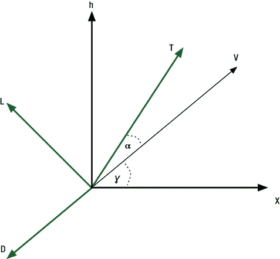

**图 11-1.** 二维航迹坐标

攻角 `α` 用于调节升力 `L` 和阻力。推力矢量 `T` 与机体 `x` 轴对齐。航迹角 `γ` 是 `x` 轴与速度矢量 `V` 之间的夹角。状态矢量 `s` 为：

![ $$ s=\left[\begin{array}{r}\hfill v\\ {}\hfill \gamma \\ {}\hfill \psi \\ {}\hfill x\\ {}\hfill y\\ {}\hfill h\end{array}\right] $$ ](A335353_1_En_11_Chapter_Equ1.gif)

(11.1) 其中 `v` 是速度大小；`γ` 是 `xz` 平面内的航迹角；`ψ` 是 `xy` 平面内的航向角；`x`、`y`、`h` 是笛卡尔坐标。`h` 是高度，即 `z` 坐标。动力学方程为：

![ $$ \left[\begin{array}{r}\hfill \dot{v}\\ {}\hfill \dot{\gamma}\\ {}\hfill \dot{\psi}\\ {}\hfill \dot{x}\\ {}\hfill \dot{y}\\ {}\hfill \dot{h}\end{array}\right]=\left[\begin{array}{l}\frac{T \cos \alpha -D}{m}-g \cos \gamma \hfill \\ {}\frac{\left(L+T \sin \alpha \right) \cos \phi - mg \cos \gamma }{mv}\hfill \\ {}\frac{\left(L+T \sin \alpha \right) \sin \phi }{mv \cos \gamma}\hfill \\ {}v \cos \gamma \cos \psi \hfill \\ {}v \cos \gamma \sin \psi \hfill \\ {}v \sin \gamma \hfill \end{array}\right] $$ ](A335353_1_En_11_Chapter_Equ2.gif)

(11.2) 其中 `g` 是重力加速度，`m` 是质量，`D` 是阻力，`L` 是升力。定义动压为：

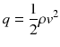

(11.3) 其中 `ρ` 是大气密度。我们简单的升力和阻力模型为：

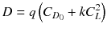

(11.4)

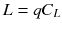

(11.5)

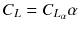

(11.6)

第一个方程称为阻力极线。`C_D0` 是零升力时的阻力。`k` 是升力-阻力耦合系数。`s` 是浸润面积。此升力模型仅适用于小攻角 `α`，因为它未考虑失速——失速是指气流从机翼分离，升力迅速降至零的情况。

实现这些方程的函数是我们的 `RHS` 函数，名为 `RHSAircraft`。请注意，当方程 11.2 中 `v = 0` 时，这些方程存在奇点。函数头提供了关于该奇点的警告。

```
%% RHSAIRCRAFT 六自由度质点飞行器模型。
%% 格式：
% d = RHSAircraft;
% [sDot, D, LStar] = RHSAircraft( t, s, d )
%% 描述
% 计算质点飞行器的右侧函数。若调用时不带任何参数，则返回默认数据结构。
% 当 v = 0 时， sDot(2) 和 sDot(3) 将为无穷大。默认的大气模型是
% AtmosphericDensity，该模型使用指数大气模型。
%
%% 输入
% t (1,1) 时间（未使用）
% s (6,1) 状态矢量 [v;gamma;psi;x;y;h]
% d (.) 数据结构
% .m (1,1) 飞行器质量
% .g (1,1) 重力加速度
% .thrust (1,1) 推力
% .alpha (1,1) 攻角
% .phi (1,1) 滚转角
% .s (1,1) 表面积
% .cD0 (1,1) 零升力阻力
% .k (1,1) 升力-阻力耦合项
% .cLAlpha (1,1) 升力系数
% .density (1,1) 指向大气密度函数的函数句柄
%
%% 输出
% sDot (6,1) 状态矢量导数 d[v;gamma;psi;x;y;h]/dt
% D (1,1) 阻力
% LStar (1,1) 升力/攻角
```

接下来是函数体。由于各项比较简单，将状态导数 `sDot` 组装成一个数组。为了提高可读性，每个元素单独一行。返回 `D` 和 `LStar` 作为辅助输出，供平衡计算使用。

```
function [sDot, D, LStar] = RHSAircraft( ~, s, d )

% 默认数据结构
if ( nargin == 0 )
    sDot = struct('m',5000, 'g', 9.806, 'thrust',0,'alpha',0, 'phi',0,...
        'cLAlpha',2*pi,'cD0',0.006,'k',0.06,'s',20,'density',...
        @AtmosphericDensity);
    return
end

% 保存为局部变量
V = s(1);
gamma = s(2);
psi = s(3);
h = s(6);

% 三角函数
cG = cos(gamma);
sG = sin(gamma);
cPsi = cos(psi);
sPsi = sin(psi);
cB = cos(d.phi);
sB = sin(d.phi);

% 指数大气模型
rho = feval(d.density,h);

% 升力和阻力
qS = 0.5*rho*d.s*v²;   % 动压
cL = d.cLAlpha*d.alpha;
cD = d.cD0 + d.k*cL²;
LStar = qS*d.cLAlpha;
L = qS*cL;
D = qS*cD;

% 速度导数
% sDot 是 d[v;gamma;psi;x;y;h]/dt
lT = L + d.thrust*sin(d.alpha);
sDot = [ (d.thrust*cos(d.alpha) - D)/d.m - d.g*sG;...
         (lT*cB - d.m*d.g*cG)/(d.m*v);...
         lT*sB/(d.m*v*cG);...
         v*cPsi*cG;...
         v*sPsi*cG;...
         v*sG];
```

更复杂的右侧函数会为阻力和升力计算传入函数句柄，从而允许用户使用自己的模型。我们为大气密度计算传入了一个函数句柄，以允许用户选择自己的密度函数。我们本可以对气动模型也采用同样的做法。这将使 `RHSAircraft` 更加灵活。

注意，我们必须编写一个大气密度模型 `AtmosphericDensity`，作为 `RHS` 函数的默认值。该模型使用指数方程计算密度，这是最简单的表示形式。该函数自带一个模型演示，绘图时使用了对数刻度。

```
%% AtmosphericDensity 基于指数模型的大气密度。
% 使用指数模型计算给定高度的大气密度。提供最高海拔 100 公里的演示图。
%% 格式：
% rho = AtmosphericDensity( h )
%
%% 输入
% h (1,:) 海拔高度 (m)
%
%% 输出
% rho (1,:) 密度 (kg/m³)

function rho = AtmosphericDensity( h )

% 演示
if ( nargin < 1 )
    h = linspace(0,100000);
    AtmosphericDensity( h );
    return
end

% 密度
rho = 1.225*exp(-2.9e-05*h.¹.15);

% 若无输出请求则绘图
if ( nargout < 1 )
    PlotSet(h,rho,'x label','h (m)','y label','Density (kg/m³)',...
        'figure title','Exponential Atmosphere',...
        'plot title','Exponential Atmosphere',...
        'plot type','y log');
    clear rho
end
```

## 11.2 使用数值搜索寻找飞行器的平衡控制量

### 问题

你希望找到使速度、航迹角和倾斜角状态（滚转角）导数为零的滚转角、推力和攻角。这就是一个平衡点。

### 解决方案

你将使用下山单纯形法，通过 `MATLAB` 函数 `fminsearch` 来寻找平衡角度。

### 工作原理

第一步是找到能够产生所需平衡状态（即设定点）的控制量。将设定点定义为向量

![$$ \left[\begin{array}{l}{v}_s\\ {}{\gamma}_s\\ {}{\psi}_s\end{array}\right] $$](A335353_1_En_11_Chapter_Equ7.gif)

(11.7) 其中包含速度 `${v}_s`、航向角 `${\psi}_s$` 和飞行路径角 `${\gamma}_s$` 的设定值。将这些值代入方程 11.2 中的前三个动力学方程，并将等号左侧设为零。

![$$ 0=\left[\begin{array}{l}T \cos \alpha -D\left({v}_s,\alpha \right)- mg \cos {\gamma}_s\\ {}\left(L\left({v}_s,\alpha \right)+T \sin \alpha \right) \cos \phi - mg \cos {\gamma}_s\\ {}\left(L\left({v}_s,\alpha \right)+T \sin \alpha \right) \sin \phi \end{array}\right] $$](A335353_1_En_11_Chapter_Equ8.gif)

(11.8)

控制量为攻角 `$\alpha$`、滚转角 `$\phi$` 和推力 `$T$`。由于三个方程对应三个未知数，因此可以得到唯一解。求解平衡控制量最简单的方法是使用 `fminsearch`。该程序会找到能使三个方程归零的三个控制量。

函数 `EquilibriumControl.m` 在循环中使用 `fminsearch` 来处理多个状态。在循环内部，你需要计算控制量的初始猜测值。推力需要平衡阻力，因此你在零攻角下进行计算。升力必须平衡重力，因此你根据这一关系计算攻角。如果没有合理的初始猜测值，算法可能无法收敛，或者收敛到局部最小值。代价函数嵌套在控制函数内部。

```
function [u, c] = EquilibriumControl( x, d, tol )
n = size(x,2);
u = zeros(3,n);
c = zeros(1,n);
p = optimset('TolFun',tol);
% additional options during testing:
% 'PlotFcns',{@optimplotfval,@PlotIteration},'Display','iter','MaxIter',50);
for k = 1:n
[˜,D,LStar] = RHSAircraft(0,x(:,k),d);
alpha = d.m*d.g/LStar;
u0 = [D;alpha;0];
[umin,cval,exitflag,output] = fminsearch( @Cost, u0, p, x(:,k), d );
u(:,k) = umin;
c(k) = Cost( u(:,k), x(:,k), d );
end
```

默认输出是绘制结果。

```
% Plot if no outputs are specified
if ( nargout == 0 )
yL = {'T (N)', '\alpha (rad)', '\phi (rad)' 'Cost'};
s = 'Equilibrium Control:Controls';
PlotSet(1:n,[u;c],'x label','set','y label',yL, ...
'plot title',s, 'figure title',s);
yL = {'v' '\gamma' '\psi' 'h'};
s = 'Equilibrium Control:States';
PlotSet(1:n,x([1:3 6],:),'x label','set','y label',yL, ...
'plot title',s,'figure title',s);
clear u
end
```

接下来展示代价函数。使用一个二次代价函数，即状态导数平方的无权重和。

```
%% Find the cost of a given control
function c = Cost( u, x, d )
d.thrust = u(1);
d.alpha = u(2);
d.phi = u(3);
xDot = RHSAircraft(0,x,d);
y = xDot(1:3);
c = sqrt(y'*y);
```

该函数内置了一个演示，考察在恒定速度下，从 0 到 10 km 高度递增时的推力和攻角变化。

```
if( nargin < 1 )
x = [200*ones(1,101);...
zeros(4,101);...
linspace(0,10000,101)];
d = RHSAircraft;
EquilibriumControl( x, d )
return;
end
```

图 11-2 显示了在默认演示中计算控制量所对应的状态。图 11-3 显示了最终得到的控制量。正如预期，攻角随高度增加而增大，但推力却随高度增加而减小。空气密度降低会减小阻力和升力，因此你需要减小推力，同时增大攻角以产生更多升力。滚转角几乎为零。

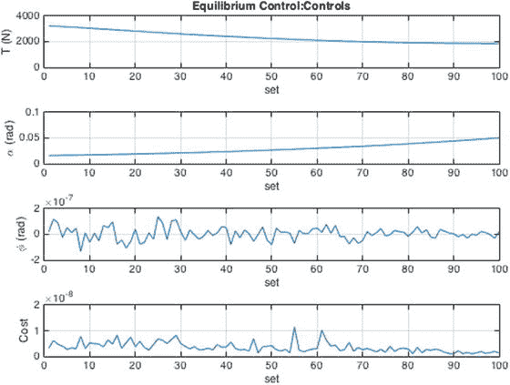

`图 11-3.` 演示中的控制量。推力随高度增加而减小，攻角随高度增加而增大

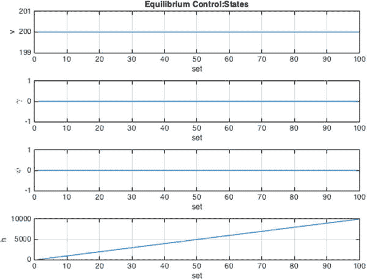

`图 11-2.` 演示中的状态。仅有高度（`h`）在变化

图 11-3 还绘制了代价函数。如果函数按预期工作，代价应几乎为零。

在调试过程中，编写需要优化的函数时，对数值搜索过程有更多了解可能会很有帮助。虽然你只需要 `umin`，但在此函数调用的版本中，可以考虑 `fminsearch` 提供的其他输出。

```
[umin,cval,exitflag,output] = fminsearch( @Cost, u0, p, x(:,k), d )
```

输出结构中包含迭代次数，而退出标志指示函数的退出条件：是否达到容差（1）、是否超过最大允许迭代次数（0），或者用户提供的输出函数是否终止了搜索（-1）。我们在脚本中设置断点来检查这些输出。对于 `k = 4` 时 `v = 200` 且 `h = 300` 的状态，输出为：

因此你可以看到，搜索需要 141 次迭代，并且推力从我们初始猜测的 2880 N 增加到 3180 N。最终代价为 `3e^(-9)`。

获取更多信息的另一种方法是将 `fminsearch` 的 `Display` 选项设置为 `iter` 或 `final`，默认值为 `notify`。在这种情况下，选项如下所示：

```matlab
p = optimset('TolFun',tol,'Display','iter');
```

并且以下类型的输出会打印到命令窗口中：

```
>> d = RHSAircraft;
>> x = [200;0;0.5;0;0;5000];
>> EquilibriumControl( x, d )
Iteration Func-count min f(x) Procedure
0 1 0.0991747
1 4 0.0817065 initial simplex
2 6 0.0630496 expand
3 7 0.0630496 reflect
4 9 0.0133862 expand
5 10 0.0133862 reflect
6 11 0.0133862 reflect
7 13 0.0133862 contract outside
8 15 0.0133862 contract inside
...
49 87 2.1869e-05 contract inside
50 89 2.1869e-05 contract outside
Exiting: Maximum number of iterations has been exceeded
- increase MaxIter option.
Current function value: 0.000022
```

为了更深入了解，你可以添加一个在每次迭代时调用的绘图函数。MATLAB 提供了一些默认的绘图函数；例如，`optimplotfval` 会在每次迭代时绘制代价函数值。你实际上需要在编辑器中打开 `optimplotfval` 才能了解所需的语法。我们像这样将函数添加到优化选项中：

```matlab
p = optimset('TolFun',tol,'PlotFcns',@optimplotfval);
```

图 11-4 是根据演示的第一次迭代生成的。

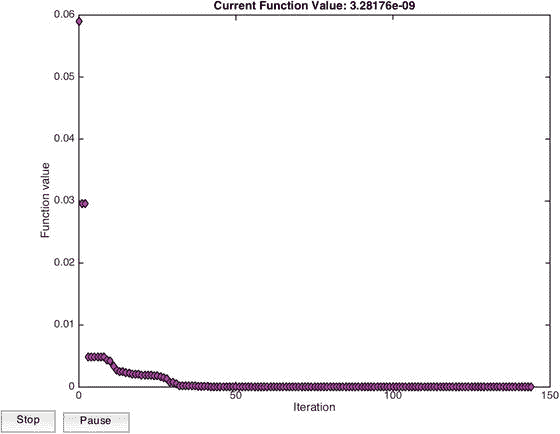

图 11-4. 使用 `optimplotfval` 绘制的函数值图

你可以看到，在此图中，代价函数值在最后 100 次迭代中几乎保持不变。你可以使用 `PlotFcns` 的元胞数组添加更多绘图，MATLAB 会自动为每个绘图分配其自己的子图坐标轴。对于棘手的数值问题，你可能希望生成一个曲面并追踪优化的迭代过程。对于我们的问题，我们添加了自定义绘图函数 `PlotIteration`，结果如图 11-5 所示。

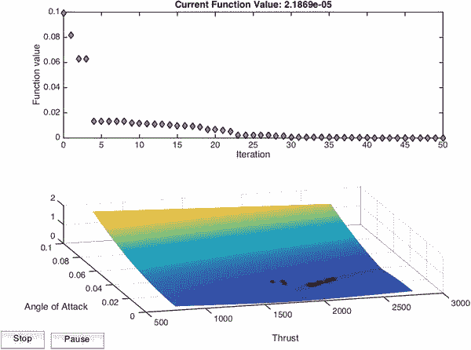

图 11-5. 使用曲面的自定义优化绘图函数

```matlab
p = optimset('TolFun',tol,'PlotFcns',{@optimplotfval,@PlotIteration});
```

我们编写了两个函数：一个用于生成曲面，另一个用于绘制迭代步骤。MATLAB 在初始化时将迭代值设为零，因此在这种情况下，你需要根据给定的初始状态生成曲面。对于所有其他迭代值，你在曲面上用星号绘制代价函数值。

```matlab
% Plot an iteration of the numerical search
function stop = PlotIteration (u0,optimValues,state,varargin)
stop = false;
x0 = varargin{1};
d = varargin{2};
switch state
case 'iter'
if optimValues.iteration == 0
a = PlotSurf( x0, u0, d );
end
plot3 (u0(1),u0(2),optimValues.fval,'k*');
end

% Plot a surface using the given initial state for a range of controls.
% MATLAB will already have an empty axis available for plotting.
function a = PlotSurf( x0, u0, d )
u1 = linspace( max(u0(1)-1000,0),u0(1)+1000);
u2 = linspace(0, max(2*u0(2),0.1));
u3 = u0(3);
cvals = zeros(100,100);
for m = 1:100
for l = 1:100
cvals(l,m) = Cost( [u1(m);u2(l);u3], x0, d );
end
end
s = surf(u1,u2,cvals);
set(s,'edgecolor','none');
a = gca;
set(a,'Tag','equilibriumcontrol');
hold on;
xlabel('Thrust')
ylabel('Angle of Attack')
```

最后，请注意，要查看 MATLAB 用于 `fminsearch` 的默认选项集，请使用优化函数的名称调用 `optimset`。

```matlab
>> options = optimset('fminsearch')
options =
Display: 'notify'
MaxFunEvals: '200*numberofvariables'
MaxIter: '200*numberofvariables'
TolFun: 0.0001
TolX: 0.0001
FunValCheck: 'off'
OutputFcn: []
PlotFcns: []
```

你可以看到，默认容差相等，均为 0.0001，而函数评估次数和迭代次数取决于输入状态 `x` 中的变量数量。

# 11.3 为飞行器设计控制系统

## 问题

你需要为一架飞行器设计一个控制系统，使其能够控制飞行轨迹并实现三维运动。

## 解决方案

你将采用动态被控对象逆推法前馈飞行器的期望控制量。使用比例控制器分别控制推力、迎角和滚转角，以修正标称控制量从而抵消阵风等扰动的影响。*不*对航向角 `ψ` 采用滚转角反馈控制，此部分留作练习。

## 工作原理

回顾配方 11-1 中的动力学模型，飞行器的状态为：

![ $$ \left[\begin{array}{cccccc}\hfill v\hfill & \hfill \gamma \hfill & \hfill \psi \hfill & \hfill x\hfill & \hfill y\hfill & \hfill h\hfill \end{array}\right] $$ ](A335353_1_En_11_Chapter_Equ9.gif)

(11.9) 其中 `v` 为速度，`γ` 为航迹角，`ψ` 为航向角，`x` 和 `y` 为飞行平面内的坐标，`h` 为高度。控制变量为滚转角 `φ`、迎角 `α` 和推力 `T`。

控制器形式如下：

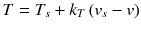

(11.10)

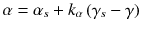

(11.11)

若状态处于 `s`，则控制量应取对应平衡点处的控制值 `T[s]`、`α[s]`、`φ[s]`。增益 `k[T]` 和 `k[a]` 用于将状态推向正确方向，其值取决于飞行工况。你需要展开公式 11.2 中的前两个动力学方程。

![ $$ \left[\begin{array}{c}\hfill \dot{v}\hfill \\ {}\hfill \dot{\gamma}\hfill \end{array}\right]=\left[\begin{array}{c}\hfill \frac{T \cos \alpha -q\left({C}_{D_0}+k{\left({C}_{L_{\alpha }}\alpha \right)}²\right)}{m}-g \cos \gamma \hfill \\ {}\hfill \frac{\left(q{C}_{L_{\alpha }}\alpha +T \sin \alpha \right) \cos \phi - mg \cos \gamma }{mv}\hfill \end{array}\right] $$ ](A335353_1_En_11_Chapter_Equ12.gif)

(11.12)

对方程进行线性化处理，并省略与控制量无关的项。

![ $$ \left[\begin{array}{c}\hfill \dot{v}\hfill \\ {}\hfill \dot{\gamma}\hfill \end{array}\right]=\left[\begin{array}{c}\hfill \frac{T}{m}\hfill \\ {}\hfill \frac{q \cos \phi {C}_{L_{\alpha }}\alpha }{mv}\hfill \end{array}\right] $$ ](A335353_1_En_11_Chapter_Equ13.gif)

(11.13)

你希望引入时间常数 `τ[γ]` 和 `τ[v]`，使方程变为：

![ $$ \left[\begin{array}{c}\hfill \dot{v}\hfill \\ {}\hfill \dot{\gamma}\hfill \end{array}\right]=\left[\begin{array}{c}\hfill -\frac{v}{\tau_v}\hfill \\ {}\hfill -\frac{\gamma }{\tau_{\gamma }}\hfill \end{array}\right] $$ ](A335353_1_En_11_Chapter_Equ14.gif)

(11.14)

因此：

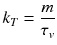

(11.15)

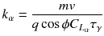

(11.16)

控制系统在函数 `AircraftControl` 中实现。

```
function [T, alpha] = AircraftControl( s, d, tauGamma, tauV, vSet, gammaSet )
u = EquilibriumControl( s, d );
v = s(1);
gamma = s(2);
h = s(6);
rho = feval( d.density, h );
qS = 0.5 * d.s * rho * vˆ2;
kV = d.m / tauV;
kGamma = ( d.m * v ) / ( qS * cos( d.phi ) * d.cLAlpha * tauGamma );
T = u(1) + kV * ( vSet - v );
alpha = u(2) + kGamma * ( gammaSet - gamma );
```

该控制系统的性能在仿真配方(11-5)中展示。该函数需要获取飞行工况信息，包含大气密度。它首先通过 `EquilibriumControl` 计算出当前状态 `s` 所需的控制量。飞行器数据结构也是必需的输入。额外输入还包括控制器的时间常数和设定值。在函数内部，通过 `feval` 和输入函数句柄来计算大气密度。该计算应与 `RHSAircraft` 中的计算方式保持一致。

# 11.4 绘制飞行器三维轨迹

## 问题

你需要用三维方式绘制飞行器的轨迹，并沿轨迹显示飞行器坐标轴和时间信息。

## 解决方案

你将使用 MATLAB 的 `plot3` 函数，并结合自定义代码在轨迹的选定点绘制飞行器坐标轴和时间标记。最终生成的图形如图 11-6 所示。

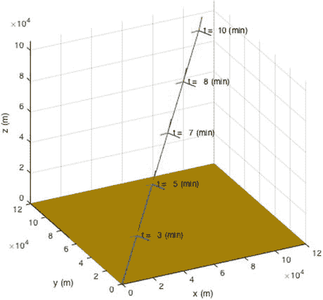

图 11-6. 飞行器轨迹函数演示

### 工作原理

使用 `plot3` 绘制 3D 显示。`Plot3DTrajectory.m` 函数允许通过 `varargin` 输入参数对。

```matlab
%% PLOT3DTRAJECTORY 在三维空间中绘制飞行器的轨迹。
%% 格式：
% Plot3DTrajectory( x, varargin )
%% 描述
% 绘制带有时间标签和局部坐标轴的飞行器三维轨迹。
% 
%% 输入参数
% x (6,:) 状态向量 [v;gamma;phi;x;y;h]
% varargin {:} 参数
% 
```

此处暂不展示演示代码，先给出绘图代码。这部分代码与 2D 绘图函数 `PlotSet` 有相似之处。我们使用 `text` 插入时间标签，并使用图形对象绘出地面。

```matlab
% 绘制图形
h = figure;
set(h,'Name',figTitle);
plot3(x(4,:),x(5,:),x(6,:));
xlabel(xLabel);
ylabel(yLabel);
zlabel(zLabel);

% 绘制时间与坐标轴
if( ~isempty(t) && ~isempty(tIndex) )
  [t,~,tL] = TimeLabel(t);
  for k = 1:length(t)
    s = sprintf('t = %3.0f (%s)',t(k), tL);
    i = tIndex(k);
    text(x(4,i),x(5,i),x(6,i),s);
    DrawAxes(x(:,i),alpha(1,i),phi(1,i));
  end
end

% 添加地面
xL = get(gca,'xlim');
yL = get(gca,'ylim');
v = [xL(1) yL(1) 0;...
     xL(2) yL(1) 0;...
     xL(2) yL(2) 0;...
     xL(1) yL(2) 0];
patch('vertices',v,'faces',[1 2 3 4],'facecolor',[0.65 0.5 0.0],'edgecolor',[0.65 0.5 0.0]);
grid on
rotate3d on
axis image
zL = get(gca,'zlim');
set(gca,'zlim',[0 zL(2)],'ZLimMode','manual');
```

绘图命令很直观。如果输入了时间数组，该函数会使用 `sprintf` 和 `text` 沿轨迹绘制时间标签。我们通过 `TimeLabel` 获取合理的单位。此外，它还会使用嵌套函数 `DrawAxes` 绘制飞行器的坐标轴。

```matlab
%%% Plot3DTrajectory>DrawAxes 子函数
%% DrawAxes
function DrawAxes( x, alpha, phi )
gamma = x(2);
psi = x(3);

% 飞行器坐标系：x 轴向前，y 轴指向右翼，z 轴向下
u0 = [1 0 0;0 1 0;0 0 -1];

cG = cos(gamma+alpha);
sG = sin(gamma+alpha);
cP = cos(psi);
sP = sin(psi);
cR = cos(phi);
sR = sin(phi);

u = [cP -sP 0;sP cP 0; 0 0 1]...
  *[cG 0 -sG; 0 1 0;sG 0 cG]...
  *[1 0 0;0 cR sR; 0 -sR cR]*u0;

% 计算坐标轴缩放长度
xL = get(gca,'xlim');
yL = get(gca,'ylim');
zL = get(gca,'zlim');
l = sqrt((xL(2)-xL(1))² + (yL(2)-yL(1))² + (zL(2)-zL(1))²)/20;
x0 = x(4:6);
for k = 1:3
  x1 = x0 + u(:,k)*l;
  c = [0 0 0];
  c(k) = 1;
  line([x0(1);x1(1)],[x0(2);x1(2)],[x0(3);x1(3)],'color',c);
end
```

该函数绘制了飞行器的坐标系：x 轴指向机头，y 轴指向右翼，z 轴向下。它使用状态向量，因此需要将 `γ` 和 `ψ` 转换为旋转矩阵。该坐标系基于风轴系。

函数通过参数对让用户自定义绘图。参数对在此处处理：

```matlab
xLabel = 'x (m)';
yLabel = 'y (m)';
zLabel = 'z (m)';
figTitle = 'Trajectory';
t = [];
tIndex = [];
alpha = 0.02*ones(1,size(x,2));
phi = 0.25*pi*ones(1,size(x,2));
for k = 1:2:length(varargin)
  switch lower(varargin{k})
    case 'x label'
      xLabel = varargin{k+1};
    case 'y label'
      yLabel = varargin{k+1};
    case 'z label'
      zLabel = varargin{k+1};
    case 'figure title'
      figTitle = varargin{k+1};
    case 'time'
      t = varargin{k+1};
    case 'time index'
      tIndex = varargin{k+1};
    case 'alpha'
      alpha = varargin{k+1};
    case 'phi'
      phi = varargin{k+1};
    otherwise
      error('%s 不是有效的参数',varargin{k});
  end
end
```

我们在 `switch` 语句中使用 `lower` 函数，以便用户输入大写字母时无需担心大小写问题。大部分参数都很直观。时间输入有多种实现方式，我们选择允许用户为时间标签指定具体时间。同时，用户需要输入状态向量对应的索引。

该函数包含一个演示。输入 `Plot3DTrajectory` 即可生成图 11-6 所示的示例轨迹。对于图形函数而言，演示能直观展示图形效果，并提供函数使用示例。

```matlab
% 演示
if( nargin < 1 )
  l = linspace(0,1e5);
  x = [200*ones(1,100);...
       (pi/4)*ones(1,100);...
       (pi/4)*ones(1,100);l;l;l];
  t = [200 300 400 500 600];
  k = [20 40 60 80 100];
  Plot3DTrajectory( x, 'time', t, 'time index', k, 'alpha',0.01*ones(1,100) )
  return;
end
```

## 11.5 模拟受控飞行器

### 问题

你希望模拟飞行器在轨迹控制下的运动。

### 解决方案

创建一个包含控制系统和飞行动力学的脚本。动力学使用 `RungeKutta` 方法进行传播。这是一个四阶方法，意味着截断误差与时间步长的四次方成正比。考虑到飞行控制系统典型的采样时间，四阶精度足以满足飞行仿真需求。我们将使用上一节描述的 3D 绘图函数 `Plot3DTrajectory` 来显示结果。

### 工作原理

仿真脚本 `AircraftSim.m` 读取 `RHSAircraft` 的数据结构，并修改参数以匹配 F-35 战斗机。该模型仅涉及推力和阻力，且即使这两部分也采用了非常简单的模型。初始飞行路径角和速度已设定。我们开启控制功能，并为速度和飞行路径角状态设定设定值和时间常数。输出方面，我们绘制状态图、控制图以及三维轨迹图。

```matlab
%% 某 F-35 飞行器的轨迹控制仿真
% 模拟一个质点飞行器的动力学特性。
%% 另请参阅
% RungeKutta, RHSAircraft, PDControl, EquilibriumControl
```

脚本从 `RHS` 函数获取默认数据结构开始。

```matlab
%% 用于右侧函数的数据结构
d = RHSAircraft;

%% 用户初始化
d.m = 13300.00; % 千克
d.s = 204.00; % 平方米
v = 200; % 米/秒
fPA = pi/6; % 弧度
% 初始化持续时间和时间步长
tEnd = 40;
dT = 0.1;

% 控制器
controlIsOn = true;
tauV = 1;
tauGamma = 1;
d.phi = 0;
vSet = 220;
gammaSet = pi/8;

%% 仿真
% 状态向量
x = [v;fPA;0;0;0;0];
% 绘图设置与步数
n = ceil(tEnd/dT);
xP = zeros(length(x)+2,n);
% 寻找非反馈设定值
[~,D,LStar] = RHSAircraft(0,x,d);
thrust0 = D;
alpha0 = d.m*d.g/LStar;

% 运行仿真
for k = 1:n
    if ( controlIsOn )
        [d.thrust, d.alpha] = AircraftControl( x, d, tauGamma, tauV, vSet, gammaSet );
    else
        d.thrust = thrust0;
        d.alpha = alpha0;
    end
    % 绘图存储
    xP(:,k) = [x;d.thrust;d.alpha];
    % 右侧函数
    x = RungeKutta(@RHSAircraft,0,x,dT,d);
end

%% 绘图
[t,tL] = TimeLabel((0:(n-1))*dT);
yL = {'T (N)', '\alpha (rad)'};
s = '飞行器仿真：控制量';
PlotSet(t,xP(7:8,:),'x label',tL,'y label',yL,'plot title',s, 'figure title',s);
yL = {'v' '\gamma' '\psi' 'x' 'y' 'h'};
s = '飞行器仿真：状态量';
PlotSet(t,xP(1:6,:),'x label',tL,'y label',yL,'plot title',s,'figure title',s);
k = floor(linspace(2,n,8));
t = t(k);
Plot3DTrajectory( xP, 'time', t, 'time index', k, 'alpha', xP(8,:) );
```

如果关闭控制，则将推力和攻角设置为常数值，以平衡阻力和重力。速度和飞行路径角的设定值与初始条件略有不同。这使你能够展示控制器的瞬态响应。

图 11-7 显示了各状态量。速度和飞行路径角收敛至其设定值。

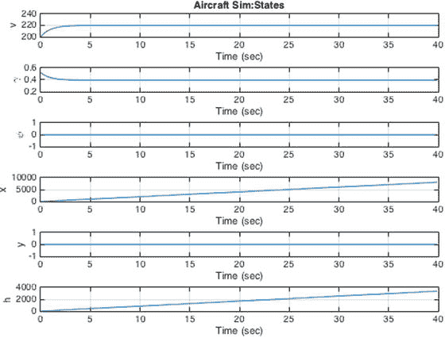

图 11-7. 速度和飞行路径角收敛至期望值

图 11-8 显示了控制量。控制量达到其稳态值。随着飞机爬升，推力和攻角发生变化。推力下降是因为阻力下降，而攻角增加是为了维持升力与重力的平衡。

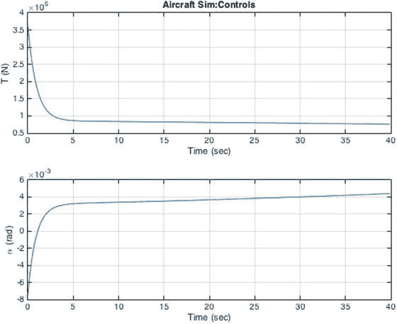

图 11-8. 控制量收敛至稳态值，随后缓慢变化以适应飞机爬升时大气密度的降低

三维轨迹如图 11-9 所示。如预期，它以近乎恒定的角度和速度爬升。

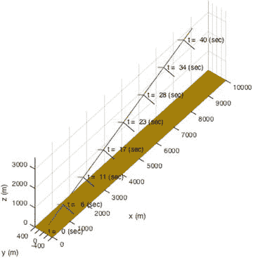

图 11-9. 轨迹图

### 总结

本章演示了如何编写质点飞行器的动力学模型。你学习到了如何使用搜索算法寻找平衡控制状态。这包括利用 MATLAB 为其优化算法提供的调试输出，并为每次搜索迭代添加自定义绘图。你学习到了如何设计一个控制系统来维持期望的速度、倾斜角和飞行路径角。你学习到了如何制作带有文本注释和其他绘图对象的三维图。你还学习到了如何将函数句柄传递给其他函数，以使函数更具通用性。表 11-1 列出了本章开发的代码。

**表 11-1.** 本章代码清单

| 文件 | 说明 |
| --- | --- |
| `RHSAircraft` | 质点飞行器的六自由度右侧函数。 |
| `AtmosphericDensity` | 基于指数模型的大气密度随高度变化函数。 |
| `EquilibriumControl` | 寻找质点飞行器的平衡控制。 |
| `AircraftControl` | 计算三维质点飞行器的攻角和推力。 |
| `Plot3DTrajectory` | 绘制带时间点和局部坐标轴的飞行器三维轨迹。 |
| `AircraftSim` | 飞行器轨迹控制仿真。 |


