# 12. 航天器

电子补充材料：本章在线版本（doi: [10.1007/978-1-4842-0559-4_12](http://dx.doi.org/10.1007/978-1-4842-0559-4_12)）包含补充材料，仅供授权用户使用。

航天器指向控制是所有机器人及载人航天器的一项关键技术。控制系统由传感、执行以及航天器本身的动力学组成。航天器控制系统种类繁多，但本章仅涉及三轴指向问题。采用反作用轮作为执行机构。

反作用轮通过角动量守恒原理来实现控制。作用在反作用轮上的力矩使其向一个方向旋转，而航天器则向相反方向旋转。从航天器移除的动量被轮子吸收。反作用轮被归类为动量交换装置。你可以仅使用轮子而无需任何外部力矩来重新定向航天器。在反作用轮问世之前，常使用推进器进行姿态控制。这会消耗推进剂，这是不可取的，因为一旦推进剂耗尽，航天器将无法继续使用。

除绕正交（垂直）轴旋转的三个反作用轮外，航天器被建模为刚体。连接在轮子转子上的电机轴与航天器相连。施加在轮子与航天器之间的扭矩会导致轮子和航天器向相反的角度方向运动。我们假设拥有用于测量航天器姿态的姿态传感器。我们还假设轮子是理想的，只存在粘性阻尼摩擦。

## 12.1 创建航天器动力学模型

### 问题

航天器是一个带有三个轮子的刚体。每个轮子都与航天器相连，如图 12-1 所示。

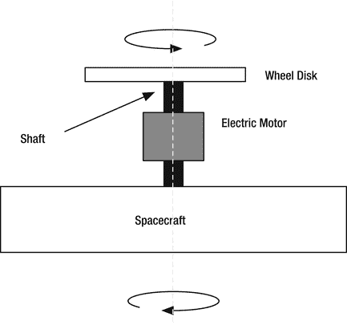

图 12-1. 反作用轮。反作用轮盘向一个方向旋转，航天器则向相反方向旋转

### 解决方案

运动方程利用角动量守恒原理写出。这产生了一个动力学模型，即在标准欧拉方程的基础上增加了旋转轮子的效应。这有时被称为陀螺体模型。

### 工作原理

航天器模型可分为动力学部分（包括反作用轮的动力学）和运动学部分。若假设飞轮完全对称、与三轴对齐且具有对角线惯性矩阵，则可通过以下耦合一阶微分方程对航天器动力学建模。

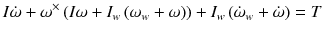

(12.1)


(12.2)

`I` 是 3 × 3 惯性矩阵，不包含飞轮的惯性。

![ $$ I=\left[\begin{array}{lll}{I}_{xx}\hfill & {I}_{xy}\hfill & {I}_{xz}\hfill \\ {}{I}_{yx}\hfill & {I}_{yy}\hfill & {I}_{yz}\hfill \\ {}{I}_{zx}\hfill & {I}_{zy}\hfill & {I}_{zz}\hfill \end{array}\right] $$ ](A335353_1_En_12_Chapter_Equ3.gif)

(12.3)

该矩阵是对称的，因此 `I_xy = I_yx`，`I_xz = I_zx`，`I_zy = I_yz`。`ω` 是在航天器坐标系中观测到的航天器角速度矢量。

![ $$ \omega =\left[\begin{array}{l}{\omega}_x\hfill \\ {}{\omega}_y\hfill \\ {}{\omega}_z\hfill \end{array}\right] $$ ](A335353_1_En_12_Chapter_Equ4.gif)

(12.4) `ω_w` 是飞轮 1、2、3 的角速度。

![ $$ {\omega}_w=\left[\begin{array}{l}{\omega}_1\hfill \\ {}{\omega}_2\hfill \\ {}{\omega}_3\hfill \end{array}\right] $$ ](A335353_1_En_12_Chapter_Equ5.gif)

(12.5)

1 与 x 轴对齐，2 与 y 轴对齐，3 与 z 轴对齐。这样，反作用轮组成了一个正交系统，可用于三轴控制。`T` 是作用在航天器上的外部力矩，可包括太阳光压、空气阻力等外部扰动，以及推力器或磁力矩器线圈的力矩。`T_w` 是作用在飞轮上的内部力矩。`I_w` 是飞轮的标量惯性（假设所有飞轮具有相同的惯性）。可将第二个方程代入第一个方程以简化表达式。

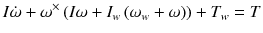

(12.6)

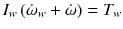

(12.7)

此项

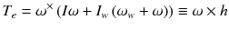

(12.8) 称为欧拉力矩。若角速率较小，可将此项设为零，方程简化为

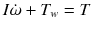

(12.9)


(12.10)

对于运动学部分，我们使用四元数。四元数是用四个参数描述航天器相对于惯性坐标系姿态的方式。虽然理论上用角度表达即可，因为仅需三个状态变量即可描述姿态。但角度存在奇异性问题——即在某些特定姿态下某个角度无法定义，因此不适合用于仿真。从惯性系到本体系的四元数导数为

![ $$ \dot{q}=\frac{1}{2}\left[\begin{array}{rr}\hfill 0& \hfill {\omega}^T\\ {}\hfill -\omega & \hfill {\omega}^{\times}\end{array}\right] $$ ](A335353_1_En_12_Chapter_Equ11.gif)

(12.11)

`ω^×` 表示斜对称矩阵，等效于叉积运算，其形式为

![ $$ {\omega}^{\times }=\left[\begin{array}{rrr}\hfill 0& \hfill -{\omega}_z& \hfill {\omega}_y\\ {}\hfill {\omega}_z& \hfill 0& \hfill -{\omega}_x\\ {}\hfill -{\omega}_y& \hfill {\omega}_x& \hfill 0\end{array}\right] $$ ](A335353_1_En_12_Chapter_Equ12.gif)

(12.12)

飞轮力矩由摩擦力矩和控制力矩组成。反作用轮通常由直流电机驱动，电机电子器件通过电流反馈抵消反电动势。因此，总的反作用轮力矩为

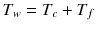

(12.13) 其中 `T_c` 是指令的反作用轮力矩，`T_f` 是摩擦力矩。一个简单的摩擦模型为

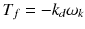

(12.14) `k_d` 是阻尼系数，`ω_k` 是第 k 个飞轮的角速度。若 `k_d` 较大，可能需将其前馈至控制器。这需要对飞轮进行仔细标定以确定阻尼系数。

首先，定义动力学右端函数无输入时返回的数据结构。该函数名为 `RHSSpacecraftWithRWA.m`。`RWA` 代表反作用轮组件。之所以称为“组件”，是因为反作用轮由轴承、轮体、转轴、支撑结构以及电力电子器件装配而成。航天器正是由各类组件构成的。

飞轮的默认单位矢量沿正交轴线（如 x、y、z 轴）。默认惯性矩阵为单位矩阵，使航天器等效为球体。默认的反作用轮惯量为 0.001。所有飞轮的非旋转部件均被归并至惯性矩阵中。

## 初始数据结构

```
% Default data structure
if ( nargin == 0 )
  xDot = struct('inr', eye (3), 'torque',[0;0;0],'inrRWA', 0.001*[1;1;1],...
    'torqueRWA',[0;0;0],'uRWA', eye (3), 'damping',[0;0;0]);
  return
end
```

## 动力学方程与变量处理

航天器的动力学方程在以下代码行中给出。需要计算总飞轮力矩，因为它同时作用于航天器和飞轮。我们使用反斜杠运算符 `\` 将方程乘以惯性矩阵的逆。惯性矩阵是正定对称矩阵，因此可使用特定例程加速计算。最好避免直接计算逆矩阵，因为可能存在病态问题——即矩阵中的微小误差可能导致逆矩阵的较大误差。

将状态向量元素保存为具有明确意义的局部变量，以便于代码阅读。这也可避免不必要的子矩阵重复提取。

你会注意到，`omegaRWA` 变量使用 `end` 关键字从向量的第 8 个元素读取至末尾。这使代码能处理任意数量的反作用轮。你可能只需要用一个轮子控制单轴，或者使用超过三个轮子以增加冗余。请确保 `d` 中的输入与轮子数量匹配。同时，由于我们输入了单位矢量，轮子不必与 x、y、z 轴对齐。注意使用反斜杠运算符求解 `omegaDotCore` 的线性方程组。

```
% Save as local variables
q = x(1:4);
omega = x(5:7);
omegaRWA = x(8:end);

% Total body fixed angular momentum
h = d.inr*omega + d.uRWA*(d.inrRWA.*(omegaRWA + d.uRWA'*omega));

% Total wheel torque
tRWA = d.torqueRWA - d.damping.*omegaRWA;

% Core angular acceleration
omegaDotCore = d.inr\(d.torque - d.uRWA*tRWA - Cross(omega,h));
```

请注意，`uRWA` 是反作用轮单位矢量（即自旋矢量）的数组。在计算 `h` 时，需使用 `uRWA` 的转置将 `omega` 变换至轮坐标系，然后变换回本体坐标系，再将轮系分量添加到核心分量 `inr*omega` 中。飞轮动力学由以下代码行给出。

```
% Wheel angular acceleration
omegaDotWheel = tRWA./d.inrRWA - d.uRWA'*omegaDotCore;
```

## 总状态导数与输出

总状态导数由以下代码行表示：

```
% State derivative
sW = [ 0 -omega(3) omega(2);...
       omega(3) 0 -omega(1);...
      -omega(2) omega(1) 0]; % skew symmetric matrix
qD = 0.5*[0, omega';-omega,-sW];
xDot = [qD*q;omegaDotCore;omegaDotWheel];
```

总惯性角动量是辅助输出。在没有外力矩的情况下，该值应守恒，因此它是检验动力学的良好指标。检验角动量守恒的一个简单方法是：用所有状态的角速率运行一次仿真，然后用更小的时间步长重新运行。角动量的变化应随着时间步长的减小而减小。

```
% Output the inertial angular momentum
if ( nargout > 1 )
  hECI = QTForm( q, h );
end
```

# 12.2 从四元数计算角度误差

## 问题描述
你需要利用三个反作用轮将航天器指向新的目标姿态（指向），或在外力矩作用于航天器时维持当前姿态。

## 解决方案
构建三个 PD 控制器，每轴各一个。你需要一个函数，用于接收两个四元数并计算它们之间的小角度偏差，作为这些控制器的输入。

## 工作原理
若你正指向一个惯性目标并希望围绕该姿态进行控制，可通过将 `ω` 近似为 `θ̇` 来简化速率方程。该近似在小角度情况下有效，此时旋转顺序无关紧要，欧拉角可被视为一个矢量。

```
θ̇ = ω
```
(12.15)

此外，你还需将欧拉方程（见方程 12.9）两边乘以 `I⁻¹`，以求解导数。注意，来自飞轮的扭矩 `T[w]` 等效于 `I * a[w]`，其中 `a` 是加速度。于是系统方程变为：

```
θ̈ + a_w = a
```
(12.16)

```
I_w(ω̇_w + ω̇) = -T_w
```
(12.17)

第一个方程现在变为三个解耦的二阶方程，这与第 6 章的情况相同。你可以通过标准的 PD 控制器来稳定该系统。

你需要姿态角作为 PD 控制器的输入，以计算控制扭矩。本示例仅针对标称姿态下的小角度位移。你可以向控制代码传递一个目标四元数，它会自动计算 `Δ` 角度；或者你也可以施加一个小的扰动力矩。

在这些情况下，姿态可被视为一个矢量，旋转顺序无关紧要。由小角度推导出的四元数为：

```
q_Δ ≈ [1; θ₁/2; θ₂/2; θ₃/2]
```
(12.18)

你需要通过将目标四元数 `q[T]` 与当前四元数的转置相乘，来求得所需的误差四元数 `q[Δ]`：

```
q_Δ = q^T * q_T
```
(12.19)

计算该角度的算法由以下代码实现。四元数乘法被封装为一个子函数，这使得代码更清晰，也更易看出其与算法的对应关系。`QMult` 函数被设计为可一次性处理多个四元数，因此易于向量化。`QPose` 用于求四元数的转置。通常这两个函数应作为独立的函数存在，但本章中它们仅与误差计算代码相关，因此放在了同一个文件中。

```
function deltaAngle = ErrorFromQuaternion( q, qTarget )
    deltaQ = QMult( QPose(q), qTarget );
    deltaAngle = -2.0*deltaQ(2:4);
end

%% 两个四元数相乘。
% Q2 将坐标系从 A 变换到 B，Q1 将坐标系从 B 变换到 C，
% 因此 Q3 将坐标系从 A 变换到 C。
function Q3 = QMult( Q2,Q1 )
    Q3 = [Q1(1,:).*Q2(1,:) - Q1(2,:).*Q2(2,:) - Q1(3,:).*Q2(3,:) - Q1(4,:).*Q2(4,:);...
          Q1(2,:).*Q2(1,:) + Q1(1,:).*Q2(2,:) - Q1(4,:).*Q2(3,:) + Q1(3,:).*Q2(4,:);...
          Q1(3,:).*Q2(1,:) + Q1(4,:).*Q2(2,:) + Q1(1,:).*Q2(3,:) - Q1(2,:).*Q2(4,:);...
          Q1(4,:).*Q2(1,:) - Q1(3,:).*Q2(2,:) + Q1(2,:).*Q2(3,:) + Q1(1,:).*Q2(4,:)];
end

%% 四元数的转置
% 转置需要改变角度项的符号。
function q = QPose(q)
    q(2:4,:) = -q(2:4,:);
end
```

控制系统通过以下代码在仿真循环中实现。

```
% 计算角度误差
angleError = ErrorFromQuaternion( x(1:4), qTarget );

if (controlIsOn)
    u = [0;0;0];
    for j = 1:3
        [u(j), dC(j)] = PDControl('update', angleError(j), dC(j));
    end
else
    u = [0;0;0];
end
```

# 12.3 模拟受控航天器

## 问题描述

你想测试姿态控制器并观察其性能表现。

## 解决方案

解决方案是构建一个 MATLAB 脚本，在脚本中设计 PD 控制器的矩阵，然后在循环中模拟该控制器，施加计算出的扭矩，直至达到期望的四元数或抵消扰动力矩为止。

### 工作原理

为控制器 `SpacecraftSim` 构建一个仿真脚本。该脚本首先要做的事情是检查角动量守恒，方法是分别以 0.1 秒和 1 秒的时间步长运行仿真 300 秒，并比较两种测试情况下角动量的大小。通过将 `controlIsOn` 标志设为 `false` 来关闭控制。在没有外部力矩的情况下，如果我们的方程编写正确，动量应保持恒定。然而，你会看到由于数值积分误差导致的动量增长。第一种情况下的增长应远低于第二种情况，因为较小的时间步长能使积分更精确。请注意，我们为航天器在 `omega` 和 `omegaRWA` 中设定了随机初始速率以及一个非球形的惯性张量，以帮助捕捉动力学代码中的任何错误。

```
tEnd = 300;
dT = 0.1;
controlIsOn = false;
qECIToBody = [1;0;0;0];
omega = [0.01;0.02;-0.03]; % 弧度/秒
omegaRWA = [5;-3;2]; % 弧度/秒
d.inr = [3 0 0;0 10 0;0 0 5]; % 千克·米²
```

图 12-2 显示了测试结果。在时间步长为 0.1 秒的测试中，动量增长低了四个数量级，这表明动力学方程如预期那样守恒角动量。增长的形态不会改变，并且将取决于各种角速度的相对大小。

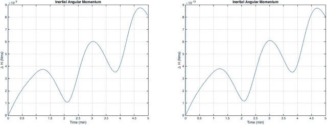

图 12-2. 1 秒和 0.1 秒时间步长下的角动量守恒。在 0.1 秒的测试中，增长降低了四个数量级，从 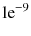 降至 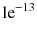

你通过使用 `RHS` 函数的数据结构特性来初始化脚本。下面展示了启用控制系统运行时的参数。此时速率初始化为零，你使用 1 秒的时间步长，该步长在前面的测试中显示出足够小的动量增长。

```
%% 右侧数据结构
d = RHSSpacecraftWithRWA;

%% 用户初始化
% 初始化持续时间、时间步长、状态和惯性张量
tEnd = 600;
dT = 1;
controlIsOn = true;
qECIToBody = [1;0;0;0];
omega = [0;0;0]; % 弧度/秒
omegaRWA = [0;0;0]; % 弧度/秒
d.inr = [3 0 0;0 10 0;0 0 5]; % 千克·米²
qTarget = QUnit([1;0.004;0.0;0]); % 归一化
d.torque = [0;0;0]; % 干扰力矩
```

控制系统在此设计。请注意 `wN` 的小数值以及单位阻尼比。航天器上干扰的频率相当低，而且飞轮有转矩限制，这导致 `wN` 比机器人示例中小得多。三个控制器完全相同。

```
%% 控制设计
% 设计一个 PD 控制器
dC = PDControl( 'struct' );
dC(1).zeta = 1;
dC(1).wN = 0.02;
dC(1).wD = 5*dC(1).wN;
dC(1).tSamp = dT;
dC(1) = PDControl( 'initialize', dC(1) );

% 使所有三个轴控制器相同
dC(2) = dC(1);
dC(3) = dC(1);
```

接下来是仿真循环。一如既往，先用零初始化绘图数组。循环中的第一步是找出当前状态与目标姿态之间的角度误差。接着，根据控制标志的值计算控制加速度或将其设为零。控制转矩通过将控制加速度乘以航天器惯性张量来计算。为绘图目的计算动量，最后，积分一个时间步长。

```
%% 仿真
% 状态向量
x = [qECIToBody;omega;omegaRWA];

% 绘图和步数
n = ceil(tEnd/dT);
xP = zeros(length(x)+7,n);

% 计算初始角动量
[˜,hECI0] = RHSSpacecraftWithRWA(0,x,d);

% 运行仿真
for k = 1:n
    % 计算角度误差
    angleError = ErrorFromQuaternion( x(1:4), qTarget );
    if (controlIsOn )
        u = [0;0;0];
        for j = 1:3
            [u(j), dC(j)] = PDControl('update',angleError(j),dC(j));
        end
    else
        u = [0;0;0];
    end
    % 飞轮转矩在等式左侧
    d.torqueRWA = d.inr*u;
    % 计算角动量增量
    [˜,hECI] = RHSSpacecraftWithRWA(0,x,d);
    dHECI = hECI - hECI0;
    hMag = sqrt(dHECI'*dHECI);
    % 存储绘图数据
    xP(:,k) = [x;d.torqueRWA;hMag;angleError];
    % 右侧计算
    x = RungeKutta(@RHSSpacecraftWithRWA,0,x,dT,d);
end
```

输出完全是二维图。我们将它们分页显示，每页包含一到三个图。这使得在大多数电脑显示器上易于阅读。

```
%% 绘图
[t,tL] = TimeLabl((0:(n-1))*dT);
yL = {'q_s', 'q_x', 'q_y', 'q_z'};
PlotSet( t, xP(1:4,:), 'x⊔label', tL, 'y⊔label', yL,...
    'plot⊔title', '姿态', 'figure⊔title', '姿态');
yL = {'\omega_x', '\omega_y', '\omega_z'};
PlotSet(t, xP(5:7,:), 'x⊔label', tL, 'y⊔label', yL,...
    'plot⊔title', '本体速率', 'figure⊔title', '本体速率');
yL = {'\omega_1', '\omega_2', '\omega_3'};
PlotSet( t, xP(8:10,:), 'x⊔label', tL, 'y⊔label', yL,...
    'plot⊔title', '反作用飞轮速率', 'figure⊔title', '反作用飞轮速率');
yL = {'T_x⊔(Nm)', 'T_y⊔(Nm)', 'T_z⊔(Nm)'};
PlotSet( t, xP(11:13,:), 'x⊔label', tL, 'y⊔label', yL,...
    'plot⊔title', '控制转矩', 'figure⊔title', '控制转矩');
yL = {'\Delta⊔H⊔(Nms)'};
PlotSet( t, xP(14,:), 'x⊔label', tL, 'y⊔label', yL,...
    'plot⊔title', '惯性角动量', 'figure⊔title', '惯性角动量');
yL = {'\theta_x⊔(rad)', '\theta_y⊔(rad)', '\theta_z⊔(rad)'};
PlotSet( t, xP(15:17,:), 'x⊔label', tL, 'y⊔label', yL,...
    'plot⊔title', '角度误差', 'figure⊔title', '角度误差');
```

注意，`PlotSet` 使绘图的设置比使用 MATLAB 内置的 `plot` 和辅助函数更加容易，代码也更具可读性。你确实会失去一些灵活性。y 轴标签使用 LaTeX 表示法。这提供有限的 LaTeX 语法。你可以将绘图设置为完整的 LaTeX 模式，以访问所有 LaTeX 命令。

请注意，我们直接从目标四元数和真实四元数计算角度误差。这代表了我们的姿态传感器。在真实的航天器中，姿态估计相当复杂。使用多种传感器，如磁力计、GPS、地球和太阳传感器的组合，并且通常使用速率积分陀螺仪来平滑测量数据。星敏感器或星跟踪器常用于三轴姿态感知，需要将相机中的图像转换为姿态估计。你不能单独使用陀螺仪，因为它们无法提供相对于惯性系的初始方位。

运行两个测试。第一个测试显示我们的控制器能够补偿一个本体固定的干扰力矩。第二个测试显示控制器能够重新定向航天器。

以下是干扰力矩测试的初始化代码。初始姿态和目标姿态相同，均为单位四元数，但 `d.torque` 中有一个小的干扰力矩。

# 姿态控制系统仿真：外部力矩与姿态偏移

## 案例一：观察外部干扰力矩的影响

```matlab
% 初始化持续时间、时间步长、状态和惯性张量
tEnd = 600;
dT = 1;
controlIsOn = true;
qECIToBody = [1;0;0;0];
omega = [0;0;0]; % 弧度/秒
omegaRWA = [0;0;0]; % 弧度/秒
d.inr = [3 0 0;0 10 0;0 0 5]; % 千克·米²
qTarget = QUnit([1;0;0.0;0]);
d.torque = [0;0.0001;0]; % 干扰力矩 (N)
```

我们将仿真运行到 600 秒，以便观察过渡过程稳定下来。干扰力矩非常小，这符合航天器的典型情况。我们使力矩为单轴，以使响应更清晰。

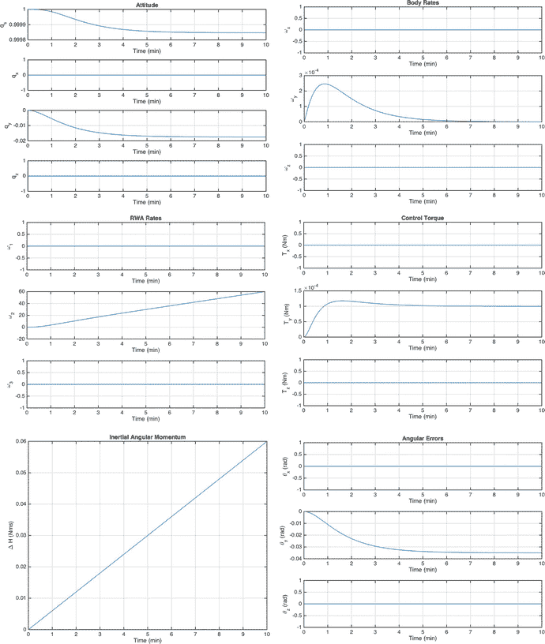

图 12-3. 控制一个突然施加的外部力矩

干扰导致围绕 y 轴的姿态发生变化。这种偏移在使用 PD 控制器时是预料之中的。控制转矩最终与干扰匹配，角度误差达到最大值。

y 轴飞轮速率线性增长，因为它必须吸收由力矩产生的所有动量。我们并未限制最大飞轮速率。在真实的航天器中，飞轮很快就会饱和，达到其允许的最大速度。我们的控制系统需要其他执行器来对飞轮进行消饱和处理。惯性角动量也随着恒定外部力矩的出现而线性增长，这是预期的。

## 案例二：执行指令姿态偏移

现在，我们进行一个围绕 x 轴的姿态校正。以下是初始化代码。

```matlab
% 初始化持续时间、时间步长、状态和惯性张量
tEnd = 600;
dT = 1;
controlIsOn = true;
qECIToBody = [1;0;0;0];
omega = [0;0;0]; % 弧度/秒
omegaRWA = [0;0;0]; % 弧度/秒
d.inr = [3 0 0;0 10 0;0 0 5]; % 千克·米²
qTarget = QUnit([1;0.004;0.0;0]); % 归一化
d.torque = [0;0;0]; % 干扰力矩
```

我们指令一个围绕 x 轴的小姿态偏移，这通过改变四元数中的第二个元素来实现。我们对四元数进行单位化以防止数值问题。

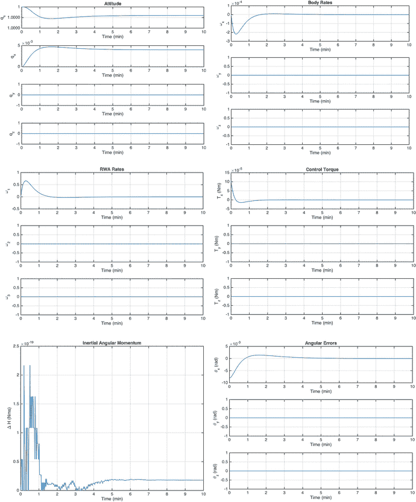

图 12-4. 指令一个关于 x 轴的小姿态偏移

在这种情况下，围绕 x 轴的角度误差被减小到零。惯性角动量保持“恒定”，尽管由于数值积分中的截断误差会有一些微小波动。这是预料之中的，并且在控制系统运行时持续检查角动量是良好的做法。如果它不保持近似恒定，则仿真存在问题。内部力矩不会改变惯性角动量。这就是为什么反作用飞轮被称为动量交换装置。它们与航天器本体交换动量，但不会计入惯性角动量总量。

在两种情况下，姿态速率都保持较小，因此欧拉耦合力矩很小。这证明了我们先前将航天器视为三个双积分器的决定是合理的。同时也证明了我们使用四元数误差到小角度近似的合理性。

# 12.4 批量执行仿真运行

## 问题

你已经使用仿真脚本验证了动量守恒并测试了控制器，但请注意，你需要为每种情况手动修改脚本顶部的行。这对于开发阶段来说没问题，但这会使结果难以复现；你无法得知生成特定图表的初始条件。你可能需要针对一整套输入运行仿真，并进行蒙特卡洛分析。

## 解决方案

基于该脚本创建一个新的函数，并将关键参数作为输入。一个新的数据结构将同时存储输入和输出，这样你就可以将每次运行的结果保存为`.mat`文件。这使得将来可以重新绘制任何一次运行的结果，或者根据存储的输入重新运行；例如，当你发现并修复了控制器中的一个错误时。

## 工作原理

首先将仿真脚本复制到一个新文件中。添加一个函数签名。用输入结构替换初始化变量。执行仿真，然后保存输入结构以及生成的输出。生成的函数头如下所示。`input`结构包含`RHS`数据、控制器数据和仿真时序数据。

```
%% SpacecraftSimFunction 航天器反作用轮仿真函数
% 根据给定的初始状态，对带有反作用轮的航天器进行仿真。
%% 格式
% d = SpacecraftSimFunction( x0, qTarget, input )
%% 输入
% x0 (7+n,1) 初始状态
% qTarget (4,1) 目标四元数
% input (.) 数据结构
%   .rhs (.) RHS 数据
%   .pd (:) 控制器
%   .dT (1,1) 时间步长
%   .tEnd (1,1) 仿真时长
%   .controlIsOn 控制开关标志
%% 输出
% d (.) 数据结构
%   .input
%   .x0
%   .qTarget
%   .xPlot
%   .dPlot
%   .tPlot
%   .yLabel
%   .dLabel
%   .tLabel
```

现在，你可以编写一个循环调用仿真函数的脚本。可能性是无限的：你可以测试不同的目标，为蒙特卡洛仿真改变初始条件，或者施加不同的干扰力矩。你可以对结果进行统计分析，或者根据某些条件识别并绘制单次运行的结果。在本示例中，你将找出每次运行中施加的最大控制力矩。

```
%% 航天器仿真多次运行
% 在循环中执行 SpacecraftSimBatch 多次运行，并改变初始条件。
% 找出每种情况下施加的最大控制力矩。
%% 另请参阅
% SpacecraftSimFunction

sim = struct;

%% 控制器设计
% 设计一个 PD 控制器
dC = PDControl( 'struct' );
dC(1).zeta = 1;
dC(1).wN = 0.02;
dC(1).wD = 5*dC(1).wN;
dC(1).tSamp = dT;
dC(1) = PDControl( 'initialize', dC(1) );
% 使三个轴的控制器完全相同
dC(2) = dC(1);
dC(3) = dC(1);
sim.pd = dC;

%% 航天器模型
% 设置航天器为非球形；无干扰
rhs = RHSSpacecraftWithRWA;
rhs.inr = [3 0 0;0 10 0;0 0 5]; % kg-m²
rhs.torque = [0;0;0]; % 干扰力矩
sim.rhs = rhs;

%% 初始化
% 初始化仿真时长、时间步长、状态和惯量
sim.tEnd = 600;
sim.dT = 1;
sim.controlIsOn = true;

% 航天器状态
qECIToBody = [1;0;0;0];
omega = [0;0;0]; % rad/sec
omegaRWA = [0;0;0]; % rad/sec
x0 = [qECIToBody;omega;omegaRWA];

% 目标四元数
qTarget = QUnit([1;0.004;0.0;0]); % 归一化

%% 仿真循环
clear d;
for k = 1:10;
    % 改变初始条件中的某个参数并进行仿真
    x0(5) = 1e-3*k;
    thisD = SpacecraftSimFunction( x0, qTarget, sim );
    % 将运行结果保存为 .mat 文件
    thisDir = fileparts(mfilename('fullpath'));
    fileName = fullfile(thisDir,'Output', sprintf('Run%d',k));
    save( fileName, '-struct', 'thisD' );
    % 存储运行输出
    d(k) = thisD;
end

%% 对结果进行统计分析
% ... 按需进行
for k = 1:length(d)
    tMax(k) = max( max( d(k).dPlot(2:4,:) ) );
end

figure;
plot(1:length(d), tMax);
xlabel('运行次数')
ylabel('力矩 (Nm)')
title('最大控制力矩');

% 绘制单次运行结果
kPlot = 4;
PlotSpacecraftSim( d(4) );
```

图 12-5 显示了最大力矩的结果。

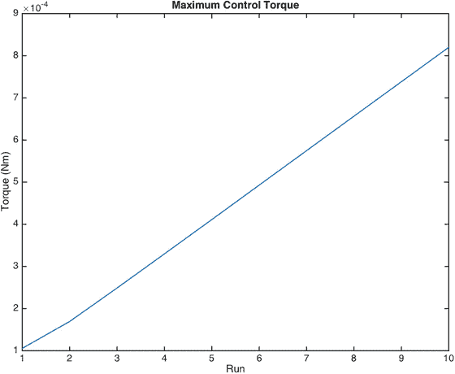
图 12-5. 10 次仿真运行中的最大控制力矩

某次运行的输出结果如下所示。

```
>> d(1)

ans =

      input: [1x1 struct]
         x0: [10x1 double]
    qTarget: [4x1 double]
      xPlot: [10x600 double]
      dPlot: [7x600 double]
      tPlot: [1x600 double]
     tLabel: '时间 (分钟)'
     yLabel: {1x10 cell}
     dLabel: {1x7 cell}
```

作为一个有趣示例，你可以为航天器设定更高的初始速率，观察控制器如何响应。在命令行中，将围绕`x`轴的初始速率改为`0.2 rad/sec`，然后调用仿真函数（不返回任何输出），以便生成全套图表。你会看到响应耗时很长（超过 20 分钟），但速率最终会衰减至零。

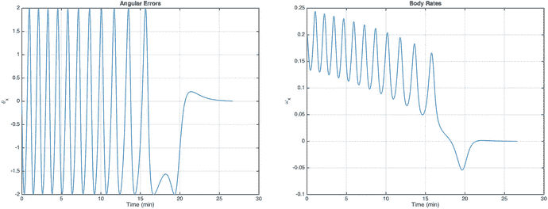
图 12-6: 对`x`轴大速率的控制响应。最终速率确实被抑制了！

完整的仿真函数如下所示。内置演示程序对默认航天器模型执行无控制的开环仿真，这与前面配方中进行的动量守恒测试（图 12-2）一致。

### 函数 `SpacecraftSimFunction` 仿真

```matlab
function d = SpacecraftSimFunction( x0, qTarget, input )

%% Handle inputs
if nargin == 0
    % perform an open loop simulation
    input = struct;
    input.rhs = RHSSpacecraftWithRWA;
    input.pd = [];
    input.dT = 1; % sec
    input.tEnd = 600; % sec
    input.controlIsOn = false;
    x0 = [1;0;0;0;1e-3*randn(6,1)];
    SpacecraftSimFunction( x0, [], input );
    return;
end

if isempty(x0)
    qECIToBody = [1;0;0;0];
    omega = [0;0;0]; % rad/sec
    omegaRWA = [0;0;0]; % rad/sec
    x0 = [qECIToBody;omega;omegaRWA];
end

if isempty(qTarget)
    qTarget = x0(1:4);
end

%% Simulation
% State vector
x = x0;
nWheels = length(x0)-7;

% Plotting and number of steps
n = ceil(input.tEnd/input.dT);
xP = zeros(length(x),n);
dP = zeros(7,n);

% Find the initial angular momentum
d = input.rhs;
[˜,hECI0] = RHSSpacecraftWithRWA(0,x,d);

% Run the simulation
for k = 1:n
    % Control
    u = [0;0;0];
    angleError = [0;0;0];
    if (input.controlIsOn )
        % Find the angle error
        angleError = ErrorFromQuaternion( x(1:4), qTarget );
        % Update the controllers individually
        for j = 1:nWheels
            [u(j), input.pd(j)] = PDControl('update',angleError(j), input.pd(j));
        end
    end

    % Wheel torque
    d.torqueRWA = d.inr*u;

    % Get the delta angular momentum
    [˜,hECI] = RHSSpacecraftWithRWA(0,x,d);
    dHECI = hECI - hECI0;
    hMag = sqrt(dHECI'*dHECI);

    % Plot storage
    xP(:,k) = x;
    dP(:,k) = [hMag;d.torqueRWA;angleError];

    % Right hand side
    x = RungeKutta(@RHSSpacecraftWithRWA,0,x,input.dT,d);
end

[t,tL] = TimeLabl((0:(n-1))*input.dT);

%% Store data
% Record initial conditions
d = struct;
d.input = input;
d.x0 = x0;
d.qTarget = qTarget;
d.xPlot = xP;
d.dPlot = dP;
d.tPlot = t;
d.tLabel = tL;

y = cell(1,nWheels);
for k = 1:nWheels
    y{k} = sprintf('\\omega_%d',k);
end
d.yLabel = {'q_s','q_x','q_y','q_z','\omega_x','\omega_y','\omega_z',y{:}};
d.dLabel = {'\Delta⊔H⊔(Nms)','T_x⊔(Nm)', 'T_y⊔(Nm)', 'T_z⊔(Nm)', ...
            '\theta_x⊔(rad)', '\theta_y⊔(rad)', '\theta_z⊔(rad)'};

if nargout == 0
    PlotSpacecraftSim( d );
end
```

### 绘图函数

绘图代码被封装到一个独立的函数中，该函数接受输出数据结构。在仿真函数中创建并保存绘图标签，这允许你重新绘制任何已保存的输出。添加一个语句，在创建控制和角度误差图之前检查非零角度误差，因为开环仿真不需要这些图。

> **提示：** 使用结构体中的字段进行绘图，无需在本地重命名变量，这样在运行仿真后，你可以直接将单个绘图复制粘贴到命令行。

```matlab
%% PlotSpacecraftSim Plot the spacecraft simulation output
%% Form
% PlotSpacecraftSim( d )

%% Inputs
% d (.) Simulation data structure

%% Copyright
% Copyright (c) 2015 Princeton Satellite Systems, Inc.
% All rights reserved.

function PlotSpacecraftSim( d )

t = d.tPlot;
yL = d.yLabel(1:4);
PlotSet( d.tPlot, d.xPlot(1:4,:), 'x⊔label', d.tLabel, 'y⊔label', yL,...
         'plot⊔title', 'Attitude', 'figure⊔title', 'Attitude');

yL = d.yLabel(5:7);
PlotSet(d.tPlot, d.xPlot(5:7,:), 'x⊔label', d.tLabel, 'y⊔label', yL,...
        'plot⊔title', 'Body⊔Rates', 'figure⊔title', 'Body⊔Rates');

yL = d.yLabel(8:end);
PlotSet( t, d.xPlot(8:end,:), 'x⊔label', d.tLabel, 'y⊔label', yL,...
         'plot⊔title', 'RWA⊔Rates', 'figure⊔title', 'RWA⊔Rates');

yL = d.dLabel(1);
PlotSet( d.tPlot, d.dPlot(1,:), 'x⊔label', d.tLabel, 'y⊔label', yL,...
         'plot⊔title', 'Inertial⊔Angular⊔Momentum',...
         'figure⊔title', 'Inertial⊔Angular⊔Momentum');

if any(d.dPlot(5:end,:)˜=0)
    yL = d.dLabel(2:4);
    PlotSet( d.tPlot, d.dPlot(2:4,:), 'x⊔label', d.tLabel, 'y⊔label', yL,...
             'plot⊔title', 'Control⊔Torque', 'figure⊔title', 'Control⊔Torque');

    yL = d.dLabel(5:end);
    PlotSet( d.tPlot, d.dPlot(5:end,:), 'x⊔label', d.tLabel, 'y⊔label', yL,...
             'plot⊔title', 'Angular⊔Errors', 'figure⊔title', 'Angular⊔Errors');
end
```

一个有趣的练习是：将固定的干扰输入`d.torque`替换为一个函数句柄，该句柄调用一个干扰函数。这构成了我们航天器控制工具箱中航天器仿真的基础。在该工具箱中，干扰是根据航天器几何形状、空间环境以及航天器沿轨道旋转和运动的情况计算得出的。

### 总结

本章演示了如何编写动力学方程，并为带有反作用轮的航天器实现一个简单的控制律。我们的控制系统仅适用于小角度变化，如果航天器的角速率变大，它将无法正常工作。此外，我们未考虑反作用轮的力矩或动量限制。你还学习了四元数以及如何使用四元数实现刚体运动学。我们展示了如何从两个四元数中获取角度误差。表 12-1 列出了本章开发的代码。

**表 12-1: 本章代码清单**

| 文件 | 描述 |
| --- | --- |
| `SpacecraftSimFunction.m` | 航天器仿真主函数 |
| `PlotSpacecraftSim.m` | 仿真结果绘图函数 |

| --- | --- |

| `RHSSpacecraftWithRWA` | 带反作用轮的航天器的右端函数。 |

| `ErrorFromQuaternion` | 航天器仿真脚本。 |

| `SpacecraftSim` | 航天器仿真脚本。 |

| `SpacecraftSimBatch` | 航天器仿真函数。 |

| `BatchSimRuns` | 多次运行航天器仿真。 |

| `PlotSpacecraftSim` | 绘制仿真结果。 |

| `QTForm` | 沿四元数相反方向变换向量。 |

| `QUnit` | 归一化四元数。 |


# 索引 A

飞机三维轨迹控制系统动态模型数值搜索仿真动画 `GUIDE` 编辑器空白 GUI `BoxAnimationGUI` 按钮 `CloseRequestFcn` 编辑框 MATLAB `questdlg` 文本标签线段对象 MATLAB 应用商店与回放 `TimeDisplayGUI` `uicontrol` 按钮

## B

无刷直流电机 (BLDC)

## C

化工混合过程扰动建模 `PHProcessSim` 闭环瞬态数值优化例程开环响应剖面分析器用户输入 pH 传感器比例积分控制器

## D

双积分器数字控制定步长数值积分数学建模 MATLAB 代码多个子图比例微分控制器 `CToDZOH` 函数默认值微分方程工程函数初始化模式极点配置无阻尼自然频率更新函数时间单位编写方程

动态字段名

动态图形函数动画执行时间键盘命令 `patch` 对象 `pause` 命令

## E

电机磁场定向控制脉冲宽度调制仿真数据结构 PI 转矩控制脉宽三相永磁同步电机空间矢量调制 `SVPWM` `SwitchToVoltage` 函数总脉冲模式

工程可视化 `EquilibriumControl.m` 函数

## F

故障检测空气涡轮模型动态模型状态空间系统检测滤波器 GUI 构建系统控件 `duration_Callback` 函数查找/替换步骤全局变量初始化函数 MATLAB `GUIDE` 重置功能 sendTach 与 sendInput 静态文本 `uicontrol` `TimeLabel` 函数 `uicontrols` 仿真

故障

磁场定向控制 (FOC)

正向 Clarke 变换

## G, H, I, J, K

GUI 设计环境 (`GUIDE`)

## L

拉格朗日公式

LAPACK (线性代数包) 库

## M

矩阵实验室 MathWorks MATLAB 元胞数组冒号运算符命令行组件数据结构数据类型点运算符 end 关键字函数全局作用域帮助命令输入与输出历史定位目录逻辑数组矩阵 MEX 文件 `pcode` 函数读写二进制数据作用域操作字符串文本文件波浪号运算符变量可视化

MATLAB 风格内置输入与输出命令行帮助函数头 `clear` 命令点积发布标记变量类型与大小指南 `if` 语句标记语法命名约定制表符大小重载函数发布功能智能结构工具箱文档结构化

## N, O

Nelder–Mead 最小化器

## P, Q

永磁同步电机 (PMSM)

照片级可视化 `PHProcessSim` `Plot3DTrajectory.m` 函数

比例积分控制器

脉冲宽度调制

## R

调节器 `RHSAircraft`

## S

SCARA (选择性顺应性关节机械臂) 机器人控制系统动态模型数值搜索仿真可视化函数

航天器姿态控制角度误差姿态修正控制设计欧拉耦合转矩动量增长仿真循环转矩测试二维图动态模型陀螺体模型运动学 `omegaRWA` 变量自旋向量状态导数车轮转矩车轮单位向量四元数误差仿真脚本

## T, U

测试考虑因素覆盖工具设计错误与警告图形生成已知输入与输出日志记录函数需求测试套件单元测试 `absTol` 参数类 `CompleteTriangle` `CompleteTriangle` 函数固定件包函数 MATLAB 包资格包 `runtests` 函数设置与拆卸函数容差检查 `TriangleTest` 函数详细级别警告与错误

三维可视化 另请参阅 可视化

## V, W, X, Y, Z

可视化 `AnnotatePlot` `cam` 函数颜色分布等高线与箭头图 `imgsec` 函数 `imshow` 函数光照对象 `OuterPosition` 属性 `patch` 函数绘图数据目录窗口 `Figure Palatte` 窗口 `Figure` 工具栏按钮 `Generate Code` 命令 `Plot Edit` 工具栏 `PLOTS` 选项卡 `subplot` 函数（含日期） `subplot` 函数水印