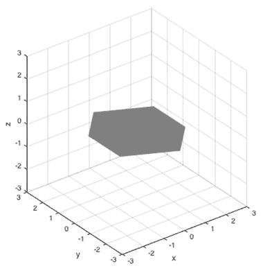
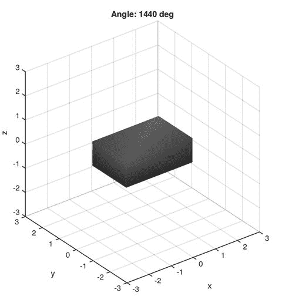
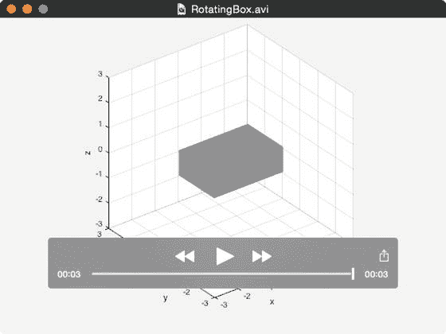
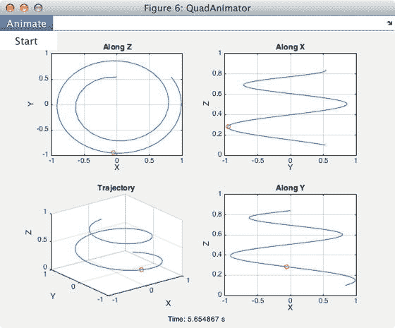
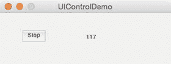
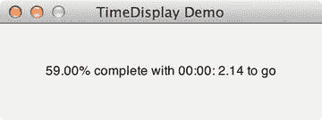
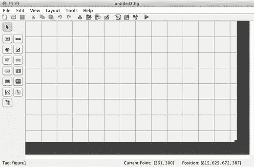
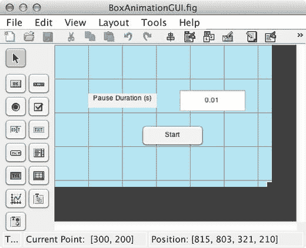
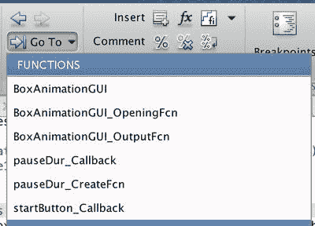
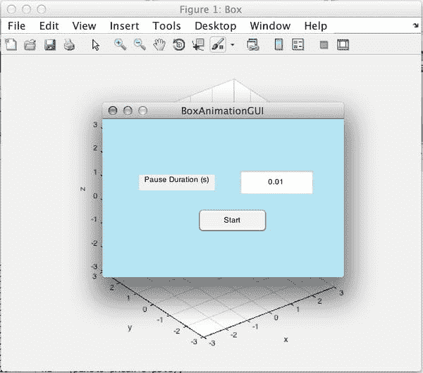

# 4. 交互式图形

电子补充材料：本章的在线版本（doi: [10.1007/978-1-4842-0559-4_4](http://dx.doi.org/10.1007/978-1-4842-0559-4_4)）包含补充材料，供授权用户使用。

上一章介绍了静态图形的生成。本章提供了生成动态图形的方案。这包括线条和面片对象的动画；在图形中使用 `uicontrol` 对象；使用 GUIDE 开发环境设计 GUI；以及将 GUI 部署为 MATLAB 应用程序。我们还提供了一些技巧，以最大限度地提高动态图形函数的性能。

## 4.1 创建简单动画

### 问题

你需要一种随时间变化的可视化效果，而不希望生成数百个不同的图形。

### 解决方案

你可以通过在循环中连续更新图形中的面片对象来创建动画。图 4-1 展示了此类动画的一帧。



**图 4-1.** 旋转立方体的动画

### 工作原理

首先，创建一个包含上一章三维盒子的图形。然后在一个循环中更新它。如果能为现有图形对象分配新数据，这将是最高效的方式。这可以更改对象的颜色、样式或物理位置。另一种方法是先删除对象，再在当前坐标系中重新创建。在这两种情况下，你都需要存储图形句柄以便进行更新。

在本例中，你通过乘以旋转矩阵 `b` 来更新顶点。然后，通过句柄使用 `set(p, 'vertices', vK)` 将顶点传递到补片（patch）对象中。请注意转置的使用，因为顶点存储在一个 `n×3` 的数组中。一个光照对象能让最终的动画更有趣。你将补片对象的 `'linestyle'` 设置为 `'none'`，以消除三角形之间的线条。

```
%% 使用补片（patch）制作立方体动画

% 创建一个图形并在其中绘制一个立方体。顶点和面直接指定。
% 我们仅更新顶点以得到流畅的动画。

%% 盒子设计

x = 3;
y = 2;
z = 1;

% 面
f = [2 3 6;3 7 6;3 4 8;3 8 7;4 5 8;4 1 5;2 6 5;2 5 1;1 3 2;1 4 3;5 6 7;5 7 8];

% 顶点
v = [-x x x -x -x x x -x;...
    -y -y y y -y -y y y;...
    -z -z -z -z z z z z]'/2;

%% 绘制对象

h = figure('name','Box');
p = patch('vertices',v,'faces',f,'facecolor',[0.5 0.5 0.5],...
    'linestyle','none','facelighting','gouraud');
ax = gca;
set(ax,'DataAspectRatio',[1 1 1],'DataAspectRatioMode','manual')
axis([-3 3 -3 3 -3 3])
grid on
xlabel('x')
ylabel('y')
zlabel('z')
view(3)
rotate3d on
light('position',[0 0 1])

%% 动画

% 我们使用 tic 和 toc 来计时动画。Pause 配合小于一秒的输入用以减慢动画。

tic
n = 10000;
a = linspace(0,8*pi,n);
c = cos(a);
s = sin(a);
for k = 1:n
    b = [c(k) 0 s(k);0 1 0;-s(k) 0 c(k)];
    vK = (b*v')';
    set(p,'vertices',vK);
    pause(0.001);
end
toc
```

在一台 MacBook Pro 笔记本电脑上，完整旋转四次的动画大约需要 16 秒。其中预计约 10 秒来自 `pause` 命令，即 10000 步乘以 0.001 秒。使用 `pause` 可以减慢动画速度，否则动画可能过快而失去实用价值。请记住，可以使用 `pause off` 临时禁用 `pause` 命令；这在测试使用了 `pause` 的图形函数时非常有用。

**提示**：根据需要，使用 `pause` 来减慢动画速度。测试时，请记得使用 `pause off` 来禁用暂停，以全速运行。

检查你电脑上的执行时间！运行脚本两次，第二次时关闭 pause。

```
>> pause on
>> PatchAnimation;
Elapsed time is 15.641664 seconds.

>> pause off
>> PatchAnimation;
Elapsed time is 0.780012 seconds.
```

注意，`pause` 会刷新系统图形队列，将更新后的补片绘制到屏幕上。当 `pause` 关闭时，图形不会更新，你只能在窗口中看到初始帧。另外请注意，由暂停和图形更新引起的实际时间增加了将近 15 秒。要强制更新图形而不使用 `pause`，请使用 `drawnow`。

此脚本利用代码段（cells）允许独立运行各个部分。这意味着你可以通过重新执行该代码段来重新运行动画，而无需重新创建图形。这可以通过工具栏中的“运行节”按钮或键盘命令（例如 Mac 上的 Command-Enter）来完成。

假设你想向动画中添加一个显示旋转角度的文本项。你可以轻松地使用 `title` 来实现：

```
title(sprintf('Angle: %f deg',a(k)*180/pi));
```

然而，你会惊讶于它对性能的影响。现在动画耗时超过了 90 秒！显示文本的效率远低于更新图形顶点。首先，你可以尝试直接使用轴标题对象的句柄并设置字符串。但这几乎没什么区别，仍然耗时约 90 秒。另一种解决方案是添加一个内层循环来降低更新标题的频率。反复试验表明，每 50 步更新一次对运行时间影响甚微。带有标题的图形如图 4-2 所示。



图 4-2. 带有动态标题的盒子动画

```
if rem(k,50)==0
    set(ax.Title,'string',sprintf('Angle: %.5g deg',a(k)*180/pi));
end
```

表 4-1 总结了在参考 MacBook 上的执行时间。这些时间由 `toc` 打印输出，来自单次运行，并非平均值。多次运行之间，执行时间的变化预计可达 10%。

**表 4-1.** `PatchAnimation` 的执行时间

| 无标题 |
| --- |
| `pause off` / `pause on` (0.001 秒) | 0.780154 秒 / 17.254507 秒 |
| 有标题 |
| 标题 | 90.761500 秒 |
| 每步设置 | 90.213318 秒 |
| 每 50 步设置 | 20.218774 秒 |

## 4.2 播放动画

### 问题

你想要存储并播放一段动画。

### 解决方案

使用 `VideoWriter` 类将动画的每一帧保存到一个 AVI 文件中。

### 工作原理

在下面的代码清单中，你使用 `VideoWriter` 保存动画并将其读入一个 AVI 文件。这行代码打开一个 AVI 文件：

```
vObj = VideoWriter('RotatingBox.avi');
```

该脚本名为 `PatchAnimationStorage.m`。创建盒子和图形的部分未显示，因为它们与上一个示例相同。在这个例子中，你仅使用 100 个点来完成四次旋转；在暂停关闭的情况下，执行时间（包括保存影片）约为 4 秒。在分析器（Profiler）中运行此脚本显示，近 90% 的执行时间花费在 `writeVideo` 命令上。

```
%% 使用补片（patch）制作立方体动画并存储为 AVI 文件

% 图形和盒子的创建方式与 PatchAnimation 相同。这次我们使用
% VideoWriter 将帧存储到影片中。

%% 动画

n = 100;
a = linspace(0,8*pi,n);
c = cos(a);
s = sin(a);

% 创建视频文件
vObj = VideoWriter('RotatingBox.avi');
open(vObj);
tic
for k = 1:n
    pause(0.01);
    b = [c(k) 0 s(k);0 1 0;-s(k) 0 c(k)];
    vK = (b*v')';
    set(p,'vertices',vK);
    writeVideo(vObj, getframe(h));
end
toc
close(h)
close(vObj)
```

然后你可以在任何视频播放器中播放动画，如图 4-3 所示。



图 4-3. 在视频播放器中回放的影片文件

## 4.3 线条对象动画

### 问题

你希望在循环中更新一个包含线条对象的绘图。

### 解决方案

这与示例 4-1 类似，但你需要更新图形对象的不同属性。你将使用第 3 章的四边形图，并添加一个沿轨迹移动的标记动画。这还将演示如何使用 `uimenu` 向图形添加菜单。

### 工作原理

从 `QuadPlot.m` 函数开始。该函数创建四个子图以查看轨迹：一个三维视图和三个来自不同方向的二维视图（参见图 4-4）。要添加一个可制作动画的标记，你需要执行以下几步：


图 4-4. 四象限图动画的一帧

1. 添加时间输入。
2. 在每个子图中添加标记并保存句柄。
3. 添加一个文本 `uicontrol` 控件，用于在动画进行时显示当前时间。
4. 将轨迹数据和句柄存储在图形对象的 `UserData` 中。
5. 关闭常规图形菜单，并添加一个包含 `Start` 函数的动画菜单。

你使用一个 `nargin` 检查来判断是通过 `t` 和 `x` 数据创建图形，还是通过输入 `'update'` 进入回调函数。另一种替代方案是将回调函数放在一个单独的函数中；执行回调的图形可以通过 `Tag` 属性或此处使用的 `gcbf` 来识别。

```matlab
%% QUADANIMATOR Create a quad plot page with animation.
% This creates a 3D view and three 2D views of a trajectory in one figure. A
% menu is provided to animate the trajectory over time.

%% Form
% QuadAnimator( t, x )

%% Input
% t (1,:) Time data
% x (3,:) Trajectory data
%
%% Output
% None.

function QuadAnimator(t,x)

if nargin == 0
   disp('Demo of QuadAnimator');
   t = linspace(0,4*pi,101);
   th = logspace(0,log10(4*pi),101);
   in = logspace(-1,0,101);
   x = [sin(th).*cos(in); cos(th).*cos(in); sin(in)];
   QuadAnimator(t,x);
   return;
end

if nargin == 2
   h = figure('Name','QuadAnimator');
   set(h,'InvertHardcopy','off','menubar','none')
   ma = uimenu(h,'Label','Animate');
   ms = uimenu(ma,'Label','Start','Callback','QuadAnimator(''update'')');
   m = Plot(x);
   p = get(h,'position');
   ut = uicontrol('Style','text','String','Time: 0.0 s',...
                  'Position',[0 0 p(3) 20]);
   d.t = t;
   d.x = x;
   d.m = m;
   d.ut = ut;
   set(h,'UserData',d);
else
   h = gcbf;
   d = get(h,'UserData');
   Animate(d);
end

function m = Plot(x)
% Use subplot to create four plots of a trajectory
subplot(2,2,3)
plot3(x(1,:),x(2,:),x(3,:));
hold on
m(3) = plot3(x(1,1),x(2,1),x(3,1),'o');
hold off
xlabel('X')
ylabel('Y')
zlabel('Z')
grid on
title('Trajectory')

subplot(2,2,1)
plot(x(1,:),x(2,:));
hold on
m(1) = plot(x(1,1),x(2,1),'o');
hold off
xlabel('X')
ylabel('Y')
grid on
title('Along Z')

subplot(2,2,2)
plot(x(2,:),x(3,:));
hold on
m(2) = plot(x(2,1),x(3,1),'o');
hold off
xlabel('Y')
ylabel('Z')
grid on
title('Along X')

subplot(2,2,4)
plot(x(1,:),x(3,:));
hold on
m(4) = plot(x(1,1),x(3,1),'o');
hold off
xlabel('X')
ylabel('Z')
grid on
title('Along Y')

function Animate( d )
% Animate the markers on the subplots over time
for k = 1:length(d.t)
   x = d.x(:,k);
   set(d.m(3),'XData',x(1),'YData',x(2),'ZData',x(3));
   set(d.m(1),'XData',x(1),'YData',x(2));
   set(d.m(2),'XData',x(2),'YData',x(3));
   set(d.m(4),'XData',x(1),'YData',x(3));
   set(d.ut,'string',sprintf('Time: %f s',d.t(k)));
   drawnow;
end
```

可以看到，两个子函数分别实现了绘图和动画功能。动画部分设置当前时间下标记的 `XData`、`YData` 和 `ZData`，并更新文本控件。我们使用了 `drawnow` 来刷新事件队列。该动画在不使用 `pause` 命令的情况下以良好的速度运行，但你的计算机上可能有所不同，请做好实验的准备！

## 4.4 uicontrol 按钮的实现

### 问题

你想在对话框中使用一个按钮来在脚本运行时停止它。

### 解决方案

使用 `uicontrol` 和 `figure` 创建一个带有控件的弹出窗口，如图 4-5 所示。


图 4-5. UIControlDemo 窗口

### 工作原理

使用脚本`UIControlDemo.m`中的两个`uicontrol`调用。第一个在窗口中放置一个文本框。第二个在窗口中放置一个按钮。您不必为按钮指定样式，因为这是默认样式，但为了清晰起见，您可以指定它。按钮控件有一个回调。回调可以是任何MATLAB代码或函数句柄。在这种情况下，只需将全局`stop`设为`true`以停止循环。请注意，为了清晰起见，我们使用`true`和`false`作为全局布尔值，尽管`1`和`0`也可以工作。

```
%% Demonstrate the use of a uicontrol button with a callback

% Create a window with a button that interacts with a global variable in the script.

%% Build the GUI

% This is a global to communicate the button push from the GUI
global stop;
stop = false;

% Build the GUI
set (0,'units','pixels')
p = get (0,'screensize');
bottom = p(4) - 190;
fig = figure ('name','UIControlDemo','position',[340 bottom 298 90],...
    'NumberTitle','off','menubar','none',...
    'resize','off');

% The display text
speed = uicontrol ( 'Parent', fig, 'position', [ 20 40 280 15],...
    'style', 'text','string','Waiting to start.');

% This has a callback setting stop to 1
step = uicontrol ( 'parent', fig, 'position',[ 40 40 40 20],...
    'string','Stop', 'callback','stop = true;');

%% Run the GUI
for k = 1:1000
    pause (0.01)
    set ( speed, 'String', k );
    if ( stop )
        break ; %#ok<UNRCH>
    end
    %drawnow % alternative to pause
end
```

位置`input`定义为`[left bottom width height]`。获取计算机屏幕尺寸的目的是通过将底部位置参数设置为屏幕尺寸减去图形尺寸（90 像素高）再加上 100 像素边距，即`p(4) − 190`，将窗口放置在屏幕顶部附近。

MATLAB 的代码分析器在包含`break`的行上放置一个警报，提示当`stop`为`false`时该行不可达。事实确实如此，但您有`uicontrol`来更改该参数。MATLAB 无法确定这一点，因此您可以添加`%#ok<UNRCH>`注释来抑制该警告。如果您右键单击带有警告的行并在弹出菜单中选择“抑制此语句...”，此注释可以由 MATLAB 自动添加（即自动修复）。

**提示**：抑制仅在您的布尔逻辑更改后才可到达的代码行上的警告。

让我们检查执行时间。使用`tic`和`toc`运行脚本两次，第二次关闭`pause`。

```
>> tic; UIControlDemo; toc
Elapsed time is 11.601678 seconds.
>> pause off
>> tic; UIControlDemo; toc
Elapsed time is 0.147663 seconds.
```

如果您希望动画持续超过或少于 11 秒，可以调整`pause`时间。您可以看到，即使更新了 1000 次，仅图形循环本身也只占用了一小部分秒！这是因为关闭`pause`后，图形不会在循环的每一步强制更新。MATLAB 仅在脚本结束时刷新图形，除非您有刷新系统队列的命令，例如`pause`、`drawnow`或`getframe`。如果您不想或不需要`pause`，请使用`drawnow`来强制在循环的每一步进行图形更新。表 4-2 显示了在`pause`开启或关闭以及使用`drawnow`时的执行时间。这些是单次在参考 MacBook 上运行的时间，并非平均值；预计运行时间可能会有高达 10%的差异。

**表 4-2.** `PatchAnimation`的执行时间

| `pause off` | 0.147663 秒 |
| `pause on` (0.01 秒) | 11.601678 秒 |
| `drawnow` | 2.642504 秒 |
| `pause` AND `drawnow` | 13.785564 秒 |

## 4.5 显示正在运行的模拟或循环的状态

### 问题

您希望在循环中显示耗时任务剩余的运行时间。

### 解决方案

创建一个包含文本`uicontrol`的窗口以显示剩余时间（见图 4-6）。



**图 4-6.** 时间显示窗口

### 工作原理

`TimeDisplayGUI` 实现了时间窗口。它使用了三个带有 `varargin` 的动作。一个持久变量 `hGUI` 存储了步骤数，并在每次更新调用时自动递增。以下是在此函数中需要注意的一些事项：

- 使用 MATLAB 函数 `now` 来获取当前日期，以进行计时。

- 已完成的步骤数存储在 `hGUI.stepsDone` 中。

- GUI 每半秒钟更新一次文本字符串。

- 假设所有步骤耗时相同，它会计算脚本完成前的预估剩余时间。

- 内置演示使用了 `pause`。

```
function TimeDisplayGUI( action, varargin )
```

```
%% TimeDisplayGUI 在循环中显示预计剩余时间
% 每次步骤调用 TimeDisplayGUI('update')；步骤计数器通过持久变量自动递增。
% 每 0.5 秒间隔更新一次。
%
% TimeDisplayGUI('initialize', nameOfGUI, totalSteps )
% TimeDisplayGUI('update')
% TimeDisplayGUI('close')
%
% 一次只能运行一个 TimeDisplayGUI。内置演示使用 pause 运行约 5 秒。
```

```
%% 格式：
% TimeDisplay( action, varargin )
```

```
%% 输入
% action (1,:) 'initialize', 'update' 或 'close'
% nameOfGUI (1,:) 要显示的名称
% totalSteps (1,1) 总步骤数
%
%% 输出
% 无
```

```
persistent hGUI
if nargin == 0
   % 演示
   disp('正在初始化包含 100 步的演示窗口。')
   TimeDisplayGUI( 'initialize', 'TimeDisplay Demo', 100 );
   for k = 1:100
      pause(0.05)
      TimeDisplayGUI( 'update' );
   end
   return;
end

switch action
   case 'initialize'
      hGUI = BuildGUI( varargin{1} );
      hGUI.totalSteps = varargin{2};
      hGUI.stepsDone = 0;
      hGUI.date0 = now;
      hGUI.lastDate = now;
   case 'update'
      if( isempty( hGUI ) )
         return
      end
      hGUI.stepsDone = hGUI.stepsDone + 1;
      hGUI = Update( hGUI );
   case 'close'
      if ~isempty(hGUI) && ishandle(hGUI.fig)
         delete( hGUI.fig );
      else
         delete( gcf )
      end
      hGUI = [];
end
```

function hGUI = Update( hGUI )
% 更新显示
thisDate = now;
dTReal = thisDate - hGUI.lastDate; % 天数
if( dTReal > 0.5/86400 )
   % 每 0.5 秒递增一次
   stepPer = hGUI.stepsDone/(thisDate - hGUI.date0);
   stepsToGo = hGUI.totalSteps - hGUI.stepsDone;
   tToGo = stepsToGo/stepPer;
   datev = datevec(tToGo);
   str = FormatString( hGUI.stepsDone/hGUI.totalSteps, datev );
   set( hGUI.percent, 'String', str );
   drawnow;
   hGUI.lastDate = thisDate;
end
```

```matlab
function h = BuildGUI( name )
% 初始化 GUI
set(0,'units','pixels')
p = get(0,'screensize');
bottom = p(4) - 190;
h.fig = figure('name',name,'Position',[340 bottom 298 90],'NumberTitle','off',...
   'menubar','none','resize','off','closerequestfcn',...
   'TimeDisplayGUI(''close'')');
v = {'Parent',h.fig,'Units','pixels','fontunits','pixels'};
str = FormatString( 0, [0 0 0 0 0 0] );
h.percent = uicontrol( v{:}, 'Position',[ 20 35 260 20], 'Style','text',...
   'fontsize',12,'string',str,'Tag','StaticText2');
drawnow;
```

```matlab
function str = FormatString( fSteps, date )
% 格式化倒计时时间字符串
str = sprintf('%4.2f%% 已完成，剩余 %2.2i:%2.2i:%5.2f',...
   100*fSteps, date(4), date(5), date(6));
```

下面的脚本`TimeDisplayDemo`演示了如何使用此函数。图 4-6 展示了结果窗口。

```matlab
%% 演示一个显示进程剩余时间的 GUI

%% 另请参阅
% TimeDisplayGUI

%% 脚本常量
n = 10000;
dT = 0.1;
a = rand(10,10);

%% 初始化时间显示
TimeDisplayGUI( 'initialize', 'SVD', n )

%% 循环
for j = 1:n
   % 执行一些耗时的操作
   for k = 1:100
      svd(a);
   end
   % 显示状态消息
   TimeDisplayGUI( 'update' );
end

%% 结束
TimeDisplayGUI( 'close' );
```

## 4.6 使用 GUIDE 创建自定义 GUI

### 问题

你有一个重复性的工作流程，并且希望构建一个 GUI，以避免反复在脚本中更改参数。例如，让我们采用配方 4-1 中的旋转立方体动画，并将其放入 GUI 中，这样你就可以轻松查看不同暂停时长的影响。

### 解决方案

你将使用 GUI 设计环境 (GUIDE) 来创建 GUI，从一个空白图形窗口开始。你需要一个用于输入暂停时长的编辑框，以及用于交互的按钮。

### 工作原理

输入 `guide` 启动 GUIDE 快速入门窗口。在“创建新 GUI”选项卡中，选择“空白 GUI”。这将在编辑器中打开一个名为 `untitled1.fig` 的空白图形，如图 4-7 所示。



**图 4-7.** GUIDE 编辑器中的空白 GUI

使用左侧的按钮在 GUI 中创建以下项目：

- 用于输入暂停时间的编辑框
- 文本框的文本标签
- 启动动画的按钮

从文本标签开始，它看起来像一个包含 TXT 的方框。单击该按钮，然后用鼠标拖拽，直到拉出一个大小合适的方框。其中会填充“Static Text”字样。双击文本框打开控件检查器。在这里，可以更改文本的样式和内容。将“String”更改为“Pause Duration (s)”，然后按 Tab 键离开该字段或按 Enter 键。

接下来，添加编辑框。此按钮看起来像一个包含 EDIT 的方框。在文本标签的右侧为编辑框拖拽出一个方框。双击它以打开检查器。将“String”更改为“0.01”，即默认暂停持续时间。请注意，“String”字段下方有一个“Tag”字段。默认情况下，它类似于 `edit1`。它是 GUI 代码中此编辑框句柄的标识符。将其更改为 `pauseDur`。

最后，添加按钮。它看起来像一个带有 OK 字母的按钮。将按钮放在文本和编辑框的下方。默认情况下，它显示为“Push Button”。在检查器中，将其更改为“Start”。将“Tag”更改为 `startButton`。

您还可以通过双击控件外部（背景）来更改图形本身的参数。将“Color”更改为您选择的背景色。取消选中“InvertHardcopy”复选框，这样在打印图形时背景色才能显示出来。在更改后的背景色下，您添加的控件会更容易看清。

有多种实现动画的选项。您可以直接在 GUI 中添加坐标轴，或者为动画维护一个单独的窗口，使其与之前的外观一致。现在，我们将为动画使用一个单独的图形窗口。

根据需要，将图形缩小。使用**工具** ➤ **对齐对象...** 对齐控件，然后保存新的图形。您的图形现在应类似于图 4-8。



**图 4-8.** 新保存的 GUI

此时，MATLAB 会创建一个 m 文件来控制该图形。FIG 文件维护您在检查器中看到的几何、样式和标签数据。m 文件处理控件回调的执行。图 4-9 显示了新 m 文件中的函数列表，这些函数使用了您在编辑控件时指定的标签名称。



**图 4-9.** 新保存的 GUI m 文件中的函数

主函数 `BoxAnimationGUI` 包含一段标有“请勿编辑”的初始化代码。您可以在此段代码之后添加额外的初始化代码，或者添加到 `OpeningFcn` 中，在那里您可以访问 `handles` 数据。编辑框（您用于输入暂停持续时间的控件）有两个相关函数：`callback` 和 `create` 函数。启动按钮只有一个回调函数。

您需要在代码中执行以下操作：

1. 在 `BoxAnimationGUI_OpeningFcn` 中创建图形窗口并绘制立方体，存储用于访问顶点数据的 `patch` 对象句柄。
2. 将编辑框中的字符串转换为数字并存储。
3. 在 `startButton_Callback` 中运行动画。将编辑框内容字符串转换为数字有两种选择。您可以在编辑框回调中执行此操作（当用户按 Tab 键离开该框或在该框处于活动状态时按 Enter 键时触发），也可以等到用户按下“启动”按钮时才转换数据。这是一个架构决策，在较大的 GUI 中，可能会受到用户可能输入的不同参数之间关系的影响。在这个简单案例中，影响不大，我们将在编辑框回调中进行转换。然而，这确实带来了数据初始化的问题：您必须在初始化期间将暂停持续时间的默认字符串转换为双精度浮点数，否则用户必须首先激活回调才能运行动画。因此，您需要在编码任务列表中添加以下步骤：
4. 在 `pauseDur_CreateFcn` 中初始化暂停持续时间值。
5. 最后，您正在使用 GUI 创建一个外部图形。使用这组默认函数，当主窗口关闭时，无法关闭额外的 GUI。但是，可以添加一个关闭函数来处理这个清理步骤。在 FIG 窗口的图形检查器中，默认的 `CloseRequestFcn` 是 `closereq`。如果您单击它左侧的小按钮，MATLAB 会创建一个关闭函数并将其添加到您的 m 文件中。这是您在 GUI 中的最后一段编码：
6. 在 `figure1_CloseRequestFcn` 中关闭额外的图形窗口。

完整的 GUI 函数如下所示。请注意，添加到 `handles` 数据结构中的自定义数据字段被分组到一个名为 `data` 的子结构中，以避免与 `uicontrol` 句柄发生名称冲突。因无意中将控件对象和相关参数使用相同的名称而引入错误是非常容易的。

# BoxAnimationGUI MATLAB 代码说明

## 文件概述

```matlab
function varargout = BoxAnimationGUI(varargin)
% BOXANIMATIONGUI MATLAB code for BoxAnimationGUI.fig
%      BOXANIMATIONGUI, by itself, creates a new BOXANIMATIONGUI or raises the existing singleton*.
%
%      H = BOXANIMATIONGUI returns the handle to a new BOXANIMATIONGUI or the handle to
%      the existing singleton*.
%
%      BOXANIMATIONGUI('CALLBACK',hObject,eventData,handles,...) calls the local
%      function named CALLBACK in BOXANIMATIONGUI.M with the given input arguments.
%
%      BOXANIMATIONGUI('Property','Value',...) creates a new BOXANIMATIONGUI or raises the
%      existing singleton*. Starting from the left, property value pairs are
%      applied to the GUI before `BoxAnimationGUI_OpeningFcn` gets called. An
%      unrecognized property name or invalid value makes property application
%      stop. All inputs are passed to `BoxAnimationGUI_OpeningFcn` via `varargin`.
%
%      *See GUI Options on GUIDE's Tools menu. Choose "GUI allows only one
%      instance to run (singleton)".
%
% See also: GUIDE, GUIDATA, GUIHANDLES

% Edit the above text to modify the response to help BoxAnimationGUI
% Last Modified by GUIDE v2.5 25-Aug-2015 15:10:40
```

## 初始化代码

```matlab
% Begin initialization code - DO NOT EDIT
gui_Singleton = 1;
gui_State = struct('gui_Name',       mfilename, ...
                   'gui_Singleton',  gui_Singleton, ...
                   'gui_OpeningFcn', @BoxAnimationGUI_OpeningFcn, ...
                   'gui_OutputFcn',  @BoxAnimationGUI_OutputFcn, ...
                   'gui_LayoutFcn',  [] , ...
                   'gui_Callback',   []);
if nargin && ischar(varargin{1})
    gui_State.gui_Callback = str2func(varargin{1});
end

if nargout
    [varargout{1:nargout}] = gui_mainfcn(gui_State, varargin{:});
else
    gui_mainfcn(gui_State, varargin{:});
end
% End initialization code - DO NOT EDIT
```

## 主窗口打开函数

```matlab
% --- Executes just before `BoxAnimationGUI` is made visible.
function `BoxAnimationGUI_OpeningFcn`(hObject, eventdata, handles, varargin)
% This function has no output args, see `OutputFcn`.
% hObject    handle to figure
% eventdata  reserved - to be defined in a future version of MATLAB
% handles    structure with handles and user data (see GUIDATA)
% varargin   command line arguments to `BoxAnimationGUI` (see `VARARGIN`)

% ADDED CUSTOM CODE FOR RECIPE
% Design the box
x = 3;
y = 2;
z = 1;
f = [2 3 6;3 7 6;3 4 8;3 8 7;4 5 8;4 1 5;2 6 5;2 5 1;1 3 2;1 4 3;5 6 7;5 7 8];
v = [−x x x −x −x x x −x;...
     −y −y y y −y −y y y;...
     −z −z −z −z z z z z]'/2;

% Create the figure
h = figure('name','Box');
p = patch('vertices',v,'faces',f,'facecolor',[0.5 0.5 0.5],...
          'linestyle','none','facelighting','gouraud');
ax = gca;
set(ax,'DataAspectRatio',[1 1 1],'DataAspectRatioMode','manual')
grid on
axis([−3 3 −3 3 −3 3])
xlabel('x')
ylabel('y')
zlabel('z')
view(3)
light('position',[0 0 1]);

% Choose default command line output for `BoxAnimationGUI`
handles.output = hObject;

% Additional variables required
handles.data.box = p;
handles.data.vertices = v;
handles.data.axis = ax;
handles.data.figure = h;
% END CUSTOM CODE

% Update handles structure
guidata(hObject, handles);

% `UIWAIT` makes `BoxAnimationGUI` wait for user response (see `UIRESUME`)
% uiwait(handles.figure1);
```

## 输出函数

```matlab
% --- Outputs from this function are returned to the command line.
function varargout = `BoxAnimationGUI_OutputFcn`(hObject, eventdata, handles)
% varargout  cell array for returning output args (see `VARARGOUT`);
% hObject    handle to figure
% eventdata  reserved - to be defined in a future version of MATLAB
% handles    structure with handles and user data (see GUIDATA)

% Get default command line output from handles structure
varargout{1} = handles.output;
```

## 暂停时长编辑框回调

```matlab
function `pauseDur_Callback`(hObject, eventdata, handles)
% hObject    handle to `pauseDur` (see GCBO)
% eventdata  reserved - to be defined in a future version of MATLAB
% handles    structure with handles and user data (see GUIDATA)

% Hints: `get(hObject,'String')` returns contents of `pauseDur` as text
%        `str2double(get(hObject,'String'))` returns contents of `pauseDur` as a double

% ADDED CUSTOM CODE FOR RECIPE
pauseDur = str2double(get(hObject,'String'));
% Optional: add checking of pause value; can't be negative
handles.data.pauseVal = pauseDur;
guidata(hObject, handles);
```

## 暂停时长编辑框创建函数

```matlab
% --- Executes during object creation, after setting all properties.
function `pauseDur_CreateFcn`(hObject, eventdata, handles)
% hObject    handle to `pauseDur` (see GCBO)
% eventdata  reserved - to be defined in a future version of MATLAB
% handles    empty - handles not created until after all CreateFcns called

% Hint: edit controls usually have a white background on Windows.
%       See `ISPC` and `COMPUTER`.
if ispc && isequal(get(hObject,'BackgroundColor'), get(0,'defaultUicontrolBackgroundColor'))
    set(hObject,'BackgroundColor','white');
end

% ADDED CUSTOM CODE FOR RECIPE
pauseDur = str2double(get(hObject,'String'));
% Optional: add checking of pause value; can't be negative
handles.data.pauseVal = pauseDur;
guidata(hObject, handles);
```

## 启动按钮回调函数

```matlab
% --- Executes on button press in `startButton`.
function `startButton_Callback`(hObject, eventdata, handles)
% hObject    handle to `startButton` (see GCBO)
% eventdata  reserved - to be defined in a future version of MATLAB
% handles    structure with handles and user data (see GUIDATA)

% ADDED CUSTOM CODE FOR RECIPE
dT = handles.data.pauseVal; % pause duration from our edit box
p = handles.data.box;       % handle to the patch object
v0 = handles.data.vertices; % initial vertices, before rotation
ax = handles.data.axis;     % axis, for updating title
n = 1000;
a = linspace(0,8*pi,n);
c = cos(a);
s = sin(a);

for k = 1:n
    b = [c(k) 0 s(k);0 1 0;−s(k) 0 c(k)];
    vK = (b*v0')';
    set(p,'vertices',vK);
    if rem(k,25)==0
        title(ax, sprintf('Angle: %.5g deg',a(k)*180/pi));
    end
    pause(dT);
end
```

## 窗口关闭请求函数

```matlab
% --- Executes when user attempts to close `figure1`.
function `figure1_CloseRequestFcn`(hObject, eventdata, handles)
% hObject    handle to `figure1` (see GCBO)
% eventdata  reserved - to be defined in a future version of MATLAB
% handles    structure with handles and user data (see GUIDATA)
% Hint: `delete(hObject)` closes the figure
delete(hObject);

% ADDED CUSTOM CODE FOR RECIPE
delete(handles.data.figure)
```

> **提示：** 将您添加的数据存储在一个唯一的子结构中，这样它就不会与任何图形句柄混淆。

要运行 GUI，可以执行`m`文件，或使用`GUIDE`图形编辑器中的“运行”按钮。带有绘图窗口的 GUI 将打开，如图 4-10 所示。



`图 4-10.` 带有绘图窗口的完整 GUI

您可以验证更改暂停持续时间并运行动画是否奏效。关闭 GUI 会同时关闭绘图窗口。但是，如果您先关闭绘图窗口，然后尝试运行 GUI，则会出错；这种情况在此实现中并未处理。您可以为`绘图图形`添加一个关闭函数，询问用户确认（使用`questdlg`），或者让它连同 GUI 一起关闭。另一种方式是，GUI 可以检查图形窗口是否存在，如果意外关闭则重新创建它。为此，需要将初始化代码移动到其自己的函数中。

作为练习，尝试使用滑块而不是编辑框来实现暂停时间，范围设置为 0 到 0.1 秒。您可能还想尝试为动画中的步数添加额外的控件。

```
if (condVar > someVal) {console.log("xxx")}
```