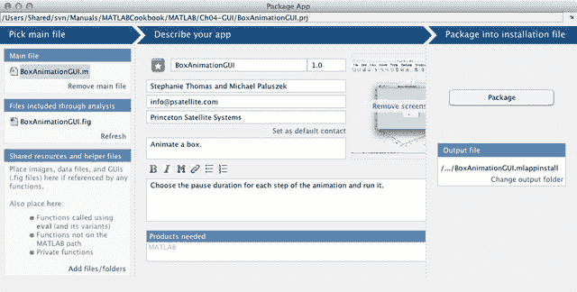
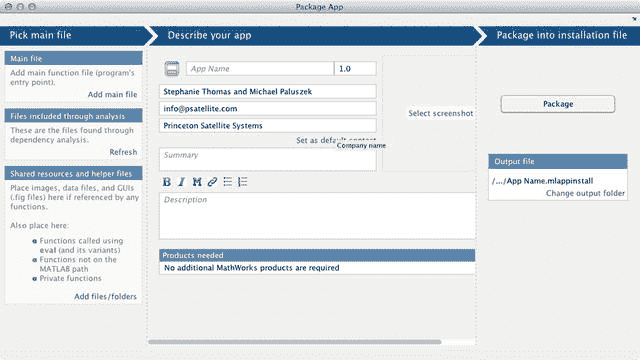

# 4.7 从 GUI 构建 MATLAB App

## 问题

您希望将新的 GUI 作为打包的应用程序与他人共享。

## 解决方案

MATLAB 提供了一个工具，可以将 GUI（或脚本）打包为应用程序，用户随后可以轻松安装和卸载该应用程序。这里将使用上一节中创建的 GUI 作为示例。

## 工作原理

通过指定运行应用程序的主文件（在本例中，即上一节中 `BoxAnimationGUI` 的主函数）来创建应用程序。打包工具会执行依赖项检查，并将路径中任何其他相关的函数和文件包含进来。生成的二进制文件随后可以由他人分发和安装。

应用程序工具可以从 MATLAB 命令窗口的“应用程序”选项卡访问。该选项卡包含“获取更多 App”、“安装 App”按钮，以及对于本教程最重要的“打包 App”按钮。该选项卡还显示一个功能区，列出您当前已安装的所有 App。单击“打包 App”会打开一个窗口，您可以在其中输入应用程序的文件和元数据信息。

第一步，从“打包 App”窗口的左上角开始，选择应用程序的主文件。请记住，这不一定是 GUI；例如，您可能有一个从命令行收集用户输入的脚本，使用了 `input` 或 `inputdlg`。点击“添加主文件”并选择 `BoxAnimationGUI.m`。MATLAB 会根据主文件名自动填充应用程序的名称，并执行依赖项检查。在本例中，唯一的依赖项是对应的 FIG 文件 `BoxAnimationGUI.fig`。在左下角，您可以添加 MATLAB 搜索工具无法找到的任何其他共享资源，例如通过 `eval` 或 `load` 调用且带有字符串名称的文件。

在“打包 App”窗口的中央，您可以添加用于描述应用程序的额外信息。您可以选择一个图标（如果有自定义图标也可以使用）；指定版本号；编写摘要和更详细的描述；并提供截图。当用户安装您的应用程序时，您选择的图标将显示在 MATLAB 的 App 工具栏中。

一旦您输入了应用程序的所有信息并验证了依赖项，就可以在“打包 App”窗口的右侧将文件打包到应用程序中。您可以在创建包之前更改输出文件夹；生成的应用程序安装程序将以 `.mlappinstall` 扩展名保存。

您的打包数据会保存在一个扩展名为 `.prj` 的项目文件中。这允许您在开发过程中根据需要重新打包应用程序；您可以针对错误修复或重大版本变更来增加版本号。

图 4-12. 打包后的应用程序结果及项目文件

图 4-11. 打包 App 窗口摘要

本章介绍了图形控件以及在循环中更新图形的方法。MATLAB 提供了丰富的 GUI 构建环境，包括按钮、滑块、列表框、菜单和绘图坐标轴。您可以直接创建 `uicontrols`，或使用 GUIDE 工具通过鼠标放置控件。在设计需要更新的图形时，考虑性能非常重要，因为某些操作（如字符串与对象几何体）的性能差异巨大。表 4-3 列出了本章开发的代码。

### 表 4-3. 本章代码清单

| 文件 | 描述 |
| :--- | :--- |
| `BoxAnimationGUI.fig` | 包含 GUI 定义的文件。 |
| `BoxAnimationGUI.m` | 实现 `BoxAnimationGUI.fig` 的 MATLAB 代码。 |
| `BoxAnimationGUI.prj` | 存储从 `BoxAnimationGUI.m` 创建应用程序信息的文件。 |
| `PatchAnimation` | 在 `for` 循环中对 3D 补丁进行动画处理。 |
| `PatchAnimationStorage` | 使用补丁对立方体进行动画处理并存储为 AVI 文件。 |
| `QuadAnimator` | 创建带有动画的四象限绘图页面。 |
| `TimeDisplayDemo` | 演示显示过程剩余时间的 GUI。 |
| `UIControlDemo` | 演示带有回调函数的 `uicontrol` 按钮的使用。 |