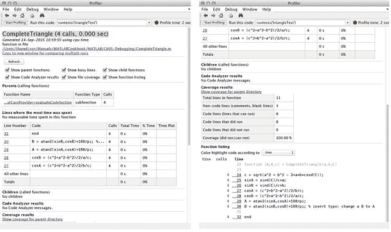
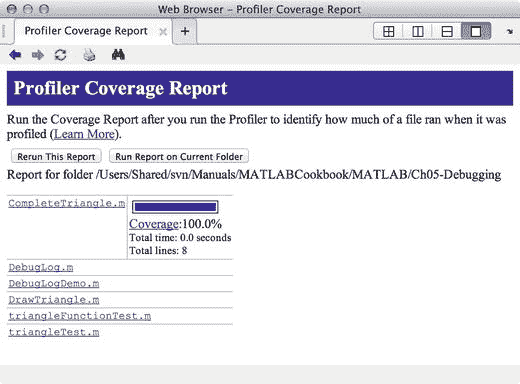

# 工作原理

`matlab.unittest` 是一个为 MATLAB 设计的 xUnit 风格单元测试框架。你可以编写以单元格标题分隔测试用例的脚本，或使用子函数包含测试用例的函数，并通过该框架执行它们。我们将分别展示一个示例。MATLAB 文档中提供了该框架的详尽文档和示例；以下列表可助你快速入门：

以下是实现该框架的相关 MATLAB 包：

- `matlab.unittest`
- `matlab.unittest.constraints`
- `matlab.unittest.fixtures`
- `matlab.unittest.qualifications`

`matlab.unittest.qualifications` 包提供了检查函数结果（包括数值、错误和警告）的所有方法。`matlab.unittest.fixtures` 包允许你为单个测试或测试组提供设置和拆卸代码。

以下是编写测试时将会使用的相关类：

- `matlab.unittest.TestCase`
- `matlab.unittest.TestResult`
- `matlab.unittest.TestSuite`
- `matlab.unittest.qualifications.Verifiable`

`TestCase` 是编写测试类的超类。

以下是相关函数：

- `assert`
- `runtests`
- `functiontests`
- `localfunctions`

为函数实现测试的最简单方法是编写脚本。每个测试用例使用`%%`通过单元格标题标识。使用`assert`函数检查函数输出。然后可通过`runtests`运行脚本，即使之前的测试失败，它也会运行每个测试，并将输出整理成有用的报告。

让我们为一个示例函数 `CompleteTriangle` 编写测试，该函数根据给定的两条边及其夹角计算三角形的其余数据：

```
function [A,B,c] = CompleteTriangle (a,b,C)
c = sqrt (aˆ2 + bˆ2 − 2*a*b*cosd(C));
sinA = sind (C)/c*a;
sinB = sind (C)/c*b;
cosA = (cˆ2+bˆ2 − aˆ2)/2/b/c;
cosB = (cˆ2+aˆ2-bˆ2)/2/a/c;
A = atan2 (sinA,cosA)*180/ pi;
B = atan2 (sinB,cosB)*180/ pi; % 插入笔误：将 B 改为 A
end
```

这类似于 MATLAB 文档中用作示例的直角三角形函数，但由于允许钝角三角形，因此需要四象限反正切函数。由于两个角度 `A` 和 `B` 的代码行非常相似，需要注意其中一行可能出现笔误，尤其是在编写函数时使用复制/粘贴时；我们将通过测试来演示这种笔误的影响。

现在让我们看一个为该函数定义几个测试用例的脚本 `TriangleTest`。每次检查都使用带逻辑语句的 `assert`。

```
%% Test1: 角度和
% 测试角度之和是否为 180 度。
C = 30;
[A,B] = CompleteTriangle(1,2,C);
theSum = A+B+C;
assert (theSum == 180,'PSS:Book:triangle','sum of angles: %f',theSum)

%% Test 2: 等腰直角三角形
% 测试如果边 a 和 b 相等，角度 A 和 B 是否相等。
C = 90;
[A,B] = CompleteTriangle(2,2,C);
assert (A ==B,'PSS:Book:triangle','Isoceles Triangle')

%% Test 3: 3-4-5 直角三角形
% 测试如果边 a 为 3，边 b 为 4，斜边 c 是否为 5。
C=90;
[˜,˜,c] = CompleteTriangle(3,4,C);
assert (c == 5,'PSS:Book:triangle','3-4-5 Triangle')

%% Test 4: 等边三角形
% 测试如果边 a 和 b 相等，所有角度是否均为 60。
[A, B, c] = CompleteTriangle(1,1,60);
assert (A == 60,'PSS:Book:triangle','Equilateral Triangle %d',1)
assert (B == 60, 'PSS:Book:triangle','Equilateral Triangle %d',2)
assert (c == 1,'PSS:Book:triangle','Equilateral Triangle %d',3)
```

注意如何使用 `assert` 可用的额外输入来添加消息 ID 字符串和错误消息。错误消息可以使用 `sprintf` 支持的任何说明符（如 `%d` 和 `%f`）的格式化字符串。

你可以直接执行此脚本，它会在第一个失败的 `assert` 处退出。更好的方法是使用 `runtests` 运行它，这会自动区分测试用例，并在某个测试失败时独立地运行它们。

```
>> runtests('TriangleTest');
Running TriangleTest
...
================================================================================
Error occurred in TriangleTest/Test4_EquilateralTriangle and it did not run to
completion.
--------------
Error Details:
--------------
Equilateral Triangle 1
================================================================================
.
Done TriangleTest
__________
Failure Summary:
Name              Failed  Incomplete  Reason(s)
=======================================================================
TriangleTest/Test4_EquilateralTriangle   X       X        Errored.
```

等边三角形测试失败了。从打印的索引 `Equilateral Triangle 1` 可以看出，是第一个 `assert` 失败了。如果你在命令行中运行该测试的代码，会发现输出看起来实际上是正确的：

```
>> [A,B,c] = CompleteTriangle (1,1,60)
A =
    60
B =
    60
c =
     1
```

如果实际从 `A` 和 `B` 中减去期望值 60，你就会看到测试失败的原因。

```
>> A − 60
ans =
   7.1054e−15
>> B − 60
ans =
   7.1054e−15
```

这个值在 MATLAB 三角函数的容差范围内，但 `assert` 语句并未考虑到这一点。你可以添加一个容差，如下所示：

```
assert (abs(A − 60) < 1e−10,'PSS:Book:triangle', 'Equilateral Triangle %d',1)
assert (abs(B − 60) < 1e−10,'PSS:Book:triangle','Equilateral Triangle %d',2)
```

现在所有测试都通过了：

```
>> runtests('TriangleTest')
Running TriangleTest
....
Done TriangleTest
__________
ans =
  1×4 TestResult array with properties:
    Name
    Passed
    Failed
    Incomplete
    Duration
Totals:
   4 Passed, 0 Failed, 0 Incomplete.
   0.012243 seconds testing time.
```

注意末尾没有分号；因此除了简短的报告外，你还可以看到 `runtests` 返回了一个 `TestResult` 对象数组，并打印了额外的总计信息，包括测试持续时间。

现在，考虑一下函数中尚未调试的笔误情况。将函数最后一行的 `B` 改为 `A`，使其变为：

`B = atan2 (sinB, cosA)*180/ pi ; % 插入笔误：将 B 改为 A`

使用容差检查再次运行测试。使用 `TestResult` 输出和表格类来获取格式良好的测试结果。

```
>> tr = runtests('TriangleTest');
>> table(tr)
ans =
      Name                           Passed    Failed    Incomplete    Duration
    _______________________________  ______    ______    ________     ________
    'TriangleTest/Test1_SumOfAngles'  false     true       true        0.0040209
    'TriangleTest/Test2_IsoscelesRightTriangles' true  false      false      0.002971
    'TriangleTest/Test3_3_4_5RightTriangle'      true  false      false      0.0027831
    'TriangleTest/Test4_EquilateralTriangle'     true  false      false      0.0031556
```

尽管代码中存在重大错误，但只有一个测试失败了：角度和测试。等腰三角形和等边三角形测试仍然通过，因为在这两种情况下 `A` 和 `B` 是相等的。你可以故意在代码的每一行引入错误，看看你的测试是否能够捕获它们！

现在考虑单元测试的另一种可能性：测试函数，而不是脚本。在这种情况下，每个测试用例必须放在自己的子函数中，主函数必须返回一个测试函数对象数组。这为你提供了为测试编写设置和拆卸函数的机会。它还利用了 `TestCase` 类和 qualifications 包。以下是这种格式下的测试：

```
function tests = TriangleFunctionTest
% 创建一个局部函数数组
tests = functiontests (localfunctions);
end

%% 测试函数
function testAngleSum(testCase) %#ok<*DEFNU>
C = 30;
[A,B] = CompleteTriangle(1, 2, C);
theSum = A+B+C;
testCase.verifyEqual (theSum,180)
end

function testIsosceles(testCase)
C = 90;
[A,B] = CompleteTriangle(2,2,C);
testCase.verifyEqual (A,B)
end

function test345(testCase)
C = 90;
[˜,˜,c] = CompleteTriangle(3,4,C);
testCase.verifyEqual (c,5)
end

function testEquilateral(testCase)
[A,B,c] = CompleteTriangle(1,1,60);
assert (abs(A-60)<testCase.TestData.tol)
testCase.verifyEqual (B,60,'absTol',1e-10)
testCase.verifyEqual (c,1)
end

%% 可选的文件夹具
function setupOnce(testCase) % 请勿更改函数名
% 设置一个所有测试都可以使用的容差
testCase.TestData.tol=1e-10;
end

function teardownOnce(testCase) % 请勿更改函数名
% 例如，恢复原始路径
end

%% 可选的新鲜夹具
function setup(testCase) % 请勿更改函数名
% 例如，打开一个图形窗口
end

function teardown(testCase) % 请勿更改函数名
% 例如，关闭图形窗口
end
```

如果只是运行这个函数，你会得到一个包含四个测试方法的数组。

```
>> TriangleFunctionTest
ans =
  1×4 Test array with properties:
    Name
    Parameterization
    SharedTestFixtures
```

在 `testEquilateral` 中显示了两种为测试设置容差的方法；一种方法是使用 `absTol` 参数硬编码容差，另一种方法是使用设置函数通过 `TestData` 传递容差。有两种类型的设置和拆卸函数可供选择：文件夹具（仅对文件中的整个测试集运行一次）和新鲜夹具（对每个测试用例运行）。文件夹具以 `Once` 后缀标识。对于此容差，`setupOnce` 函数是合适的。

要运行测试，请像对脚本一样使用 `runtests`。令人高兴的是，所有测试都通过了！

```
>> runtests('TriangleFunctionTest')
Running TriangleFunctionTest
....
Done TriangleFunctionTest
__________
...
Totals:
   4 Passed, 0 Failed, 0 Incomplete.
   0.043001 seconds testing time.
```

你可以在性能分析器中运行任意一组测试（即“运行并计时”）来验证被测试函数的覆盖率。使用脚本版本的测试来导航到 `CompleteTriangle` 的结果会稍微容易一些；测试函数的结果会列出测试框架中的许多函数。图 5-1 显示了性能分析器中的结果，显示该函数达到了 100% 的覆盖率。



**图 5-1.** 性能分析器中的三角形测试

运行性能分析器后，你可以运行覆盖率报告。要运行该报告，你必须使用编辑器的“当前文件夹”窗格，并从上下文菜单中选择 `Reports/Coverage Report`（报告/覆盖率报告）。图 5-2 显示了一个示例。示例函数运行速度太快，无法测量任何时间，但通常，此报告能让你深入了解函数的执行时间以及实现的覆盖率。



**图 5-2.** `CompleteTriangle` 的覆盖率报告


## 5.2 运行测试套件

### 问题

你的工具箱中有数十个或数百个函数，每个函数都附带有单元测试。你需要一种高效的方法来运行所有测试，甚至更好的是，能够运行其中的子集。

### 解决方案

MATLAB 的测试框架支持构建测试套件。

### 工作原理

在您为工具箱中的函数生成测试后，可以通过几种方式将它们分组到测试套件中。`TestSuite` 类的帮助文档列出了这些选项：

`TestSuite` 方法：

- `fromName` - 根据测试元素的名称创建测试套件
- `fromFile` - 根据 TestCase 类文件名创建测试套件
- `fromFolder` - 根据文件夹中的所有测试创建测试套件
- `fromPackage` - 根据包中的所有测试创建测试套件
- `fromClass` - 根据 TestCase 类创建测试套件
- `fromMethod` - 根据单个测试方法创建测试套件

你还可以连接使用这些方法创建的测试套件，并将数组传递给测试运行器。通过这种方式，你可以轻松生成要运行的测试子集。

在之前的技巧中，你为 `CompleteTriangle` 创建了两个测试文件：一个测试脚本和一个测试函数。你可以为包含这些代码的文件夹创建一个测试套件，它将自动找到这两组测试用例。假设当前文件夹包含两个测试文件。

```
>> import matlab.unittest.TestSuite
>> testSuite = TestSuite.fromFolder(pwd);
>> result = run(testSuite)

Running TriangleFunctionTest
....
Done TriangleFunctionTest
__________
Running TriangleTest
.......
Done TriangleTest
__________
result = 
  1×8 TestResult array with properties:

    Name
    Passed
    Failed
    Incomplete
    Duration

Totals:
   8 Passed, 0 Failed, 0 Incomplete.
   0.04218 seconds testing time.
```

如您所见，测试套件其实非常简单。一些高级功能包括能够对套件应用选择器以获取测试子集。要在命令行查看 `TestSuite` 的完整文档，请键入以下任意一条命令：

```
>> help matlab.unittest.TestSuite
```

或

```
>> import matlab.unittest.TestSuite
>> help TestSuite
```

用于执行选择的函数是 `selectIf`。下面是一个示例，从套件中选择等边三角形的两个测试：

```
>> subSuite = testSuite.selectIf('Name','*Equilateral*');
>> subSuite
subSuite = 
  1×2 Test array with properties:

    Name
    Parameterization
    SharedTestFixtures

>> subSuite.Name
ans = 
    'TriangleFunctionTest/testEquilateral'
ans = 
    'TriangleTest/Test4_EquilateralTriangle'
```

您可以运行生成的套件中的测试，或像之前一样与其他套件连接。

## 5.3 在测试中设置详细级别

### 问题

你测试中的输出信息开始失控，但你不想仅仅删除或注释掉所有在开发测试时所需的信息。如果将来某个测试失败，你可能需要那些消息。

### 解决方案

测试框架包含一个日志记录功能，该功能有四个详细级别的日志。要使用它，你需要使用日志记录插件创建一个测试运行器，并在测试用例中添加 `log` 调用。

### 工作原理

支持的四个详细级别是：Terse（精简）、Concise（简洁）、Detailed（详细）和 Verbose（冗长），如表 5-1 所列。

**表 5-1.**

| 级别 | 名称 | 描述 |
|-------|------|-------------|
| 1 | Terse（精简） | 最少量的信息 |
| 2 | Concise（简洁） | 典型量的信息 |
| 3 | Detailed（详细） | 补充量的信息 |
| 4 | Verbose（冗长） | 多余的信息 |

默认的测试运行器使用最低的详细级别（Terse）。你在测试用例中使用的 `log` 函数是 `TestCase` 的一个方法，因此要访问其帮助文档，你需要使用完全限定名称：

```
>> help matlab.unittest.TestCase/log
```

以下是帮助文档中 `log` 方法的语法：

- `log(TESTCASE, LEVEL, DIAG)` 在指定的 `LEVEL`（级别）记录诊断信息。`LEVEL` 可以是一个数值（1、2、3 或 4），也可以是 `matlab.unittest.Verbosity` 枚举中的值。当未指定级别时，`log` 方法使用 Concise（简洁）级别（2）。

日志记录需要一个 `TestCase` 对象。`DIAG` 的诊断数据可以是一个字符串或一个 `matlab.unittest.diagnostics.Diagnostic` 实例。让我们为 `eig` 编写一个示例测试来演示详细级别。

```
%% VerboseEigTest 在测试中演示详细级别
% 使用日志消息运行对 eig 函数的测试。演示所有四个详细级别。
% 要运行测试，请在命令行使用配置了 LoggingPlugIn 的 TestRunner：
%
% import matlab.unittest.TestRunner;
% import matlab.unittest.plugins.LoggingPlugin;
% runner = TestRunner.withNoPlugins;
% runner.addPlugin(LoggingPlugin.withVerbosity(4));
% results = runner.run(VerboseEigTest);
%% 格式
% tests = VerboseEigTest
%% 输入
% 无。
%% 输出
% tests (:) 测试函数数组
function tests = VerboseEigTest
% 创建局部函数数组
tests = functiontests(localfunctions);
end
%% 测试函数
function eigTest(testCase)
log(testCase, '正在生成测试数据'); % 默认为级别 2
m = rand(2000);
A = m'*m;
log(testCase,'即将调用 eig.');
[V,D,W] = eig(A);
log(testCase, 4, 'Eig 完成。');
assert(norm(W'*A-D*W')<1e-6)
log(testCase,3, 'eig 测试完成。');
end
% 如果你想在代码中使用 Verbose 枚举而不是数字，
% 请导入类 matlab.unittest.Verbosity
function eigWithEnumTest(testCase)
import matlab.unittest.Verbosity
m = rand(1000);
A = m'*m;
log(testCase, Verbosity.Detailed, '即将调用 eig (使用枚举)。');
[V,D,W] = eig(A);
assert(norm(W'*A-D*W')<1e-6)
log(testCase, Verbosity.Terse, 'eig 测试完成 (使用枚举)。');
end
```

如果你直接用 `runtests` 运行这个测试，你会得到 Terse（精简）级别的输出。请注意，系统时间会与你的日志消息一起显示。

```
>> runtests('VerboseEigTest');
Running VerboseEigTest
[Terse] Diagnostic logged (2015–09–14 T12:15:29): 即将调用 eig.
. [Terse] Diagnostic logged (2015-09-14 T12:15:40): eig 测试完成 (使用枚举)。
.
Done VerboseEigTest
__________
```

要获得更高的详细级别，需要使用带有日志记录插件的测试运行器。这需要在命令行（或你的脚本中）进行一些导入。你需要生成一个“普通”的运行器（不带插件），然后添加具有所需详细级别的日志记录插件。消息的详细级别会显示在输出中。

```
>> import matlab.unittest.TestRunner;
>> import matlab.unittest.plugins.LoggingPlugin;
>> runner = TestRunner.withNoPlugins;
>> runner.addPlugin(LoggingPlugin.withVerbosity(4));
>> results = runner.run(VerboseEigTest);
[Concise] Diagnostic logged (2015-09-14 T12:19:57): 正在生成测试数据
[Terse] Diagnostic logged (2015-09-14 T12:19:57): 即将调用 eig.
[Verbose] Diagnostic logged (2015-09-14 T12:20:01): Eig 完成。
[Detailed] Diagnostic logged (2015-09-14 T12:20:07): eig 测试完成。
[Detailed] Diagnostic logged (2015-09-14 T12:20:07): 即将调用 eig (使用枚举)。
[Terse] Diagnostic logged (2015-09-14 T12:20:08): eig 测试完成 (使用枚举)。
```

## 5.4 创建日志函数来显示数据

### 问题

通过移除语句末尾的分号来打印变量值既简单又方便，但如此留下的代码可能会产生难以追踪的多余输出。即使是使用 `disp` 和 `fprintf` 也可能使多余输出难以查找，因为你可能在其他地方也用了这些函数。


