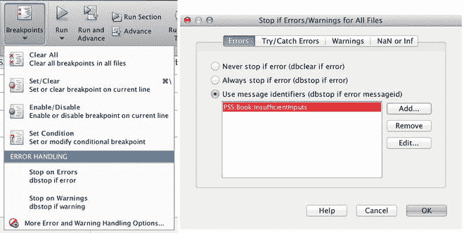

# 工作原理

`DebugLog` 中实现了一个示例日志函数。`DebugLog` 会打印出一条可以是任意内容的消息，并在其之前显示调用 `DebugLog` 的位置路径。该回溯信息通过 `dbstack` 获取。

```
%% DEBUGLOG 用于调试的日志函数

% 使用此函数代替添加 disp() 语句或省略分号。

%% 格式

% DebugLog( msg, fullPath )

%% 描述

% 使用 disp() 打印 msg 中的数据，并显示消息的路径。

% 完整路径选项将打印完整的回溯信息。

%% 输入参数

% msg (.) 任意消息

% fullPath (1,1) 如果输入，则打印完整的回溯信息

%% 输出参数

% 无

function DebugLog( msg, fullPath )

% 演示

if ( nargin < 1 )

DebugLog( rand (2,2));

return;

end

% 获取调用此函数的函数

f = dbstack;

% 仅在直接从命令行调用时取第二条路径

if ( length (f) > 1)

f1 = 2;

else

f1 = 1;

end

if ( nargin > 1 && fullPath )

f2 = length (f);

else

f2 = f1;

end

for k = f1:f2

disp (['- > ' f(k).name]);

end

disp (msg);
```

`DebugLog` 在 `DebugLogDemo` 中进行了演示。该函数包含一个子函数，用于演示回溯信息。

```
%% 演示 DebugLog

% 使用 DebugLog 将变量记录到命令窗口。

function DebugLogDemo

y = linspace (0,10);

i = FindInY(y);

function I = FindInY(y)

i = find (y < 0.5);

DebugLog( i, true );
```

这是该演示的输出：

```
>> DebugLogDemo

-> FindInY

-> DebugLogDemo

1 2 3 4 5
```

此函数的一个扩展是，如果 `msg` 是变量，则使用函数 `inputname` 添加被记录变量的名称。增加这些代码行后如下所示：

```
str = inputname(1);

if ~isempty (str)

disp (['变量: ' str]);

end
```

现在演示输出如下：

```
>> DebugLogDemo

-> FindInY

-> DebugLogDemo

变量: i

1 2 3 4 5
```

持续使用你自己的日志函数向用户显示消息并打印调试数据，将使你的代码更易于维护。

## 生成和追踪 MATLAB 错误与警告

### 问题

你希望以有序的方式向用户显示错误和警告。

### 解决方案

始终使用 `warning` 和 `error` 的附加输入参数来指定消息 ID。这允许你的消息被追踪回代码中生成它的函数，并且可以控制某些警告的显示。

### 工作原理

`warning` 函数有几个有用的参数，用于自定义和控制警告显示。当你生成一个警告时，请使用带有消息标识符的完整语法：

```
warning('消息 ID','消息内容', A, B, ...)
```

`消息 ID` 是一种助记符，形式为 `<组件>[:<组件>]:<助记符>`，例如 `PSS:函数名:非法输入`。通常，当你发出警告时，ID 不会显示，除非你通过 `warning on verbose` 和 `warning off verbose` 打开了详细显示。这很容易在命令行中演示：

```
>> warning('PSS:示例:警告演示', '这是一个示例警告')

警告: 这是一个示例警告

>> warning verbose on

>> warning('PSS:示例:警告演示','这是一个示例警告')

警告: 这是一个示例警告

(输入 "warning off PSS:示例:警告演示" 可抑制此警告。)
```

如上所示，你可以使用其消息 ID，通过显示的命令形式或函数形式 `warning('off', 'msgid')` 来关闭某个特定的警告。

如果传递额外的输出参数，`lastwarn` 函数也可以返回消息 ID，例如：

```
>> [最后消息, 最后 ID] = lastwarn

最后消息 =

这是一个示例警告

最后 ID =

PSS:示例:警告演示
```

`error` 和 `lasterr` 函数的工作方式相同。使用消息标识符的一个额外好处是，你可以在调试时选择它们，作为遇到错误或警告时停止的一个选项。调试器集成在编辑器窗口中，调试器选项分组在“断点”工具栏按钮下。该按钮和“更多选项”弹出窗口如图 5-3 所示。在此例中，我们输入了一个示例 PSS 消息标识符。



**图 5-3.** 在调试器中根据错误停止的选项

记住，你始终应该在函数的头部说明该函数可能生成的所有警告和错误！

## 测试自定义错误和警告

### 问题

你有一段代码，会对有问题的输入生成警告或错误，你需要测试它。

### 解决方案

你有两种可能的方法来测试代码中错误的生成：结合使用 `try`/`catch` 块与 `assert`，以及 `TestCase` 可用的 `verifyError` 方法。对于警告，你可以使用 `lastwarn` 或 `verifyWarning`。

### 工作原理

为代码编写一套全面的测试应该涵盖所有路径，或者尽可能接近所有路径；并且必须检验代码可能生成的所有警告和错误。你可以手动使用 `try`/`catch` 块来捕获错误，并将错误（`MException` 对象）与预期错误进行比较。对于警告，你可以检查 `lastwarn` 来确认是否已发出警告，如下所示：

```
>> lastwarn('');
>> warning('PSS:Book:id','Warning!')
警告: 警告！
>> [anywarn, anyid] = lastwarn;
>> assert(strcmp(anyid, 'PSS:Book:wrongid'))
断言失败。
```

下面是一个使用 `try`/`catch` 块配合 `assert` 来检测特定错误的示例：

```
%% 测试我们是否得到预期错误，并通过测试
errFun = @() error('PSS:Book:id','错误！');
try
    feval(errFun);
catch ME
    assert(strcmp(ME.identifier,'PSS:Book:id'));
end
```

此测试验证了抛出的错误是否为预期的错误；然而，它不会检测是否根本没有抛出任何错误。为此，你需要在 `try` 块中添加一个布尔变量。

```
%% 这次我们根本没有得到任何错误
wrongFun = @() disp('一些无错误的代码。');
tf = false;
try
    feval(wrongFun);
    tf = true;
catch ME
    assert(strcmp(ME.identifier,'PSS:Book:id'));
end
if (tf)
    assert(false,'CatchErrorTest: 未抛出错误');
end
```

当你运行这段代码时，会得到以下输出：

```
一些无错误的代码。
CatchErrorTest: 未抛出错误
```

如果你将此测试作为 `runtests` 测试脚本的一部分来运行，该测试将会失败。

一个更好的测试警告和错误的方法是使用单元测试框架的限定符来检查是否生成了预期的警告或错误。以下是一个验证警告的示例，其中一个测试将通过，另一个测试将失败；请注意，你需要向 `verifyWarning` 函数传递一个函数句柄。

```
function tests = WarningsTest
% 创建一个本地函数数组
tests = functiontests(localfunctions);
end

%% 测试函数
function passTest(testCase)
    warnFun = @()warning('PSS:Book:id','警告！');
    testCase.verifyWarning(warnFun,'PSS:Book:id');
end

function failTest(testCase)
    warnFun = @() warning('Wrong:id','警告！');
    testCase.verifyWarning(warnFun,'PSS:id','错误的 id');
end
```

当你使用 `runtests` 运行此测试函数时，可以看到 `failTest` 确实失败了。

# 标题

```
>> runtests('WarningsTest')
正在运行 WarningsTest
.警告: 警告！
===========================================================
WarningsTest/failTest 中验证失败。
----------------
测试诊断:
----------------
错误的 id
---------------------
框架诊断:
---------------------
verifyWarning 失败。
--> 函数句柄未发出预期的警告。

实际警告:
    Wrong:id

预期警告:
    PSS:id

评估函数:
    @()warning('Wrong:id','警告！')
------------------
堆栈信息:
------------------
位于 /Users/Shared/svn/Manuals/MATLABCookbook/MATLAB/Ch05-Debugging/WarningsTest.m
(failTest) 第 12 行
===========================================================
.
完成 WarningsTest
_________
失败摘要:
    名称                    失败  不完整  原因
======================================================================
    WarningsTest/failTest    X                 验证失败。

总计:
    1 通过, 1 失败, 0 不完整。
测试时间 0.047691 秒。
```

`verifyError` 的工作方式相同。在实践中，你需要创建一个函数句柄，其中包含会导致生成错误或警告的输入。

对于高级程序员，还有一个进一步的机制，可以使用 `verifyThat` 结合 `Constraint` 类来构建测试。你也可以提供自己的 `Diagnostic` 对象。有关更多信息，请参阅这些类以及 `Verifiable` 类的参考页面。

## 5.7 测试图形的生成

### 问题

你的函数生成一个图形而不是输出变量。你如何测试它？

### 解决方案

虽然你可能需要人工来验证图形看起来是否正确，但至少你可以使用 `findobj` 来验证你的函数是否生成了正确的图形集。

### 工作原理

为你的图形常规分配名称，即使你无法访问其句柄，也能很容易地测试它们是否已被生成。你还可以为图形分配标签，例如为整个工具箱设置一个单一标签，这样你就可以定位一组图形。

```matlab
>> figure('Name', '图形 1', 'Tag', 'PSS');
>> figure('Name', '图形 2', 'Tag', 'PSS')
>> h = findobj('Tag', 'PSS')
h =
  2×1 图形数组:
    图形 (PSS)
    图形 (PSS)

>> h = findobj('Name','图形 1')
h =
  带属性的图形 (PSS):
    编号: 1
    名称: '图形 1'
    颜色: [0.94 0.94 0.94]
    位置: [440 378 560 420]
    单位: '像素'
```

在你的测试中，你可以使用 `length(h)` 检查是否生成了正确数量的图形，或者使用 `strcmp` 检查每个特定命名的图形是否存在。如果你使用 `UserData` 在图形中存储了任何数据，你同样可以测试它。

如果你没有使用标签，或者需要检查没有名称或标签的图形，你可以使用 `findobj` 的 `type` 输入来查找当前所有打开的图形：

```matlab
>> findobj('type','figure')
ans =
  2×1 图形数组:
    图形 (PSS)
    图形 (PSS)
```

请注意，只有当图形通过其 `HandleVisibility` 属性对命令行可见时，`findobj` 才会返回它们。此属性可以取值 `'on'`、`'off'` 和 `'callback'`。由设计工具 GUIDE 生成的 GUI 通常是隐藏的，以防止用户使用 plot 或类似命令意外更改 GUI；这些图形使用值 `'callback'`。常规图形使用值 `'on'` 并且可以被定位。将 `HandleVisibility` 设置为 `'off'` 的图形只能通过其句柄访问。

### 总结

本章演示了如何使用 MATLAB 的单元测试框架，并提供了帮助调试函数的实用方法。表 5-2 列出了代码文件。

**表 5-2.** 章节代码清单

| 文件 | 描述 |
| --- | --- |
| `CatchErrorTest` | 演示如何在 `try` 块中捕获错误的脚本。 |
| `CompleteTriangle` | 计算三角形角度的示例函数。 |
| `DebugLog` | 自定义数据记录函数。 |
| `DebugLogDemo` | `DebugLog` 的演示，显示回溯信息。 |
| `TriangleFunctionTest` | 包含 `CompleteTriangle` 测试用例的函数。 |
| `TriangleTest` | 包含 `CompleteTriangle` 测试用例的脚本。 |
| `VerboseEigTest` | 显示所有详细级别的测试函数。 |
| `WarningsTest` | 使用 `verifyWarning` 的测试函数。 |