# 第六章 双积分器

电子补充材料：本章在线版本 (doi: [10.1007/978-1-4842-0559-4_6](http://dx.doi.org/10.1007/978-1-4842-0559-4_6)) 包含补充材料，仅供授权用户使用。

双积分器是多种物理系统的动力学模型。这包括一维运动的质量块和绕轴旋转的物体。它代表了一类具有两个状态的广泛系统。在本章中，你将学习如何对双积分器进行建模以及如何控制它。在此过程中，你将创建一些非常重要的函数，用于实现控制系统、绘制图形以及执行数值积分。这将为后续章节中更复杂的系统提供一个跳板。

## 6.1 为双积分器模型编写方程

### 问题

双积分器是一个二阶模型，具有二阶导数，且该导数独立于状态。该模型出现在许多工程学科中。

### 解决方案

你将编写模型动力学的方程，并在一个函数中实现它们。

### 工作原理

一维线性运动可以用以下微分方程建模：

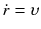

(6.1)

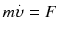

(6.2) `r` 和 `υ` 是状态；`m` 即质量，是一个参数；`F` 即力，是一个输入。状态向量为

![ $$ x=\left[\begin{array}{r}\hfill r\\ {}\hfill \upsilon \end{array}\right] $$ ](A335353_1_En_6_Chapter_Equ3.gif)

(6.3)

变量 `x` 表示为一个 MATLAB 的两行×一列数组。该数组的第一个元素是 `r`，第二个是 `υ`。

**提示：** 此方程同样适用于旋转运动。只需将 `m` 替换为惯性矩 `I`，将 `r` 替换为角度 `θ`，将 `υ` 替换为角速度 `ω`，并将 `F` 替换为扭矩 `T`。

为了编写导数的函数，将方程两边除以 `m`，以将导数隔离在方程左侧。右侧的项就是你将在所谓 `RHS` 函数中计算的内容。


(6.4)

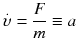

(6.5)

用向量符号写出这些方程，得到

![ $$ \dot{x}=\left[\begin{array}{r}\hfill \upsilon \\ {}\hfill a\end{array}\right] $$ ](A335353_1_En_6_Chapter_Equ6.gif)

(6.6)

现在，你可以为状态向量 `x` 的导数编写函数 `RHSDoubleIntegrator`。注意名称中的 `RHS` 前缀，这是用来标识所有可被积分的函数。速度项是状态 `x` 的第二个元素，并作为位置状态 `r` 的导数传递。速度状态的导数则是加速度 `a`。`RHS` 函数对于第一个参数有一个占位符 `∼`，积分器会将时间 `t` 传递至此，但该函数并不需要它。

```
function xDot = RHSDoubleIntegrator(∼, x, a)
xDot = [x(2);a];
```

## 6.2 创建定步长数值积分器

### 问题

在仿真中，你需要使用数值积分来演化系统的状态。

### 解决方案

你将回顾四阶龙格-库塔积分器的方程，并开发一个函数来执行定步长积分。


### 工作原理

让我们看一个直线运动的简单模型。你需要将方程转化为状态方程形式，这是一组将导数项置于左侧的一阶微分方程。例如，来自配方 6-1 的一维运动模型，其中`r`和`υ`的导数项位于方程左侧。

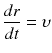

(6.7)

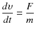

(6.8)

两边同时乘以`dt`。

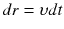

(6.9)

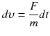

(6.10)

将`dt`替换为固定时间间隔`h`。现在你可以写出最简单的数值积分器，用于从第`k`步的状态计算第`k + 1`步的状态。

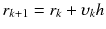

(6.11)

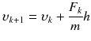

(6.12)

第`k`步位于时间`t[k]`，第`k + 1`步位于时间`t[k+1]`，其中`t[k+1] = t[k] + h`。

这种简单的积分器称为欧拉积分。它假设力`F[k]`在时间间隔`h`内是恒定的。欧拉积分对于像上述这样的简单系统效果相当不错。例如，对于一个弹簧系统：

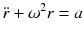

(6.13) 其振荡的固有频率为`ω`。如果时间步长大于振荡周期`2π/ω`的一半，数值积分将无法捕捉到动力学特性。实践中，时间步长`h`必须远小于一半。

由于其精度有限，欧拉积分在工程中很少使用。控制系统仿真中最常用的方法之一是四阶龙格-库塔法。其方程如下：


(6.14) `f(x, u, t)` 是微分方程的右侧部分。`O(h⁴)` 表示因积分阶次产生的截断误差与时间步长的四次方成正比。这意味着如果将时间步长减半，误差将降至较大步长误差的 0.0625。在上述系统中，右侧函数在四个不同点进行计算：在`h/2`处计算两次，在`t`和`t + h`处各计算一次。

![ $$ f\left(x,F,t\right)=\left[\begin{array}{l}\upsilon \hfill \\ {}\frac{F}{m}\hfill \end{array}\right] $$ ](A335353_1_En_6_Chapter_Equ15.gif)

(6.15)

**注意**  
存在其他具有不同系数的四阶龙格-库塔法。

MATLAB 提供了许多数值积分器。它们被设计用于在任何区间上进行积分。一些积分器，例如 `ode113`，会在期望区间内调整步长和积分阶次（欧拉为一阶，前述龙格-库塔为四阶）。对于数字控制，你需要根据数字控制器的步长进行积分。你可以为此使用 `ode113`，但通常四阶龙格-库塔法就足够了。本书中的所有示例均采用此方法。

接下来，你将查看实现方程 6.14 的 `RungeKutta` 函数。请注意在以下代码中使用 `feval` 来评估右侧函数。

```
function x = RungeKutta( Fun, t, x, h, varargin )
hO2 = 0.5*h;
tPHO2 = t + hO2;
k1 = feval( Fun, t, x, varargin{:} );
k2 = feval( Fun, tPHO2, x + hO2*k1, varargin{:} );
k3 = feval( Fun, tPHO2, x + hO2*k2, varargin{:} );
k4 = feval( Fun, t+h, x + h*k3, varargin{:} );
x = x + h*(k1 + 2*(k2+k3) + k4)/6;
```

`Fun` 是指向右侧函数的指针。`varargin` 被传递给该函数，这使得动力学模型可以拥有任意数量的参数。本书中的所有示例均使用此 `RungeKutta` 函数。你会预先计算所有需多次使用的值，例如 `t + h/2`。这对于被反复调用的函数尤为重要。

你向该函数传递一个指向右侧函数 `RHSDoubleIntegrator` 的句柄，该函数实现了方程 6.1。

**提示**  
在函数调用中，用波浪线 `~` 替换未使用的变量。

为了将模型向前积分一步，你调用：

```
xNew = RungeKutta( @RHSDoubleIntegrator, ∼, x, h, a )
```

我们的 `RungeKutta` 函数以及所有 MATLAB 积分器，都将自变量放在首位，本例中为 `t`。由于此处未使用它，你可以用波浪线替换它。MATLAB 的代码分析器会建议你这样操作，以提高代码中所有未使用的函数输入和输出的效率。

## 6.3 实现离散比例-微分控制器

### 问题

你需要能够控制双积分器系统及其他动力学系统的数字控制软件。

### 解决方案

你将推导时域中有阻尼的二阶系统的方程，然后创建一个采样数据版本，并在 MATLAB 函数中实现它。


### 工作原理

如果向系统施加一个**恒定力** `F`，质量 `m` 将会加速，其位置随时间呈平方变化。两个状态 `r` 和 `υ` 的解析解为：

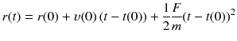

(6.16)

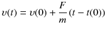

(6.17)

如果你希望质量的位置保持在零附近，可以使用一种称为**调节器**的控制系统。你将使用比例-微分调节器。该调节器测量位置，并施加一个与位置误差和位置误差导数成比例的控制力。我们来看一种特别简单的控制形式：

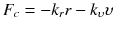

(6.18)

`F[c]` 是控制力。要使此系统工作，你不需要能够测量干扰力 `F`。如果将动态系统写成二阶系统的形式，选择增益 `k[r]` 和 `k[υ]` 就很容易：

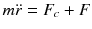

(6.19)

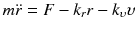

(6.20)

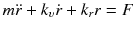

(6.21)

被控系统是一个**阻尼二阶振荡器**。你可以将所需的微分方程写成：

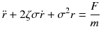

(6.22) 其中增益为：

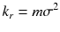

(6.23)

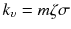

(6.24) `σ` 是**无阻尼自然频率**，`ζ` 是**阻尼比**。只要增益为正，该系统就始终稳定。如果 `F` 是恒定的，位置最终会稳定在一个偏移量上。这个偏移量为：

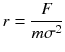

(6.25)

这种控制设计方法被称为**“极点配置”**。

几乎所有控制系统都是在数字计算机上实现的，因此你必须将此控制器转换为**数字形式**。假设你只测量位置。第一步是将控制部分组合成**连续时间状态空间形式**。在本实现中，你将为 PD 控制器添加一个**速率滤波器**。

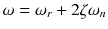

(6.26)

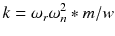

(6.27)

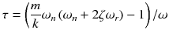

(6.28)

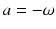

(6.29)

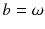

(6.30)

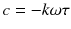

(6.31)

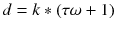

(6.32) 其中 `ω[r]` 是速率项上一阶滤波器的**截止频率**；`ω[n]` 是控制器的**无阻尼自然频率**；`ζ` 是控制器的**阻尼比**。`m` 是**“质量”**或惯性。你通常可以将其设为 1，然后缩放控制输出。无阻尼自然频率给出了控制器的**带宽**。带宽越高，其对误差的响应越快。带宽越高，由恒定输入引起的偏移误差就越小。

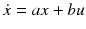

(6.33)

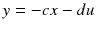

(6.34) `x` 是控制器状态，`u` 是位置测量值。状态空间形式便于计算，但仍然假设你在**连续采样**。有许多方法可以将其转换为数字形式。你将使用**零阶保持器**，这意味着你将在每个采样周期计算控制量，并在该采样周期内保持该值。你可以使用 MATLAB 中的矩阵指数函数 `expm` 进行转换。如果 `T` 是采样周期，你可以构建矩阵：

![ $$ \sigma =\left[\begin{array}{ll}aT\hfill & bT\hfill \\ {}0\hfill & 0\hfill \end{array}\right] $$ ](A335353_1_En_6_Chapter_Equ35.gif)

(6.35)

`a` 和 `b` 的离散时间形式为：

![ $$ \left[\begin{array}{r}\hfill {a}_d\\ {}\hfill {b}_d\end{array}\right]={e}^{\sigma } $$ ](A335353_1_En_6_Chapter_Equ36.gif)

(6.36)

数字控制器现在为：

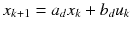

(6.37)

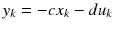

(6.38)

现在让我们看看 `PDControl`。该函数设计并实现了公式 6.26 中推导出的控制系统。其名称代表“比例-微分控制”。它有几个子函数。函数头如下所示。它包含一个指向其中一个子函数帮助文档的链接，当函数头在命令行显示时，该链接是活动的。你需要列出输入和输出的每个数据结构字段。

```
%% PDCONTROL 设计和实现一个采样时间下的 PD 控制器。

%% 形式

% d = PDControl( 'struct' )

% d = PDControl( 'initialize', d )

% [ y, d ] = PDControl( 'update', u, d )

%

%% 描述

% 设计一个 PD 控制器并以离散形式实现。

%

% y = -c*x - d*u

% x = a*x + b*u

%

% 其中 u 是输入，y 是输出。该控制器在微分项上具有一阶速率滤波器。

%

% 将模式设置为 initialize 来为控制器创建状态空间矩阵。

% 将模式设置为 update 来更新控制器并获取新的输出。

%

% 利用子函数 C2DZOH 进行离散化，参见 <a href="matlab: help PDControl> CToDZOH">CToDZOH 帮助文档</a>

%

%% 输入

% mode (1,1) 'initialize' 或 'update'

% u (1,1) 测量值

% d (.) 数据结构

% .m (1,1) 质量

% .zeta (1,1) 阻尼比

% .wN (1,1) 无阻尼自然频率

% .wD (1,1) 微分项滤波器截止频率

% .tSamp (1,1) 采样周期*

% .x (1,1) 控制器状态

%

%% 输出

% y (1,1) 控制量

% d (.) 数据结构的补充字段

% .a (1,1) 状态转移矩阵

% .b (1,1) 输入矩阵

% .c (1,1) 状态输出矩阵

% .d (1,1) 前馈矩阵

% .x (1,1) 更新后的控制器状态
```

接下来是函数体。注意其中的 `switch` 语句以及底部的两个子函数 `CToDZOH` 和 `DefaultStruct`。

```
function [y, d] = PDControl( mode, u, d )

% 演示

if ( nargin < 1 )

disp('使用默认结构体进行 PDControl 演示')

d = PDControl('struct');

d = PDControl('initialize',d);

disp(d)

return

end

switch lower (mode)

case 'initialize'

d = u;

w = d.wD + 2*d.zeta*d.wN;

k = d.wD*d.wNˆ2*d.m/w;

tau = ((d.m/k)*d.wN*(d.wN + 2*d.zeta*d.wD) - 1 )/w;

d.a = -w;

d.b = w;

d.c = -k*w*tau;

d.d = k*(tau*w + 1);

[d.a, d.b] = CToDZOH(d.a,d.b,d.tSamp);

y = d;

case 'update'

y = -d.c*d.x - d.d*u;

d.x = d.a*d.x + d.b*u;

case 'struct'

y = DefaultStruct;

otherwise

error('%s 不是一个有效的模式',mode);

end

function [f, g] = CToDZOH( a, b, T )

%% CToDZOH

% 使用零阶保持器进行连续到离散的变换。使用矩阵指数进行离散化，< matlab:doc ('expm') expm >。

%

% [f, g] = C2DZOH( a, b, T )

%

% * 输入 *

%

% a (1,1) 连续系统矩阵

% b (1,1) 输入矩阵

% T (1,1) 时间步长

%

% * 输出 *

%

% f (1,1) 离散系统矩阵

% g (1,1) 离散输入矩阵

%

% 另请参阅

% expm

q = expm ([a*T b*T; zeros (1,2)]);

f = q(1,1);

g = q(1,2);

function d = DefaultStruct

d.m = 1.0;

d.zeta = 0.7;

d.wN = 0.1;

d.wD = 0.5;

d.tSamp = 1.0;

d.x = 0.0;

d.a = [];

d.b = [];

d.c = [];

d.d = [];
```

这是我们工程函数的标准格式。以下是其重要特性：

-   它将设计和实现结合在一个函数中。
-   它返回其所使用的默认数据结构。
-   它具有多种模式。
-   它具有内置演示。
-   它包含嵌套函数。

内置演示使用了默认值。这些默认值让用户了解函数的合理参数。该内置演示生成状态空间矩阵，在本例中这些矩阵是标量。

```
使用默认结构体进行 PDControl 演示

m: 1

zeta: 0.7000

wN: 0.1000

wD: 0.5000

tSamp: 1

x: 0

a: 0.5273

b: 0.4727

c: -0.0722

d: 0.0800
```

本可以添加一个包含仿真的更复杂的演示。内置演示非常有用，因为它们向用户展示了如何使用该函数的简单示例。同时也有助于开发该函数，因为你只需在命令行中键入函数名即可测试该函数。

第一个参数是模式变量，它指示函数应该执行 `switch` 语句中的哪个`case`。必须先运行“initialize”模式。初始化会修改数据结构，该数据结构用作函数的内存。你也可以将持久变量用于函数内存。使用输出可以更方便地以编程方式检查内存内容。“update”模式用于在接收到新输入时更新控制器。`switch` 语句包含一个“otherwise”情况，用于警告用户模式错误。这会抛出一个错误，停止脚本的执行。你可能并不总是希望这样做，而可能只使用警告来提醒用户。

嵌套函数 `CToDZOH` 使用公式 6.35 将连续控制系统转换为采样数据控制系统。其名称代表“连续到离散零阶保持器”（Continuous to Discrete Zero-Order Hold）。非控制专家可能无法立即理解这个缩写，但展开后的名称又太长，不适合作为有用的函数名。

**提示：** 使函数名称格式一致，并使用你所在领域的标准术语。请记住，并非所有代码读者都以英语为母语！

如果你正在构建一个工具箱，`CToDZOH` 函数很可能会是一个单独的文件。但对于本书而言，它仅由 `PDControl` 使用，因此你将其放入该函数文件中。


### 6.4 使用数字控制模拟双积分器

#### 问题
您希望模拟双积分器模型的数字控制。

#### 解决方案
您将编写一个脚本，在循环中顺序调用控制函数和积分函数，并绘制结果图。

#### 工作原理
表 6-1 列出了您将在双积分器模拟中使用的控制参数的标称值。

表 6-1. 控制参数

| `Zeta` | 阻尼比 | 1.0 |
| --- | --- | --- |
| `wN` | 无阻尼固有频率 | 0.1 弧度/秒 |
| `wD` | 微分项滤波器截止频率 | 1.0 弧度/秒 |
| `dT` | 时间步长 | 0.1 秒 |

模拟脚本在 `DoubleIntegratorSim.m` 中实现。请注意，使用单元格分隔符将脚本划分为可以独立运行的部分。“另请参阅”部分列出了所使用的函数，当通过命令行帮助显示标头时，这些函数会显示为链接。

```
%% 双积分器演示
% 演示双积分器的控制。
%% 另请参阅
% PDControl, RungeKutta, RHSDoubleIntegrator, TimeLabel
%% 初始化
tEnd = 100; % 模拟结束时间（秒）
dT = 0.1; % 时间步长（秒）
aD = 1.0; % 扰动加速度（米/秒²）
controlIsOn = false; % 如果使用控制器，则为 true
x = [0;0]; % [位置；速度]
% 控制器参数
d = PDControl( 'struct' );
d.zeta = 1.0;
d.wN = 0.1;
d.wD = 1.0;
d.tSamp = dT;
d = PDControl( 'initialize', d );
%% 模拟
nSim = tEnd/dT+1;
xPlot = zeros(3,nSim);
for k = 1:nSim
    if ( controlIsOn )
        [u, d] = PDControl('update',x(1),d);
    else
        u = 0;
    end
    xPlot(:,k) = [x;u];
    x = RungeKutta( 'RHSDoubleIntegrator', 0, x, dT, aD+u );
end
%% 绘制结果
yL = {'r (m)' 'v (m/s)' 'u (m/s²)'};
[t,tL] = TimeLabel(dT*(0:(nSim-1)));
PlotSet( t, xPlot, 'x label', tL, 'y label', yL );
```

第一个代码块设置了用户可以更改的模拟参数。如果希望使用控制器，则将 `controlIsOn` 变量设置为 `true`。这使得在不使用控制器的情况下测试脚本变得容易。当控制器被禁用时，您将得到“开环”响应。在测试控制器之前，确保开环响应合理是一个好习惯。

**提示：** 将所有用户可以更改的参数放置在脚本的开头。

第二个代码块设置了控制器。回想一下，`PDControl` 有三个参数：`'struct'`、`'initialize'`、`'update'`。第一个参数返回函数所需的数据结构。在该语句之后的行中，您使用为问题选择的值填充结构体字段。在此代码块末尾，您初始化了控制器。这将把控制器状态设置为零，并创建采样时间状态空间矩阵，在本例中为四个标量。

第三个代码块是模拟过程，其中包含检查控制器是否开启的语句。请注意控制函数之后紧接着积分器的顺序使用。这是离散控制，因为控制量 `u` 在积分时间步长内是恒定的。最后一个代码块绘制了结果。

图 6-1 展示了通过将 `controlIsOn` 标志设置为 `false` 并执行 `DoubleIntegratorSim` 所获得的开环响应。速度呈线性增加，位置随时间平方增加，符合预期。输出结果与公式 6.16 中的解析解一致。图 6-2 展示了将 `controlIsOn` 设置为 `true` 时的闭环响应。速度降至零，位置达到一个常数（非零）。控制加速度 `u` 精确匹配扰动加速度 `a`。您本可以使用比例积分微分（PID）控制器来消除位置偏移。

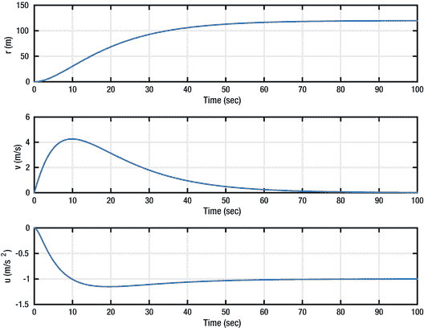
图 6-2. 在 1 米/秒² 恒定扰动加速度下的闭环响应

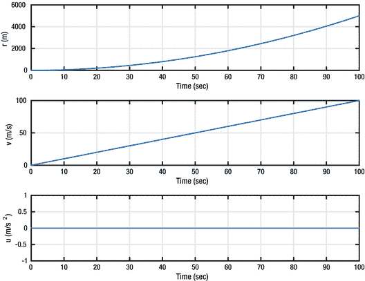
图 6-1. 在 1 米/秒² 恒定扰动加速度下的开环响应

这两个示例表明，模拟在没有控制的情况下也能工作，并且控制按预期执行。此脚本是对标头中列出的所有函数的集成测试。它在测试这些函数的功能方面表现良好。然而，一次测试不足以理解控制器。让我们通过将域 `d.zeta` 中的 ζ 设置为 0.2 来使控制器欠阻尼。现在响应开始振荡（见图 6-3）。您将 `tEnd` 设置为 300 以显示其阻尼过程。

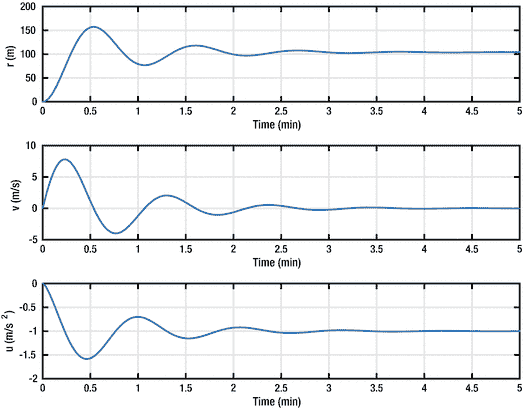
图 6-3. 在 1 米/秒² 恒定扰动加速度且 ζ 等于 0.2 时的闭环响应

另一件可以尝试的事情是将带宽设置得非常高。将域 `d.wN` 中的 ω[n] 设置为 8，将速率滤波器带宽 `d.wD` 设置为 50。结果如图 6-4 所示。控制器变得不稳定，因为带宽远高于采样率所允许的值。

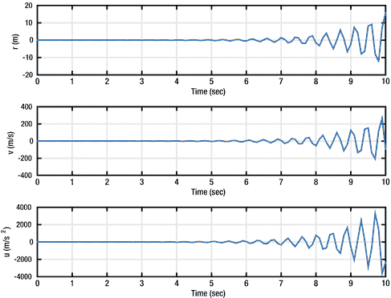
图 6-4. 使用过高的带宽进行采样时的闭环响应

您的带宽必须小于采样带宽的一半，采样带宽为

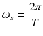 (6.39)

所有结果均为预期行为。最后一种情况是所谓的边缘或极端情况，表明预期的失稳确实会发生。对于这个公认的简单控制系统示例，这四种情况构成了最小化的测试集。

### 6.5 使用合理的时间单位创建时间轴

#### 问题
您希望时间轴具有易于读取的单位，而不仅仅是秒。

#### 解决方案
您将创建一个函数，检查时间跨度并将秒转换为分钟、小时、天或年。

#### 工作原理
您检查时间数组中的最大时间，并将其缩放到更大的时间单位。实现的时间单位包括秒、分钟、小时、天和年。您返回缩放后的时间向量、标签字符串和单位字符串，因为这些信息可能有用。

```
function [t, c, s] = TimeLabel( t )
secInYear = 365.25*86400;
secInDay = 86400;
secInHour = 3600;
secInMinute = 60;
tMax = max(t);
if ( tMax > secInYear )
    c = 'Time (years)';
    s = 'years';
    t = t/secInYear;
elseif ( tMax > 3*secInDay )
    c = 'Time (days)';
    t = t/secInDay;
    s = 'days';
elseif ( tMax > 3*secInHour )
    c = 'Time (hours)';
    t = t/secInHour;
    s = 'hours';
elseif ( tMax > 3*secInMinute )
    c = 'Time (min)';
    t = t/secInMinute;
    s = 'min';
else
    c = 'Time (sec)';
    s = 'sec';
end
```

### 6.6 创建具有多个子图的图形

#### 问题
在控制分析过程中，您经常需要生成具有多个子图的图形，这会导致每个脚本底部出现大量重复代码块。

#### 解决方案
您创建一个函数，可以轻松地用一行代码生成子图。


