# 8. 电机

电子补充材料：本章在线版本（doi: [10.1007/978-1-4842-0559-4_8](http://dx.doi.org/10.1007/978-1-4842-0559-4_8)）包含补充材料，可供授权用户使用。

你将建立一个由直流电源驱动的三相永磁电机的模型。定子上有三个线圈，转子上有永磁体。这种类型的电机由直流电源驱动，该电源带有连接到三个线圈（称为 A、B 和 C 线圈）的六个半导体开关。可以使用两个或更多线圈来驱动无刷直流电机，但三个线圈尤其易于实现。这种类型的电机如今用于大多数工业应用中，包括电动汽车和机器人。它有时被称为无刷直流电机（BLDC）或永磁同步电机（PMSM）。

脉宽调制用于开关，因为其效率高；当不需要时，开关会关闭。为电机和脉宽调制编写模型代码相对简单。在仿真中，我们演示了使用两种时间步长：一种用于仿真以处理脉冲宽度，另一种用于外部控制环路。仿真脚本将包含多个控制标志，以便对此复杂系统进行调试。

## 8.1 对三相无刷永磁电机进行建模

### 问题

你希望以适合控制系统设计的形式，对三相永磁同步电机进行建模。图 8-1 展示了一个概念图。该电机具有三个定子绕组和一个位于转子上的永磁体。该磁体有两个磁极，即一个磁极对。坐标轴为定子上的 `a`、`b` 和 `c` 轴；每个线圈的中心轴按右手定则确定方向，而 `(d,q)` 坐标系则固定在旋转框架中的磁体上。在电机应用中，这些轴表示电流或电压，而非机械工程中的位置量。

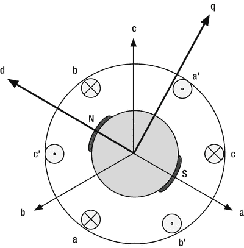
图 8-1. 电机示意图，展示了定子上的三相线圈 `a`、`b`、`c` 以及转子上的两极磁体 (N,S)。符号 `×` 表示电流流入纸面，点表示电流流出纸面

### 解决方案

解决方案是对一个具有三个定子线圈和永磁转子的电机进行建模。你需要对线圈电流和转子的物理状态进行建模。

### 工作原理

永磁同步电机在定子中使用两个或更多绕组，并在转子中使用永磁体。转子可以具有任意偶数个磁极。定子线圈中的电流相位必须与转子位置同步。定义电感矩阵 `L` ¹：
```
L = (1/d) * [ 2L_ss - L_m,  L_m,        L_m;
             L_m,          2L_ss - L_m,  L_m;
             L_m,          L_m,          2L_ss - L_m ]
```
(8.1) 其中
```
d = 2L_ss² - L_ss*L_m - L_m²
```
(8.2)
`L_m` 是相绕组的互感，`L_ss` 是自感。相电流阵列 `i` 为：
```
i = [ i_a; i_b; i_c ]
```
(8.3) 其中 `i_a` 是 A 相定子绕组电流；`i_b` 是 B 相电流；以此类推。相电压 `u` 为：
```
u = [ u_a; u_b; u_c ]
```
(8.4) 其中 `u_a` 是 A 相定子绕组电压。动力学方程为：
```
[ di/dt; dω_e/dt; dθ_e/dt ] = [ -r_s*L, 0, 0; 0, -b/J, 0; 0, 1, 0 ] * [ i; ω_e; θ_e ]
                               + ψ * [ -L*ω_e; (p²*i^T)/(4J); 0 ] * [ cos(θ_e); cos(θ_e + 2π/3); cos(θ_e - 2π/3) ]
                               + [ L, 0, 0; 0, 0, 0; 0, 0, 0 ] * u
                               + [ 0; p/(2J); 0 ] * T_L
```
(8.5) 其中 `ω` 是转子角速率，`θ` 是转子角度；`p` 是转子磁极数；`b` 是粘性阻尼系数；`r_s` 是定子电阻；`ψ` 是磁通量；`T_L` 是负载转矩；`J` 是转子转动惯量。`i` 和 `u` 是上文展示的相绕组三维向量，`L` 是同样展示的 3×3 电感矩阵。公式 8.5 实际上是矩阵形式的五个方程。针对电流阵列 `i` 的前三个方程是电气动力学方程。针对 `ωe` 和 `θ_e` 的最后两个方程是以电气坐标表示的机械动力学方程。

驱动电路如图 8-2 所示。它包含六个半导体开关。在该模型中，这些开关被视为理想开关，意味着它们可以以你期望的任何频率瞬时切换。在实际应用中，开关具有最大开关速度和一定的瞬态响应。请注意，电机采用 Y 型连接，这意味着三相绕组的末端连接在一起。

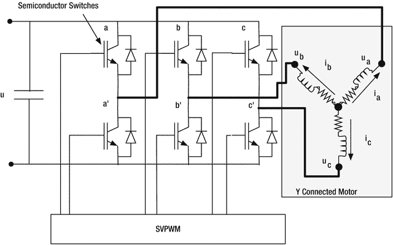
图 8-2. 电机三相驱动电路。图中所示的半导体开关为 IGBT（绝缘栅双极型晶体管）。脉宽调制模块 `SVPWM` 将在配方 8-3 中讨论

右侧代码如下所示。第一个输出是状态导数，用于积分计算。第二个输出是控制所需的电磁转矩。第一段代码定义了电机模型数据结构，其中包含动力学方程所需的参数。调用该函数时不带输入参数即可检索此结构。其余代码实现了公式 8.5。请注意，`ω` 和 `θ` 使用的后缀 `M` 旨在强调这些是机械量；这将其与电气量区分开来，电气量之间的关系为 `p/2`，其中 `p` 是磁极数。在为电机编写软件时，使用 `M` 和 `E` 下标是典型做法。

# RHSPMMACHINE 永磁电机 ABC 坐标系模型

假设采用 Y 型连接的三相电机。永磁体磁通分布假定为正弦分布。

## 形式

`d = RHSPMMachine`
`[xDot,tE] = RHSPMMachine(˜, x, d)`

## 输入

`t (1,1)` 时间，未使用
`x (5,1)` 状态向量 `[iA;iB;iC;omegaE;thetaE]`
`d (.)` 数据结构
`.lM (1,1)` 互感
`.psiM (1,1)` 永磁体磁通
`.lSS (1,1)` 定子自感
`.rS (1,1)` 定子电阻
`.p (1,1)` 磁极数 (1/2 磁极对数)
`.u (3,1)` `[uA;uB;uC]`
`.tL (1,1)` 负载转矩
`.bM (1,1)` 粘性阻尼 (Nm/rad/s)
`.j (1,1)` 转动惯量
`.u (3,1)` 相电压 `[uA;uB;uC]`

## 输出

`x (5,1)` 状态向量导数
`tE (1,1)` 电磁转矩

## 参考文献

Lyshevski, S. E., "Electromechanical Systems, Electric Machines, and Applied Mechatronics," CRC Press, 2000.

```matlab
function [xDot, tE] = RHSPMMachine(˜, x, d )
  if ( nargin == 0 )
    xDot = struct('lM',0.0009,'psiM',0.069, 'lSS',0.0011,'rS',0.5,'p',2,...
        'bM',0.000015,'j',0.000017,'tL',0,'u',[0;0;0]);
    return
  end

  % 磁极对数
  pP = d.p/2;

  % 状态
  i = x(1:3);
  omegaE = x(4);
  thetaE = x(5);

  % 电感矩阵
  denom = 2*d.lSSˆ2 - d.lSS*d.lM - d.lMˆ2;
  l2 = d.lM;
  l1 = 2*d.lSS - l2;
  l = [l1 l2 l2;l2 l1 l2;l2 l2 l1]/denom;

  % 右侧
  tP3 = 2*pi/3;
  c = cos(thetaE + [0;-tP3;tP3]);
  iDot = l*(d.u - d.psiM*omegaE*c - d.rS*i);
  tE = pPˆ2*d.psiM*i'*c;
  omegaDot = (tE - d.bM*omegaE - pP*d.tL)/d.j;
  xDot = [iDot;omegaDot;omegaE];
```

## 8.2 控制电机

### 问题

你希望控制电机以产生所需的转矩。具体来说，你需要计算施加到定子线圈上的电压。

### 解决方案

你将使用磁场定向控制（FOC）结合比例积分控制器来控制电机。FOC 是一种控制方法，它将定子电流变换为两个正交分量。一个分量定义电机的磁通，另一个分量定义转矩。计算出的控制电压通过半导体开关的脉宽调制来实现，正如上一配方中所述。

### 工作原理

电机控制器如图 8-3 所示。该控制器实现了磁场定向控制（FOC）。FOC 有效地将无刷三相电机转变为带换向器的直流电机。

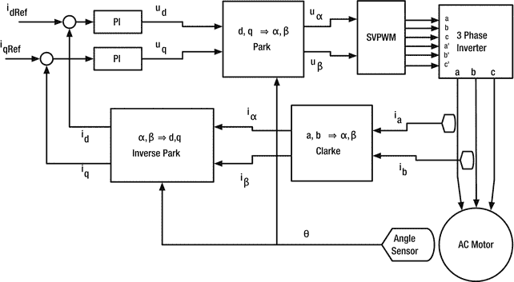

图 8-3. 电机控制器。`PI` 代表比例积分控制器。`PWM` 代表脉宽调制。有两个电流传感器测量 `i[a]` 和 `i[b]`，以及一个角度传感器测量 `θ`

该问题涉及三种电气参考坐标系。第一种是 `(`α`,`β`,`χ`)` 坐标系，即图 8-1 所示的三相定子坐标系。这是一个**时变**坐标系。接着，需要将其变换为一个两轴时变坐标系 `(`α`,`β`)`，然后再变换为一个两轴时不变坐标系 `(`d`,`q`)`，该坐标系也称为直轴和交轴，并且**固定**在永磁体上。在我们的坐标系中，每个轴代表一个电流。对于采用 Y 形连接的电机，电流之和为零，因此只需处理两个电流：`i [a]` 和 `i [b]`。

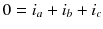

(8.6)

从 `(`d`,`q`)` 到 `(`α`,`β`)` 的变换称为正向 Park 变换：

![ $$ \left[\begin{array}{r}\hfill {u}_{\alpha}\\ {}\hfill {u}_{\beta}\end{array}\right]=\left[\begin{array}{rrr}\hfill \cos {\theta}_e& \hfill - \sin {\theta}_e& \hfill \\ {}\hfill \sin {\theta}_e& \hfill \cos {\theta}_e& \hfill \end{array}\right]\left[\begin{array}{r}\hfill {u}_d\\ {}\hfill {u}_q\end{array}\right] $$ ](A335353_1_En_8_Chapter_Equ7.gif)

(8.7)

该变换将静止的 `(`d`,`q`)` 坐标系变换为旋转的 `(`α`,`β`)` 坐标系。其中 `θ [e]` 是电角度，等于 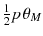，`p` 是磁极对数。对于 Y 形连接的电机，正向 Clarke 变换为：

![ $$ \left[\begin{array}{r}\hfill {u}_{\alpha}\\ {}\hfill {u}_{\beta}\end{array}\right]=\left[\begin{array}{rrr}\hfill 1& \hfill 0& \hfill \\ {}\hfill \frac{1}{\sqrt{3}}& \hfill \frac{2}{\sqrt{3}}& \hfill \end{array}\right]\left[\begin{array}{r}\hfill {u}_a\\ {}\hfill {u}_b\end{array}\right] $$ ](A335353_1_En_8_Chapter_Equ8.gif)

(8.8)

这两个变换分别在函数 `ClarkeTransformationMatrix` 和 `ParkTransformationMatrix` 中实现。它们允许我们从时变的 `(`α`,`β`,`χ`)` 坐标系转换到时不变但仍旋转的 `(`δ`,`θ`)` 坐标系。

在直轴-交轴坐标系下，通用永磁电机的方程如下：

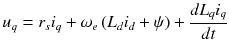

(8.9)

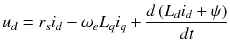

(8.10)

其中 `u` 是电压，`i` 是电流；`r [s]` 是定子电阻；`L [q]` 和 `L [d]` 分别是 `d` 轴和 `q` 轴的电感；`ω [e]` 是电角速度；`ψ` 是永磁体产生的磁链。产生的电磁转矩为：

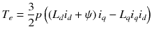

(8.11)

其中 `p` 是极对数。

转矩方程为：

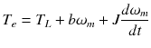

(8.12)

其中 `b` 是机械阻尼系数，`J` 是转动惯量，机械角速度与电角速度之间的关系为：

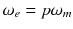

(8.13)

对于采用槽内线圈的表贴式磁钢电机，`L [d] = L [q]` = `L`，并且电感不是时间的函数。方程简化为：

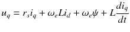

# 开关的脉宽调制

## 问题
在上一节中，你计算了施加于定子的控制电压。现在，你需要将这些控制电压作为输入，通过脉宽调制来驱动开关。

## 解决方案
你将使用空间矢量调制，从旋转的二维`(α, β)`坐标系转换到旋转的三维`(α, β, χ)`定子坐标系，这比直接在`(α, β, χ)`坐标系中进行调制在计算上更加高效。

## 工作原理
你将使用空间矢量调制来控制开关，以实现脉冲宽度调制。² 这一过程从`(α, β)`坐标转换到开关状态(`α`,`β`,`χ`)。每一相的每个节点要么接地，要么连接到`+u`。这些值如图 8-4 所示。图中的六个辐条以及原点，对应着八个离散的开关状态。

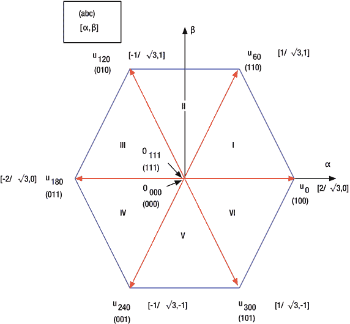
图 8-4. `(α, β)`坐标下的空间矢量调制。你需要确定当前所处的扇区（用罗马数字表示），然后选择合适的矢量进行施加，从而使它们平均起来能达到所需的电压。括号内的数字是归一化后的`[α, β]`电压值

表 8-1 详细列出了这八个离散的开关状态、它们在`(α, β)`坐标中对应的矢量以及由此产生的电压。请注意，`O`矢量位于空间矢量调制的原点，而`U`矢量则按 60 度增量排列。状态从 0 到 7 进行索引，其中 0 代表所有开关断开的状态，7 代表所有开关闭合的状态。

表 8-1. 空间矢量调制。在矢量名称中，`O`表示断开，`U`表示施加了电压，而下标表示在α-β平面中的角度。开关状态为`a`、`b`、`c`，如图 8-2 所示，其中 1 表示开关闭合，0 表示开关断开

| k | abc | 矢量 | `u[a] / u` | `u[b] / u` | `u[c] / u` | `u[ab] / u` | `u[bc] / u` | `u[ac] / u` |
| :--- | :--- | :--- | :--- | :--- | :--- | :--- | :--- | :--- |
| 0 | 000 | `O[000]` | 0 | 0 | 0 | 0 | 0 | 0 |
| 1 | 110 | `U[60]` | 2/3 | 1/3 | −1/3 | 1 | 0 | −1 |
| 2 | 010 | `U[120]` | 1/3 | 1/3 | −2/3 | 0 | 1 | −1 |
| 3 | 011 | `U[180]` | −1/3 | 2/3 | −1/3 | −1 | 1 | 0 |
| 4 | 001 | `U[240]` | −2/3 | 1/3 | 1/3 | −1 | 0 | 1 |
| 5 | 101 | `U[300]` | −1/3 | −1/3 | 2/3 | 0 | −1 | 1 |
| 6 | 100 | `U[360]` | 1/3 | −2/3 | 1/3 | 1 | −1 | 0 |
| 7 | 111 | `O[111]` | 0 | 0 | 0 | 0 | 0 | 0 |

(8.14)
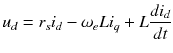

(8.15)
我们将直轴电流 `i[d]` 控制为零。如果 `i[d]` 为零，则控制对于 `i[q]` 是线性的。此时转矩为：
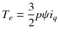

(8.16)
因此，转矩仅是交轴电流 `i[q]` 的函数。所以我们可以通过控制交轴电流来控制电磁转矩。而交轴电流又由直轴和交轴电压控制。现在，可以根据转矩设定值 `T[e]^s` 计算出所需电流 `i[q]^s`。
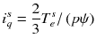

(8.17)
我们使用比例积分控制器来计算 (`δ`,`θ`) 电压。控制器的比例部分驱动误差趋于零。但是，如果存在稳态扰动，将会产生偏移。积分部分可以将这种稳态扰动引起的误差驱动为零。比例积分控制器的形式如下：
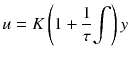

(8.18)
其中 `u` 是控制量，`y` 是被测量，`τ` 是积分器时间常数，`K` 是前向（比例）增益。控制量 `u` 将是相电压，被测量 `y` 是在 (`δ`,`θ`) 坐标系下的电流误差。
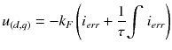

(8.19)
其中：
![ $$ {\left[\begin{array}{c}\hfill {i}_d\hfill \\ {}\hfill {i}_q\hfill \end{array}\right]}_{err}=\left[\begin{array}{c}\hfill {i}_d\hfill \\ {}\hfill {i}_q\hfill \end{array}\right]-\left[\begin{array}{c}\hfill 0\hfill \\ {}\hfill {i}_q^s\hfill \end{array}\right] $$ ](A335353_1_En_8_Chapter_Equ20.gif)

(8.20)
现在，我们编写一个名为 `TorqueControl` 的函数，该函数根据当前状态 `x` 计算控制电压 `u[(α, β)]`。状态向量与配方 8-1 相同；即 (`α`,`β`,`χ`) 坐标系下的电流 `i` 以及角度状态 `θ` 和 `ω`。我们使用 Park 和 Clarke 变换来计算 (`δ`,`θ`) 坐标系下的电流。然后使用欧拉积分实现比例积分控制器。该函数将其数据结构用作存储器——更新后的结构体 `d` 作为输出返回。`TorqueControl` 函数如下所示。

```matlab
%% TORQUECONTROL 交流电机的转矩控制
% 确定产生所需转矩的交轴电流，并使用比例积分控制器控制电机。
% 我们将直轴电流控制为零，因为我们希望仅利用磁通与交轴电流相互作用。
% 我们可以将直轴电流控制为其他值以实现弱磁控制，但这会导致非线性控制系统。
%% 格式
% d = TorqueControl
% [u, d, iAB] = TorqueControl( torqueSet, x, d )
%
%% 输入参数
% torqueSet (1,1) 转矩设定点
% x (5,1) 状态 [ia;ib;ic;omega;theta]
% d (.) 控制数据结构体
% .kF (1,1) 前向增益
% .tauI (1,1) 积分时间常数
% . iDQInt (2,1) 电流误差的积分
% . dT (1,1) 时间步长
% . psiM (1,1) 磁通量
% . p (1,1) 磁极对数
%
%% 输出参数
% u (2,1) 控制电压 [alpha;beta]
% d (.) 控制数据结构体
% iAB (2,1) 稳态电流 [alpha;beta]
%
function [u, d, iAB] = TorqueControl( torqueSet, x, d )
% 默认数据结构体
if ( nargin == 0 )
    u = struct('kF',0.003,'tauI',0.001, 'iDQInt',[0;0], 'dT', 0.01,...
               'psiM',0.0690,'p',2);
    return
end
% Clarke 和 Park 变换
thetaE = 0.5*d.p*x(5);
park = ParkTransformationMatrix( thetaE );
iPark = park';
clarke = ClarkeTransformationMatrix;
iDQ = iPark*clarke*x(1:2);
% 产生所需转矩的设定点 [iD;iQ]
iDQSet = [0;(2/3)*torqueSet/(d.psiM*d.p)];
% 误差
iDQErr = iDQ - iDQSet;
% 积分项
d.iDQInt = d.iDQInt + d.dT*iDQErr;
% 控制量
uDQ = -d.kF*(iDQErr + d.iDQInt/d.tauI);
u = park*uDQ;
% 稳态电流
if ( nargout > 2 )
    iAB = park*iDQSet;
end
```

为了产生所需的转矩，你必须组合使用这些矢量或开关状态，从而在平均值上达到所需的电压。你在(`α`, `β`)平面中选择包围目标角度的两个矢量（`O`或`U`）；它们被指定为`k`和`k + 1`，其中`k`指的是表 8-1 中矢量的序号。然后，你必须计算在每个开关状态下应花费的时间，每个脉冲宽度周期计算一次。这两个时间段`T[k]`和`T[k + 1]`的持续时间由以下方程求得：

![ $$ \left[\begin{array}{l}{T}_k\hfill \\ {}{T}_{k+1}\hfill \end{array}\right]=\frac{\sqrt{3}}{2}\frac{T_s}{u_d}\left[\begin{array}{rr}\hfill \sin \frac{k\pi }{3}& \hfill - \cos \frac{k\pi }{3}\\ {}\hfill - \sin \frac{\left(k-1\right)\pi }{3}& \hfill \cos \frac{\left(k-1\right)\pi }{3}\end{array}\right]\left[\begin{array}{r}\hfill {u}_{\alpha}\\ {}\hfill {u}_{\beta}\end{array}\right] $$ ](A335353_1_En_8_Chapter_Equ21.gif)

(8.21)

相应的(`a`,`b`,`c`)开关模式分别按计算出的时间使用，其平均值即为指定的电压。

在每个模式中花费的时间`T[k]`或`T[k + 1]`随后被分成相等的两部分，以使整个脉冲模式对称。零时间`T[0]`（即不需要开关动作的时间）被平均分配在脉冲端点与脉冲中点`T[s]`之间——这样，中间模式（`O[111]`）的时间是两端模式（`O[000]`）时间的两倍。这样总共产生七个分段，如图 8-5 所示。总的中间时间被指定为`T[7]`。

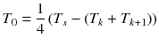

(8.22)

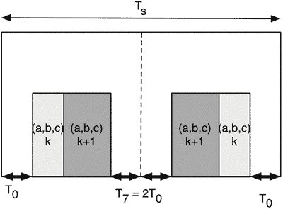

图 8-5. 脉冲周期分段。每个脉冲周期`T[s]`被分成七个分段，使得两种开关模式`k`和`k + 1`对称地施加

对于图 8-4 中的偶数扇区和奇数扇区，脉冲分段的实现略有不同。两者都以脉冲中点为对称，但模式`k`和`k + 1`的实现顺序是相反的。这在以下等式中针对产生的电压`u`进行了展示。在偶数扇区中使用第一个等式，在奇数扇区中使用第二个等式。

![ $$ \left[\begin{array}{lllllll}{u}_0\hfill & {u}_k\hfill & {u}_{k+1}\hfill & {u}_7\hfill & {u}_{k+1}\hfill & {u}_k\hfill & {u}_0\hfill \end{array}\right] $$ ](A335353_1_En_8_Chapter_Equ23.gif)

(8.23) 和

![ $$ \left[\begin{array}{lllllll}{u}_0\hfill & {u}_{k+1}\hfill & {u}_k\hfill & {u}_7\hfill & {u}_k\hfill & {u}_{k+1}\hfill & {u}_0\hfill \end{array}\right] $$ ](A335353_1_En_8_Chapter_Equ24.gif)

(8.24)

在奇数和偶数矢量上使用不同的模式，可以最大限度地减少每个周期的开关切换次数。

你可以根据指令电压`u[α]`和`u[β]`所形成的角度`Θ`来确定扇区。

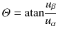

(8.25)

`SVPWM`脉宽调制例程实际上并不计算反正切。相反，它考察单位矢量`u[α]`和`u[β]`，首先确定它们的象限，然后确定它们的扇区，整个过程无需任何三角函数运算。

`SVPWM`的第一个部分实现了脉冲的时序控制。正如之前控制器的配方一样，该函数将其数据结构用作存储器——更新后的结构作为输出传回。这是持久变量的替代方案。

```
%% SVPWM 实现空间矢量脉宽调制。
% 空间矢量脉宽调制接收 alpha 和 beta 电压分量，并使 6 开关逆变器上的开关动作，以驱动
% 三相交流电机。该数据结构充当函数的存储器。
% 标记了存储器变量。
%
% 该调制在每个脉冲周期内有七个脉冲子周期。这些
% 子周期关于脉冲中心对称排列。零脉冲
% 位于开头、中间和结尾。活动脉冲（针对两个活动空间矢量）的顺序
% 在 alpha-beta 平面中的奇数和偶数扇区中
% 是不同的。这可以最大限度地减少开关动作。
%
% 输入正弦波时，输入 SVPWM 进行演示。
%
%% 格式
% d = SVPWM
% [s, d] = SVPWM( t, d )
%
%% 输入
% t (1,1) 时间
% d (.) 数据结构
%   . dT (1,1) 仿真时间步长 (输入)
%   . tLast (1,1) 上次脉冲的时间 (存储器)
%   . tUpdate (1,1) 新脉冲的更新周期 (输入)
%   . u (2,1) 电压矢量 [alpha;beta] (输入) (V)
%   . uM (1,1) 最大电压 (参数) (V)
%   . tP (1,7) 每个脉冲分段的时间 (输出)
%   . sP (3,7) 每个脉冲分段的 [a;b;c] (输出)
%
%% 输出
% s (3,1) 开关状态 (1 或 0)
% d (.) 更新后的数据结构
%
%% 参考
% Implementing Space Vector Modulation with the ADMCF32X, ANF32X-17,
% Analog Devices, January 2000.
%% 另请参阅
% SVPWM>Demo
function [s, d] = SVPWM( t, d )
% 默认数据结构
if ( nargin < 1 && nargout == 1 )
    s = struct( 'dT',1e-6,'tLast',-0.0001,'tUpdate',0.001,'u',[0;0],...
        'uM',10,'tP', zeros(1,7),'sP', zeros(3,7));
    return ;
end
% 运行演示
if ( nargin < 1 )
    Demo;
    return ;
end
% 在更新时刻更新脉宽
if ( t >= d.tLast + d.tUpdate || t == 0 )
    [d.sP, d.tP] = SVPW( d.u, d.tUpdate, d.uM );
    d.tLast = t;
end
% 自脉冲周期初始化以来的时间
dT = t - d.tLast;
s = zeros(3,1);
for k = 1:7
    if ( dT < d.tP(k) )
        s = d.sP(:,k);
        break ;
    end
end
```

脉宽矢量在子函数`SVPW`中计算。你首先计算象限，然后在不使用任何三角函数的情况下计算扇区。这是通过简单的`if`/`else`语句和一个`switch`语句完成的。注意，调制索引`k`被简单地指定为`k`，而`k + 1`被指定为`kP1`。你计算与扇区相邻的两个空间矢量的时间。然后组装出七个子周期。

# SVPWM>SVPW 计算空间矢量脉宽

[sP, tP] = SVPW( u, tS, uD )

输入:
- `u` (2,1) 电压矢量
- `tS` (1,1) 更新周期
- `uD` (1,1) 最大电压

输出:
- `sP` (3,7) 开关模式
- `tP` (1,7) 脉冲时间

```matlab
function [sP, tP] = SVPW ( u, tS, uD )
% 使 u 更易于解释
alpha = 1;
beta = 2;
% 确定象限
if ( u(alpha) >= 0 )
    if ( u(beta) > 0 )
        q = 1;
    else
        q = 4;
    end
else
    if ( u(beta) > 0 )
        q = 2;
    else
        q = 3;
    end
end
sqr3 = sqrt(3);
% 查找扇区。k1 和 k2 定义边界矢量
switch q
    case 1 % [+,+]
        if ( u(beta) < sqr3*u(alpha) )
            k = 1;
            kP1 = 2;
            oddS = 1;
        else
            k = 2;
            kP1 = 3;
            oddS = 0;
        end
    case 2 % [-,+]
        if ( u(beta) < -sqr3*u(alpha) )
            k = 3;
            kP1 = 4;
            oddS = 1;
        else
            k = 2;
            kP1 = 3;
            oddS = 0;
        end
    case 3 % [-,-]
        if ( u(beta) < sqr3*u(alpha) )
            k = 5;
            kP1 = 6;
            oddS = 1;
        else
            k = 4;
            kP1 = 5;
            oddS = 0;
        end
    case 4 % [+,-]
        if ( u(beta) < -sqr3*u(alpha) )
            k = 5;
            kP1 = 6;
            oddS = 1;
        else
            k = 6;
            kP1 = 1;
            oddS = 0;
        end
end
% 开关序列
piO3 = pi /3;
kPiO3 = k* pi /3;
kM1PiO3 = kPiO3-piO3;
% 空间矢量脉宽
t = 0.5*sqr3*(tS/uD)*[ sin(kPiO3) -cos(kPiO3);...
    -sin(kM1PiO3) cos(kM1PiO3)]*u;
% 总零矢量时间
t0 = tS - sum(t);
t = t/2;
% 奇数和偶数扇区的不同顺序
if ( oddS )
    sS = [0 k kP1 7 kP1 k 0];
    tPW = [t0/4 t(1) t(2) t0/2 t(2) t(1) t0/4];
else
    sS = [0 kP1 k 7 k kP1 0];
    tPW = [t0/4 t(2) t(1) t0/2 t(1) t(2) t0/4];
end
tP = [tPW(1) zeros(1,6)];
for k = 2:7
    tP(k) = tP(k-1) + tPW(k);
end
% 每个电压矢量对应的开关
% 从 0 到 7
% a b c
s = [ 0 0 0;...
    1 0 0;...
    1 1 0;...
    0 1 0;...
    0 1 1;...
    0 0 1;...
    1 0 1;
    1 1 1]';
sP = zeros(3,7);
for k = 1:7
    sP(:,k) = s(:,sS(k)+1);
end
```

内置演示相当复杂，因此被放在一个单独的子函数中。你只需使用三角函数指定一个示例输入`u`。

```matlab
function Demo
%%% SVPWM>Demo 函数演示
% 使用正弦输入 u 调用 SVPWM。
% 此演示将遍历一系列时间点，并生成最终电压的图表。
d = SVPWM;
tEnd = 0.003;
n = tEnd/d.dT;
a = linspace(0, pi /4,n);
tP3 = 2* pi /3;
uABC = 0.5*[ cos(a); cos(a-tP3); cos(a+tP3)];
uAB = ClarkeTransformationMatrix*uABC(1:2,:); % a-b 到 alpha-beta 变换
tSamp = 0;
t = 0;
tPP = 1;
x = zeros(4,n);
for k = 1:n
    if ( t >= tSamp )
        tSamp = tSamp + d.tUpdate;
        tPP = ~tPP;
    end
    d.u = uAB(:,k);
    [s, d] = SVPWM( t, d );
    t = t + d.dT;
    x(:,k) = [SwitchToVoltage(s,d.uM);tPP];
end
[t,tL] = TimeLabel( (0:(n-1))*d.dT);
PlotSet(t,[uABC;x],'x label',tL,'plot title','Voltages',...
    'y label', {'u_a' 'u_b' 'u_c' 'u_{ap}' 'u_{bp}' 'u_{cp}' 'Pulse' } );
```

图 8-6 显示了来自内置演示的状态矢量脉宽调制。图中有三个脉冲，每个脉冲持续 0.001 秒。每个脉冲周期有七个子周期。

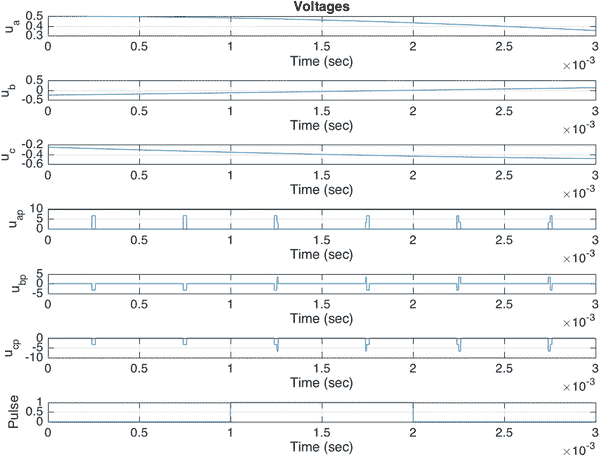

图 8-6. 所需的电压矢量以及空间矢量调制脉冲和脉宽。底部的图显示了脉冲周期。注意，每个脉冲周期内的脉冲序列是对称的

函数`SwitchToVoltage`将开关状态转换为电压。它假设开关是瞬时动作的，且不存在开关动态特性。

```matlab
%% SwitchToVoltage 开关状态到电压的转换
% 将六开关逆变器的开关状态转换为 a、b 和 c 相电压。
% 开关编号为
%
% a b c
% a' b' c'
%
%% 格式
% u = SwitchToVoltage( s, uDC )
%
%% 输入
% s (3,1) 开关
% uDC (1,1) 直流电压
%
%% 输出
% u (3,1) 三相电压 [uA;uB;uC]
%
function u = SwitchToVoltage( s, uDC )
% 开关状态 [a;b;c]
sA = [1 1 0 0 0 1;...
    0 1 1 1 0 0;...
    0 0 0 1 1 1];
% 电压数组
uA = [ 2 1 -1 -2 -1 1;...
    -1 1 2 1 -1 -2;...
    -1 -2 -1 1 2 1];
% 查找正确的开关状态
u = [0;0;0];
for k = 1:6
    if ( sum(sA(:,k) - s) == 0 )
        u = uA(:,k)*uDC/3;
        break ;
    end
end
```

## 8.4 模拟受控电机

### 问题

您希望使用空间矢量调制来模拟带扭矩控制的电机。

### 解决方案

编写一个脚本来模拟带控制器的电机。包含用于闭环控制和平衡三相电压输入的选项。

### 工作原理

脚本的头文件 `PMMachineDemo` 如下所示。这里描述了控制标志 `bypassPWM` 和 `torqueControlOn`，以及实现的两个周期——一个用于仿真，另一个较长的周期用于控制。

```matlab
%% 永磁交流电机仿真
% 对带扭矩控制的永磁交流电机进行仿真。该仿真有两个选项。
% 第一个是 torqueControlOn，用于开启或关闭扭矩控制。
% 如果关闭，相电压将是一组平衡的三相电压。
%
% bypassPWM 允许您将相电压直接馈入电机，从而绕过脉宽调制开关函数。
% 这对于调试您的控制系统和其他测试非常有用。
%
% 该仿真有两个时间常数。一个是控制周期，另一个是仿真周期。
% 后者要短得多，因为它需要仿真脉宽调制。
%
% 为了进行控制测试，负载扭矩和设定点扭矩应该相同。
```

## 脚本主体部分

脚本的主体部分如下。三种不同的数据结构从其对应的函数中初始化，如前几篇菜谱所述；即来自 `SVPWM`、`TorqueControl` 和 `RHSPMMachine`。请注意，我们仅仿真电机很短的一段时间，即 0.05 秒，且时间步长仅为 1e-6 秒。控制器的时间步长设置为仿真时间步长的 100 倍。

```matlab
%% 初始化所有数据结构
dS = SVPWM;
dC = TorqueControl;
d = RHSPMMachine;
dC.psiM = d.psiM;
dC.p = d.p;
d.tL = 1.0; % 负载扭矩 (Nm)

%% 用户输入
tEnd = 0.05; % 秒
torqueControlOn = false;
bypassPWM = false;
torqueSet = 1.0; % 设定点 (Nm)
dC.dT = 100*dS.dT; % 是仿真 dT 的 100 倍
dS.uM = 1.0; % 开关输入端的直流电压
magUABC = 0.1; % 平衡三相电压的电压值

if (torqueControlOn && bypassPWM)
    error('控制要求 PWM 必须开启。');
end

%% 运行仿真
nSim = ceil(tEnd/dS.dT);
xP = zeros(10,nSim);
x = zeros(5,1);

% 我们需要两个定时器，因为控制周期大于仿真周期
t = 0.0; % 仿真定时器
tC = 0.0; % 控制定时器

for k = 1:nSim
    % 电角度
    thetaE = x(5);
    park = ParkTransformationMatrix( thetaE );
    clarke = ClarkeTransformationMatrix;
    
    % 计算电压控制
    if ( torqueControlOn && t >= tC )
        tC = tC + dC.dT;
        [dS.u, dC] = TorqueControl( torqueSet, x, dC );
    elseif ( ~torqueControlOn )
        tP3 = 2*pi/3;
        uABC = magUABC*dS.uM*[cos(thetaE); cos(thetaE-tP3); cos(thetaE+tP3)];
        if ( bypassPWM )
            d.u = uABC;
        elseif ( t >= tC )
            tC = tC + dC.dT;
            dS.u = park*clarke*uABC(1:2,:);
        end
    end
    
    % 空间矢量脉宽调制
    if ( ~bypassPWM )
        dS.u = park'*dS.u;
        [s,dS] = SVPWM( t, dS );
        d.u = SwitchToVoltage(s,dS.uM);
    end
    
    % 获取扭矩输出用于绘图
    [~,tE] = RHSPMMachine( 0, x, d );
    xP(:,k) = [x;d.u;torqueSet;tE];
    
    % 传播一个仿真步长
    x = RungeKutta( @RHSPMMachine, 0, x, dS.dT, d );
    t = t + dS.dT;
end

%% 生成时域图
[t, tL] = TimeLabel( (0:(nSim-1))*dS.dT );
figure('name','三相电流');
plot(t, xP(1:3,:));
grid on;
ylabel('电流');
xlabel(tL);
legend('i_a','i_b','i_c')

PlotSet( t, xP([4 10],:), 'x label', tL, 'y label', {'\omega_e' 'T_e (Nm)'}, ...
    'plot title','电气量', 'figure title','电气量');

thisTitle = '相电压';
if ~bypassPWM
    thisTitle = [thisTitle ' - PWM'];
end

PlotSet( t, xP(6:8,:), 'x label', tL, 'y label', {'u_a' 'u_b' 'u_c'}, ...
    'plot title',thisTitle, 'figure title',thisTitle);

thisTitle = '扭矩/转速';
if ~bypassPWM
    thisTitle = [thisTitle ' - PWM'];
end
```

## 仿真结果与分析

关闭扭矩控制以测试电机仿真，结果如图 `8-7` 所示。这两幅图展示了扭矩-速度曲线。第一幅图是使用直接三相激励的结果，即通过将 `bypassPWM` 设置为 `false` 来绕过脉宽调制。以这种方式直接控制相电压，虽然能产生最平滑的响应，但需要线性放大器，其效率低于开关。这将使电机的整体效率大大降低，并产生不必要的热量。第二幅图是使用空间矢量脉宽调制的结果。两幅图几乎相同，表明脉宽调制工作正常。

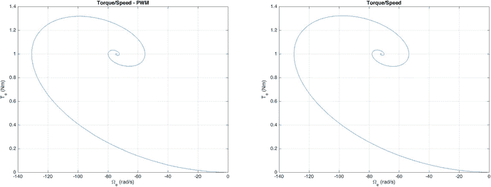

`图 8-7.` 平衡三相电压激励且负载扭矩为 1.0 Nm 时的扭矩-速度曲线。左图显示了直接三相输入下的曲线，右图显示了空间矢量脉宽调制输入下的曲线。两者几乎相同。

现在，通过 `torqueControlOn` 标志开启扭矩控制，得到的结果如图 `8-8` 所示。该过冲是扭矩控制的典型特征。请注意，负载扭矩被设置为等于 1 Nm 的扭矩设定点。在终点附近存在极限环。

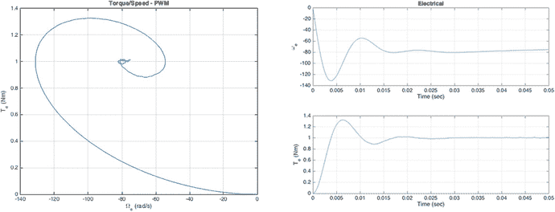

`图 8-8.` 电机的 PI 扭矩控制

脉宽及其产生的线圈电流如图 `8-9` 所示。图 `8-10` 是脉宽图末端的放大视图，并为交替的脉宽添加了阴影。这使得更容易观察脉宽的片段并验证它们是否对称。

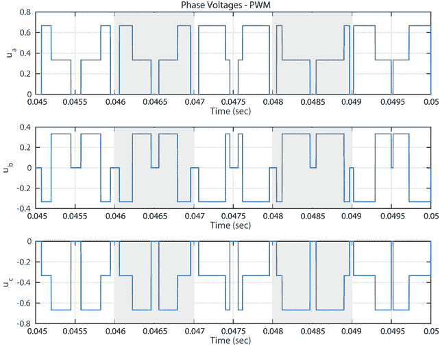

`图 8-10.` 带阴影的脉宽

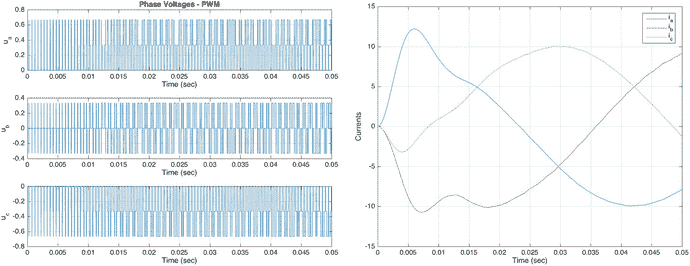

`图 8-9.` PI 扭矩控制的电压脉宽及产生的电流

添加阴影的代码使用了带有透明度的 `fill` 函数，通过 `alpha` 参数实现。在此例中，我们硬编码了函数以显示最后五个脉宽，但这可以推广到时间窗口或为整个图添加阴影。

我们确实花费了时间为脉宽长度添加了一个输入参数，以便可以在主脚本中更改此参数，而函数仍能正常工作。请注意，作为最后一步，轴子级被重新排序，以防止阴影遮挡图线。

## MATLAB 函数
```matlab
%% ADDFILLTOPWM Add shading to the motor pulsewidth plot
% Adds gray shading to alternate pulsewidths for the last 5 pulses of the
% plot. The pulsewidth plot should be the current axes.
%
%% Form
% AddFillToPWM( dT )
%
%% Input
% dT (1,1) Pulsewidth
%% Output
% None.
function AddFillToPWM( dT )
if nargin == 0
    dT = 0.001;
end
hAxes = get( gcf ,'children');
nAxes = length( hAxes );
for j = 1:nAxes
    if strcmp( hAxes(j). type ,'axes')
        axes( hAxes(j) );
        AddFillToAxes;
    end
end
function AddFillToAxes
    hold on;
    y = axis ;
    xMin = y(2) - 5*dT;
    xMax = y(2);
    axis ([xMin xMax y(3:4)])
    x0 = xMin;
    yMin = y(3) + 0.01*(y(4)-y(3));
    yMax = y(4) - 0.01*(y(4)-y(3));
    for k = [2 4]
        xMinK = x0 + (k-1)*dT;
        xMaxK = x0 + k*dT;
        fill ([xMinK xMaxK xMaxK xMinK],...
             [yMin,yMin,yMax,yMax],...
             [0.8 0.8 0.8],'edgecolor','none','facealpha',0.5);
    end
    babes = get( gca ,'children');
    set( gca ,'children',[babes( end ); babes(1: end -1)])
    hold off;
end
end
```

## 总结
本章演示了如何为三相电机编写动力学方程并实现磁场定向控制律。使用带空间矢量脉宽调制的比例积分控制器来驱动六个开关。这为电机制造了一种低成本的控制器。表 8-2 列出了本章中开发的代码。

### 表 8-2. 章节代码清单
| 文件 | 描述 |
| :--- | :--- |
| `AddFillToPWM` | 为电机脉宽图添加阴影。 |
| `ClarkeTransformationMatrix` | Clarke 变换矩阵。 |
| `ParkTransformationMatrix` | Park 变换矩阵。 |
| `PMMachineDemo` | 永磁电机演示。 |
| `RHSPMMachine` | 永磁无刷三相电机的右侧函数。 |
| `SVPWM` | 实现空间矢量脉宽调制。 |
| `SwitchToVoltage` | 将开关状态转换为电压。 |
| `TorqueControl` | 比例积分扭矩控制器。 |

## 脚注
1 Lyshevski, S. E. *Electromechanical Systems, Electric Machines, and Applied Mechatronics*, CRC Press, 2000, pp. 589–627.
2 Analog Devices, “Implementing Space Vector Modulation with the ADMCF32X,” ANF32X-17, January 2000.