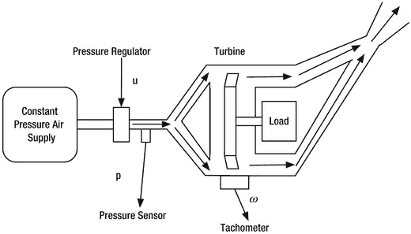
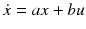
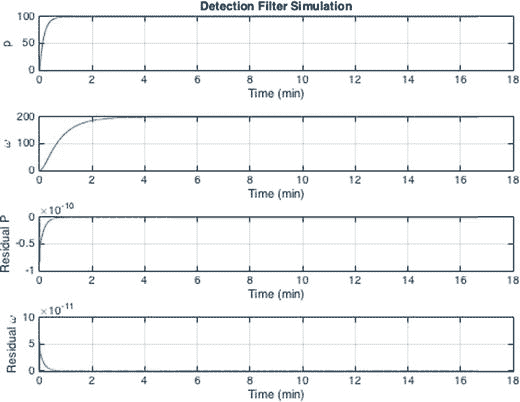

# 9. 故障检测

电子补充材料：本章的在线版本（doi: [10.1007/978-1-4842-0559-4_9](http://dx.doi.org/10.1007/978-1-4842-0559-4_9)）包含补充材料，仅供授权用户使用。

## 引言

故障检测是在动态系统中检测失效（也称为故障）的过程。对于需要在无人监督情况下运行的系统来说，这是一个重要的领域。检测失效的方法有很多种。最简单的是使用布尔逻辑对照固定阈值进行检查。例如，您可以检查汽车的速度是否超过限速。其他方法包括模糊逻辑、参数估计、专家系统、统计分析和奇偶空间方法。本章实现了一种类型的故障检测系统——检测滤波器。其基于线性滤波。检测滤波器是一种状态估计器，被调谐用于检测特定的故障。您将为空气涡轮机设计一个检测滤波器系统。您还将学习如何构建一个图形用户界面 (GUI) 作为故障检测仿真的前端。

### 9.1 为空气涡轮机建模

#### 问题

您需要一个空气涡轮机的数值模型来演示检测滤波器。

#### 解决方案

写出空气涡轮机的运动方程。您将使用空气涡轮机的线性模型以简化模型和检测滤波器的设计。这将允许您使用状态空间模型对该系统进行建模。

#### 工作原理

图 9-1 展示了一个空气涡轮机。¹ 它有一个恒压气源。您可以通过控制气源的阀门（即调压阀）来调节涡轮机的转速。空气流经涡轮叶片使其旋转。控制系统需要调节气压以应对负载变化。您需要测量阀门下游的气压 `p`，并通过转速计测量涡轮机的转速 `ω`。


图 9-1. 空气涡轮机。箭头表示气流方向。空气流过涡轮叶片顶端，使其旋转。

空气涡轮机的动力学模型如下：

![ $$ \left[\begin{array}{l}\dot{p}\hfill \\ {}\dot{\omega}\hfill \end{array}\right]=\left[\begin{array}{rr}\hfill -\frac{1}{\tau_p}& \hfill 0\\ {}\hfill \frac{K_t}{\tau_t}& \hfill -\frac{1}{\tau_t}\end{array}\right]\left[\begin{array}{l}p\hfill \\ {}\omega \hfill \end{array}\right]+\left[\begin{array}{l}\frac{K_p}{\tau_p}\hfill \\ {}0\hfill \end{array}\right]u $$ ](A335353_1_En_9_Chapter_Equ1.gif)
(9.1)

这是一个状态空间系统：


(9.2)

其中：

![ $$ a=\left[\begin{array}{rr}\hfill -\frac{1}{\tau_p}& \hfill 0\\ {}\hfill \frac{K_t}{\tau_t}& \hfill -\frac{1}{\tau_t}\end{array}\right] $$ ](A335353_1_En_9_Chapter_Equ3.gif)
(9.3)

![ $$ b=\left[\begin{array}{l}\frac{K_p}{\tau_p}\hfill \\ {}0\hfill \end{array}\right] $$ ](A335353_1_En_9_Chapter_Equ4.gif)
(9.4)

状态向量为：

![ $$ \left[\begin{array}{l}p\hfill \\ {}\omega \hfill \end{array}\right] $$ ](A335353_1_En_9_Chapter_Equ5.gif)
(9.5)

当系统处于平衡状态时，调压阀下游的压力等于 `K_p * u`。`τ_p` 是调压阀的时间常数，`τ_t` 是涡轮机的时间常数。当系统处于平衡状态时，涡轮机转速为 `K_t * p`。转速计测量 `ω`，压力传感器测量 `p`。负载的影响被纳入涡轮机的时间常数中。

动力学方程右侧的代码如下所示。其中只有一行代码是右侧项，其余部分用于返回默认的数据结构。该模型的简洁性得益于它采用状态空间模型。状态的数量可能很大，但代码结构保持不变。

```
function xDot = RHSAirTurbine(~, x, d )
% 默认数据结构
if ( nargin < 1 )
  kP = 1;
  kT = 2;
  tauP = 10;
  tauT = 40;
  c = eye(2);
  b = [kP/tauP;0];
  a = [-1/tauP 0; kT/tauT -1/tauT];
  xDot = struct('a',a,'b',b,'c',c,'u',0);
  return
end
% 导数
xDot = d.a*x + d.b*d.u;
```

系统对 `u` 的阶跃输入的响应如图 9-2 所示。压力比涡轮机更快地达到稳定状态。这是由于涡轮机的时间常数以及气压变化的滞后所致。残差非常小，因为没有故障发生。


图 9-2. 空气涡轮机对调压阀阶跃输入的响应

### 9.2 构建检测滤波器

#### 问题

您希望利用上一节中建立的线性模型，构建一个系统来检测空气涡轮机中的故障。

#### 解决方案

您将构建一个能够检测调压阀故障和转速计故障的检测滤波器。我们的被控对象模型（即连续时间状态空间矩阵 `a`、`b` 和 `c`）将作为滤波器构建函数的输入。

#### 工作原理

该检测滤波器是一个带有特定增益矩阵的估计器，该矩阵对残差进行乘法运算。

![ $$ \left[\begin{array}{l}\dot{\widehat{p}}\hfill \\ {}\dot{\widehat{\omega}}\hfill \end{array}\right]=\left[\begin{array}{rr}\hfill -\frac{1}{\tau_p}& \hfill 0\\ {}\hfill \frac{K_t}{\tau_t}& \hfill -\frac{1}{\tau_t}\end{array}\right]\left[\begin{array}{l}\widehat{p}\hfill \\ {}\widehat{\omega}\hfill \end{array}\right]+\left[\begin{array}{l}\frac{K_p}{\tau_p}\hfill \\ {}0\hfill \end{array}\right]u+\left[\begin{array}{rr}\hfill {d}_{11}& \hfill {d}_{12}\\ {}\hfill {d}_{21}& \hfill {d}_{22}\end{array}\right]\left[\begin{array}{l}p-\widehat{p}\hfill \\ \omega -\widehat{\omega}\hfill \end{array}\right] $$ ](A335353_1_En_9_Chapter_Equ6.gif)
（9.6）其中 `\widehat{p}` 是估计压力，`\widehat{\omega}` 是涡轮的估计角速率。`D` 矩阵是检测滤波器的增益矩阵。这些增益将残差（即测量状态与估计状态之间的差值）反馈到检测滤波器中。残差向量为

![ $$ r=\left[\begin{array}{l}p-\widehat{p}\hfill \\ \omega -\widehat{\omega}\hfill \end{array}\right] $$ ](A335353_1_En_9_Chapter_Equ7.gif)
（9.7）

需要选择 `D` 矩阵，使得该向量能够告知您故障的性质。应选择增益，使得：

*   滤波器保持稳定。
*   如果调压器发生故障，第一个残差 `p-\widehat{p}` 不为零，但第二个残差保持为零。
*   如果涡轮发生故障，第二个残差 `\omega -\widehat{\omega}` 不为零，但第一个残差保持为零。

增益矩阵为

![ $$ D=a+\left[\begin{array}{rr}\hfill \frac{1}{\tau_1}& \hfill 0\\ {}\hfill 0& \hfill \frac{1}{\tau_2}\end{array}\right] $$ ](A335353_1_En_9_Chapter_Equ8.gif)
（9.8）

时间常数`τ[1]`是压力残差时间常数。时间常数`τ[2]`是转速计残差时间常数。实际上，您抵消了被控对象的动态特性，并用去耦的检测滤波器动态特性替代它们。这些时间常数应比动力学模型中的时间常数更短，以便能够快速检测到故障。然而，为了避免数值不稳定性，它们至少应该是采样周期的两倍长。

编写一个具有三种操作模式的函数：初始化（initialize）、更新（update）和重置（reset）。使用`varargin`允许三种模式具有不同的输入列表。函数签名为

```
function d = DetectionFilter( action, varargin )
```

`DetectionFilter`的标头和语法如下所示。使用一些LaTeX方程来描述该函数。

```
%% DetectionFilter 构建并更新一个线性检测滤波器。
%  检测滤波器增益矩阵 d 在初始化操作期间设计。
%  然后使用内部函数 CToDZOH 将连续矩阵离散化。
%  估计状态和残差向量被初始化为由 a 决定的维度。
%  在更新操作期间，计算残差和新的估计状态，并存储在数据结构 d 中。
%
%  残差计算公式为
%
%  $$r = y - c\hat{x}$$
%
%  使用检测滤波器增益计算出的估计状态为
%
%  $$\hat{x}_{k+1} = a*\hat{x} + b*u + d*r$$
%
%% 语法
%  d = DetectionFilter( 'initialize', d, tau, dT );
%  d = DetectionFilter( 'update', u, y, d );
%  d = DetectionFilter( 'reset', d );
%
%% 输入参数
%  action (1,:) 'initialize' 或 'update'
%  d (.) 数据结构
%      .a (:,:) 状态空间连续 a 矩阵
%      .b (:,1) 状态空间连续 b 矩阵
%      .c (:,:) 状态空间连续 c 矩阵
%  tau (:,1) 时间常数向量
%  dT (1,1) 时间步长
%  u (:,1) 执行器输入
%  y (:,1) 测量向量
%
%% 输出参数
%  d (.) 更新后的数据结构
%      .a (:,:) 状态空间离散 a 矩阵
%      .b (:,1) 状态空间离散 b 矩阵
%      .c (:,:) 状态空间离散 c 矩阵
%      .d (:,:) 检测滤波器增益矩阵
%      .x (:,1) 估计状态
%      .r (:,1) 残差向量
```

以下`DetectionFilter`中的代码构建并初始化了该滤波器。被控对象的连续状态空间模型（在此例中为我们的线性空气涡轮模型）作为一个输入。所选的时间常数`τ`也是一个输入，它们被添加到被控对象模型中，如公式9.8所示。该函数对被控对象的`a`和`b`矩阵以及计算出的检测滤波器增益矩阵`d`进行离散化。

```
switch lower(action)
    case 'initialize'
        d   = varargin{1};
        tau = varargin{2};
        dT  = varargin{3};

        % 设计检测滤波器
        d.d = d.a + diag(1./tau);

        % 对两者进行离散化
        d.d    = CToDZOH( d.d, d.b, dT );
        [d.a, d.b] = CToDZOH( d.a, d.b, dT );

        % 初始化状态
        m   = size(d.a,1);
        d.x = zeros(m,1);
        d.r = zeros(m,1);
```

检测滤波器的更新位于同一个函数中。注意这些方程是按照标头中的描述实现的。

```
    case 'update'
        u = varargin{1};
        y = varargin{2};
        d = varargin{3};

        r   = y - d.c * d.x;
        d.x = d.a * d.x + d.b * u + d.d * r;
        d.r = r;
```

最后，创建一个重置操作，允许您在仿真之间重置滤波器的残差和状态值。

```
    case 'reset'
        d = varargin{1};
        m = size(d.a,1);
        d.x = zeros(m,1);
        d.r = zeros(m,1);
end
```

## 9.3 仿真故障检测系统

### 问题

您希望仿真被控对象中的故障，并演示故障检测的性能。

### 解决方案

您将构建一个MATLAB脚本，该脚本使用上一节中的函数设计检测滤波器，然后通过用户可选择的调压器或转速计故障对其进行仿真。该故障可以是完全故障或部分故障。