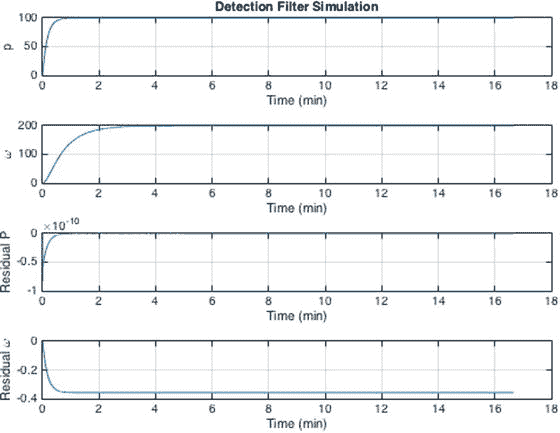
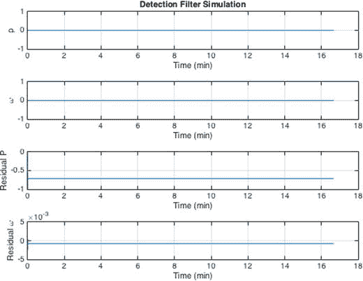

# 工作原理

该脚本利用前一教程中的 `DetectionFilter` 设计了一个检测滤波器，并通过循环实现其功能。龙格-库塔积分法用于传播空气涡轮机的连续域右侧函数 `RHSAirTurbine`。检测滤波器是离散时间的。

该脚本包含两个比例因子 `uF` 和 `tachF`，它们分别乘以调节器输入和转速计输出以模拟故障。将比例因子设置为零表示完全故障，设置为 1 表示设备正常工作。如果其中一个发生故障，其对应的残差将不为零，而另一个残差将保持为零。

```
%% 检测滤波器仿真

% 仿真空气涡轮机的故障检测。

% 空气涡轮机具有一个恒压空气源，空气通过管道驱动涡轮叶片。
% 涡轮机连接到一个负载上。

% 空气涡轮机模型是线性的。通过将调节器输入和转速计输出乘以一个常数来模拟故障。
% 常数为 0 表示完全故障，1 表示正常工作。

%% 用户输入

% 故障参数。可设置为任意数值。0 表示完全故障，1 表示正常工作。
% uF 缩放执行器输入 u。tachF 缩放速率测量值。
uF = 1;
tachF = 0;

% 故障检测的时间常数
tau1 = 0.3; % 秒
tau2 = 0.3; % 秒

% 结束时间
tEnd = 1000; % 秒

% 状态空间系统
d = RHSAirTurbine;

%% 初始化

dT = 0.02; % 秒
n = ceil(tEnd/dT);

% 初始状态
x = [0;0];

%% 检测滤波器设计

dF = DetectionFilter('initialize',d,[tau1;tau2],dT);

%% 运行仿真

% 控制输入。这是调节器输入。
u = 100;

% 绘图数组
xP = zeros(4,n);
t = (0:n-1)*dT;

for k = 1:n

    % 包含测量故障的测量向量
    y = [x(1);tachF*x(2)]; % 传感器故障

    xP(:,k) = [x;dF.r];

    % 更新检测滤波器
    dF = DetectionFilter('update',u,y,dF);

    % 积分一步
    d.u = uF*u; % 执行器故障
    x = RungeKutta( @RHSAirTurbine, t(k), x, dT, d );

end

%% 绘制状态和残差

[t,tL] = TimeLabel(t);
yL = {'p' '\omega' '残差 P' '残差 \omega' };
tTL = '检测滤波器仿真';
PlotSet( t, xP,'x label',tL,'y label',yL,'plot title',tTL,'figure title',tTL)
```

在图 9-3 中，调节器发生故障，其残差不为零。在图 9-4 中，转速计发生故障，其残差不为零。残差清晰地显示了故障所在。简单的布尔逻辑（例如 if end 语句）就足以实现此功能。



图 9-4. 空气涡轮机对转速计故障的响应



图 9-3. 空气涡轮机对调节器故障的响应

