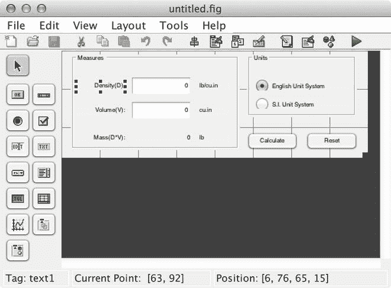
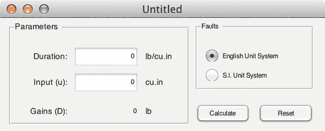
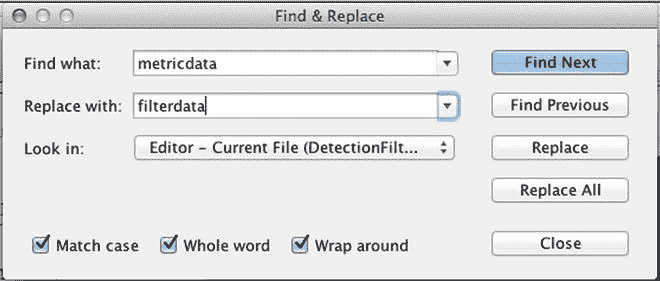

# 9.4 为检测滤波器仿真构建图形用户界面

## 问题

你需要一个图形用户界面（GUI）来为故障检测仿真提供图形化接口，以便评估滤波器的性能。

## 解决方案

你将使用 MATLAB 的 GUIDE 工具构建一个 GUI，该 GUI 允许你：

- 设置残差时间常数。
- 设置仿真的结束时间。
- 设置压力调节器输入。
- 随时引入压力调节器或转速计故障。
- 在图表中显示状态和残差。

## 工作原理

MATLAB 的 GUI 构建系统 GUIDE 通过在命令行输入 `guide` 来启动。有几种 GUI 模板选项，也可以选择空白 GUI；你将从一个包含 `uicontrols` 的 GUI 开始。首先，根据你期望的功能列表，列出所需的控件：

- 用于输入仿真持续时间、残差时间常数 τ[1] 和 τ[2]、压力调节器设定值 `u` 的编辑框
- 用于输入压力调节器和转速计故障参数的编辑框，并带有按钮，用于将新设定的值发送到仿真程序
- 用于显示计算出的检测滤波器增益的文本框
- 用于启动仿真的运行按钮
- 绘图坐标轴

为了在仿真运行期间更改故障参数，你需要循环检查一个可由 GUI 外部设置的变量。你可以使用全局变量来实现这一点。

GUI 控件的模板提供了几个带标签的编辑框、一组单选按钮以及“计算”和“重置”两个操作按钮。你将使用编辑框来实现控件列表中的前两项，并使用带有单选按钮的区域来处理故障参数。图 9-5 显示了你进行任何修改之前在 GUIDE 中的模板 GUI。



图 9-5. 包含 uicontrols 的 GUI 模板

只需在 GUIDE 的模板 GUI 中双击某个项目，即可打开检查器并编辑该项目的文本、字体大小等属性。对于文本项目，更改该项目检查器中的 `String` 字段。对于框架项目（如 `Measures` 框架），更改 `Title` 字段。对于编辑框，更改 `Tag` 字段。对左侧的控件集进行以下修改：

1.  将 `Density(D)` 标签的 `String` 改为“Duration”。
2.  将 `Volume(V)` 标签的 `String` 改为“Input”。
3.  将标签字体大小增加到 10 磅。
4.  将密度编辑框的 `Tag` 改为 `duration`。
5.  将体积编辑框的 `Tag` 改为 `input`。
6.  将质量文本框的 `Tag` 改为 `gains`。
7.  将 `Measures` 框架的 `Title` 改为“Parameters”。

完成这些修改后，点击绿色三角形按钮保存并运行 GUI。MATLAB 会将 `.fig` 文件以你指定的名称保存，并生成相应的 `.m` 文件。我们将 GUI 命名为 `DetectionFilterGUI`。生成的初始 GUI 如图 9-6 所示。



图 9-6. 初步修改后的 GUI 快照

至此，你可以开始编写 GUI 代码本身了。模板 GUI 将其数据（根据用户在编辑框中输入的数据计算得出）存储在一个名为 `metricdata` 的字段中。你可以在整个 m 文件中执行查找/替换操作，将此字段改为 `filterdata`。类似地，你可以将 `density` 替换为 `duration`，将 `volume` 替换为 `input`。更改编辑框的 Tag 会改变回调函数的名称（例如，从 `density_Callback` 变为 `duration_Callback`），但不会改变函数体内变量的名称。查找/替换的步骤如图 9-7 所示。



图 9-7. 查找/替换 `metricdata` 字段名

更新后的 `duration_Callback` 函数如下所示。你可以保留确保输入为合法数字的错误检查代码。请注意，MATLAB 提供了关于如何将图形对象内容从字符串转换为双精度浮点数，或如何将其保留为字符串的最佳方法的良好提示。`guidata` 函数使用图形句柄将更改后的参数的新值存储在图形本身中。

```
function duration_Callback(hObject, eventdata, handles)
% hObject 指向 duration 的句柄（参见 GCBO）
% eventdata 保留 - 将在 MATLAB 的未来版本中定义
% handles 包含句柄和用户数据的结构体（参见 GUIDATA）
```


