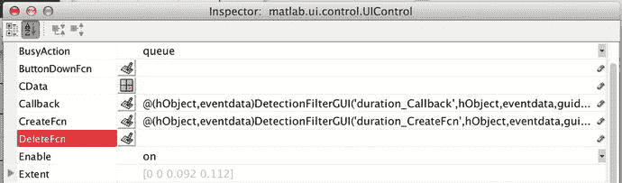
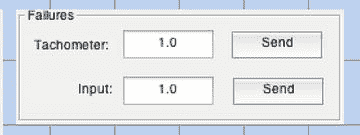
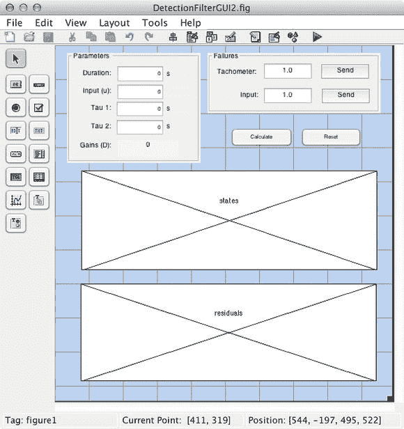
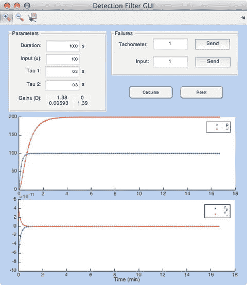
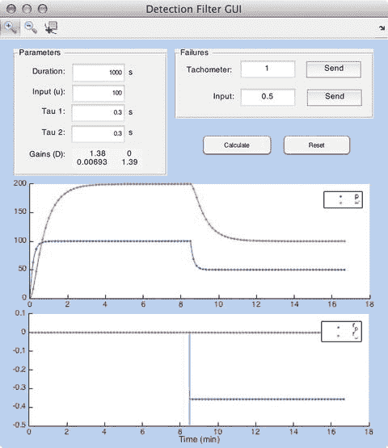

# 排版结果

`% 提示：get(hObject, 'String') 以文本形式返回 duration 的内容`

`% str2double(get(hObject, 'String')) 以双精度浮点数形式返回 duration 的内容`

```
duration = str2double(get(hObject, 'String'));
if isnan(filterdata)
    set(hObject, 'String', 0);
    errordlg('Input must be a number','Error');
end
```

`% 保存新的 duration 值`

```
handles.filterdata.duration = duration;
guidata(hObject,handles)
```

与 `uicontrols` 控件一起存储的回调字符串，可以通过双击控件在检查器中查看，如图 9-8 所示，对应 "duration" 编辑框。



图 9-8. `uicontrol` 的回调字符串

GUI 中编辑框右侧的单位，是由单位单选按钮调用的函数控制的。首先，移除整个 Units 面板；如果现在尝试运行 GUI，由于缺少英制和公制单位的字段，将会抛出错误。接下来，在 GUI 的 m 文件中移除与此 "unitgroup" 相关的代码。你还可以移除设置单位字段的代码，因为你可以将这些字符串硬编码；在模板中，它们被标记为 "text4"、"text5" 和 "text6"。移除 `initialize_gui` 中的代码行，并删除整个 `unitgroup_SelectionChangedFcn` 函数。

在 `initialize_gui()` 中移除：

```
set(handles.unitgroup, 'SelectedObject', handles.english);
set(handles.text4, 'String', 'lb/cu.in');
set(handles.text5, 'String', 'cu.in');
set(handles.text6, 'String', 'lb');
```

将 "duration" 和输入变量的初始值设置为仿真脚本中的值：

```
handles.filterdata.duration = 1000;
handles.filterdata.input = 100;
```

现在，GUI 可以运行了。由于已经移除了设置单位字符串的函数，你现在可以在检查器中更改 Duration、Input 和 Gains 的单位字符串。你可以为图形窗口指定一个新名称：检测滤波器 GUI（点击图形背景，而非某个控件）。

下一步是在 GUI 右侧添加一个新面板，其中包含用于故障参数 `uF` 和 `tachF` 的编辑框和按钮。每个项目需要一个静态文本 `uicontrol`、一个编辑框和一个按钮。添加了这些项目的框架如图 9-9 所示。



图 9-9. 带有编辑框和按钮 `uicontrols` 的面板

然后，你可以将 GUI 和右侧面板放大；插入用于时间常数 τ [1] 和 τ [2] 的框；并添加两个绘图坐标轴。你需要在坐标轴左侧为轴标签留出大量空间。将上方坐标轴的 Tag 改为 `states`，下方坐标轴的 Tag 改为 `residuals`。带有全部 `uicontrols` 的最终 GUI 如图 9-10 所示。请注意，坐标轴上显示了标签。



图 9-10. 在 GUIDE 中显示的已完成 GUI

现在，你需要为 GUI 添加相当多的代码。检测滤波器仿真放在 Calculate 回调中。你必须添加代码，将新的编辑框项转换为双精度浮点数，即 `tachF`、`uF`、`tau1` 和 `tau2`，就像在 `duration_Callback` 中一样。你需要向 `initialize_gui` 函数中添加代码来设置所有字段的值。最后，你需要为故障参数上的 Send 按钮添加全局变量的处理。

首先，确保初始化函数定义了所有必需的变量，然后修复编辑框回调。你需要定义用于故障的两个全局变量。

```
% ---------------------------------------------------------
function initialize_gui(fig_handle, handles, isreset)
global tachFSent
global inputFSent
% 如果 filterdata 字段存在且重置标志为 false，则表示
% 我们只是通过命令行调用 GUI 来重新初始化它
```


```matlab
% while it is up. So, bail out as we dont want to reset the data.
if isfield(handles, 'filterdata') && ~isreset
    return;
end

handles.filterdata.duration = 1000;
handles.filterdata.input = 100;
handles.filterdata.tau1 = 0.3;
handles.filterdata.tau2 = 0.3;
handles.filterdata.tachF = 1.0;
handles.filterdata.uF = 1.0;
handles.filterdata.dT = 0.1; % sec
handles.filterdata.dF = [];

set(handles.duration, 'String', handles.filterdata.duration);
set(handles.input, 'String', handles.filterdata.input);
set(handles.tau1, 'String', handles.filterdata.tau1);
set(handles.tau2, 'String', handles.filterdata.tau2);
set(handles.uF, 'String', handles.filterdata.uF);
set(handles.tachF, 'String', handles.filterdata.tachF);
set(handles.gains, 'String', '[]');

tachFSent = false;
inputFSent = false;

% Update handles structure
guidata(handles.figure1, handles);
UpdateGains(handles.figure1, [], handles);
```

重置功能来源于模板 GUI；你会保留它，因为当用户将滤波器调整到不稳定状态时，它允许用户将所有字段恢复为标称值。注意，你在此处添加了一个 `dT` 字段和一个变量 `dF`，后者用于存储检测滤波器数据结构。在通过 handles 设置 GUI 数据后，你添加了对函数 `UpdateGains` 的调用；当 `tau1` 或 `tau2` 字段被更改时，此函数会更新存储的检测滤波器。这让你能够在 `gains` 文本框中显示它们，并避免每次进行仿真时都重新计算滤波器矩阵。你使用 `num2str` 来显示增益矩阵，并采用最大精度位数，以使矩阵能够在分配的空间中完整显示。`UpdateGains` 函数如下所示。

```matlab
function UpdateGains(hObject, eventdata, handles)
tau1 = handles.filterdata.tau1;
tau2 = handles.filterdata.tau2;
dT = handles.filterdata.dT;
d = RHSAirTurbine;
dF = DetectionFilter('initialize',d,[tau1;tau2],dT);
handles.filterdata.dF = dF;
set(handles.gains, 'String', num2str(dF.d,3));
guidata(hObject,handles)
```

现在你可以更新 `tau1` 和 `tau2` 的回调函数。在通过 handles 设置值之后，你需要调用新的更新函数，就像在初始化函数中所做的那样。接下来展示 `tau1` 的函数；`tau2` 必须进行相同的更改。

```matlab
function tau1_Callback(hObject, eventdata, handles)
% hObject handle to tau1 (see GCBO)
% eventdata reserved - to be defined in a future version of MATLAB
% handles structure with handles and user data (see GUIDATA)
tau1 = str2double(get(hObject, 'String'));
if isnan(tau1)
    set(hObject, 'String', 0);
    errordlg('Input must be a number','Error');
end
% Save the new duration value
handles.filterdata.tau1 = tau1;
guidata(hObject,handles)
UpdateGains(hObject,[],handles);
```

现在，你需要设置发送按钮的回调函数以设置全局变量。发送按钮的标签分别设置为 `sendTach` 和 `sendInput`。回调函数中唯一需要的代码是声明全局变量并将其设置为 `true`。接下来展示 `sendInput` 的函数；`sendTach` 必须进行相同的更改，但要使用 `tachFSent` 全局变量。

```matlab
% --- Executes on button press in sendInput.
function sendInput_Callback(hObject, eventdata, handles)
% hObject handle to sendInput (see GCBO)
% eventdata reserved 2013 to be defined in a future version of MATLAB
% handles structure with handles and user data (see GUIDATA)
global inputFSent
inputFSent = true;
```

现在，可以添加计算函数了。它基于之前配方中的仿真脚本。你添加了对全局变量的处理，以便在仿真循环中更改故障参数。你还添加了实时绘图更新，以便向用户提供残差的即时反馈。在仿真循环开始之前，使用 `TimeLabel` 函数根据时长字段获取时间标签的比例因子。

你通过 `floor` 计算一个参数 `dP`，表示两次绘图之间的步数。基本上，你会在仿真过程中更新绘图 100 次。在循环中，如果当前步 `k` 除以 `dP` 的余数为零，则绘制当前状态和残差的点。在循环中使用 `drawnow` 或通过选择坐标轴来更新图形可能非常缓慢，因此这是一种限制图形计算时间的简单方法。

**提示：** 如果每一步都绘图太慢，可以在循环中使用带有 `rem` 的内部 `if` 语句来实现间歇性图形更新。

还要注意，你使用了可以传入坐标轴句柄的 `plot` 形式，以避免使用 `axes` 将坐标轴设为当前坐标轴。MATLAB 会警告你这样做可能非常缓慢。但是，一旦循环结束，在创建图例时，没有理由不这样做。

```matlab
% --- Executes on button press in calculate.
function calculate_Callback(hObject, eventdata, handles)
% hObject handle to calculate (see GCBO)
% eventdata reserved – to be defined in a future version of MATLAB
% handles structure with handles and user data (see GUIDATA)
global inputFSent
global tachFSent

% get the data from the handles
u = handles.filterdata.input;
duration = handles.filterdata.duration;
tachF = handles.filterdata.tachF;
uF = handles.filterdata.uF;
dT = handles.filterdata.dT;

% initialize the simulation states and arrays
n = ceil(duration/dT);
x = [0;0];
d = RHSAirTurbine;
dF = handles.filterdata.dF;
dF = DetectionFilter('reset',dF);
xP = zeros(4,n);
t = (0:n-1)*dT;
dP = floor(n/100);

% prepare for plotting during the simulation
[tt,tL] = TimeLabel(duration);
tF = tt/duration;
axes(handles.states)
cla
hold on
axes(handles.residuals)
cla
hold on
xlabel(tL)

for k = 1:n
    if inputFSent
        inputFSent = false;
        data = guidata(hObject);
        uF = data.filterdata.uF;
    end
    if tachFSent
        tachFSent = false;
        data = guidata(hObject);
        tachF = data.filterdata.tachF;
    end
    y = [x(1);tachF*x(2)]; % Sensor failure
    xP(:,k) = [x;dF.r];
    dF = DetectionFilter('update',u,y,dF);
    d.u = uF*u; % Actuator failure
    x = RungeKutta( @RHSAirTurbine, t(k), x, dT, d );
    if rem(k,dP)==0
        plot(handles.states,tF*t(k), xP(1,k),'b.' );
        plot(handles.states,tF*t(k), xP(2,k),'r.' );
        plot(handles.residuals,tF*t(k), xP(3,k), 'b.' );
        plot(handles.residuals,tF*t(k), xP(4,k), 'r.' );
        drawnow
    end
end

% Plot the states and residuals
axes(handles.states)
plot(tF*t, xP(1:2,:) )
legend('p','\omega')
axes(handles.residuals)
plot(tF*t, xP(3:4,:) )
legend('r_p','r_{\omega}')
```

现在，你有了一个功能完备的 GUI，可以绘制仿真进度，并允许你随时注入故障。图 9-11 显示了一次无故障仿真的结果。



**图 9-11.** 无故障运行的 GUI

你现在已经构建了一个工具，可以在不生成数十个绘图窗口的情况下探索模型的参数空间。请注意，添加几个工具栏按钮可以让用户放大或从绘图中获取数据点。可以添加的其他功能包括菜单项，例如保存和重新加载特定案例，或将运行结果导出到工作区、mat 文件或文本文件。图 9-12 显示了一次在仿真中途注入输入故障的运行。这会影响状态和残差。为了复现这样的运行，你需要随时间记录 `tachF` 和 `uF` 的值以及初始条件。



**图 9-12.** 注入输入故障的 GUI 运行

总结


本章演示了如何设计用于检测动态系统中故障的检测滤波器。该系统通过一台可能经历压力调节器故障和转速计故障的涡轮机进行演示。此外，您还学习了使用`GUIDE`设计图形用户界面来自动化滤波器仿真。该图形用户界面展示了实时绘图以及在持续仿真循环中注入故障的功能。表 9-1 列出了本章开发的代码。

表 9-1. 章节代码清单

| 文件 | 描述 |
| --- | --- |
| `RHSAirTurbine` | 连续状态空间形式的涡轮机动力学模型。 |
| `DetectionFilter` | 构建并更新一个线性检测滤波器。 |
| `DetectionFilterSim` | 检测滤波器的仿真程序。 |
| `DetectionFilterGUI` | 通过图形用户界面运行检测滤波器仿真。 |
| `DetectionFilterGUI.fig` | 供`GUIDE`使用的图形用户界面布局。 |

脚注 1

Jere Schenck Meserole 的博士论文，“用于涡扇发动机容错控制的检测滤波器”，麻省理工学院航空航天系，1981 年。

