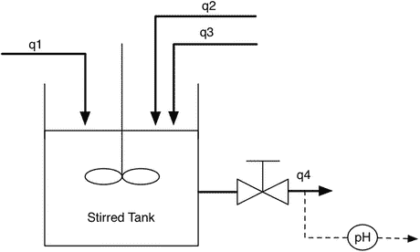
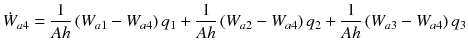
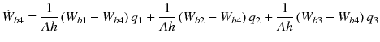
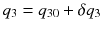
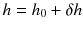
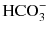
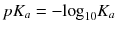
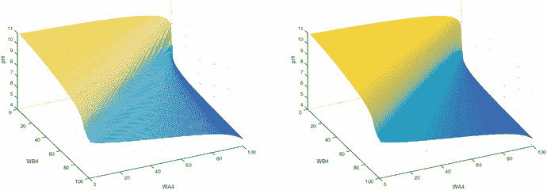
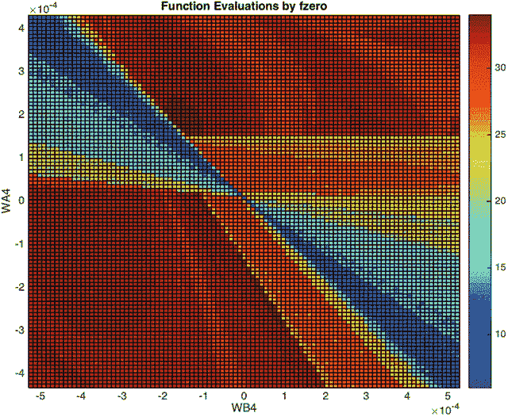

# 10. 化学过程

电子补充材料：本章的在线版本（doi: [10.​1007/​978-1-4842-0559-4_​10](http://dx.doi.org/10.1007/978-1-4842-0559-4_10)）包含补充材料，仅供授权用户使用。

在化学工程中，需要对化学品生产进行建模并控制生产过程。我们的示例是一个需要控制混合溶液 pH 值的简单过程。这个问题很有趣，因为该过程高度非线性，且传感器模型没有 pH 测量的显式解。对传感器进行建模需要使用数值求解器`fzero`。

您将研究的具体化学过程包括一股酸（`HNO[3]`）流、一股缓冲液（`NaHCO[3]`）流和一股碱（`NaOH`）流，它们在搅拌罐中混合。¹ 这基于加州大学圣塔芭芭拉分校（UCSB）为研究化学过程控制而开发的实验室规模实验。² 图 10-1 展示了该系统的示意图，有三股输入流`q1`、`q2`和`q3`，以及一个通向输出流`q4`的阀门，您将在其中测量 pH 值。目标是实现中性 pH 值。



图 10-1. 化学混合问题

## 10.1 对化学混合过程进行建模

### 问题

您希望对化学过程进行建模，该过程由在搅拌罐中混合的一股酸流、一股缓冲液流和一股碱流组成。

### 解决方案

通过为每路输入流添加两个反应不变量来对化学平衡进行建模，并使用这些不变量写出动力学方程。这些方程被编码在一个右侧函数中，该函数还定义了模型的数据结构。


### 工作原理

反应不变量是指在反应过程中数值不发生变化的量。每个不变量都是一组化学成分的组合，其值保持不变。输入物料为硝酸（`HNO[3]`）、碳酸氢钠（`NaHCO[3]`）以及氢氧化钠（`NaOH`）。每个输入流 `i` 都有一对不变量。两个反应不变量 `W[a]` 和 `W[b]` 分别为：

![ $$ {W}_{ai}={\left[{\mathrm{H}}^{+}\right]}_i-{\left[{\mathrm{OH}}^{-}\right]}_i-{\left[{\mathrm{H}\mathrm{CO}}_3^{-}\right]}_i-2{\left[{\mathrm{CO}}_3^{=}\right]}_i $$ ](A335353_1_En_10_Chapter_Equ1.gif)

(10.1)

![ $$ {W}_{bi}={\left[{\mathrm{H}}_2{\mathrm{CO}}_3\right]}_i+{\left[{\mathrm{H}\mathrm{CO}}_3^{-}\right]}_i+{\left[{\mathrm{CO}}_3^{=}\right]}_i $$ ](A335353_1_En_10_Chapter_Equ2.gif)

(10.2)

其中，`I = 1` 代表酸流，`I = 2` 代表缓冲液流，`i = 3` 代表碱液流，`i = 4` 代表混合后的出流。通过质量平衡推导，出流不变量的动力学方程如下：



(10.3)



(10.4) 其中，`q[i]` 是第 `i^(th)` 股液流的体积流量，`A` 是混合罐的横截面积，`h` 是液位高度。液位高度由以下微分方程控制：

![ $$ \dot{h}=\frac{1}{A}\left[{q}_1+{q}_2+{q}_3-{C}_v{\left(h+z\right)}^n\right] $$ ](A335353_1_En_10_Chapter_Equ5.gif)

(10.5) 其中，`C[v]` 是阀门系数，`n` 是阀门指数，`z` 是混合罐底部到出流口之间的垂直距离。你可以测量 `h` 的值。通常，你需要估计反应不变量，但在此问题中，我们将假设这些值可直接测量。上述方程均为一阶方程，因此构成了该系统的状态方程。流量与各状态变量相乘，这意味着它们对导数的影由状态变量与液流的乘积决定。当 `h = 0` 时，出流不变量的微分方程会出现奇异。这是因为如果罐体为空，则流量必须为零。

由此得到的右端函数 `RHSpH` 如下所示。它符合 `RungeKutta` 积分器（参见配方 6-2）所需的格式，即 `RHS(t,x,d)`，并用波浪号 `˜` 代替第一个输入，因为该动力学方程与时间无关。请注意，当没有输入时，会定义并返回一个数据结构。该模型包含相当多的参数，这些参数在注释头部中已做说明。

```
%% RHSpH 化学混合过程的动力学模型。
% 该过程包括一股酸（HNO3）液流、一股缓冲液（NaHCO3）液流
% 和一股碱（NaOH）液流，它们在搅拌罐中混合。混合后的出流
% 通过一个阀门离开罐体。化学平衡通过为每个入口液流引入
% 两个反应不变量来建模。i = 1 代表酸，i = 2 代表缓冲液，
% i = 3 代表碱，i = 4 代表出流。
%
% + - - =
% wAi = [H ]i - [OH ]i - [HCO3 ]i - 2[CO3 ]i
% - =
% wBi = [H2CO3]i + [HCO3 ]i + 2[CO3 ]i
%
%% 形式
% d = RHSpH
% xDot = RHSpH( t, x, d )
%
%% 输入
% t (1,1) 时间，未使用
% x (3,1) 状态 [wA4;wB4;h]
% d (.) 数据结构
% .wA1 (1,1) 酸的不变量 A, (M)
% .wA2 (1,1) 缓冲液的不变量 A, (M)
% .wA3 (1,1) 碱的不变量 A, (M)
% .wB1 (1,1) 酸的不变量 B, (M)
% .wB2 (1,1) 缓冲液的不变量 B, (M)
% .wB3 (1,1) 碱的不变量 B, (M)
% .a (1,1) 混合罐的横截面积 (cm2)
% .cV (1,1) 阀门系数
% .n (1,1) 阀门指数
% .z (1,1) 罐底到出流口的垂直距离 (cm)
% .q1 (1,1) HNO3 的体积流量 (ml/s)
% .q2 (1,1) NaHCO3 的体积流量 (ml/s)
% .q3 (1,1) NaOH 的体积流量 (ml/s)
%
%% 输出
% xDot (3,1) 状态导数
%
%% 参考文献
% Henson, M. A. and D. E. Seborg. (1997.) Nonlinear Process
% Control, Prentice-Hall. pp. 207-210.

function xDot = RHSpH( ˜, x, d )
if ( nargin < 1 )
% 注意：原始文献中省略了 Cv；我们根据罐内恒定液位 14 cm 计算了该值。
d = struct('wA1',0.003,'wA2',−0.03,'wA3',−3.05e−3,...
'wB1',0.0, 'wB2', 0.03,'wB3', 5.0e−5,...
'a',207,'cV',4.5860777,'n',0.607,'z',11.5,...
'q1',16.6,'q2',0.55,'q3',15.6);
xDot = d;
return ;
end
wA4 = x(1);
wB4 = x(2);
h = x(3);
hA = 1/(h*d.a);
xDot = [hA*( (d.wA1 − wA4)*d.q1 + (d.wA2 − wA4)*d.q2 + (d.wA3 − wA4)*d.q3 );...
hA*( (d.wB1 − wB4)*d.q1 + (d.wB2 − wB4)*d.q2 + (d.wB3 − wB4)*d.q3 );...
d.q1 + d.q2 + d.q3 − d.cV*(h + d.z)ˆd.n];
```

数据结构中的默认值源自参考文献中的数据，但 `C[v]` 除外；该参数在参考文献中被忽略了，因此我们根据平衡罐液位计算了一个值。

```
ans =
wA1: 0.003
wA2: −0.03
wA3: −0.00305
wB1: 0
wB2: 0.03
wB3: 5e − 05
a: 207
cV: 4.5861
n: 0.607
z: 11.5
q1: 16.6
q2: 0.55
q3: 15.6
```

本章的目标是设计一个平衡点控制器。我们可以将方程重写为线性方程，每个状态和输入都被替换为，例如：



(10.6)



(10.7) 其中 `δq[3]` 是一个小量。然后我们可以正式推导出线性控制系统。不过，我们将把这个任务留给感兴趣的读者，直接继续实现一个线性控制系统。

## 10.2 感知化学过程中的 pH 值

### 问题

pH 传感器由一个非线性方程建模，该方程无法显式求解出 pH 值。

### 解决方案

使用 MATLAB 的 `fzero` 函数来求解 pH 值。


### 工作原理

pH 值的方程如下：


(10.8)

回顾一下，`W[a4]` 和 `W[b4]` 是配方 10-1 中定义的混合流出物的反应不变量。`pK[1]` 和 `pK[2]` 分别是 `H[2]CO[3]` 和  解离常数的以 10 为底的对数。



生成该测量值的函数是 `PHSensor`。

```
%% PHSensor Model pH measurement of a mixing process
% Compute pH as a function of wA4 and wB4 and also the slope of pH with
% respect to those states. Requires the use of fzero.
%
%% Forms
% pH = PHSensor( x, d )
% d = PHSensor( 'struct' )
%
%% Inputs
% x (2,:) State [wA4;wB4]
% d (.) Data structure
% .pK1 (1,1) Base 10 log of a disassociation constant (H2CO3)
% .pK2 (1,1) Base 10 log of a disassociation constant (HCO3-)
%
%% Outputs
% pH (:,:) pH of the solution
%
%% Reference
% Henson, M. A. and D. E. Seborg. Nonlinear Process control, Prentice–Hall,
% 1997. pp. 207–210.
```

`PHSensor` 的主体部分调用 `fzero` 来计算 pH 值。这需要一个目标函数，系统将在输入点附近搜索该函数的零点。使用中性的 pH 值 7.0 作为优化的初始条件。该函数已向量化以处理多个输入状态，计算出一个包含 `W[a4]` 和 `W[b4]` 组合的 pH 值方阵。

```
% Compute the pH starting from neutral
n = size(x,2);
pH = zeros(n,n);
pH0 = 7.0;
for k = 1:n
    for j = 1:n
        d.wA4 = x(1,k);
        d.wB4 = x(2,j);
        pH(k,j) = fzero( @Fun, pH0, [], d );
    end
end
```

**提示：** 使用 `fzero` 求解复杂单方程的零点。对于需要最小化函数的多个值的方程组，请使用 `fminzero`。

请注意，按照我们的常规模式，我们定义了一个数据结构 `d` 用于将数据传递给传感器模型。我们的两个参数是 `pK[1]` 和 `pK[2]`。

```
if ( ischar(x) )
    pH = struct('pK1',-log10(4.47e-7),'pK2',-log10(5.62e-11));
    return
end
```

方程 10.8 体现在子函数 `Fun` 中，该函数被传递给 `fzero`。

```
function y = Fun( pH, d )
%%% PHSensor>Fun Function to be zeroed via fzero
% y = Fun( pH, d )
y = d.wA4 + 10ˆ(pH − 14) − 10ˆ(−pH) ...
    + d.wB4*(1 + 2*10ˆ(pH − d.pK2))/(1 + 10ˆ(d.pK1 − pH) + 10ˆ(pH − d.pK2));
```

该函数中包含一个演示，正如风格配方中描述的最佳实践所建议的那样。该演示基于参考文献中的数值，为状态（即不变量）指定了数值范围。

```
% Demo
if ( nargin < 1 )
    x(1,:) = linspace(−9e−4,0);
    x(2,:) = linspace(0,1e−3);
    d = PHSensor('struct');
    PHSensor( x, d );
    return
end
```

结果在主函数的末尾绘制成图。

```
if ( nargout == 0 )
    h = figure ;
    set (h,'Name','pH Sensor');
    mesh (pH)
    xlabel ('WB4');
    ylabel ('WA4');
    zlabel ('pH')
    grid on
    rotate3d on
    clear pH
end
```

绘图使用了 `mesh` 函数。请务必记住，`p` 的行对应于 `Wa[4]`，列对应于 `W[b4]`。在 `mesh` 图中，列是 x 轴，行是 y 轴。图 10-2 显示了 `mesh` 图以及另一种 `surf` 图（其 `'edgecolor'` 设置为 `'none'`）。请注意这两个 MATLAB 命令：



**图 10-2.** pH 传感器输出的 `surf` 和 `mesh` 图

```
grid on
rotate3d on
```

始终使用 `on` 以确保命令被执行而非切换；否则，如果你刚刚运行了另一个包含这些命令的脚本或函数，可能会得到意想不到的结果。

请注意，pH 值与反应不变量之间的关系是高度非线性的。理想情况下，你可能希望得到如下关系式：

![ $$ pH=c\left[\begin{array}{l}{W}_{a4}\hfill \\ {}{W}_{b4}\hfill \end{array}\right] $$ ](A335353_1_En_10_Chapter_Equ9.gif)

(10.9) 其中 `c` 是一个具有常系数的 2 × 2 矩阵。这在平坦区域可能是成立的，但在“瀑布”区域则不成立。

在模拟中使用此函数时，需要它尽可能快地运行，而无需安装 `fzero` 的诊断程序。然而，在调试期间，你可能需要额外的信息。通过设置 `Display` 选项，`fzero` 可以显示每次迭代的信息。例如，使用 `'iter'` 设置，它将打印每次迭代的信息。更新后的 `fzero` 调用如下：

```
pH(k,j) = fzero( @Fun, pH0, optimset('Display','iter'), d );
```

以下是单个状态的结果：

```
>> d = PHSensor('struct')
d = 
    pK1: 6.3497
    pK2: 10.25
>> pH = PHSensor( [−4.32e−4;5.28e−4], d )
Search for an interval around 7 containing a sign change:
 Func-count    a          f(a)             b          f(b)        Procedure
 1            7         −2.39821e−07     7         −2.39821e−07   initial interval
 3        6.80201    −4.16536e−05     7.19799    3.09792e−05     search
Search for a zero in the interval [6.80201, 7.19799]:
 Func-count    x          f(x)             Procedure
 3        7.19799    3.09792e−05        initial
 4        7.0291     4.96758e−06        interpolation
 5        7.00028   −1.88684e−07        interpolation
 6        7.00133    3.84365e−09        interpolation
 7        7.00131    2.86799e−12        interpolation
 8        7.00131    0                  interpolation
Zero found in the interval [6.80201, 7.19799]
pH =
    7.0013
```

这是一个非常快速的求解过程，因为它非常接近起始点 7.0。请注意，`fzero` 首先找到了一个包含符号变化的区间，然后搜索零点。`fzero` 也可以在完成后输出诊断信息，而不是在运行期间打印。例如，如果调用如下：

```
[pH(k,j),fval,exitflag,output] = fzero( @Fun, pH0, [], d );
```

那么输出的结构体是可用的，例如：

```
output = 
  intervaliterations: 1
          iterations: 5
           funcCount: 8
            algorithm: 'bisection, interpolation'
              message: 'Zero found in the interval [6.80201, 7.19799]'
```

请注意，所使用的算法（二分法）会与迭代总数和函数求值次数一起列出。考虑对输入状态稍作修改，将 `W[b4]` 降低到 4e^(–4) M。迭代次数会显著增加。

```
>> pH = PHSensor( [−4.32e−4;4e−4], d )
output = 
  intervaliterations: 8
          iterations: 7
           funcCount: 24
            algorithm: 'bisection, interpolation'
              message: 'Zero found in the interval [4.76, 9.24]'
pH =
    9.022
```

特别需要注意的是，查看问题的诊断信息有助于确认你的容差是否合适。考虑上一案例的最后几次迭代。

```
Search for a zero in the interval [4.76, 9.24]:
 Func-count    x          f(x)             Procedure
 17       9.24      2.04571e−05        initial
 18       9.04068   1.42294e−06        interpolation
 19       9.02583   2.87604e−07        interpolation
 20       9.02207   5.59178e−09        interpolation
 21       9.02199   2.25694e−11        interpolation
 22       9.02199   1.7808e−15         interpolation
 23       9.02199   5.42101e−20        interpolation
 24       9.02199   5.42101e−20        interpolation
```

搜索将函数值一直推到了 5.4e − 20，这可能比需要的限制更严格。可以通过使用 `optimset` 获取默认选项结构来查看默认容差。

```
>> options = optimset('fzero')
options = 
        Display: 'notify'
    MaxFunEvals: []
        MaxIter: []
         TolFun: []
           TolX: 2.2204e−16
    FunValCheck: 'off'
       OutputFcn: []
       PlotFcns: []
```

函数值的默认容差 `TolX` 是 2.2204e-16。请注意，你将所选优化例程的名称 `fzero` 传递给了 `optimiset`。`fminbnd` 和 `fminsearch` 也可以同样处理。

**提示：** 使用 `optimset` 并传入优化函数的名称，以获取默认选项结构。

现在考虑你希望评估 `fzero` 在一系列输入上的表现。假设你为 `Fun` 创建一个单独的函数，并编写一个脚本来记录运行期间 `output` 中的额外数据。图 10-3 显示了使用 `pcolor` 绘制的记录到的函数求值次数图。你可以看到由于模型的非线性而导致的快速变化。最大函数求值次数不超过 35。



**图 10-3.** `PHSensor` 算法的函数求值次数

以下是创建该图的增强代码。

```
%% Script for debugging PHSensor algorithm
% Nominal operating conditions from the reference
x10 = −4.32e−4;
x20 = 5.28e−4;
x = [];
x(1,:) = linspace(2*x10,0);
x(2,:) = linspace(0,2*x20);
d = PHSensor('struct');

% Compute the pH starting from neutral
n = size(x,2);
pH = zeros(n,n);
fEvals = zeros(n,n);
pH0 = 7.0;
for k = 1:n
    for j = 1:n
        d.wA4 = x(1,k);
        d.wB4 = x(2,j);
        % Options: TolX, Display, FunValCheck
        % ( 'TolX' ,1e − 10);
        % ( 'Display' , 'iter' )
        % ( 'FunValCheck' , 'on' ) % no errors found for demo
        options = optimset('FunValCheck','on');
        [pH(k,j),fval,exitflag,output] = fzero( @Fun, pH0, options, d );
        fEvals(k,j) = output.funcCount;
    end
end

figure ('Name','pH Sensor');
surf (pH,'edgecolor','none')
xlabel ('WB4');
ylabel ('WA4');
zlabel ('pH')
grid on
rotate3d on

figure ('Name','Evaluations')
s = pcolor (x(2,:),x(1,:),fEvals);
set (s,'edgecolor','none')
xlabel ('WB4');
ylabel ('WA4');
colormap jet
title ('Function Evaluations by fzero')
```


