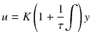

# 10.3 控制排放 pH 值

## 问题
当酸或碱的流量发生变化时，您想要控制混合罐中的 pH 水平。

## 解决方案
您将改变碱流 `i = 3` 的流量，以维持 pH 值。这意味着使用比例积分控制器来改变 `q[3]` 的值。这使得您能够处理阶跃扰动。

## 工作原理
比例积分控制器的形式为



(10.10) 其中 `u` 是控制量，`y` 是被测量，`τ` 是积分器时间常数，`K` 是前向（比例）增益。控制量为 `u = q[3]`，被测量为 `y = pH`。这里有一个控制量 `q[3]` 和一个输出量 `pH`，这构成了一个单输入/单输出过程。然而，`q[3]` 与 `pH` 之间的关联涉及三个动态状态：`h`、`Wa[4]` 和 `Wb[4]`。这些状态与 `pH` 之间的关系是非线性的。另一个问题是 `q[3]` 不能为负；也就是说，您不能从罐中抽取碱液。如果平衡状态下的 `q[3]` 足够高，这通常不会构成问题。

尽管存在这些潜在问题，但这个非常简单的控制器对于相当大范围的扰动仍然有效。平衡值通过一个包含比例项和积分项的扰动输入。积分项使用简单的欧拉积分法。完整脚本将在下一个方案中描述；此处重点关注实现控制功能的几行代码。

控制变量定义如下。pH 设定值为中性；即 pH 值为 7。`kF` 是前向增益，`tau` 是来自方程 10.10 的时间常数，分别设置为 2 和 60 秒。`q3Set` 是碱液流量额定设定点，取自参考文献。

```matlab
%% 控制设计
pHSet = 7.0;
tau = 60.0;  % (秒)
kF = 2.0;    % 前向增益
q3Set = 15.6; % (毫升/秒)
```

以下代码片段展示了在循环中实现的逻辑。误差计算为模型计算的 pH 测量值与 pH 设定值之间的差值。注意欧拉积分法，其中 `intErr` 通过简单地使用时间步长乘以误差来更新。同时注意有一个标志位 `controlIsOn`，它允许您在开环（不施加控制）状态下运行脚本。

```matlab
% 比例积分控制
err = pH - pHSet;
if controlIsOn
    d.q3 = q3Set - kF*(err + intErr/tau);
    intErr = intErr + dT*err;
else
    d.q3 = q3Set;
end
```

为了严格确定此问题的前向增益和时间常数，您需要将工作点处的仿真右侧函数线性化，并进行严格的单输入/单输出控制设计，这涉及伯德图、根轨迹图和其他技术。这超出了本书的范围。目前，只需选择能产生合理响应的值即可。