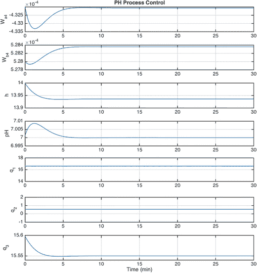
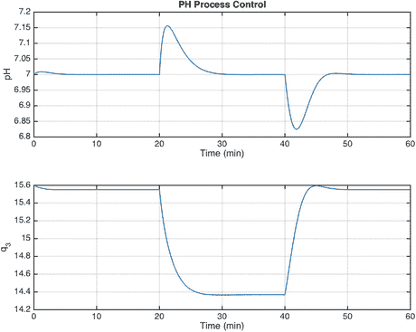
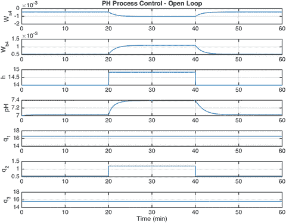
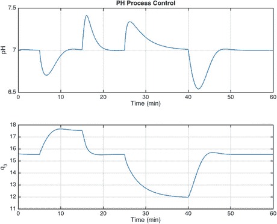
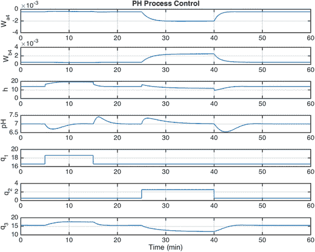
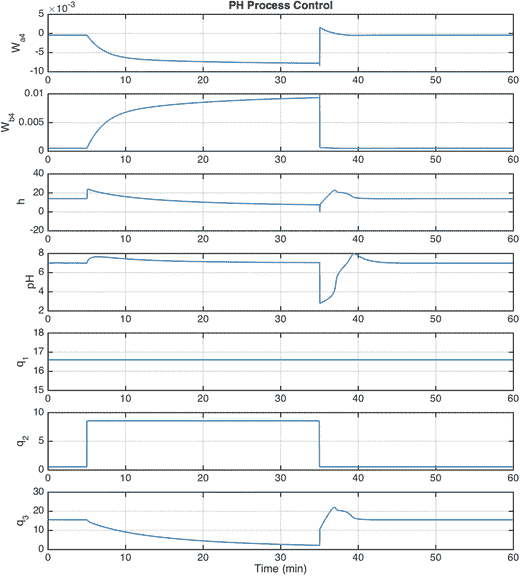
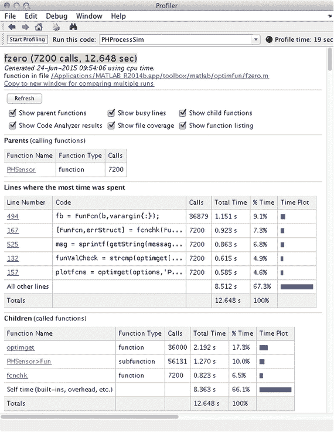
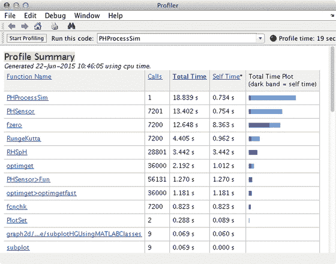

# 10.4 模拟带控制的 pH 过程

## 问题

您想要模拟搅拌罐，混合三种流（酸、缓冲液和碱），以演示对 pH 水平的控制。碱流是对缓冲液和酸流扰动的控制变量。

## 解决方案

编写一个包含控制器的脚本 `PHProcessSim`，并从平衡状态开始仿真。使用前一个方案中推导的比例积分控制器。脚本的结构允许您在酸流和/或缓冲液流中插入脉冲。

## 工作原理

扰动 `d` 是 `q[1]` 和 `q[2]` 的偏差，

![ $$ d=\left[\begin{array}{r}\hfill {q}_1\\ {}\hfill {q}_2\end{array}\right] $$ ](A335353_1_En_10_Chapter_Equ11.gif)

(10.11) 它们分别是酸流和缓冲液流。碱流是 `q[3]`，混合排放物的反应不变量是 `Wa[4]` 和 `Wb[4]`。

首先指定脚本的用户输入。您将其置于平衡状态，并将研究稳态附近的小扰动。有一个标志位 `controlIsOn` 用于打开或关闭控制系统。时间步长和持续时间通过迭代几个值来确定。

```
%% 用户输入
% 时间 (秒)
tEnd = 60*60;
dT = 1.0;

% 状态
wA4 = -4.32e-4;  % 排放流反应不变量 A (M)
wB4 = 5.28e-4;   % 排放流反应不变量 B (M)
h = 14.0;        % 液位 (厘米)

% 闭环或开环
controlIsOn = true;
```

扰动被建模为作用于 `d.q1` 和 `d.q2` 的脉冲。用户参数是脉冲的大小和开始/停止时间。这种设置允许您运行与参考文献类似的案例。

```
% 扰动
% 脉冲将根据 tPulse 的开始和结束时间施加：
% q1 = q10 + deltaQ1; and q2 = q20 + deltaQ2;
% 小脉冲：q2 中 0.65 毫升/秒
% 大脉冲：2.0 毫升/秒
% 非常大脉冲：8.0 毫升/秒
deltaQ1 = 8.0;   % +/- 1.5
deltaQ2 = 0.0;   % 0.65 1.45 0.45 - 0.55 % 来自参考文献的值
tPulse1 = [5 15]*60;
```

在脚本的其余部分，您获取前几个方案中定义的数据结构，指定控制参数，并创建仿真循环。假设不变量测量值是精确的；在实际应用中，它们需要被估计。然而，您应该始终先在理想条件下测试控制器，以了解其行为，避免复杂化。pH 测量使用来自方案 10-2 的 `PHSensor` 进行建模。过程的右侧函数在方案 10-1 中定义。积分使用第 6 章定义的 `RungeKutta` 函数执行。

```
%% 数据格式
dSensor = PHSensor('struct');
d = RHSpH;

%% 控制设计
pHSet = 7.0;
tau = 60.0;   % (秒)
kF = 2.0;     % 前向增益
q3Set = 15.6; % (毫升/秒)
q10 = d.q1;
q20 = d.q2;

%% 运行仿真
% 仿真步数
n = ceil(tEnd/dT);
% 绘图数组
xP = zeros(7,n);
t = (0:n-1)*dT;
% 初始状态
x = [wA4;wB4;h];
intErr = 0;

for k = 1:n
    % 测量
    dSensor.wA4 = x(1);
    dSensor.wB4 = x(2);
    pH = PHSensor( x, dSensor );
    
    % 比例积分控制
    err = pH - pHSet;
    if controlIsOn
        d.q3 = q3Set - kF*(err + intErr/tau);
        intErr = intErr + dT*err;
    else
        d.q3 = q3Set;
    end
    
    % 扰动
    if ( t(k) > tPulse1(1) && t(k) < tPulse1(2) )
        d.q1 = q10 + deltaQ1;
    else
        d.q1 = q10;
    end
    
    if ( t(k) > tPulse2(1) && t(k) < tPulse2(2) )
        d.q2 = q20 + deltaQ2;
    else
        d.q2 = q20;
    end
    
    % 存储数据供绘图
    xP(:,k) = [x;pH;d.q1;d.q2;d.q3];
    
    % 积分一步
    x = RungeKutta( @RHSpH, 0, x, dT, d );
end

%% 绘图
[t,tL] = TimeLabel(t);
yL = {'W_{a4}' 'W_{b4}' 'h' 'pH' 'q_1' 'q_2' 'q_3'};
tTL = 'pH 过程控制';
if ~controlIsOn
    tTL = [tTL ' - 开环'];
end
PlotSet( t, xP,'x label',tL,'y label',yL,'plot title',tTL,'figure title',tTL)
PlotSet( t, xP([4 7],:),'x label',tL,'y label',yL([4 7]),'plot title',tTL,'figure title',tTL)
```

现在，您将给出使用不同脉冲运行此脚本的结果。标准图会显示所有三个状态：测量的 pH 值、酸、碱和缓冲液的流量。一个更紧凑的图只显示 pH 值和 `q[3]` 的命令值。我们在绘图代码中添加了一行，用于修改开环响应时的图标题，这样如果您重复运行脚本，可以更容易地识别图表。

**提示**：使用您的控制标志和字符串变量来自定义您的图名称。


图 10-4 展示了在完全没有扰动的情况下运行 30 分钟仿真后的闭环响应。可以看到，参考值并未产生精确的平衡，但所达到的数值非常接近。反应不变量 `W[b4]` 的变化小于 `0.005 × 10^(−4)`，液位 `h` 变化小于 `0.1 cm`，而碱液流量 `q[3]` 的变化约为 `0.05 ml/s`。这相当于一个非常小的阶跃响应。请注意，稳定时间约为 5 分钟。这些结果让您有信心确信代码编写正确。您将在接下来的仿真中（在施加扰动之前）看到这一初始响应。



**图 10-4.** 无扰动的闭环响应

接下来，图 10-5 展示了缓冲流中加入一个从 20 分钟开始、40 分钟结束的 `0.65 ml/s` 脉冲时的开环响应。请注意，pH 值上升至接近 7.4，而 `q[3]` 实际上保持在设定值不变。图 10-6 展示了 pH 值和碱液流量 `q[3]` 的闭环暂态过程。pH 值的上升被限制在 7.2 以下，并且 pH 值和碱液流量在脉冲开始和结束后的约 10 分钟内达到平衡。这与参考资料中对比自适应和非自适应非线性控制方案的图表相比，结果令人满意。



**图 10-6.** 在`q2` 中加入 `0.65 ml/s` 脉冲时控制器的性能



**图 10-5.** 在`q2` 中加入 `0.65 ml/s` 脉冲时的开环响应

图 10-7 展示了在 `q[1]` 和 `q[2]` 中分别施加 `2 ml/s` 的较大偏移量扰动时的暂态过程。`q[1]` 的脉冲从 5 分钟持续到 15 分钟，`q[2]` 的脉冲从 25 分钟持续到 40 分钟。图 10-8 仅绘制了 pH 值和控制流量 `q[3]` 的图。



**图 10-8.** `q1` /`q2` 扰动结果的放大图



**图 10-7.** 在`q1` 和 `q2` 中加入 `2 ml/s` 的大扰动时控制器的性能

图 10-9 展示了在 `q[2]` 中加入一个从 5 分钟到 35 分钟、幅值为 `8 ml/s` 的极大扰动时的暂态过程。控制器的工作效果不再理想，其稳定时间比之前的示例长得多，并且在脉冲结束时碱液流量 `q[3]` 仍在下落。一个 `10 ml/s` 的脉冲值会导致仿真“失控”或产生虚数。始终有必要了解非线性系统中控制性能的极限。



**图 10-9.** 在`q[2]` 中加入极大扰动 (8 `ml/s`) 时控制器的性能

最后，由于您使用的是数值优化例程，因此对仿真进行分析，以确定花在 `fzero` 上的执行时间比例是很有启发性的。可以通过命令窗口中名为“运行并计时”的按钮访问探查器。运行 pH 仿真后的摘要如图 10-10 所示。在仿真花费的近 19 秒中，有整整 12.6 秒用在了 `fzero` 本身内部。积分仅花费了 4.4 秒，其中 3.4 秒用于右侧函数。该摘要包含指向各个函数的超链接，这些函数已按行计时。图 10-11 显示了在 `fzero` 内部花费的时间，除了绝对时间外，还计算了百分比。目标函数 `PHSensor` > `Fun` 被调用了 56,131 次，仅耗时 1.27 秒（占执行时间的 10%）。相当多的时间花费在了 `sprintf` 和 `optimget` 上。



**图 10-11.** `fzero` 的探查器结果



**图 10-10.** 仿真的探查器摘要

**提示**  
在实现数值搜索或优化例程时，请务必使用探查器运行一次。这能让您深入了解使用的迭代次数以及代码中任何未发现的错误。

在此例中，没有太多可以优化的地方，因为大部分时间都花费在 `fzero` 本身，而不是目标函数上，但如果不进行分析，您不会知道这一点。每当您使用数值工具，并且脚本或函数运行时间超过一两秒时，就有必要使用探查器进行分析。

## 总结

本章演示了如何为化学过程编写动力学方程并实现一个简单的控制律。该过程是高度非线性的，但您可以通过一个简单的比例积分控制器来控制该过程。pH 传感器没有闭式解，您需要使用 MATLAB 的 `fzero` 函数从不变式中找到 pH 值。本章还演示了如何使用 MATLAB 绘图函数 `mesh` 和 `surf` 来显示三维数据。您使用了一个仿真脚本来评估控制器在各种条件下的性能，并在探查器中运行该脚本以分析花在数值例程上的时间。表 10-1 列出了本章开发的代码。

**表 10-1.** 章节代码列表

| 文件 | 描述 |
| --- | --- |
| `PHSensor` | 模拟混合过程的 pH 值测量。 |
| `PHProcessSim` | pH 中和过程的仿真。 |
| `RHSpH` | 化学混合过程的动力学。 |
| `SensorTest` | 用于测试传感器算法的脚本。 |

**脚注**

1 Henson, M. A. 和 D. E. Seborg, *《非线性过程控制》*, Prentice-Hall, 1997 年。

2 Henson, M. 和 D. Seborg, “pH 中和过程的自适应非线性控制”，《IEEE 控制系统技术汇刊》，第 2 卷，第 3 期，1994 年 8 月。

