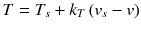
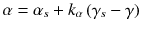
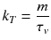
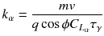

# 11.3 为飞行器设计控制系统

## 问题

你需要为一架飞行器设计一个控制系统，使其能够控制飞行轨迹并实现三维运动。

## 解决方案

你将采用动态被控对象逆推法前馈飞行器的期望控制量。使用比例控制器分别控制推力、迎角和滚转角，以修正标称控制量从而抵消阵风等扰动的影响。*不*对航向角 `ψ` 采用滚转角反馈控制，此部分留作练习。

## 工作原理

回顾配方 11-1 中的动力学模型，飞行器的状态为：

![ $$ \left[\begin{array}{cccccc}\hfill v\hfill & \hfill \gamma \hfill & \hfill \psi \hfill & \hfill x\hfill & \hfill y\hfill & \hfill h\hfill \end{array}\right] $$ ](A335353_1_En_11_Chapter_Equ9.gif)

(11.9) 其中 `v` 为速度，`γ` 为航迹角，`ψ` 为航向角，`x` 和 `y` 为飞行平面内的坐标，`h` 为高度。控制变量为滚转角 `φ`、迎角 `α` 和推力 `T`。

控制器形式如下：



(11.10)



(11.11)

若状态处于 `s`，则控制量应取对应平衡点处的控制值 `T[s]`、`α[s]`、`φ[s]`。增益 `k[T]` 和 `k[a]` 用于将状态推向正确方向，其值取决于飞行工况。你需要展开公式 11.2 中的前两个动力学方程。

![ $$ \left[\begin{array}{c}\hfill \dot{v}\hfill \\ {}\hfill \dot{\gamma}\hfill \end{array}\right]=\left[\begin{array}{c}\hfill \frac{T \cos \alpha -q\left({C}_{D_0}+k{\left({C}_{L_{\alpha }}\alpha \right)}²\right)}{m}-g \cos \gamma \hfill \\ {}\hfill \frac{\left(q{C}_{L_{\alpha }}\alpha +T \sin \alpha \right) \cos \phi - mg \cos \gamma }{mv}\hfill \end{array}\right] $$ ](A335353_1_En_11_Chapter_Equ12.gif)

(11.12)

对方程进行线性化处理，并省略与控制量无关的项。

![ $$ \left[\begin{array}{c}\hfill \dot{v}\hfill \\ {}\hfill \dot{\gamma}\hfill \end{array}\right]=\left[\begin{array}{c}\hfill \frac{T}{m}\hfill \\ {}\hfill \frac{q \cos \phi {C}_{L_{\alpha }}\alpha }{mv}\hfill \end{array}\right] $$ ](A335353_1_En_11_Chapter_Equ13.gif)

(11.13)

你希望引入时间常数 `τ[γ]` 和 `τ[v]`，使方程变为：

![ $$ \left[\begin{array}{c}\hfill \dot{v}\hfill \\ {}\hfill \dot{\gamma}\hfill \end{array}\right]=\left[\begin{array}{c}\hfill -\frac{v}{\tau_v}\hfill \\ {}\hfill -\frac{\gamma }{\tau_{\gamma }}\hfill \end{array}\right] $$ ](A335353_1_En_11_Chapter_Equ14.gif)

(11.14)

因此：



(11.15)



(11.16)

控制系统在函数 `AircraftControl` 中实现。

```
function [T, alpha] = AircraftControl( s, d, tauGamma, tauV, vSet, gammaSet )
u = EquilibriumControl( s, d );
v = s(1);
gamma = s(2);
h = s(6);
rho = feval( d.density, h );
qS = 0.5 * d.s * rho * vˆ2;
kV = d.m / tauV;
kGamma = ( d.m * v ) / ( qS * cos( d.phi ) * d.cLAlpha * tauGamma );
T = u(1) + kV * ( vSet - v );
alpha = u(2) + kGamma * ( gammaSet - gamma );
```

该控制系统的性能在仿真配方(11-5)中展示。该函数需要获取飞行工况信息，包含大气密度。它首先通过 `EquilibriumControl` 计算出当前状态 `s` 所需的控制量。飞行器数据结构也是必需的输入。额外输入还包括控制器的时间常数和设定值。在函数内部，通过 `feval` 和输入函数句柄来计算大气密度。该计算应与 `RHSAircraft` 中的计算方式保持一致。

