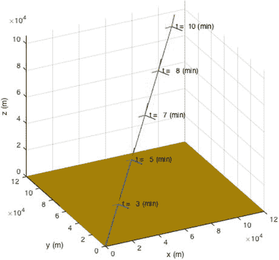
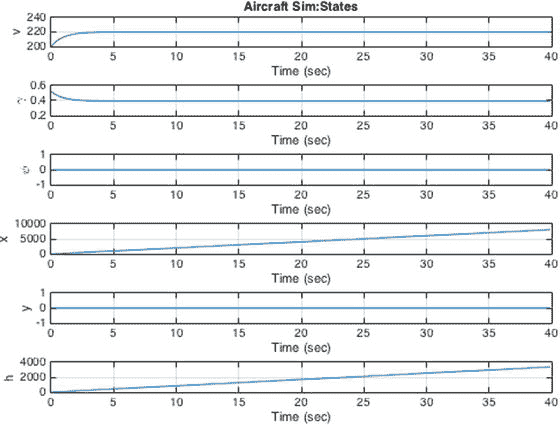
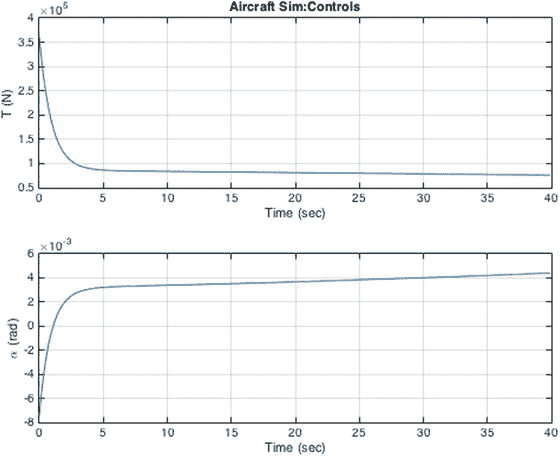
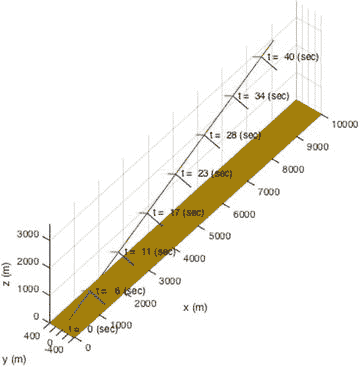

# 11.4 绘制飞行器三维轨迹

## 问题

你需要用三维方式绘制飞行器的轨迹，并沿轨迹显示飞行器坐标轴和时间信息。

## 解决方案

你将使用 MATLAB 的 `plot3` 函数，并结合自定义代码在轨迹的选定点绘制飞行器坐标轴和时间标记。最终生成的图形如图 11-6 所示。



图 11-6. 飞行器轨迹函数演示


### 工作原理

使用 `plot3` 绘制 3D 显示。`Plot3DTrajectory.m` 函数允许通过 `varargin` 输入参数对。

```
%% PLOT3DTRAJECTORY 在三维空间中绘制飞行器的轨迹。
%% 格式：
% Plot3DTrajectory( x, varargin )
%% 描述
% 绘制带有时间标签和局部坐标轴的飞行器三维轨迹。
% 
%% 输入参数
% x (6,:) 状态向量 [v;gamma;phi;x;y;h]
% varargin {:} 参数
% 
```

此处暂不展示演示代码，先给出绘图代码。这部分代码与 2D 绘图函数 `PlotSet` 有相似之处。我们使用 `text` 插入时间标签，并使用图形对象绘出地面。

```
% 绘制图形
h = figure;
set(h,'Name',figTitle);
plot3(x(4,:),x(5,:),x(6,:));
xlabel(xLabel);
ylabel(yLabel);
zlabel(zLabel);

% 绘制时间与坐标轴
if( ~isempty(t) && ~isempty(tIndex) )
  [t,~,tL] = TimeLabel(t);
  for k = 1:length(t)
    s = sprintf('t = %3.0f (%s)',t(k), tL);
    i = tIndex(k);
    text(x(4,i),x(5,i),x(6,i),s);
    DrawAxes(x(:,i),alpha(1,i),phi(1,i));
  end
end

% 添加地面
xL = get(gca,'xlim');
yL = get(gca,'ylim');
v = [xL(1) yL(1) 0;...
     xL(2) yL(1) 0;...
     xL(2) yL(2) 0;...
     xL(1) yL(2) 0];
patch('vertices',v,'faces',[1 2 3 4],'facecolor',[0.65 0.5 0.0],'edgecolor',[0.65 0.5 0.0]);
grid on
rotate3d on
axis image
zL = get(gca,'zlim');
set(gca,'zlim',[0 zL(2)],'ZLimMode','manual');
```

绘图命令很直观。如果输入了时间数组，该函数会使用 `sprintf` 和 `text` 沿轨迹绘制时间标签。我们通过 `TimeLabel` 获取合理的单位。此外，它还会使用嵌套函数 `DrawAxes` 绘制飞行器的坐标轴。

```
%%% Plot3DTrajectory>DrawAxes 子函数
%% DrawAxes
function DrawAxes( x, alpha, phi )
gamma = x(2);
psi = x(3);

% 飞行器坐标系：x 轴向前，y 轴指向右翼，z 轴向下
u0 = [1 0 0;0 1 0;0 0 -1];

cG = cos(gamma+alpha);
sG = sin(gamma+alpha);
cP = cos(psi);
sP = sin(psi);
cR = cos(phi);
sR = sin(phi);

u = [cP -sP 0;sP cP 0; 0 0 1]...
  *[cG 0 -sG; 0 1 0;sG 0 cG]...
  *[1 0 0;0 cR sR; 0 -sR cR]*u0;

% 计算坐标轴缩放长度
xL = get(gca,'xlim');
yL = get(gca,'ylim');
zL = get(gca,'zlim');
l = sqrt((xL(2)-xL(1))² + (yL(2)-yL(1))² + (zL(2)-zL(1))²)/20;
x0 = x(4:6);
for k = 1:3
  x1 = x0 + u(:,k)*l;
  c = [0 0 0];
  c(k) = 1;
  line([x0(1);x1(1)],[x0(2);x1(2)],[x0(3);x1(3)],'color',c);
end
```

该函数绘制了飞行器的坐标系：x 轴指向机头，y 轴指向右翼，z 轴向下。它使用状态向量，因此需要将 γ 和 ψ 转换为旋转矩阵。该坐标系基于风轴系。

函数通过参数对让用户自定义绘图。参数对在此处处理：

```
xLabel = 'x (m)';
yLabel = 'y (m)';
zLabel = 'z (m)';
figTitle = 'Trajectory';
t = [];
tIndex = [];
alpha = 0.02*ones(1,size(x,2));
phi = 0.25*pi*ones(1,size(x,2));
for k = 1:2:length(varargin)
  switch lower(varargin{k})
    case 'x label'
      xLabel = varargin{k+1};
    case 'y label'
      yLabel = varargin{k+1};
    case 'z label'
      zLabel = varargin{k+1};
    case 'figure title'
      figTitle = varargin{k+1};
    case 'time'
      t = varargin{k+1};
    case 'time index'
      tIndex = varargin{k+1};
    case 'alpha'
      alpha = varargin{k+1};
    case 'phi'
      phi = varargin{k+1};
    otherwise
      error('%s 不是有效的参数',varargin{k});
  end
end
```

我们在 `switch` 语句中使用 `lower` 函数，以便用户输入大写字母时无需担心大小写问题。大部分参数都很直观。时间输入有多种实现方式，我们选择允许用户为时间标签指定具体时间。同时，用户需要输入状态向量对应的索引。

该函数包含一个演示。输入 `Plot3DTrajectory` 即可生成图 11-6 所示的示例轨迹。对于图形函数而言，演示能直观展示图形效果，并提供函数使用示例。

```
% 演示
if( nargin < 1 )
  l = linspace(0,1e5);
  x = [200*ones(1,100);...
       (pi/4)*ones(1,100);...
       (pi/4)*ones(1,100);l;l;l];
  t = [200 300 400 500 600];
  k = [20 40 60 80 100];
  Plot3DTrajectory( x, 'time', t, 'time index', k, 'alpha',0.01*ones(1,100) )
  return;
end
```

## 11.5 模拟受控飞行器

### 问题

你希望模拟飞行器在轨迹控制下的运动。

### 解决方案

创建一个包含控制系统和飞行动力学的脚本。动力学使用 `RungeKutta` 方法进行传播。这是一个四阶方法，意味着截断误差与时间步长的四次方成正比。考虑到飞行控制系统典型的采样时间，四阶精度足以满足飞行仿真需求。我们将使用上一节描述的 3D 绘图函数 `Plot3DTrajectory` 来显示结果。


### 工作原理

仿真脚本 `AircraftSim.m` 读取 `RHSAircraft` 的数据结构，并修改参数以匹配 F-35 战斗机。该模型仅涉及推力和阻力，且即使这两部分也采用了非常简单的模型。初始飞行路径角和速度已设定。我们开启控制功能，并为速度和飞行路径角状态设定设定值和时间常数。输出方面，我们绘制状态图、控制图以及三维轨迹图。

```
%% 某 F-35 飞行器的轨迹控制仿真
% 模拟一个质点飞行器的动力学特性。
%% 另请参阅
% RungeKutta, RHSAircraft, PDControl, EquilibriumControl
```

脚本从 `RHS` 函数获取默认数据结构开始。

```
%% 用于右侧函数的数据结构
d = RHSAircraft;

%% 用户初始化
d.m = 13300.00; % 千克
d.s = 204.00; % 平方米
v = 200; % 米/秒
fPA = pi/6; % 弧度
% 初始化持续时间和时间步长
tEnd = 40;
dT = 0.1;

% 控制器
controlIsOn = true;
tauV = 1;
tauGamma = 1;
d.phi = 0;
vSet = 220;
gammaSet = pi/8;

%% 仿真
% 状态向量
x = [v;fPA;0;0;0;0];
% 绘图设置与步数
n = ceil(tEnd/dT);
xP = zeros(length(x)+2,n);
% 寻找非反馈设定值
[˜,D,LStar] = RHSAircraft(0,x,d);
thrust0 = D;
alpha0 = d.m*d.g/LStar;

% 运行仿真
for k = 1:n
    if ( controlIsOn )
        [d.thrust, d.alpha] = AircraftControl( x, d, tauGamma, tauV, vSet, gammaSet );
    else
        d.thrust = thrust0;
        d.alpha = alpha0;
    end
    % 绘图存储
    xP(:,k) = [x;d.thrust;d.alpha];
    % 右侧函数
    x = RungeKutta(@RHSAircraft,0,x,dT,d);
end

%% 绘图
[t,tL] = TimeLabel((0:(n-1))*dT);
yL = {'T (N)', '\alpha (rad)'};
s = '飞行器仿真：控制量';
PlotSet(t,xP(7:8,:),'x label',tL,'y label',yL,'plot title',s, 'figure title',s);
yL = {'v' '\gamma' '\psi' 'x' 'y' 'h'};
s = '飞行器仿真：状态量';
PlotSet(t,xP(1:6,:),'x label',tL,'y label',yL,'plot title',s,'figure title',s);
k = floor(linspace(2,n,8));
t = t(k);
Plot3DTrajectory( xP, 'time', t, 'time index', k, 'alpha', xP(8,:) );
```

如果关闭控制，则将推力和攻角设置为常数值，以平衡阻力和重力。速度和飞行路径角的设定值与初始条件略有不同。这使你能够展示控制器的瞬态响应。

图 11-7 显示了各状态量。速度和飞行路径角收敛至其设定值。



图 11-7. 速度和飞行路径角收敛至期望值

图 11-8 显示了控制量。控制量达到其稳态值。随着飞机爬升，推力和攻角发生变化。推力下降是因为阻力下降，而攻角增加是为了维持升力与重力的平衡。



图 11-8. 控制量收敛至稳态值，随后缓慢变化以适应飞机爬升时大气密度的降低

三维轨迹如图 11-9 所示。如预期，它以近乎恒定的角度和速度爬升。



图 11-9. 轨迹图

### 总结

本章演示了如何编写质点飞行器的动力学模型。你学习到了如何使用搜索算法寻找平衡控制状态。这包括利用 MATLAB 为其优化算法提供的调试输出，并为每次搜索迭代添加自定义绘图。你学习到了如何设计一个控制系统来维持期望的速度、倾斜角和飞行路径角。你学习到了如何制作带有文本注释和其他绘图对象的三维图。你还学习到了如何将函数句柄传递给其他函数，以使函数更具通用性。表 11-1 列出了本章开发的代码。

**表 11-1.** 本章代码清单

| 文件 | 说明 |
| --- | --- |
| `RHSAircraft` | 质点飞行器的六自由度右侧函数。 |
| `AtmosphericDensity` | 基于指数模型的大气密度随高度变化函数。 |
| `EquilibriumControl` | 寻找质点飞行器的平衡控制。 |
| `AircraftControl` | 计算三维质点飞行器的攻角和推力。 |
| `Plot3DTrajectory` | 绘制带时间点和局部坐标轴的飞行器三维轨迹。 |
| `AircraftSim` | 飞行器轨迹控制仿真。 |

