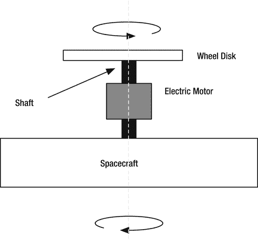
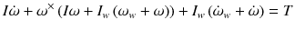
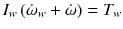
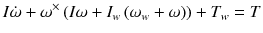
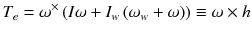
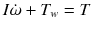
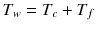
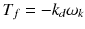

# 12. 航天器

电子补充材料：本章在线版本（doi: [10.1007/978-1-4842-0559-4_12](http://dx.doi.org/10.1007/978-1-4842-0559-4_12)）包含补充材料，仅供授权用户使用。

航天器指向控制是所有机器人及载人航天器的一项关键技术。控制系统由传感、执行以及航天器本身的动力学组成。航天器控制系统种类繁多，但本章仅涉及三轴指向问题。采用反作用轮作为执行机构。

反作用轮通过角动量守恒来实现控制。作用在反作用轮上的力矩使其向一个方向旋转，而航天器则向相反方向旋转。从航天器移除的动量被轮子吸收。反作用轮被归类为动量交换装置。你可以仅使用轮子而无需任何外部力矩来重新定向航天器。在反作用轮问世之前，常使用推进器进行姿态控制。这会消耗推进剂，这是不可取的，因为一旦推进剂耗尽，航天器将无法继续使用。

除绕正交（垂直）轴旋转的三个反作用轮外，航天器被建模为刚体。连接在轮子转子上的电机轴与航天器相连。施加在轮子与航天器之间的扭矩会导致轮子和航天器向相反的角度方向运动。我们假设拥有用于测量航天器姿态的姿态传感器。我们还假设轮子是理想的，只存在粘性阻尼摩擦。

## 12.1 创建航天器动力学模型

### 问题

航天器是一个带有三个轮子的刚体。每个轮子都与航天器相连，如图 12-1 所示。



图 12-1. 反作用轮。反作用轮盘向一个方向旋转，航天器则向相反方向旋转

### 解决方案

运动方程利用角动量守恒原理写出。这产生了一个动力学模型，即在标准欧拉方程的基础上增加了旋转轮子的效应。这有时被称为陀螺体模型。


### 工作原理

航天器模型可分为动力学部分（包括反作用轮的动力学）和运动学部分。若假设飞轮完全对称、与三轴对齐且具有对角线惯性矩阵，则可通过以下耦合一阶微分方程对航天器动力学建模。



(12.1)



(12.2)

`I` 是 3 × 3 惯性矩阵，不包含飞轮的惯性。

![ $$ I=\left[\begin{array}{lll}{I}_{xx}\hfill & {I}_{xy}\hfill & {I}_{xz}\hfill \\ {}{I}_{yx}\hfill & {I}_{yy}\hfill & {I}_{yz}\hfill \\ {}{I}_{zx}\hfill & {I}_{zy}\hfill & {I}_{zz}\hfill \end{array}\right] $$ ](A335353_1_En_12_Chapter_Equ3.gif)

(12.3)

该矩阵是对称的，因此 `I_xy = I_yx`，`I_xz = I_zx`，`I_zy = I_yz`。`ω` 是在航天器坐标系中观测到的航天器角速度矢量。

![ $$ \omega =\left[\begin{array}{l}{\omega}_x\hfill \\ {}{\omega}_y\hfill \\ {}{\omega}_z\hfill \end{array}\right] $$ ](A335353_1_En_12_Chapter_Equ4.gif)

(12.4) `ω_w` 是飞轮 1、2、3 的角速度。

![ $$ {\omega}_w=\left[\begin{array}{l}{\omega}_1\hfill \\ {}{\omega}_2\hfill \\ {}{\omega}_3\hfill \end{array}\right] $$ ](A335353_1_En_12_Chapter_Equ5.gif)

(12.5)

1 与 x 轴对齐，2 与 y 轴对齐，3 与 z 轴对齐。这样，反作用轮组成了一个正交系统，可用于三轴控制。`T` 是作用在航天器上的外部力矩，可包括太阳光压、空气阻力等外部扰动，以及推力器或磁力矩器线圈的力矩。`T_w` 是作用在飞轮上的内部力矩。`I_w` 是飞轮的标量惯性（假设所有飞轮具有相同的惯性）。可将第二个方程代入第一个方程以简化表达式。



(12.6)


(12.7)

此项



(12.8) 称为欧拉力矩。若角速率较小，可将此项设为零，方程简化为



(12.9)


(12.10)

对于运动学部分，我们使用四元数。四元数是用四个参数描述航天器相对于惯性坐标系姿态的方式。虽然理论上用角度表达即可，因为仅需三个状态变量即可描述姿态。但角度存在奇异性问题——即在某些特定姿态下某个角度无法定义，因此不适合用于仿真。从惯性系到本体系的四元数导数为

![ $$ \dot{q}=\frac{1}{2}\left[\begin{array}{rr}\hfill 0& \hfill {\omega}^T\\ {}\hfill -\omega & \hfill {\omega}^{\times}\end{array}\right] $$ ](A335353_1_En_12_Chapter_Equ11.gif)

(12.11)

`ω^×` 表示斜对称矩阵，等效于叉积运算，其形式为

![ $$ {\omega}^{\times }=\left[\begin{array}{rrr}\hfill 0& \hfill -{\omega}_z& \hfill {\omega}_y\\ {}\hfill {\omega}_z& \hfill 0& \hfill -{\omega}_x\\ {}\hfill -{\omega}_y& \hfill {\omega}_x& \hfill 0\end{array}\right] $$ ](A335353_1_En_12_Chapter_Equ12.gif)

(12.12)

飞轮力矩由摩擦力矩和控制力矩组成。反作用轮通常由直流电机驱动，电机电子器件通过电流反馈抵消反电动势。因此，总的反作用轮力矩为



(12.13) 其中 `T_c` 是指令的反作用轮力矩，`T_f` 是摩擦力矩。一个简单的摩擦模型为



(12.14) `k_d` 是阻尼系数，`ω_k` 是第 k 个飞轮的角速度。若 `k_d` 较大，可能需将其前馈至控制器。这需要对飞轮进行仔细标定以确定阻尼系数。

首先，定义动力学右端函数无输入时返回的数据结构。该函数名为 `RHSSpacecraftWithRWA.m`。RWA 代表反作用轮组件。之所以称为“组件”，是因为反作用轮由轴承、轮体、转轴、支撑结构以及电力电子器件装配而成。航天器正是由各类组件构成的。

飞轮的默认单位矢量沿正交轴线（如 x、y、z 轴）。默认惯性矩阵为单位矩阵，使航天器等效为球体。默认的反作用轮惯量为 0.001。所有飞轮的非旋转部件均被归并至惯性矩阵中。

```
% Default data structure
if ( nargin == 0 )
  xDot = struct('inr', eye (3), 'torque',[0;0;0],'inrRWA', 0.001*[1;1;1],...
    'torqueRWA',[0;0;0],'uRWA', eye (3), 'damping',[0;0;0]);
  return
end
```

航天器的动力学方程在以下代码行中给出。需要计算总飞轮力矩，因为它同时作用于航天器和飞轮。我们使用反斜杠运算符将方程乘以惯性矩阵的逆。惯性矩阵是正定对称矩阵，因此可使用特定例程加速计算。最好避免直接计算逆矩阵，因为可能存在病态问题——即矩阵中的微小误差可能导致逆矩阵的较大误差。

将状态向量元素保存为具有明确意义的局部变量，以便于代码阅读。这也可避免不必要的子矩阵重复提取。

你会注意到，`omegaRWA` 变量使用 `end` 关键字从向量的第 8 个元素读取至末尾。这使代码能处理任意数量的反作用轮。你可能只需要用一个轮子控制单轴，或者使用超过三个轮子以增加冗余。请确保 `d` 中的输入与轮子数量匹配。同时，由于我们输入了单位矢量，轮子不必与 x、y、z 轴对齐。注意使用反斜杠运算符求解 `omegaDotCore` 的线性方程组。

```
% Save as local variables
q = x(1:4);
omega = x(5:7);
omegaRWA = x(8:end);

% Total body fixed angular momentum
h = d.inr*omega + d.uRWA*(d.inrRWA.*(omegaRWA + d.uRWA'*omega));

% Total wheel torque
tRWA = d.torqueRWA - d.damping.*omegaRWA;

% Core angular acceleration
omegaDotCore = d.inr\(d.torque - d.uRWA*tRWA - Cross(omega,h));
```

请注意，`uRWA` 是反作用轮单位矢量（即自旋矢量）的数组。在计算 `h` 时，需使用 `uRWA` 的转置将 `ω` 变换至轮坐标系，然后变换回本体坐标系，再将轮系分量添加到核心分量 `Iω` 中。飞轮动力学由以下代码行给出。

```
% Wheel angular acceleration
omegaDotWheel = tRWA./d.inrRWA - d.uRWA'*omegaDotCore;
```

总状态导数由以下代码行表示：

```
% State derivative
sW = [ 0 -omega(3) omega(2);...
       omega(3) 0 -omega(1);...
      -omega(2) omega(1) 0]; % skew symmetric matrix
qD = 0.5*[0, omega';-omega,-sW];
xDot = [qD*q;omegaDotCore;omegaDotWheel];
```

总惯性角动量是辅助输出。在没有外力矩的情况下，该值应守恒，因此它是检验动力学的良好指标。检验角动量守恒的一个简单方法是：用所有状态的角速率运行一次仿真，然后用更小的时间步长重新运行。角动量的变化应随着时间步长的减小而减小。

```
% Output the inertial angular momentum
if ( nargout > 1 )
  hECI = QTForm( q, h );
end
```


