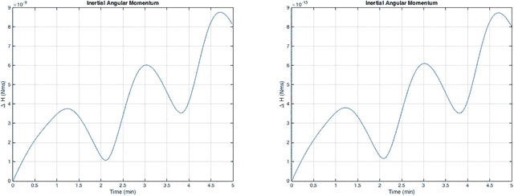
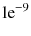
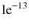
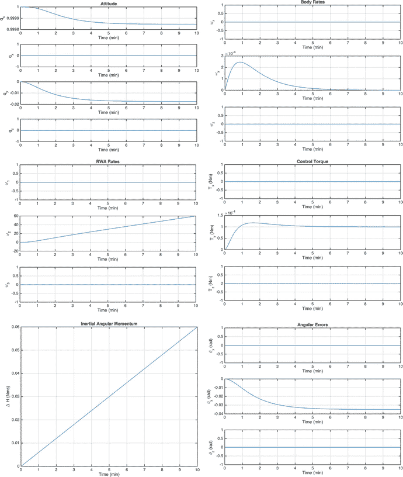
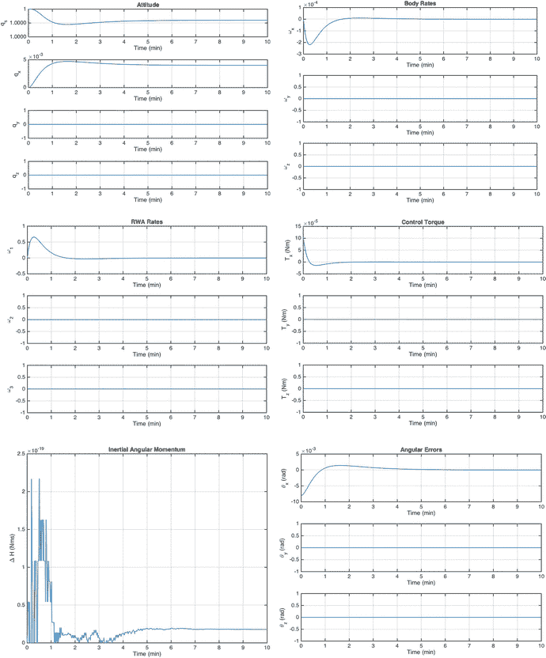

# 12.3 模拟受控航天器

## 问题描述
你想测试姿态控制器并观察其性能表现。

## 解决方案
解决方案是构建一个 MATLAB 脚本，在脚本中设计 PD 控制器的矩阵，然后在循环中模拟该控制器，施加计算出的扭矩，直至达到期望的四元数或抵消扰动力矩为止。


### 工作原理

为控制器 `SpacecraftSim` 构建一个仿真脚本。该脚本首先要做的事情是检查角动量守恒，方法是分别以 0.1 秒和 1 秒的时间步长运行仿真 300 秒，并比较两种测试情况下角动量的大小。通过将 `controlIsOn` 标志设为 false 来关闭控制。在没有外部力矩的情况下，如果我们的方程编写正确，动量应保持恒定。然而，你会看到由于数值积分误差导致的动量增长。第一种情况下的增长应远低于第二种情况，因为较小的时间步长能使积分更精确。请注意，我们为航天器在 `omega` 和 `omegaRWA` 中设定了随机初始速率以及一个非球形的惯性张量，以帮助捕捉动力学代码中的任何错误。

```
tEnd = 300;
dT = 0.1;
controlIsOn = false;
qECIToBody = [1;0;0;0];
omega = [0.01;0.02;-0.03]; % 弧度/秒
omegaRWA = [5;-3;2]; % 弧度/秒
d.inr = [3 0 0;0 10 0;0 0 5]; % 千克·米²
```

图 12-2 显示了测试结果。在时间步长为 0.1 秒的测试中，动量增长低了四个数量级，这表明动力学方程如预期那样守恒角动量。增长的形态不会改变，并且将取决于各种角速度的相对大小。



图 12-2. 1 秒和 0.1 秒时间步长下的角动量守恒。在 0.1 秒的测试中，增长降低了四个数量级，从  降至 

你通过使用 `RHS` 函数的数据结构特性来初始化脚本。下面展示了启用控制系统运行时的参数。此时速率初始化为零，你使用 1 秒的时间步长，该步长在前面的测试中显示出足够小的动量增长。

```
%% 右侧数据结构
d = RHSSpacecraftWithRWA;

%% 用户初始化
% 初始化持续时间、时间步长、状态和惯性张量
tEnd = 600;
dT = 1;
controlIsOn = true;
qECIToBody = [1;0;0;0];
omega = [0;0;0]; % 弧度/秒
omegaRWA = [0;0;0]; % 弧度/秒
d.inr = [3 0 0;0 10 0;0 0 5]; % 千克·米²
qTarget = QUnit([1;0.004;0.0;0]); % 归一化
d.torque = [0;0;0]; % 干扰力矩
```

控制系统在此设计。请注意 `wN` 的小数值以及单位阻尼比。航天器上干扰的频率相当低，而且飞轮有转矩限制，这导致 `wN` 比机器人示例中小得多。三个控制器完全相同。

```
%% 控制设计
% 设计一个 PD 控制器
dC = PDControl( 'struct' );
dC(1).zeta = 1;
dC(1).wN = 0.02;
dC(1).wD = 5*dC(1).wN;
dC(1).tSamp = dT;
dC(1) = PDControl( 'initialize', dC(1) );

% 使所有三个轴控制器相同
dC(2) = dC(1);
dC(3) = dC(1);
```

接下来是仿真循环。一如既往，先用零初始化绘图数组。循环中的第一步是找出当前状态与目标姿态之间的角度误差。接着，根据控制标志的值计算控制加速度或将其设为零。控制转矩通过将控制加速度乘以航天器惯性张量来计算。为绘图目的计算动量，最后，积分一个时间步长。

```
%% 仿真
% 状态向量
x = [qECIToBody;omega;omegaRWA];

% 绘图和步数
n = ceil(tEnd/dT);
xP = zeros(length(x)+7,n);

% 计算初始角动量
[˜,hECI0] = RHSSpacecraftWithRWA(0,x,d);

% 运行仿真
for k = 1:n
    % 计算角度误差
    angleError = ErrorFromQuaternion( x(1:4), qTarget );
    if (controlIsOn )
        u = [0;0;0];
        for j = 1:3
            [u(j), dC(j)] = PDControl('update',angleError(j),dC(j));
        end
    else
        u = [0;0;0];
    end
    % 飞轮转矩在等式左侧
    d.torqueRWA = d.inr*u;
    % 计算角动量增量
    [˜,hECI] = RHSSpacecraftWithRWA(0,x,d);
    dHECI = hECI - hECI0;
    hMag = sqrt(dHECI'*dHECI);
    % 存储绘图数据
    xP(:,k) = [x;d.torqueRWA;hMag;angleError];
    % 右侧计算
    x = RungeKutta(@RHSSpacecraftWithRWA,0,x,dT,d);
end
```

输出完全是二维图。我们将它们分页显示，每页包含一到三个图。这使得在大多数电脑显示器上易于阅读。

```
%% 绘图
[t,tL] = TimeLabl((0:(n-1))*dT);
yL = {'q_s', 'q_x', 'q_y', 'q_z'};
PlotSet( t, xP(1:4,:), 'x⊔label', tL, 'y⊔label', yL,...
    'plot⊔title', '姿态', 'figure⊔title', '姿态');
yL = {'\omega_x', '\omega_y', '\omega_z'};
PlotSet(t, xP(5:7,:), 'x⊔label', tL, 'y⊔label', yL,...
    'plot⊔title', '本体速率', 'figure⊔title', '本体速率');
yL = {'\omega_1', '\omega_2', '\omega_3'};
PlotSet( t, xP(8:10,:), 'x⊔label', tL, 'y⊔label', yL,...
    'plot⊔title', '反作用飞轮速率', 'figure⊔title', '反作用飞轮速率');
yL = {'T_x⊔(Nm)', 'T_y⊔(Nm)', 'T_z⊔(Nm)'};
PlotSet( t, xP(11:13,:), 'x⊔label', tL, 'y⊔label', yL,...
    'plot⊔title', '控制转矩', 'figure⊔title', '控制转矩');
yL = {'\Delta⊔H⊔(Nms)'};
PlotSet( t, xP(14,:), 'x⊔label', tL, 'y⊔label', yL,...
    'plot⊔title', '惯性角动量', 'figure⊔title', '惯性角动量');
yL = {'\theta_x⊔(rad)', '\theta_y⊔(rad)', '\theta_z⊔(rad)'};
PlotSet( t, xP(15:17,:), 'x⊔label', tL, 'y⊔label', yL,...
    'plot⊔title', '角度误差', 'figure⊔title', '角度误差');
```

注意，`PlotSet` 使绘图的设置比使用 MATLAB 内置的 `plot` 和辅助函数更加容易，代码也更具可读性。你确实会失去一些灵活性。y 轴标签使用 LaTeX 表示法。这提供有限的 LaTeX 语法。你可以将绘图设置为完整的 LaTeX 模式，以访问所有 LaTeX 命令。

请注意，我们直接从目标四元数和真实四元数计算角度误差。这代表了我们的姿态传感器。在真实的航天器中，姿态估计相当复杂。使用多种传感器，如磁力计、GPS、地球和太阳传感器的组合，并且通常使用速率积分陀螺仪来平滑测量数据。星敏感器或星跟踪器常用于三轴姿态感知，需要将相机中的图像转换为姿态估计。你不能单独使用陀螺仪，因为它们无法提供相对于惯性系的初始方位。

运行两个测试。第一个测试显示我们的控制器能够补偿一个本体固定的干扰力矩。第二个测试显示控制器能够重新定向航天器。

以下是干扰力矩测试的初始化代码。初始姿态和目标姿态相同，均为单位四元数，但 `d.torque` 中有一个小的干扰力矩。

```
% 初始化持续时间、时间步长、状态和惯性张量
tEnd = 600;
dT = 1;
controlIsOn = true;
qECIToBody = [1;0;0;0];
omega = [0;0;0]; % 弧度/秒
omegaRWA = [0;0;0]; % 弧度/秒
d.inr = [3 0 0;0 10 0;0 0 5]; % 千克·米²
qTarget = QUnit([1;0;0.0;0]);
d.torque = [0;0.0001;0]; % 干扰力矩 (N)
```

我们将仿真运行到 600 秒，以便观察过渡过程稳定下来。干扰力矩非常小，这符合航天器的典型情况。我们使力矩为单轴，以使响应更清晰。图 12-3 显示了完整的输出图集。



图 12-3. 控制一个突然施加的外部力矩

干扰导致围绕 y 轴的姿态发生变化。这种偏移在使用 PD 控制器时是预料之中的。控制转矩最终与干扰匹配，角度误差达到最大值。

y 轴飞轮速率线性增长，因为它必须吸收由力矩产生的所有动量。我们并未限制最大飞轮速率。在真实的航天器中，飞轮很快就会饱和，达到其允许的最大速度。我们的控制系统需要其他执行器来对飞轮进行消饱和处理。惯性角动量也随着恒定外部力矩的出现而线性增长，这是预期的。

现在，我们进行一个围绕 x 轴的姿态校正。以下是初始化代码。

```
% 初始化持续时间、时间步长、状态和惯性张量
tEnd = 600;
dT = 1;
controlIsOn = true;
qECIToBody = [1;0;0;0];
omega = [0;0;0]; % 弧度/秒
omegaRWA = [0;0;0]; % 弧度/秒
d.inr = [3 0 0;0 10 0;0 0 5]; % 千克·米²
qTarget = QUnit([1;0.004;0.0;0]); % 归一化
d.torque = [0;0;0]; % 干扰力矩
```

我们指令一个围绕 x 轴的小姿态偏移，这通过改变四元数中的第二个元素来实现。我们对四元数进行单位化以防止数值问题。图 12-4 显示了输出图。



图 12-4. 指令一个关于 x 轴的小姿态偏移

在这种情况下，围绕 x 轴的角度误差被减小到零。惯性角动量保持“恒定”，尽管由于数值积分中的截断误差会有一些微小波动。这是预料之中的，并且在控制系统运行时持续检查角动量是良好的做法。如果它不保持近似恒定，则仿真存在问题。内部力矩不会改变惯性角动量。这就是为什么反作用飞轮被称为动量交换装置。它们与航天器本体交换动量，但不会计入惯性角动量总量。

在两种情况下，姿态速率都保持较小，因此欧拉耦合力矩很小。这证明了我们先前将航天器视为三个双积分器的决定是合理的。同时也证明了我们使用四元数误差到小角度近似的合理性。


