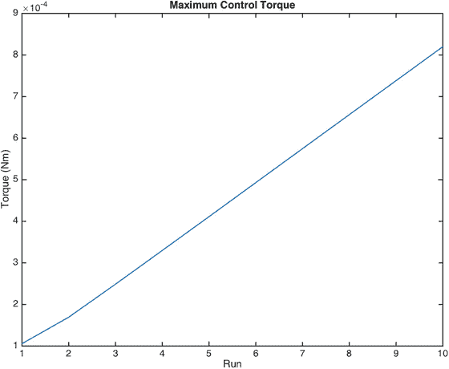
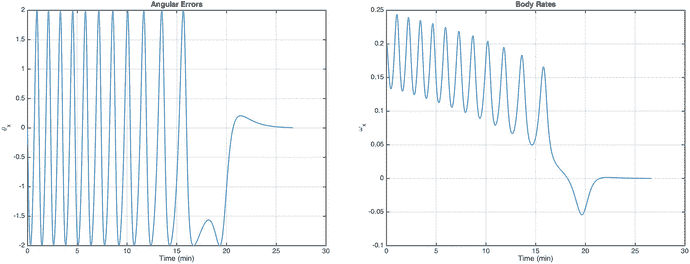

# 12.4 批量执行仿真运行

## 问题

你已经使用仿真脚本验证了动量守恒并测试了控制器，但请注意，你需要为每种情况手动修改脚本顶部的行。这对于开发阶段来说没问题，但这会使结果难以复现；你无法得知生成特定图表的初始条件。你可能需要针对一整套输入运行仿真，并进行蒙特卡洛分析。

## 解决方案

基于该脚本创建一个新的函数，并将关键参数作为输入。一个新的数据结构将同时存储输入和输出，这样你就可以将每次运行的结果保存为 `.mat` 文件。这使得将来可以重新绘制任何一次运行的结果，或者根据存储的输入重新运行；例如，当你发现并修复了控制器中的一个错误时。

## 工作原理

首先将仿真脚本复制到一个新文件中。添加一个函数签名。用输入结构替换初始化变量。执行仿真，然后保存输入结构以及生成的输出。生成的函数头如下所示。`input` 结构包含 RHS 数据、控制器数据和仿真时序数据。

```
%% SpacecraftSimFunction 航天器反作用轮仿真函数
% 根据给定的初始状态，对带有反作用轮的航天器进行仿真。
%% 格式
% d = SpacecraftSimFunction( x0, qTarget, input )
%% 输入
% x0 (7+n,1) 初始状态
% qTarget (4,1) 目标四元数
% input (.) 数据结构
%   .rhs (.) RHS 数据
%   .pd (:) 控制器
%   .dT (1,1) 时间步长
%   .tEnd (1,1) 仿真时长
%   .controlIsOn 控制开关标志
%% 输出
% d (.) 数据结构
%   .input
%   .x0
%   .qTarget
%   .xPlot
%   .dPlot
%   .tPlot
%   .yLabel
%   .dLabel
%   .tLabel
```

现在，你可以编写一个循环调用仿真函数的脚本。可能性是无限的：你可以测试不同的目标，为蒙特卡洛仿真改变初始条件，或者施加不同的干扰力矩。你可以对结果进行统计分析，或者根据某些条件识别并绘制单次运行的结果。在本示例中，你将找出每次运行中施加的最大控制力矩。

```
%% 航天器仿真多次运行
% 在循环中执行 SpacecraftSimBatch 多次运行，并改变初始条件。
% 找出每种情况下施加的最大控制力矩。
%% 另请参阅
% SpacecraftSimFunction

sim = struct;

%% 控制器设计
% 设计一个 PD 控制器
dC = PDControl( 'struct' );
dC(1).zeta = 1;
dC(1).wN = 0.02;
dC(1).wD = 5*dC(1).wN;
dC(1).tSamp = dT;
dC(1) = PDControl( 'initialize', dC(1) );
% 使三个轴的控制器完全相同
dC(2) = dC(1);
dC(3) = dC(1);
sim.pd = dC;

%% 航天器模型
% 设置航天器为非球形；无干扰
rhs = RHSSpacecraftWithRWA;
rhs.inr = [3 0 0;0 10 0;0 0 5]; % kg-m²
rhs.torque = [0;0;0]; % 干扰力矩
sim.rhs = rhs;

%% 初始化
% 初始化仿真时长、时间步长、状态和惯量
sim.tEnd = 600;
sim.dT = 1;
sim.controlIsOn = true;

% 航天器状态
qECIToBody = [1;0;0;0];
omega = [0;0;0]; % rad/sec
omegaRWA = [0;0;0]; % rad/sec
x0 = [qECIToBody;omega;omegaRWA];

% 目标四元数
qTarget = QUnit([1;0.004;0.0;0]); % 归一化

%% 仿真循环
clear d;
for k = 1:10;
    % 改变初始条件中的某个参数并进行仿真
    x0(5) = 1e-3*k;
    thisD = SpacecraftSimFunction( x0, qTarget, sim );
    % 将运行结果保存为 .mat 文件
    thisDir = fileparts(mfilename('fullpath'));
    fileName = fullfile(thisDir,'Output', sprintf('Run%d',k));
    save( fileName, '-struct', 'thisD' );
    % 存储运行输出
    d(k) = thisD;
end

%% 对结果进行统计分析
% ... 按需进行
for k = 1:length(d)
    tMax(k) = max( max( d(k).dPlot(2:4,:) ) );
end

figure;
plot(1:length(d), tMax);
xlabel('运行次数')
ylabel('力矩 (Nm)')
title('最大控制力矩');

% 绘制单次运行结果
kPlot = 4;
PlotSpacecraftSim( d(4) );
```

图 12-5 显示了最大力矩的结果。



**图 12-5.** 10 次仿真运行中的最大控制力矩

某次运行的输出结果如下所示。

```
>> d(1)

ans =

      input: [1x1 struct]
         x0: [10x1 double]
    qTarget: [4x1 double]
      xPlot: [10x600 double]
      dPlot: [7x600 double]
      tPlot: [1x600 double]
     tLabel: '时间 (分钟)'
     yLabel: {1x10 cell}
     dLabel: {1x7 cell}
```


作为一个有趣示例，你可以为航天器设定更高的初始速率，观察控制器如何响应。在命令行中，将围绕`x`轴的初始速率改为`0.2 rad/sec`，然后调用仿真函数（不返回任何输出），以便生成全套图表。你会看到响应耗时很长（超过 20 分钟），但速率最终会衰减至零。



**图 12-6:** 对`x`轴大速率的控制响应。最终速率确实被抑制了！

完整的仿真函数如下所示。内置演示程序对默认航天器模型执行无控制的开环仿真，这与前面配方中进行的动量守恒测试（图 12-2）一致。

```matlab
function d = SpacecraftSimFunction( x0, qTarget, input )

%% Handle inputs
if nargin == 0
    % perform an open loop simulation
    input = struct;
    input.rhs = RHSSpacecraftWithRWA;
    input.pd = [];
    input.dT = 1; % sec
    input.tEnd = 600; % sec
    input.controlIsOn = false;
    x0 = [1;0;0;0;1e-3*randn(6,1)];
    SpacecraftSimFunction( x0, [], input );
    return;
end

if isempty(x0)
    qECIToBody = [1;0;0;0];
    omega = [0;0;0]; % rad/sec
    omegaRWA = [0;0;0]; % rad/sec
    x0 = [qECIToBody;omega;omegaRWA];
end

if isempty(qTarget)
    qTarget = x0(1:4);
end

%% Simulation
% State vector
x = x0;
nWheels = length(x0)-7;

% Plotting and number of steps
n = ceil(input.tEnd/input.dT);
xP = zeros(length(x),n);
dP = zeros(7,n);

% Find the initial angular momentum
d = input.rhs;
[˜,hECI0] = RHSSpacecraftWithRWA(0,x,d);

% Run the simulation
for k = 1:n
    % Control
    u = [0;0;0];
    angleError = [0;0;0];
    if (input.controlIsOn )
        % Find the angle error
        angleError = ErrorFromQuaternion( x(1:4), qTarget );
        % Update the controllers individually
        for j = 1:nWheels
            [u(j), input.pd(j)] = PDControl('update',angleError(j), input.pd(j));
        end
    end

    % Wheel torque
    d.torqueRWA = d.inr*u;

    % Get the delta angular momentum
    [˜,hECI] = RHSSpacecraftWithRWA(0,x,d);
    dHECI = hECI - hECI0;
    hMag = sqrt(dHECI'*dHECI);

    % Plot storage
    xP(:,k) = x;
    dP(:,k) = [hMag;d.torqueRWA;angleError];

    % Right hand side
    x = RungeKutta(@RHSSpacecraftWithRWA,0,x,input.dT,d);
end

[t,tL] = TimeLabl((0:(n-1))*input.dT);

%% Store data
% Record initial conditions
d = struct;
d.input = input;
d.x0 = x0;
d.qTarget = qTarget;
d.xPlot = xP;
d.dPlot = dP;
d.tPlot = t;
d.tLabel = tL;

y = cell(1,nWheels);
for k = 1:nWheels
    y{k} = sprintf('\\omega_%d',k);
end
d.yLabel = {'q_s','q_x','q_y','q_z','\omega_x','\omega_y','\omega_z',y{:}};
d.dLabel = {'\Delta⊔H⊔(Nms)','T_x⊔(Nm)', 'T_y⊔(Nm)', 'T_z⊔(Nm)', ...
            '\theta_x⊔(rad)', '\theta_y⊔(rad)', '\theta_z⊔(rad)'};

if nargout == 0
    PlotSpacecraftSim( d );
end
```

绘图代码被封装到一个独立的函数中，该函数接受输出数据结构。在仿真函数中创建并保存绘图标签，这允许你重新绘制任何已保存的输出。添加一个语句，在创建控制和角度误差图之前检查非零角度误差，因为开环仿真不需要这些图。

> **提示：** 使用结构体中的字段进行绘图，无需在本地重命名变量，这样在运行仿真后，你可以直接将单个绘图复制粘贴到命令行。

```matlab
%% PlotSpacecraftSim Plot the spacecraft simulation output
%% Form
% PlotSpacecraftSim( d )

%% Inputs
% d (.) Simulation data structure

%% Copyright
% Copyright (c) 2015 Princeton Satellite Systems, Inc.
% All rights reserved.

function PlotSpacecraftSim( d )

t = d.tPlot;
yL = d.yLabel(1:4);
PlotSet( d.tPlot, d.xPlot(1:4,:), 'x⊔label', d.tLabel, 'y⊔label', yL,...
         'plot⊔title', 'Attitude', 'figure⊔title', 'Attitude');

yL = d.yLabel(5:7);
PlotSet(d.tPlot, d.xPlot(5:7,:), 'x⊔label', d.tLabel, 'y⊔label', yL,...
        'plot⊔title', 'Body⊔Rates', 'figure⊔title', 'Body⊔Rates');

yL = d.yLabel(8:end);
PlotSet( t, d.xPlot(8:end,:), 'x⊔label', d.tLabel, 'y⊔label', yL,...
         'plot⊔title', 'RWA⊔Rates', 'figure⊔title', 'RWA⊔Rates');

yL = d.dLabel(1);
PlotSet( d.tPlot, d.dPlot(1,:), 'x⊔label', d.tLabel, 'y⊔label', yL,...
         'plot⊔title', 'Inertial⊔Angular⊔Momentum',...
         'figure⊔title', 'Inertial⊔Angular⊔Momentum');

if any(d.dPlot(5:end,:)˜=0)
    yL = d.dLabel(2:4);
    PlotSet( d.tPlot, d.dPlot(2:4,:), 'x⊔label', d.tLabel, 'y⊔label', yL,...
             'plot⊔title', 'Control⊔Torque', 'figure⊔title', 'Control⊔Torque');

    yL = d.dLabel(5:end);
    PlotSet( d.tPlot, d.dPlot(5:end,:), 'x⊔label', d.tLabel, 'y⊔label', yL,...
             'plot⊔title', 'Angular⊔Errors', 'figure⊔title', 'Angular⊔Errors');
end
```

一个有趣的练习是：将固定的干扰输入`d.torque`替换为一个函数句柄，该句柄调用一个干扰函数。这构成了我们航天器控制工具箱中航天器仿真的基础。在该工具箱中，干扰是根据航天器几何形状、空间环境以及航天器沿轨道旋转和运动的情况计算得出的。

## 总结

本章演示了如何编写动力学方程，并为带有反作用轮的航天器实现一个简单的控制律。我们的控制系统仅适用于小角度变化，如果航天器的角速率变大，它将无法正常工作。此外，我们未考虑反作用轮的力矩或动量限制。你还学习了四元数以及如何使用四元数实现刚体运动学。我们展示了如何从两个四元数中获取角度误差。表 12-1 列出了本章开发的代码。

**表 12-1: 本章代码清单**

| 文件 | 描述 |
| --- | --- |
| `RHSSpacecraftWithRWA` | 带反作用轮的航天器的右端函数。 |
| `ErrorFromQuaternion` | 航天器仿真脚本。 |
| `SpacecraftSim` | 航天器仿真脚本。 |
| `SpacecraftSimBatch` | 航天器仿真函数。 |
| `BatchSimRuns` | 多次运行航天器仿真。 |
| `PlotSpacecraftSim` | 绘制仿真结果。 |
| `QTForm` | 沿四元数相反方向变换向量。 |
| `QUnit` | 归一化四元数。 |


好的，以下是按照您的要求进行排版后的 Markdown 文档。

---

