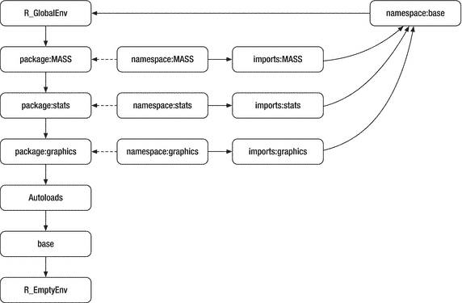
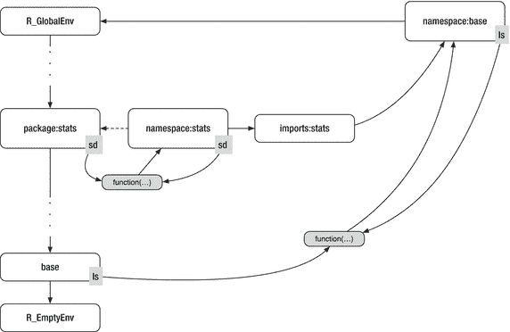

# 链接环境的链条

你已经了解了函数如何拥有捕获其定义位置的关联环境，也看到了在求值函数调用时，会有一个求值环境链接到该定义环境。你还通过父环境的链表明白了这其中的工作原理。不过到目前为止，你一直声称这条链终止于全局环境，即如果在任何嵌套作用域中都找不到变量，就会到全局环境中查找。对于你目前看到的所有示例来说，这可能确实如此，但在任何实际的 R 语言使用中，你都会加载包。你之所以能从包中找到函数，是因为这些包也位于环境链中。全局环境也有自己的父环境，当你加载包时，最后加载的包会成为全局环境的父环境，而之前加载的包则会成为新包的父环境。这既解释了你是如何在已加载的包中找到变量的，也解释了为什么加载新包可能会遮蔽其他包中定义的变量。

当然，这条链必须在某个点终止，有一个特殊的环境起到了终结序列的作用。这被称为空环境，它是唯一没有父环境的环境。当你启动 R 时，空环境就已存在。然后 R 会放置基础环境，所有基础语言功能都在其中。接着会放置一个 `Autoload` 环境，负责按需加载数据，而在这之上，会放置全局环境。基础环境和空环境非常重要，因此你有专门的函数来获取它们。这两个函数分别是 `baseenv()` 和 `emptyenv()`。

当你导入包，或者通常来说是附加一个命名空间时，它会被放置在这个列表的全局环境下方。`search()` 函数会为你列出从全局环境向下的环境序列。你可以通过以下示例看到加载库是如何影响这个列表的：

```
search()
##  [1] ".GlobalEnv"
##  [2] "package:ggplot2"
##  [3] "package:purrr"
##  [4] "package:microbenchmark"
##  [5] "package:pryr"
##  [6] "package:magrittr"
##  [7] "package:knitr"
##  [8] "package:stats"
##  [9] "package:graphics"
## [10] "package:grDevices"
## [11] "package:utils"
## [12] "package:datasets"
## [13] "Autoloads"
## [14] "package:base"
library(MASS)
search()
##  [1] ".GlobalEnv"
##  [2] "package:MASS"
##  [3] "package:ggplot2"
##  [4] "package:purrr"
##  [5] "package:microbenchmark"
##  [6] "package:pryr"
##  [7] "package:magrittr"
##  [8] "package:knitr"
##  [9] "package:stats"
## [10] "package:graphics"
## [11] "package:grDevices"
## [12] "package:utils"
## [13] "package:datasets"
## [14] "Autoloads"
## [15] "package:base"
```

`search()` 函数是一个内置函数，但你可以编写自己的版本来感受它的工作方式。不过，`search()` 是从全局环境开始搜索的，而你的函数会更通用，允许你指定一个起始环境。你只需要让它打印出环境名称，然后从当前环境移动到父环境，直到遇到空环境为止。

要获取环境的名称，你可以使用 `environmentName()` 函数。并非所有环境都有名称；当你嵌套或调用函数时创建的环境，或者使用 `new.env()` 创建的环境，都没有名称。但是，加载包时创建的环境是有名称的。如果一个环境没有名称，`environmentName()` 会返回一个空字符串。在这种情况下，你可以改用 `str()` 来获取一个可打印的环境表示。

要检查是否已到达环境链的末尾，你可以检查 `identical(env, emptyenv())`。你不能用 `==` 来比较两个环境，但可以使用 `identical()`。你的函数可能如下所示：

```
my_search <- function(env) {
repeat {
name <- environmentName(env)
if (nchar(name) != 0)
name <- paste0(name, "\n")
else
name <- str(env, give.attr = FALSE)
cat(name)
env <- parent.env(env)
if (identical(env, emptyenv())) break
}
}
```

以全局环境作为参数调用该函数，应该会得到与 `search()` 类似的结果，只不过你是打印环境，而不是返回一个名称列表。

```
my_search(globalenv())
## R_GlobalEnv
## package:MASS
## package:ggplot2
## package:purrr
## package:microbenchmark
## package:pryr
## package:magrittr
## package:knitr
## package:stats
## package:graphics
## package:grDevices
## package:utils
## package:datasets
## Autoloads
## base
```

由于你可以将任何环境传递给它，因此可以尝试获取某个函数的环境。如果你编写一个嵌套在其他函数作用域中的函数，你会看到这些函数拥有（无名的）环境。

```
f <- function() {
my_search(environment())
}
f()
## 
## 
## R_GlobalEnv
## package:MASS
## package:ggplot2
## package:purrr
## package:microbenchmark
## package:pryr
## package:magrittr
## package:knitr
## package:stats
## package:graphics
## package:grDevices
## package:utils
## package:datasets
## Autoloads
## base
```

你也可以获取导入函数的环境。例如，你可以像这样获取从 `ls()` 函数开始的环境链：

```
my_search(environment(ls))
## base
## R_GlobalEnv
## package:MASS
## package:ggplot2
## package:purrr
## package:microbenchmark
## package:pryr
## package:magrittr
## package:knitr
## package:stats
## package:graphics
## package:grDevices
## package:utils
## package:datasets
## Autoloads
## base
```

这里你看到了一些有点奇怪的现象。看起来 `base` 在列表的顶部和底部都出现了。显然，这不能是同一个环境；因为一个环境需要同时将全局环境和它的父环境作为父环境，而每个环境只能有一个父环境。看起来像是同一个环境的唯一原因是，`environmentName()` 为两个不同的环境返回了相同的名称。它们实际上是不同的。

```
environment(ls)
## <environment: namespace:base>
baseenv()
## <environment: base>
```

`ls()` 的环境是由 `base` 包定义的一个命名空间。`baseenv()` 环境是这个包如何被导出到全局环境之下的环境，使得基础函数在 `base` 包之外也可以使用。

拥有这些额外的环境，正是包能够在包内拥有私有函数，同时拥有导出给包用户的其他函数的方式。`base` 包比较特殊，它只定义了两个环境：包的命名空间和包环境。所有其他包在全局环境之前的环境链中都设置了三个环境：包命名空间、一个包含导入符号的命名空间，以及基础环境（正如你刚才看到的，它连接到全局环境）。图 3-1 展示了加载了三个包时的环境图：`MASS`、`stats` 和 `graphics`（这里先加载了 `graphics`，然后是 `stats`，最后是 `MASS`，因此在从全局环境到基础环境的路径上，`MASS` 首先出现，接着是 `stats`，然后是 `graphics`）。实线箭头表示环境的父指针，虚线箭头表示哪些包的符号被导出到了包环境中。



**图 3-1.** 加载了三个包（MASS、stats 和 graphics）时的环境示意图


如果你尝试从全局环境访问包中的符号，则只能访问导出的函数，且其中一些可能被你加载的其他包所遮蔽。对于包内定义的函数，其父环境包含包中定义的所有函数（及其他变量）；由于这个包命名空间环境位于全局环境之前，当你执行包中的函数时，其他包中的变量不会遮蔽包内的变量。

如果某个包导入了其他包，这些导入会进入“导入环境”，位于包命名空间之下、基础环境之上。因此，包内的函数可以看见导入的符号，但仅当它们在包内未被遮蔽时。如果包的用户导入了其他包，这些导入不会遮蔽包函数所能看见的任何符号，因为从包内部来看，这些导入在环境链中位于更靠后的位置。在导入环境之后是基础命名空间。这使得所有包都能访问基本的 R 功能，即使其中部分功能从全局环境看可能被遮蔽了。²

在`DESCRIPTION`文件中，有三种方式指定一个包依赖另一个包：`Suggests:`、`Depends:`和`Imports:`。第一种实际上并不建立任何依赖关系；它只是建议其他可能增强被定义包功能的包。

`Depends:`指令中指定的包，在加载当前包时会被加载到搜索路径中。对于这里指定的包，你会污染全局命名空间（并非全局环境，而是其下方的搜索路径），并且你依赖的函数可能会被之后加载到全局命名空间中的包所遮蔽。只要可能，应避免使用`Depends:`。

使用`Imports:`时，你只需确保一组其他包在安装你自己的包之前已经安装。然而，这些包既不会被放入搜索路径，也不会被导入到“导入环境”中。使用`Imports:`仅仅允许你通过包命名空间前缀来访问另一个包中的函数和数据；因此，如果你使用`Imports:`导入`stats`包，你就可以保证在用户使用你的包时，`stats::sd`是可用的。

要将变量实际导入到`imports`命名空间，你需要修改`NAMESPACE`文件；分别使用以下指令来导入整个包、函数、S4 类以及 S4 方法：

*   `imports()`
*   `importFrom()`
*   `importClassesFrom()`
*   `importMethodsFrom()`

不过，处理`NAMESPACE`文件最简单的方法是使用`Roxygen`，你可以通过以下方式导入名称：

*   `@import <package>`
*   `@importFrom <package> <name>`
*   `@importClassesFrom <package> <classes>`
*   `@importMethodsFrom <package> <methods>`

为了确保你编写的包与其他命名空间良好协作，对于绝对需要的依赖应使用`Imports:`（对于其他依赖则使用`Suggests:`），并要么对其他包中的依赖使用包名前缀，要么在`NAMESPACE`中导入这些依赖。

函数`sd`位于包`stats`中。其父环境是`namespace:stats`，祖父环境是`imports:stats`，曾祖父环境是`namespace:base`。然而，如果你从全局环境访问`sd`，你会在`package:stats`中找到它。

```
my_search(environment(sd))
## stats
## imports:stats
## base
## R_GlobalEnv
## package:MASS
## package:ggplot2
## package:purrr
## package:microbenchmark
## package:pryr
## package:magrittr
## package:knitr
## package:stats
## package:graphics
## package:grDevices
## package:utils
## package:datasets
## Autoloads
## base
environment(sd)
## 
parent.env(environment(sd))
## 
## attr(,"name")
## [1] "imports:stats"
parent.env(parent.env(environment(sd)))
## 
parent.env(parent.env(parent.env(environment(sd))))
## 
```

图 3-2 展示了`ls`和`sd`如何位于包环境和命名空间环境中，以及它们的父环境是命名空间而非包环境。



图 3-2. 展示`stats::sd`和`base::ls`位置的环境关系图

正如你现在所见，这种简单的环境链机制不仅为函数提供了词法作用域，也解释了包中的命名空间是如何工作的。


