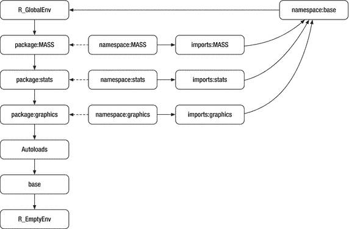
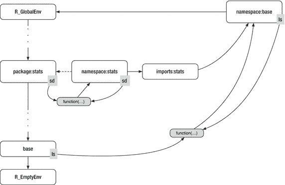
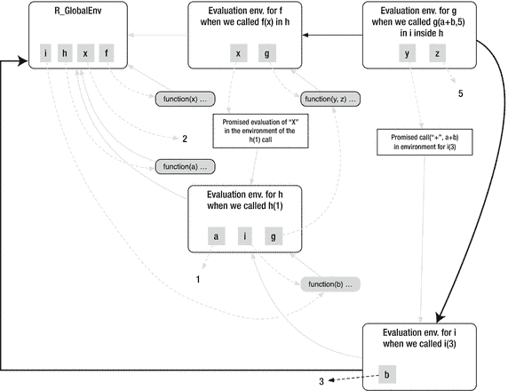
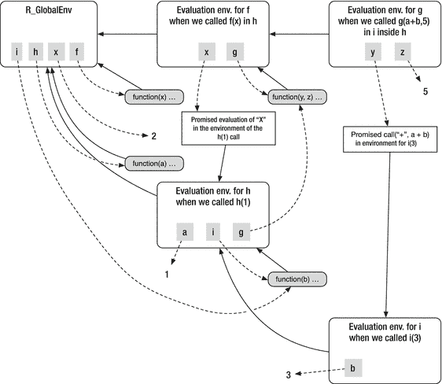

# 3. 表达式与环境

本章深入探讨环境的工作机制以及如何在不同的环境中对表达式求值。理解环境如何链接在一起，有助于您理解语言如何查找变量，而在求值表达式时能够创建、操作和链接环境，是元编程的关键技巧。

## 表达式

在 R 中，任何被求值的内容都可以被视为一个表达式。程序中的每条语句也都是一个表达式，它会求出某个值（当然，该值可能是 `NULL`）。这包括控制结构和函数体。所有内容都可以视为表达式；只是某些表达式会对其包含的多个表达式进行求值以获得它们的副作用（side effects），然后返回最后一个被求值表达式的结果。然而，从元编程的角度来看，您最感兴趣的是那些可以在程序内部获取、检查、修改或求值的表达式。

信不信由你，您已经看到了获取表达式对象的大部分方法。您可以使用 `body` 函数获取函数体，或者使用 `quote` 或 `call` 构建表达式。使用这些方法中的任何一种，您都会得到一个可以在程序内部操作和求值的对象。通常，表达式会在程序执行时由 R 自动求值，但如果您拥有一个可以操作的对象形式的表达式，则必须显式地对其求值。如果您不对它求值，它的值就是实际的表达式本身；如果您对它求值，您就会得到它在给定作用域中所对应的值。

在本章中，您将不涉及表达式的操作。那是第 4 章的主题。相反，您将重点关注表达式如何被求值，以及如何在求值表达式时更改其作用域。如果您只是将表达式作为 R 源代码编写，它将在其书写的作用域中被求值，这是您习惯的做法。要在不同的作用域中求值，您需要使用 `eval` 函数。如果您不给 `eval` 提供一个环境，它将只会在 `eval` 被调用的作用域中对表达式求值，就像您直接在那里编写表达式一样。然而，如果您给它一个环境，该环境就决定了表达式求值时的作用域。

不过，要理解如何利用作用域，您首先需要详细了解环境如何定义作用域。

# 链接环境的链条

你已经了解了函数如何拥有捕获其定义位置的关联环境，也看到了在求值函数调用时，会有一个求值环境链接到该定义环境。你还通过父环境的链表明白了这其中的工作原理。不过到目前为止，你一直声称这条链终止于全局环境，即如果在任何嵌套作用域中都找不到变量，就会到全局环境中查找。对于你目前看到的所有示例来说，这可能确实如此，但在任何实际的 R 语言使用中，你都会加载包。你之所以能从包中找到函数，是因为这些包也位于环境链中。全局环境也有自己的父环境，当你加载包时，最后加载的包会成为全局环境的父环境，而之前加载的包则会成为新包的父环境。这既解释了你是如何在已加载的包中找到变量的，也解释了为什么加载新包可能会遮蔽其他包中定义的变量。

## 环境链的终止与核心环境

当然，这条链必须在某个点终止，有一个特殊的环境起到了终结序列的作用。这被称为空环境，它是唯一没有父环境的环境。当你启动 R 时，空环境就已存在。然后 R 会放置基础环境，所有基础语言功能都在其中。接着会放置一个 `Autoload` 环境，负责按需加载数据，而在这之上，会放置全局环境。基础环境和空环境非常重要，因此你有专门的函数来获取它们。这两个函数分别是 `baseenv()` 和 `emptyenv()`。

当你导入包，或者通常来说是附加一个命名空间时，它会被放置在这个列表的全局环境下方。`search()` 函数会为你列出从全局环境向下的环境序列。你可以通过以下示例看到加载库是如何影响这个列表的：

```
search()
##  [1] ".GlobalEnv"
##  [2] "package:ggplot2"
##  [3] "package:purrr"
##  [4] "package:microbenchmark"
##  [5] "package:pryr"
##  [6] "package:magrittr"
##  [7] "package:knitr"
##  [8] "package:stats"
##  [9] "package:graphics"
## [10] "package:grDevices"
## [11] "package:utils"
## [12] "package:datasets"
## [13] "Autoloads"
## [14] "package:base"
library(MASS)
search()
##  [1] ".GlobalEnv"
##  [2] "package:MASS"
##  [3] "package:ggplot2"
##  [4] "package:purrr"
##  [5] "package:microbenchmark"
##  [6] "package:pryr"
##  [7] "package:magrittr"
##  [8] "package:knitr"
##  [9] "package:stats"
## [10] "package:graphics"
## [11] "package:grDevices"
## [12] "package:utils"
## [13] "package:datasets"
## [14] "Autoloads"
## [15] "package:base"
```

## 编写自定义的环境搜索函数

`search()` 函数是一个内置函数，但你可以编写自己的版本来感受它的工作方式。不过，`search()` 是从全局环境开始搜索的，而你的函数会更通用，允许你指定一个起始环境。你只需要让它打印出环境名称，然后从当前环境移动到父环境，直到遇到空环境为止。

要获取环境的名称，你可以使用 `environmentName()` 函数。并非所有环境都有名称；当你嵌套或调用函数时创建的环境，或者使用 `new.env()` 创建的环境，都没有名称。但是，加载包时创建的环境是有名称的。如果一个环境没有名称，`environmentName()` 会返回一个空字符串。在这种情况下，你可以改用 `str()` 来获取一个可打印的环境表示。

要检查是否已到达环境链的末尾，你可以检查 `identical(env, emptyenv())`。你不能用 `==` 来比较两个环境，但可以使用 `identical()`。你的函数可能如下所示：

```
my_search <- function(env) {
repeat {
name <- environmentName(env)
if (nchar(name) != 0)
name <- paste0(name, "\n")
else
name <- str(env, give.attr = FALSE)
cat(name)
env <- parent.env(env)
if (identical(env, emptyenv())) break
}
}
```

以全局环境作为参数调用该函数，应该会得到与 `search()` 类似的结果，只不过你是打印环境，而不是返回一个名称列表。

```
my_search(globalenv())
## R_GlobalEnv
## package:MASS
## package:ggplot2
## package:purrr
## package:microbenchmark
## package:pryr
## package:magrittr
## package:knitr
## package:stats
## package:graphics
## package:grDevices
## package:utils
## package:datasets
## Autoloads
## base
```

## 探索函数的环境

由于你可以将任何环境传递给它，因此可以尝试获取某个函数的环境。如果你编写一个嵌套在其他函数作用域中的函数，你会看到这些函数拥有（无名的）环境。

```
f <- function() {
my_search(environment())
}
f()
## 
## 
## R_GlobalEnv
## package:MASS
## package:ggplot2
## package:purrr
## package:microbenchmark
## package:pryr
## package:magrittr
## package:knitr
## package:stats
## package:graphics
## package:grDevices
## package:utils
## package:datasets
## Autoloads
## base
```

你也可以获取导入函数的环境。例如，你可以像这样获取从 `ls()` 函数开始的环境链：

```
my_search(environment(ls))
## base
## R_GlobalEnv
## package:MASS
## package:ggplot2
## package:purrr
## package:microbenchmark
## package:pryr
## package:magrittr
## package:knitr
## package:stats
## package:graphics
## package:grDevices
## package:utils
## package:datasets
## Autoloads
## base
```

## 环境命名空间与包结构

这里你看到了一些有点奇怪的现象。看起来 `base` 在列表的顶部和底部都出现了。显然，这不能是同一个环境；因为一个环境需要同时将全局环境和它的父环境作为父环境，而每个环境只能有一个父环境。看起来像是同一个环境的唯一原因是，`environmentName()` 为两个不同的环境返回了相同的名称。它们实际上是不同的。

```
environment(ls)
## <environment: namespace:base>
baseenv()
## <environment: base>
```

`ls()` 的环境是由 `base` 包定义的一个命名空间。`baseenv()` 环境是这个包如何被导出到全局环境之下的环境，使得基础函数在 `base` 包之外也可以使用。

拥有这些额外的环境，正是包能够在包内拥有私有函数，同时拥有导出给包用户的其他函数的方式。`base` 包比较特殊，它只定义了两个环境：包的命名空间和包环境。所有其他包在全局环境之前的环境链中都设置了三个环境：包命名空间、一个包含导入符号的命名空间，以及基础环境（正如你刚才看到的，它连接到全局环境）。图 3-1 展示了加载了三个包时的环境图：`MASS`、`stats` 和 `graphics`（这里先加载了 `graphics`，然后是 `stats`，最后是 `MASS`，因此在从全局环境到基础环境的路径上，`MASS` 首先出现，接着是 `stats`，然后是 `graphics`）。实线箭头表示环境的父指针，虚线箭头表示哪些包的符号被导出到了包环境中。



**图 3-1.** 加载了三个包（`MASS`、`stats` 和 `graphics`）时的环境示意图

如果你尝试从全局环境访问包中的符号，则只能访问导出的函数，且其中一些可能被你加载的其他包所遮蔽。对于包内定义的函数，其父环境包含包中定义的所有函数（及其他变量）；由于这个`package`命名空间环境位于全局环境之前，当你执行包中的函数时，其他包中的变量不会遮蔽包内的变量。

如果某个包导入了其他包，这些导入会进入“导入环境”，位于包命名空间之下、基础环境之上。因此，包内的函数可以看见导入的符号，但仅当它们在包内未被遮蔽时。如果包的用户导入了其他包，这些导入不会遮蔽包函数所能看见的任何符号，因为从包内部来看，这些导入在环境链中位于更靠后的位置。在导入环境之后是基础命名空间。这使得所有包都能访问基本的 R 功能，即使其中部分功能从全局环境看可能被遮蔽了。²

在`DESCRIPTION`文件中，有三种方式指定一个包依赖另一个包：`Suggests:`、`Depends:`和`Imports:`。第一种实际上并不建立任何依赖关系；它只是建议其他可能增强被定义包功能的包。

`Depends:`指令中指定的包，在加载当前包时会被加载到搜索路径中。对于这里指定的包，你会污染全局命名空间（并非全局环境，而是其下方的搜索路径），并且你依赖的函数可能会被之后加载到全局命名空间中的包所遮蔽。只要可能，应避免使用`Depends:`。

使用`Imports:`时，你只需确保一组其他包在安装你自己的包之前已经安装。然而，这些包既不会被放入搜索路径，也不会被导入到“导入环境”中。使用`Imports:`仅仅允许你通过包命名空间前缀来访问另一个包中的函数和数据；因此，如果你使用`Imports:`导入`stats`包，你就可以保证在用户使用你的包时，`stats::sd`是可用的。

要将变量实际导入到`imports`命名空间，你需要修改`NAMESPACE`文件；分别使用以下指令来导入整个包、函数、S4 类以及 S4 方法：
- `imports()`
- `importFrom()`
- `importClassesFrom()`
- `importMethodsFrom()`

不过，处理`NAMESPACE`文件最简单的方法是使用`Roxygen`，你可以通过以下方式导入名称：
- `@import <package>`
- `@importFrom <package> <name>`
- `@importClassesFrom <package> <classes>`
- `@importMethodsFrom <package> <methods>`

为了确保你编写的包与其他命名空间良好协作，对于绝对需要的依赖应使用`Imports:`（对于其他依赖则使用`Suggests:`），并要么对其他包中的依赖使用包名前缀，要么在`NAMESPACE`中导入这些依赖。

函数`sd()`位于包`stats`中。其父环境是`namespace:stats`，祖父环境是`imports:stats`，曾祖父环境是`namespace:base`。然而，如果你从全局环境访问`sd()`，你会在`package:stats`中找到它。
```
my_search(environment(sd))
## stats
## imports:stats
## base
## R_GlobalEnv
## package:MASS
## package:ggplot2
## package:purrr
## package:microbenchmark
## package:pryr
## package:magrittr
## package:knitr
## package:stats
## package:graphics
## package:grDevices
## package:utils
## package:datasets
## Autoloads
## base
environment(sd)
## 
parent.env(environment(sd))
## 
## attr(,"name")
## [1] "imports:stats"
parent.env(parent.env(environment(sd)))
## 
parent.env(parent.env(parent.env(environment(sd))))
## 
```

图 3-2 展示了`ls()`和`sd()`如何位于包环境和命名空间环境中，以及它们的父环境是命名空间而非包环境。



图 3-2. 展示`stats::sd`和`base::ls`位置的环境关系图

正如你现在所见，这种简单的环境链机制不仅为函数提供了词法作用域，也解释了包中的命名空间是如何工作的。

# 环境与函数调用

理解环境与包命名空间如何协同工作是一件有趣的事，这或许能为你如何将命名空间应用于其他场景提供启发，但在日常编程中，你更应关注环境与函数如何协作。因此从现在开始，我将假设作用域图终止于全局环境，并聚焦于当定义和调用函数时，环境是如何链式连接的。

你已经知道相关规则：调用函数时，会得到一个求值环境，它的父环境指向函数被定义时的环境；如果你需要获取函数调用者的环境，可以使用 `parent.frame` 函数。不过，为了检验你的知识掌握程度，你应该考虑一个比之前更复杂的嵌套函数示例。请思考在评估 `i(3)` 调用时以下代码的状况。图 3-3 展示了环境如何链式连接；此处实线表示父级指针，虚线表示从变量指向其值的指针。图 3-4 则添加了作为父帧环境的调用栈。请边阅读代码边对照图示。



图 3-4. 嵌套函数复杂示例的环境图，突出展示了通过 `parent.frame` 获取的调用栈



图 3-3. 嵌套函数复杂示例的环境图

```
f <- function(x) {
g <- function(y, z) x + y + z
g
}
h <- function(a) {
g <- f(x)
i <- function(b) g(a + b, 5)
}
x <- 2
i <- h(1)
i(3)
```

代码中的前两个语句定义了函数 `f` 和 `h`。你并未调用它们，只是定义，因此没有创建任何新环境。与这两个函数关联的环境都是全局环境。接着你将 `x` 设为 2，这里同样没有发生什么有趣的事。然而，当你调用 `h` 时，便开始创建新的求值环境。首先，你创建一个环境来执行 `h` 内部的逻辑。由于你用参数 1 调用了 `h`，该环境将 `a` 设为 1。接着它用 `x` 调用了 `f`。

这里开始变得有些棘手。由于你用一个变量调用了 `f`（该变量将在 `f` 内部被惰性求值），所以你并非用全局参数 `x` 的值来调用 `f`。因此，`f` 接收到一个承诺，它稍后可用此承诺获取 `x` 的值，并且这个承诺知道应当在当前正在评估的 `h` 调用作用域内寻找 `x`。在本例中，那个 `x` 恰好是全局变量，但你可以在调用 `f` 之后，在 `h` 内部给局部变量 `x` 赋值，那样 `f` 就会使用这个局部变量 `x`。当你在函数调用中创建承诺时，该承诺知道它应在调用作用域内被求值，但此时它并不会立即寻找任何变量；这一过程只有在承诺被实际求值时才会发生。

在 `f` 调用内部，你定义了函数 `g` 并将其返回。由于 `g` 是在 `f` 调用内部定义的，其环境被设置为该调用的求值作用域。这将使 `g` 之后知道如何获取 `x` 的值。它并不存储 `x` 本身，但可以在 `f` 调用的作用域中找到它——在那里，它发现 `x` 是一个应在 `h` 调用作用域内求值的承诺，而最终在 `h` 的作用域中，它将找到全局变量 `x`。这看起来已经非常复杂了，但无论何时你需要某个值，只需沿着父环境链查找，最终总能找到它。

随后，`h(1)` 调用定义了一个函数 `i` 并将其返回，你将其保存在全局变量 `i` 中。该函数的环境是 `h(1)` 调用的求值作用域，因此函数会在这个作用域中查找名称 `a` 和 `g`。

现在，你终于调用了 `i(3)`。这首先创建了一个求值环境，将变量 `b` 设为 `3`（因为这是 `b` 对应的参数值）。接着你找到函数 `g`（即你之前创建的闭包），并用参数 `a+b` 和 `5` 调用 `g`。`5` 只是作为一个数字直接传递，你并不会将常量转换为承诺；然而，`a+b` 会被惰性求值，因此它在调用 `g` 时是一个承诺。调用 `g` 时，你为它创建一个新的求值环境。在这个环境中，你存储了变量 `y` 和 `z`。前者被设为承诺 `a+b`，后者被设为 `5`。由于承诺应在它们被定义的地方（即此处调用作用域内）求值，这一信息与承诺一同存储。

你对 `g(a + b, 5)` 的求值过程如下：首先需要找出 `x` 是什么，于是你在本地求值环境中查找，但没有找到。接着你在父环境中查找，找到了它，但发现它来自于 `h(1)` 环境的承诺，所以你现在需要到那里去找。那里也没有，于是你继续沿着父级链向下查找，最终在全局环境中找到它——值为 2。然后你需要找出 `y` 是什么。你在本地环境中找到了 `y`，发现它是一个承诺 `a+b`，且该承诺应在 `i(3)` 环境中求值。在此环境中，你需要找到 `a` 和 `b`。`b` 可以直接在当前环境中找到，这很简单；但你需要到父环境中搜索 `a`。你在父环境中找到了它，因此可以将 `a+b` 求值为 `1+3`。这个值现在替换了 `y` 中的承诺。最后，你需要找出 `z`，但这至少很简单，它就是本地环境中存储的数字 `5`。现在你拥有了计算 `x + y + z` 所需的所有值，分别是 `2 + (1+3) + 5`，因此当从 `i(3)` 调用返回时，你得到返回值 11。

环境图可能变得相当复杂，但寻找值的规则却非常简单。你只需沿着环境链查找。唯一容易让程序员困惑的陷阱就是惰性求值。不过这里的规则同样简单，只是不那么熟悉而已。承诺在它们被定义的作用域中被求值。因此，默认参数会在函数被定义时的环境中求值，而实际参数会在调用作用域中求值。当你访问一个参数时，它总会被求值，所以如果不想通过修改其他作用域的变量而对闭包环境产生副作用，你应该在创建闭包之前使用 `force`。

花些时间仔细研读这个示例。一旦你理解了它，你就理解了环境的工作方式。其复杂性不会超过这个程度（当然，除非你开始胡乱摆弄环境！）。

## 操控环境

那么，如何才能让环境的使用变得更加复杂呢？当然，你可以开始修改它们，并以各种新奇的方式将它们串联起来。你看，你不仅可以访问环境并向其中放入变量，还可以修改父环境的链。例如，你可以像这样通过更改求值环境的父环境来改变函数执行时的环境：

```
f <- function() {
my_env <- environment()
parent.env(my_env) <- parent.frame()
x
}
g <- function(x) f()
g(2)
## [1] 2
```

你并没有更改局部环境——这很难做到，因为如果没有它，你就没有地方存放变量值。不过，你是让它的父环境指向了函数调用环境，而不是函数被定义时的环境。如果你没有篡改父环境，`x` 会在全局环境中被查找，但由于你将父环境设置为父框架，你反而会在调用者中开始查找，从而找到 `x`。

以这种方式修改作用域的能力可以用于正途，但无疑也可以用于邪道。其工作原理并不复杂；如果你从上一节理解了环境图是如何运作的，那么当你开始修改父指针时，你也会理解它们是如何工作的。主要问题就在于环境是可变的，因此如果你在某个地方修改它们，就会在其他地方产生连锁反应。

考虑这个闭包的例子：

```
f <- function() {
my_env <- environment()
call_env <- parent.frame()
parent.env(my_env) <- call_env
y
}
g <- function(x) {
closure <- function(y) {
z <- f()
z + x
}
closure
}
add1 <- g(1)
add2 <- g(2)
```

这不过是编写一个数字加法闭包的复杂方式，但这里我们追求的不是优雅——而是观察修改环境会如何影响你。这里有一个函数 `f`，它将调用环境设置为自身的作用域，然后返回 `y`。由于 `y` 不是局部变量，必须在封闭作用域中查找，查找从父环境开始；这个父环境正是你刚刚更改为调用作用域的环境。在函数 `g` 中，你定义了一个闭包，它接受一个参数 `y`，然后调用 `f` 并将 `x` 加到调用的结果上。由于 `y` 是闭包的一个参数，`f` 从其（修改后的）父作用域中查找时就能看到它。由于 `x` 不是闭包的局部变量，它会在封闭作用域中查找，而该变量正是封闭函数的参数。

它的工作方式和你预期的一样。虽然达到这个效果的方法很复杂，但代码中并没有陷阱。

```
add1(3)
## [1] 4
add2(4)
## [1] 6
```

出于马上就会明朗的原因，我只想向你展示，设置一个全局变量 `x` 并不会改变其行为。

```
x <- 3
add1(3)
## [1] 4
add2(4)
## [1] 6
```

这自然也是理所应当的。当你阅读闭包的定义时，可以看到它所引用的 `x` 是 `g` 的参数，而不是全局变量。

但接下来，你要在不接触闭包本身的情况下破坏它。你只需在 `f` 中多做一件简单的事。不仅要改变 `f` 的封闭作用域，还要对 `f` 的调用者做同样的操作。将 `f` 的调用者的父环境设置为其调用者，而不是它的封闭环境。

### 显式创建环境

你可以通过 `new.env` 函数创建一个新环境。默认情况下，该环境会将当前环境作为其父环境，并且你可以使用 `exists` 和 `get` 等函数来检查它所包含的内容。

```r
env <- new.env()
x <- 5
exists("x", env)
## [1] TRUE
get("x", env)
## [1] 5
f <- function() {
x <- 7
new.env()
}
env2 <- f()
get("x", env2)
## [1] 7
```

你也可以使用 `$` 下标运算符来访问它，但此时 R 不会向上搜索父环境列表来查找变量；只有当变量存在于该实际环境中时，你才能获取到它。

```r
env$x
## NULL
```

你可以使用 `assign` 或通过 `$<-` 函数向环境中赋值变量。

```r
assign("x", 3, envir = env)
env$x
## [1] 3
env$x <- 7
env$x
## [1] 7
```

根据你对环境的用途，你可能不希望它拥有父环境。但并没有办法实现这一点。

```r
env <- new.env(parent = NULL) # 这行不通！
```

所有环境都有父环境，但空环境除外。不过，你可以通过将空环境设为你新环境的父环境来达到次优效果。

```r
global_x <- "foo"
env <- new.env(parent = emptyenv())
exists("global_x", env)
## [1] FALSE
```

你可以尝试用手动创建的环境做一些更有趣的事情，比如构建一个并行的调用栈，用来实现动态作用域而不是词法作用域。词法作用域是 R 中已有的作用域机制，其中函数调用的父环境是函数的定义域。而动态作用域则将调用环境作为父环境。在具有动态作用域的语言中，程序逻辑极难推理，因此我建议你避免使用它，但出于教学目的，你可以尝试实现它。

由于你不想实际修改调用栈和父环境指针，你需要创建一系列并行的环境，并将每个调用栈帧的内容复制到这些环境中。你可以像这样复制一个环境：

```r
copy_env <- function(from, to) {
for (name in ls(from, all.names = TRUE)) {
assign(name, get(name, from), to)
}
}
```

为了说明问题，你需要一个函数来展示当你沿着环境链向下直到全局环境时，每个环境中可以看到哪些名称。你不想一路向下直到空环境，所以你可以提前停止。这个函数让你做到这一点：

```r
show_env <- function(env) {
if (!identical(env, globalenv())) {
print(env)
print(names(env))
show_env(parent.env(env))
}
}
```

现在轮到创建并行环境链的函数了。这并不难；你可以使用 `parent.frame` 来获取调用栈上任意深度的帧——实际上，可以一直向下到第一个函数调用——并且你可以使用 `sys.nframe` 函数来获取调用栈的深度。唯一需要注意的是，你需要将栈深度调整 1，因为你希望为函数的调用者（而不是函数本身）创建调用栈链。剩下的部分只是一个循环。

```r
build_caller_chain <- function() {
n <- sys.nframe() - 1
env <- globalenv()
for (i in seq(1,n)) {
env <- new.env(parent = env)
frame <- parent.frame(n - i + 1)
copy_env(frame, env)
}
env
}
```

要看到它的实际效果，你需要设置一个相当复杂的示例，其中同时包含嵌套作用域和调用栈。它看起来不太美观，但请尝试理解它，并思考函数环境应该是什么样子，以及调用栈应该是什么结构。

```r
f 
## [1] "z"
## 
## [1] "y"
## 
## [1] "x"
## [1] "---Calling environments---"
## 
## [1] "z"
## 
## [1] "x" "y"
```

当你调用 `h` 时，它会调用 `g`，你会得到一个环境列表，从包含 `z` 的最内层开始，一直到包含 `x` 的、全局环境之前的最后一个层级。在（并行的）调用栈上，你首先也会看到一个 `z`（它位于函数环境的副本中，但确实存在），但这个链只有两步长，第二个环境包含了 `x` 和 `y`。

你可以使用这里构建的栈链来实现动态作用域。你只需要在这个链所定义的作用域内求值表达式，而不是在当前求值环境中。`<<-` 赋值运算符不会起作用——你需要编写一个类似的函数来获得该行为，并且关于对这个链所做的更改在多大程度上应该被写回到实际调用栈帧中，这将是一个设计选择。然而，只要涉及表达式求值，你就可以将其用于动态作用域。

### 环境与表达式求值

最后，本节介绍如何将表达式和环境结合起来计算值。好消息是，你已经度过了所有困难的部分，在经历了前面所有内容之后，这变得非常简单。你只需要在任何选定的环境链中求值一个表达式，就是将其提供给 `eval` 函数。你可以在以下示例中看到这一点，该示例在词法作用域和动态作用域中求值同一个表达式：

```r
f <- function() {
x <- 1
function() {
y <- 2
function() {
z <- 3
cat("Lexical scope: ", x + y + z, "\n")
call_env <- build_caller_chain()
cat("Dynamic scope: ", eval(quote(x + y + z), call_env), "\n")
}
}
}
g <- f()()
h <- function() {
x <- 4
y <- 5
g()
}
h()
## Lexical scope:  6
## Dynamic scope:  12
```

使用环境时，真正的难点实际上不在于求值。而在于操作它们。

脚注

如果你想给你的环境命名，你可以设置 `"name"` 属性。不过通常你并不需要这样做。

严格来说，导入其他包的方法远比我这里解释的要多，但这超出了本书的范围。

如果你查看 `new.env` 的文档，你会看到默认参数实际上是 `parent.frame()`。仔细想想，这就是它成为当前环境的方式：当你调用 `new.env` 时，当前环境将成为它的父框架。

