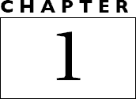

# 度量指标：如何提升关键业务成果

版权所有 © 2011 马丁·克卢贝克

本作品受版权保护。出版商保留所有权利，无论涉及全部或部分材料，具体包括翻译、重印、插图再利用、朗诵、广播、微缩胶片复制或其他任何物理形式的复制权，以及信息存储与检索的传输权、电子改编权、计算机软件权，或目前已知或未来开发的相似或不相似方法的使用权。与评论、学术分析相关的简短摘录，或专门为输入计算机系统并供购买者独家使用而提供的材料，不受此法律限制。本出版物或其部分的复制仅允许在出版商所在地现行版权法的规定下进行，且必须始终获得斯普林格的许可。使用许可可通过版权清算中心（RightsLink）获取。违反者将根据相应版权法被起诉。

国际标准书号-13（平装）：978-1-4302-3726-6  
国际标准书号-13（电子版）：978-1-4302-3727-3

本书中可能出现商标名称、标志和图像。我们并非在每次出现商标名称、标志或图像时使用商标符号，而是仅以编辑方式使用这些名称、标志和图像，以维护商标所有者的利益，且无意侵犯商标权。

本出版物中使用的商号、商标、服务标志及类似术语，即使未被明确标识，也不应被视为对其是否受专有权利保护的看法。

尽管本书中的建议和信息在出版时被认为是真实准确的，但作者、编辑和出版商均不对可能出现的任何错误或遗漏承担法律责任。出版商对本书内容不作任何明示或暗示的担保。

总裁与出版商：保罗·曼宁  
首席编辑：杰夫·奥尔森  
技术审校：拉斯·奇斯曼  
编辑委员会：史蒂夫·安格林、马克·贝克纳、尤安·白金汉、加里·康奈尔、摩根·埃特尔、乔纳森·根尼克、乔纳森·哈塞尔、罗伯特·哈钦森、米歇尔·洛曼、詹姆斯·马卡姆、马修·穆迪、杰夫·奥尔森、杰弗里·佩珀、道格拉斯·庞迪克、本·雷诺-克拉克、多米尼克·谢克沙夫特、格温南·斯皮林、马特·韦德、汤姆·威尔士  
统筹编辑：安妮·贝克  
文字编辑：金伯利·伯顿  
排版：玛丽·苏杜尔  
索引编制：SPi Global  
插画：马丁·克卢贝克与艾丽莎·克卢贝克  
封面设计：安娜·伊什琴科

本书通过斯普格科学与商业媒体纽约公司向全球图书贸易发行，地址：纽约州纽约市春街 233 号 6 楼，邮编 10013。电话：1-800-SPRINGER，传真：(201) 348-4505，邮箱：`orders-ny@springer-sbm.com`，或访问 `www.springeronline.com`。

有关翻译事宜，请发送邮件至 `rights@apress.com`，或访问 `www.apress.com`。

Apress 及 friends of ED 书籍可批量购买用于学术、企业或促销用途。大多数图书也提供电子版和许可证。更多信息，请参考我们的特种批量销售–电子书许可网页：`www.apress.com/bulk-sales`。

*献给所有努力改善组织、流程或自身的人们。请将时间用于追逐梦想，而非追逐数据。*

*献给我的父亲：我十分想念您。我写作的最大希望是能让您为我感到骄傲。*

## 目录

**关于作者**

**关于技术审校**

**致谢**

**度量指标：基础入门**

**第 1 章**：建立通用语言：数据、度量与信息，天哪！

**第 2 章**：设计度量指标：方法

**第 3 章**：规划良好度量指标：从何处着手

**第 4 章**：将度量指标用作指示器

**第 5 章**：使用答案键：一条捷径

**第 6 章**：从有效性开始

**第 7 章**：三角验证：创建有效度量指标的关键

**第 8 章**：期望：如何有意义地解读度量指标

**第 9 章**：创建与解读度量报告卡

**第 10 章**：最终产品：度量报告卡

**第 11 章**：高级度量指标

**第 12 章**：创建服务目录：如何增强报告卡

**第 13 章**：确立标准与基准

**第 14 章**：尊重度量指标的威力

**第 15 章**：避免研究陷阱

**第 16 章**：拥抱组织的独特性

**附录**：工具与资源

**索引**

## 关于作者

**马丁·克卢贝克**是圣母大学的战略与规划顾问，也是实用度量指标领域的公认专家。他拥有韦伯斯特大学人力资源开发硕士学位，以及查普曼大学计算机科学学士学位。他是《为何组织如此努力改进却收效甚微》一书的合著者，并发表过多篇关于度量指标的文章。他热衷于简化复杂问题，并由此开发出一套开发有意义度量指标的简单系统。克卢贝克还是信息技术绩效标准联盟的创始人，该组织致力于为度量标准提供急需的规范。

## 关于技术审校

**拉斯·奇斯曼**是一位资深信息技术专业人士和顾问，在系统开发生命周期的各个阶段拥有丰富经验。他的职业生涯大部分致力于为业务问题或机遇提供 IT 解决方案。他曾担任多个行业领域的 IT 经理和实践者，包括银行/金融、制造业、建筑、零售、制药、电信和医疗保健。近年来，奇斯曼先生通过在多家 IT 和医疗保健组织内运用业务战略、平衡计分卡、度量指标、关键绩效指标和业务分析系统，从事业务绩效衡量与管理。

奇斯曼先生很高兴担任本书及其中度量指标相关概念的高级技术审校，并期待本书的出版及其对渴望改进、持续成熟和追求卓越绩效的个人、团体和组织所产生的价值。

## 度量指标：基础  
入门介绍

在所有可能的组织改进工具中，度量指标对我来说是最受需求、最被误解、最令人畏惧——也最为有用的。从高层定义度量指标，需要我向您阐明“是什么、为什么、何时、何地、谁”以及“如何做”这六个方面。

### 是什么

指标可以通过多种方式来定义。我在本书的开头部分提供了一套通用的语言，用于定义和使用指标。对我而言，指标是一种讲述完整故事的手段，目的是为了改进某个事物。通常，其理念是改进一个组织。不过，有时你也会希望专注于改进某个流程。归根结底，你所改进的任何事物都应当能够与有助于组织发展的改进措施保持一致。

指标是用于改进的工具。就其本质而言，指标利用不同层次的信息（数据、度量、情报以及其他指标）来讲述一个故事。尽管我总是力求让这个故事全面完整，但几乎不可能捕捉到所有方面。在大多数情况下，我试图捕捉足够重要的信息来助力改进。

指标通过帮助你判断最初哪里出了问题、你的努力取得了多大成效（你是否实现了改进？改进的程度是否达到了预期？），以及变革后新的环境是什么样的，来影响改进工作。我之所以说“变革”，是因为改进需要变革。它不一定是剧烈的。它可以意味着你开始做某件新事，停止做某件事，或者以不同的方式做某件事。但是，没有变革就不会有改进。

阿尔伯特·爱因斯坦曾说过：“疯狂的定义是，一遍又一遍地做同一件事，却期待不同的结果。”

以下仅列举指标方案能帮助你做到的几件事：

*   在多个方面提升公司的“健康状况”
    *   提高客户满意度
    *   提升产品/服务价值
    *   提高员工满意度
    *   提升流程效率
    *   改进战略、规划与执行
*   为变革提供基础
    *   改变什么
    *   何时改变
    *   如何改变
*   通过提供对以下方面的洞察，为理解你的组织奠定基础
    *   优势
    *   问题
    *   劣势
    *   机遇

指标关乎为改进而进行的变革。至少我是这样使用它们的。在接下来的篇幅中，我将提供一种方法，用于开发一个改进组织内某一大型领域的指标方案。我还会就如何开发单个指标以改进特定事物提供指导。我是一个理想主义者，你会从我的信念中看到这一点，那就是指标可以成为改进的有力工具。

### 为什么

为什么是指标？为了改进。我知道我已经说过这一点了。但是，为什么是指标？为什么不用其他任何流行的方法（全面质量管理、六西格玛、平衡计分卡等）呢？有趣的是，你选择的任何方法都需要你使用指标——或者至少是指标的组成部分（数据、度量或情报）。作为基础，这些改进方法希望你首先衡量你当前的状况，这样在实施改进方法论之后，你才能看到改进过程的效果如何。所有这些方法还希望你衡量投入到改进工作中的时间、金钱和精力。但是，这些实际上都不能帮助你改进你想要改进的那个事物！

指标在一些基本方面为你提供帮助，这使其本身成为改进的重要工具。指标将为你提供关于你想要改进的事物——无论是产品、服务还是流程——的洞察。这种洞察对于从事该工作的人来说很有价值——无论是满足需求还是提供服务。它帮助他们以新的视角看待自己的努力，通常能看到更完整的图景。它会帮助他们找到改进的方法。它还会帮助他们看到自己获得的收益。它将提供宝贵的反馈，团队可以利用这些反馈使持续改进成为现实（而不是成为最新的流行口号）。

指标也为高层管理人员提供了洞察。它使团队领导能够向那些控制资金的人“推销”改进工作。它照亮了你的努力，以便你能获得对改进工作的支持。

它还能让你以客户易于理解的方式与他们分享你的努力成果。他们能够了解到事情是如何向好的方向转变的。看看任何新产品发布（我特别喜欢苹果公司每半年的发布会），并注意其中穿插的指标数量。

指标提供洞察。它们也为你的论点提供了一定程度的合理性。在其他条件相同的情况下，数据是决定胜负的关键。如果你和另一个部门有相互竞争的资源需求，拥有数据的一方会胜出。

### 何时

理想情况下，你应该等到你的组织能够证明其没有受到组织不成熟（即无力承担企业级变革）的困扰时，才着手进行任何大规模指标工作。但这只是在整个组织范围内实施指标方案的前提条件。如果你负责一个部门或单位，并且想要实施部门级的指标方案，你只需要确保你的单位有能力进行变革。如果你提供一两种服务或产品，实施指标方案应该不会有什么问题。请记住，指标只是改进的工具，因此你需要与指标一同实施其他改进工具。指标可以告诉你应该把精力集中在哪里。指标可以告诉你你的努力有多成功。但是，指标本身并不是一套解决方案。

你很可能已经在收集数据和度量。你可能拥有自动化工具来跟踪、收集，甚至生成充满数据和度量的报告。你可能将情报输入年度报告。你可能已经在满足特定的度量请求。根据你所在的行业，可能已经有一些使用多年（甚至几十年）的成熟标准。根据我的定义，这些不一定是指标，制定这类标准也并非本书的宗旨。那些数据和度量被报告了，但却没有被使用。它们没有被用来改进流程、产品或服务。

也许是时候开始为你自己的利益而利用你的信息了。也许是时候开发你的指标方案了。你需要问的主要问题是：你准备好、愿意并且能够改变吗？你想要改进吗？

你将在本书中学到，“何时”的部分内容包括：在你尝试对想要改进的事物进行优化*之前*收集相关信息——就像优秀的研究人员所做的那样。因此，“何时”是指在你改进工作开始之前、进行期间以及完成之后。

### 何处

度量方案应当由数据的所有者来掌管。我 80%的工作时间都在为他人开发度量指标。我指导客户完成度量的设计、创建、实施和维护。在很多情况下，我还会生成并发布他们的度量指标。但我乐于告诉任何询问的人：我并不拥有其中任何一个指标。我只是帮助所有者产出它们。它们不属于我。我最大的成功，莫过于能将度量的维护和发布工作移交给团队中拥有该指标的人。随后，我便转为顾问角色，帮助他们使用和改进这些度量。这一转变需要时间——通常是因为缺乏技能或资源。但让度量指标的所有者接管其生成、维护和发布工作，始终是我的最终目标。

因此，度量指标最终需要存在于数据所有者的领域。它可以贴在他们的办公室墙上。可以放在他们的共享电脑驱动器里。也可以挂在他们的网站上。那里才是它该在的地方。但度量指标也会出现在其他地方，比如年度报告、月度会议和公共网站。

度量指标的发布将由所有者决定。发布的场合应谨慎选择，需基于度量指标的用途以及他人获取信息的必要性。组织越成熟，就越愿意分享度量指标。许多组织还不够成熟，无法与同行、客户，尤其是公众共享度量指标。

### 何人

我每天都在部分回答“是谁”这个问题。我是我所在组织使用的许多度量指标的生成者。我也是首席设计师、收集者、分析者和发布者。但正如在“何处”部分所述，我始终在寻找机会，将尽可能多的工作转移给度量指标的所有者。

所有者是谁？正如我将在本书中详细说明的那样，度量指标的所有者主要是那些交付产品、提供服务或执行流程的人。但所有权可以遍布整个组织，具体取决于你如何定义被度量的对象。

这里的关键不在于谁拥有度量指标，而在于谁没有拥有它。不要排除一线员工。不要认为度量指标属于 CEO 或高层管理者。即使度量指标是在那些高层会议上汇报的，也不意味着它们只应停留在那里。记住度量指标的目的。除非 CEO 和高层管理者就是改进流程的人（而他们很少直接交付产品或服务），否则你必须将执行工作的人——那些负责让改进真正落地的人——也列为所有者。如果高层管理者发现某个部门一直在使用度量指标进行改进，却没有向上汇报，会造成多大的伤害？有一些。但试想一下，如果一个部门发现高层管理者一直在审查关于他们流程、服务或产品的度量指标，而他们自己却毫不知情，又会引发多大的麻烦？这会对组织造成严重损害吗？我敢打赌会的。

如果高层管理者想要关于某个部门、单位、流程、服务或产品的度量指标，那么所有相关人员都应该被纳入这些度量指标的发布范围。他们也应该参与度量指标的设计、创建和发布工作。

对“是谁”这个问题最简单的回答是：组织中的每一个人，而一线员工是首要的“谁”。

### 如何

嗯，这就是这本书要解决的问题。我为你提供一套全面的指南，用于开发度量方案或用于改进的特定度量指标。我称之为“指南”，因为“规则”意味着我提供了唯一正确的方法。就像大多数事情一样，开发度量指标的正确方法不止一种。我所提供的语言、流程和工具，是我二十多年经验的结果。那段经历充满了成功和失败。我从两者中学习，并乐于分享这些成果，这样你就不必重蹈我的覆辙。如果你已经身陷其中某个困境，我的建议很简单：别再挖了。

### 你将在书中发现什么

对于度量指标及其组成部分拥有共同的语言，是我们全书对话的基础。在整理本书、思考你可以用哪些工具来简化度量的分析和发布时，我突然意识到，度量指标与其他改进工具之间还有一个重要的区别。除了数据、衡量标准、信息和度量指标的定义之外，我想分享另一个关于我认为度量指标是什么的观点。

首先，也是最重要的，对我来说，度量指标本身就是改进的工具。即使使用度量指标来跟踪进度或预测未来趋势，度量也应被视为改进的一种手段。但这并不足以将其与众多其他工具区分开来。我使用过许多工具来制定改进计划或解决组织问题。全面质量管理、能力成熟度模型、精益生产和精益六西格玛只是其中几个。这些改进方法也都使用数据和衡量标准。六西格玛在其整个流程中都使用数据，不仅用于衡量改进，还用于确定改进什么。还有衡量成功和目标达成度的标准。甚至有些衡量标准能将普通愿望转化为 SMART（具体的、可衡量的、可实现的、相关的、有时限的）目标。

许多围绕度量指标设计的工具都用于统计分析。这些强大的工具可用于确定不同数据之间的关系、因果关系，甚至确定数据的准确性。

但对我来说，“度量指标”远不止于此，而在某些方面又比统计分析工具略逊一筹。

度量指标并非统计学家的梦想，也不是分析师最喜欢的工具。统计分析的学派比我计划挖掘的要庞大和深入得多。我在讲授度量指标时通常都会做一个免责声明：我不是统计学家，课程也不包括统计学。在这些方面，度量指标稍微逊色一些。

但度量指标在许多方面又远胜于统计学。它们是讲述故事、提供宝贵见解的一种手段。度量指标是在十字路口——在一个改进努力与另一个改进努力之间的十字路口——指明正确方向的工具。

对我来说，度量指标是组织发展计划的基石，也是回答最重要组织问题的工具。

正是度量指标与其他基于衡量的改进工具之间的这些细微差别，使得本书成为必需。有统计学课程（我的一位同事就是通过成为统计学家而接触度量指标的）、关于各种分析工具的书籍，以及为此目的开发的软件工具（例如 SPSS、MiniTab 和 Sigma XL）。但关于度量指标使用的优秀著作或教学却少之又少。这一不足已由卡普兰和诺顿的平衡计分卡方法以及迪安·斯皮策博士的著作《`Transforming Performance Measurement`》（AMACOM, 2007）部分弥补。我打算将他们的努力推向合乎逻辑且必要的下一步——让度量指标的设计、创建和使用对任何人都变得切实可行。

度量指标将使你能够利用数据、衡量标准和信息来改进你的组织，并取得你成功所需的关键业务成果。

我希望这本书能帮助你开发度量指标，进而帮助你改进组织。无论你的组织规模或使命如何，度量指标都可以成为强大的改进工具，而本书将尽可能简化度量指标。

