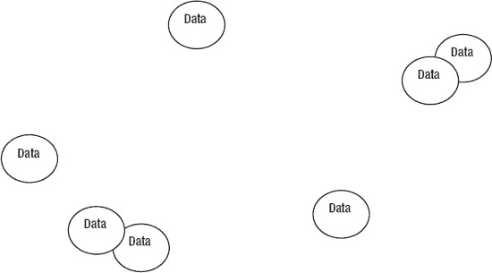
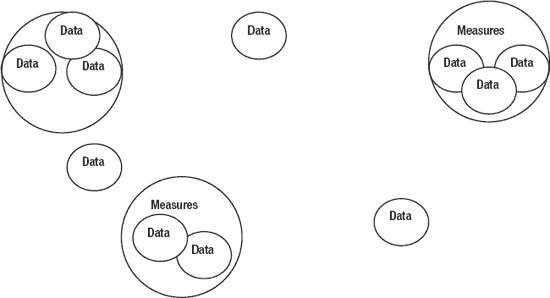
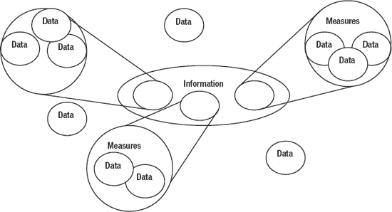
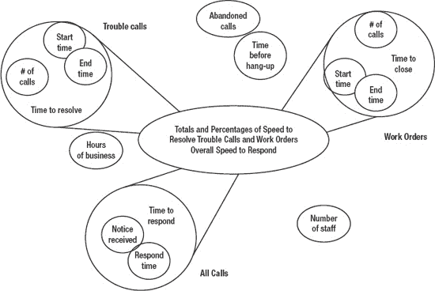
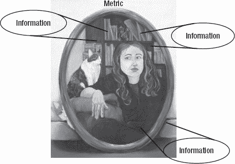
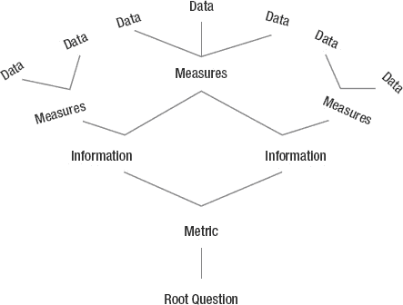
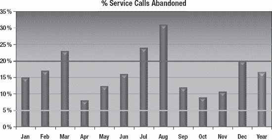
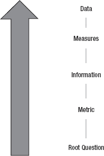

# 建立通用语言

数据、度量与信息，天哪！

建立一个简单易懂的语言至关重要，这样无论经验或教育背景如何，每个人都能理解指标能带来的益处。我相信，缺乏通用语言在商业（乃至生活）中造成的问题比任何其他因素都多。建立共享词汇是确保成功的第一步。

本书提出了许多可能全新的概念，但我认为没有必要再增加一套新词来塞满本就臃肿的组织发展词汇库。相反，我打算使用非常常见的词语——即通俗易懂的英语——来帮助将看似复杂的东西变得简单直接。

让我们从一个故事开始，来帮助我们进入正确的心态。

## 三只小猪大冒险

那时，我正努力回忆一个童话故事，好让我三岁的孩子入睡。她要求听故事，但在路上没有她的书，意味着我必须自己回忆一个。嗯，我对故事的记忆很差——但对自己教过的道理却记忆犹新。所以，像任何好父亲一样，我即兴发挥。还有什么比讲一个关于指标的故事更能让她入睡的呢？

### 故事

在有效处理了他们的房东（狼先生）之后，三只小猪过上了奢侈放纵的生活。三年过去了，每只小猪都生活在污秽中，体重超标严重（即使对猪来说也是如此），健康状况每况愈下。每只小猪都去看了各自的医生。每位医生都得出了相同的预后：这只小猪正走在通往早早上烤肉架的快速通道上。小猪们吃不好、睡不够、不锻炼，也不注意身体发出的信号。医生们知道，小猪们必须改变生活方式，否则就会死去。

#### 第一只小猪

不幸的是，医生们也是天差地别。第一只小猪的医生告诉他，他的健康状况正在恶化，必须改变生活方式。这只小猪需要认真对待自己的健康。医生给了这只小猪一份饮食计划、一份锻炼计划，并预约了 12 个月后复诊。

第一只小猪被医生的警告吓住了，于是努力去改变。他不再吃不健康的食物。他每天锻炼。他甚至开始早睡。一个月后，第一只小猪感觉棒极了。多年来他从未感觉这么好！他决定庆祝一下。他和双胞胎小羊一起出去狂欢了一整夜。他大吃了一顿，接着又参加了一个吃冰淇淋比赛（他赢了）。大约凌晨 3 点，他回到家，心满意足地躺在床上睡着了。第二天他忘了锻炼。坏习惯很容易就养成了。最终，他只周末锻炼，理由是周中太忙。到了下个月底，他又开始吃得不健康了——虽然没有以前那么糟糕——但也没有达到应有的水平。

年底，当第一只小猪回到医生那里时，他震惊地听到医生很失望。

> “但是医生，我照你说的做了，”第一只小猪恳求道。“我锻炼了，也吃得更好。我甚至睡得更早了。我知道我更健康了……我感觉比去年好多了。”
>
> “是的，但是你的体重没有改善得足够好。你可能吃得比以前好，但还不够好。你可能睡得更多，但仍然不够。你的健康状况总体上正在恶化……我担心如果你不改变，你会死。”

医生给了第一只小猪一份新的饮食和锻炼计划。他甚至给第一只小猪报了一个动感单车课程，并开了药。医生为这只小猪预约了第二年的复诊，并祝他好运。第一只小猪被这一切着实吓坏了，并凭着他那（相当肥大的）下巴发誓，他会做得更好。

这一次，第一只小猪坚持了下来。他定期锻炼，只吃健康食品。饿了就吃胡萝卜、芹菜或无脂酸奶。他每周准时去上动感单车课，雷打不动。不幸的是，由于无法衡量自己的进步，第一只小猪不知道自己做得有多好。七个月后，他感觉好多了，但对健康的焦虑造成了巨大的压力，以至于他中风了。虽然他的健康状况有所改善，但改善的程度还不足以承受中风对他身体系统造成的生理需求。一个月后他死了。第一只小猪的医生得知他的死讯很悲伤。他流了一滴泪，同时从日历上删除了即将到来的预约。

#### 第二只小猪

第二只小猪的医生理解指标的重要性。他是一位好医生，与患者沟通良好。他觉得自己像患者的父亲，并试图帮助他们变得更健康。当医生查看第二只小猪的图表时，他感到沮丧。如何帮助这只小猪改变方向？他怎样才能帮助他变得健康？他喜欢指标，并认为如果给小猪设定一些目标，他会做得很好。医生设计了一个包含三项度量的计划：体重、血压和胆固醇水平。他向小猪解释，他面临严重的健康问题风险。他告诉小猪要减重 100 磅，将血压降至建议水平，并将坏胆固醇降低到可接受的标准。他甚至给了小猪一张图表来追踪这三项度量。当小猪向他请教如何实现这些目标时，医生给了小猪六本小册子、两本书和一串网站列表，让他可以从中寻找健康计划。医生在接下来的一年里安排了每三个月一次的复诊。

第二只小猪非常努力地执行他的计划。他把图表贴在冰箱上。他改变了饮食习惯，开始了锻炼计划，并尝试冥想。他买了血压计、高质量的体重秤和一套用于检查胆固醇水平的漂亮工具包。他不介意花费——他的健康值得。他醒来时测量血压、体重和胆固醇——并且在白天再测量两次。在第一次季度检查时，医生对他的进展感到满意。他们核对了数字，认为第二只小猪走在正确的轨道上。小猪很高兴。他决定再加把劲。他考虑过胃绕道手术，但最终选择每周六天吃豆腐。第七天，他会吃混合蔬菜。他加强了锻炼计划。他开始服用一种从他收到的垃圾邮件（他爱吃垃圾邮件*注：双关，spam 既指垃圾邮件也指一种午餐肉*）中了解到的降胆固醇药物。

随着第二次检查的临近，第二只小猪的行为变得更加鲁莽。他在检查前三天开始只喝水，并在预约当天早上蒸桑拿来脱水减重。他的医生感到惊讶。小猪总共减重了 60 磅，改善了血压，并将胆固醇水平降到了距离标准值 10%以内。医生称赞了他的努力，并预言三个月后的下一次复诊时他将取得成功。

两个月后，第二只小猪的肾衰竭了，他死了。这只小猪没有理解总体目标，也不知道如何衡量自己的整体健康状况。过去的八个月里，他一直在追逐一小堆数字，而不是培养“好身体”。他成功改善了自己测量的三个方面，但却为此忽视了健康的其他方面。

### 第三只小猪

第三只小猪的医生也信奉指标。他同样善待病人，但和第二只小猪的医生不同。他相信自己的病人能够承受全部真相，并且应该了解指标背后隐藏的东西。医生告诉第三只小猪，他的整体健康状况存在风险——主要是由于他的生活方式。医生解释称，体重、血压和胆固醇水平是衡量健康的不错指标，但不能作为判断真实健康的唯一标准。很大程度上，这取决于小猪是否关注自己的身体，并在感觉“不对劲”时及时与医生沟通。小猪好奇“感觉不对劲”这个指标是什么，医生解释说，这并非一个指标，而仅仅是小猪与医生之间的交流。

> “那我拿这些测量值怎么办？”
>
> “你收集它们，跟踪它们，我们把这些作为指标，看看有没有遗漏什么，以及你是否在取得进步。”
>
> “这么说，我必须提高这些数字吗？”小猪接过图表问道。
>
> “不。你的目标是变得健康。这些数字只是让我们了解你是否走在正轨上。”
>
> 第三只小猪哼了一声。“这有什么区别？”
>
> “嗯，有很多指标。血压、体重和胆固醇水平只是其中三项。我确实希望你在这些方面有所改善，但不能以牺牲其他方面为代价，比如睡眠质量、运动量是否充足、压力测试、记忆力、营养状况等。目标是健康——不只是临床上的健康，还包括情感上的健康。”
>
> “所以，我不必非得提高这些数字？”
>
> “是的，理论上你即使某些具体指标没有改善，也能变得更健康。”
>
> “那计划是什么？”
>
> “问得好，小猪！”医生为小猪制定了一个简单的改善计划。他还教第三只小猪如何测量血压、体重和胆固醇水平。他让小猪每天填写日志，每周在线填写日记。每周的在线日记包括他收集的数据、一个“今天感觉如何”的计量器，以及一个记录他本周为健康所做努力的版块。医生承诺会检查在线日记，如果发现任何异常，就会联系小猪。
>
> “希望你不会觉得我是在微观管理你，”医生说，“我只是想随时了解你的进展。你能恢复健康，对我来说非常重要。”
>
> “不，我喜欢这样，”第三只小猪说，他知道医生很关心他。“但你为什么不每个月给我做一整套检查呢？”
>
> “那超出了我们的需要。除非指标显示有必要，否则我不会让你做那么多检查。这样既不会浪费你的时间，也不会浪费你的钱。”

到第六个月时，第三只小猪看起来气色更好，感觉也更棒了，根据医生的评估，他的状况也在好转。到了第九个月，他已经非常健康了。他看起来状态极佳，赢得了朋友和同事们的诸多称赞。他正走在通往健康的路上。

故事结束

我敢肯定，我的版本不会成为这个传统寓言公认的续集，但它达到了目的。我女儿听到一半时就睡着了。

## 数据

我们先从一些基本术语开始，以便更清晰地沟通。数据、度量、信息和指标是截然不同但又完全交织在一起的实体。它们层层递进。指标由其他指标和信息构成；信息由度量构成；度量则由数据构成。

图 1-1 展示了这些不同的实体，它们常常被错误地与指标关联起来，或者被误认为是指标。

**图 1-1.** 数据关系图

数据最常见的定义是“单个事实、统计信息或信息项”。然而，这个定义过于宽泛。它暗示了准确性，还暗示了数据本身并不一定具备的某种有用性。就我们的目的而言，数据是信息可能存在的最简单形式，通常由一个数字或数值表示；例如：六、二十二、七十、真、假、高或低。数据本身基本上是没用的，因为它无法传递任何有意义的信息。如图 1-1 所示，一些数据可以通过重叠的气泡表示“相关联”，但这并非数据定义的一部分。

*数据* 是信息可能存在的最简单形式。它通常由一个数字或数值表示。

## 数据、度量与关系

数据可能完全不相关（气泡相距很远），也可能通过共同的目的而相互关联。在分析数据时，关系图可以直观地展示数据与其他数据的关系。很多时候，人们会错误地认为数据之间存在关系，仅仅是因为这些数据来自同一个来源，或是为了某个单一目的而收集的。例如，如果我们查看“响应时间”和“解决时间”的数据，它们可能看起来是相关的。其来源可能是同一个——故障工单跟踪系统。数据类型（时间）也可能给人造成它们关系比实际情况更密切的印象。数据集经常是不相关的，无论其来源或目的如何。假定不相关的数据集之间存在关系，会导致我们得出错误的结论。例如，响应时间和解决时间互不影响，它们传达的是不同的信息。

### 度量

图 1-2 展示了信息的下一层级：度量以及数据之间的关系。

度量通过加入一定程度的细节，开始为我们提供更有用的画面。这些细节可能包括度量单位（在“50%”中，“百分比”是度量单位，数据是 50），以及关于数据如何与其他数据关联的信息。说“70%”比简单地说“70”更有用。更好的是，我们可以说“63 个用户中的 70%”。每个度量由一个或多个数据点组成。和数据一样，这些度量可以具有不同层级的相互关系。其中一个气泡（图 1-2 左上方）描绘了一组缺少父级度量的数据。这组数据之所以被分组是因为它们相关，但并没有引出一个更有意义的度量。人口统计数据以及身高体重就是这类例子——这些数据可能有用，但不一定能融入一个更大的度量。

其他数据在关系图中独立存在。这些是游离数据（任何表示“无连接”的术语都适用），它们以后可能有也可能没有用处。

度量通过将数据按照真实关系分组，并增加一点上下文，使数据更清晰。然而，如果与底层目标或根本问题（稍后详述）没有明确的联系，度量充其量不过是经过打扮的数据。

#### 信息

图 1-3 展示了第一个实用的信息层级——我们正是将其称为“信息”。信息将度量项和数据（以及异常数据）组合成一个有意义的整体。

信息为度量项和数据增添了上下文。请注意，某些数据并未被纳入信息之中。有些数据，无论收集得多么完善，无论你计划得多么周全，都可能是多余的。最终，你可能会判定这些数据并不适用，或者无助于回答你正在研究的根本问题。信息只提取所需的数据和度量项。

上下文为数据与度量项带来的背景信息，对于将难以辨别的数字点转化为可理解的状态至关重要。借助度量项，我们知道自己谈论的是百分比，并且它与用户数量相关。信息以含义的形式添加上下文，从而使度量项变得易于理解：“63 名用户中，有 70%更偏好滑雪机而非 stair stepper（踏步机）。”

虽然在正确语境下的信息可能特别有用，但真正需要的或许是一个指标。

在继续探讨下一块拼图之前，看一个关于实际信息（数据与度量项）如何融入该图表的示例可能会有所帮助。图 1-4 展示了一个围绕“解决速度”信息的示例。

### 指标

图 1-5 展示了一个完整的故事，即一个指标。这是一幅由信息、度量项和数据构成的画面。它应该印证那句格言：“一图胜千言。”

我们终于触及了 `metric`（指标）这个至关重要的定义。一个指标不仅仅是简单地将多条信息组合在一起。好吧，其实也差不多。

根据我的定义，一个指标由信息、度量项和数据构成。指标还可以包含其他指标。指标与信息之间的主要区别在于，指标讲述了一个完整的故事，能够充分回答一个根本问题。而且它必须讲述“正确”的故事。如果指标完全讲错了故事，那它就没多大用处了。除了数据、度量项和信息，指标还包含了文字叙述。虽然一图可能胜千言，但一张没有解释的图片仍然可能存在多种解读方式。

如果你在指标方面做得很好，因为你的图表和表格在讲述一个结构良好的故事，那么误解的可能性就会大大降低。但这仍然有可能发生。除非你确信那些查看你指标的人们没有自己的目的、不太可能误解，并且思想完全开放，否则我强烈建议你用文字来完善这幅画面。

这种对文字说明的需求并非新概念。我女儿在大学修了一门艺术鉴赏课。我发现这门课有配套的教科书，对此我并不惊讶。每件艺术作品都有数页文字介绍艺术家、艺术家创作该作品的一些背景、创作所花费的时间、所使用的媒介以及它之所以重要的背景情况。但这一切让我感到震惊，因为在我高中时，我记得我的美术老师解释说，艺术除了每个观众自己的解读方式之外，没有确定的意义。现代艺术尤其如此（我至今仍然不理解）。这些教科书没有把解读留给观众，而是直接给出了画作背后信息的至关重要的解释。每幅画、每件雕塑、每张素描都有。每件蚀刻作品、每件雕刻品、每幅史前岩画都有。解释艺术家试图用他那千言万语的图像向我们“讲述”什么。

如果解释一件艺术作品背后的含义是有用的，那么捕捉一个指标的含义又有多么必要呢？而且，让艺术家本人来解释这个含义难道不是最好的吗？这种解释，当然是对指标的一种解读。诚然，如果你请五个人解读一个指标，你可能会得到五个不同的答案——但你肯定希望你的解读能伴随这幅画面一同呈现。如果指标使用得当，你的解读不会被当作“真理”，而是作为它本身：看待指标含义的一种方式。

“63 名用户中，有 70%更偏好滑雪机而非 stair stepper（踏步机）作为其锻炼计划的有氧部分。滑雪机的平均等待时间为 25 分钟。通常情况下，stair stepper（踏步机）没有等待时间。这里有 3 台滑雪机和 12 台 stair stepper（踏步机）。”这已经接近成为一个“好”指标了。如果加上一幅图（图表或图形），可能会更接近目标。指标的目标是为了回答一个根本问题而讲述一个完整（且有用）的故事。

问题实际上是驱动一个好指标的因素。没有根本问题，就不可能有好的指标。当我们审视滑雪机与 stair stepper（踏步机）的指标时，我们并不知道该指标的有用性，因为我们不知道问题是什么。我们可能会仓促下结论，更糟的是，我们可能会据此做出一个可能令人后悔的决定。

我们是否应该购买更多滑雪机？淘汰一些 stair stepper（踏步机）？是否应该缩短滑雪机的使用时限？是否应该开设一门基于 stair stepper（踏步机）的健身课程？显而易见，正确的答案并不明显。部分困惑可能源于缺乏问题。我们为何收集这些数据？我们为何进行这些分析，从而得出这个指标？没有根本问题，就无法讲述一个完整的故事。

### 根本问题

在我的著作《为何组织如此努力却改进甚微》（Praeger, 2009）中，我与合著者迈克尔·朗索恩和唐纳德·帕吉特将度量指标比作一棵树。按照这种观点，数据是树叶，测量值是细枝，信息是树枝，而度量指标则是树干。所有这些都依赖于发达的根系而存在，这些根系就代表了根本问题。这个类比很好地展示了度量指标各组成部分之间的关系。

图 1-6 展示了构成度量指标的组件的另一种视图。它看起来像一种有机结构，这很恰当。

如果没有一个好的根本问题，你所推导出的答案可能会让你误入歧途。只有当你知道了问题是什么，答案才有用。根本问题与度量指标紧密相连，以至于它必须成为度量指标定义的一部分。

一个度量指标利用数据、测量值、信息和其他度量指标来讲述一个完整的故事，以回答一个根本问题。

从根本上说，根本问题是度量指标中最重要的组成部分。它是我们用来确定方向的路线图。它明确了我们旅程的目标。有些情况下，你可能有充分的理由并获得良好的结果，在没有根本问题的情况下收集数据（参见第 15 章），但对于度量指标的实际应用而言，这是不可接受的。这就像没有目的地就出发旅行。没有目标、没有计划、没有方向——只管上车然后开始开。

后来你可能会意识到，你忘记了带驾照、钱，甚至鞋子。你可能会意识到你已经开得太远，油箱里剩余的油不够你开回去了。你可能会意识到，唯一合乎逻辑的做法就是继续开下去，尽管你不知道自己会开到哪里。你更有可能最终到达一个你不想到达的地方。因为唯一正确的地方就是那个你忘记确定的目的地，所以你最终停在别处的可能性要大得多。而且，当你未能到达目的地时（最终你可能确定也可能没有确定目的地），你会责怪汽车。它的油耗太高了。

你不会责怪自己缺乏事先规划。即便你加了更多油*并*想好了要去哪里，你也不会再回家拿钱包、驾照或鞋子。你已经投入太多了。相反，你会继续前行，试图从当前位置到达目的地，不愿承认自己到此为止所做的一切都是徒劳。

你需要度量指标的目的，也就是根本问题，这样才能尽可能高效地利用你的资源（汽车、燃料、时间和你的努力）。当然，如果你拥有无限的资源，或者无论你如何使用资源都能赚钱（也许你有一位富有的乘客，他只关心被载着到处走，不关心目的地、目的，也不关心需要多长时间），那么效率就无关紧要了。但如果你和我们大多数人一样，需要充分利用你所拥有的东西，那么踏上这条漫无目的的旅程就不仅仅是浪费了。它最终带来的代价将远远超过实际产生的费用。

缺乏方向会在你、你的同事、上级和下属心中种下绝望和怨恨的种子。它可能摧毁你所在组织的精神。

根本问题为你提供了焦点和方向。你知道自己要往哪里去。你知道目的地。你知道度量指标的目的以及你试图回答的问题。

一个根本问题，一个措辞正确且经过深思熟虑的问题，能让你确定正确的答案。如果没有根本问题——`正确的问题`——你所推导出的答案将是一场漫无目的的旅程的结果。这个答案很可能会弊大于利。

即使是一个措辞恰当的根本问题，如果它本身不是`正确的`问题，也无法导向良好的结果。

综合起来，让我们看一个完整的例子。一个度量指标是一个通过信息呈现来讲述的完整故事。信息又是测量值的汇编，用于传达意义。测量值是基于数据（可收集组件的最低层级，即数值或数字）建立的结果。以下是一个简单的例子：

*   `数据`：`15` 和 `35`

*   `测量值`：`15 英里/加仑` 和 `35 英里/加仑`

*   `信息`：一辆紧凑型轿车使用无铅汽油取得的每加仑英里数：市区 `15 英里/加仑`，高速公路 `35 英里/加仑`

*   `度量指标`：合乎逻辑的后续度量指标将是一张图表（多数情况下是折线图或柱状图），讲述一个故事。在这个例子中，这个故事可能是不同紧凑型轿车车型燃油效率（每加仑英里数）的比较，并结合了其他用于帮助你挑选合适车辆的指标。

*   `根本问题`：哪款车最适合我？

数据、测量值和信息的使用是相对的，而非一成不变。我的意思并不是要规定僵化的定义，从而阻碍你构建度量指标。目标是针对我们的问题制定出度量指标——也就是答案。

数据可以包括每加仑英里数的标签。测量值可以包括“市区”和“高速公路”。信息可以区分不同汽车的品牌和型号。需要记住的要点是，当我们从数据到测量值再到信息逐步推进时，会提供额外的含义（和背景信息）。此外，度量指标利用这些信息以及更多其他信息构建了一个完整的故事。

让我们再看另一个例子，如图 1-7 所示。以客户服务台为例，我们可以识别出列出的每个组件。

*   `根本问题`：服务台对我们的客户响应及时吗？

*   `数据`：
    *   每月 `1,259` 个
    *   每月 `59` 个
    *   按 `1–5` 分制进行的评分

*   `测量值`：
    *   故障电话数量
    *   放弃呼叫数量
    *   呼叫者挂断前的等待时长
    *   调查回复

*   `信息`：
    *   每月放弃呼叫占总呼叫的百分比
    *   每年放弃呼叫占总呼叫的百分比

*   `度量指标`：

`图 1-7.` 按月和按年计算的放弃服务呼叫百分比

观察图 1-7 可知，过去一年里服务台的响应情况完全在预期范围内。然而，在三月、七月和八月，放弃呼叫的百分比超出了预期（超过 `20%`）。这三个异常峰值值得调查，以确定其原因以及这些问题再次出现的可能性。同样值得注意的是，在这些峰值出现之前，数据呈稳步上升趋势。四月和十月的响应情况非常好，应该分析一下原因是否可复制。

这是否是一个度量指标？是的，按照我们的分类法，这符合度量指标的定义，因为它讲述了一个回答根本问题的故事。

这是一个好的指标吗？不，它绝对可以更好。它可以讲述一个更完整的故事。回顾这些信息，我们还可以将关于“回复时间”的调查反馈纳入进来，以确定客户对服务台响应速度的看法。该指标的另一个重要组成部分应该是 30 秒内放弃呼叫的百分比。这个标准可能会有所不同；可能是 15 秒或 45 秒以下。这取决于不同的因素。客户在等待期间在听什么？一个人在意识到自己拨错号码之前通常会在线等待多久？多短的等待时间才不会被视作一次机会的错失？但在没有首先解决根本问题的情况下就去改进这个指标，正如一位朋友最近所说，就像在岩石上抹糖霜。它看起来可能好吃，但实际并非如此。我们可以继续改进这个指标，让它看起来更好，但除非我们回到根本问题，否则它不会令人满意。

这个指标，就像它的组成部分一样，是可用于回答根本问题的工具。我们将在后面讨论如何正确使用这些工具。目前，对这些组成部分是什么以及它们之间如何相互关联有一个共同的理解就足够了。

## 数据与指标的悖论

在指标的组成部分及其与导出它们的根本问题之间的关系中，存在一个有趣的悖论。

数据是最容易理解、识别和收集的，但它应该是最后才开发的东西。最复杂和最难的部分，即根本问题，必须放在第一位。正如我们那位倒霉司机在曲折旅程中的比喻所示，我们必须首先确定我们的目的地和目的。我们不应该从简单的开始去构建复杂的，而必须从最复杂的开始，并用它来识别简单的部分。

三只小猪也遇到了这个悖论。第一只小猪的医生对数据和度量感到满意，却忽略了更大、更重要的需求。他失去了他的病人，但还是用“健康”的数字来交差。企业也会犯同样的错误。你可能拥有良好的数据点（每客户销售额、每次销售利润或回头客数量），但仍然会破产。

我们必须从复杂的开始，以揭示简单的——从根本问题出发，准确无误地通向数据。

识别正确的根本问题并不像听起来那么简单，也不像我们通常认为的那样困难。我们需要保持好奇心。我们需要不断深挖，直到我们触及真相、根源问题、需求和要求。这个指标的用途是什么？你真正想了解的是什么？这个根本需求使我们能够形成答案的图景。这个图景就是指标的设计。

一旦你知道了根本问题，你就能画出图景。

这个图景，即指标的设计，可以在对实际答案毫无概念的情况下创建出来。指标为信息提供了形式。信息告诉我们需要的度量是什么，而度量则确定了所需的数据。这是创建指标的最佳方式。从问题到指标，再到信息，再到度量，最后到数据。

不幸的是，大多数时候，我们试图朝相反的方向去做，从简单的（数据）开始，试图在此基础上阐述，以发展出复杂的（根本问题）。这个过程很少能成功。但是，当我们从复杂的开始，形成关于问题是什么以及答案会是什么样子的图景时，向下细化到数据就变得容易了。

数据、度量、信息和指标都服务于同一个主人：根本问题。它们都有一个共同的目标：为问题提供答案。正因为如此，问题定义了所需答案的层级。

让我们提出以下问题：去奶奶家有多远？你不需要指标来回答这个问题。你甚至不需要信息。一个度量（例如，英里数）就足够了。而且你会感到完全满意。为了让数据足够充分，你必须带着足够的上下文来提问，使得一个简单的数字或数值就能成为充分的答案。去奶奶家有多少英里？还要多久才能到奶奶家？在这些情况下，你只需要数据。但数据本身很少有用。

让我们再提出一个问题：我们是否有时间在路上进行一些观光或购物，并且仍然能及时赶上去奶奶家的火鸡晚餐？要回答这个问题，我们需要信息。度量和数据可能包括以下内容：

- 奶奶准备晚餐的时间
- 当前时间
- 沿途的观光或购物站点数量
- 每个站点预计的观光/购物时间

我们仍然不需要指标。而且我们绝对不需要一个需要定期收集、分析和报告信息构建结果的周期性指标。

问题在于，管理层——任何高于员工级别的人——已经被训练成几乎总是从数据入手。少数从指标开始的人心中已有答案（这本身并非坏事），但缺乏问题。这导致他们要求定期（每周、每月、每季度或每年）的报告。他们希望以某种格式查看指标：趋势线与基于最佳实践的基线进行比较，同时包含月度数据和年度累计数据。听起来不错，但如果不知道根本问题，直接索要这个答案可能会浪费大量资源。

有时客户（经理、部门主管、组织领导等）在知道问题之前就已知晓他们想要的答案（指标），然后意识到这些答案并不能真正满足他们的需求，于是尝试进行中途修正。就像我们那位兜圈子的司机一样，他们拒绝重新开始、回到原点、忽略已经完成的工作并从头再来。当他们发现指标有误时，会采取以下措施之一：

- 假设数据是错误的
- 断定分析是错误的
- 调整数据（而非指标）

一些真正明智的经理会判断指标不正确并重新尝试。不幸的是，他们没有意识到问题在于缺乏根本问题，或者他们当前所依据的问题本身就是错误的。他们不是从问题重新开始，而是尝试重新设计指标。

这个常见问题的底线和解决方案是什么？选一句你最爱的老生常谈，任何一句都行：我们必须从顶层开始。我们必须从终点开始。我们必须始终牢记最终目标。你无法从底部向上挖洞。我们必须确定正确的根本问题。

根本问题将决定答案的层次。如果问题足够复杂并且需要定期给出答案，那么你很可能需要开发一个全面的指标。一个诸如“（某个服务或小猪的）健康状况如何？”的问题可能需要一个指标来回答，特别是如果你想持续定期监控健康状况。

问题的模糊性使其更加复杂。清晰则简化一切。

当我们设计指标来回答根本问题时，我们意识到需要衡量构成组织健康状况的各个组成部分。以三只小猪（或者人类）为例，我们可能需要呼吸系统、循环系统、消化系统和内分泌系统的指标。更别提神经系统、排泄系统、骨骼或肌肉了。关键在于，由于问题范围广泛，我们需要更多信息。

如果我们的问题范围更窄，答案就会更简单。例如，考虑以下问题：你的体重控制得怎么样？答案可以通过定期站在可靠秤上测量来提供。不幸的是，问题很少如此具体。如果第一只小猪只被问及体重，就会错过其他健康指标。过于专注于某个特定指标可能会导致遗漏重要信息。你问的可能是个错误问题，就像第二只小猪的医生，他只用了三个指标，却忽略了与他的猪患者分享全局情况。

也许你了解自己的血压。也许你做了全面体检，一切正常——除了需要减掉几磅。“你减肥进展如何？”可能就足够了。如果是这样，那么指标就过于繁琐了。一个简单的测量就够了。

在设计指标时，最重要的部分是找到正确的根本问题。这将让我们知道需要什么层次的信息来回答它。它将指导从数据收集到指标设计的全过程。

## 指标组成部分

让我们回顾一下指标的组成部分及其定义：

- `数据`：就我们而言，数据是信息的最简单形式，通常由一个数字或值表示；例如，六、二十二、七十、真、假、高或低。
- `度量`：由数据组成，度量将最低级别的上下文添加到数据中。度量可以由其他度量组成。
- `信息`：信息由数据和度量组成。信息可以由其他信息组成。信息提供额外、更有意义的上下文。
- `指标`：指标由数据、度量以及信息组成。指标可以由其他指标组成。指标提供信息的完整上下文。指标（试图）讲述一个完整的故事。指标（试图）回答一个根本问题。
- `根本问题`：指标的用途。根本问题定义了指标的需求并确定了其有用性。

## 总结

本章介绍了指标体系及其组成部分的通用语言。它还介绍了“数据-指标悖论”，我们了解到必须从最复杂的内容入手才能得出简单的结果。我们必须从根本问题开始，以安全地找到回答该问题所需的信息层次。可能这个问题并不需要指标，甚至不需要信息。当管理层要求创建指标（或指标项目）时，我们必须放慢脚步，询问根本问题是什么。我们必须愿意并能够接受答案可能根本不在于创建指标。

## 附赠材料

我担心可能误导了你。本章采用这样的呈现方式，或许会让你怀疑我是否正将你引向歧途。但这样安排自有其逻辑原因。我曾考虑过按照我希望你处理的 `自上而下` 的顺序来呈现定义：从 `根本问题` 到 `指标`，再到 `信息` 与 `度量`，最后才是 `数据`。但我担心读者会抗拒。这并非我们接触指标的常规顺序。不幸的是，我们通往指标的寻常路径往往始于对数据的索取。

`图 1-8` 以 `自下而上` 的方式展示了各组件之间的层级关系。

`图 1-8.` 度量指标组件的层级结构

我曾与许多管理者共事，他们的任务是提交有意义的信息（即指标），用以说明其部门或单位的运作状况。他们迈出的第一步都是相同的：询问我们有哪些数据？采取这种策略，是出于避免给员工增加额外工作负担的善意初衷。他们期望用现有数据填满“框子”，从而平息组织高层的需求。然而，由于我们未能将指标需求视为一个为组织各层级创造价值的机会，最终只是敷衍了事，尽可能少地去满足要求。接下来的问题则是（如果现有数据似乎不够）：我们能获取哪些数据？因此，我没有按照我认为正确的顺序来介绍它们，而是按照我认为你会感到熟悉的顺序来呈现。现在，我希望你能拿出信任，接受这个观点——先从宏观图景入手。

所以，请接受我的歉意，并允许我确保你为阅读本书剩余部分打下正确基础。

`误解一`：`数据`是无用的。

我可能给你留下了数据无用的印象。或者，脱离了更大的指标体系，度量和信息就无法为改善组织发挥效用。数据-指标悖论已经阐述过这一点，但仍值得再次强调。如果你的问题极其具体，且仅需要一个数字/数值答案（比如“现在几点了？”），那么数据可能非常有用。如果只需数据即可，你很可能不需要指标或其附带任何详细信息。

