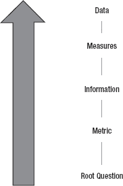

# 排版后的内容

这是一个好的指标吗？不，它绝对可以更好。它可以讲述一个更完整的故事。回顾这些信息，我们还可以将关于“回复时间”的调查反馈纳入进来，以确定客户对服务台响应速度的看法。该指标的另一个重要组成部分应该是 30 秒内放弃呼叫的百分比。这个标准可能会有所不同；可能是 15 秒或 45 秒以下。这取决于不同的因素。客户在等待期间在听什么？一个人在意识到自己拨错号码之前通常会在线等待多久？多短的等待时间才不会被视作一次机会的错失？但在没有首先解决根本问题的情况下就去改进这个指标，正如一位朋友最近所说，就像在岩石上抹糖霜。它看起来可能好吃，但实际并非如此。我们可以继续改进这个指标，让它看起来更好，但除非我们回到根本问题，否则它不会令人满意。

这个指标，就像它的组成部分一样，是可用于回答根本问题的工具。我们将在后面讨论如何正确使用这些工具。目前，对这些组成部分是什么以及它们之间如何相互关联有一个共同的理解就足够了。

### 数据与指标的悖论

在指标的组成部分及其与导出它们的根本问题之间的关系中，存在一个有趣的悖论。

数据是最容易理解、识别和收集的，但它应该是最后才开发的东西。最复杂和最难的部分，即根本问题，必须放在第一位。正如我们那位倒霉司机在曲折旅程中的比喻所示，我们必须首先确定我们的目的地和目的。我们不应该从简单的开始去构建复杂的，而必须从最复杂的开始，并用它来识别简单的部分。

三只小猪也遇到了这个悖论。第一只小猪的医生对数据和度量感到满意，却忽略了更大、更重要的需求。他失去了他的病人，但还是用“健康”的数字来交差。企业也会犯同样的错误。你可能拥有良好的数据点（每客户销售额、每次销售利润或回头客数量），但仍然会破产。

我们必须从复杂的开始，以揭示简单的——从根本问题出发，准确无误地通向数据。

识别正确的根本问题并不像听起来那么简单，也不像我们通常认为的那样困难。我们需要保持好奇心。我们需要不断深挖，直到我们触及真相、根源问题、需求和要求。这个指标的用途是什么？你真正想了解的是什么？这个根本需求使我们能够形成答案的图景。这个图景就是指标的设计。

一旦你知道了根本问题，你就能画出图景。

这个图景，即指标的设计，可以在对实际答案毫无概念的情况下创建出来。指标为信息提供了形式。信息告诉我们需要的度量是什么，而度量则确定了所需的数据。这是创建指标的最佳方式。从问题到指标，再到信息，再到度量，最后到数据。

不幸的是，大多数时候，我们试图朝相反的方向去做，从简单的（数据）开始，试图在此基础上阐述，以发展出复杂的（根本问题）。这个过程很少能成功。但是，当我们从复杂的开始，形成关于问题是什么以及答案会是什么样子的图景时，向下细化到数据就变得容易了。

数据、度量、信息和指标都服务于同一个主人：根本问题。它们都有一个共同的目标：为问题提供答案。正因为如此，问题定义了所需答案的层级。

让我们提出以下问题：去奶奶家有多远？你不需要指标来回答这个问题。你甚至不需要信息。一个度量（例如，英里数）就足够了。而且你会感到完全满意。为了让数据足够充分，你必须带着足够的上下文来提问，使得一个简单的数字或数值就能成为充分的答案。去奶奶家有多少英里？还要多久才能到奶奶家？在这些情况下，你只需要数据。但数据本身很少有用。

让我们再提出一个问题：我们是否有时间在路上进行一些观光或购物，并且仍然能及时赶上去奶奶家的火鸡晚餐？要回答这个问题，我们需要信息。度量和数据可能包括以下内容：

*   奶奶准备晚餐的时间
*   当前时间
*   沿途的观光或购物站点数量
*   每个站点预计的观光/购物时间

我们仍然不需要指标。而且我们绝对不需要一个需要定期收集、分析和报告信息构建结果的周期性指标。

问题在于，管理层——任何高于员工级别的人——已经被训练成几乎总是从数据入手。少数从指标开始的人心中已有答案（这本身并非坏事），但缺乏问题。这导致他们要求定期（每周、每月、每季度或每年）的报告。他们希望以某种格式查看指标：趋势线与基于最佳实践的基线进行比较，同时包含月度数据和年度累计数据。听起来不错，但如果不知道根本问题，直接索要这个答案可能会浪费大量资源。

有时客户（经理、部门主管、组织领导等）在知道问题之前就已知晓他们想要的答案（指标），然后意识到这些答案并不能真正满足他们的需求，于是尝试进行中途修正。就像我们那位兜圈子的司机一样，他们拒绝重新开始、回到原点、忽略已经完成的工作并从头再来。当他们发现指标有误时，会采取以下措施之一：

-   假设数据是错误的
-   断定分析是错误的
-   调整数据（而非指标）

一些真正明智的经理会判断指标不正确并重新尝试。不幸的是，他们没有意识到问题在于缺乏根本问题，或者他们当前所依据的问题本身就是错误的。他们不是从问题重新开始，而是尝试重新设计指标。

这个常见问题的底线和解决方案是什么？选一句你最爱的老生常谈，任何一句都行：我们必须从顶层开始。我们必须从终点开始。我们必须始终牢记最终目标。你无法从底部向上挖洞。我们必须确定正确的根本问题。

根本问题将决定答案的层次。如果问题足够复杂并且需要定期给出答案，那么你很可能需要开发一个全面的指标。一个诸如“（某个服务或小猪的）健康状况如何？”的问题可能需要一个指标来回答，特别是如果你想持续定期监控健康状况。

问题的模糊性使其更加复杂。清晰则简化一切。

当我们设计指标来回答根本问题时，我们意识到需要衡量构成组织健康状况的各个组成部分。以三只小猪（或者人类）为例，我们可能需要呼吸系统、循环系统、消化系统和内分泌系统的指标。更别提神经系统、排泄系统、骨骼或肌肉了。关键在于，由于问题范围广泛，我们需要更多信息。

如果我们的问题范围更窄，答案就会更简单。例如，考虑以下问题：你的体重控制得怎么样？答案可以通过定期站在可靠秤上测量来提供。不幸的是，问题很少如此具体。如果第一只小猪只被问及体重，就会错过其他健康指标。过于专注于某个特定指标可能会导致遗漏重要信息。你问的可能是个错误问题，就像第二只小猪的医生，他只用了三个指标，却忽略了与他的猪患者分享全局情况。

也许你了解自己的血压。也许你做了全面体检，一切正常——除了需要减掉几磅。“你减肥进展如何？”可能就足够了。如果是这样，那么指标就过于繁琐了。一个简单的测量就够了。

在设计指标时，最重要的部分是找到正确的根本问题。这将让我们知道需要什么层次的信息来回答它。它将指导从数据收集到指标设计的全过程。

### 指标组成部分

让我们回顾一下指标的组成部分及其定义：

-   **数据**：就我们而言，数据是信息的最简单形式，通常由一个数字或值表示；例如，六、二十二、七十、真、假、高或低。
-   **度量**：由数据组成，度量将最低级别的上下文添加到数据中。度量可以由其他度量组成。
-   **信息**：信息由数据和度量组成。信息可以由其他信息组成。信息提供额外、更有意义的上下文。
-   **指标**：指标由数据、度量以及信息组成。指标可以由其他指标组成。指标提供信息的完整上下文。指标（试图）讲述一个完整的故事。指标（试图）回答一个根本问题。
-   **根本问题**：指标的用途。根本问题定义了指标的需求并确定了其有用性。

### 总结

本章介绍了指标体系及其组成部分的通用语言。它还介绍了“数据-指标悖论”，我们了解到必须从最复杂的内容入手才能得出简单的结果。我们必须从根本问题开始，以安全地找到回答该问题所需的信息层次。可能这个问题并不需要指标，甚至不需要信息。当管理层要求创建指标（或指标项目）时，我们必须放慢脚步，询问根本问题是什么。我们必须愿意并能够接受答案可能根本不在于创建指标。

### 附赠材料

我担心可能误导了你。本章采用这样的呈现方式，或许会让你怀疑我是否正将你引向歧途。但这样安排自有其逻辑原因。我曾考虑过按照我希望你处理的**自上而下**的顺序来呈现定义：从**根本问题**到**指标**，再到**信息**与**度量**，最后才是**数据**。但我担心读者会抗拒。这并非我们接触指标的常规顺序。不幸的是，我们通往指标的寻常路径往往始于对数据的索取。

`图 1-8` 以**自下而上**的方式展示了各组件之间的层级关系。

**图 1-8.** 度量指标组件的层级结构

我曾与许多管理者共事，他们的任务是提交有意义的信息（即指标），用以说明其部门或单位的运作状况。他们迈出的第一步都是相同的：询问我们有哪些数据？采取这种策略，是出于避免给员工增加额外工作负担的善意初衷。他们期望用现有数据填满“框子”，从而平息组织高层的需求。然而，由于我们未能将指标需求视为一个为组织各层级创造价值的机会，最终只是敷衍了事，尽可能少地去满足要求。接下来的问题则是（如果现有数据似乎不够）：我们能获取哪些数据？因此，我没有按照我认为正确的顺序来介绍它们，而是按照我认为你会感到熟悉的顺序来呈现。现在，我希望你能拿出信任，接受这个观点——先从宏观图景入手。

所以，请接受我的歉意，并允许我确保你为阅读本书剩余部分打下正确基础。

*误解一：* 数据是无用的。

我可能给你留下了数据无用的印象。或者，脱离了更大的指标体系，度量和信息就无法为改善组织发挥效用。数据-指标悖论已经阐述过这一点，但仍值得再次强调。如果你的问题极其具体，且仅需要一个数字/数值答案（比如“现在几点了？”），那么数据可能非常有用。如果只需数据即可，你很可能不需要指标或其附带任何详细信息。

*误解二：* 从数据入手，再逐步构建指标。

多数情况下，这种误解源于一个错误的信念：你需要数据，你需要答案。而科技带来的海量数据则是另一个催化剂。你可能认为应该先收集数据，尝试将其分组为度量，然后将度量编译成有意义的信息片段，最后再组合这些组件构建一个指标，赋予一切意义与清晰度。

事实恰恰相反。你可以收集的数据种类繁多，从数据层面入手几乎注定无法创建出可用的指标。你将会看到，**以终为始**至关重要；指标就是终点（如果问题需要的话），因此，也是我们的起点。

*误解三：* 在收集数据、度量或信息之前，你必须先有一个根本问题。

虽然我希望事实如此，但你会发现很多时候，你被要求收集数据、分析度量并制作信息报告，却完全不明所以。就像大多数优秀的执行者一样，你很可能不得不去完成那些并非“正确”之举。我强烈建议你在开始之前尽力查明根本问题，但如果做不到，当然也可以在未知根本问题的情况下收集信息。如果发生这种情况，我建议你在过程中尽快找到根因问题。

当你从上级那里听到“我看到了就知道想要什么”这样的说法时，请保持坚定。帮助客户识别他们真正想要什么的最佳方式，就是帮助他们找出其根本问题。在道格拉斯·哈伯德（Douglas Hubbard）的杰作《如何衡量一切：发现商业中无形资产的价值》（Wiley, 2010 年）中，作者介绍了他的方法论，用以识别人们真正想知道的东西。

哈伯德使用了所谓的“澄清链”（clarification chain），这让你能够不断深入挖掘对客户真正重要的东西。他会简单地询问：“你说的 x 是什么意思？”在他与美国退伍军人事务部的合作案例中，为了找到根本问题，他最终举办了多次研讨会。哈伯德并不要求一个严格意义上的根本问题，他在此之前就停止了探索。但他的书是关于**度量**（measures）的，而非**指标**（metrics，在我们的定义中）。好消息是，他关于“能够衡量一切”的观点是完全正确的。我多次参考了他的书。有时，当与客户合作时，我们在确定了问题、设计了看似合理的指标并明确了所需信息后，会遇到瓶颈。通常，客户不愿意推进，因为她不相信我们能衡量出为整合信息所需的东西。这时，我会从书架上抽出哈伯德的书，向她保证我们真的可以衡量一切。由于我们已经掌握了根本问题、指标和信息需求，识别具体的度量会变得非常简单。

因此，从底层开始并非不可能，只是并非明智之选。

## 设计指标
### 方法篇

既然我们已经建立了沟通的共同语言，下一步就是讨论如何进行。我阅读过大量关于平衡计分卡、绩效衡量和改进指标的书籍、文章和博客帖子。每本书都力劝读者使用作者自己的方法和工具。但是，我至今没有发现哪一本能够用平实的英语将“如何从零开始设计一个指标”说清楚。现在是时候有人来做这件事了。

在本章中，我们将涵盖以下内容：

-   如何形成一个根本问题——**正确的**根本问题
-   如何通过画图来设计一个指标
-   如何充实为了使图表完备所需的信息、度量和数据
-   如何收集数据、度量和信息

这看起来工作量不小（事实也确实如此），但我保证，从长远来看，如果你遵循这个方法，将节省大量的时间和精力。节省下来的大部分成本将来自于更少的返工、更少的挫折感，以及对你所设计指标的更少不满。

可以这样理解：你可以先通过制作蓝图来建房，以确保最终得到你想要的房子。或者，你也可以订购大量的木材和物资，然后边干边摸索。建房或开发软件时，这种先做基础工作的流程是必要的，它需要纪律性，但终将物超所值。我从未见过有人因为拥有一个深思熟虑的计划而感到失望；相反，我帮助过许多程序员试图解开他们最终写出的意大利面条式代码，那是因为他们在了解需求之前就开始了编程。

虽然程序员在前期规划方面已有改进，建筑商也绝不会想到胡乱开始敲打，但遗憾的是，那些寻求使用指标的人仍然想跳过需求阶段。

那么，让我们开始制定那份蓝图吧。

### 触及根本问题

在设计指标之前，你首先必须确定根本问题：真正的驱动需求是什么？在上一章的服务台案例中，主管问道：“我们的服务台对客户响应及时吗？”分析师据此开发了一个看似不错的指标——电话放弃率。然而，他做得并不出色，因为他没有先绘制一幅画面（指标），而是直接着手收集数据和度量。他也没有判断这个问题是否是根本问题，或者是*正确*的问题。

我与客户多次进行的讨论，常常类似下面的对话（其中我扮演指标设计师的角色）：

> *主管：“我想知道我们的服务台对客户是否响应及时。”*

指标设计师需要深挖真正根本问题的第一个线索是，给定问题的答案可能是“是”或“否”。

> *指标设计师：“您所说的‘响应及时’具体指什么？”*
> 
> *主管：“我们是否及时接听了电话？”*
> 
> *指标设计师：“‘及时’具体指什么？是指接听需要多少秒，还是电话响了多少次？”*
> 
> *主管：“我猜是在电话响三声之内吧？”*

设计师做了笔记——主管猜测电话应在三声响铃内接听，但最终答案需要由最终用户给出。

> *指标设计师：“好的。我们为什么需要知道这个？是什么引发了这种好奇？”*
> 
> *主管：“我收到一些投诉，说我们接电话不够快。客户说他们联系不上我们，或者要等太久才能和真人通话。”*
> 
> *指标设计师：“什么算是‘不够快’？或者说，什么样的等待算是‘太久’？”*
> 
> *主管：“我不知道。”*

设计师又做了一些笔记。主管愿意承认他不知道客户所说的“够快”是什么意思，也不知道什么能让客户满意。这种坦诚很有帮助。

> *指标设计师：“我建议我们询问一些您的客户来确定这些参数。这将帮助我们确定期望值和可接受的范围。但我们还需要知道您想了解什么。您为什么想知道服务台的响应情况？”*
> 
> *主管：“嗯，服务台是我们组织的门面——当大多数客户提到‘翡翠城服务’时，他们想到的就是服务台。”*
> 
> *指标设计师：“那么，您想了解关于组织门面的什么信息呢？”*
> 
> *主管：“客户对它的接受程度如何。我想知道它是否树立了良好的形象。”*

这对于我们的指标设计来说是一个好得多的起点。有了根本问题（服务台在多大程度上代表了翡翠城服务的形象？），我们就可以决定一个更有意义的画面——一个涵盖所有能回答该问题要素的画面。

我们的探究还可能产生其他结果。当然，我们不应该把它看作一场审问。那不仅会给主管留下错误印象，还会导致我们提出错误的问题。不，我们的工作是触及根本问题。我们必须帮助客户确定他们真正的潜在需求是什么，以及他们需要或想知道什么。做到这一点的工具之一就是“五个为什么”。

“五个为什么”的概念很简单。你连续问五次“为什么”，直到客户无法再用更深层次的需求来回答。当然，你不能像孩子被告知不能在雨中玩耍那样反复追问“为什么”。你必须以成熟的方式提问。很多时候，你实际上并不使用“为什么”这个词。就像前面的例子，有时你会用其他词语来提问——比如“什么”、“如何”和“如果……会怎样？”

这个过程并不那么依赖于“为什么”这个词的使用，而是基于试图触及根本目的或需求。可能最糟糕的错误就是，当你对第一个“为什么”有一些能回答的信心时，就欣然接受。我们天生都是问题解决者，而抓住一个我们很容易就能提供答案的问题的可能性是非常诱人的。

让我们再看另一个例子，这个例子说明了“五个为什么”如何帮助我们触及根本问题。

> *主管：“我想知道我们的服务台对客户是否响应及时。”*
> 
> *指标设计师：“您所说的‘响应及时’具体指什么？”*
> 
> *主管：“我们是否及时接听了电话？”*
> 
> *指标设计师：“我们为什么需要知道这个？是什么引发了这种好奇？”*
> 
> *主管：“我的老板要求提供指标，我从服务台了解到这些信息可以从我们的故障报修系统中轻易获取。”*
> 
> *指标设计师：“是的，确实如此。但是，如果我们选择这个指标，可能会对你认为重要的东西造成错误印象。也许我们可以看看，是否可以在不增加员工额外工作的情况下，提供一些对你有意义的信息。如果我们能确定一些易于收集的不同度量，并能让你更好地了解部门的状况，你愿意改用它们吗？”*
> 
> *主管：“当然。”*
> 
> *指标设计师：“太好了。通常，我们围绕你想要实现的目标、想要改进的流程或想要解决的问题来构建指标。”*
> 
> *主管：“但领导层想要服务台的指标。”*
> 
> *指标设计师：“好的。他们为什么想要服务台的指标？”*
> 
> *主管：“我想他们是在要求经理们展示他们在战略计划上的进展。”*
> 
> *指标设计师：“你有服务台的战略计划吗？”*
> 
> *主管：“是的，当然有。”*
> 
> *指标设计师：“那么，也许我们应该看看计划中的目标……”*

要触及根本问题，就连续问五次“为什么”——深挖直到你找到一个根本需求或问题。

我能够将需求缩小到围绕一组目标的指标。这并非完美的根本问题，但比我们开始时好得多。

问题在于，你可能甚至还没有接近根本问题。你可能像场景中的主管一样，受到上级指令的驱使。你可能只是在填写检查清单上的一个方框。

当我遇到这个问题时，我会认真考虑放弃。我只是告诉他们，尽管他们相信他们想要一个指标，但我认为他们实际上并不*需要*一个。如果他们想查看几个度量，或为索要这些数据的人提供一些数据点——我或其他人可以提供，但同样，他们并不需要一个完整的指标。如果我是以顾问身份（而非组织内认为自己必须服从的员工），我会选择退出。

大多数根本问题都源于你希望实现的目标、改进机会或想要解决的问题。

如果你的部门没有一份目标清单，那么你可以先制定这些目标来增加价值。这看起来可能超出了设计指标的流程，但由于你必须有一个好的根本问题才能继续推进，你别无选择。

如果你有一组目标，那么你的任务就会变得容易得多。但要小心；一份记录在案的战略计划的存在并不意味着你有可用的目标。除非你有一个活的战略计划（一个你实际遵循的计划），否则你现有的战略计划可能更像是书架上的装饰品，而非可用的计划。但让我们先假设你将不得不确定你的目标、改进机会和/或问题。

我发现从一张白纸开始触及根本问题的最佳方式是，与一位训练有素的引导者、你的团队和你本人举行一次工作会议。这不应超过两到三次一小时的会议。

