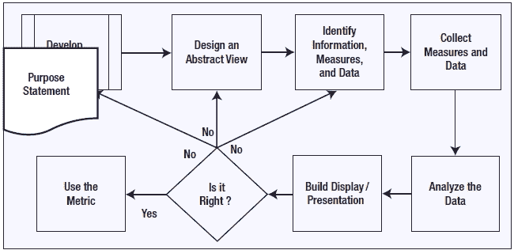
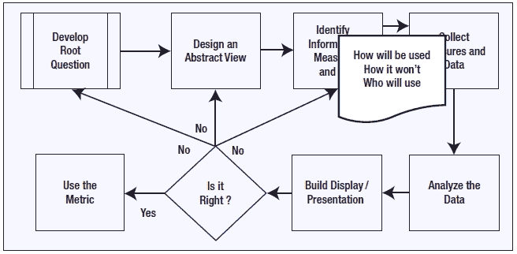
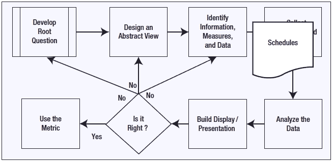
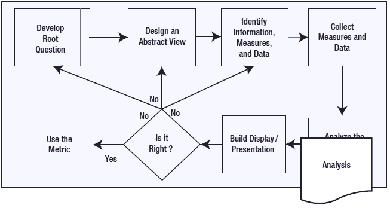
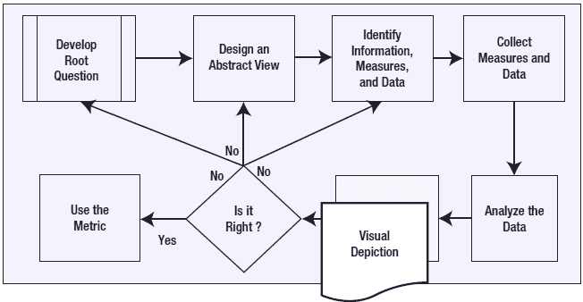
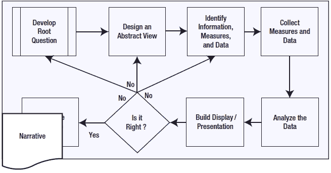
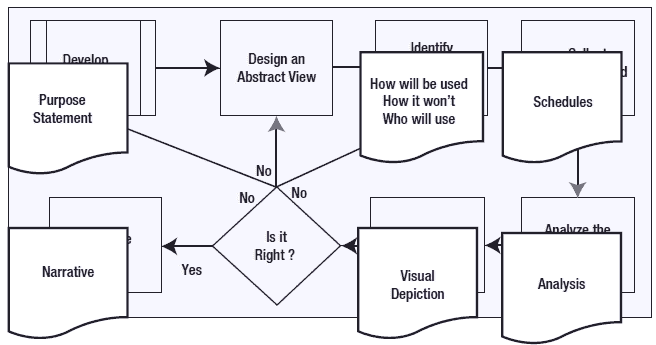

## 规划一个好的指标

# 从何入手

在《为什么组织如此努力却改进甚微》一书中，我和合著者们谈到了在记录指标工作时需要结构和严谨性。与任何其他组织发展工作相比，指标需要更加细致的关注。需要出色的细节关注——不仅是在指标中使用的信息上（记住人为参与的风险），还包括所涉及的流程上。

在本章中，我们将介绍如何识别指标开发计划中的众多可能组成部分，并记录该计划，使其不仅成为创建指标的工具，也成为有效使用指标的工具。

## 度量开发计划

我们已经讨论过构成度量的基本要素。如果把度量比作一所房子，那么根问题就可以逻辑上视为整栋建筑的地基。没有坚实的地基，房子可能无法持久（问问三只小猪就知道了）。当然，如果这栋建筑本就不是为了长期居住，那么地基的重要性就会大打折扣。我们还讨论了承重墙（`metric` 度量）、木龙骨（`information` 信息）、石膏板（`measures` 测量指标）以及钉子（`data` 数据）。但我们尚未讨论建造一栋房子所需的其他各种物品，以及将一栋建筑变成一个家所需的各种组成部分。

虽然度量旨在回答一个根问题，并利用信息、测量指标和数据来赋予其实质内容，但度量还需要其他组件才能成为有用的工具。这些组件都包含在度量开发计划中。

## 度量开发计划的组成部分

度量开发计划捕捉了度量的所有组件——数据、测量指标、信息、图表，当然，还有根问题。该计划还记录了这些组件是如何被收集、分析和报告的。开发计划包括时间表、数据所有权归属的信息，以及信息将如何存储和共享。与大多数计划一样，它从头（设计和创建度量）到尾（报告和使用度量）提供指导。计划还可能包含度量何时将不再必要的内容。

度量开发计划为定义清晰、有用且易于管理的度量提供了一份行动方案。至少，它应包含以下内容：

- 目的陈述
- 关于度量将如何使用的说明
- 关于度量将不会被如何使用的说明
- 度量的客户（利益相关者）列表
- 时间安排
- 分析
- 可视化内容或“给我们这些普通人看的图”
- 叙述性说明

该计划不仅有助于度量的创建，还为其维护和最终处置提供了指导。

如果一件事值得做，那就值得计划好如何把它做对。

## 目的陈述

目的陈述与你的根问题相同吗？答案是：“也许吧”。当你确定根问题时，就像图 3-1 所示那样，你将在开发计划中记录目的陈述。

**图 3-1.** 目的陈述

如果你有一个结构良好的根问题，并且已经尽可能深入地挖掘了，那么你的根问题很可能本身就包含了目的陈述。考虑以下示例：

> 根问题：“我们通过在线聊天提供客户支持的效果如何？”
>
> 目的陈述：“确保我们通过在线聊天提供世界一流的客户支持。”

两者之间区别不大。但它确实提供了一个更清晰的要求。它给出了这个问题以及相应度量背后的根本原因。度量的目的通常不仅仅是提供洞察或回答你的根问题。所提出的问题通常有一个核心目的。这个目的允许你将多个度量整合到一个总体要求之下。

以我那个通过聊天提供客户支持的例子来说。如果我们不断追问“为什么”，我们可能会发现，其背后存在一个提升整体客户服务/支持水平的需求，以使客户支持团队成为整个组织成功的关键组成部分。这个要求是让客户支持成为对客户的一个卖点。它应该成为客户成为该组织忠诚、重复宣传者的原因之一。

这个根本目的将为我们提供更清晰的度量指南。如果你准备好了，它还能让我们识别出其他所需的度量。你可能不得不暂时满足于使用现有问题，并在未来去处理更全局性的需求。但始终拥有全局观总是最好的——它让你在着手处理局部时，能时刻牢记最终目标。

近来，我与许多客户在组织发展的另一个领域——愿景设定——展开了合作，这个领域让我觉得非常有价值。与我们为识别根问题所做的工作非常相似，愿景设定也需要挖掘其根本的需求或渴望。在愿景设定中，我不提倡使用冗长的陈述。当我们撰写陈述时，往往倾向于使用华丽、多音节的词语来描述本应极其简单的事物。你的目的陈述不应该是为了追求美感而精心雕琢的——你又不是要把它裱起来。它应该为了清晰而进行编辑。记住要定义陈述中的每一个词语和从句。

你的根问题是度量和目的陈述的基础。如果你已经确定了一个好的根问题，那么问题和你的目的可能是一回事。

在记录度量开发计划时，我会特别强调要同时捕捉根问题和目的。如果两者是同义的，那也无妨。如果并非同义，那么我就能对度量的真正内涵获得更深入的洞察。

请允许我举一个实际的例子。一个女性中心的执行主任和我正在研究一个可能的度量，我们的对话如下：

> “我想知道每天有多少女性走进那扇门，”她说。这似乎是个合理的问题，但并非经过充分审视的问题。
>
> “为什么？你要用这个数字做什么？”
>
> “我需要向董事会展示我们的价值。”
>
> 我问道：“他们会根据走进你们大门的人数来判断你的价值吗？”
>
> 她想了想，明白了我的意思。“不会。我们的价值取决于我们帮助了多少女性。”
>
> 我说：“衡量价值或许还有其他方式，所以在讨论具体衡量方法之前，我们先深入探讨一下你的问题。你为什么想向董事会证明你的价值？”
>
> “他们认为我工作做得不好。”
>
> “你怎么知道他们这么想？”我问。“他们亲口告诉你的吗？”
>
> “不，当然没有。但他们一直在要求我提供衡量业绩的方法。”
>
> “评估你的业绩是他们职责的一部分吗？”
>
> 她说：“嗯，是的。我想是的。”
>
> “那好。我们假设他们只是想从你这里获取信息，以便履行他们的职责。或许一个好的开场问题是：‘执行主任履行职责的情况如何？’”
>
> “嗯，听起来不错。”
>
> “那么，你的具体工作职责是什么？”

从这个起点出发，我得以确定执行主任这个职位的含义。我们本可以将其概括为一个漂亮的宗旨声明，比如“确保护理中心的日常运营得到及时、高效、有效的执行”。这或许值得刻成牌匾，但对于定义衡量主任履职情况的指标而言，并无用处。不，我需要分解构成执行主任职位的各项任务和职责。

通过“你的工作职责是什么？”这样直接的问题，你可以确定适当的衡量标准，从而给出有意义的答案。与任何需求收集工作一样，你必须找到真正的需求，即根本需求。

在我与需要回答上级（指其组织指挥链中的上级，而非天堂）问题的客户合作时，很多时候我们并未触及一个“好的”根本问题——我们往往因为时间限制或数据产出方式的要求而无此奢侈待遇。即便如此，我仍要强调尝试的重要性，无论怎么强调都不为过。在您感到舒适的范围内尽可能挑战现状。询问“为什么”。如果您理解了“为什么”，您在设计指标、收集和分析数据时会做得更好。

图 3-2 展示了在收集数据、度量指标和信息过程中需要捕获的三个关键要素。

**图 3-2.** “如何”与“谁”

### 信息将如何被使用

除了根本问题和目的，您还应该清晰地阐明指标将如何被使用。指标开发计划的这一部分提供了关键工具，有助于克服人们对提供数据的恐惧。它还将有助于消除人们对数据使用方式的恐惧、不确定性和疑虑。同样地，如果您拥有一个结构良好、清晰且基础扎实的根本问题和目的陈述，这部分工作应该很容易。虽然定义指标将如何使用可能很容易，但这并不意味着定义是显而易见的。您需要直接提出问题：“您将如何使用这个指标？”您的目标是尽可能获得最直接的回答。问题越直接，您越有可能得到直接的回答。

- 模糊的回答：“为了改进我们的流程。”
- 直接的回答：“为了衡量我们实施的变更对流程的影响。”
- 更具体的回答：“为了衡量我们实施的变更对流程的影响，并允许进行纠正调整。”

如果说公开演讲是最大的恐惧之一，那么个人数据的使用可能紧随其后，位居第二。不仅仅是任何数字和数值——而是那些可以用来伤害个人或为我们的组织制造负面公众认知的数据。我们会设想最坏的情况，这是我们的天性。因此，当被要求提供数据，尤其是我们认为在任何方面反映了我们自身或部门的数据时，就会产生巨大的恐惧。

当我们不知道原因时，我们会设想最糟糕的情景。这是我们的天性。

恐惧的最大根源在于，人们认为数据是针对个人层面的。这就是为什么我建议从有效性层面开始制定衡量指标计划。

当您收集（以及后续分析和报告）的数据可能成为关于个人的指标时，恐惧因素会呈指数级增长。即使您计划只使用汇总层面的数据，从不查看个人数据，这也无关紧要。如果数据可能被用于个人层面，那么这种恐惧就是合理的。

`解决时间`可以是一个很好的有效性衡量指标，用于改善整体客户服务。其目的可能仅仅是实现更好的客户服务，从而提高满意度。但是，如果您未能传达这个目的、根本问题以及将如何使用这些答案——那么提供数据的个人将会设想最坏的情况。

请预先警告。即使您拥有自动化系统来收集数据（例如，工单开启和关闭的日期和时间），在该系统中开启和关闭工单的人员仍是在提供数据。

如果员工得知您在收集关于解决速度的数据，他们就会“听到”您在收集他们个人解决工单需要多长时间的数据。不是团队或组织解决大多数工单需要多长时间，而是他们每个人完成工作分别需要多长时间。而且，如果您正在收集关于个人绩效的数据，那么被涉及的个人会设想出所有最糟糕的情况，推测您将如何使用这些数据。

因此，您那无辜且恰当的 `解决时间` 衡量指标，如果不加以解释，可能会因恐惧、不确定性和疑虑而引发士气问题。

# 请求数据时分享目的的重要性

如果恐惧源于无知，那么在请求数据时不分享目的，您就相当于那个接生婆。

> *老板说：“我只是想要数据，以便了解情况。”*
>
> *员工听到：“我想要数据，以便看看你们在哪里搞砸了。”*
>
> *老板说：“我需要数据，以便做出更好的决策。”*
>
> *员工听到：“我需要数据，以便决定解雇谁、削减谁的工作时间，或者惩罚谁。”*
>
> *老板问：“汇报你的业绩有什么问题？我难道不应该了解情况吗？”*
>
> *员工心想：“是啊，那你为什么不知道呢？为什么要向我要数据？为什么不直接问我？为什么不花点时间和我在一起呢？”*

如果你曾在任何拥有多层管理架构的组织中待过较长时间，那么上述对话可能会让你觉得极为熟悉。不幸的是，这种对话并非个例。我相信它（或类似的情形）每天都在每个工作场所上演。

## 应对普遍问题

我们需要应对这个普遍的问题。要创建有用的度量指标，你必须在收集数据之前，就预先知道结果（答案）将被如何使用。这对于正确设计度量指标、识别正确的信息、测量方法和数据至关重要。同时，如果涉及任何人为提供数据的环节，这也对于获取准确数据必不可少。

## 一个简单的测试

有一个足够简单的测试可以让你尝试。问你的朋友、亲戚、同事或老板一个简单的、私人的问题。更好的做法是，问你的伴侣一个简单问题，比如“你多重？”先别急着问——在阅读预期结果之后（以免你受伤）再行动。

当你问某人一个私人问题，却没有给出任何理由时，很可能会出现以下五种反应之一：

1.  你会被当面质问。至少我问我妻子同样问题时，就是这种结果。
2.  你会得到准确反映数据提供者*认为*你想听的数据。
3.  你会得到准确反映数据提供者*想要*你听到的数据。
4.  你会获得准确的数据。
5.  你会收到一个反问：“你为什么想知道？”

大多数人很可能反过来问你：“你为什么想知道？”这是一种自然反应。除了预期的回应，你或许还会注意到受访者变得有戒心。观察他们的肢体语言。他们可能根本不会回答你，就算回答了，也多半不是心甘情愿的。

### 提供正当理由

这个实验的第二步是，你为自己的问题提供一个看似正当的理由，而不是说“哦，我只是好奇”或“我只是想了解一下你的体重”。尽管很多时候，当我们问管理层为什么需要某些数据时，我们得到的回答同样模棱两可：“哦，我只是想了解情况”或“我只是想了解*我们*做得怎么样。” 目标不明确会导致数据不准确。在软件编程中，我们有个术语叫`GIGO`——垃圾进，垃圾出。处理与他人带有情绪色彩的讨论时也是如此。别被误导了。索要数据会造成情绪紧张。如果你为提问提供了垃圾理由，你就会得到垃圾答案。

仅仅向你采访的人保证每个人都收到了同样的问题，这无济于事。但是，举个例子，如果你先告诉他们你在为学校做一项研究，需要收集十个随机个体的体重，他们可能会回答你的问题。

你可能不会立刻得到答案，而是会得到以下一个或多个回应：

*   “你会使用我的名字吗？”
*   “谁会看到它？”
*   “你打算用它做什么？”

所有这些问题的核心都是同一个：你打算如何使用我给你的答案？在你能让受访者满意地回答这个问题之前，你得到的任何答案都高度可疑。

即使你充分解释了你将如何使用这些信息，根据受访者个人对该信息的感受，其准确性仍然可疑。这对你来说可能合情合理。我以前也听过这样的争论。你可能会争辩说，你并不是在打探员工的个人信息，你只是在围绕人员配置制定度量指标，以便为增设一个职位提供理由！

回到我们的实验。问某人：“你多重？”

如果你碰巧得到了一个答案，请把它记下来。同时记下你对这个答案准确性的信心程度。你有 90%的把握它是准确的吗？

如果你一开始没得到答案，那就解释你提问的目的（例如，你正在为课堂项目收集数据）。如果你得到了答案，把它记下来。现在你对它的准确性有多少信心？

作为第三次尝试，分享你打算如何使用这个答案。实际上你说什么都行。你可以说：“我会汇总数据，然后展示我问的十个人的平均体重。接着我们会讨论这个体重是否是一个健康的标准。” 看看你是否能得到答案。

别忘了全程观察肢体语言。观察受访者是否在你提供更多信息时减少了戒心。检查你对答案的信心程度。

## 记录在开发计划中

关于度量指标及其组成部分将如何使用的说明，应记录在度量指标开发计划中。不要纠结于是否需要记录所有内容或让它看起来很漂亮。开发计划的价值在于其目的的清晰性。当然，计划也提供了一致性、长期的指导，以及为可能使用它的其他人指明方向。通过制定开发计划，你将彻底思考清楚这个度量指标，并且能够向任何询问者传达其价值。

我们已经看到，除非我们明确说明收集信息的目的，否则我们所提的问题可能导致没有答案或得到不准确的答案。另一个获得更好答案（或当受访者仍然犹豫时，至少得到一个答案）的关键是，说明这些结果将*不*会被如何使用。

### 说明信息将*不*会被如何使用

当你询问一个人的体重时，告诉他你将*不*会如何使用这些信息。真诚地向他保证，无论怎样，你都不会以他觉得冒犯的方式使用他的信息。这可能包括在已发表的研究中使用，或作为课堂案例研究。你可能不知道他具体担忧什么。通过解释你将不会如何使用这些信息，你为他提供了一个机会，让他分享什么是他觉得不合适的（有威胁性或令人恐惧的）。如果你想获得准确的数据，你就必须能够向数据提供者保证你将如何使用，以及不会如何使用这些数据。而对你而言，对于数据提供者来说，“将*不*会如何使用”可能比“将如何使用”更重要。

这个承诺需要你自己尽职尽责。你必须记住你的承诺——当你收到一个看似天真的信息请求时，这可能会很棘手。你必须确保它在你与数据提供者达成的协议范围之内。

我做出的最常见、最简单的协议是，未经数据源许可，不向他人提供数据。如果你提供了数据，那就是你的数据。应该由你决定谁能看到它。

这应该被记录在开发计划的“将不会如何使用”部分。将计划书面化的主要原因可能是，书面协议能让你更轻松地信守诺言。

定义度量指标将不会被如何使用，有助于防止恐惧、不确定性和疑虑。

### 确定谁将使用这些度量指标

虽然你可能认为自己是想查看或使用该指标的唯一个人，但实际上，你的指标很可能有很多使用者。一个简单的检验方法是列出所有你计划与之分享信息的人。这份名单很可能包括你的上司、你的同事，以及那些使用你服务的人。

任何会使用你的指标的人都是它的使用者。你应该只向使用者展示这些指标。

你计划与之分享指标的所有人都将成为该指标的使用者。如果他们不是使用者，那就没有理由与他们分享信息。你可能提倡公开透明，想把指标发布在公开网站上，但这些信息并不属于你。它们是数据提供者的财产。这不是公开信息；它旨在帮助组织回答一个根本性问题。为何要与全世界分享？而且今天我们都知道，一旦公开分享，它就会永远留存在公共领域。

数据提供者应该是首要的指标使用者。

可能的指标使用者包括以下这些：

-   为创建指标提供数据的人。
-   你选择与之分享指标的人。
-   向你索要指标，*并且*能够清楚说明他们将如何使用该指标的人。

明确识别你的指标使用者至关重要，因为他们将在指标如何呈现、其有效性以及如何使用方面拥有发言权。如果你想信守关于该指标将如何被使用以及不会被如何使用的承诺，你就必须知道谁会使用它、谁不会。

这些使用者应记录在你的开发计划中，并注明他们属于哪类使用者。他们是数据提供者吗？是一线主管吗？是高层管理人员吗？使用者类型将有助于界定他们接收何种级别的信息，以及围绕指标使用所需的沟通方式。

谁会使用和谁不会使用该指标，与它将如何被使用以及不会被如何使用，同样重要。

### 现实检验与倡导

在进入下一个部分之前，我们先来做一个现实检验。我很清楚，有时候你无法对上司说“不”。我知道你的上司可能会要求你提供数据、衡量标准或信息，并且可能不会体谅你需要确保他不会滥用或误用你所提供的信息。如果我相信众多作者、同事和朋友的说法——坏经理的数量远远超过好经理。

我并非主张你要为了一项无关紧要的信息请求而“壮烈牺牲”。我是倡导，根据你在组织中的职位，如果你不幸被夹在“坏”经理和员工之间——那么请尽你所能，*竭尽全力*确保你提供的信息不被滥用。

### 报告、分析和收集的时间表

收集用于构建指标所需的数据、衡量标准及信息需要一个计划。图 3-3 展示了制定计划中这部分内容的时间安排。

**图 3-3.** 时间表

大多数指标都是基于时间的。你将看到大多数指标的年度、月度或周度报告。有些指标是事件驱动的，需要你定期报告。作为指标开发计划的一部分，你需要为指标的以下至少三个方面制定时间表：

-   *报告时间表*。从最终结果向前倒推来查看时间表。从你的需求出发。考虑你已经识别的使用者，以帮助确定何时需要这些指标。根据指标将如何被使用，也将决定你何时需要进行报告。
-   *分析时间表*。基于需求，你可以倒推来确定何时需要分析信息以最终确定指标。这是“三合一”时间表中最简单的部分，因为它纯粹取决于完成工作所需的时间。当然，另一个变量是数据量以及分析的复杂性。但最终，你需要将分析时间安排得足够提前，以便完成分析并复核结果。我强烈建议你至少让另外一个人来检查你的分析。根据数据的复杂程度，你可能还需要对分析中使用的原始数据进行质量检查。

- `收集时间表`。你何时收集数据？根据你必须报告数据的时间，确定你何时需要进行分析。然后，基于此，确定你需要何时收集数据。通常，数据收集的时间表取决于你如何收集数据。如果是自动化收集，你或许可以随时获取。如果依赖于人工输入，你可能需要等待定期更新。如果你的数据是基于调查的，那么你必须等到你开展调查，并且留出额外时间让人们完成调查。

既然你从最终结果开始构思，你就知道何时需要数据，并能倒推出必须掌握数据的具体日期。根据你选择的收集方法，你可以计划好何时启动收集流程，并据此制定时间表。

这里没有什么新东西——如果你想获得成功，就必须计划如何成功。不要只想着“等有空的时候”再做。要计划它。安排它。如果一件事值得去做，就值得好好规划去做。

而且，如果一件事值得做对，就值得确保你能不止一次地把它做对。但请记住，开发计划不仅仅关乎可重复性，更在于通过强迫自己把事情从头到尾想透彻，从而第一次就把事情做对。

## 分析

当你认为分析阶段来临时，就该记录分析过程了……没错，就是在分析阶段。

**图 3-4.** 分析

这可能是到目前为止指标开发计划中最显而易见的部分。在数据收集之后，当我提到指标时，大多数人想到的下一步便是分析。我上过的所有统计课程都指向同一个终点：如何分析你精心收集的数据。计划中的这份分析文档必须包含所有指标数据规则、编辑方法、公式和算法；每一项都应清楚阐明，以便将来参考。

可能会引起争议的是分析工具的绝对正确性。有些人认为，只要拥有准确的数据（甚至少数人连数据是否准确都不在乎），就能通过统计分析来预测、解释或改进任何事物。我可不属于这个阵营。

我非常尊重分析带来的益处，当然，我也依赖它来确定指标所提供的答案。对我来说，指标的设计——从根本问题到抽象图景，再到完整的故事——比数据分析更为重要。这看起来可能有些奇怪。如果我们未能正确分析，很可能得出错误的结论，进而得到错误的答案。但是，如果我们一开始就没有正确设计指标，那么无论分析质量如何，我们都绝无可能得到正确答案。

而如果我们有了良好的基础（正确的组成部分），最终就应该得到一个有用的指标。如果分析有所偏差，我们在指标的汇报和审查过程中很可能就会察觉到这一点。

没有坚实的基础，分析的质量就无从谈起。

虽然分析次于基础，但记录你的分析过程仍然很重要。分析技术（公式和流程）是指标中第二容易变动的部分（最容易变动的是图形化呈现）。当指标被汇报和使用时，我预期它会发生变化。如果我已经通过设计打下了坚实的基础，最终产品仍然需要进行微调。

把这视为与管理层协商的一部分。如果你已经与领导层合作确定了根本问题——并且设法没有惹人厌烦——那么当你交付指标时，你就是在履行你的那部分约定。你将给予领导者她想要的东西——有助于她决策的有用答案。虽然问题是她提出的，但她可能需要对答案进行调整。管理者很少会全盘接受一个指标而不做任何修改。他们几乎总是觉得有必要修改最终的图表。这是因为他们拥有更宏观的组织视野，还是仅仅出于需要感受自己有所贡献，我不确定，但这并不重要。你应该对更改图形化呈现的建议持开放态度。

如果图形化呈现发生了变化，你很可能也需要调整支撑该指标的分析。如果领导者想看到的是满意客户的百分比，而不是平均客户满意度评分，你就必须改变你的分析方法。

原始数据（受访者人数、每个人的评分、回复日期以及每个评分的含义）仍然有效，但你呈现分析的方式以及分析本身需要改变。

将分析记录在开发计划中会很有帮助——这不仅能帮助你理清思路，也有助于复现。在计划的所有部分中，这个组成部分最需要被记录以保证可重复性。你必须确保每次都以相同的方式分析数据，并且任何变更都被记录下来，因为这直接影响到最终展示的指标。

# 为他人描绘的图景

你为自己的指标画了一幅画。这幅画是对根本问题答案的抽象表现。一个深思熟虑的指标的另一个主要组成部分是另一幅画——一幅你的客户能够轻松解读的画。这幅画通常是一个图表、图形或表格。计划在你的指标开发计划中包含它。

**图 3-5.** 可视化呈现

它完全可以不止一幅画。如果你需要一个由十二个图表、图形和表格组成的仪表板——那就用吧。如果你在根本问题和指标的抽象版本上做好了功课，那么确定如何用图形表示指标应该是一个简单的步骤。真正的好消息是，这部分你不太可能出错。如果你选择了堆叠条形图，后来又意识到应该用趋势线——你可以更改它。没有任何坏处。

如果你发现不同的结构能更好地讲述你的故事，你不仅可以改变表示指标的方式，而且你可能本来就需要多种表示方式。这取决于客户是谁，每个客户将如何使用该指标，以及你将如何分享它。对于每个群体，你呈现指标的方式可能会有所不同。

这个部分应该充满乐趣。让你的创造力闪耀出来。想方设法用视觉来解释，这样你就不需要那么多文字了。一张图确实能讲述千言万语。无论图有多好，你仍然需要添加文字来确保观看者理解正确，但我们希望这些文字尽可能简短。我们想要图片清晰地讲述故事。不要把图片搞得太复杂。

事实上，你拥有的数据可能比讲述故事所需的还要多。你可能会发现自己不愿意舍弃某些信息，但有时少即是多。尤其是当额外信息可能混淆观众时。并不因为你收集了数据，就必须将其放入指标中。

另外，尝试用不同的方式来描绘指标。你甚至可以在指标客户那里测试视觉呈现的想法。

# 叙述性描述

当有人问：“需要我给你明明白白讲清楚吗？”我很喜欢听到这句话。我的回答通常是：“谢谢！那太好了。”

为什么不呢？无论你的图形化呈现有多好，你都承担不起误解的风险。你已经挖掘出了问题，并设计了指标，以便能为正确的问题提供正确的答案。你不能让指标的观看者误解你费尽心力讲述的故事。

叙述是你确保证观看者能以你的视角、像你一样看到所看到的东西的机会。他们希望能听到你试图传达的信息。计划的任何部分都可以定期更新，但叙述需要频繁记录。由于叙述解释了指标在告诉观看者什么，所以解释必须随着故事的变化而改变。伴随图片出现并记录指标含义的叙述，对于指标将如何被使用至关重要。

图 3-6 显示了叙述被记录的时间点。

**图 3-6.** 叙述

## 文档：让指标开发计划不止于计划

最终，指标开发计划应记录以下内容：原因（目的陈述）、内容（指标）、时间（时间表）、人员（客户）以及方式（分析、如何以及如何不加以使用）。

请尽可能详尽地记录——将所有细节汇总在一处。这将通过以下三种方式为你提供帮助：

*   帮助你全面地思考该指标。

*   在你需要改进流程时提供帮助。

*   在你需要复制这些步骤时提供帮助。

图 3-7 展示了所有这些要素与指标开发流程的协调运作。

**图 3-7.** 开发计划

我不想规定具体的篇幅或格式，而是想强调最终计划的可读性。你会需要它作为参考，有时也需要它作为已达成协议的凭证。我发现，当指标报告频率较低时，该计划极其有用。指标报告越不频繁，我就越有可能忘记自己遵循的步骤。数据收集可能非常复杂，数据清洗可能很繁琐，而分析可能还需要更详细的步骤。流程越复杂、执行频率越低，我就越需要记录在案的计划。

当然，即使我每周都执行该流程，负责任的做法也是将计划记录下来，以便他人能在我不在场时继续执行。

该计划在指标的整个生命周期中都有用。它首先帮助我充分构思指标的设计与创建。然后，它有助于记录围绕指标使用和时间表达成的协议。它有助于为行动辩护（成为指标分析师、数据提供者与最终客户之间的契约），并满足各方期望。最后，它对长期成功也至关重要。它既提供了历史视角，也提供了一份“操作方法”指南。没有可重复性，就无法改进。

没有可重复性，就无法改进。

开发计划的各个组成部分需要以一种能够轻松、准确查阅的方式进行记录。确保准确性比确保易于查阅更困难。我们讨论了不同的数据收集方法以及提高准确性的途径。真正的好消息是，很多时候，我们用来提高准确性的方法也使其更易于查阅。减少人工干预能让我们对数据准确性更有信心，而自动化则使数据收集更简单。

在记录各个组成部分时，不要害怕写得详细。此刻不是追求简洁的时候。我们需要建立对指标及其组成部分的信心。我们需要尽可能多地记录每个组成部分的相关信息，以便在以下方面建立信任：

*   *原始数据的准确性*。你将会在这方面受到质疑，而且这合情合理。人们对你的根本问题应该得出什么答案有自己的预期。他们对数据针对该问题应该说明什么也有自己的预期。无论答案如何，*总会有人*认为你搞错了并去核查你的数据。因此，你在分享数据时必须准确无误。这就要求你对数据进行质量检查。无论错误是由你的数据来源、公式还是软件故障造成的，都无关紧要。如果你的数据被证明是错误的，你的指标就不会被信任或使用。

大多数原始数据不准确的例子都可以归因于人为错误，但即使是自动化工具也容易出错，尤其是在数据解释方面。错误可能出现在任何地方，从错误地记录数据、计算错误，到将信息归入错误的类别。如果你的类别定义不当，自动化系统可能会正确地报告数据，但它报告的可能是错误的数据。如果你在跟踪解决故障单的时间，这个时间是指开始和结束日期之间的时间吗？还是指从接到呼叫到最终解决（可能远在故障单关闭的日期/时间之前就已发生）的时间？你是用日历天数还是工作日来跟踪时间？如果你在报告可用性，什么才算是中断？你如何确定中断发生了、何时发生以及持续了多久？简单的经验法则是反复检查你的数据。我发现检查数据的最佳方法是让别人也看一看。我距离工作太近，无法看到他人一眼就能发现的错误。

在起步阶段，没有什么比你原始数据的准确性更重要了。

*   *你分析的准确性*。我们稍后会讨论分析方法，但眼下，记录下来你分析数据所采用的流程和步骤至关重要。这将使你能够重复该流程——这是保持一致性的必要条件。一个简单的例子是电子表格程序中的公式使用。我很多指标工作都在电子表格程序中完成，因为它们简单、用户友好且功能强大。我使用公式来计算从经过的天数到随时间变化的百分比等一切内容。无论你使用何种方法，都必须记录下来。任何审阅你工作的人都应该能够通过手工（使用笔、纸和计算器）重现你的工作。这种记录工作虽然繁琐，但必不可少。你的流程必须是可重复的。你的流程*必须*在数据、分析和结果中实现零缺陷。

你的流程及其产生的信息必须毫无差错。

*   *你流程的可重复性*。是的，我已在分析准确性部分提及此点。但值得再次强调和澄清的是，可重复性不仅对分析至关重要，而且贯穿于设计指标的整个流程。数据的收集必须是可重复的——在严格意义上。数据的分析必须是可重复的。数据的图形化呈现也必须是流程中可重复的步骤。每次，你都应以相同的方式收集、分析和报告数据。如果你不记录流程并确保其可重复性，你将失去受众至关重要的信任。这种可重复性在整个流程中都不可或缺。这正是我们制定时间表的原因。我们希望以相同的方式、在相同的时间间隔内、使用相同的工具来完成工作。一致性至关重要。

没有可重复性，你就谈不上拥有一个流程。

为了遵循良好文档管理的原则，你需要使用一种方法来控制你的数据、分析和报告的版本。你需要对存储的信息进行备份。所有列出的文档都必须加以保护，防止丢失或篡改。你必须确保各组成部分的准确性，而如果你不控制对信息的访问权限，就无法做到这一点。

首先，你必须确保你的数据来源正在产生准确的信息。当你检查了数据质量并对准确性有了很高的信心后，你必须重复你用于收集这些信息的流程。一旦你获得了准确的数据，你就必须确保它始终保持准确。

人员是准确数据面临的最大风险。

# 排版后的内容

你需要一个安全可靠的位置来存储数据、分析结果和报告。你需要保护它们，防止他人无意中篡改。同时，也要防止自己犯错。你上一次在过了正常就寝时间还继续工作是何时？上一次输入数据出错是何时？上一次因忘记定期保存而损失超过一小时的工作成果是何时？

你难免会犯错——这是不可避免的。关键在于尽可能地减轻这种现实影响。

那么，如何减轻这些无疑会犯的不可避免的错误呢？尽早保存、频繁保存，并将工作成果保存在多个位置。手头保留一份纸质版工作成果作为最终保障也无妨。除了备份数据，记录下流程也同样重要。

另一个减少错误的工具是在所有公式中使用变量。如果你使用软件执行方程计算，避免在公式中出现原始数据。将所有会重复使用的值放在一个单独的位置（工作表、表格或文件）。这不仅有助于避免错误，还能让修改公式变得更简单。

引用所有数值，并将原始数据排除在等式之外。

以下是一些其他提示，有助于你记录计划：

-   **疲劳时不要工作。** 说真的。你应该足够了解自己，知道自己何时疲劳。放下工作，休息好后再回来。有些事可以在疲劳时做——但度量指标不在此列。

-   **坚持你的流程。** 不要让紧迫的截止日期迫使你偏离流程。你可能会为了快速更新指标以满足意外截止日期而想走捷径。抵制这种想法。抵制那些在约定时间之前就要求数据的人。每当你偏离流程，就增加了犯错的风险。

从说“不”开始。拒绝仓促行事。

-   **使用版本控制。** 不需要非常复杂——只要有效即可。只要能够追踪已完成的工作以及做出的任何更改，就需要能够“撤销”已做的更改，并回退到你信任的早期版本。

-   **尽可能创建并使用模板。** 模板能让你的流程更具可重复性，并确保你以相同的方式收集相同的数据。我在调查、访谈和问卷中都会使用模板。在分析以及创建图表时也会用到它们。需要注意的是——请仔细核对模板的准确性。

重复使用很棒！何必重新发明轮子？只需仔细检查这个轮子没有损坏的辐条即可。

## 关于流程副产品的说明

在处理根本问题时，你可能识别出一些副产品，如目标、目的、任务和成功衡量标准，这些对于指标设计并非必需。在构思指标的抽象图景时，其他想法也会浮现。当你捕捉到可能需要的衡量标准以完善图景时，你会发现所需之外的内容。你将这些多余的项目暂存或保存到待办事项列表中。所有这些副产品都有可能帮助你改进组织，并且可能非常有价值。它们应该被记录和分享。不要浪费它们。

不要浪费任何东西！你的知识产权很有价值——请尊重它。

## 内容回顾

我介绍了一个分类法，以便我们能够围绕指标这一主题进行清晰的沟通。在第二章，我涵盖了设计指标的理论和概念，以及收集、分析和报告构成该指标的数据、衡量标准和信息的高级流程。在本章中，我介绍了如何开始以及从何处开始的基础知识。我有意将信息保持在较高层次，以便在我开始深入细节之前，你能对这个概念感到适应。本章涵盖了：

-   指标开发计划不是奢侈品，而是必需品。

-   该计划不仅有助于创建指标，还为指标的维护和最终处置提供了指导。

-   指标开发计划由以下部分组成：

    -   目的陈述

    -   如何使用它的说明

    -   不会如何使用它的说明

    -   指标客户名单

    -   时间表

    -   分析

    -   可视化或“为我们其他人准备的图像”

    -   叙述性说明

-   准确性至关重要。我强调了数据（依赖于来源）、数据收集（依赖于流程）和分析（依赖于流程和工具）中准确性的重要性。我还提出了使流程可重复的好处。

## 结语

我们已经为负责任地设计和使用指标奠定了一些基础。我们提供了一些实际实施指标计划的工具。接下来的三章将涵盖指标计划中固有的危险，我将提供警告、缓解措施和威胁，以帮助你避免许多人陷入的困境。我相信这是一个合乎逻辑的递进——因为在你使用一个强大且因此存在潜在危险的工具之前，重要的是你要理解它是什么、应该如何正确使用，以及如何避免受伤。

几乎在每一项严肃的工作中，你都会被告知要记录你的工作。从软件工程到撰写资助申请，这一点都倍受强调。问题在于，这很繁琐。我不知道有谁对记录工作充满热情。如果你未能记录其他所有内容，我可以原谅你——只要你还记录下你的指标。

