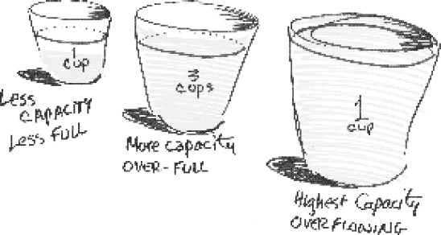
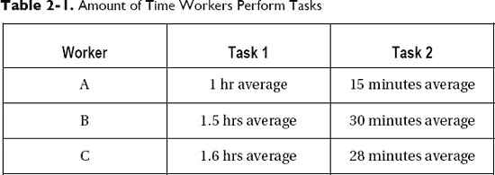
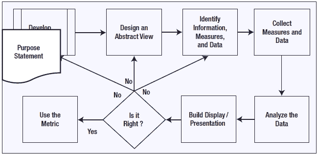
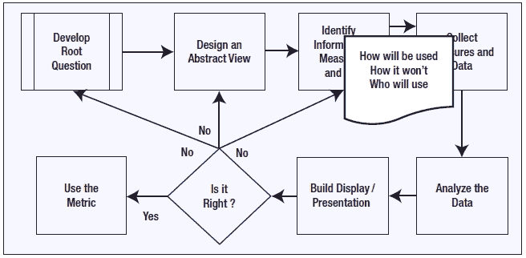
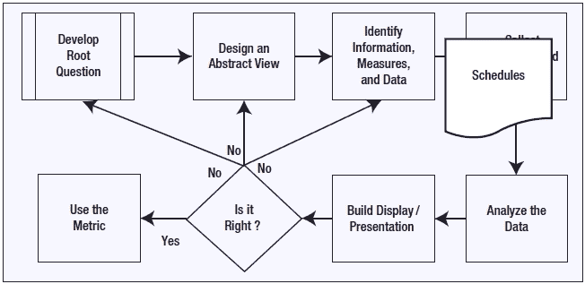
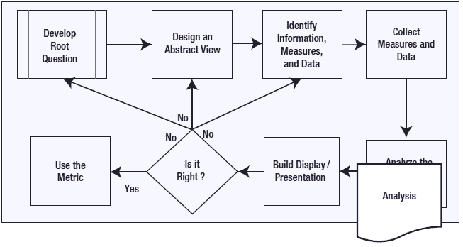

# 排版后的文本

1. 这本书在帮助读者设计指标方面**效果如何**？
    1. 我们所说的“效果”是指什么？在这里，因为这是我的目标，所以我来做定义。它的实际作用有多大？它是否真的能帮助读者？
    2. 我说“效果如何”指的是什么？“如何”意味着书中的哪些部分是有帮助的？哪些部分没有帮助？此外，它是否能让人们设计出高质量的指标？毕竟，我的目标是让这本书成为制定指标计划的实用工具和指南。
2. 这本书在帮助读者设计指标方面效果**如何**？
    1. 这看起来很明显，而且在这里也确实如此。但是，你仍然应该检查一下。如果我当初问的是“我的指标设计系统效果如何？”，那么对定义的需求就可能会更大。
    2. 即使是像这样显而易见的定义，也可能会引导你修改问题。如果有人问“你说的‘这本书’是什么意思？”，我很可能要回答：“哦，实际上我想知道的是这个系统是否有效，而这本书只是分享这个系统的载体。”这会让我们意识到，我真正想知道的是我的系统是否对他人有效——这胜过询问这种沟通形式是否有效。
3. 这本书在**帮助读者**设计指标方面效果如何？
    1. 它有帮助吗？我必须定义“帮助”意味着：
        1. 读者在阅读后能否开发出指标？
        2. 读者在阅读后是否更擅长开发指标？
        3. 读者是否避免了我在书中告诫要防范的错误？
    2. “读者”是另一个显而易见的组成部分——但我们还可以做一些更清晰的界定。
        1. “读者”是指阅读了整本书的人，还是指阅读了书中任何部分的人？
        2. 读者是否基于目标受众来定义？
4. 这本书在帮助读者**设计指标**方面效果如何？
    1. 我所说的“设计”是指什么？正如你已读到的，对我来说，设计一个指标远不止是得出最终的指标。它包括了识别根本需求，然后确保指标是回答该需求的恰当方式。因此，虽然“设计”可能意味着开发，但必须结合指标的定义来理解。
    2. 我所说的“指标”是指什么？我是指（指标）等式中的指标部分，还是指包含根本问题、指标、信息、度量标准和数据在内的整个体系？如果你已经读过这本书，你就会知道这个问题的答案。没有根本问题，指标就无法被正确设计；它由信息、度量标准、数据和其他指标构成。即便如此，我所说的在根本问题中的含义可能与此略有不同，因为遵循该流程的结果可能是最终不创建指标。在这种情况下，利用根本问题来提供答案就算成功——尽管并没有设计出指标。

基于这个练习，如果我选择保持根本问题不变，我现在就会更清楚如何描绘这个场景。不过，很有可能的是，在分析了问题中的每个词语后，我会重新改写问题。我提出这个问题的根本目的是判断这本书是否成功。既然成功可能体现在没有设计出指标，我会将问题改写得更符合我实际认可的成功标准——即我的系统得以有效运用。新的根本问题可能是：我的系统在帮助那些需要或想要设计指标的人方面效果如何？

## 测试根本问题

如果你认为你已经确定了根本问题，那么就可以继续了。当然，对问题进行测试以确认你是否真的找对了，也是值得的。

**测试 1：根本问题是否实际上是在询问信息、度量标准或数据？** “我想知道系统 X 的可用性。”这个请求促使我们反问：“为什么？”这个看似直接的问题背后存在一个根本需求或要求。当你深入挖掘后，你就会找到真正的需求，而这很可能只是对数据的请求。根本问题不应当是对数据的直接请求。以下是对数据请求的示例：我们的汽油够开到目的地吗？系统是否可靠，还是我们需要一个备份？完成这个项目需要多长时间？

**测试 2：问题的答案会是简单的吗？** 答案会是度量标准吗？是数据吗？如果答案是“是”或“否”，那么你很可能还没找到根本问题，或者该问题不需要指标来提供答案。这看起来可能太简单了——你花了这么多功夫最后提出的问题竟然能用“是”或“否”来回答。但这种情况确实可能发生。这可能意味着只需要对问题稍作修改，但这修改仍然是必要的。我们的新手机应用会畅销吗？我们应该把 IT 部门外包吗？我们的员工满意吗？这些问题看起来像是不错的根本问题，但它们都可以用简单的“是”或“否”来回答。

**测试 3：答案将如何被使用？** 如果你找到了一个有效的根本问题，你会强烈感觉到或清晰地知道你将如何使用这个答案。答案应该带来可辨别的益处。以我之前问的“这本书在帮助读者开发指标方面效果如何”这个问题为例。如果我知道它对读者非常有效，我会怎么做？我可能会利用这一信息来争取基于这本书的演讲机会。我可能会把这本书提交参评文学奖。我可能要举办一场庆祝活动。如果答案是该书无效，那么我可能会调查可能的纠正方法。我可能不得不提供关于如何使用这本书的手册或指南。我可能不得不通过网站提供更多信息。如果反馈比较中立，我可能会寻求在后续版本中改进的方法。

关键是要预先设定你收到答案后会如何应对。当我问客户他们将如何使用这个答案时，如果我得到的是困惑的眼神或他们目光呆滞，我就知道我们还没找到根本问题。

**测试 4：答案将与谁分享？谁会看到这个指标？** 如果答案只面向高层管理人员，那么你很可能需要回到起点重新思考。如果你已经找到了根本问题，那么应该有更多人的能从看到答案中受益。答案的一个关键接收者应该是帮助您开发它的团队。如果答案仅仅用于安抚高层管理人员——那么你很可能还没有找到根本问题，或者答案根本不需要一个指标。

**测试 5：你能用它来画一幅图吗？** 当你设计指标时，你会更多地将其视为一门艺术而非科学。有很多关于统计分析课程可以学习。你可以使用复杂的数学工具进行激动人心且有趣的分析。但我在这里不讨论这些。我们谈论的是如何开发一个可用的指标计划——一个用于改进的工具。如果你无法为问题画出答案的图示，这可能就不是一个根本问题。

并非所有根本问题都能通过这些测试。

我并不是说所有根本问题都必须通过这些测试。但是，所有需要“指标”来回答的根本问题都必须通过。如果你的问题没有通过这些测试，你还有一些选择。

## 制定度量指标

1.  在不依赖数据、度量、信息或指标的情况下制定答案。有时答案就是流程上的改变。有时答案是停止做某件事、换种方式做某事，或者开始做一件新的事情。它最终不一定非要进行衡量。
2.  使用度量（或者仅仅是数据）来制定答案。这可能是一次性的衡量。你可能不需要多次收集或报告这些数据。
3.  反复推敲问题，直至其通过五项检验——这样你才能制定出度量指标。为什么你会为了得到一个度量指标而重新推敲你的问题呢？你不应该这么做。如果你对结果充满信心，就此打住。如果客户说你已经触及到了根本问题，就此打住。如果问题引起了强烈的共鸣，就此打住。无论你处于哪个阶段，就停留在那里。从那里继续推进。如果并非必要，不要强行制定度量指标。

你的任务不是制定度量指标——而是确定根本问题并提供答案。

## 制定度量指标

这是一个有趣的争论：设计度量指标的过程是一门科学还是一门艺术？如果你阅读统计学教材，你可能会支持科学一方的观点。如果你读了迪恩·斯皮策（AMACON，2007 年出版）的《重塑绩效衡量：反思我们衡量和驱动组织成功的方式》，或者道格拉斯·哈伯德（Wiley，2010 年出版）的《如何量化一切》，你可能会认为这是一门艺术。我认为，如同现实生活中的大多数事物（而非理论）一样，它是两者的结合。

在度量的*设计*方面，更多是艺术而非科学。我可以毫无保留地这样说，因为为了设计我们的度量指标，你实际上需要画一幅图。这不是精美的艺术。它更像是一种派对游戏，你拿到一个词或短语，必须画一幅画，让你的队友猜出线索是什么。

在我教授的第一次关于设计度量指标的研讨会——“自己动手做度量指标”中，我把学生分成四到五人一组。在完成了识别根本问题的练习之后，我告诉他们画一幅图来回答一个问题。问题是：“我们如何分配团队的工作量才能实现最高的生产力？” 图 2-1 展示了学生中最好的答案之一。

这幅图展示了每个人（由不同的杯子代表）拥有不同程度的工作量。液体的高度代表了“每个人杯子中”的工作量。靠近顶部的那条线是液体应该被倒到的最高水位线，因为泡沫会导致它溢出。这条线代表了每个人实际能处理的最大工作量，为“额外”部分——如生病、午餐、假期等——在顶部留出了空间。通过看这幅图，管理者可以轻松理解谁的工作量过多、谁可以承担更多工作、谁的生产力更高、以及谁需要提升技能以便最终能拥有一个更大的杯子。

画图的一个有用之处在于明确了问题。为了确保我们画对了，我们还需要定义图中使用的术语：生产力、工作量和团队。

定义术语——即使是那些显而易见的术语。在这方面，明确性同样至关重要。

我们发现，工人 A、B 和 C 组成了这个团队——他们在组织的一个小单元里做着相同类型的工作。我们还了解到，“团队”这个词并不意味着这个小组通常一起工作。相反，这个“团队”在不同的任务上独立工作。这个简单的认识给了管理者更多的启发。

*工作量*被定义为管理者分配给工人的任务。它排除了工人们为组织中的其他人、客户以及彼此之间完成的其他许多任务。这幅图中唯一计入的任务是那些有截止日期并对管理层负有责任的任务。

*生产力*被定义为有多少任务按时（或在截止日期前）完成。

这些定义对于制定“正确的”度量指标至关重要。如果没有这些澄清，我们也许能画出一幅好图并设计出一个度量指标，但我们可能会冒衡量错误事物的风险。

不要想当然地认为问题中使用的术语已经被理解。

这个度量指标在管理者后来为员工提供培训机会时也会很有用。如果培训达到了预期效果，杯子的大小会增加——也许从 32 盎司增加到 44 盎司的超大尺寸。

这看起来奇怪吗？是不是看起来过于简单了？

虽然我无法反驳“奇怪”这一点，但很少有事情是“过于简单”的。爱因斯坦曾说过：“让事物尽可能简单，但不能更简单。”这并不过于简单——就像金发姑娘喜欢说的那样：“刚刚好。”

一旦我们对构成根本问题的术语有了清晰的定义，我们就能画出更好的图！还记得共同语言的重要性吗？确保每个人都充分理解用于创造根本问题的语言，这一点同样重要。

我与客户合作修改这些图画，直到它能完全回答他们的问题。这种技术有很好的好处。通过使用图画：
* 更容易避免匆忙下结论去获取数据。这是一个常见问题。记住人们有直接去获取数据的自然倾向。
* 更容易进行抽象思考，避免被束缚在框框里。告诉别人要“跳出框框思考”并不总是让他们做到这一点的有效方法。
* 我们避免了对于收集、分析和报告必要信息的能力所产生的恐惧、不确定或怀疑。这些对度量指标的常见情绪会限制你创造性且透彻地进行思考的能力。它们往往会让你“满足”于不够理想的答案。
* 我们拥有一个非威胁性的工具来捕捉需求。没有名字，没有数据或度量。没有会让客户担忧的信息。完全没有数据。只是一幅图。当然，当你最终确定度量指标时，这幅图可能会发生巨大变化。这本质上是一个工具，让你可以不受对度量指标（或某个特定答案）应有模式的先入之见所限制，进行创造性思考。

一条关键建议是不要孤立地设计你的度量指标。即使你是你自己的度量指标客户，也要让其他人参与进来。我不是提倡使用顾问。我提倡的是使用其他人——任何人。你需要有人帮你产生想法，并向他们抛砖引玉。你需要有人帮你问“为什么”。你需要有人与你讨论你的画（或许还能一起画）。这是一个充满创造力和探究精神的过程——对我们大多数人来说，与其他人一起做这件事会容易得多。随意使用你整个团队的力量。但不要独自完成。

一个好的根本问题会使画图更容易。

画出一幅完整的图（我不是指毕加索那种），不仅使识别信息、度量和数据变得容易，而且能确保你很有机会获得正确的组成部分。

这幅图必须是“完整的”。当我纸上有了一些东西（即使是火柴人）之后，我会问客户：“还缺什么？”“这完全回答了你的问题吗？”很可能，答案是否定的。当我举办那场研讨会时，团队成员有杯子——但它们的尺寸都一样，并且没有那条“填充至此处”的线。经过一些讨论和提问，小组修改了图画，以展示完整的图景。

实际上，不断修改这幅图、摆弄它直到你觉得它完整为止，这个过程是很有趣的。参与其中的人开始思考他们想要什么和需要什么，而不是他们认为可能达成什么。这就是画图式度量指标的真正力量所在。

### 确定所需的信息、度量指标与数据

只有当你掌握了全局图景后，才能着手处理各个组成部分。这个图景是对我们核心问题答案的抽象表示，就像艺术家为设计一座大教堂而绘制的效果图——那种用于向金主推销创意的图。当你向潜在捐赠者展示这个想法时，你不需要提供施工蓝图，你只需要推销这个概念。

接下来是确保建筑可行的具体设计元素。作为建筑师，你可以提供艺术构想，同时凭借经验判断这个构想是否合理。下一步是确定具体设计要包含什么——结构类型、布线、管道和承重墙。然后你必须确定实现它所需的材料——我们需要什么来填充这个度量指标？

让我们看看工作量这个例子。我们如何分配团队的工作量才能实现最高效率？记住，这里的图景是饮料杯——从 20 盎司、32 盎司到超大杯的 44 盎司，各种尺寸的杯子。每个杯子上都有一个标记指明“填充”线——如果我们填充超过这条线，泡沫就会溢出杯子。利用这个图景，我们需要确定以下内容：
* 我们如何衡量团队的生产力水平？
* 我们目前如何分配（划分）工作？
* 还有哪些其他分配工作的方式？

在上述三条信息中，似乎只有第一条需要度量指标。另外两条属于流程定义。由于我们的问题是由一个目标（提升团队生产力）驱动的，那么设计度量指标的过程将会产生其他有助于实现该目标的元素。

信息可以由其他信息、度量指标和数据组成。不必详细区分每个组成部分——重要的是从复杂到简单、不急于求成地推进。不要直接跳到数据上去！

以下是一个示例，展示如何从问题过渡到度量指标，再到数据。
* 我们如何衡量团队的生产力水平？
    * 每个员工能完成多少工作量？
        * 员工 A？
        * 员工 B？
        * 员工 C？
    * 每个员工实际完成了多少工作量？
        * 按员工划分（与上一个度量指标的细分方式相同）
    * 每个员工的“杯子”里装了多少？
        * 按员工划分
    * 完成一项任务需要多长时间？
        * 按员工划分
        * 按任务类型划分
        * 按具体任务划分

我为每个员工记录了一个子项，是为了强调一个对许多人来说似乎反直觉的事情——大多数时候并不存在适用于所有人的“标准”。在制定度量指标时，我发现有多少客户想要设定一个他们认为对所有人都适用的数字，这很有趣。

即便是按照极其精确的标准制造出来的机器，运行方式也不可能完全相同。为什么我们会认为人类——这个已知最复杂的、充满多样性的生命有机体——会符合标准化的行为模式呢？

当然，如果我们有一个标准会更简单——比如一个程序员能完成的工作量，以及每个程序员实际完成了多少工作量。但这几乎是不可能的。

你可能也会好奇，为什么我们要设定第一和第二个度量指标——员工能完成多少工作量，以及他实际完成了多少。但由于目标是提升团队的生产力，答案可能不在于重新分配负荷——而在于找到让人们发挥潜力的方法。一个更简单的原因是，我们不知道每个员工是否被分配了其能力范围内的工作量——或者是否分配了过多的工作量。

回顾图 2-1，我们可能需要判断饮料的口味是否重要。我们是否需要知道每个员工必须完成的工作类型？工作的复杂性是否重要？客户是否重要？工作的目的是否重要？工作的质量是否重要？我们是否只应该围绕经理分配的工作进行度量？如果我们排除了其他工作，我们是否冒着以牺牲其他领域为代价来提高某一领域生产力的风险？

这些问题在最合适的时机被提出来——相比如果我们从数据入手的话。如果我们从一个模糊的想法（而非核心问题）开始，然后直接跳到数据——我们会在收集了大量数据、或许还进行了分析并创建了图表之后，才问出这些问题。只有当我们把劳动成果展示给客户时，我们才会发现自己是否走在正确的轨道上。

我想帮助你避免浪费时间和资源。我想说服你，从掌握知识的角度出发去构建度量指标。

### 收集度量指标与数据

既然我们已经确定了所需的信息（以及构成这些信息的度量指标），接下来就需要收集数据。有了预先设计好的问题、度量画像（答案）和信息，这一过程会轻松许多。关键在于不要遗漏细节。

人们很容易跳过或遗漏某些部分，因为我们想当然地认为这些内容显而易见。以工作量示例为基础，我们来审视一下需要识别的部分数据。

首先，我们需要任务分解，这样才能了解“工作”的具体内容。任务由哪些部分构成——这样我们才能衡量每个工人“能够”完成哪些任务。有了这种分解，我们还需要对任务/工作的类型进行分类。在解释概念时，我发现使用具体示例很有帮助。概念越抽象，示例就应该越具体。
* `任务 1`：提供二级支持
    * `任务 1a`：分析问题原因
    * `任务 1b`：确定解决方案集
    * `任务 1c`：选择最佳解决方案

这个示例可归类为“支持”。任务的其他类别可能包括创新、流程改进、项目开发或维护。

我们还需要衡量每个工人执行每项任务所需的时间，如表 2-1 所示。

如果我们有了工作组成部分的度量指标，就应该能够将这些数据“向上”汇总，以确定完成更大工作单元所需的时间。

接下来，我们需要衡量当前分配给每个工人的任务。

工人 A 正在做支持工作，而工人 B 和 C 正在做维护工作。

由于我们需要知道每个工人能做什么（“能够做”），我们还需要了解每个工人的技能组合，并具体识别他们“不能做”什么。很多时候我们发现，`X` 的度量值可以部分（或完全）由其倒数 `¹/x` 的度量值来确定。

工人 A 没有能力做维护工作。这就是为什么他没有被分配维护任务，而是做支持层面的工作。

再次强调，一旦我们采用自上而下的方式，事情就会简单得多。根据得到的答案，我们会进行调查，以确保我们的假设是正确的。然后，我们可以根据这些结果进行更改（改进）。

工人 A 想要做更多维护类任务，但她对自己的能力缺乏信心。经理决定为工人 A 制定一个全面的培训计划。

工人 B 和 C 表明他们具备提供支持所需的技能，并且愿意这样做。经理将支持工作更均匀地分配给了团队。

根据从指标中得出的答案，这类调整（以及新的解决方案）可以在整个过程中进行。

无需在识别所有度量指标和数据时做到“完美”。如果遗漏了某些东西，在尝试构建信息并最终构建指标时，这一点应该会变得显而易见。如果你缺少了什么，它会凸显出来。如果你拥有不需要的数据或度量指标，当你在汇总指标时，这一点也会很快显现出来。

你不需要一开始就做到完美，但肯定要尽可能高效。你希望积极主动，并依据一个强有力的计划开展工作。当你以根本问题和指标作为起点时，这一切就会发生。

令人惊叹的是，一幅图像——不是图表或图形，而是一幅描绘答案的创造性图画——能起到多大的作用。它有助于集中你的精力，并防止你盲目追逐数据。

指标的“画像”提供了焦点和方向，并帮助我们避免盲目追逐数据。

## 如何收集数据

一旦我们设计好指标的外观，并对其所需的信息、度量指标和数据有了大致概念，我们就需要讨论如何收集所需的各个部分。我不会给出具体的步骤，而是提供一些收集数据的指导方针。这些“经验法则”将帮助你以尽可能准确的方式收集数据。

稍后，我们将详细阐述一些使数据准确性变得不确定的因素。这与其说是所用机制造成的结果，不如说是数据提供者对你和管理层的信任程度带来的后果。

### 尽可能使用自动化数据

当我看到“禁止入内，禁止擅入”的牌子时，我会想到度量指标。禁止擅入的标志旨在将人们挡在不属于他们的地方。很多时候这与安全有关。在收集数据的情况下，你希望将人挡在外面。

为什么？人与数据的交互越少越好。交互越少，数据就越准确，每个人对其准确性的信心就越高。只要有可能通过自动化方式收集数据，我就会这样做。例如，回到第 1 章中的例子，与其让人去数滑雪机或台阶机的使用者数量，我更倾向于使用某种自动化方式收集这些数据。如果每个用户都必须在使用编程功能时输入机器上的信息（体重、年龄等），那么机器本身可能就能够提供用户数据。

使用自动化数据的最大风险可能是数据的丰富性和多样性。如果你发现这些运动器械能够提供你所需的数据（因为你从问题出发，到指标，再到信息，最后到度量指标和数据，这一过程非常顺畅），那太好了！但通常情况下，你也会发现大量与指标无关的其他数据。任何为你提供数据的自动化系统都不可避免地会同时提供大量你不需要的数据。

例如，你会得到我已经列出的用户人口统计数据（年龄和体重）。你还会得到用户使用器械的时间长度、选择的锻炼项目、用户的平均速度以及锻炼所覆盖的“总距离”等数据。器械可能还会给出平均心率信息。但是，如果这些数据中没有一个是为了回答你的根本问题而服务的，那么它们就都没有用。

在我们的工作量示例中，如果没有人工交互，收集工作相关的数据将会很困难。大多数工作记账系统都严重依赖于工人按照任务和工作类别来记录他们的工作量。

#### 注意！

那么，当你的客户发现所有这些尚未开发的数据时，会发生什么呢？

他会想找到它们的用途！想要物有所值是人的天性。既然你已经在提供指标，客户可能也希望你在正在构建的指标中为这些“有趣”的数据找到一席之地。这个风险是可控的，并且可能值得换取高度准确数据带来的好处。

使用自动化数据的风险在于，管理层可能会想要使用与你的根本问题无关的数据，仅仅因为这些额外的数据是可用的。

你还应该小心不要过度信任自动化数据。有时数据看似没有人干预。如果客户想要使用滑雪机收集的体重和年龄数据呢？好吧，体重可能是由机器测量的，没有人干预（除了人站在机器上），但年龄是人工提供的数据，因为器械的用户必须输入这些数据。

### 使用软件和硬件

使用软件或硬件收集数据是最常见的自动化数据收集形式。我指的不一定是为了收集数据而开发的软件或硬件（比如车辆流量计数器）。我指的是更像滑雪机这类设备，它们旨在提供服务，同时还能提供系统数据作为附加好处。自动收集的数据提供更高水平的准确性，但存在数据过多导致难以选择的风险。我日常使用的大部分数据都来自软件和硬件——包括关于使用情况和速度的数据。

### 开展问卷调查

问卷调查可能是最常用的数据收集工具。它们被用于研究（盖洛普民意测验）、预测分析（选举期间的出口民调）、反馈收集（客户满意度调查）、市场分析（比如在购物中心里拦住你，占用几分钟时间的调查员）以及人口统计数据收集（美国人口普查）。只要你需要从大量人群中收集大量数据——人群是关键要素，就会用到问卷调查。问卷调查本质上就涉及人。

当你寻求受访者的意见时，是使用问卷调查的最佳时机。任何通过“询问”他人来收集数据的方式，其答案都会缺乏客观性。与使用自动化工具收集数据（高度/完全客观）相反，问卷调查本质上具有高度/完全主观性。因此，当你刻意想要获取主观意见时，问卷调查是最佳选择。

客户满意度调查就是一个很好的例子。市场分析也是如此。如果你想了解某人是否更喜欢某种饮品，一个很好的方法就是去询问。问卷调查会以某种方式收集你的意见。我将所有此类数据收集都归入问卷调查的范畴——即使你并没有使用“调查工具”来收集。所以，焦点小组（Focus groups）和访谈也属于问卷调查。我们稍后会介绍各类问卷调查及调查方法背后的理论。

### 利用人

到目前为止，我建议在需要高精度数据时避免由人来提供数据。我也提到过，当你需要意见时，你希望（也必须）借助人类。但是，当你决定使用人来收集意见之外的数据时，情况又如何呢？当你因为负担不起自动化解决方案，或是不存在这样的解决方案而不得不使用人时，会发生什么？

我努力保持健康，并定期去健身房。我注意到，一名健身房工作人员经常拿着一个带剪贴板的记录表在场所里走动。他会目测数一下篮球场上的人数。然后统计使用有氧运动器械的人数。接下来是自由重量区、力量器械区，最后是高层跑道。他还会检查更衣室，而一名女同事则会检查女更衣室。

在这个过程中，会引入多少人为误差呢？除了简单的数错之外，很容易想象计数者可能会漏数或重复计算人数。在工作人员于不同房间、区域和楼层之间转换时，他很可能会漏掉顾客，和/或重复计算同一个人（例如，用户 A 在篮球场上被计数了一次，等到工作人员到达更衣室时，用户 A 也在更衣室，于是又被计数了一次）。然而，使用自动化设备按区域统计设施使用情况，在经济上并不可行。

我们很容易接受人为收集数据这种形式所固有的不准确性。因此，我们必须提出以下问题：

*   我们的数据需要高度精确有多重要？

*   高精度是否值得付出高成本？

*   拥有这些数据本身有多重要？如果只是需要大致了解各区域的使用情况，那么粗略的估算可能就绰绰有余了。

很多时候，我们使用人来收集数据，是因为我们需要人与人之间的互动来处理产生数据的情况。IT 服务台就是一个很好的例子。因为选择由人工接听故障报修电话（而不是用自动化系统），所以收集到的大部分数据（以及之后用于分析趋势和预测问题区域的数据）都是由接电话的人完成的。即使是“自动化”的调查工具（生成并发送给来电者的电子邮件），也依赖于技术人员正确记录每位来电者的信息。

## 另一个示例

我想再给你举一个关于如何制定指标的例子。这个例子来自我的工作经历。

我曾与一位网络和电话会议技术员共事。他的老板想知道以下问题的答案：“这项服务是否值得继续维持？”该技术员提供的服务，其成本相当于一名全职员工的工资，外加昂贵的设备、一间专用会议室以及月费。老板想知道成本是否物有所值。

现在你可能已经要求我定义“服务”、“值得”和“维持”。你应该这么做！服务可能包括所有形式的会议，*或者*仅指需要技术员时间和产生经常性费用的网络会议。如果电话会议方式是沉没成本且不需要技术员干预，那这可能就不是一个考虑因素。

当我们问某事是否“值得”时——到底是什么意思？仅仅是金钱上的投资回报率问题吗？商誉是否算数？员工的生产力、效率和效果重要吗？最后，我们所说的“维持”是什么意思？是指保有这项服务？支付技术员的工资？拥有自己的设施，还是使用签约或托管的解决方案？“维持”是否包括硬件维护？是否包括软件升级？维修和更换又该如何？

一旦我们明确定义了构成根本问题的各个术语，我们就会对情况有更清晰得多的把握！记住共同语言的重要性。每个人都完全理解用于构建根本问题的语言，这一点同样重要。

图 2-2 展示了我与那位技术员为他的服务指标绘制的图片。

**图 2-2.** 网络/电话会议价值

我们绘制的这张图描绘了使用网络会议系统所获得的价值（避免的成本）。我们预计展示的信息包括：节省的资金（差旅费和酒店费）、节省的时间（旅途时间）、环境效益（燃料消耗和二氧化碳[2]排放）以及能够更容易与其他人进行“面对面”交流的客户的满意度。这些因素将与实际发生的成本进行比较。

这不是一个完美的指标。依我的经验，根本不存在完美指标。你无法证明如果没有这个系统，这些成本就一定会发生。这就像假设如果没有电话，我们会更频繁地写信或探望家人一样。虽然我们不能绝对地说这种情况一定会发生，但出于确定已避免成本或服务价值的目的，我们不得不做出这些假设。

### 信息

我们提出了许多澄清性问题——寻求对根本问题所有组成部分的定义。这些定义引导我们得出以下信息决策（我们只想回答根本问题的一个方面）：我们节省了多少？通过维持会议中心，我们可能节省多少钱、航空燃料、二氧化碳[2]排放量以及时间？这种明确性使得下一阶段的工作更有针对性。我们不必追逐各种数据，而可以将精力只集中在我们所需的度量指标和数据上。

### 度量指标

我们设计了能够揭示以下信息的度量指标：

*   每次会议节省的时间

*   每次会议节省的金额

    *   节省的差旅费（飞机票和出租车费）

    *   酒店费用（当距离较远需要过夜时）

*   每次会议减少的二氧化碳[2]排放量

### 数据

要构建这些衡量指标，我们需要如下所示的数据：

- 参与网络/电话会议的各个地点

- 每个地点的参会人数

- 每个地点到“主办”地点的距离。为了计算该指标，我们必须确定一个参与者将要前往的“主办”地点。如果我们所在的地点作为主办方，我们就无法节省开支——但我们的同事则可以申领这部分节省的费用。
    - 如果会议在 X 地点举行（例如，出于礼仪原因），则需获取每个参与出发地到该地点的距离。
    - 如果礼仪未指定具体的会议地点——那么则选择参会人数最多的地点作为主办地点。
- 往返主办地点的机票费用
- 这些航班的飞机 CO[2] 排放量
- 如果该地点不在机场附近：
    - 从该地点到机场/从机场到该地点的距离
    - 往返机场的地面交通费用
- 主办地点酒店房间的平均每晚价格
    - 国际地点
    - 国内地点
- 网络/电话会议的成本
    - 按周期收费的系统
    - 按年收费的系统
    - 技术人员的薪资
    - 技术人员每次会议所花费的时间
- 网络/电话会议的总次数

这个指标是一个很好的范例，展示了如何从一个根本问题出发，构建出一个抽象蓝图，并最终落实到讲述故事所需的数据、衡量指标和信息。然而，这个例子最精彩的部分在于，它的创建是为了满足服务提供者的需求。我们的网络会议技术人员请求创建该指标，以回答他老板一直追问他的问题。我提醒过他，如果得出的答案是“不，取消这项服务”，我不会隐瞒这个结果。他表示同意。部分原因是他是位忠诚的员工——如果数据准确显示该服务不值得投入成本，他会第一个主张取消这项服务。另一个原因是他“深知”这项服务是有价值的。由于他每天都在使用这项服务，他深知其价值所在。

服务提供者通常已经知道你要构建指标来验证的答案。

该指标每季度发布一次，用以展示网络/电话会议对组织带来的益处。

### 回顾

在本章中，我们涵盖了以下内容：

- 探究根本问题：至关重要的是，在你甚至开始“考虑”数据之前，必须先探究根本问题。根本问题能帮你避免做无用功。为了找到真正的根源，我讨论了使用“五问法”、引导团队干预、以及愿意接受答案可能不包含指标的情况。确保你明确了问题的每一个方面，以便完全清楚自己想要什么。
- 检验根本问题：我提供了一些建议，教你如何检验你确定的问题是否是一个真正的根本问题。即使通过了检验，重要的是要认识到，在你绘制蓝图时，可能还未完全触及根本。你可能需要做些返工。
- 制定衡量指标：这更多关乎不应该做什么，而不是应该做什么。你不应该考虑数据。你不应该设计图表和图形。你不应该立即跳到你想要什么衡量标准。保持抽象。
- 做一名艺术家：我发现保持抽象的最佳方式是发挥创造力。发挥创造力的最佳方式是避开细节，专注于全局。两者相辅相成。画一幅图——不一定非得是艺术品。
- 识别所需的信息、衡量指标和数据：一旦你有了清晰的蓝图（字面和象征意义上），就该考虑信息、衡量指标和数据了。可以把它想象成“按数字涂色”的画。需要哪些信息来填充这幅画？你需要哪些颜色的颜料？确保你没有遗漏任何基本组成部分。
- 收集衡量指标和数据：既然知道了需要什么，那么如何收集它们呢？
- 如何收集数据：我介绍了四种主要的收集数据方法：利用自动化来源、使用软件和硬件、开展调查以及使用人力。

## 结论

本章涵盖了如何创建一个根本问题，并在此基础上设计一个衡量指标。我还介绍了如何识别和收集所需的信息、衡量指标和数据，以便将指标蓝图转变为可用的衡量指标。

### 附赠材料

一种思考指标的独特方式。一种处理指标的独特方法。这些都是我想要与你们分享的部分内容。

我六岁孩子就读的学校通过募捐活动来补充经费。最近，学校正在以五美元的低价出售当地快餐店的优惠券册。这桩买卖不错——我只用了一张优惠券就轻松赚回了本钱。

我喜欢这个募捐活动。在我看来，它物超所值，同时学校也能从中获得可观的资金分成。校长也很喜欢，但他想确认这个活动效果如何——表面上是想决定是继续举办这个募捐活动，还是另寻替代方案。

一天，我把女儿送到教室后，校长向我走来。“马蒂，我们收集了一些数据……”他知道我是指标专家。他已经在“收集数据”，并且一开口就提到这个，这让我心生疑虑。

“是吗？”我尽量不置可否。我喜欢谈论指标，和大多数人一样，我也喜欢谈论自己的专业。但是，我记忆中没有人对我给出的答案感到满意过。大多数人没有根本性的问题。大多数人不想发挥创造力。大多数人只是想要数据来证明自己是对的，而这“比可能的要简单”。

“是的。我们收集了今年优惠券册活动成功程度的数据。”

“嗯哼。”我欲言又止。

“我想知道它是否成功，所以我们统计了卖出了多少册。”

他没有定义“成功”，也没有探寻根本问题，就做了几件本可避免的事。好消息是，我知道收集这些数据并不费力——他只需对比年底还剩多少册以及学校最初购买了多少册即可。

他甚至制作了一张漂亮的图表，显示了每周及总体的销售百分比。

“不错的图表。”我说。

“正如你所见，我们在计划截止日期前一周就卖光了所有优惠券册。所以，明年我要把订购量翻倍。”

“是吗？”

“当然，这是个巨大的成功！”

“好吧……”我忍不住微微皱了下眉。

在随后的短暂停顿中，我其实幻想过自己能就此脱身，不再继续谈论下去。

“我太了解你了，我知道你认为我哪里做错了。说吧，告诉我。”

如果这是一场研讨会而非一本书，此刻我会给你们做个测试。我会问你们：“校长忽略了什么？他应该怎么做？他的结论可能在哪些方面错了？这些错误又会如何造成问题？”

如果这是一场研讨会，我会给你们五分钟时间写下答案。既然这是一本书，如果你们想自己思考，现在就合上书，自己试试看。

我花时间尽可能友善地解释了他错在哪里。

“约翰，不是说你做错了什么，而是你可能遗漏了一些东西。我至少会建议你在进一步调查之前不要做决定。在继续深入之前，我要做的第一件事就是定义你所说的‘成功’是什么意思。仅仅是卖了很多优惠券册吗？”

“当然。难道不是吗？”

“我真的不知道。你卖这些书的目的是什么？你的目标是什么？”他差点翻白眼。他觉得我在让他说些显而易见的事情。

“为了筹集资金。”

“好的。那这点你做到了，对吧？”

“是的。”

“那这就是你想知道的所有事情吗？”

“当然。”

“真的吗？那你为什么决定明年把订购量翻倍呢？看起来你实际上是想知道明年应该订购多少册……”

“嗯，是的。如果成功了，我想我们就应该增加订购量。”

“那如果没有卖完呢？如果你只卖掉了订购量的一半呢？”

“我不知道。可能明年只订购四分之三，然后更努力去卖。或者换个别的募捐活动？”

“约翰，我鼓励客户做的一件事是，在收集任何数据之前，先确定他们将如何使用这些问题的答案。所以，我应该先问你——如果答案是‘非常成功’，你会怎么做？”

“巨大的成功！”他笑着说。

“巨大的成功。关键是，如果你告诉我你会把订购量翻倍，我会帮你找到你的真正问题——听起来像是‘我明年应该买多少本优惠券册’，而可能的答案范围很广，从零本（取消这个活动）到订购量翻倍都有可能。”

“有什么区别呢？”

“嗯，如果我们带着这个新问题，你会以不同的方式看待你的数据，并且你还会收集一些其他数据，比如：
- 谁卖出了这些书？
- 谁买了这些优惠券？
- 为什么我们会售罄？
- 有多少你无法满足的请求？
- 你们是如何推广这个活动的？”

“我明白你的意思，但我不认为这些会有什么不同。”

“我给你举个简单的例子。如果我告诉你，你们在一天之内卖出了一半的优惠券呢？在截止日期前一周，你们在一天之内卖光了所有剩余的书。”

他停下来思考了一会儿。

“一半？”

“是的。”

“嗯。我可能得知道为什么我们在这么短的时间内卖出了这么多。”

“很好。如果我告诉你，这些全是由一个人卖出的呢？”

“哇！那我得给这个人寄一张大大的感谢卡。也许我们可以给他颁个奖？”

我用只有家长或校长才能懂的眼神看着他。

“我又在仓促下结论了？”他试探着问道。

我点了点头。

“我想我会想知道这是怎么发生的。”

“很好。假设你发现，有位匿名捐赠者知道你们的募捐活动进行了两个半月后，只达到了目标的一半。假设这位捐赠者决定帮你们一把，买下了你们所有剩余的优惠券册。”

“他们要这么多书干什么用？那可是好多本书！等等，我该关心这个，对吧？我的意思是，这很重要，不是吗？”

“实际上，我很高兴你想知道。这意味着你没有在仓促下结论，并且开始正确地思考这些衡量标准。它们应该是你用来帮助思考的工具。做得好。”

他笑了。

“捐赠者像秘密圣诞老人一样，把它们送给了别人。他像发糖果一样把它们分发出去了。现在，更重要的是——如果你明年把订购量翻倍会怎样？”

“嗯……我猜如果捐赠者决定不帮我们脱困，尤其是考虑到届时我们在活动的同一时间点可能会有三倍的优惠券册剩余……哦。那可能会是一场灾难。”

现在我笑了。“那么，让我们谈谈你真正需要的信息，你真正想了解的东西，如果需要的话，我们可以构建一个指标。”

设计指标，就像几乎所有组织发展活动一样，涉及的内容远不止实际操作本身。你从设计指标的努力中所获得的，远不止是指标本身。有时，你最终得到的甚至根本不是预期的结果（一个指标），但你总能得到一些有用的东西。

## 规划一个好的指标

# 从何入手

在《为什么组织如此努力却改进甚微》一书中，我和合著者们谈到了在记录指标工作时需要结构和严谨性。与任何其他组织发展工作相比，指标需要更加细致的关注。需要出色的细节关注——不仅是在指标中使用的信息上（记住人为参与的风险），还包括所涉及的流程上。

在本章中，我们将介绍如何识别指标开发计划中的众多可能组成部分，并记录该计划，使其不仅成为创建指标的工具，也成为有效使用指标的工具。

## 度量开发计划

我们已经讨论过构成度量的基本要素。如果把度量比作一所房子，那么根问题就可以逻辑上视为整栋建筑的地基。没有坚实的地基，房子可能无法持久（问问三只小猪就知道了）。当然，如果这栋建筑本就不是为了长期居住，那么地基的重要性就会大打折扣。我们还讨论了承重墙（`metric` 度量）、木龙骨（`information` 信息）、石膏板（`measures` 测量指标）以及钉子（`data` 数据）。但我们尚未讨论建造一栋房子所需的其他各种物品，以及将一栋建筑变成一个家所需的各种组成部分。

虽然度量旨在回答一个根问题，并利用信息、测量指标和数据来赋予其实质内容，但度量还需要其他组件才能成为有用的工具。这些组件都包含在度量开发计划中。

## 度量开发计划的组成部分

度量开发计划捕捉了度量的所有组件——数据、测量指标、信息、图表，当然，还有根问题。该计划还记录了这些组件是如何被收集、分析和报告的。开发计划包括时间表、数据所有权归属的信息，以及信息将如何存储和共享。与大多数计划一样，它从头（设计和创建度量）到尾（报告和使用度量）提供指导。计划还可能包含度量何时将不再必要的内容。

度量开发计划为定义清晰、有用且易于管理的度量提供了一份行动方案。至少，它应包含以下内容：

- 目的陈述
- 关于度量将如何使用的说明
- 关于度量将不会被如何使用的说明
- 度量的客户（利益相关者）列表
- 时间安排
- 分析
- 可视化内容或“给我们这些普通人看的图”
- 叙述性说明

该计划不仅有助于度量的创建，还为其维护和最终处置提供了指导。

如果一件事值得做，那就值得计划好如何把它做对。

## 目的陈述

目的陈述与你的根问题相同吗？答案是：“也许吧”。当你确定根问题时，就像图 3-1 所示那样，你将在开发计划中记录目的陈述。

**图 3-1.** 目的陈述

如果你有一个结构良好的根问题，并且已经尽可能深入地挖掘了，那么你的根问题很可能本身就包含了目的陈述。考虑以下示例：

> 根问题：“我们通过在线聊天提供客户支持的效果如何？”
>
> 目的陈述：“确保我们通过在线聊天提供世界一流的客户支持。”

两者之间区别不大。但它确实提供了一个更清晰的要求。它给出了这个问题以及相应度量背后的根本原因。度量的目的通常不仅仅是提供洞察或回答你的根问题。所提出的问题通常有一个核心目的。这个目的允许你将多个度量整合到一个总体要求之下。

以我那个通过聊天提供客户支持的例子来说。如果我们不断追问“为什么”，我们可能会发现，其背后存在一个提升整体客户服务/支持水平的需求，以使客户支持团队成为整个组织成功的关键组成部分。这个要求是让客户支持成为对客户的一个卖点。它应该成为客户成为该组织忠诚、重复宣传者的原因之一。

这个根本目的将为我们提供更清晰的度量指南。如果你准备好了，它还能让我们识别出其他所需的度量。你可能不得不暂时满足于使用现有问题，并在未来去处理更全局性的需求。但始终拥有全局观总是最好的——它让你在着手处理局部时，能时刻牢记最终目标。

近来，我与许多客户在组织发展的另一个领域——愿景设定——展开了合作，这个领域让我觉得非常有价值。与我们为识别根问题所做的工作非常相似，愿景设定也需要挖掘其根本的需求或渴望。在愿景设定中，我不提倡使用冗长的陈述。当我们撰写陈述时，往往倾向于使用华丽、多音节的词语来描述本应极其简单的事物。你的目的陈述不应该是为了追求美感而精心雕琢的——你又不是要把它裱起来。它应该为了清晰而进行编辑。记住要定义陈述中的每一个词语和从句。

你的根问题是度量和目的陈述的基础。如果你已经确定了一个好的根问题，那么问题和你的目的可能是一回事。

在记录度量开发计划时，我会特别强调要同时捕捉根问题和目的。如果两者是同义的，那也无妨。如果并非同义，那么我就能对度量的真正内涵获得更深入的洞察。

请允许我举一个实际的例子。一个女性中心的执行主任和我正在研究一个可能的度量，我们的对话如下：

> “我想知道每天有多少女性走进那扇门，”她说。这似乎是个合理的问题，但并非经过充分审视的问题。
>
> “为什么？你要用这个数字做什么？”
>
> “我需要向董事会展示我们的价值。”
>
> 我问道：“他们会根据走进你们大门的人数来判断你的价值吗？”
>
> 她想了想，明白了我的意思。“不会。我们的价值取决于我们帮助了多少女性。”
>
> 我说：“衡量价值或许还有其他方式，所以在讨论具体衡量方法之前，我们先深入探讨一下你的问题。你为什么想向董事会证明你的价值？”
>
> “他们认为我工作做得不好。”
>
> “你怎么知道他们这么想？”我问。“他们亲口告诉你的吗？”
>
> “不，当然没有。但他们一直在要求我提供衡量业绩的方法。”
>
> “评估你的业绩是他们职责的一部分吗？”
>
> 她说：“嗯，是的。我想是的。”
>
> “那好。我们假设他们只是想从你这里获取信息，以便履行他们的职责。或许一个好的开场问题是：‘执行主任履行职责的情况如何？’”
>
> “嗯，听起来不错。”
>
> “那么，你的具体工作职责是什么？”

从这个起点出发，我得以确定执行主任这个职位的含义。我们本可以将其概括为一个漂亮的宗旨声明，比如“确保护理中心的日常运营得到及时、高效、有效的执行”。这或许值得刻成牌匾，但对于定义衡量主任履职情况的指标而言，并无用处。不，我需要分解构成执行主任职位的各项任务和职责。

通过“你的工作职责是什么？”这样直接的问题，你可以确定适当的衡量标准，从而给出有意义的答案。与任何需求收集工作一样，你必须找到真正的需求，即根本需求。

在我与需要回答上级（指其组织指挥链中的上级，而非天堂）问题的客户合作时，很多时候我们并未触及一个“好的”根本问题——我们往往因为时间限制或数据产出方式的要求而无此奢侈待遇。即便如此，我仍要强调尝试的重要性，无论怎么强调都不为过。在您感到舒适的范围内尽可能挑战现状。询问“为什么”。如果您理解了“为什么”，您在设计指标、收集和分析数据时会做得更好。

图 3-2 展示了在收集数据、度量指标和信息过程中需要捕获的三个关键要素。

**图 3-2.** “如何”与“谁”

### 信息将如何被使用

除了根本问题和目的，您还应该清晰地阐明指标将如何被使用。指标开发计划的这一部分提供了关键工具，有助于克服人们对提供数据的恐惧。它还将有助于消除人们对数据使用方式的恐惧、不确定性和疑虑。同样地，如果您拥有一个结构良好、清晰且基础扎实的根本问题和目的陈述，这部分工作应该很容易。虽然定义指标将如何使用可能很容易，但这并不意味着定义是显而易见的。您需要直接提出问题：“您将如何使用这个指标？”您的目标是尽可能获得最直接的回答。问题越直接，您越有可能得到直接的回答。

- 模糊的回答：“为了改进我们的流程。”
- 直接的回答：“为了衡量我们实施的变更对流程的影响。”
- 更具体的回答：“为了衡量我们实施的变更对流程的影响，并允许进行纠正调整。”

如果说公开演讲是最大的恐惧之一，那么个人数据的使用可能紧随其后，位居第二。不仅仅是任何数字和数值——而是那些可以用来伤害个人或为我们的组织制造负面公众认知的数据。我们会设想最坏的情况，这是我们的天性。因此，当被要求提供数据，尤其是我们认为在任何方面反映了我们自身或部门的数据时，就会产生巨大的恐惧。

当我们不知道原因时，我们会设想最糟糕的情景。这是我们的天性。

恐惧的最大根源在于，人们认为数据是针对个人层面的。这就是为什么我建议从有效性层面开始制定衡量指标计划。

当您收集（以及后续分析和报告）的数据可能成为关于个人的指标时，恐惧因素会呈指数级增长。即使您计划只使用汇总层面的数据，从不查看个人数据，这也无关紧要。如果数据可能被用于个人层面，那么这种恐惧就是合理的。

`解决时间`可以是一个很好的有效性衡量指标，用于改善整体客户服务。其目的可能仅仅是实现更好的客户服务，从而提高满意度。但是，如果您未能传达这个目的、根本问题以及将如何使用这些答案——那么提供数据的个人将会设想最坏的情况。

请预先警告。即使您拥有自动化系统来收集数据（例如，工单开启和关闭的日期和时间），在该系统中开启和关闭工单的人员仍是在提供数据。

如果员工得知您在收集关于解决速度的数据，他们就会“听到”您在收集他们个人解决工单需要多长时间的数据。不是团队或组织解决大多数工单需要多长时间，而是他们每个人完成工作分别需要多长时间。而且，如果您正在收集关于个人绩效的数据，那么被涉及的个人会设想出所有最糟糕的情况，推测您将如何使用这些数据。

因此，您那无辜且恰当的 `解决时间` 衡量指标，如果不加以解释，可能会因恐惧、不确定性和疑虑而引发士气问题。

# 请求数据时分享目的的重要性

如果恐惧源于无知，那么在请求数据时不分享目的，您就相当于那个接生婆。

> *老板说：“我只是想要数据，以便了解情况。”*
>
> *员工听到：“我想要数据，以便看看你们在哪里搞砸了。”*
>
> *老板说：“我需要数据，以便做出更好的决策。”*
>
> *员工听到：“我需要数据，以便决定解雇谁、削减谁的工作时间，或者惩罚谁。”*
>
> *老板问：“汇报你的业绩有什么问题？我难道不应该了解情况吗？”*
>
> *员工心想：“是啊，那你为什么不知道呢？为什么要向我要数据？为什么不直接问我？为什么不花点时间和我在一起呢？”*

如果你曾在任何拥有多层管理架构的组织中待过较长时间，那么上述对话可能会让你觉得极为熟悉。不幸的是，这种对话并非个例。我相信它（或类似的情形）每天都在每个工作场所上演。

## 应对普遍问题

我们需要应对这个普遍的问题。要创建有用的度量指标，你必须在收集数据之前，就预先知道结果（答案）将被如何使用。这对于正确设计度量指标、识别正确的信息、测量方法和数据至关重要。同时，如果涉及任何人为提供数据的环节，这也对于获取准确数据必不可少。

## 一个简单的测试

有一个足够简单的测试可以让你尝试。问你的朋友、亲戚、同事或老板一个简单的、私人的问题。更好的做法是，问你的伴侣一个简单问题，比如“你多重？”先别急着问——在阅读预期结果之后（以免你受伤）再行动。

当你问某人一个私人问题，却没有给出任何理由时，很可能会出现以下五种反应之一：

1.  你会被当面质问。至少我问我妻子同样问题时，就是这种结果。
2.  你会得到准确反映数据提供者*认为*你想听的数据。
3.  你会得到准确反映数据提供者*想要*你听到的数据。
4.  你会获得准确的数据。
5.  你会收到一个反问：“你为什么想知道？”

大多数人很可能反过来问你：“你为什么想知道？”这是一种自然反应。除了预期的回应，你或许还会注意到受访者变得有戒心。观察他们的肢体语言。他们可能根本不会回答你，就算回答了，也多半不是心甘情愿的。

### 提供正当理由

这个实验的第二步是，你为自己的问题提供一个看似正当的理由，而不是说“哦，我只是好奇”或“我只是想了解一下你的体重”。尽管很多时候，当我们问管理层为什么需要某些数据时，我们得到的回答同样模棱两可：“哦，我只是想了解情况”或“我只是想了解*我们*做得怎么样。” 目标不明确会导致数据不准确。在软件编程中，我们有个术语叫`GIGO`——垃圾进，垃圾出。处理与他人带有情绪色彩的讨论时也是如此。别被误导了。索要数据会造成情绪紧张。如果你为提问提供了垃圾理由，你就会得到垃圾答案。

仅仅向你采访的人保证每个人都收到了同样的问题，这无济于事。但是，举个例子，如果你先告诉他们你在为学校做一项研究，需要收集十个随机个体的体重，他们可能会回答你的问题。

你可能不会立刻得到答案，而是会得到以下一个或多个回应：

*   “你会使用我的名字吗？”
*   “谁会看到它？”
*   “你打算用它做什么？”

所有这些问题的核心都是同一个：你打算如何使用我给你的答案？在你能让受访者满意地回答这个问题之前，你得到的任何答案都高度可疑。

即使你充分解释了你将如何使用这些信息，根据受访者个人对该信息的感受，其准确性仍然可疑。这对你来说可能合情合理。我以前也听过这样的争论。你可能会争辩说，你并不是在打探员工的个人信息，你只是在围绕人员配置制定度量指标，以便为增设一个职位提供理由！

回到我们的实验。问某人：“你多重？”

如果你碰巧得到了一个答案，请把它记下来。同时记下你对这个答案准确性的信心程度。你有 90%的把握它是准确的吗？

如果你一开始没得到答案，那就解释你提问的目的（例如，你正在为课堂项目收集数据）。如果你得到了答案，把它记下来。现在你对它的准确性有多少信心？

作为第三次尝试，分享你打算如何使用这个答案。实际上你说什么都行。你可以说：“我会汇总数据，然后展示我问的十个人的平均体重。接着我们会讨论这个体重是否是一个健康的标准。” 看看你是否能得到答案。

别忘了全程观察肢体语言。观察受访者是否在你提供更多信息时减少了戒心。检查你对答案的信心程度。

## 记录在开发计划中

关于度量指标及其组成部分将如何使用的说明，应记录在度量指标开发计划中。不要纠结于是否需要记录所有内容或让它看起来很漂亮。开发计划的价值在于其目的的清晰性。当然，计划也提供了一致性、长期的指导，以及为可能使用它的其他人指明方向。通过制定开发计划，你将彻底思考清楚这个度量指标，并且能够向任何询问者传达其价值。

我们已经看到，除非我们明确说明收集信息的目的，否则我们所提的问题可能导致没有答案或得到不准确的答案。另一个获得更好答案（或当受访者仍然犹豫时，至少得到一个答案）的关键是，说明这些结果将*不*会被如何使用。

### 说明信息将*不*会被如何使用

当你询问一个人的体重时，告诉他你将*不*会如何使用这些信息。真诚地向他保证，无论怎样，你都不会以他觉得冒犯的方式使用他的信息。这可能包括在已发表的研究中使用，或作为课堂案例研究。你可能不知道他具体担忧什么。通过解释你将不会如何使用这些信息，你为他提供了一个机会，让他分享什么是他觉得不合适的（有威胁性或令人恐惧的）。如果你想获得准确的数据，你就必须能够向数据提供者保证你将如何使用，以及不会如何使用这些数据。而对你而言，对于数据提供者来说，“将*不*会如何使用”可能比“将如何使用”更重要。

这个承诺需要你自己尽职尽责。你必须记住你的承诺——当你收到一个看似天真的信息请求时，这可能会很棘手。你必须确保它在你与数据提供者达成的协议范围之内。

我做出的最常见、最简单的协议是，未经数据源许可，不向他人提供数据。如果你提供了数据，那就是你的数据。应该由你决定谁能看到它。

这应该被记录在开发计划的“将不会如何使用”部分。将计划书面化的主要原因可能是，书面协议能让你更轻松地信守诺言。

定义度量指标将不会被如何使用，有助于防止恐惧、不确定性和疑虑。

### 确定谁将使用这些度量指标

虽然你可能认为自己是想查看或使用该指标的唯一个人，但实际上，你的指标很可能有很多使用者。一个简单的检验方法是列出所有你计划与之分享信息的人。这份名单很可能包括你的上司、你的同事，以及那些使用你服务的人。

任何会使用你的指标的人都是它的使用者。你应该只向使用者展示这些指标。

你计划与之分享指标的所有人都将成为该指标的使用者。如果他们不是使用者，那就没有理由与他们分享信息。你可能提倡公开透明，想把指标发布在公开网站上，但这些信息并不属于你。它们是数据提供者的财产。这不是公开信息；它旨在帮助组织回答一个根本性问题。为何要与全世界分享？而且今天我们都知道，一旦公开分享，它就会永远留存在公共领域。

数据提供者应该是首要的指标使用者。

可能的指标使用者包括以下这些：

-   为创建指标提供数据的人。
-   你选择与之分享指标的人。
-   向你索要指标，*并且*能够清楚说明他们将如何使用该指标的人。

明确识别你的指标使用者至关重要，因为他们将在指标如何呈现、其有效性以及如何使用方面拥有发言权。如果你想信守关于该指标将如何被使用以及不会被如何使用的承诺，你就必须知道谁会使用它、谁不会。

这些使用者应记录在你的开发计划中，并注明他们属于哪类使用者。他们是数据提供者吗？是一线主管吗？是高层管理人员吗？使用者类型将有助于界定他们接收何种级别的信息，以及围绕指标使用所需的沟通方式。

谁会使用和谁不会使用该指标，与它将如何被使用以及不会被如何使用，同样重要。

### 现实检验与倡导

在进入下一个部分之前，我们先来做一个现实检验。我很清楚，有时候你无法对上司说“不”。我知道你的上司可能会要求你提供数据、衡量标准或信息，并且可能不会体谅你需要确保他不会滥用或误用你所提供的信息。如果我相信众多作者、同事和朋友的说法——坏经理的数量远远超过好经理。

我并非主张你要为了一项无关紧要的信息请求而“壮烈牺牲”。我是倡导，根据你在组织中的职位，如果你不幸被夹在“坏”经理和员工之间——那么请尽你所能，*竭尽全力*确保你提供的信息不被滥用。

### 报告、分析和收集的时间表

收集用于构建指标所需的数据、衡量标准及信息需要一个计划。图 3-3 展示了制定计划中这部分内容的时间安排。

**图 3-3.** 时间表

大多数指标都是基于时间的。你将看到大多数指标的年度、月度或周度报告。有些指标是事件驱动的，需要你定期报告。作为指标开发计划的一部分，你需要为指标的以下至少三个方面制定时间表：

-   *报告时间表*。从最终结果向前倒推来查看时间表。从你的需求出发。考虑你已经识别的使用者，以帮助确定何时需要这些指标。根据指标将如何被使用，也将决定你何时需要进行报告。
-   *分析时间表*。基于需求，你可以倒推来确定何时需要分析信息以最终确定指标。这是“三合一”时间表中最简单的部分，因为它纯粹取决于完成工作所需的时间。当然，另一个变量是数据量以及分析的复杂性。但最终，你需要将分析时间安排得足够提前，以便完成分析并复核结果。我强烈建议你至少让另外一个人来检查你的分析。根据数据的复杂程度，你可能还需要对分析中使用的原始数据进行质量检查。

- `收集时间表`。你何时收集数据？根据你必须报告数据的时间，确定你何时需要进行分析。然后，基于此，确定你需要何时收集数据。通常，数据收集的时间表取决于你如何收集数据。如果是自动化收集，你或许可以随时获取。如果依赖于人工输入，你可能需要等待定期更新。如果你的数据是基于调查的，那么你必须等到你开展调查，并且留出额外时间让人们完成调查。

既然你从最终结果开始构思，你就知道何时需要数据，并能倒推出必须掌握数据的具体日期。根据你选择的收集方法，你可以计划好何时启动收集流程，并据此制定时间表。

这里没有什么新东西——如果你想获得成功，就必须计划如何成功。不要只想着“等有空的时候”再做。要计划它。安排它。如果一件事值得去做，就值得好好规划去做。

而且，如果一件事值得做对，就值得确保你能不止一次地把它做对。但请记住，开发计划不仅仅关乎可重复性，更在于通过强迫自己把事情从头到尾想透彻，从而第一次就把事情做对。

## 分析

当你认为分析阶段来临时，就该记录分析过程了……没错，就是在分析阶段。

**图 3-4.** 分析

这可能是到目前为止指标开发计划中最显而易见的部分。在数据收集之后，当我提到指标时，大多数人想到的下一步便是分析。我上过的所有统计课程都指向同一个终点：如何分析你精心收集的数据。计划中的这份分析文档必须包含所有指标数据规则、编辑方法、公式和算法；每一项都应清楚阐明，以便将来参考。

可能会引起争议的是分析工具的绝对正确性。有些人认为，只要拥有准确的数据（甚至少数人连数据是否准确都不在乎），就能通过统计分析来预测、解释或改进任何事物。我可不属于这个阵营。

我非常尊重分析带来的益处，当然，我也依赖它来确定指标所提供的答案。对我来说，指标的设计——从根本问题到抽象图景，再到完整的故事——比数据分析更为重要。这看起来可能有些奇怪。如果我们未能正确分析，很可能得出错误的结论，进而得到错误的答案。但是，如果我们一开始就没有正确设计指标，那么无论分析质量如何，我们都绝无可能得到正确答案。

而如果我们有了良好的基础（正确的组成部分），最终就应该得到一个有用的指标。如果分析有所偏差，我们在指标的汇报和审查过程中很可能就会察觉到这一点。

没有坚实的基础，分析的质量就无从谈起。

虽然分析次于基础，但记录你的分析过程仍然很重要。分析技术（公式和流程）是指标中第二容易变动的部分（最容易变动的是图形化呈现）。当指标被汇报和使用时，我预期它会发生变化。如果我已经通过设计打下了坚实的基础，最终产品仍然需要进行微调。

把这视为与管理层协商的一部分。如果你已经与领导层合作确定了根本问题——并且设法没有惹人厌烦——那么当你交付指标时，你就是在履行你的那部分约定。你将给予领导者她想要的东西——有助于她决策的有用答案。虽然问题是她提出的，但她可能需要对答案进行调整。管理者很少会全盘接受一个指标而不做任何修改。他们几乎总是觉得有必要修改最终的图表。这是因为他们拥有更宏观的组织视野，还是仅仅出于需要感受自己有所贡献，我不确定，但这并不重要。你应该对更改图形化呈现的建议持开放态度。

如果图形化呈现发生了变化，你很可能也需要调整支撑该指标的分析。如果领导者想看到的是满意客户的百分比，而不是平均客户满意度评分，你就必须改变你的分析方法。

原始数据（受访者人数、每个人的评分、回复日期以及每个评分的含义）仍然有效，但你呈现分析的方式以及分析本身需要改变。

将分析记录在开发计划中会很有帮助——这不仅能帮助你理清思路，也有助于复现。在计划的所有部分中，这个组成部分最需要被记录以保证可重复性。你必须确保每次都以相同的方式分析数据，并且任何变更都被记录下来，因为这直接影响到最终展示的指标。