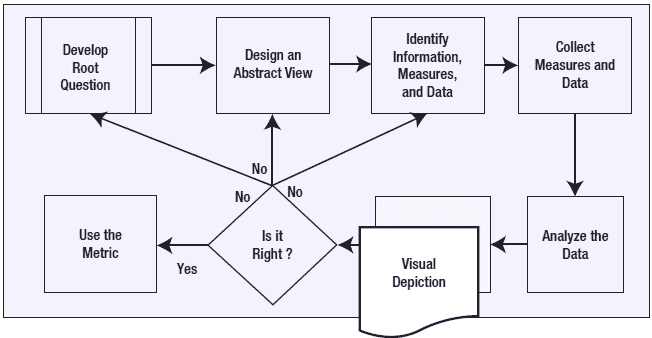

# 为他人描绘的图景

你为自己的指标画了一幅画。这幅画是对根本问题答案的抽象表现。一个深思熟虑的指标的另一个主要组成部分是另一幅画——一幅你的客户能够轻松解读的画。这幅画通常是一个图表、图形或表格。计划在你的指标开发计划中包含它。

**图 3-5.** 可视化呈现

它完全可以不止一幅画。如果你需要一个由十二个图表、图形和表格组成的仪表板——那就用吧。如果你在根本问题和指标的抽象版本上做好了功课，那么确定如何用图形表示指标应该是一个简单的步骤。真正的好消息是，这部分你不太可能出错。如果你选择了堆叠条形图，后来又意识到应该用趋势线——你可以更改它。没有任何坏处。

如果你发现不同的结构能更好地讲述你的故事，你不仅可以改变表示指标的方式，而且你可能本来就需要多种表示方式。这取决于客户是谁，每个客户将如何使用该指标，以及你将如何分享它。对于每个群体，你呈现指标的方式可能会有所不同。

这个部分应该充满乐趣。让你的创造力闪耀出来。想方设法用视觉来解释，这样你就不需要那么多文字了。一张图确实能讲述千言万语。无论图有多好，你仍然需要添加文字来确保观看者理解正确，但我们希望这些文字尽可能简短。我们想要图片清晰地讲述故事。不要把图片搞得太复杂。

事实上，你拥有的数据可能比讲述故事所需的还要多。你可能会发现自己不愿意舍弃某些信息，但有时少即是多。尤其是当额外信息可能混淆观众时。并不因为你收集了数据，就必须将其放入指标中。

另外，尝试用不同的方式来描绘指标。你甚至可以在指标客户那里测试视觉呈现的想法。

