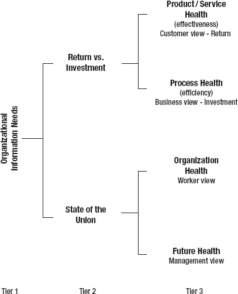
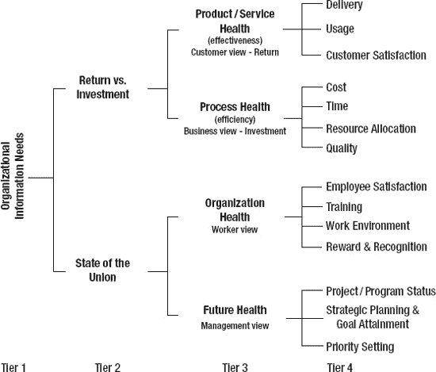
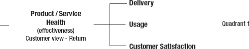
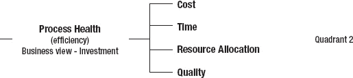
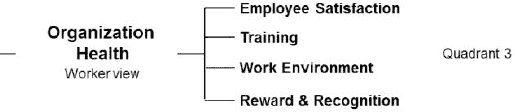
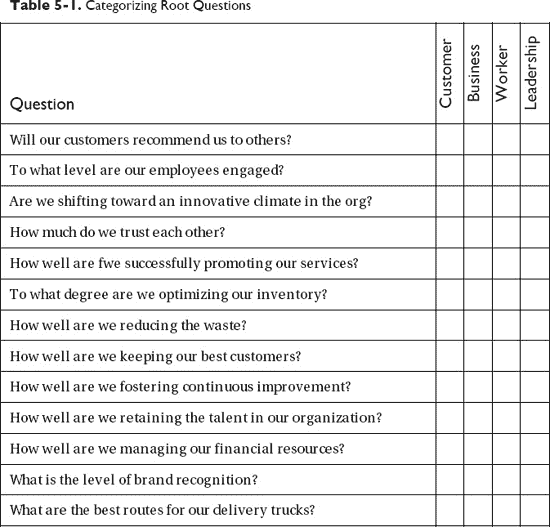
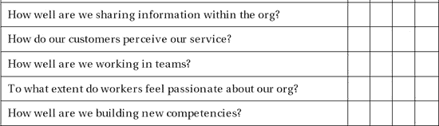
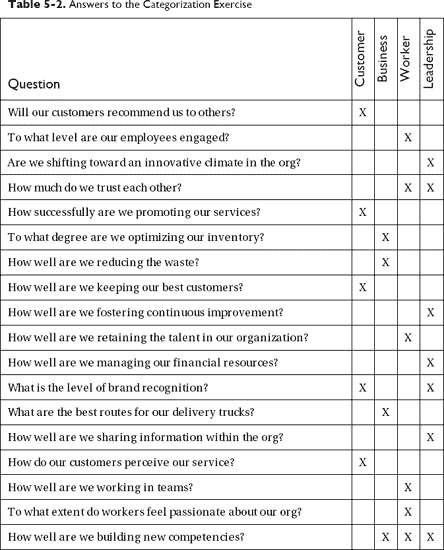

## 使用答案密钥

### 一个捷径

本章标志着本书实践部分的开始。我们在第一部分涵盖了大量理论和概念，这些内容应为实际工作奠定基础。

`答案密钥` 是一个工具，旨在帮助你确保找到根问题的正确答案。它适用于大多数组织改进方面的问题。它还能为你提供关于你可能希望衡量的其他领域的想法。当你使用`答案密钥`来推进组织改进工作时，你将获得最大收益。

### 什么是答案密钥？

`答案密钥`的起点是任何指标的定义点：对信息的需求，即根问题。`答案密钥`并非适用于所有根问题，仅适用于涉及组织健康的问题。组织健康涵盖了通常我们为其制定指标的广泛问题和需求。大多数根问题，尤其是在商业环境中，都围绕着组织运行状况如何展开。大多数平衡计分卡（见下文框）和关于客户满意度的问题都属于这一范畴。

`答案密钥`是你将遇到的许多指标的捷径。它包含了我建议组织在首次尝试实施指标体系时应首先采用的指标。

**平衡计分卡与仪表盘**

平衡计分卡由半导体公司 Analog Devices 的经理阿特·施奈德曼于 1987 年引入。其最著名的倡导者是哈佛商学院的教授罗伯特·S·卡普兰和 Palladium 集团的创始人兼董事大卫·P·诺顿博士。其基本概念包含四个视角：财务、客户、内部业务流程、学习与成长。通过关注这些关键领域，管理层可以利用衡量指标和目标来把握组织的脉搏。

虽然我不赞同“目标”这一概念，并且对整个平衡计分卡有所保留，但它具有我必须尊重的优势。平衡计分卡已被许多组织成功使用，并且至今仍然流行。

“仪表盘”则是后来以更平衡的方式推广指标的一种形式。它秉承其名称的精神而创建，是一种动态的指标工具。与平衡计分卡类似，仪表盘也采用多项衡量指标，但包含了一个围绕关键绩效指标构建的、更具实时性的组件。可供选择的指标流程和工具层出不穷。好消息是，我所提供的内容可以应用于这些流行方法中的任何一种，或者你也可以开始一段个人旅程，从零开始构建你自己的指标。

`答案密钥`可以帮助你确定指标的发展方向。它还能识别出与你起始问题相关的其他问题。它还可以帮助你避免误入歧途，或避免精力过于分散、缺乏重点。

`答案密钥`由从左向右分支的层级组成。每个层级都比前一个层级包含更多的衡量指标和数据。以下各节将更详细地描述这些层级。

#### 答案密钥：第一层级

第一层级与其说是一个层级，不如说是一个起点。你的根问题是否是一个组织信息需求？你的根问题是否涉及关于组织的信息，特别是关于组织健康的信息？如果是，你的问题很可能属于以下两类关注点之一：

- 你向客户提供服务和产品的效果如何

- 你组织的未来前景如何

#### 答案密钥：第二层级

如果你的根问题符合`答案密钥`前两个层级之一，那么这个工具将帮助你集中精力并找到可行的衡量指标，而无需花费过多时间寻找它们。但是，如果你的问题不符合`答案密钥`，请不要为了使用这个捷径而改变你的问题。

同时，也不要忽略首先提出根问题的必要性。换句话说，不要从密钥开始。如果你这样做了，最终将阻碍你开发有用指标的努力，更重要的是，阻碍你回答问题的努力。

第二层级为战略层面的根问题提供了一个框架。如果你的根问题处于愿景层面，那么第二层级可能代表实际的指标。当你发现你的根问题基于改进组织时，该问题通常源于理解“组织现在在哪里”以及“它将去向何方”的需求。`答案密钥`表明，这种信息需求流入两个渠道：一个用于展示回报（我们得到了什么）与我们的投入（我们投入了什么）的关系，另一个用于协助管理资源。我将这两条分支称为“回报与投入”和“组织现状”。图 5-1 展示了这种分支结构。

**图 5-1.** 答案密钥，第一层级和第二层级

### 回报 vs. 投资

“回报 vs. 投资”是组织指标两大主要分支中的第一个。它代表了回答以下问题所需的信息：组织的运作状况如何？管理得好不好？我们是否在做正确的事？我们是否以正确的方式做正确的事？这些都是关乎改进乃至生存的关键关注领域。如果你没有在做“正确”的事，很可能很快就会倒闭，或者至少会失业。

如果你没有以正确的方式做事，你可能会发现组织仍能继续运转，业务也能勉强维持，但任何有意义的改进都极不可能发生。你最多能期望的是生存，而非繁荣。

围绕*回报*的根本问题可能包括：

- 我们在提供关键服务方面做得如何？

- 我们可以通过哪些方式来改进关键服务？

围绕*投资*的问题可能包括：

- 提供关键服务需要我们付出多少成本？

- 我们在管理资源方面做得如何？

当我们深入探究答案钥匙时，更具体的问题会逐渐显现。但请记住，根本问题的广度将决定你需要向左走多远。在答案钥匙上越靠左，问题就越宏观或越具有战略性。

### 组织状况

一旦你高效且有效地运营业务，就可以将注意力转向如何管理资源。你所拥有的最宝贵资产应该用爱心来维护。是的，我说的是你的员工队伍。我遇到过的每位老板都宣扬过同样的口号：“我们最宝贵的资产是员工。”然而，令我惊讶的是，我们对这些公认的无价资产的照料是如此糟糕。

我观察到有些管理者会将他们的宝马车送到经销商处进行定期保养，只使用优质汽油（无论油价如何），并且绝不停靠在其他车辆附近——但却对维护员工队伍完全不作为。没有培训计划，没有员工满意度调查，甚至连一个建议计划都没有。他们很少听取员工的意见，并且通过从不征求员工的观点来贬低他们。如果员工真的是我们最宝贵的资产，那么我们就应该如此对待他们。

这种对组织的看法就是我们的“组织状况”报告。它告诉我们的组织内部健康程度。虽然“回报 vs. 投资”告诉我们从客户和业务角度看的组织健康程度，但“组织状况”告诉我们的则是文化层面的健康程度。

除了员工队伍，我们还需要关注未来的潜力。我们可以通过审视我们如何管理走向成熟的成长过程来确定这一点。我们是否有良好的未来战略规划？我们是否在朝着目标努力？

你在这个领域可能遇到的根本问题包括以下内容：

- 我们组织内部对认可的文化有多强？

- 我们员工队伍的忠诚度有多高？

- 我们的专业发展工作成效如何？
- 我们组织的预期未来是什么？
- 与竞争对手相比，我们表现如何？
- 我们在实现战略目标方面做得如何？

你在答案钥匙上越往右走，根本问题就会变得越具体、越具战术性。

### 答案钥匙：第三层级

图 5-2 展示了答案钥匙的下一层级，我们将分支扩展为包括：产品/服务健康度（有效性）、流程健康度（效率）、组织健康度（员工维护）和未来健康度（项目与战略规划）。

**图 5-2.** 答案钥匙，第一、第二和第三层级

大多数根本问题最终都归结为想要基于第三层级所代表的组织某一视角来获取答案。这些标题——产品/服务健康度、流程健康度、组织健康度和未来健康度——有助于我们理解每个分支与其他分支的关系。它们也有助于我们理解自己的指标适合放在哪里。与这些标题一起，我们还发现了附带的视角，以进一步辅助解读答案钥匙。这些视角表明，每个标题都可以从客户、业务、员工以及最终的管理层等角度来审视。

让我们来确定你的根本问题最适合放在哪里。

你的根本问题是关于你提供某项服务或产品的水平吗？它是否询问你是否在做正确的事？它是否询问你所做的事情是否满足了客户的需求或期望？你的根本问题会是客户会问的问题吗？如果你的问题符合上述任意一点，它就属于产品/服务健康度类别。

你的根本问题是否触及你执行交付服务或产品所需流程的好坏？你有多高效？执行流程中的任务需要多长时间或多少成本？你的问题是否是一线管理者会问的问题？如果你的问题可以在上述任何一点中找到，那么你很可能关注的是一个流程健康度的根本问题。

如果你的根本问题涉及人力资源、员工，或者是一位有同情心的领导者会问的问题，那么你的问题可能属于组织健康度分支。这里的根本问题会询问员工队伍的士气、忠诚度、员工留任率等。你对待员工有多好？你的组织是否位居行业最佳工作场所前 100 名？

第三层级的最后一个部分代表关注组织未来健康度的根本问题。组织是否患有组织不成熟症？战略规划、使命宣言和组织愿景有多大用处？研发进展如何？这一视角主要来自高层领导——如果你的领导层和组织已准备好展望未来。

你将如何使用答案钥匙来制定你的指标？

定义“回报 vs. 投资”所需的信息由“有效性”和“效率”这两条被广泛应用的道路组成。有效性是从客户角度看的组织健康度。组织在履行承诺方面做得如何？组织是否在做正确的事？这不仅对于制定可行的指标很重要，对于理解和培育组织文化也至关重要。有些组织甚至可能不知道自己的客户是谁。而且即使客户群已被明确定义，收集客户对有效性各个组成部分的看法也并未被视为重要。

有时，组织被迫询问客户对公司有效性的看法。于是，调查被构建，焦点小组被组建，问题被提出。

- 您使用我们的产品或服务吗？
- 您对我们产品或服务的交付满意吗？
- 您对我们的组织有多满意？

这些问题不仅有助于定义可行的衡量标准，也为您自身的成长提供了焦点。组织是否拥有明确定义并记录在案的客户清单？组织是否知道自己的产品和服务是什么？组织是否致力于让客户满意？组织如何“服务”客户？这些不仅仅是收集数据点的指南。答案钥匙帮助寻求实现持续改进的组织勾勒出一幅图景。

虽然这四部分可以描述指标本身（如果你有一个更高级别的根本问题），但很可能你的根本问题处于这个层级，而你的指标要到第四层级才会开始出现。

#### 答案层级：第四层

现在我们来看大多数组织开始并止步的层级。当你的根问题起始于此，你面对的是战术性的、低层次的问题。这在组织刚开始使用指标时属于正常现象。你遇到的根问题会非常具体，可能只涉及很小的领域。例如，你可能会有一个关于交付的根问题：“我们对客户更新请求的响应表现如何？”

你可能会遇到关于具体流程健康度的根问题，比如生产一个组件所需的时间、产出质量，或特定服务的成本。你的根问题落在答案层级中的哪个位置，决定了每个层级的特征。图 5-3 介绍了第四层。

**图 5-3.** 答案层级，第一至第四层

如果你的根问题出自第四层，那么左侧的所有内容都是该问题的背景信息。随着组织逐渐成熟，你应该将问题向左移动，从更具战略性的角度提问。如果你的根问题在第二层，那么第三层代表你可以使用的指标，第四层则代表信息。每个信息集都会定义相应的度量和数据——如果有必要，甚至可以扩展到第五层和第六层。

答案层级不仅能让你保持专注，帮你确定感兴趣的领域；它还能根据你的根问题位置，提供一些标准化的指标、信息和度量方式。

##### 产品/服务健康度（有效性）

**图 5-4.** 答案层级，象限 1，产品/服务健康度

以下是产品/服务健康度（图 5-4）的主要组成部分：

- *交付*：你在产品/服务交付方面表现如何？
- *使用情况*：你的产品/服务是否被使用？
- *客户满意度*：客户对你的产品/服务有何看法？

每个组成部分都可以进一步拆解为更小的单元——使其更易于理解。交付就是一个很好的例子，因为它是一个更高层级的概念。我倾向于将交付分解为以下部分：

- *可用性*：当客户需要时，服务/产品是否可用？
- *速度*：交付服务/产品需要多长时间？
- *准确性*：我们是否按承诺交付，还是存在错误？

产品/服务健康度的驱动力是客户。我们不关心谁对问题“负责”。我们不关心你对情况或条件是否有任何控制权。我们只是想了解客户如何看待我们的产品和服务。这种审视组织的简单方式很有价值，因为它能让你轻松专注于最重要的事情。

##### 流程健康度（效率）

**图 5-5.** 答案层级，象限 2，流程健康度

回报与投资的另一个组成部分是效率，或者说组织是否在以“正确的方式”做事？此部分（图 5-5）体现了所有利益相关者都应认同的业务视角。以下经实践检验的效率组成部分仍然具有相关性：

- *成本*：我们执行流程的方式是否具有成本效益？
- *时间*：时间类似于客户视角中的速度。很多时候，相同的数据和来源可以重复用于此度量。执行一项任务或流程需要多少时间？
- *资源分配*：我们分配工作的效率如何？我们是否按类型和数量分配工作？
- *质量*：质量是业务视角中的准确性。即使我们有冗余系统提供 100% 的正常运行时间，我们也需要追踪（每个系统的）可靠性，以便进行最佳维护。

许多组织过于关注成本，却忘了他们的首要关切应该是组织是否在做正确的事（有效性），其次才是是否以正确的方式做事（效率）。相反，许多组织一发现成本方面的任何感知缺陷，便不假思索、不加批判地做出反应。由于缺乏服务和产品成本的相关信息，这一错误被进一步放大。这在软性行业中尤为明显。制造业通常能很好地掌握成本数据，但信息技术、软件开发或教育等软性行业却发现很难为其产品和服务定价。这合乎逻辑，因为这些组织通常很难定义他们生产的产品和服务是什么。试着问问某所大学的院长，该组织提供哪些产品和服务。然后再进一步看看这些产品的成本是否有记录可查。

时间，尤其是当它与成本（人/小时）挂钩作为限制因素时，是最容易被滥用的信息之一。当管理者开始相信他们可以要求获取数据，从而（在不进行辅导或领导的情况下）管理员工，而无需实际与他们交谈或了解他们时，他们就会盲目跟风指标。考勤表、时间-动作研究以及时间分配表开始流行起来。在一个精心构建的指标体系中，如果你不是从至关重要的根问题及其所有列出的组成部分出发，你根本不会到达这个层级，这应该能防止人们滥用数据。时间不应被用来“控制”你的员工。它应该用于以下目的：

- 提高组织估算交付时间表的能力
- 协助改进流程和程序
- 完善其他数据，例如成本和质量

如果“质量”是基于缺陷的客观度量，那么每千个实例中多少个缺陷才算是“高质量的”？高质量是目标吗？质量是“是或否”的决策吗？质量最好通过缺陷和返工来描述，并且和“时间”一样，它也可能被滥用。它并非管理者用来决定谁该加薪或处理其他人事问题的简单方法。如果你滥用指标，*质量就可能从工具变成武器*。

请确保你的指标被用作改进的工具，而不是武器。

质量、时间、资源分配和成本都是流程健康度的组成部分，并定义了组织流程和程序所代表的投资业务视角。因此，这些视角只应用于改善业务——而非针对个人。产品/服务健康度完全从客户视角出发。流程健康度也同样专注于其自身焦点——它代表了业务视角。客户很可能永远看不到（也不需要有理由看到）这些指标。这些是“内部”指标，第四层接下来的两个领域也是如此。

指标应用于改善整体业务，而非个人。

#### 组织健康度

**图 5-6.** 答案指南，第三象限，组织健康度

在审视组织健康度（图 5-6）时，我们从员工的角度来观察组织。它考量以下方面：

- 员工满意度
- 职业发展
- 工作环境
- 奖励与认可

当我们确保最有价值的资产得到相应对待时，就会发现组织在进步。我通常建议组织自上而下地解决答案指南中的各个领域，将组织健康度的衡量措施放在第三或第四位。这在一定程度上是出于政治因素的考虑。在你证明使用指标的合理性时，如果首先从客户的角度来应对组织健康问题，会更容易获得支持。没有客户，就没有可以改善的业务。一旦解决了客户视角的问题，就需要确保有能力留住员工。

但在理想情况下，比如你自己就是 CEO，我可以很直接地主张，改善工作的第一步应该从你最大的资产开始，然后再轮到客户。听起来像是谬论？如果你拥有一支健康的员工队伍，就能与他们一起更好地定义你的商业模式、未来以及希望在哪些方面进行改进。

员工满意度相当直白。员工对他们的处境、组织和环境越满意，工作就会越努力，忠诚度也会越高。你的组织就会因此变得更强大。

除了满意度，你还必须关注员工技能和知识库的培养。职业发展衡量指标能告诉你在这方面做得如何。你为每位员工制定了培训计划吗？每位员工的技能发展水平如何？员工队伍越强大，你能做成的事就越多。每当资金削减时首先砍掉培训，应该被视为一种不负责任的行为。以更少资源做更多事的唯一方法，就是提升员工队伍实现更多产出和更优产出的能力。提高生产力的最佳途径是提升员工的技能组合。

工作环境衡量指标通常通过主观工具（如调查问卷）来采集。但也存在大量客观衡量指标。例如工作空间面积、空气质量、照明、人体工程学等。有很多方法可以衡量物理工作环境的质量。此外还有文化工作环境。组织是一个愉快的工作场所吗？它是一个高压环境吗（如果是，是否有必要）？同样，你可以找到主观（询问员工）和客观的衡量指标。员工是否请了大量的假期和病假？人员流动率高吗？

组织健康度的最后一个组成部分是奖励与认可。一些简单的问题可能不需要数据收集。你有正式的奖励或认可计划吗？它有效吗？它是否达到了你的预期效果？你是如何奖励员工的？你如何认可他们的成就？你只认可他们与工作相关的成就吗？更微妙的一点是，你是否无意中将认可与奖励混为一谈，以至于只有在涉及奖励时才给予认可？

组织健康度的底线非常简单——你是否像对待最有价值的资产那样对待你最有价值的资产？

## 未来健康度

**图 5-7.** 答案指南，第四象限，未来健康度

答案指南的最后一个领域是未来健康度（图 5-7）。它涵盖以下方面：

- 项目/计划状态

- 战略规划：组织执行战略规划的情况如何

- 目标达成：组织实现目标的情况如何

- 优先级设定：如何设定优先级，以及优先级是否得到满足

这个领域假定你正在为组织进行持续改进。未来健康度没有被列在最后，是因为它不如其他领域重要。它排在最后，是因为大多数组织尚未准备好尝试在这个领域使用指标。大多数组织在开始着手大规模的改进努力之前，需要先将第四层的前三个领域控制好。

许多组织绕过了这个指导，直接跳到那些旨在展示他们改进流程工作做得如何的衡量指标上。他们跳上了持续流程改进的“列车”。我对这种行为不太有信心，因为一旦资金紧张，这些组织就会放弃同样的努力。

你开展改进努力的原因，比你是否成功更为重要。真正成功的唯一方法，就是出于正确的理由做正确的事情。

围绕组织未来健康度的衡量指标大多是预测性的，这使得它们对领导层很有吸引力。但比预测未来更重要的是鼓励和奖励真正的流程改进。

项目与计划状态衡量指标为领导层提供了洞察，了解这些努力如何帮助改进组织。你应该预期到，流程改进的进展正在或将要在其他三个领域所捕获的指标中反映出来。如果你在持续流程改进方面做得好，客户视角应该会得到改善。业务视角也应该看到收益，员工队伍也应受益。如果你的努力未能改善这三个领域，那么你就没有在改进组织。

战略规划、目标达成和优先级设定都是需要关注的重要事项——但就其本身而言，它们是毫无意义的。如果这些不是改进组织的更大努力的一部分，你只是在原地打转。这些努力之所以艰难，是因为它们需要真正的（有时甚至是孤注一掷的）成功承诺。你必须想要改变。许多组织在这个领域只是口头承诺，并未真正将努力贯彻到底——而当我们谈论“持续”流程改进时——实际上是没有终点的。

## 答案指南：第五层及更高层级

第五层将为所呈现的每个视角中的每条“信息”引入具体的衡量指标。虽然你的根本问题理论上可能存在于这一层，但可能性不大。如果你发现你的问题始于这一层，那么你可能不需要一个度量指标，而仅仅需要一个测量值。

你在这里最可能找到的是测量值。例如，从第四层“使用情况”的顶层分支延伸出以下内容到第五层：

- 按月度、按类型的独立客户数

- 按类型的购买次数

- 重复客户数量

没有必要列出第四层每个元素可能的测量值。尝试列出第六层或第七层（更低层级的测量值或数据）中的每一项也没有意义。在“使用情况”的例子中，我们可能会看到如下数据点：

- 客户数量

- 每位客户的姓名

- 按类型列出的产品

- 每次购买的日期和时间

### 如何使用答案密钥：识别度量类型

答案密钥可用于识别可以用来回答根本问题的度量。如果你已经完成了准备工作，明确了根本问题并制定了抽象设计，那么现在就可以进入下一步——识别可能的度量来填充指标。

答案密钥能帮助你完成这一阶段。以你的根本问题和指标设计为基础，确定你在答案密钥中所处的位置。如果你的问题涉及组织的价值，那么你处于顶层，即 `Return vs. Investment`（回报 vs. 投资）。如果你的问题属于管理组织资源的范畴，那么你处于底层，即 `State of the Union`（组织状况）。

我们之前举过一些根本问题的例子。其中一个例子基于工作分配。这属于第四层，即 `Process Health–Resource Allocation`（流程健康——资源分配）。使用这个工具，我们不仅能识别所需的度量类型，还能理解问题关注的领域。从 `Resource Allocation`（资源分配）向左移动，我们可以看到问题涉及的是业务视图（投资）。如果我们的问题是根本问题，我们可以使用 `Five Whys`（五个为什么）。现在，我们还可以问自己，我们的关注点是否超出了 `Resource Allocation`（以度量为中心）？我们的关注点实际上是否在于 `Process Health`（流程健康）？我们是否遗漏了关于成本、时间和质量的度量？

如果你的根本问题仅由第四层中的某一个度量就能回答，那么你很可能还没有找到真正的根本问题。你肯定还没有形成一个指标。

我们使用的另一个例子是：“我们的网络/电话会议服务的价值是什么？”这也属于 `Return vs. Investment`（回报 vs. 投资），可能符合（客户视图）`Product/Service Health–Usage`（产品/服务健康——使用情况）或 `–Customer Satisfaction`（客户满意度）。但它也可能符合（业务视图）`Process Health`（流程健康），尤其是因为它包含了大量成本效益度量。通常，你的指标可能需要来自多个类别的度量。逻辑上，它们通常来自同一个更大的区域——`Return vs. Investment`（回报 vs. 投资）或 `State of the Union`（组织状况）。因此，很多时候，如果你有一个衡量有效性的指标，你可能也会同时衡量对效率有用的东西。我发现这一点在时间度量上尤其如此。考虑一下解决问题的时间与完成任务的时间。如果任务本身就是解决问题，那么这两种度量是相同的。

使用答案密钥可以让我们快速简便地对已识别的度量进行质量检查。例如，如果指标是员工视图（基于根本问题），而你发现你识别出的某些度量来自客户视图（如交付度量），那么要么这些度量对于该指标是错误的，要么你的指标可能不适合回答这个问题。一般规律是，我发现通常是度量放置不当，而非指标有误。

再举一个例子。我们还讨论过：“帮助台的响应速度如何？”这可能是效率类别中的时间（响应时间），也可以通过有效性度量来表示——特别是交付。当我们查看交付类别下的速度和可用性（另一个度量是准确性）时，我们可以看到这两种度量如何共同讲述帮助台对客户需求的响应情况。使用 `Time to Respond/Time to Resolve`（响应时间/解决时间）会用到一些相同的数据点，尽管数据的这种“视图”对于回答我们的特定问题可能没有用处。

### 补充材料

由于本章介绍了本书的实践部分，让我们来做一项实际练习。接下来是一系列基于伯纳德·马尔关于绩效度量的优秀著作《智能公司》（Wiley, 2010）的可能根本问题列表。马尔提出根本问题有两种类型：`Key Performance Questions`（关键绩效问题，KPQ）和 `Key Analytic Questions`（关键分析问题，KAQ）。他用这种区分来区别做“正确的事”（KAQ）和以“正确的方式”做事（KPQ）。

正如你所读到的，我将它们分别翻译为“有效性”和“效率”。虽然马尔为每种类型都列出了一些问题，但他没有解释划分的依据，而且这些问题与我提出的分类并不吻合。实际上，马尔的例子涵盖了我答案密钥中提出的所有四种视图，而不仅仅是客户和业务视图。有趣的是，在他的书中，他的多个问题同时出现在这两个类别中。

我希望以他的问题为基础，不仅能让你练习根据答案密钥对它们进行分类，还能让你看到，你不必完全相信任何作者（包括我本人）提出的观点——你应该自己尝试和验证。

请审阅 `Table 5-1` 中的每个问题，并使用视图，通过在相应列中放置一个 X 来确定问题在答案密钥上的位置。

希望你发现每个类别中都有适合的例子。你也可能发现你对一个问题标记了多列（是的，这是允许的）。如果我们记得这取决于观点，这就很容易理解了。

# 一个可能适合多个类别的问题是最后一个：“我们在建立新能力方面做得如何？”

如果我们想知道培训项目运行得如何，这可能是业务视图。如果我们从员工的角度来看——关注我们员工的培训——这可以是一个 `Organizational Health`（组织健康）问题。如果我们从领导层的角度来看，想知道我们是否准备好应对未来需求，它可以归入 `Future Health`（未来健康）。当你处理自己的问题时，你会知道（或询问）问题所依据的是谁的观点。

那么，现在，如果你和我一样，你可能在寻找上述练习的“标准”答案。在 `Table 5-2` 中，我给出了我的答案——但有一个前提：没有所谓的“正确”答案。

其理念是使用答案密钥来确定你的度量是否在发挥其应有的作用——即它们是否对齐且全面。记住，对齐意味着它们有助于回答根本问题（如果你发现你使用的度量在答案密钥上不对齐，那么它们就不能回答同一个根本问题）；全面意味着综合来看，你有信心它们能够回答这个问题（没有缺失的数据点）。

### 回顾

“答案关键”能帮助你检验工作质量，确保你走在正确的方向上。当你遇到难题、不知该往哪个方向前进时，它也能帮你重回正轨。

大多数你设计的指标，如果落在“答案关键”上，很可能从第三层级开始，并属于以下四个视角之一：

*   客户视角（有效性）
*   业务视角（效率）
*   员工视角
*   领导视角

当你沿着“答案关键”从左向右移动时，就是从战略层转向战术层。另一种理解方式是，你正从根本问题转向数据。

无论你的指标（或根本问题）落在哪个位置，你都需要向右移动，才能找到回答该问题所需的度量项和数据。在第四层级，我们发现了以下内容：

*   回报 vs. 投入
    *   产品/服务健康度——客户视角
    *   流程健康度——业务视角
*   总体状况
    *   组织健康度——员工视角
    *   未来健康度——领导视角

第四层级是我的客户最常使用的层级。它位置足够靠左，使得从该处出发的根本问题值得用指标来回答；同时它又足够靠右，使得大多数组织易于理解这些指标在改进组织方面的用途。

在第五层级（及其后的任何层级）中，我们主要发现的是信息和度量项。如果我们的根本问题落在此处，那么该问题可能非常战术化，或许不需要一个完整的指标来回答。请记住指标开发计划，你不仅应该通过识别信息和度量项来充实指标，还应该记录所需的个别数据点。

## 结论

“答案关键”之所以成为本书实践部分的开篇，是因为它是一个实现指标的绝佳捷径工具。它能帮助你将根本问题置于组织健康度的背景中。如果你不得不在没有根本问题的情况下工作，它可以用来确保你不会试图混合不协调的度量项，并帮助你朝着一个迫切的需求努力。

从左侧开始向右移动，你从高层级走向战术层。它会帮助你识别可能用于回答根本问题的信息和度量项。

从右向左移动，你可以从具体的度量项（甚至数据）回溯到某个迫切的需求。朝这个方向工作也有助于你确保你的指标在逻辑上分组和整理得当。通常情况下，你不希望将来自不同领域（产品/服务、流程、组织或未来健康度）的信息混合到一个指标中，因为除非是在“答案关键”的最高层级或最左侧层级，否则它们几乎无法回答任何问题。

请记住，“答案关键”虽然是一个有用的捷径，但它仍然只是帮助你开发指标的工具。它不是完整的答案，也不能免除你遵循指标开发模型的责任。

