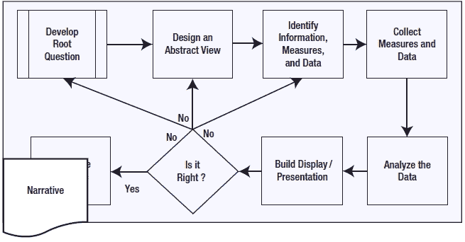
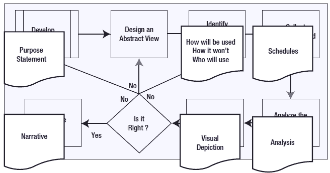

# 叙述性描述

当有人问：“需要我给你明明白白讲清楚吗？”我很喜欢听到这句话。我的回答通常是：“谢谢！那太好了。”

为什么不呢？无论你的图形化呈现有多好，你都承担不起误解的风险。你已经挖掘出了问题，并设计了指标，以便能为正确的问题提供正确的答案。你不能让指标的观看者误解你费尽心力讲述的故事。

叙述是你确保证观看者能以你的视角、像你一样看到所看到的东西的机会。他们希望能听到你试图传达的信息。计划的任何部分都可以定期更新，但叙述需要频繁记录。由于叙述解释了指标在告诉观看者什么，所以解释必须随着故事的变化而改变。伴随图片出现并记录指标含义的叙述，对于指标将如何被使用至关重要。

图 3-6 显示了叙述被记录的时间点。

**图 3-6.** 叙述

## 文档：让指标开发计划不止于计划

最终，指标开发计划应记录以下内容：原因（目的陈述）、内容（指标）、时间（时间表）、人员（客户）以及方式（分析、如何以及如何不加以使用）。

请尽可能详尽地记录——将所有细节汇总在一处。这将通过以下三种方式为你提供帮助：

*   帮助你全面地思考该指标。

*   在你需要改进流程时提供帮助。

*   在你需要复制这些步骤时提供帮助。

图 3-7 展示了所有这些要素与指标开发流程的协调运作。

**图 3-7.** 开发计划

我不想规定具体的篇幅或格式，而是想强调最终计划的可读性。你会需要它作为参考，有时也需要它作为已达成协议的凭证。我发现，当指标报告频率较低时，该计划极其有用。指标报告越不频繁，我就越有可能忘记自己遵循的步骤。数据收集可能非常复杂，数据清洗可能很繁琐，而分析可能还需要更详细的步骤。流程越复杂、执行频率越低，我就越需要记录在案的计划。

当然，即使我每周都执行该流程，负责任的做法也是将计划记录下来，以便他人能在我不在场时继续执行。

该计划在指标的整个生命周期中都有用。它首先帮助我充分构思指标的设计与创建。然后，它有助于记录围绕指标使用和时间表达成的协议。它有助于为行动辩护（成为指标分析师、数据提供者与最终客户之间的契约），并满足各方期望。最后，它对长期成功也至关重要。它既提供了历史视角，也提供了一份“操作方法”指南。没有可重复性，就无法改进。

没有可重复性，就无法改进。

开发计划的各个组成部分需要以一种能够轻松、准确查阅的方式进行记录。确保准确性比确保易于查阅更困难。我们讨论了不同的数据收集方法以及提高准确性的途径。真正的好消息是，很多时候，我们用来提高准确性的方法也使其更易于查阅。减少人工干预能让我们对数据准确性更有信心，而自动化则使数据收集更简单。

在记录各个组成部分时，不要害怕写得详细。此刻不是追求简洁的时候。我们需要建立对指标及其组成部分的信心。我们需要尽可能多地记录每个组成部分的相关信息，以便在以下方面建立信任：

*   *原始数据的准确性*。你将会在这方面受到质疑，而且这合情合理。人们对你的根本问题应该得出什么答案有自己的预期。他们对数据针对该问题应该说明什么也有自己的预期。无论答案如何，*总会有人*认为你搞错了并去核查你的数据。因此，你在分享数据时必须准确无误。这就要求你对数据进行质量检查。无论错误是由你的数据来源、公式还是软件故障造成的，都无关紧要。如果你的数据被证明是错误的，你的指标就不会被信任或使用。

大多数原始数据不准确的例子都可以归因于人为错误，但即使是自动化工具也容易出错，尤其是在数据解释方面。错误可能出现在任何地方，从错误地记录数据、计算错误，到将信息归入错误的类别。如果你的类别定义不当，自动化系统可能会正确地报告数据，但它报告的可能是错误的数据。如果你在跟踪解决故障单的时间，这个时间是指开始和结束日期之间的时间吗？还是指从接到呼叫到最终解决（可能远在故障单关闭的日期/时间之前就已发生）的时间？你是用日历天数还是工作日来跟踪时间？如果你在报告可用性，什么才算是中断？你如何确定中断发生了、何时发生以及持续了多久？简单的经验法则是反复检查你的数据。我发现检查数据的最佳方法是让别人也看一看。我距离工作太近，无法看到他人一眼就能发现的错误。

在起步阶段，没有什么比你原始数据的准确性更重要了。

*   *你分析的准确性*。我们稍后会讨论分析方法，但眼下，记录下来你分析数据所采用的流程和步骤至关重要。这将使你能够重复该流程——这是保持一致性的必要条件。一个简单的例子是电子表格程序中的公式使用。我很多指标工作都在电子表格程序中完成，因为它们简单、用户友好且功能强大。我使用公式来计算从经过的天数到随时间变化的百分比等一切内容。无论你使用何种方法，都必须记录下来。任何审阅你工作的人都应该能够通过手工（使用笔、纸和计算器）重现你的工作。这种记录工作虽然繁琐，但必不可少。你的流程必须是可重复的。你的流程*必须*在数据、分析和结果中实现零缺陷。

你的流程及其产生的信息必须毫无差错。

*   *你流程的可重复性*。是的，我已在分析准确性部分提及此点。但值得再次强调和澄清的是，可重复性不仅对分析至关重要，而且贯穿于设计指标的整个流程。数据的收集必须是可重复的——在严格意义上。数据的分析必须是可重复的。数据的图形化呈现也必须是流程中可重复的步骤。每次，你都应以相同的方式收集、分析和报告数据。如果你不记录流程并确保其可重复性，你将失去受众至关重要的信任。这种可重复性在整个流程中都不可或缺。这正是我们制定时间表的原因。我们希望以相同的方式、在相同的时间间隔内、使用相同的工具来完成工作。一致性至关重要。

没有可重复性，你就谈不上拥有一个流程。

为了遵循良好文档管理的原则，你需要使用一种方法来控制你的数据、分析和报告的版本。你需要对存储的信息进行备份。所有列出的文档都必须加以保护，防止丢失或篡改。你必须确保各组成部分的准确性，而如果你不控制对信息的访问权限，就无法做到这一点。

首先，你必须确保你的数据来源正在产生准确的信息。当你检查了数据质量并对准确性有了很高的信心后，你必须重复你用于收集这些信息的流程。一旦你获得了准确的数据，你就必须确保它始终保持准确。

人员是准确数据面临的最大风险。