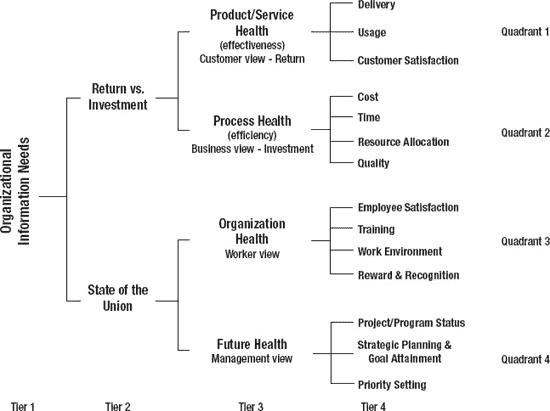
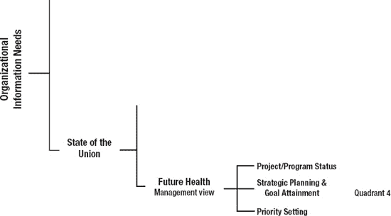
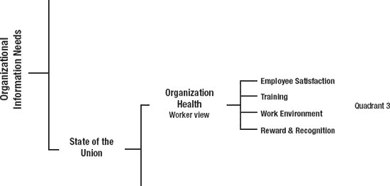
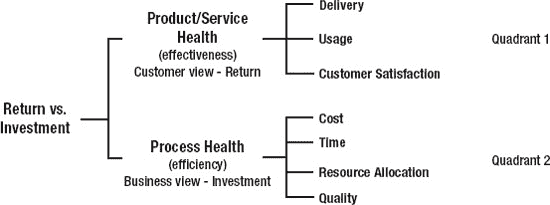
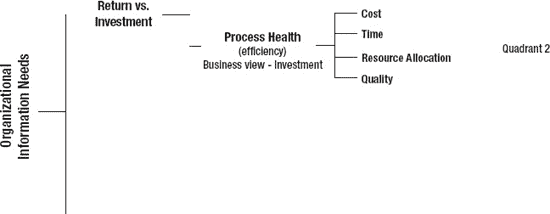
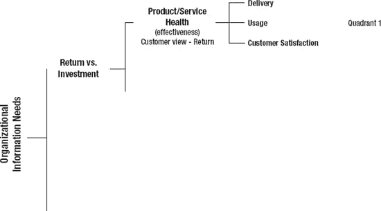
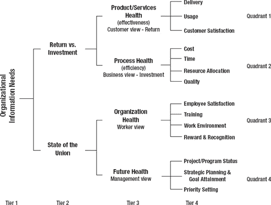

## 从有效性开始

我合作过的第一位首席信息官常说：“做正确的事。”除了这一指示在哲学和宗教层面的解读外，这还体现了领导者对其团队日常行为的简单期望。有效性指标能让你判断自己是否在“做正确的事”。

我不仅是建议你*从*有效性开始。在`第 5 章`中，我介绍了“答案关键”。我讨论了有效性指标的组成部分，即第三层级的第一个象限：产品与服务健康度。我建议你不仅从此处开始，而且应停留在“答案关键”的这个区域，直到你的组织成熟到能够应对其他象限为止。

正如我在第一本关于克服组织不成熟度的书中所描述的，一个组织可能根本无法应对一个完整的指标项目。使用指标是一种高级行为。

让我们来看看为什么我建议你在可预见的未来从有效性象限开始（并停留在此）。可以从第四象限“未来健康度”开始，逐个象限地讨论原因。

让我们再次看看`图 6-1`中的“答案关键”。

**图 6-1.** 答案关键

### 未来健康度

第三层级的第四象限（`图 6-2`）涵盖了未来健康度，即从领导视角看的组织健康度。在开始制定涵盖未来健康度领域的指标项目之前，最好确保你的组织已经为此做好了准备。

**图 6-2.** 答案关键，第四象限

以下是一些你可以自问或询问他人，以判断组织是否为此领域指标做好准备的问题：

*   你们有使命宣言吗？如今大多数组织都有。
*   如果你问五位员工组织的使命是什么，你会得到同样正确的答案吗？
*   你们有鲜活的战略规划吗？如果有，最远的目标是多长时间？大多数流程改进专家会告诉你，战略目标至少应为三到五年。最长可延伸至十年。
*   你们的组织是否将大部分目标文档化？
*   如果有长期目标，它们是否在被积极执行？（我不会问你是否清楚它们的进展如何，因为那需要度量项，进而引向指标。）
*   组织的问题是否已按优先级排序？如果是，这些优先级是否得到遵守，还是经常被忽略？
*   你们的目标是否包括随着时间的推移改进流程？
*   你们是否有完善的项目管理流程？
*   该流程是否被组织自愿遵循？

如果你不能对这些问题的回答给出肯定的答案，你可能还未准备好。通常情况下，组织在此区域存在内部冲突。领导层——指标的主要驱动者——希望同时从所有方面改进组织。这促使组织制定战略规划。似乎每位高层领导都必须有一份包含使命宣言和目标的战略规划。

我不会带你详述这会给一个无法进行全组织变革的组织带来所有问题。相反，我提出这些问题是为了帮助你判断是否准备好了。当然，你可以衡量这个领域，并确定你们的成果物（战略规划、目标、优先级清单）并未如预期发挥作用。这本身可能是有用的信息，但正如我非常喜欢说的那样，大多数时候你不需要指标来告诉你已知之事。

大多数时候，你不需要一个指标来告诉你已知之事。

我相信大多数组织都会制定战略规划和优先级清单。大多数组织甚至为其较大规模的工作制定了流程。这主要是因为它们是“该做的正确之事”。但不幸的是，这些组织中的大多数实际上并未为这些工作做好准备，因此他们认真的尝试收效甚微甚至毫无收益；在此之上创建指标来叠加这种投资损失将是浪费。

未来健康度指标需要一种大多数组织所缺乏的成熟度。

### 组织健康

组织健康象限（`图 6-3`）是从员工视角出发的。

**图 6-3.** 答案矩阵，象限 3

同样，我们可以提出一些基本问题来感受这项工作的准备情况。

-   你是否有奖励和认可计划？
-   你是否有员工建议计划以收集意见？
-   你会将自己的企业文化描述为一种相互信任的文化吗？
-   你的每位员工是否都有职业发展计划？

与未来健康象限不同，组织健康通常不是领导层早期关注的领域。在许多尚不成熟的组织中，领导者害怕基于这一领域的度量指标。领导层应该清楚员工是否得到了良好对待并感到被重视。他们不“需要”度量指标来告知这一点。当“答案”未知时，就会产生怀疑，而这种怀疑理所当然地让领导层感到担忧。除非组织内部存在信任，否则这个领域对领导层来说可能会很棘手。

在大多数情况下，*领导层*并未准备好接受组织健康度量指标。

组织健康与未来健康这两个象限都直接反映了组织的“现状”。在这两种情况下，度量指标应等到组织能够持续做正确的事并让客户满意后再进行。如果组织处于动荡或尚不成熟的状态，度量计划不仅无法解决问题，反而可能让情况变得更糟。从这两个象限中的任何一个开始，都无异于去测量纸飞机的平均空速、高度和升力系数。在开始测量纸飞机的性能之前，获得更好的交通工具要重要得多。

### 回报 vs. 投资

**图 6-4.** 答案矩阵，象限 1 和 2

上面两个象限（`图 6-4`）是大多数组织在着手进行度量工作时自然倾向于关注的区域。大多数领导者首先希望看到客户满意度调查的结果。这是最容易开始的度量方式。毫无例外，每当我提出要了解客户对服务或产品的感受时，第一个想法总是“调查”。我并非认为这是负面的——事实上，当这种情况发生时我反而很高兴，因为这是一个非常安全且合乎逻辑的起点。

平衡计分卡也有四个象限：客户、财务、员工和流程——大多数领导者会直接跳到财务象限。在答案矩阵中，最接近的对应区域是流程健康（或效率）象限。

虽然“现状”中的右侧两个象限要求组织做好充分准备，但通常组织并未准备就绪，而回报 vs. 投资象限可以在组织成熟之前就着手处理。当然，组织越成熟越好——尤其是在制定度量计划时。

## 流程健康

流程健康（效率）度量（`图 6-5`）可能会引发许多问题，尤其是在一个尚不成熟的组织中。如果你与员工关系不佳，或者员工之间缺乏信任，那么试图针对这个象限进行度量工作可能会是致命的。

**图 6-5.** 答案矩阵，象限 2

我会请你提出以下问题来判断开展效率度量的准备情况：

-   你的员工信任管理层吗？

-   你的基层主管信任中高层管理者吗？

-   管理层信任员工吗？

要安全地使用效率度量指标，需要信任。在缺乏信任的文化中，不可能获得诚实准确的数据。大多数专家认为，信任文化取决于组织高层领导者言行一致的程度。员工是否相信高层领导者能履行承诺？做到他们说过要做的事？遵守他们的协议和承诺？

我发现信任问题的答案其实更直接、更简单。员工是否相信他们的直接主管真心为他们着想？他们对于高层领导者真实性的关注程度远低于此。他们最在乎的是他们的直接经理。距离直接经理越远，所需的信任程度就越低。

因此，与其对公司 CEO 说教，要求她必须赢得员工的信任，不如从最基层开始，确保从下到上建立一种信任文化。

当你决定衡量组织的效率时，你的员工会清楚地听到你想要衡量`他们`的效率。他们不会“听到”你想要改进流程和程序。至少，除非他们信任你，否则他们听不到。而这里的“你”，我指的是他们的老板。

我的 CIO 通常在告诫要“做正确的事”之后，还会补充一条同样重要的指令：以“正确的方式”做正确的事。如果管理层足够强大，它应该致力于改进做事的方法——而不是去改进那些做事的人。如果你急于采用效率度量指标，你不仅可能因不信任而收集到不准确的数据，更糟的是，你还有可能播下更多不信任的种子。

流程健康度量指标需要一种在大多数组织中罕见的相互信任水平。

请记住，组织健康度量指标关乎员工的处境，而大多数领导者并未准备好倾听这些。即使领导层相信自己能够听取反馈，但如果缺乏信任，大多数员工也不准备分享。

同样的缺乏信任也使得收集关于业务运行状况（流程健康）的准确数据变得困难重重。

## 产品或服务健康度

那么，这就引出了`产品或服务健康度`这一象限（图 6-6）。这不仅是最安全的起点，也是最合乎逻辑的起点。

**图 6-6.** 答案指南，象限 1

让我们看看下面这些问题，你需要通过它们来判断自己是否已准备好进行效能度量：

-   你是否清楚你的客户是谁？（这看似不言而喻，但其实值得一问。我很少对未知之事感到惊讶。）

-   你是否了解客户认为什么最重要？

-   你是否知道客户的期望？

这听起来是不是比其他四个象限容易得多？事实确实如此。在层级的上半部分，你需要的成熟度更低，而且`产品或服务健康度`涉及的风险也小于效率度量。至少，你应该知道你的客户是谁，并且能够确定他们的愿望、期望和需求。

你可能会问，怎么会有人*不*知道自己的客户是谁呢？

我承认，起初我也觉得这难以理解。但这确实会发生。一位同事喜欢讲述一个关于大学招生办职员的故事。这位职员接待新生已经至少干了好多年，多到让她不胜其烦。

有一次，一名新生又对她老调重弹，称自己是她的客户，理应得到比现在更好的待遇。他大声抱怨，说自己就是学校存在的理由，她应该竭尽全力满足他的需求。

> “你的客户服务呢？”他最后一次喊道，享受着其他学生投来的目光。

> 她平静地等着他停下来。她想确保他能清楚地听到她的话。

> “亲爱的，你搞错了。你不是客户，你是产品。”

你可能会想，“反驳得好”或者“回击得妙”。但糟糕的是，我的那位同事是名教师。更糟的是，听到这番话的学生觉得极其好笑。当然，我不能怪他们——这句话确实有趣。但，这有多真实呢？

我们有时是否会混淆谁才是我们的客户？另一个广为人知的笑话是，一位杂货店店员争辩说：“要是我们不用应付客户，能完成更多工作。”

如果客户是谁以及他们想要什么都那么显而易见，就不会有那么多客户服务课程和研讨会了。这可能是最基本的公理之一：真相并不总是显而易见的。

真相并不总是显而易见的。

你可能会认为情况恰恰相反。谎言和假话应该很难发现。真相不应该难以找到。真相不应该被无关的数据所隐藏或掩盖。真相*应该*是显而易见的。

那些本应显而易见的事情——比如真相，或你的客户是谁——却并不总是显而易见。

那么，如何确定你的客户是谁呢？由于这是制定效能度量的先决条件，我认为有必要介绍一个简单的流程来确定你的客户。

一个简单的观点是，你的客户就是给你发薪水的人。这让你可以在个人层面（以及组织层面）确定你的客户。让我们从显而易见的事情开始（但不一定是“真相”）。你的薪水由你的组织支付。但这笔资金从何而来？如果你是一家盈利性组织，资金很可能来自产品或服务的销售。该服务或产品的购买者很可能是一个供应商或分销商。那么下一个合乎逻辑的问题是，谁在向你的产品或服务的接收者付款？你应该沿着这个逻辑一直追查，直到确定最终用户或购买者。

让我们以汽车的安全气囊为例。负责质检的工人认为他的客户是与他们部门有合同的汽车制造商。这没错，但这不是真相。买车的人既不是汽车制造商，也不是经销商。当我们把目光投向租车公司这样的买家时，这一点就更清楚了。然后租车公司将车辆出租给最终的终端用户（客户）。这是真正的客户吗？是的，但还有另一位客户。坐在“副驾驶”座位上、真正受益于那个特定安全气囊的乘客，才是对该客户更真实的体现。当然，这还可以进一步延伸，包括那些关爱这位乘客的人：乘客的孩子、父母和配偶。

如果质检安全气囊的工人看到了其工作真正客户的深层真相，这将如何改变该工人的行为模式？又将如何改变该工人的自尊心？

在非营利组织中，这个过程同样适用。以`仁人家园`为例。当你在`仁人家园`做志愿者时，现场监督员是客户吗？还是`仁人家园`组织本身？或者是最终将拥有这所房子的人？或者是那些生平第一次拥有一个“真正”的家可以居住的孩子们？你甚至可以更进一步，问真正的客户是不是社会。在不变得过于哲学化的前提下，我建议我们追踪到直接的终端用户。在这个案例中，就是最终住进房子的那户人家。

当我们足够深入地探究这个现实时，我们会承认，我们的客户远不止是我们产品或服务的第一个购买者。当我们如此深入地探寻时，我们就能找到客户是谁的真相。

当然，当我们在审视交付、使用和客户满意度等效能度量时，通常确定直接客户就足够了。你需要知道他们是谁，这样你才能弄清客户认为什么是重要的。你还需要确定他们的期望是什么，以及如何满足这些要求。

### 客户视角

从客户视角出发是完全合理的。它是开始收集、分析和报告数据、度量指标及信息的正确起点。让我给你讲一个关于汤姆经营的餐厅的故事。他是一个勤劳的人，热爱美食。

汤姆的餐厅经营得还不错，但他希望能做得更好。他想让自己的餐厅成为镇上的最佳餐厅，甚至可能成为连锁餐厅的样板。他的菜单由家族秘方组成——家常菜，老少皆宜。他认为，一家更好的餐厅能为他的家庭带来美好的未来。

他想知道业务的真实运营状况，以及如何改进。他决定收集度量指标；不仅是为了评估自己的表现，也是为了更好地预测他的愿景是否有实现的机会。

汤姆对组织发展或流程改进知之甚少。他对度量指标更是一无所知。他是一位出色的管理者/老板，对业务、产品和客户服务的热情让他浑然天成。他对员工的关怀源于他过去从事底层工作、省吃俭用，然后拿出毕生积蓄投入自己的餐厅——这是他一生中最大的冒险。他知道薪水微薄不被重视是什么滋味。但他不知道的是，如何将自己的梦想提升到新的高度。

当他考虑收集餐厅相关信息时，他立刻想到了客户满意度调查。他制作了意见卡，让每位服务员在给顾客菜单时一起递上。他希望给顾客一个机会，从头到尾评价他们的用餐体验。

汤姆知道这种调查有利有弊。好处是能从他最重要的批评者——客户那里获得快速反馈。这些反馈能帮助员工，并提醒他们始终将客户的满意度放在首位。

另一方面，他明白客户不一定总能提供有助于他改进所需的信息，因为许多人除非非常不满，否则不喜欢抱怨。

除了调查提供的定性信息，汤姆还需要关于其服务和产品质量的客观输入。这些信息是现成的。

汤姆拥有关于客户群的实证数据——由于大多数客户使用信用卡，他可以确定回头客的数量以及这些客户光顾餐厅的频率。他还能确定他们点了哪些菜品。他知道什么时候是高峰期，什么时候是冷清时段。实际上，他已经拥有了丰富的使用信息。这些信息结合客户满意度调查结果，应该能清晰地反映出他餐厅的经营状况。

汤姆对这些信息很满意，但他觉得自己缺少一种客观衡量标准，能够在不询问客户的情况下评估餐厅满足客户的程度。他认为意见卡已经是一种打扰了。

汤姆通过邀请当地美食评论家来评估食物的质量。他通过亲自观察员工以及听取他们对餐厅的意见来评估服务水平。他评估了食物准备和上菜的速度，以及顾客结账的速度。他将这些信息与本地其他顶级餐厅进行了比较。

有了这些输入，汤姆确信自己拥有了从客户角度衡量餐厅质量的良好指标。

在很大程度上，他是对的。还有其他一些衡量指标他可以使用，比如可用性（营业时间）、可靠性（口味、品质和上桌时间的一致性）以及准确性（订单准确无误）。这些指标将有助于完善他的度量体系，让他获得更全面的图景。但目前的客户满意度和使用数据已经是一个很好的开始。

### 消除恐惧

通过关注客户视角，汤姆消除了困扰效率度量的恐惧基础，同时专注于回报与投资——这是大多数管理者渴望深入理解的一个领域。恐惧源于未知。在大多数初期的度量项目中（尤其是在尚未成熟的组织中），未知因素在于信息将如何（以及不会如何）被使用。这就是为什么我极力主张所有度量工作都要明确沟通这些度量指标将如何及不会如何被使用。

即使你承诺收集和报告的数据不会被不当使用，除非你的组织拥有强大的信任文化，否则员工不会相信，恐惧仍将主导一切。至少在使用效率度量时是这样。但如果你从有效性度量开始，就很容易说服他人这些信息不会被用来针对他们。这是因为所有度量都会反映客户的视角。

下面是一个真实的例子。

无论我如何强调度量指标不会被不当使用，我赢得客户信任的唯一方法就是向他们展示这些度量指标。我们以返工形式的准确性为例。在设计度量指标时，如果你坚持它必须源于客户视角这条规则，你甚至不会去收集内部返工的数据。你只会处理从客户角度看到的返工。

当我为我们的印刷服务设计有效性度量指标时，问题围绕什么构成返工而展开。

> “如果我们必须把打印机送回供应商那里修三次才能修好，这算返工吗？”
>
> 我反问了一个问题。“客户知道你送修了三次吗？”
>
> “不知道。”
>
> “那么不算，这不是返工。”
>
> “如果我们从供应商那里收到了错误的零件呢？”
>
> 我再次以一个问题回应，“客户知道吗？”
>
> “不知道。”
>
> “那仍然不是返工。”
>
> “如果我们修理了一个卡纸故障，但客户尝试打印时，发现还有另一个问题呢？”
>
> “客户知道吗？”
>
> “知道，但这不是我们的错……”
>
> “那么，是的，这就是返工。”
>
> “但这又不是我们的错……”
>
> “我明白。但度量指标不是为了推卸责任。它只是让我们了解客户所见的一种方式。如果客户认为这是返工，我们就需要知道。如果不知道问题存在，我们就无法解决它。”

有效性不是用来评判或归咎责任的。有效性度量指标为我们提供了客户看待我们服务和产品的视角。

### 要事为先

你必须从起点开始，同时牢记终点。终点是一个运作良好、全面的度量体系。但要达到这一点，我们必须拥有一个成熟的组织。我们必须拥有一种信任文化。我们必须实现全方位的开放沟通。我们必须走在相当前面。正如大卫·艾伦在他的书《搞定》（企鹅出版社，2002 年）中谈及他的咨询服务时所说，“最需要[他的改进方法]的人，用得最少。”

所以，对于我们其余的人来说，我们必须从起点开始。而你需要做的第一件事，就是像你的客户那样看待你的组织。有效性度量正做到了这一点。

### 回顾

从起点开始。当你从起点开始时，就能避开许多麻烦。贸然采用组织尚未准备就绪的成熟做法，可能会引发大量问题。最稳妥且最合适的起点是衡量`产品/服务健康度`，即有效性指标。这将帮助你与组织建立良好的合作关系，并改善客户关系。

通过从有效性指标入手，你还能让组织更轻松地适应度量体系，减少恐惧、不确定性和疑虑。尽管组织对于你引入的指标仍会有些担忧，但从客户视角出发，能化解大部分风险。你还可以利用这些指标获得高回报——了解并取悦客户，确实是企业长期成功的基石。

幸运的是，最佳的起点也是最简单、最安全的，而其他可选方案则需要更多努力、付出更多代价来应对问题，并且失败风险最高。

以下是需要记住的重点：

-   `未来健康度指标`需要大多数组织尚不具备的成熟度。

-   组织健康度指标反映的是员工状况，而大多数员工尚未准备好倾听；如果缺乏信任，多数员工也不愿分享。

-   信任缺失导致衡量组织健康度变得困难，这使得收集关于企业运营状况（流程健康度）的准确数据也几乎不可能。

-   `产品/服务健康度指标`需要了解客户——包括客户是谁、他们认为什么重要、以及他们的期望。

## 结论

**图 6-7.** 答案密钥——分层与象限

尽管答案密钥（图 6-7）为指标开发提供了多种选择，但正确的起点是`产品/服务健康度`（有效性），即客户视角。这不仅是最安全的行动路径，同时也是最佳选择，因为它为第三层级的其他象限奠定了基础。如果你围绕产品和服务健康度的有效性建立了一套行之有效且有用的度量方案，你将能够积累必要的信任，进而拓展到效率指标。

一旦你成功解决了回报与投资象限的问题，你就具备了足够的成熟度基础，可以为组织进入"国情咨文"象限做好准备。结论如下：

1.  从客户视角（有效性指标）开始。循序渐进，充分实现这一层级指标带来的益处，使其成为组织文化中被接受的一部分。

2.  在需要深入探究提升有效性的方法时，谨慎地使用业务视角（效率指标）。（我将在后文提供更多见解。）

3.  在组织内部建立起足够健康的信任水平，并成功运行基于有效性的度量方案后，再拓展到其他象限。

4.  尽管管理层接下来会倾向于转向业务视角，但除了那些用于提升有效性所必需的指标外，我建议跳过效率指标，转而关注员工视角（组织健康度）。这将有助于建立信任，并为组织的整体有效性带来更大、更快的提升。

    如果员工确实是组织最宝贵的资产——那么在开发出改善客户体验的指标之后，下一个优先事项应当是改善员工体验。将`未来健康度指标`主要作为判断组织目标实现可能性的工具。然后利用它们来评估目标是否达成。如果你专注于`未来健康度`中的战略规划部分，就能为度量体系创造出另一个安全区域。

在第 11 章"运用高级指标"中，我将更详细地阐述在第三层级各个象限开发指标的好处和方法。目前，重点在于将`产品/服务健康度`作为正确的起点，并强调在其他领域时机成熟之前需耐心等待。

