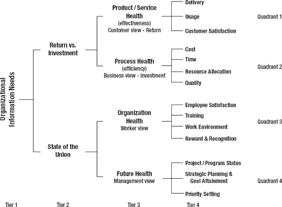
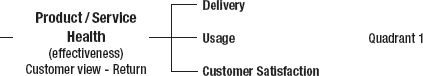
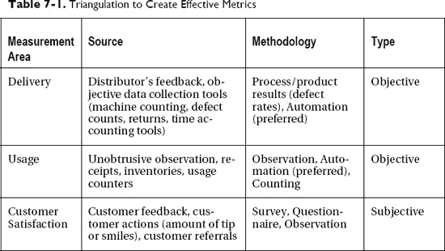
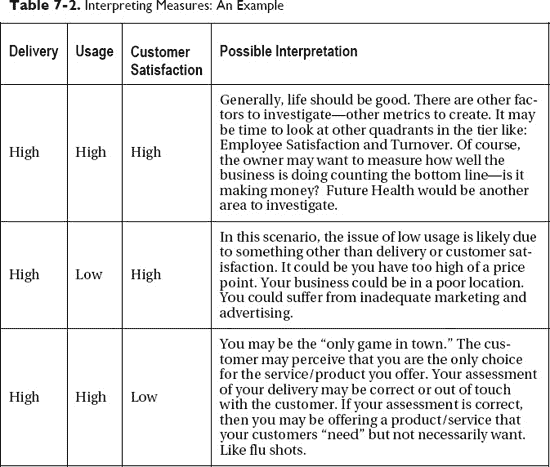
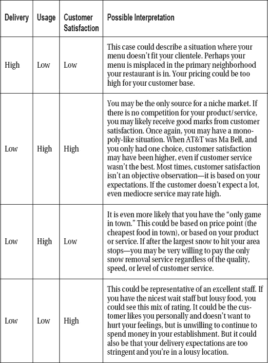
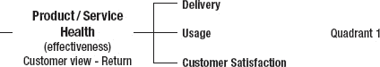

## 三角验证

创建有效指标的关键

话说从前，鼠妈妈生了三只美丽但失明的幼鼠。它们长大后，农夫的妻子心生怜悯，决定帮助它们在这个世界上生存下去。对于它们而言，由于缺乏视觉，这个世界变得更加危险。

农夫的妻子认为，如果老鼠们能学会分辨哪些动物是友好的，哪些动物更喜欢吃掉它们而不是与它们交谈，那将会很有帮助。由于她原本是个城市姑娘，于是她把三只老鼠装进自己的小货车，出发前往自然历史博物馆。她认为利用展品来介绍，比带它们接触真实的动物更安全。

尽管它们居住的农场里非洲野生动物不算多，但农夫的妻子觉得"有备无患"总比后悔好。

> 它们从老虎开始观察。她解释说，老虎只是比谷仓猫大一号的版本。第一只老鼠站在左后爪上。“它有爪子和巨大的脚掌，”它喊道。第二只老鼠站在尾巴上。“它有一条又长又粗的尾巴。”第三只老鼠，比另外两只大三秒钟，站在脸部的位置。“它有大眼睛、大牙齿和胡须。”
>
> 农夫的妻子微笑着问：“那么，这是什么？”
>
> “一只非常大的猫。”它们异口同声地回答。
>
> “非常好。这一个呢？”它们都走到下一个动物旁边。
>
> “这根本不是动物，是一根树干。”第一只老鼠说。
>
> “不，是一条挂在树上的蛇。”第二只老鼠说。
>
> 而第三只老鼠，再次站在动物的脸部，说道：“从强有力翅膀的感觉来看，这是一只巨鸟。”
>
> “孩子们，把所有这些感受综合起来。”农夫的妻子建议道。
>
> 它们思考了一会儿，最后极其和谐地齐声喊道：“大象！”
>
> “非常好。”
>
> 它们就这样继续在动物展区进行观察，识别出了狼、狗、狮子、熊。它们了解了各种类型的动物，无论是家养还是野生的。最后，它们遇到了一种无法解决的动物。它似乎长着狮子的头、山羊的身体和蛇的尾巴。
>
> “我们已经从头到脚仔细检查过这个动物了。”它们一致同意，“但我们无法就它是什么达成一致！”
>
> “那是奇美拉。”农夫的妻子说，“你们三个让我印象深刻。凭借对动物生理学的理解，你们利用非常不同的输入信息，成功地识别出了每一种生物。”
>
> 三只老鼠脸上洋溢着喜悦。
>
> “但是，我们并没有全部答对。”第三只老鼠想到奇美拉时说。
>
> “不，即使拥有来自多个来源的、各不相同但相互补充的可靠数据，你们也未必总能找到‘真相’。”她对它们已经做得如此出色感到非常满意。有时候，即使拥有大量数据，也可能无法得出正确答案。当然，如果你能亲自观察事物本身，那会有所帮助。

研究人员是数据的终极使用者。

### 三角测量——历史视角

实验鼠被迫使用`triangulation`（三角测量）来识别动物。它们比较通过不同方法收集到的不同信息，以确定问题的答案（我们触摸的是什么动物？）。如果老鼠只关注单一信息片段，它们就会得出错误答案。

我向伊利诺伊大学厄巴纳-香槟分校的传播学与社会学教授诺曼·K·登钦致敬，因为他将`triangulation`这一术语用于指代在收集和研究数据时使用两种以上方法。我的定义与其非常相似——即使用多种衡量手段和收集方法，来处理指标中使用的信息。

根据登钦的说法，使用三角测量的一个主要原因是为了减少（甚至消除）研究中的偏差。通过三角测量，我们确保对问题有了全面的答案。

在他的著作《社会学方法：资料汇编》中，登钦描述了以下四种三角测量类型：^(1)

*   **数据源**：使用多个数据来源。

*   **调查者**：使用多人来收集、分析或解释一组数据。

*   **理论**：使用多种视角来解释一组数据。

*   **方法**：使用多种方法来获取数据。

但即便是登钦也不得不承认，这并非他的“发明”，因为他引用了尤金·J·韦布的一篇论文，韦布在文中为社会研究提供了一种三角测量法。登钦指出，随着你不断增加用于洞察单一问题所采用的不同衡量方法，其定义会从抽象概念，演变为经过验证的概念，最终成为被证实的现实。尽管登钦可能并非创造`triangulation`这一术语的第一人，但我欣赏他的解释。这与我在衡量指标项目背景下使用该术语的方式高度吻合。

登钦的四种三角测量类型与我用于衡量指标的不同类型并非完全吻合——这部分是由于我们使用结果的性质不同。登钦为社会研究提供指导，其目的是在其领域内寻找更深层的真理，并通过期刊和实验在科学界对这些真理进行辩论和挑战——而我们的需求（你我的需求）则要简单和实际得多。

¹ 诺曼·K·登钦，《社会学方法：资料汇编》（芝加哥：阿尔定出版社，1970 年）。

在我的领域，需要不同调查者的需求相对不必要，尽管在研究领域这对避免分析偏差至关重要。我认同使用不同数据源、不同视角和不同方法。我把视角称为观点。现在让我们来看看我版本的三角测量。

### 三角测量作为实际应用

2003 年，我提出了一个使用多种衡量手段来构建综合指标的概念。当时我正在为我的 IT 部门开发一个衡量指标项目，我需要构建一个完整的叙事，来回答最高执行官提出的两个问题。他的第一个问题是：“你们做得怎么样？”

他是在询问我们 IT 组织的健康状况。这是一个简单但具有驱动性的问题。它不仅催生了一套衡量指标，还开启了我的旅程，最终将我在这本书中记录下的许多方法和理论付诸文档。

执行官的第二个问题是第一个问题的绝佳补充：“你怎么知道？”

我想我喜欢这些问题，最主要的原因是它们的简洁和直接。它们推动我们的组织走向一个可行且实用的衡量指标项目。

#### 衡量指标的三角测量

我将重点放在`答案键`的有效性象限上（图 7-1），选择从我们客户的角度来限定这个问题——因为提问的执行官正是我们的最高层客户。虽然执行官可能关心我们办事的效率如何，但他首要关心的是我们对客户的服务质量。

**图 7-1.** 答案键

当我开发用于回答这些问题的衡量指标时，我知道提供一个能被接受为准确的答案至关重要。除了需要对数据收集和分析进行控制之外，我还需要一个基本的指标构建框架。

我知道这个象限。我也知道可能适用的衡量方法（至少是一个起点）。我还知道如何测试这些衡量方法与产品/服务健康象限的一致性。

但为了确保我们获得全面的图景，我采用了`三角测量`——即使用三种或更多种衡量方法来回答问题。以`有效性`为例，我们从`答案键`中识别出主要的几个——`交付`、`使用`和`客户满意度`，如图 7-2 所示。

**图 7-2.** 产品/服务健康象限

我没有只选一两个，而是决定我们应该三者都用，这样能提供更全面的图景。每种衡量方法在数据来源和收集方法上都具有不同的特性。

`交付`解决了客观衡量我们提供服务和产品质量的需求。这一衡量方法将在没有客户参与的情况下捕获我们有效性的数据。最佳数据来源是 IT 部门使用的问题跟踪和报告工具。衡量指标的好处之一就是它能凸显出你已在使用的工具。

通过使用这些工具的数据，它促使各单位比以前更准确、更频繁地捕获数据。在衡量指标项目之前，这些工具并未得到最佳利用，产生的数据也无用——这就是`GIGO`（垃圾进，垃圾出）。

`使用`是一种不引人注意地捕获客户观点的方式，在这种情况下，观察客户如何“用脚投票”。这可以通过独立客户数（你到底服务了多少客户）或回头客数来体现。

`客户满意度调查`可以让你询问自己为客户服务得怎么样，并了解什么对他们重要，但你也可以提出开放式问题，直接获取关于如何改进的意见。尽管 IT 部门已经针对每个问题案例做了满意度调查，但这些调查只收集了那些对我们的服务或产品表达过不满，并且已经在使用我们产品或服务的客户反馈。

我们也想听听那些对我们的服务没有过任何问题的客户的意见，或许更重要的是，那些还没有尝试过我们服务的客户的意见。我们需要知道潜在客户为什么不找我们来满足他们的需求。一个组织如果只向现有客户进行营销，增长是有限的。在某个时刻，它需要吸引新客户。

因此，除了问题单跟踪调查之外，IT 部门还对整个客户群体进行了年度调查。根据你的业务情况，你可能需要对潜在客户进行抽样调查。

所研究的每个领域都有其客户视角，并处理不同类型的反馈——客观且独立的客户反馈、间接客户反馈以及直接客户反馈。

如果你能引入`三角测量`的概念并让它被接受，那自然很好。如果你能引入我迄今为止提出的任何概念——从根本问题，到衡量指标框架和分类法，再到文档使用、如何正确与错误地使用指标、答案键、从有效性开始——而无需费力争取其被接受，那也很好。

好的，遵照您的要求，以下是翻译后的中文文档：

# 引言

当我尝试为自己的组织建立一个度量程序时，遇到了很大的阻力。我曾以为这源于“本地无先知”综合征。但在帮助他人建立并实施度量程序之后，我现在认为原因远不止于此。尽管这种综合征确实会造成困难，即使你是一名外部顾问，依然会听到这样的反对声——“去问客户啊！我们的客户满意度调查就够了！”这不仅是有人会大声疾呼，而且还会引来一片强烈的附和声。

即使在今天，我仍不得不为多维度度量而努力。这不仅是指使用两个以上的度量指标，更是指在同一象限内使用来自不同视角的指标。

## 收集方法与来源的三角互证

三角互证也需要不同的收集方法，如下所示：

-   **交付量** 是客观收集的，无需客户参与。换句话说，客户不会知道你在收集数据。你不会使用任何意见（全是定量数据）。大多数时候，我也尝试对这些指标使用自动化收集方法（例如问题呼叫跟踪系统、监控系统或时间核算系统）。需要注意的是，这些指标衡量的不是客户，而是组织交付产品和服务的好坏程度。稍后我会解释。

-   **使用量** 是基于客户行为的度量。他们买了什么？他们给谁打过电话？他们多久使用一次我们的服务？他们是如何知道我们的服务和产品的？我们有多少一次性客户，又有多少回头客？

-   **客户满意度** 是最以客户为中心的度量组。在这里，我们直接询问客户的意见。将此项目称为“客户直接反馈”可能更贴切。你询问客户对服务和产品的看法，也询问改进建议。这些问题可以通过调查、焦点小组或个人访谈来提出。每种方法各有利弊，从不同的成本到收集数据量的差异。你应该选择最适合你的方法。很多时候，客户群体会决定最佳的反馈工具。

还记得那三只盲鼠吗？当它们“观察”大象时，很难弄清楚它是什么，直到它们被允许交流各自的观察结果（三角互证）。既然它们能正确识别动物，似乎无需改变这种策略或方法——只需改变样本和来源即可。更精确的三角互证形式会使用多种方法和策略。如果这头大象是活的，而不是博物馆的展品，那么一只老鼠可以用触觉，另一只用嗅觉，第三只则可以向大象提出一系列深思熟虑的问题。

三角互证要求你使用不同的来源、方法和度量类型。表 7-1 反映了这些可能性。

你可以使用其他分组进行三角互证。我提出这些分组是因为我知道它们行之有效，并且易于实施。其核心思想是至少要涉及三种不同的视角、来源和收集方法。

三角互证的概念可以应用于度量的每一个层级。我不建议你深入太多，否则你可能会发现自己收集了成千上万种不同的度量指标。我希望你在顶层使用三角互证——在有效性度量中，即在交付量、使用量和客户满意度层面。但是，你也可以在下一层级使用同样的概念。

对于客户满意度，你可以使用以下三种不同的收集方法：调查、焦点小组和访谈。这可能非常昂贵，尤其是访谈。但你也可以使用两种不同的调查——面向大部分客户群的年度调查，以及问题呼叫调查。你还可以使用工单调查——即在交付服务/产品时提供给客户的问卷。这是对你的活跃客户群进行的另一项调查，但不需要他们有投诉。你还可以在交付后三到六个月进行满意度调查，以了解客户是否：

1.  在最初的兴奋感消退后，仍然对服务或产品感到满意

2.  对你的产品或服务的优势或劣势有了新的见解

3.  已将你的服务或产品推荐给了其他人

使用量也允许有多个度量指标。你可以衡量独特客户的数量、回头客的数量，以及客户“购买”你服务和产品的频率。我最近在百思买买了一台新笔记本电脑，体验非常愉快，以至于第二周我就带我已成年的女儿去了那里。她为自己买了一台笔记本电脑（和我的完全不同），而我也忍不住买了一个无线键盘和鼠标（我现在正在用它们打字）。我不但自己成了回头客，而且第二周还推荐了另一个人（实际上，我开车送她去商店，帮她挑选电脑，并主动提出帮她把电脑拿到车上）。所有这些都可以用于衡量使用量。

我把交付量放在最后，因为它是最容易进行三角互证的。在我为我的组织开发的程序中，我将交付量分解为以下三个主要因素：

-   **可用性**

-   **速度**

-   **准确性**

### 交付量：可用性

可用性很直接，但并不总是适用。当客户需要或想要服务或产品时，它是否可用？就电话服务而言，当你拿起听筒时，是否有拨号音？我刚刚因为屋外的电话线故障，在家忍受了五天没有电话服务（我家里仍然有固定电话）。服务（产品）五天内不可用。我和我的妻子都觉得这不可接受。可用性也可以进行三角互证（记住，我警告过不要深入太多）——在这种情况下，完全中断、部分中断和服务降级是三个可行的度量指标。

### 交付量：速度

速度是交付量度量中最有力的指标之一，尤其是在我们当今的社会，甚至是全球社会中——我们都希望事情更快完成。耐心基本上已经是一种遗失的美德。所以，在我的项目中，我们衡量了解决速度、恢复速度和完成工单的速度。我们还衡量了项目交付、软件合同和新产品上市的速度。许多公司另一个偏爱的指标是响应速度——你回复信息、接听电话或亲自响应的速度有多快？速度很容易与可用性相关联。例如，我们不仅想知道中断的次数和持续时间，还想知道我们响应、解决问题和恢复服务的速度有多快。

耐心基本上是一种遗失的美德，因此预计你的许多产品/服务健康指标将与速度相关。

以我的电话中断为例，我对响应时间感到不满（技术人员五天后才上门），但我对解决速度感到满意。技术人员在不到 30 分钟内就解决了问题。

### 交付量：准确性

我用于交付量的最后一个领域是准确性。这通常以返工的形式来衡量。在客户认为问题已解决后，有多少工单被重新开启？其他指标可能包括交付产品的缺陷数。服务中也存在错误。我们是否交付了正确的东西？我们是否交付给了正确的人？在正确的时间？在正确的地点？组织可能在很多方面犯错。准确性从客户的角度衡量你的产品或服务的质量。

# 视角三角互证

三角互证是一个简单的概念。尽可能使用多种数据来源，使用一种以上的衡量方式、一种以上的收集方法、一种以上的视角。就你们所讨论的象限而言，不同的视角并非指以下四种观点：

1.  顾客的

2.  企业（管理者）的

3.  员工的

4.  领导层的

相反，我提供的是以下视角：

1.  客观的、无顾客参与
2.  顾客行为（观察）以及
3.  顾客直接反馈

就有效性指标（我建议你从这里开始）而言，你只需处理顾客的观点。

> “同时考虑内在和外在的测试因素，迫使每位研究者自觉地意识到自己的每一个行为如何可能影响后续的观察。从这个角度来看，研究成为一种社会行为。”^(2)

如果指标成为一种“社会行为”会怎样？如果指标通过三角互证，结合研究结果的公开分享，变成一种协作活动呢？一种组织内部的社会行为？这将有助于消除数据的误用和滥用，允许多种视角以确保数据的准确性，更重要的是，能引导对指标（答案）进行更有意义的解读。这种社会行为也可能促使组织提出更优质的问题。

## 人口统计学数据不算

你可能会错误地基于人口统计学数据来对你的指标进行三角互证。这并非真正的数据三角互证，而是分解。例如，在高等教育机构中，我们经常根据客户群（教职员工和学生）的人口统计数据来看待问题。并非每个客户都能明确归入这三类，所以我们也会考虑非机构关联方、高级职员和家庭成员。虽然这提供了多种不同的数据，但它们并非不同的观点、来源和方法。它们只是对已收集数据的细分。这种分解可能非常有用（尤其是在想了解特定群体的反馈时），但并不构成三角互证。

这些细分对于分析客户群体中的子集非常有用，并能让你满足每个群体的特定需求。但这并不满足三角互证的要求。

______________________________

² 诺曼·K·邓金，《社会学方法：资料集》（芝加哥：阿尔丁出版公司，1970 年），第 471-472 页。

根据邓金的观点，在单一调查中使用多种形式的三角互证可以提高对（观察到的）研究结果的信心。他还提出，衡量方式、收集方法、数据解读人员以及数据来源的多样性越高，信心水平就越高。三角互证的程度越高，信心水平就越高。三角互证的程度越低，信心水平就越低。

我认同这个概念，并且很乐意主张，由多种衡量方式构成的任何指标，其信心水平都会高于由较少衡量方式构成的指标。从其他指标推导出的答案能带来更高的信心水平。

但我并不主张通过处处要求元指标（由其他指标构成的指标）来追求这种信心水平。请记住，有些问题可能甚至不需要一个指标。有些可能只需要一个“是”或“否”的答案。其他的可能需要一个（或两个）衡量指标来提供必要的洞察，以便做出更明智的决策。但是，问题越复杂、越关键，就越需要更高的信心水平。如果你的根本问题将被用于帮助决定整个组织的未来方向以及重大的投资决策，你可能就需要对构建指标所用的单个数据以及指标的总体结论抱有更高的信心。

## 相互矛盾的结果

由于我们使用了不同的方法和数据来源，我们面临着获取相互矛盾结果的真实风险。但是，你不应将其视为负面因素，而应将其视为积极因素。

让我们看看餐厅的例子。如果我们餐厅的有效性指标由交付、使用情况和客户满意度构成，我们可能会期望这三个衡量领域的结果始终一致。如果我们服务好（交付），客户满意度评分就应该高。而如果客户满意度高，我们可以假设回头客多，使用频率也高。我们也期望相反的情况：如果客户满意度低，我们预期顾客不会再来；如果我们交付不佳（速度太慢、送错物品或菜单项目缺货），我们就会预期评分低、使用率低。

这些是符合逻辑的假设，但很多时候却是错误的。每一种排列组合都告诉我们一些不同的信息。在表 7-2 中，让我们看看每个指标简单的高/低结果。当然，你指标的实际结果可能要复杂得多——尤其是当你想到每个指标本身也可以运用三角互证时。交付可能可用性和速度很高，但准确性很差。你可能对某类客户群使用率高，而对另一类使用率低。客户满意度可能在有些方面得分高（员工礼貌），在另一些方面得分低（员工效率）。与其进一步复杂化，不如让我们在更高层次上审视这些指标，同时考虑到在较低层次的三角互证中可能存在的复杂性。

除了对每个衡量领域的单独解读，三角互证本身也提供了若你只收集一两个领域就会缺失的信息。

以我们的餐厅业务为例，让我们解读一些可能的指标。在表 7.2 中，你可以看到指标结果的不同排列组合如何讲述不同的故事。虽然每个指标都提供了一些基本见解，但将它们相互关联起来审视才更有意义。

你可能会争辩说，三角互证似乎使结果更加令人困惑，而不是更清晰。但实际上，三角互证确保你拥有更多的数据以及看待这些数据的更多视角。你拥有的信息越多，你的答案就会越好。但在所有情况下，下一步都应该是一样的：调查，调查，再调查。三角互证的美妙之处在于，你已经拥有了如此多的输入，以至于你的调查可以更有针对性，并且用更少的额外工作获得更大的收益。

设想一下，如果你只衡量了客户满意度。如果你在这方面的评分很高，你能得出什么结论？你可能觉得一切都很美好。但如果你没有赚到足够的钱来维持生意，你就会想知道发生了什么。

三角互证不仅允许你使用不同的数据来回答一个单一问题，它实际上还鼓励你这样做。

### 回顾

三角测量是构建强大度量体系的根本基础。三角测量有许多优点。使用的三角测量越多，这些优势就越明显。但“凡事有度”这句话同样适用于三角测量——任何事都可能过度。你需要找到适合自己的平衡点。让我们看看以下几个优点：

-   对构成度量的测量数据准确性的信心更高
-   对收集、分析和报告测量数据所用方法的信心更高
-   对答案有更广阔的视角——提高准确解读度量的可能性
-   因知道自己在“倾听所有客户的声音”而感到满足
-   更稳健的度量（如果丢失一项测量数据、数据源或分析工具，你还有其他测量数据可以依赖）
-   确信自己尽可能全面地“看清”了大局

在测量数据收集和分析的多个环节中都采用三角测量非常重要，包括以下方面：

-   多个数据来源
-   多种收集方法
-   多种分析方法（跨不同测量数据，以及愿意对同一测量数据应用不同分析手段）
-   多个领域（如交付、使用和客户满意度）或类别

在如此多元化的环境下，保持聚焦至关重要。从“答案地图”中不同象限收集数据并不符合三角测量的原则。如果通过混合核心视角来稀释你的答案，你可能会迷失在数据中。如果失去焦点，从“答案地图”中互不关联的部分收集数据，很可能你是在试图用一个答案回答多个问题。虽然元度量会将其他度量作为其输入的一部分，但它们仍需严格限定在根本问题所定义的上下文范围内。

一个扎实的度量最终会引导你探索“答案地图”中其他领域的度量，但这必须在你尽职尽责地回答好当前问题之后。

## 结论

三角测量的概念并非度量开发所独有，它已被证明是利用数据的有效指导原则。

三角测量是创建可行度量体系的主要原则。它需要你付出努力，从更多来源、以多种方式收集和分析更多数据，但作为回报，它带来了诸多好处。在“答案地图”的“产品/服务健康”象限中运用三角测量，能让你获得一套强大的测量数据来构建度量。

通过专注于融合多种来源、测量数据和方法，你最终能得到一个全面的度量。你仍需评估该度量对问题的覆盖完整性，但三角测量能让你更轻松、更少困扰地达到目标。

**图 7-3.** 产品/服务健康象限

快速审视“产品/服务健康”象限（图 7-3）即可说明这一点，具体如下：

-   产品/服务健康
    -   交付
        -   可用性
        -   速度
        -   准确性
    -   *使用*
        -   独立用户数
        -   回头客
        -   推荐量
    -   客户满意度
        -   年度调查
        -   问题解决反馈
        -   访谈

以上每个类别下都可以有超过三个组成部分。例如，你可以在“交付”中增加“可靠性”，或在“使用”中增加“使用频率”。很多时候，测量数据本身会决定不同的收集和分析方法。调查问卷与访谈有着本质区别。虽然问题解决反馈通常以调查问卷形式呈现，但所提问题的类型与每年进行一次的总体调查截然不同。

每一块信息（交付、使用和客户满意度）都有不同的收集/分析方法论，但在每组内部，你还可以进一步变化收集/分析的工具、流程和方法。

当你将“答案地图”的聚焦特性与三角测量的全面性结合起来时，你会发现自己已准备好向组织推广一个切实可行的度量体系。

