# 指标只是指标

最简单的例子可能来自客户满意度调查。即使在焦点小组访谈中获得的直接反馈，也需谨慎对待。当我们审视真正客观的数据时，总有被误解的余地。客观的测量工具可能存在缺陷，并产生错误数据。

大多数时候，优秀的管理者（以及优秀的员工和优秀的客户）无需数据就能了解真相。当你看到与直觉不符的数据时，请进行调查。当数据过于轻易地符合你的预感时，也请进行调查。

按照我建议的方式构建指标的主要好处之一是，它能完整地讲述一个故事，回答一个根本问题。如果你构建得当，它很可能是准确和全面的。这是你最接近真相的东西。但根据经验，我知道无论我多么努力，总会有出错和曲解的空间。为调查原因稍作停顿不会有坏处——而且可能大有裨益。

## 指标可能是错误的

由于任何收集方法中都可能存在变数和错误，因此任何衡量标准的完全有效性总是有存疑的余地。如果你对信息所表达的内容没有健康的怀疑态度，你往往会误入歧途。假设你汽车的发动机检查灯亮了。再假设这辆车是新车。即使我们知道这个灯是故障指示灯，我们也应避免妄下结论。我最喜欢去修车店的经历是，他们对我发动机检查灯进行诊断，并确定唯一的问题*在于*发动机检查灯本身。

也许你在想，燃油油位指示器会是一个更好的例子。如果燃油表显示接近空油，特别是在警告灯亮起的情况下，你可以高度确信需要加油了。但燃油表仍然只是一个指示器。也许它比发动机检查灯更可靠，但它仍然只是一个指示器。除了涉及的变异性（我注意到，在斜坡上时，指针会从接近空油跳变到接近八分之一箱油！），仍然存在油表卡住或损坏的可能性。

我理解如果你选择相信燃油表、温度计或数字时钟——这些是单一度量。但是，当你审视由多个数据、度量和信息组成的指标时，我希望你在解读指标含义时，保持适度的谦逊。

这种健康的谦逊能防止我们仅凭指标就匆忙得出结论或做出决定。

指标是工具，是指示器——它们不是答案，并且可能有多种解读。

我经常听到（频率之高让我反感）指标应该“驱动”决策。我更喜欢的态度和信念是，指标应该“为决策提供信息”。

## 准确的指标仍然只是指示器

撇开出现错误数据的可能性不谈，还有一些重要的理由让我们不要过分信任指标。

让我们来看一个美国职业棒球大联盟的例子。我喜欢用棒球举例，因为在所有主要运动中，棒球无疑是最注重统计的。球迷、记者、解说员和球员都用统计数据来讨论这项美国国球。可以说，统计数据是比赛固有的一个组成部分。

入选国家棒球名人堂，在很大程度上是球员职业生涯的巅峰。让我们来看一位最伟大球员的数据。2011 年，我亲眼目睹了德里克·基特（Derek Jeter）的第 3000 支安打（一支本垒打），这是球员几乎可以确保进入名人堂的成就之一（基特是有史以来第 28 位达成此成就的球员）。问题立刻被提出——基特能否成为历史安打王？当时的历史安打王有 4256 支安打！就我个人而言，我认为基特做不到。

这位历史安打王在 23 年的职业生涯中，曾 17 次入选全明星赛——而且是以前所未有的五个不同位置入选。他赢得了三次世界大赛冠军、两次金手套奖、一次国家联盟最有价值球员（MVP）奖，以及一次世界大赛 MVP 奖。他还赢得了年度最佳新秀奖、卢·格里克纪念奖，并入选了美国职业棒球大联盟世纪之队。根据一个在线来源，他在美职联的纪录如下：

*   最多安打

*   最多出局数

*   最多参赛场次

*   最多打席数

*   最多一垒安打

*   作为左右开弓打者的最多得分

*   作为左右开弓打者的最多二垒安打

*   作为左右开弓打者的最多保送

*   作为左右开弓打者的最多垒打数

*   单季 200 支以上安打的最多赛季数

*   单季 100 支以上安打的最多连续赛季数

*   单季 600 个打席的最多连续赛季数

*   唯一在五个不同位置都打了超过 500 场比赛的球员

这位棒球运动员还保持着其他一些世界纪录，以及许多国联纪录，包括最多得分和最多二垒安打。

在我能找到的所有榜单中，他都位列历史棒球运动员的前 50 名。1998 年，*体育新闻*将他排在第 25 位，而美国棒球研究协会将他排在第 48 位。

所以，基于所有这些客观、经过严格核查的数据，应该很容易理解为什么这位职业棒球运动员在他有资格参选的第一轮投票中就全票入选了国家棒球名人堂。

但他并没有入选。

他的名字是皮特·罗斯。他不在棒球名人堂中，而且可能永远进不去。如果你看在名人堂投票者们使用的所有统计数据，他的入选是显而易见的。但这些统计数据在讲述一个完整故事的同时，缺少了被考虑进去的输入信息——具体来说，他违反了棒球界一条不可逾越的规则：他在职业棒球比赛中合法和非法的赌博行为。

面对“皮特·罗斯应该入选棒球名人堂”这一压倒性的“事实”，真相与数据截然相反。

即使我们看到定义明确、讲述完整故事的指标，它们在最真实的意义上也只是指示器。如果你完全且清晰地解释你调查的结果，你就能通过解释指示器的含义来完善指标。你解释这些指标指示了什么，以便做出更好的决策、发现改进机会或确定进展。你提供了一种解读——希望这种解读有你调查结果的支撑。

无论你如何装饰，指标都只是指示器，因而只应引发一个初始反应：进行调查。

当然，有些指标足够简单，你无需太多调查就会接受它们所讲述的故事（比如你车上的燃油表），但即使在这些情况下，你也应保持警惕，以防它们开始向你显示你认为具有误导性或错误的数据。

归根结底，即使你对数据的准确性有十足的信心（例如，职业体育统计数据），你也必须将它们全部视为指示器。数据无法预测未来。如果它能，那么就没必要进行比赛了！

关键在于，指标不应被视为事实，而应被视为当前和过去状况的指示器。如果运用得当，指标应引导我们的对话，帮助我们集中注意力，并将我们的注意力引向正确的方向。指标并不提供答案；它们帮助我们提出正确的问题并采取正确的行动。

## 指示器：定性数据与定量数据

定性数据和定量数据的简单区别在于，定性数据由意见构成，而定量数据由客观数字构成。定性数据更容易被接受为一种指示器，而定量数据则更可能被错误地视为无需进一步调查的事实。让我们来看看这两大类指示器。

### 定性数据

客户满意度评级是一种观点——衡量客户满意程度的定性指标。大多数定性数据收集工具包括调查问卷和访谈。它们可以采用开放式问题、选择题或评级的形式。即使是观察结果，如果不涉及捕捉“数字”——比如统计棒球中的击球次数，或关于特定产品线的提问数量——也可以是定性的。当观察结果捕捉的是观察者的观点时，我们得到的仍然是定性数据。

很多时候，我们需要用定性数据来回答我们的根本问题。除了询问客户满意程度之外，其他例子还包括：

- 你的员工满意程度如何？

- 你的客户更喜欢普通产品还是低糖产品？

- 他们希望多快能拿到产品？

- 你的客户愿意为你的产品或服务支付多少钱？

- 你的客户希望在什么时间或时段获得你的产品或服务？

- 你的员工是否感受到被重视？

无论你如何收集这些数据，它们都是观点。它们不是客观数据。在很大程度上，它们甚至不是数字。你可以获取定性数据，并尝试将其转换为更具定量的形式——例如，将观点转化为李克特量表上的分值。但归根结底，它们仍然是观点。它们看起来像定量数据，但实际并非如此。

一些分析师，尤其是那些坚信“客户永远是对的”的分析师，认为定性数据是最好的数据。这些分析师相信，通过开放式问题，你可以获得关于你的流程、产品和服务的宝贵反馈。既然客户是上帝，还有什么分析工具能比捕捉客户对你产品和服务的看法更好呢？

这些分析师很喜欢焦点小组和访谈。调查问卷在紧急情况下也凑合能用，但缺乏让分析师观察非语言信息及其他线索的能力，而这些线索有助于他们判断“我们的客户有多满意？”这个问题的答案。

近年来最受欢迎的组织发展书籍之一是马库斯·白金汉和柯特·科夫曼合著的《首先，打破一切常规》（`Simon & Schuster`, 1999 年）。这本书建立在对定性数据的分析之上。其书评向潜在读者承诺，能帮助他们“洞察”成功公司中成功管理者与领导者的内心，以此吸引读者。这本书的巨大成功，仅仅是定性分析力量在现代的一个实例。

### 定量数据

定量数据通常指数字——不带情感的客观度量。这包括你汽车上的所有仪表。它们也包含来自自动化系统（如自动呼叫工具）的信息，这些信息告诉你接听了多少电话、接听耗时多久以及通话时长。

过去曾有一场争论，认为一种数据形式优于另一种。有人认为定量数据更好，因为它避免了基于情感观点的数据中天然存在的不一致性。定量阵营随后辩称，某人可能因多种与产品质量无关的原因，而在满意度量表上对你的产品给出高分或低分。评估服务质量或产品时，一些可能影响定性评估的因素包括：

- 提问的时间点

- 受访者在你提问前的心情

- 受访者过往使用类似产品或服务的经历

- 房间的温度

- 照明条件

- 提问者的外貌吸引力

- 访问者是否有外国口音

这个列表可以无限列举下去。另一方面，定量数据则避免了这些变数，直接关注那些可以被计数的事物。在同类场景下的一些例子包括：

- 购买你产品的客户数量

- 客户购买该产品的次数

- 客户为你的产品支付的金额

- 客户还购买了哪些其他产品

- 产品退货的数量

定量信息的支持者会认为，这种数据更可靠，因此也更有意义。

我相信你已经猜到，这两种观点都不完全正确。我建议混合使用两种类型的数据。

在很大程度上，定性和定量数据各自的缺陷，最好通过引入对方数据来弥补。孤立地看待定性数据很难令人信服，因为影响所收集信息的因素太多。如果客户说他们喜欢你的产品或服务，但从不购买，那么当公司倒闭时，你从积极反馈中获得的温暖感将毫无帮助。关于销售数量和回头客数量的定量数据，则有助于为定性反馈提供信心。

如果我们只看定量数据，我们就有做出不明智决策的风险。如果我们测试产品的全部库存一天内售罄，我们可能会认为这是个热门产品，并预期能卖出更多。如果没有定性数据支持这一假设，我们可能会进行大规模生产并投入巨资。定性问题本可以告诉我们产品为何如此畅销。我们或许会了解到，这种即时成功的原因不太可能重现，因此在全力推进之前，我们需要进行更多的研发。也许产品售罄是因为一个糊涂的客户被派去购买大量 X 产品，却错误地买了很多你的产品。也许它卖得快是因为它是一个外观新颖的新产品，但当被问及时，客户向你保证不会再买——他们并不喜欢它。

你不仅应该使用两种类型的数据（以及相应的数据收集方法），还应该争取收集多种数据。当然，一旦你收集了数据，就必须研究其结果。

你可能认为定性指标是更明显的指示器。然而，即使我们问一位客户是否对产品满意，她斩钉截铁地回答“是”，她的回应也并不意味着她真的满意。我们唯一知道的“事实”是，受访者说她满意。

即使在自动呼叫软件的情况下，结果也只是指标。

定量数据虽然客观，但仍然只是指标。如果你不知道数字为何如此，你最终只能猜测数字背后的原因。如果你猜测原因，你就是在猜测答案。

指标（指示器）需要经过解读才能被恰当使用。

我主张采用三角互证法（参见第七章），以便更全面地理解任何根本问题的完整答案。这要求我们不应单独依赖定性或定量数据。关于哪种更好的大辩论是不必要的。你应该在你的方案中综合使用这两者。

### 回顾

以下是需要记住的原则：

- `指标仅仅是指示器。`

- 指标并非事实。即使你对它们的准确性有很高的信心，也不要将其提升到真理的地位。

- 对指标的唯一正确回应是进行调查。

- 当你通过添加叙述来讲述故事时，你是在解释指标所表明的内容，以便做出更好的决策、发现改进机会或确定进展情况。

- 指标主要有两类：定性指标和定量指标。定性指标本质上具有主观性，通常是意见的表达。定量指标本质上具有客观性，通过自动化、公正的工具进行汇编。

- 指标本身并不能提供答案；它们帮助我们提出正确的问题并采取正确的行动。

- `指标需要解释才能发挥作用。`

- `即使是解释本身也可以被解读——指标的目的不是提供真理，而是提供洞见。`

## 结论

指标仅仅是指示器。这并不意味着它们无效或不准确。即使是最客观、最准确、最有效的指标，也只能被当作指示器对待。在空军服役期间，我学到了“感知即现实”。这一点同样适用于指标。我坚持要求你在图表旁边附上解释的主要原因之一，就是为了限制对指标感知的差异性。对指标的解释不应留给观看者。你应该尽职尽责地进行调查，探究指标在告诉你什么。你应该根据调查结果，基于数据形成深思熟虑的结论。这些内容应在指标的解释中提供。

然后，你要尽最大努力向你的受众“推销”你对指标的解释。即便如此，你也必须接受，你的解释对于那些查看指标的人来说，仍然是可以被解读的。你还必须接受，你精心定义且完整讲述的故事，归根结底也只是一个指示器。它应该是一个解释充分的指示器，并且你的诊断正确地解读了它；但它终究只是一个指示器。这需要你保持健康的谦逊态度。

请记住，指标只是一种工具。它们不应被赋予更多含义。

## 使用答案密钥

### 一个捷径

本章标志着本书实践部分的开始。我们在第一部分涵盖了大量理论和概念，这些内容应为实际工作奠定基础。

`答案密钥` 是一个工具，旨在帮助你确保找到根问题的正确答案。它适用于大多数组织改进方面的问题。它还能为你提供关于你可能希望衡量的其他领域的想法。当你使用`答案密钥`来推进组织改进工作时，你将获得最大收益。

### 什么是答案密钥？

`答案密钥`的起点是任何指标的定义点：对信息的需求，即根问题。`答案密钥`并非适用于所有根问题，仅适用于涉及组织健康的问题。组织健康涵盖了通常我们为其制定指标的广泛问题和需求。大多数根问题，尤其是在商业环境中，都围绕着组织运行状况如何展开。大多数平衡计分卡（见下文框）和关于客户满意度的问题都属于这一范畴。

`答案密钥`是你将遇到的许多指标的捷径。它包含了我建议组织在首次尝试实施指标体系时应首先采用的指标。

**平衡计分卡与仪表盘**

平衡计分卡由半导体公司 Analog Devices 的经理阿特·施奈德曼于 1987 年引入。其最著名的倡导者是哈佛商学院的教授罗伯特·S·卡普兰和 Palladium 集团的创始人兼董事大卫·P·诺顿博士。其基本概念包含四个视角：财务、客户、内部业务流程、学习与成长。通过关注这些关键领域，管理层可以利用衡量指标和目标来把握组织的脉搏。

虽然我不赞同“目标”这一概念，并且对整个平衡计分卡有所保留，但它具有我必须尊重的优势。平衡计分卡已被许多组织成功使用，并且至今仍然流行。

“仪表盘”则是后来以更平衡的方式推广指标的一种形式。它秉承其名称的精神而创建，是一种动态的指标工具。与平衡计分卡类似，仪表盘也采用多项衡量指标，但包含了一个围绕关键绩效指标构建的、更具实时性的组件。可供选择的指标流程和工具层出不穷。好消息是，我所提供的内容可以应用于这些流行方法中的任何一种，或者你也可以开始一段个人旅程，从零开始构建你自己的指标。

`答案密钥`可以帮助你确定指标的发展方向。它还能识别出与你起始问题相关的其他问题。它还可以帮助你避免误入歧途，或避免精力过于分散、缺乏重点。

`答案密钥`由从左向右分支的层级组成。每个层级都比前一个层级包含更多的衡量指标和数据。以下各节将更详细地描述这些层级。

#### 答案密钥：第一层级

第一层级与其说是一个层级，不如说是一个起点。你的根问题是否是一个组织信息需求？你的根问题是否涉及关于组织的信息，特别是关于组织健康的信息？如果是，你的问题很可能属于以下两类关注点之一：

- 你向客户提供服务和产品的效果如何

- 你组织的未来前景如何

#### 答案密钥：第二层级

如果你的根问题符合`答案密钥`前两个层级之一，那么这个工具将帮助你集中精力并找到可行的衡量指标，而无需花费过多时间寻找它们。但是，如果你的问题不符合`答案密钥`，请不要为了使用这个捷径而改变你的问题。

同时，也不要忽略首先提出根问题的必要性。换句话说，不要从密钥开始。如果你这样做了，最终将阻碍你开发有用指标的努力，更重要的是，阻碍你回答问题的努力。

第二层级为战略层面的根问题提供了一个框架。如果你的根问题处于愿景层面，那么第二层级可能代表实际的指标。当你发现你的根问题基于改进组织时，该问题通常源于理解“组织现在在哪里”以及“它将去向何方”的需求。`答案密钥`表明，这种信息需求流入两个渠道：一个用于展示回报（我们得到了什么）与我们的投入（我们投入了什么）的关系，另一个用于协助管理资源。我将这两条分支称为“回报与投入”和“组织现状”。图 5-1 展示了这种分支结构。

**图 5-1.** 答案密钥，第一层级和第二层级

### 回报 vs. 投资

“回报 vs. 投资”是组织指标两大主要分支中的第一个。它代表了回答以下问题所需的信息：组织的运作状况如何？管理得好不好？我们是否在做正确的事？我们是否以正确的方式做正确的事？这些都是关乎改进乃至生存的关键关注领域。如果你没有在做“正确”的事，很可能很快就会倒闭，或者至少会失业。

如果你没有以正确的方式做事，你可能会发现组织仍能继续运转，业务也能勉强维持，但任何有意义的改进都极不可能发生。你最多能期望的是生存，而非繁荣。

围绕*回报*的根本问题可能包括：

- 我们在提供关键服务方面做得如何？

- 我们可以通过哪些方式来改进关键服务？

围绕*投资*的问题可能包括：

- 提供关键服务需要我们付出多少成本？

- 我们在管理资源方面做得如何？

当我们深入探究答案钥匙时，更具体的问题会逐渐显现。但请记住，根本问题的广度将决定你需要向左走多远。在答案钥匙上越靠左，问题就越宏观或越具有战略性。

### 组织状况

一旦你高效且有效地运营业务，就可以将注意力转向如何管理资源。你所拥有的最宝贵资产应该用爱心来维护。是的，我说的是你的员工队伍。我遇到过的每位老板都宣扬过同样的口号：“我们最宝贵的资产是员工。”然而，令我惊讶的是，我们对这些公认的无价资产的照料是如此糟糕。

我观察到有些管理者会将他们的宝马车送到经销商处进行定期保养，只使用优质汽油（无论油价如何），并且绝不停靠在其他车辆附近——但却对维护员工队伍完全不作为。没有培训计划，没有员工满意度调查，甚至连一个建议计划都没有。他们很少听取员工的意见，并且通过从不征求员工的观点来贬低他们。如果员工真的是我们最宝贵的资产，那么我们就应该如此对待他们。

这种对组织的看法就是我们的“组织状况”报告。它告诉我们的组织内部健康程度。虽然“回报 vs. 投资”告诉我们从客户和业务角度看的组织健康程度，但“组织状况”告诉我们的则是文化层面的健康程度。

除了员工队伍，我们还需要关注未来的潜力。我们可以通过审视我们如何管理走向成熟的成长过程来确定这一点。我们是否有良好的未来战略规划？我们是否在朝着目标努力？

你在这个领域可能遇到的根本问题包括以下内容：

- 我们组织内部对认可的文化有多强？

- 我们员工队伍的忠诚度有多高？

- 我们的专业发展工作成效如何？
- 我们组织的预期未来是什么？
- 与竞争对手相比，我们表现如何？
- 我们在实现战略目标方面做得如何？

你在答案钥匙上越往右走，根本问题就会变得越具体、越具战术性。

### 答案钥匙：第三层级

图 5-2 展示了答案钥匙的下一层级，我们将分支扩展为包括：产品/服务健康度（有效性）、流程健康度（效率）、组织健康度（员工维护）和未来健康度（项目与战略规划）。

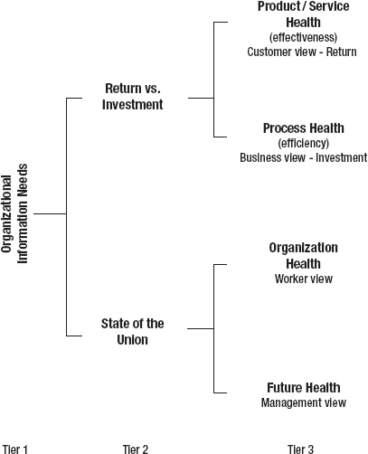

**图 5-2.** 答案钥匙，第一、第二和第三层级

大多数根本问题最终都归结为想要基于第三层级所代表的组织某一视角来获取答案。这些标题——产品/服务健康度、流程健康度、组织健康度和未来健康度——有助于我们理解每个分支与其他分支的关系。它们也有助于我们理解自己的指标适合放在哪里。与这些标题一起，我们还发现了附带的视角，以进一步辅助解读答案钥匙。这些视角表明，每个标题都可以从客户、业务、员工以及最终的管理层等角度来审视。

让我们来确定你的根本问题最适合放在哪里。

你的根本问题是关于你提供某项服务或产品的水平吗？它是否询问你是否在做正确的事？它是否询问你所做的事情是否满足了客户的需求或期望？你的根本问题会是客户会问的问题吗？如果你的问题符合上述任意一点，它就属于产品/服务健康度类别。

你的根本问题是否触及你执行交付服务或产品所需流程的好坏？你有多高效？执行流程中的任务需要多长时间或多少成本？你的问题是否是一线管理者会问的问题？如果你的问题可以在上述任何一点中找到，那么你很可能关注的是一个流程健康度的根本问题。

如果你的根本问题涉及人力资源、员工，或者是一位有同情心的领导者会问的问题，那么你的问题可能属于组织健康度分支。这里的根本问题会询问员工队伍的士气、忠诚度、员工留任率等。你对待员工有多好？你的组织是否位居行业最佳工作场所前 100 名？

第三层级的最后一个部分代表关注组织未来健康度的根本问题。组织是否患有组织不成熟症？战略规划、使命宣言和组织愿景有多大用处？研发进展如何？这一视角主要来自高层领导——如果你的领导层和组织已准备好展望未来。

你将如何使用答案钥匙来制定你的指标？

定义“回报 vs. 投资”所需的信息由“有效性”和“效率”这两条被广泛应用的道路组成。有效性是从客户角度看的组织健康度。组织在履行承诺方面做得如何？组织是否在做正确的事？这不仅对于制定可行的指标很重要，对于理解和培育组织文化也至关重要。有些组织甚至可能不知道自己的客户是谁。而且即使客户群已被明确定义，收集客户对有效性各个组成部分的看法也并未被视为重要。

有时，组织被迫询问客户对公司有效性的看法。于是，调查被构建，焦点小组被组建，问题被提出。

- 您使用我们的产品或服务吗？
- 您对我们产品或服务的交付满意吗？
- 您对我们的组织有多满意？

这些问题不仅有助于定义可行的衡量标准，也为您自身的成长提供了焦点。组织是否拥有明确定义并记录在案的客户清单？组织是否知道自己的产品和服务是什么？组织是否致力于让客户满意？组织如何“服务”客户？这些不仅仅是收集数据点的指南。答案钥匙帮助寻求实现持续改进的组织勾勒出一幅图景。

虽然这四部分可以描述指标本身（如果你有一个更高级别的根本问题），但很可能你的根本问题处于这个层级，而你的指标要到第四层级才会开始出现。

#### 答案层级：第四层

现在我们来看大多数组织开始并止步的层级。当你的根问题起始于此，你面对的是战术性的、低层次的问题。这在组织刚开始使用指标时属于正常现象。你遇到的根问题会非常具体，可能只涉及很小的领域。例如，你可能会有一个关于交付的根问题：“我们对客户更新请求的响应表现如何？”

你可能会遇到关于具体流程健康度的根问题，比如生产一个组件所需的时间、产出质量，或特定服务的成本。你的根问题落在答案层级中的哪个位置，决定了每个层级的特征。图 5-3 介绍了第四层。

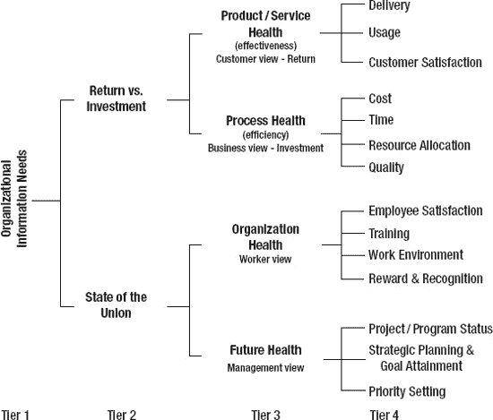

**图 5-3.** 答案层级，第一至第四层

如果你的根问题出自第四层，那么左侧的所有内容都是该问题的背景信息。随着组织逐渐成熟，你应该将问题向左移动，从更具战略性的角度提问。如果你的根问题在第二层，那么第三层代表你可以使用的指标，第四层则代表信息。每个信息集都会定义相应的度量和数据——如果有必要，甚至可以扩展到第五层和第六层。

答案层级不仅能让你保持专注，帮你确定感兴趣的领域；它还能根据你的根问题位置，提供一些标准化的指标、信息和度量方式。

##### 产品/服务健康度（有效性）

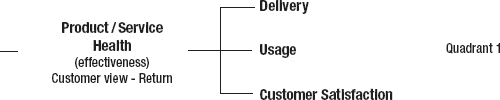

**图 5-4.** 答案层级，象限 1，产品/服务健康度

以下是产品/服务健康度（图 5-4）的主要组成部分：

- *交付*：你在产品/服务交付方面表现如何？
- *使用情况*：你的产品/服务是否被使用？
- *客户满意度*：客户对你的产品/服务有何看法？

每个组成部分都可以进一步拆解为更小的单元——使其更易于理解。交付就是一个很好的例子，因为它是一个更高层级的概念。我倾向于将交付分解为以下部分：

- *可用性*：当客户需要时，服务/产品是否可用？
- *速度*：交付服务/产品需要多长时间？
- *准确性*：我们是否按承诺交付，还是存在错误？

产品/服务健康度的驱动力是客户。我们不关心谁对问题“负责”。我们不关心你对情况或条件是否有任何控制权。我们只是想了解客户如何看待我们的产品和服务。这种审视组织的简单方式很有价值，因为它能让你轻松专注于最重要的事情。

##### 流程健康度（效率）

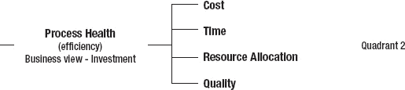

**图 5-5.** 答案层级，象限 2，流程健康度

回报与投资的另一个组成部分是效率，或者说组织是否在以“正确的方式”做事？此部分（图 5-5）体现了所有利益相关者都应认同的业务视角。以下经实践检验的效率组成部分仍然具有相关性：

- *成本*：我们执行流程的方式是否具有成本效益？
- *时间*：时间类似于客户视角中的速度。很多时候，相同的数据和来源可以重复用于此度量。执行一项任务或流程需要多少时间？
- *资源分配*：我们分配工作的效率如何？我们是否按类型和数量分配工作？
- *质量*：质量是业务视角中的准确性。即使我们有冗余系统提供 100% 的正常运行时间，我们也需要追踪（每个系统的）可靠性，以便进行最佳维护。

许多组织过于关注成本，却忘了他们的首要关切应该是组织是否在做正确的事（有效性），其次才是是否以正确的方式做事（效率）。相反，许多组织一发现成本方面的任何感知缺陷，便不假思索、不加批判地做出反应。由于缺乏服务和产品成本的相关信息，这一错误被进一步放大。这在软性行业中尤为明显。制造业通常能很好地掌握成本数据，但信息技术、软件开发或教育等软性行业却发现很难为其产品和服务定价。这合乎逻辑，因为这些组织通常很难定义他们生产的产品和服务是什么。试着问问某所大学的院长，该组织提供哪些产品和服务。然后再进一步看看这些产品的成本是否有记录可查。

时间，尤其是当它与成本（人/小时）挂钩作为限制因素时，是最容易被滥用的信息之一。当管理者开始相信他们可以要求获取数据，从而（在不进行辅导或领导的情况下）管理员工，而无需实际与他们交谈或了解他们时，他们就会盲目跟风指标。考勤表、时间-动作研究以及时间分配表开始流行起来。在一个精心构建的指标体系中，如果你不是从至关重要的根问题及其所有列出的组成部分出发，你根本不会到达这个层级，这应该能防止人们滥用数据。时间不应被用来“控制”你的员工。它应该用于以下目的：

- 提高组织估算交付时间表的能力
- 协助改进流程和程序
- 完善其他数据，例如成本和质量

如果“质量”是基于缺陷的客观度量，那么每千个实例中多少个缺陷才算是“高质量的”？高质量是目标吗？质量是“是或否”的决策吗？质量最好通过缺陷和返工来描述，并且和“时间”一样，它也可能被滥用。它并非管理者用来决定谁该加薪或处理其他人事问题的简单方法。如果你滥用指标，*质量就可能从工具变成武器*。

请确保你的指标被用作改进的工具，而不是武器。

质量、时间、资源分配和成本都是流程健康度的组成部分，并定义了组织流程和程序所代表的投资业务视角。因此，这些视角只应用于改善业务——而非针对个人。产品/服务健康度完全从客户视角出发。流程健康度也同样专注于其自身焦点——它代表了业务视角。客户很可能永远看不到（也不需要有理由看到）这些指标。这些是“内部”指标，第四层接下来的两个领域也是如此。

指标应用于改善整体业务，而非个人。

#### 组织健康度

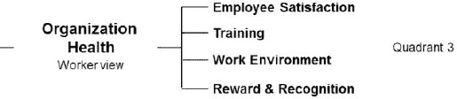

**图 5-6.** 答案指南，第三象限，组织健康度

在审视组织健康度（图 5-6）时，我们从员工的角度来观察组织。它考量以下方面：

- 员工满意度
- 职业发展
- 工作环境
- 奖励与认可

当我们确保最有价值的资产得到相应对待时，就会发现组织在进步。我通常建议组织自上而下地解决答案指南中的各个领域，将组织健康度的衡量措施放在第三或第四位。这在一定程度上是出于政治因素的考虑。在你证明使用指标的合理性时，如果首先从客户的角度来应对组织健康问题，会更容易获得支持。没有客户，就没有可以改善的业务。一旦解决了客户视角的问题，就需要确保有能力留住员工。

但在理想情况下，比如你自己就是 CEO，我可以很直接地主张，改善工作的第一步应该从你最大的资产开始，然后再轮到客户。听起来像是谬论？如果你拥有一支健康的员工队伍，就能与他们一起更好地定义你的商业模式、未来以及希望在哪些方面进行改进。

员工满意度相当直白。员工对他们的处境、组织和环境越满意，工作就会越努力，忠诚度也会越高。你的组织就会因此变得更强大。

除了满意度，你还必须关注员工技能和知识库的培养。职业发展衡量指标能告诉你在这方面做得如何。你为每位员工制定了培训计划吗？每位员工的技能发展水平如何？员工队伍越强大，你能做成的事就越多。每当资金削减时首先砍掉培训，应该被视为一种不负责任的行为。以更少资源做更多事的唯一方法，就是提升员工队伍实现更多产出和更优产出的能力。提高生产力的最佳途径是提升员工的技能组合。

工作环境衡量指标通常通过主观工具（如调查问卷）来采集。但也存在大量客观衡量指标。例如工作空间面积、空气质量、照明、人体工程学等。有很多方法可以衡量物理工作环境的质量。此外还有文化工作环境。组织是一个愉快的工作场所吗？它是一个高压环境吗（如果是，是否有必要）？同样，你可以找到主观（询问员工）和客观的衡量指标。员工是否请了大量的假期和病假？人员流动率高吗？

组织健康度的最后一个组成部分是奖励与认可。一些简单的问题可能不需要数据收集。你有正式的奖励或认可计划吗？它有效吗？它是否达到了你的预期效果？你是如何奖励员工的？你如何认可他们的成就？你只认可他们与工作相关的成就吗？更微妙的一点是，你是否无意中将认可与奖励混为一谈，以至于只有在涉及奖励时才给予认可？

组织健康度的底线非常简单——你是否像对待最有价值的资产那样对待你最有价值的资产？

## 未来健康度

**图 5-7.** 答案指南，第四象限，未来健康度

答案指南的最后一个领域是未来健康度（图 5-7）。它涵盖以下方面：

- 项目/计划状态

- 战略规划：组织执行战略规划的情况如何

- 目标达成：组织实现目标的情况如何

- 优先级设定：如何设定优先级，以及优先级是否得到满足

这个领域假定你正在为组织进行持续改进。未来健康度没有被列在最后，是因为它不如其他领域重要。它排在最后，是因为大多数组织尚未准备好尝试在这个领域使用指标。大多数组织在开始着手大规模的改进努力之前，需要先将第四层的前三个领域控制好。

许多组织绕过了这个指导，直接跳到那些旨在展示他们改进流程工作做得如何的衡量指标上。他们跳上了持续流程改进的“列车”。我对这种行为不太有信心，因为一旦资金紧张，这些组织就会放弃同样的努力。

你开展改进努力的原因，比你是否成功更为重要。真正成功的唯一方法，就是出于正确的理由做正确的事情。

围绕组织未来健康度的衡量指标大多是预测性的，这使得它们对领导层很有吸引力。但比预测未来更重要的是鼓励和奖励真正的流程改进。

项目与计划状态衡量指标为领导层提供了洞察，了解这些努力如何帮助改进组织。你应该预期到，流程改进的进展正在或将要在其他三个领域所捕获的指标中反映出来。如果你在持续流程改进方面做得好，客户视角应该会得到改善。业务视角也应该看到收益，员工队伍也应受益。如果你的努力未能改善这三个领域，那么你就没有在改进组织。

战略规划、目标达成和优先级设定都是需要关注的重要事项——但就其本身而言，它们是毫无意义的。如果这些不是改进组织的更大努力的一部分，你只是在原地打转。这些努力之所以艰难，是因为它们需要真正的（有时甚至是孤注一掷的）成功承诺。你必须想要改变。许多组织在这个领域只是口头承诺，并未真正将努力贯彻到底——而当我们谈论“持续”流程改进时——实际上是没有终点的。

## 答案指南：第五层及更高层级

第五层将为所呈现的每个视角中的每条“信息”引入具体的衡量指标。虽然你的根本问题理论上可能存在于这一层，但可能性不大。如果你发现你的问题始于这一层，那么你可能不需要一个度量指标，而仅仅需要一个测量值。

你在这里最可能找到的是测量值。例如，从第四层“使用情况”的顶层分支延伸出以下内容到第五层：

- 按月度、按类型的独立客户数

- 按类型的购买次数

- 重复客户数量

没有必要列出第四层每个元素可能的测量值。尝试列出第六层或第七层（更低层级的测量值或数据）中的每一项也没有意义。在“使用情况”的例子中，我们可能会看到如下数据点：

- 客户数量

- 每位客户的姓名

- 按类型列出的产品

- 每次购买的日期和时间

### 如何使用答案密钥：识别度量类型

答案密钥可用于识别可以用来回答根本问题的度量。如果你已经完成了准备工作，明确了根本问题并制定了抽象设计，那么现在就可以进入下一步——识别可能的度量来填充指标。

答案密钥能帮助你完成这一阶段。以你的根本问题和指标设计为基础，确定你在答案密钥中所处的位置。如果你的问题涉及组织的价值，那么你处于顶层，即 `Return vs. Investment`（回报 vs. 投资）。如果你的问题属于管理组织资源的范畴，那么你处于底层，即 `State of the Union`（组织状况）。

我们之前举过一些根本问题的例子。其中一个例子基于工作分配。这属于第四层，即 `Process Health–Resource Allocation`（流程健康——资源分配）。使用这个工具，我们不仅能识别所需的度量类型，还能理解问题关注的领域。从 `Resource Allocation`（资源分配）向左移动，我们可以看到问题涉及的是业务视图（投资）。如果我们的问题是根本问题，我们可以使用 `Five Whys`（五个为什么）。现在，我们还可以问自己，我们的关注点是否超出了 `Resource Allocation`（以度量为中心）？我们的关注点实际上是否在于 `Process Health`（流程健康）？我们是否遗漏了关于成本、时间和质量的度量？

如果你的根本问题仅由第四层中的某一个度量就能回答，那么你很可能还没有找到真正的根本问题。你肯定还没有形成一个指标。

我们使用的另一个例子是：“我们的网络/电话会议服务的价值是什么？”这也属于 `Return vs. Investment`（回报 vs. 投资），可能符合（客户视图）`Product/Service Health–Usage`（产品/服务健康——使用情况）或 `–Customer Satisfaction`（客户满意度）。但它也可能符合（业务视图）`Process Health`（流程健康），尤其是因为它包含了大量成本效益度量。通常，你的指标可能需要来自多个类别的度量。逻辑上，它们通常来自同一个更大的区域——`Return vs. Investment`（回报 vs. 投资）或 `State of the Union`（组织状况）。因此，很多时候，如果你有一个衡量有效性的指标，你可能也会同时衡量对效率有用的东西。我发现这一点在时间度量上尤其如此。考虑一下解决问题的时间与完成任务的时间。如果任务本身就是解决问题，那么这两种度量是相同的。

使用答案密钥可以让我们快速简便地对已识别的度量进行质量检查。例如，如果指标是员工视图（基于根本问题），而你发现你识别出的某些度量来自客户视图（如交付度量），那么要么这些度量对于该指标是错误的，要么你的指标可能不适合回答这个问题。一般规律是，我发现通常是度量放置不当，而非指标有误。

再举一个例子。我们还讨论过：“帮助台的响应速度如何？”这可能是效率类别中的时间（响应时间），也可以通过有效性度量来表示——特别是交付。当我们查看交付类别下的速度和可用性（另一个度量是准确性）时，我们可以看到这两种度量如何共同讲述帮助台对客户需求的响应情况。使用 `Time to Respond/Time to Resolve`（响应时间/解决时间）会用到一些相同的数据点，尽管数据的这种“视图”对于回答我们的特定问题可能没有用处。

### 补充材料

由于本章介绍了本书的实践部分，让我们来做一项实际练习。接下来是一系列基于伯纳德·马尔关于绩效度量的优秀著作《智能公司》（Wiley, 2010）的可能根本问题列表。马尔提出根本问题有两种类型：`Key Performance Questions`（关键绩效问题，KPQ）和 `Key Analytic Questions`（关键分析问题，KAQ）。他用这种区分来区别做“正确的事”（KAQ）和以“正确的方式”做事（KPQ）。

正如你所读到的，我将它们分别翻译为“有效性”和“效率”。虽然马尔为每种类型都列出了一些问题，但他没有解释划分的依据，而且这些问题与我提出的分类并不吻合。实际上，马尔的例子涵盖了我答案密钥中提出的所有四种视图，而不仅仅是客户和业务视图。有趣的是，在他的书中，他的多个问题同时出现在这两个类别中。

我希望以他的问题为基础，不仅能让你练习根据答案密钥对它们进行分类，还能让你看到，你不必完全相信任何作者（包括我本人）提出的观点——你应该自己尝试和验证。

请审阅 `Table 5-1` 中的每个问题，并使用视图，通过在相应列中放置一个 X 来确定问题在答案密钥上的位置。

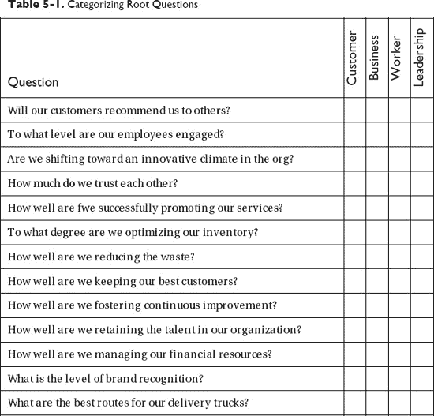

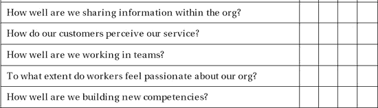

希望你发现每个类别中都有适合的例子。你也可能发现你对一个问题标记了多列（是的，这是允许的）。如果我们记得这取决于观点，这就很容易理解了。

# 一个可能适合多个类别的问题是最后一个：“我们在建立新能力方面做得如何？”

如果我们想知道培训项目运行得如何，这可能是业务视图。如果我们从员工的角度来看——关注我们员工的培训——这可以是一个 `Organizational Health`（组织健康）问题。如果我们从领导层的角度来看，想知道我们是否准备好应对未来需求，它可以归入 `Future Health`（未来健康）。当你处理自己的问题时，你会知道（或询问）问题所依据的是谁的观点。

那么，现在，如果你和我一样，你可能在寻找上述练习的“标准”答案。在 `Table 5-2` 中，我给出了我的答案——但有一个前提：没有所谓的“正确”答案。

其理念是使用答案密钥来确定你的度量是否在发挥其应有的作用——即它们是否对齐且全面。记住，对齐意味着它们有助于回答根本问题（如果你发现你使用的度量在答案密钥上不对齐，那么它们就不能回答同一个根本问题）；全面意味着综合来看，你有信心它们能够回答这个问题（没有缺失的数据点）。

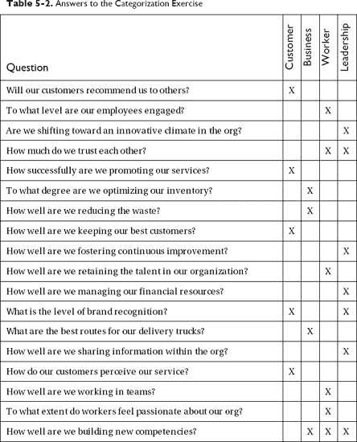

### 回顾

“答案关键”能帮助你检验工作质量，确保你走在正确的方向上。当你遇到难题、不知该往哪个方向前进时，它也能帮你重回正轨。

大多数你设计的指标，如果落在“答案关键”上，很可能从第三层级开始，并属于以下四个视角之一：

*   客户视角（有效性）
*   业务视角（效率）
*   员工视角
*   领导视角

当你沿着“答案关键”从左向右移动时，就是从战略层转向战术层。另一种理解方式是，你正从根本问题转向数据。

无论你的指标（或根本问题）落在哪个位置，你都需要向右移动，才能找到回答该问题所需的度量项和数据。在第四层级，我们发现了以下内容：

*   回报 vs. 投入
    *   产品/服务健康度——客户视角
    *   流程健康度——业务视角
*   总体状况
    *   组织健康度——员工视角
    *   未来健康度——领导视角

第四层级是我的客户最常使用的层级。它位置足够靠左，使得从该处出发的根本问题值得用指标来回答；同时它又足够靠右，使得大多数组织易于理解这些指标在改进组织方面的用途。

在第五层级（及其后的任何层级）中，我们主要发现的是信息和度量项。如果我们的根本问题落在此处，那么该问题可能非常战术化，或许不需要一个完整的指标来回答。请记住指标开发计划，你不仅应该通过识别信息和度量项来充实指标，还应该记录所需的个别数据点。

## 结论

“答案关键”之所以成为本书实践部分的开篇，是因为它是一个实现指标的绝佳捷径工具。它能帮助你将根本问题置于组织健康度的背景中。如果你不得不在没有根本问题的情况下工作，它可以用来确保你不会试图混合不协调的度量项，并帮助你朝着一个迫切的需求努力。

从左侧开始向右移动，你从高层级走向战术层。它会帮助你识别可能用于回答根本问题的信息和度量项。

从右向左移动，你可以从具体的度量项（甚至数据）回溯到某个迫切的需求。朝这个方向工作也有助于你确保你的指标在逻辑上分组和整理得当。通常情况下，你不希望将来自不同领域（产品/服务、流程、组织或未来健康度）的信息混合到一个指标中，因为除非是在“答案关键”的最高层级或最左侧层级，否则它们几乎无法回答任何问题。

请记住，“答案关键”虽然是一个有用的捷径，但它仍然只是帮助你开发指标的工具。它不是完整的答案，也不能免除你遵循指标开发模型的责任。

## 从有效性开始

我合作过的第一位首席信息官常说：“做正确的事。”除了这一指示在哲学和宗教层面的解读外，这还体现了领导者对其团队日常行为的简单期望。有效性指标能让你判断自己是否在“做正确的事”。

我不仅是建议你*从*有效性开始。在`第 5 章`中，我介绍了“答案关键”。我讨论了有效性指标的组成部分，即第三层级的第一个象限：产品与服务健康度。我建议你不仅从此处开始，而且应停留在“答案关键”的这个区域，直到你的组织成熟到能够应对其他象限为止。

正如我在第一本关于克服组织不成熟度的书中所描述的，一个组织可能根本无法应对一个完整的指标项目。使用指标是一种高级行为。

让我们来看看为什么我建议你在可预见的未来从有效性象限开始（并停留在此）。可以从第四象限“未来健康度”开始，逐个象限地讨论原因。

让我们再次看看`图 6-1`中的“答案关键”。

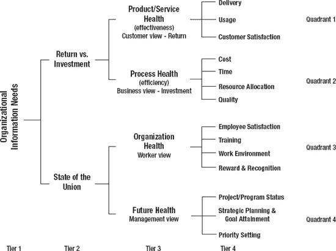

**图 6-1.** 答案关键

### 未来健康度

第三层级的第四象限（`图 6-2`）涵盖了未来健康度，即从领导视角看的组织健康度。在开始制定涵盖未来健康度领域的指标项目之前，最好确保你的组织已经为此做好了准备。

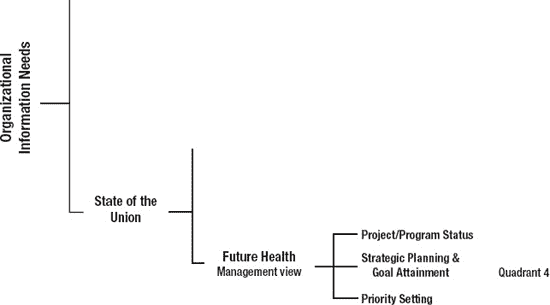

**图 6-2.** 答案关键，第四象限

以下是一些你可以自问或询问他人，以判断组织是否为此领域指标做好准备的问题：

*   你们有使命宣言吗？如今大多数组织都有。
*   如果你问五位员工组织的使命是什么，你会得到同样正确的答案吗？
*   你们有鲜活的战略规划吗？如果有，最远的目标是多长时间？大多数流程改进专家会告诉你，战略目标至少应为三到五年。最长可延伸至十年。
*   你们的组织是否将大部分目标文档化？
*   如果有长期目标，它们是否在被积极执行？（我不会问你是否清楚它们的进展如何，因为那需要度量项，进而引向指标。）
*   组织的问题是否已按优先级排序？如果是，这些优先级是否得到遵守，还是经常被忽略？
*   你们的目标是否包括随着时间的推移改进流程？
*   你们是否有完善的项目管理流程？
*   该流程是否被组织自愿遵循？

如果你不能对这些问题的回答给出肯定的答案，你可能还未准备好。通常情况下，组织在此区域存在内部冲突。领导层——指标的主要驱动者——希望同时从所有方面改进组织。这促使组织制定战略规划。似乎每位高层领导都必须有一份包含使命宣言和目标的战略规划。

我不会带你详述这会给一个无法进行全组织变革的组织带来所有问题。相反，我提出这些问题是为了帮助你判断是否准备好了。当然，你可以衡量这个领域，并确定你们的成果物（战略规划、目标、优先级清单）并未如预期发挥作用。这本身可能是有用的信息，但正如我非常喜欢说的那样，大多数时候你不需要指标来告诉你已知之事。

大多数时候，你不需要一个指标来告诉你已知之事。

我相信大多数组织都会制定战略规划和优先级清单。大多数组织甚至为其较大规模的工作制定了流程。这主要是因为它们是“该做的正确之事”。但不幸的是，这些组织中的大多数实际上并未为这些工作做好准备，因此他们认真的尝试收效甚微甚至毫无收益；在此之上创建指标来叠加这种投资损失将是浪费。

未来健康度指标需要一种大多数组织所缺乏的成熟度。

### 组织健康

组织健康象限（`图 6-3`）是从员工视角出发的。

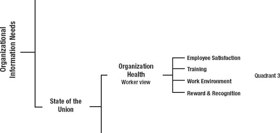

**图 6-3.** 答案矩阵，象限 3

同样，我们可以提出一些基本问题来感受这项工作的准备情况。

-   你是否有奖励和认可计划？
-   你是否有员工建议计划以收集意见？
-   你会将自己的企业文化描述为一种相互信任的文化吗？
-   你的每位员工是否都有职业发展计划？

与未来健康象限不同，组织健康通常不是领导层早期关注的领域。在许多尚不成熟的组织中，领导者害怕基于这一领域的度量指标。领导层应该清楚员工是否得到了良好对待并感到被重视。他们不“需要”度量指标来告知这一点。当“答案”未知时，就会产生怀疑，而这种怀疑理所当然地让领导层感到担忧。除非组织内部存在信任，否则这个领域对领导层来说可能会很棘手。

在大多数情况下，*领导层*并未准备好接受组织健康度量指标。

组织健康与未来健康这两个象限都直接反映了组织的“现状”。在这两种情况下，度量指标应等到组织能够持续做正确的事并让客户满意后再进行。如果组织处于动荡或尚不成熟的状态，度量计划不仅无法解决问题，反而可能让情况变得更糟。从这两个象限中的任何一个开始，都无异于去测量纸飞机的平均空速、高度和升力系数。在开始测量纸飞机的性能之前，获得更好的交通工具要重要得多。

### 回报 vs. 投资

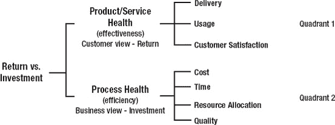

**图 6-4.** 答案矩阵，象限 1 和 2

上面两个象限（`图 6-4`）是大多数组织在着手进行度量工作时自然倾向于关注的区域。大多数领导者首先希望看到客户满意度调查的结果。这是最容易开始的度量方式。毫无例外，每当我提出要了解客户对服务或产品的感受时，第一个想法总是“调查”。我并非认为这是负面的——事实上，当这种情况发生时我反而很高兴，因为这是一个非常安全且合乎逻辑的起点。

平衡计分卡也有四个象限：客户、财务、员工和流程——大多数领导者会直接跳到财务象限。在答案矩阵中，最接近的对应区域是流程健康（或效率）象限。

虽然“现状”中的右侧两个象限要求组织做好充分准备，但通常组织并未准备就绪，而回报 vs. 投资象限可以在组织成熟之前就着手处理。当然，组织越成熟越好——尤其是在制定度量计划时。

## 流程健康

流程健康（效率）度量（`图 6-5`）可能会引发许多问题，尤其是在一个尚不成熟的组织中。如果你与员工关系不佳，或者员工之间缺乏信任，那么试图针对这个象限进行度量工作可能会是致命的。

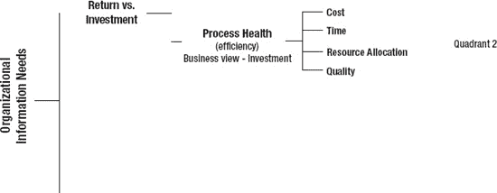

**图 6-5.** 答案矩阵，象限 2

我会请你提出以下问题来判断开展效率度量的准备情况：

-   你的员工信任管理层吗？

-   你的基层主管信任中高层管理者吗？

-   管理层信任员工吗？

要安全地使用效率度量指标，需要信任。在缺乏信任的文化中，不可能获得诚实准确的数据。大多数专家认为，信任文化取决于组织高层领导者言行一致的程度。员工是否相信高层领导者能履行承诺？做到他们说过要做的事？遵守他们的协议和承诺？

我发现信任问题的答案其实更直接、更简单。员工是否相信他们的直接主管真心为他们着想？他们对于高层领导者真实性的关注程度远低于此。他们最在乎的是他们的直接经理。距离直接经理越远，所需的信任程度就越低。

因此，与其对公司 CEO 说教，要求她必须赢得员工的信任，不如从最基层开始，确保从下到上建立一种信任文化。

当你决定衡量组织的效率时，你的员工会清楚地听到你想要衡量`他们`的效率。他们不会“听到”你想要改进流程和程序。至少，除非他们信任你，否则他们听不到。而这里的“你”，我指的是他们的老板。

我的 CIO 通常在告诫要“做正确的事”之后，还会补充一条同样重要的指令：以“正确的方式”做正确的事。如果管理层足够强大，它应该致力于改进做事的方法——而不是去改进那些做事的人。如果你急于采用效率度量指标，你不仅可能因不信任而收集到不准确的数据，更糟的是，你还有可能播下更多不信任的种子。

流程健康度量指标需要一种在大多数组织中罕见的相互信任水平。

请记住，组织健康度量指标关乎员工的处境，而大多数领导者并未准备好倾听这些。即使领导层相信自己能够听取反馈，但如果缺乏信任，大多数员工也不准备分享。

同样的缺乏信任也使得收集关于业务运行状况（流程健康）的准确数据变得困难重重。

## 产品或服务健康度

那么，这就引出了`产品或服务健康度`这一象限（图 6-6）。这不仅是最安全的起点，也是最合乎逻辑的起点。

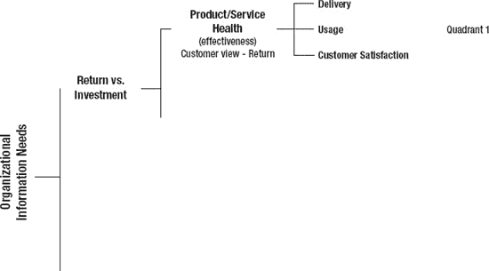

**图 6-6.** 答案指南，象限 1

让我们看看下面这些问题，你需要通过它们来判断自己是否已准备好进行效能度量：

-   你是否清楚你的客户是谁？（这看似不言而喻，但其实值得一问。我很少对未知之事感到惊讶。）

-   你是否了解客户认为什么最重要？

-   你是否知道客户的期望？

这听起来是不是比其他四个象限容易得多？事实确实如此。在层级的上半部分，你需要的成熟度更低，而且`产品或服务健康度`涉及的风险也小于效率度量。至少，你应该知道你的客户是谁，并且能够确定他们的愿望、期望和需求。

你可能会问，怎么会有人*不*知道自己的客户是谁呢？

我承认，起初我也觉得这难以理解。但这确实会发生。一位同事喜欢讲述一个关于大学招生办职员的故事。这位职员接待新生已经至少干了好多年，多到让她不胜其烦。

有一次，一名新生又对她老调重弹，称自己是她的客户，理应得到比现在更好的待遇。他大声抱怨，说自己就是学校存在的理由，她应该竭尽全力满足他的需求。

> “你的客户服务呢？”他最后一次喊道，享受着其他学生投来的目光。

> 她平静地等着他停下来。她想确保他能清楚地听到她的话。

> “亲爱的，你搞错了。你不是客户，你是产品。”

你可能会想，“反驳得好”或者“回击得妙”。但糟糕的是，我的那位同事是名教师。更糟的是，听到这番话的学生觉得极其好笑。当然，我不能怪他们——这句话确实有趣。但，这有多真实呢？

我们有时是否会混淆谁才是我们的客户？另一个广为人知的笑话是，一位杂货店店员争辩说：“要是我们不用应付客户，能完成更多工作。”

如果客户是谁以及他们想要什么都那么显而易见，就不会有那么多客户服务课程和研讨会了。这可能是最基本的公理之一：真相并不总是显而易见的。

真相并不总是显而易见的。

你可能会认为情况恰恰相反。谎言和假话应该很难发现。真相不应该难以找到。真相不应该被无关的数据所隐藏或掩盖。真相*应该*是显而易见的。

那些本应显而易见的事情——比如真相，或你的客户是谁——却并不总是显而易见。

那么，如何确定你的客户是谁呢？由于这是制定效能度量的先决条件，我认为有必要介绍一个简单的流程来确定你的客户。

一个简单的观点是，你的客户就是给你发薪水的人。这让你可以在个人层面（以及组织层面）确定你的客户。让我们从显而易见的事情开始（但不一定是“真相”）。你的薪水由你的组织支付。但这笔资金从何而来？如果你是一家盈利性组织，资金很可能来自产品或服务的销售。该服务或产品的购买者很可能是一个供应商或分销商。那么下一个合乎逻辑的问题是，谁在向你的产品或服务的接收者付款？你应该沿着这个逻辑一直追查，直到确定最终用户或购买者。

让我们以汽车的安全气囊为例。负责质检的工人认为他的客户是与他们部门有合同的汽车制造商。这没错，但这不是真相。买车的人既不是汽车制造商，也不是经销商。当我们把目光投向租车公司这样的买家时，这一点就更清楚了。然后租车公司将车辆出租给最终的终端用户（客户）。这是真正的客户吗？是的，但还有另一位客户。坐在“副驾驶”座位上、真正受益于那个特定安全气囊的乘客，才是对该客户更真实的体现。当然，这还可以进一步延伸，包括那些关爱这位乘客的人：乘客的孩子、父母和配偶。

如果质检安全气囊的工人看到了其工作真正客户的深层真相，这将如何改变该工人的行为模式？又将如何改变该工人的自尊心？

在非营利组织中，这个过程同样适用。以`仁人家园`为例。当你在`仁人家园`做志愿者时，现场监督员是客户吗？还是`仁人家园`组织本身？或者是最终将拥有这所房子的人？或者是那些生平第一次拥有一个“真正”的家可以居住的孩子们？你甚至可以更进一步，问真正的客户是不是社会。在不变得过于哲学化的前提下，我建议我们追踪到直接的终端用户。在这个案例中，就是最终住进房子的那户人家。

当我们足够深入地探究这个现实时，我们会承认，我们的客户远不止是我们产品或服务的第一个购买者。当我们如此深入地探寻时，我们就能找到客户是谁的真相。

当然，当我们在审视交付、使用和客户满意度等效能度量时，通常确定直接客户就足够了。你需要知道他们是谁，这样你才能弄清客户认为什么是重要的。你还需要确定他们的期望是什么，以及如何满足这些要求。

### 客户视角

从客户视角出发是完全合理的。它是开始收集、分析和报告数据、度量指标及信息的正确起点。让我给你讲一个关于汤姆经营的餐厅的故事。他是一个勤劳的人，热爱美食。

汤姆的餐厅经营得还不错，但他希望能做得更好。他想让自己的餐厅成为镇上的最佳餐厅，甚至可能成为连锁餐厅的样板。他的菜单由家族秘方组成——家常菜，老少皆宜。他认为，一家更好的餐厅能为他的家庭带来美好的未来。

他想知道业务的真实运营状况，以及如何改进。他决定收集度量指标；不仅是为了评估自己的表现，也是为了更好地预测他的愿景是否有实现的机会。

汤姆对组织发展或流程改进知之甚少。他对度量指标更是一无所知。他是一位出色的管理者/老板，对业务、产品和客户服务的热情让他浑然天成。他对员工的关怀源于他过去从事底层工作、省吃俭用，然后拿出毕生积蓄投入自己的餐厅——这是他一生中最大的冒险。他知道薪水微薄不被重视是什么滋味。但他不知道的是，如何将自己的梦想提升到新的高度。

当他考虑收集餐厅相关信息时，他立刻想到了客户满意度调查。他制作了意见卡，让每位服务员在给顾客菜单时一起递上。他希望给顾客一个机会，从头到尾评价他们的用餐体验。

汤姆知道这种调查有利有弊。好处是能从他最重要的批评者——客户那里获得快速反馈。这些反馈能帮助员工，并提醒他们始终将客户的满意度放在首位。

另一方面，他明白客户不一定总能提供有助于他改进所需的信息，因为许多人除非非常不满，否则不喜欢抱怨。

除了调查提供的定性信息，汤姆还需要关于其服务和产品质量的客观输入。这些信息是现成的。

汤姆拥有关于客户群的实证数据——由于大多数客户使用信用卡，他可以确定回头客的数量以及这些客户光顾餐厅的频率。他还能确定他们点了哪些菜品。他知道什么时候是高峰期，什么时候是冷清时段。实际上，他已经拥有了丰富的使用信息。这些信息结合客户满意度调查结果，应该能清晰地反映出他餐厅的经营状况。

汤姆对这些信息很满意，但他觉得自己缺少一种客观衡量标准，能够在不询问客户的情况下评估餐厅满足客户的程度。他认为意见卡已经是一种打扰了。

汤姆通过邀请当地美食评论家来评估食物的质量。他通过亲自观察员工以及听取他们对餐厅的意见来评估服务水平。他评估了食物准备和上菜的速度，以及顾客结账的速度。他将这些信息与本地其他顶级餐厅进行了比较。

有了这些输入，汤姆确信自己拥有了从客户角度衡量餐厅质量的良好指标。

在很大程度上，他是对的。还有其他一些衡量指标他可以使用，比如可用性（营业时间）、可靠性（口味、品质和上桌时间的一致性）以及准确性（订单准确无误）。这些指标将有助于完善他的度量体系，让他获得更全面的图景。但目前的客户满意度和使用数据已经是一个很好的开始。

### 消除恐惧

通过关注客户视角，汤姆消除了困扰效率度量的恐惧基础，同时专注于回报与投资——这是大多数管理者渴望深入理解的一个领域。恐惧源于未知。在大多数初期的度量项目中（尤其是在尚未成熟的组织中），未知因素在于信息将如何（以及不会如何）被使用。这就是为什么我极力主张所有度量工作都要明确沟通这些度量指标将如何及不会如何被使用。

即使你承诺收集和报告的数据不会被不当使用，除非你的组织拥有强大的信任文化，否则员工不会相信，恐惧仍将主导一切。至少在使用效率度量时是这样。但如果你从有效性度量开始，就很容易说服他人这些信息不会被用来针对他们。这是因为所有度量都会反映客户的视角。

下面是一个真实的例子。

无论我如何强调度量指标不会被不当使用，我赢得客户信任的唯一方法就是向他们展示这些度量指标。我们以返工形式的准确性为例。在设计度量指标时，如果你坚持它必须源于客户视角这条规则，你甚至不会去收集内部返工的数据。你只会处理从客户角度看到的返工。

当我为我们的印刷服务设计有效性度量指标时，问题围绕什么构成返工而展开。

> “如果我们必须把打印机送回供应商那里修三次才能修好，这算返工吗？”
>
> 我反问了一个问题。“客户知道你送修了三次吗？”
>
> “不知道。”
>
> “那么不算，这不是返工。”
>
> “如果我们从供应商那里收到了错误的零件呢？”
>
> 我再次以一个问题回应，“客户知道吗？”
>
> “不知道。”
>
> “那仍然不是返工。”
>
> “如果我们修理了一个卡纸故障，但客户尝试打印时，发现还有另一个问题呢？”
>
> “客户知道吗？”
>
> “知道，但这不是我们的错……”
>
> “那么，是的，这就是返工。”
>
> “但这又不是我们的错……”
>
> “我明白。但度量指标不是为了推卸责任。它只是让我们了解客户所见的一种方式。如果客户认为这是返工，我们就需要知道。如果不知道问题存在，我们就无法解决它。”

有效性不是用来评判或归咎责任的。有效性度量指标为我们提供了客户看待我们服务和产品的视角。

### 要事为先

你必须从起点开始，同时牢记终点。终点是一个运作良好、全面的度量体系。但要达到这一点，我们必须拥有一个成熟的组织。我们必须拥有一种信任文化。我们必须实现全方位的开放沟通。我们必须走在相当前面。正如大卫·艾伦在他的书《搞定》（企鹅出版社，2002 年）中谈及他的咨询服务时所说，“最需要[他的改进方法]的人，用得最少。”

所以，对于我们其余的人来说，我们必须从起点开始。而你需要做的第一件事，就是像你的客户那样看待你的组织。有效性度量正做到了这一点。

### 回顾

从起点开始。当你从起点开始时，就能避开许多麻烦。贸然采用组织尚未准备就绪的成熟做法，可能会引发大量问题。最稳妥且最合适的起点是衡量`产品/服务健康度`，即有效性指标。这将帮助你与组织建立良好的合作关系，并改善客户关系。

通过从有效性指标入手，你还能让组织更轻松地适应度量体系，减少恐惧、不确定性和疑虑。尽管组织对于你引入的指标仍会有些担忧，但从客户视角出发，能化解大部分风险。你还可以利用这些指标获得高回报——了解并取悦客户，确实是企业长期成功的基石。

幸运的是，最佳的起点也是最简单、最安全的，而其他可选方案则需要更多努力、付出更多代价来应对问题，并且失败风险最高。

以下是需要记住的重点：

-   `未来健康度指标`需要大多数组织尚不具备的成熟度。

-   组织健康度指标反映的是员工状况，而大多数员工尚未准备好倾听；如果缺乏信任，多数员工也不愿分享。

-   信任缺失导致衡量组织健康度变得困难，这使得收集关于企业运营状况（流程健康度）的准确数据也几乎不可能。

-   `产品/服务健康度指标`需要了解客户——包括客户是谁、他们认为什么重要、以及他们的期望。

## 结论

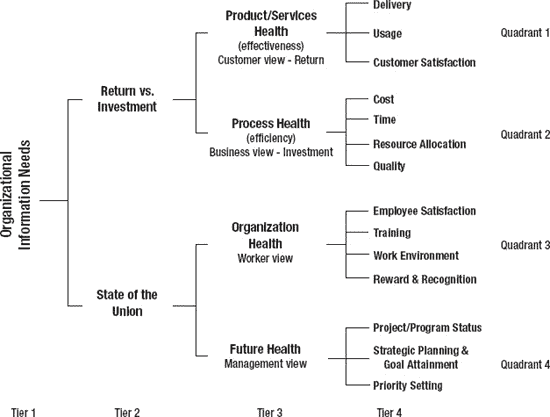

**图 6-7.** 答案密钥——分层与象限

尽管答案密钥（图 6-7）为指标开发提供了多种选择，但正确的起点是`产品/服务健康度`（有效性），即客户视角。这不仅是最安全的行动路径，同时也是最佳选择，因为它为第三层级的其他象限奠定了基础。如果你围绕产品和服务健康度的有效性建立了一套行之有效且有用的度量方案，你将能够积累必要的信任，进而拓展到效率指标。

一旦你成功解决了回报与投资象限的问题，你就具备了足够的成熟度基础，可以为组织进入"国情咨文"象限做好准备。结论如下：

1.  从客户视角（有效性指标）开始。循序渐进，充分实现这一层级指标带来的益处，使其成为组织文化中被接受的一部分。

2.  在需要深入探究提升有效性的方法时，谨慎地使用业务视角（效率指标）。（我将在后文提供更多见解。）

3.  在组织内部建立起足够健康的信任水平，并成功运行基于有效性的度量方案后，再拓展到其他象限。

4.  尽管管理层接下来会倾向于转向业务视角，但除了那些用于提升有效性所必需的指标外，我建议跳过效率指标，转而关注员工视角（组织健康度）。这将有助于建立信任，并为组织的整体有效性带来更大、更快的提升。

    如果员工确实是组织最宝贵的资产——那么在开发出改善客户体验的指标之后，下一个优先事项应当是改善员工体验。将`未来健康度指标`主要作为判断组织目标实现可能性的工具。然后利用它们来评估目标是否达成。如果你专注于`未来健康度`中的战略规划部分，就能为度量体系创造出另一个安全区域。

在第 11 章"运用高级指标"中，我将更详细地阐述在第三层级各个象限开发指标的好处和方法。目前，重点在于将`产品/服务健康度`作为正确的起点，并强调在其他领域时机成熟之前需耐心等待。

## 三角验证

创建有效指标的关键

话说从前，鼠妈妈生了三只美丽但失明的幼鼠。它们长大后，农夫的妻子心生怜悯，决定帮助它们在这个世界上生存下去。对于它们而言，由于缺乏视觉，这个世界变得更加危险。

农夫的妻子认为，如果老鼠们能学会分辨哪些动物是友好的，哪些动物更喜欢吃掉它们而不是与它们交谈，那将会很有帮助。由于她原本是个城市姑娘，于是她把三只老鼠装进自己的小货车，出发前往自然历史博物馆。她认为利用展品来介绍，比带它们接触真实的动物更安全。

尽管它们居住的农场里非洲野生动物不算多，但农夫的妻子觉得"有备无患"总比后悔好。

> 它们从老虎开始观察。她解释说，老虎只是比谷仓猫大一号的版本。第一只老鼠站在左后爪上。“它有爪子和巨大的脚掌，”它喊道。第二只老鼠站在尾巴上。“它有一条又长又粗的尾巴。”第三只老鼠，比另外两只大三秒钟，站在脸部的位置。“它有大眼睛、大牙齿和胡须。”
>
> 农夫的妻子微笑着问：“那么，这是什么？”
>
> “一只非常大的猫。”它们异口同声地回答。
>
> “非常好。这一个呢？”它们都走到下一个动物旁边。
>
> “这根本不是动物，是一根树干。”第一只老鼠说。
>
> “不，是一条挂在树上的蛇。”第二只老鼠说。
>
> 而第三只老鼠，再次站在动物的脸部，说道：“从强有力翅膀的感觉来看，这是一只巨鸟。”
>
> “孩子们，把所有这些感受综合起来。”农夫的妻子建议道。
>
> 它们思考了一会儿，最后极其和谐地齐声喊道：“大象！”
>
> “非常好。”
>
> 它们就这样继续在动物展区进行观察，识别出了狼、狗、狮子、熊。它们了解了各种类型的动物，无论是家养还是野生的。最后，它们遇到了一种无法解决的动物。它似乎长着狮子的头、山羊的身体和蛇的尾巴。
>
> “我们已经从头到脚仔细检查过这个动物了。”它们一致同意，“但我们无法就它是什么达成一致！”
>
> “那是奇美拉。”农夫的妻子说，“你们三个让我印象深刻。凭借对动物生理学的理解，你们利用非常不同的输入信息，成功地识别出了每一种生物。”
>
> 三只老鼠脸上洋溢着喜悦。
>
> “但是，我们并没有全部答对。”第三只老鼠想到奇美拉时说。
>
> “不，即使拥有来自多个来源的、各不相同但相互补充的可靠数据，你们也未必总能找到‘真相’。”她对它们已经做得如此出色感到非常满意。有时候，即使拥有大量数据，也可能无法得出正确答案。当然，如果你能亲自观察事物本身，那会有所帮助。

研究人员是数据的终极使用者。

### 三角测量——历史视角

实验鼠被迫使用`triangulation`（三角测量）来识别动物。它们比较通过不同方法收集到的不同信息，以确定问题的答案（我们触摸的是什么动物？）。如果老鼠只关注单一信息片段，它们就会得出错误答案。

我向伊利诺伊大学厄巴纳-香槟分校的传播学与社会学教授诺曼·K·登钦致敬，因为他将`triangulation`这一术语用于指代在收集和研究数据时使用两种以上方法。我的定义与其非常相似——即使用多种衡量手段和收集方法，来处理指标中使用的信息。

根据登钦的说法，使用三角测量的一个主要原因是为了减少（甚至消除）研究中的偏差。通过三角测量，我们确保对问题有了全面的答案。

在他的著作《社会学方法：资料汇编》中，登钦描述了以下四种三角测量类型：^(1)

*   **数据源**：使用多个数据来源。

*   **调查者**：使用多人来收集、分析或解释一组数据。

*   **理论**：使用多种视角来解释一组数据。

*   **方法**：使用多种方法来获取数据。

但即便是登钦也不得不承认，这并非他的“发明”，因为他引用了尤金·J·韦布的一篇论文，韦布在文中为社会研究提供了一种三角测量法。登钦指出，随着你不断增加用于洞察单一问题所采用的不同衡量方法，其定义会从抽象概念，演变为经过验证的概念，最终成为被证实的现实。尽管登钦可能并非创造`triangulation`这一术语的第一人，但我欣赏他的解释。这与我在衡量指标项目背景下使用该术语的方式高度吻合。

登钦的四种三角测量类型与我用于衡量指标的不同类型并非完全吻合——这部分是由于我们使用结果的性质不同。登钦为社会研究提供指导，其目的是在其领域内寻找更深层的真理，并通过期刊和实验在科学界对这些真理进行辩论和挑战——而我们的需求（你我的需求）则要简单和实际得多。

¹ 诺曼·K·登钦，《社会学方法：资料汇编》（芝加哥：阿尔定出版社，1970 年）。

在我的领域，需要不同调查者的需求相对不必要，尽管在研究领域这对避免分析偏差至关重要。我认同使用不同数据源、不同视角和不同方法。我把视角称为观点。现在让我们来看看我版本的三角测量。

### 三角测量作为实际应用

2003 年，我提出了一个使用多种衡量手段来构建综合指标的概念。当时我正在为我的 IT 部门开发一个衡量指标项目，我需要构建一个完整的叙事，来回答最高执行官提出的两个问题。他的第一个问题是：“你们做得怎么样？”

他是在询问我们 IT 组织的健康状况。这是一个简单但具有驱动性的问题。它不仅催生了一套衡量指标，还开启了我的旅程，最终将我在这本书中记录下的许多方法和理论付诸文档。

执行官的第二个问题是第一个问题的绝佳补充：“你怎么知道？”

我想我喜欢这些问题，最主要的原因是它们的简洁和直接。它们推动我们的组织走向一个可行且实用的衡量指标项目。

#### 衡量指标的三角测量

我将重点放在`答案键`的有效性象限上（图 7-1），选择从我们客户的角度来限定这个问题——因为提问的执行官正是我们的最高层客户。虽然执行官可能关心我们办事的效率如何，但他首要关心的是我们对客户的服务质量。

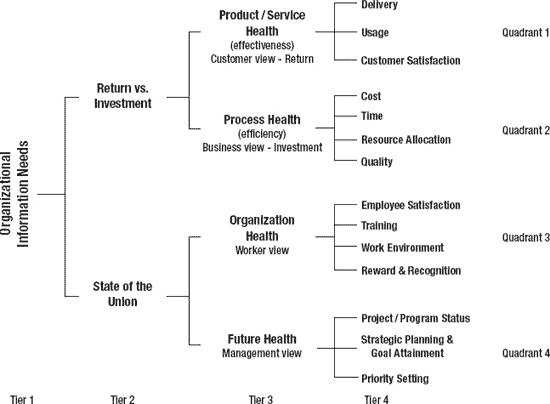

**图 7-1.** 答案键

当我开发用于回答这些问题的衡量指标时，我知道提供一个能被接受为准确的答案至关重要。除了需要对数据收集和分析进行控制之外，我还需要一个基本的指标构建框架。

我知道这个象限。我也知道可能适用的衡量方法（至少是一个起点）。我还知道如何测试这些衡量方法与产品/服务健康象限的一致性。

但为了确保我们获得全面的图景，我采用了`三角测量`——即使用三种或更多种衡量方法来回答问题。以`有效性`为例，我们从`答案键`中识别出主要的几个——`交付`、`使用`和`客户满意度`，如图 7-2 所示。

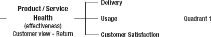

**图 7-2.** 产品/服务健康象限

我没有只选一两个，而是决定我们应该三者都用，这样能提供更全面的图景。每种衡量方法在数据来源和收集方法上都具有不同的特性。

`交付`解决了客观衡量我们提供服务和产品质量的需求。这一衡量方法将在没有客户参与的情况下捕获我们有效性的数据。最佳数据来源是 IT 部门使用的问题跟踪和报告工具。衡量指标的好处之一就是它能凸显出你已在使用的工具。

通过使用这些工具的数据，它促使各单位比以前更准确、更频繁地捕获数据。在衡量指标项目之前，这些工具并未得到最佳利用，产生的数据也无用——这就是`GIGO`（垃圾进，垃圾出）。

`使用`是一种不引人注意地捕获客户观点的方式，在这种情况下，观察客户如何“用脚投票”。这可以通过独立客户数（你到底服务了多少客户）或回头客数来体现。

`客户满意度调查`可以让你询问自己为客户服务得怎么样，并了解什么对他们重要，但你也可以提出开放式问题，直接获取关于如何改进的意见。尽管 IT 部门已经针对每个问题案例做了满意度调查，但这些调查只收集了那些对我们的服务或产品表达过不满，并且已经在使用我们产品或服务的客户反馈。

我们也想听听那些对我们的服务没有过任何问题的客户的意见，或许更重要的是，那些还没有尝试过我们服务的客户的意见。我们需要知道潜在客户为什么不找我们来满足他们的需求。一个组织如果只向现有客户进行营销，增长是有限的。在某个时刻，它需要吸引新客户。

因此，除了问题单跟踪调查之外，IT 部门还对整个客户群体进行了年度调查。根据你的业务情况，你可能需要对潜在客户进行抽样调查。

所研究的每个领域都有其客户视角，并处理不同类型的反馈——客观且独立的客户反馈、间接客户反馈以及直接客户反馈。

如果你能引入`三角测量`的概念并让它被接受，那自然很好。如果你能引入我迄今为止提出的任何概念——从根本问题，到衡量指标框架和分类法，再到文档使用、如何正确与错误地使用指标、答案键、从有效性开始——而无需费力争取其被接受，那也很好。

好的，遵照您的要求，以下是翻译后的中文文档：