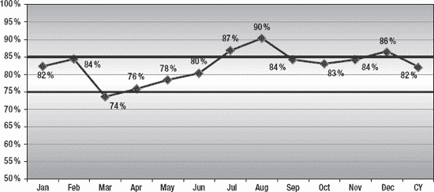
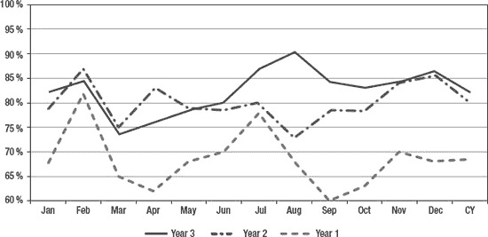
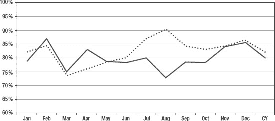
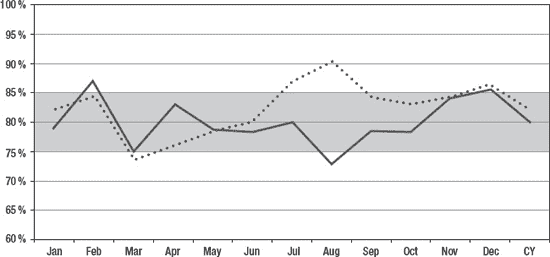
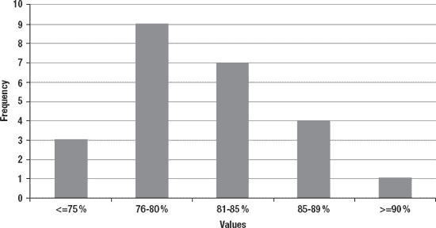
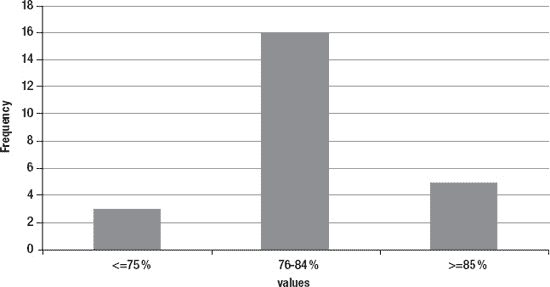

## 期望

如何以有意义的方式看待度量

如果说“答案地图”是解锁有用度量体系开发的秘诀，那么使用期望值就是钥匙链。期望值能让你将对度量的许多常见负面看法转变为富有成效的改进。

### 别选错了

我很喜欢《夺宝奇兵 3：圣战奇兵》(1989) 中圣杯骑士平静地宣布“他选错了”这句台词。当时有几十只杯子可供选择，而反派选错了那个。不过这也可以理解——他选了桌上最华丽、镶满宝石的圣杯。

管理者也常常挑选最花哨的工具，却因它们无法胜任而失望。我想帮你避免“选错”。所有度量体系周围的恐惧、不确定性和怀疑，都源于对测量数据的误用和滥用，进而对需要提供数据的人造成伤害。有时，这是由错误或恶意的管理实践造成的。由于我是个乐观主义者，并坚信人性本善，我认为度量的误用很少是出于故意。大多数情况下，度量被滥用是因为领导者被某种不当使用度量的低劣管理技巧所误导。这些技巧包括以下几种：

1.  `使用延伸目标`
2.  `将测量数据本身作为目标`
3.  `目标和阈值`
4.  `基于测量数据的激励计划`

这些技巧看起来可能相当无害且合理。有不少作者、专家和顾问都在推广其中一种或全部。即使是成功的 CEO 也会称赞这些“工具”对改进的作用。但不要被迷惑：这些都是对度量的误用，通过这种方式取得的任何成功都只是暂时的。我们先简要分析一下每种方法，然后介绍一个更简单的解决方案。

# 关于“延伸目标”的运用

通过设定目标来追求成功是件好事。但当领导者曲解这一概念，创造出“延伸目标”并将衡量标准本身当作目标时，他们便会误入歧途。目标本身可以成为强大的工具，愿景、使命和目标是指引组织前进的有力组合。然而，对目标的滥用却可能导致组织的努力付诸东流。

延伸目标往往并非出于自我提升而自发制定的。在商业环境中，我发现管理者们认为它是激励员工的好工具。可达成的目标还不够，“延伸”目标成了最新的银弹。领导者为一个部门或员工设定延伸目标——瞧！目标达成了。领导者显得英明神武，部门/员工受到赞扬，皆大欢喜。但多数情况下，这个延伸目标是强加的（而非协商确定的），员工对其没有归属感。没有归属感意味着对成就的自豪感也会大打折扣。

延伸目标通常是一个需要完成的大任务。如果仅此一次倒也还好。但随之而来的思潮是：明年要升级第一个延伸目标，制定一个更艰巨、更庞大的延伸目标。如此循环往复。员工最终会识破这种把戏。

我仿佛能清晰地听到竞技场上的演说家宣布：“游戏开始了！”

管理者不断施压，想看看能从员工身上榨出多少油水。员工则精明地意识到他们必须在规定时间内（刚好）达成目标（提前完成意味着年内会面临新的延伸目标——所以按时交付比提前完成更好）。延伸目标并不属于组织——当然也绝对不属于员工。不，这些目标完全是管理层独有的。

延伸目标的另一个意外后果是，其他工作会因此受损。那些本可以做到模范水平的工作，会因不属于延伸目标范畴而退化为“差不多就行”。当次级目标被奉为卓越标准时，就很难再着眼于全局。

# 将衡量标准当作目标

另一个常见的问题是，误将成功衡量标准（MoS）本身当作目标，而非聚焦于已识别的需求。有时这仅仅是含义上的细微差别。如果你的任务是销售五千件新产品，你是在为目标而衡量，还是为 MoS 而衡量？

如果你回答是目标，那你就错了。一个简单的测试是：如果你比“目标”多卖一件（或少卖一件），你会更高兴吗？再多十件（或少十件）呢？再多一百件呢？如果这些差异有关系，那么你就是在把成功衡量标准当作目标。

这一点之所以重要，是因为员工需要理解组织的宗旨、全局、使命和愿景。当你把员工视为改进过程中的合作伙伴时，你就不会试图通过分配“延伸目标”，或让他们追逐衡量标准（而非实现目标）来操纵（或激励）他们。

真正的目标可能是改善底线利润。增加销售额是实现这一目标的一个可能任务，而销售特定数量的特定产品则是一个子任务。售出的产品数量则构成一个成功衡量标准。

当你追逐 MoS 时，你会失去焦点。你可能达成了衡量标准，却未能实现指导性的目标。例如，你或许卖出了五千件新产品，但其他产品线的销售额可能大幅下滑。这最终无助于你实现目标。

另一种看待这个问题的方法是记住：任何成功衡量标准（或完整的度量指标）都只是一个指示器。因此，你不应该为达到某个 MoS 而庆贺，因为它本身不是目标；它只是可能接近目标的一个信号。

即使成功衡量标准被正确使用，管理者偶尔也会通过设定目标和门槛，将其变为滥用的工具。

# 目标与门槛

目标，如同延伸目标一样，有一个坏习惯：每次达成后就会被重新设定。如果你有一个目标，你可以打赌它会在最后一刻（如果不是最后一刻的话）才被达成。同样，对员工来说，提前达成目标没有任何好处，因为最常见的反应（在小小的庆祝和奖励之后）就是设定一个新的目标。

目标（在被滥用时）不会基于逻辑的、数据驱动的决策来调整。它们的调整仅基于是否达成——也就是说，新目标的设定仅仅取决于你完成上一个目标的程度——再次将糟糕的指标当作“真相”。员工很快又会明白游戏规则。如果他们提前达成目标，通常得到的奖励与在最后一刻达成是一样的。有些管理者甚至更奖励最后一刻的英雄壮举，而非提前成功。提前成功被视为管理者低估了员工的能力——目标不够“艰巨”，为何要重赏？

游戏仍在继续。

员工最好勉强达标即可。管理者自认为是对员工能力判断精准、激励有方的行家。员工则被视为勤奋努力、能够被鼓励的群体。大家皆大欢喜。

门槛与目标类似，但从负面角度来看。它不是每次提高标杆并努力触及，而是设定一个最低可接受的绩效水平，挑战员工在整个过程中保持在此标准之上。

同样，员工比操纵者认为的要聪明得多。他们会保持在这个最低限度之上，但仅仅是勉强超过。如果他们超出太多，最低标准就会被抬高，直到他们失败，届时便会招致管理层因认为其无能而施加的不公正怒火。

那些老员工告诫新员工“慢点干”，因为精力过剩的新手会让他们相形见绌的故事并非虚构。员工会学习游戏规则，并迅速适应糟糕管理者使用的激励工具。

你或许在想，清晰地阐明可接受的绩效水平有什么问题？让员工清楚这一点似乎是一种良好的沟通。你的想法没错。但是，当目标和门槛被滥用时，它们永远不会稳定——它们会不断地根据达成情况而变动。俗话说，移动的目标最难打。

# 基于衡量标准的激励方案

我要介绍的最后一个误区是围绕衡量标准建立激励机制。再次强调，就像延伸目标和将成功衡量标准当作目标一样——重点（以及奖励）放错了地方。曾有一位奥运举重运动员，每打破一项举重纪录就会获得巨额奖金。毫不意外，他逐步打破自己的世界纪录——每次只增加被允许计为新纪录的最小重量。他得以多次打破世界纪录。这恐怕并非设立该激励计划的机构原本想要激励的方向。但由于重点放在了衡量标准上，而非目标上，结果自然就偏离了中心。

因焦点错位而倒闭的企业，其数量远超你的想象。这种焦点的缺失包括：忘记了客户是谁，忘记了组织存在的理由，以及忘记了组织的目标。关注个人喝彩而非组织成功，关注激励而非整体卓越，关注衡量标准而非目标，以及围绕衡量标准设定门槛、目标和激励——这些都与真正重要的事情背道而驰。

## 期望值

使用期望值并非概念或理论上的突破，也不是万能药。同样，它也可能被滥用和误用。

期望值有助于你专注于重要的事情。它为你衡量指标提供了终极背景——完全基于客户的视角。

期望值是对客户期望从你的服务或产品中获得什么的清晰描述。当然，你可以将期望值用于“答案指南”中的任何视图，但我们关注的是有效性，因此我们将专注于第一象限。

以下是你需要提出的问题：

1.  客户期望何种服务水平？

2.  客户期望的产品质量如何？

3.  超越这些期望是否对组织有利？

4.  未能满足这些期望是否会对组织造成损害？

5.  客户为何会有这些期望？

借助期望值，我们首先假设客户对你将提供的服务抱有一系列期望。让我们再次以服务中心/帮助台为例。

当客户致电服务中心寻求建议时，他会有一些基本的期望。例如，当我在线购买产品并因此需要向服务中心寻求帮助时，我的期望值相当低。我的第一个期望是，我很难在公司的网站上轻松找到可以拨打的电话号码。我很少失望——似乎无论我选择哪个链接、图标或按钮，都会得到更多购买产品的机会。经过一番费力搜索，按下多得数不清的按键（和点击）后，我终于找到了电话号码。拨通电话后，我预期至少要花五分钟在自动应答系统的迷宫中导航，才能与真人通话。在所有提供的选项中，（1 为办理新业务，2 为延长服务，3 为增加服务，等等），没有一个选项是“转接服务代表”。所以，我没有听完所有选项，直接按了 0。然后，我听到“对不起，这是无效选择，请重试。”于是我再次按下 0，在同样的录音再次为我的“错误”道歉之前，我又按了一次 0，是的，我终于找到了一个活生生的、有呼吸的代表来接听我的电话！

现在，我的期望发生了变化：技术人员需要多长时间才能真正与我开始对话？一旦我向技术人员解释了我的问题，他需要多长时间来帮助我？技术人员的解决方案效果如何？所有这些期望都将有助于组织定义用于衡量绩效的指标。

如果你在衡量响应时间和解决时间——帮助台的两个自然指标——那么你需要从客户的角度（而非管理层的角度）来理解期望值。

如果你只是查看指标而没有期望值，你会很快意识到缺少了什么。`图 8-1` 展示了这一点。

**图 8-1.** 在 8 个工作小时内解决的案例

`图 8-1` 是一张图表，显示了在八小时内解决的帮助台案例百分比。这张图讲述的是好消息还是坏消息？三月份的结果可以接受吗？八月份的结果可以接受吗？整个日历年（CY）的总体百分比是否在可接受的参数范围内？

没有期望值，我们无法知道这是好消息还是坏消息。

当你收集期望值时，你需要确定“满足期望”意味着什么。这几乎总应该是一个范围，而不是单一数值。在“解决时间”的场景中，我们可能基于不同的标准（例如问题的严重级别）而有不同的期望。如果客户的问题很简单，那么期望就是快速解决。如果问题很复杂，那么期望就不会那么严格。

让我们继续用一个简单问题为例：你需要重置密码。这应该花多长时间？我的期望是，一旦我与真人通话，应该在一个小时内完成重置。我期望需要证明自己的身份——即我确实是丢失密码账户的“合法拥有者”。一旦我回答了必要的问题，我期望收到一封包含新密码的电子邮件（作为另一项安全措施）。虽然大多数情况下我能在几分钟内收到这封邮件，但我愿意接受最多一小时。因此，我的期望范围是从五分钟到一小时。

这些是*我*的期望。满足这些期望会让我成为满意的客户。我不需要更多，如果更差（如果花了一个多小时，我可能会再次致电帮助台）我会感到不满意。如果解决时间少于五分钟，我会很高兴。既高兴又惊讶。但我不会期望下次还会这样。更重要的是，如果花的时间更长（但仍在那一小时的时间范围内），我也不会不满意。如果我在挂断技术人员电话之前就收到了电子邮件，我甚至可能会评论速度之快。同样，这不会改变我的期望，但我会为这意外之喜感到高兴。实际上我还会好奇这怎么可能。

这是期望值的另一个本质区别——它们不容易或很快被改变。当期望被满足时，客户感到满意。当期望未被满足时，客户感到不满意。当期望被超越时，这确实是一个惊喜。一个令人愉快的惊喜，但终究是惊喜。客户不会每年都提高他们的期望，也不会因为他们的期望被持续满足而提高。满足期望并不必然要求改变期望——反而会强化期望。

让我们看看在图表中加入期望值会发生什么。`图 8-2` 显示了与 `图 8-1` 相同的数据，但加入了期望值。

**图 8-2.** 加入期望值

虚线和点划线表示期望值的流向。当数值保持在边界范围内时，期望值得到满足。超出期望值范围之上的异常点或之下的异常点都值得调查。

如果你的客户群体庞大且多样化，你如何确定客户的期望？例如，像 Amazon.com、麦当劳或福特汽车公司这样的国际公司？即使有可能询问每位客户的个人期望，也不可能达成共识。因此，对你来说，就客户群的一般期望做出决策至关重要。

从组织的角度来看，满足客户的期望非常重要。如果组织无法做到这一点，就必须进行改变以达到这一目标。这是服务/产品健康度指标项目的基础。当组织未能满足期望时，应进行进一步调查，以了解未来是否可以避免该原因。大多数组织已经在努力做到这一点。不幸的是，这些组织往往忘记了庆祝满足期望的时刻——反而将精力耗费在因少数几次未能满足期望而自我惩罚上。这些组织也会庆祝和奖励超越期望的时刻。但是，如果期望值被正确识别，*任何*偏差——无论是低于（未能满足）还是高于（超越）——都应该被调查。

如果未能满足期望，应确定将来是否能防止该事件的发生。也许流程或程序上的改变可以消除其发生。

# 第八章 预期：满足、超越与不及

如果结果超出预期，需判断这种超常表现是否可以在可控成本内复现。由于超出预期并非正常现象，很可能为了达到这种服务水平或产品质量而牺牲了其他方面。可能是其他服务被忽视、需要额外时间或投入了额外成本。若非如此，这就不是异常情况，而是常态，并且会在客户预期范围之内。

在目标与预期上限之间存在细微差别。如果你持续超出预期，那么要么是你对客户预期的判断不够严谨，要么是你的服务/产品质量水平已达到客户会真正对你提出更高要求的程度。

前面我举的关于重置密码的预期例子是真实的。但如果我讨论的是对在线购买产品的第三方配送预期与对亚马逊 Prime 服务（两日免费配送）的预期，两者会截然不同。同样，我支付加急送达与标准运输的预期也完全不同。不过总体而言，每当我看到购买的商品由亚马逊（而非第三方）供货时，我对配送速度和包装质量抱有更高的预期。

如果你持续超出客户预期，同样的情况也会发生在你的客户身上。问题是：你能持续做到这一点吗？最佳情况是你因流程或程序改进而超出预期。如果你的持续过程改进工作（例如全面质量管理、改善或六西格玛）取得成功，你可能比以前提供更好更快的服务，同时不降低其他服务质量或增加成本。

如果这是一个“目标”，管理层会关注哪怕一次超出目标的情况，并要求你逐年提高超出频率。或者他们会在下一年调高目标。

当你超出预期时，它与未能达到预期一样都属于异常。诚然，客户不会不满意，但你仍需调查原因，因为你的组织可能无法承受这些异常情况。因此，不要自动将其视为好事。领导层必须像对未能达到预期一样，对超出预期背后的原因保持好奇。超出预期确实表明你没有让业务陷入困境（效率指标），也没有在其他服务或产品领域造成糟糕的客户体验。但正因如此，你无法承受推动或奖励超出预期的代价。

满足预期才是真正的理想状态。

更全面的指标展示方式应凸显预期区间。不要使用经典的绿色表示好、红色表示坏的风格。`Figure 8-3`更清晰地展示了在八个工作小时内解决问题的预期情况。

图 8-3. 中性颜色的预期区间

### 发现预期

很多时候，当我帮助部门定义指标时，管理者并不了解客户预期。我通常会通过提问来推动思考，例如：“什么会让你的客户不满意？”或者“什么会让他们注意到问题？”我会利用他们的客户满意度调查（记住，几乎每个人都有这些调查）来查看客户对速度、可及性或准确性的评价。

通常，只要稍加调查，我就能为客户预期设定一个初始范围。一旦我分析了足够的数据，并考虑了满意度调查中可用的信息，就很容易识别出常态。

这个常态有助于了解流程的稳定性以及通常提供的服务水平。我以此为指导，与部门合作制定预期。这样做是必要的，因为客户群体通常太大，无法调查完整的代表性样本。确定常态后，我会询问部门这是否合理。

`Figure 8-4`显示了一个示例数据——即八个工作小时或更短时间内解决故障电话的数量——收集自三个日历年度。

注意：如果没有历史数据，你可能无法进行此练习，直到收集到足够的数据进行对比。

图 8-4. 示例数据

当有多年的数据和多个数据点时，确定预期就变得更容易。在`Figure 8-4`的例子中，我会问客户第一年是否是“正常”年份。通常，回答是这对他们来说是一个低于平均水平的年份。与其他年份相比表现不佳，通常是由流程、领导层或系统变更造成的。无论原因如何，我只想知道该年度发生的情况是否可以被视为正常。

然后我检查第二年和第三年。很可能这些年更正常，部门对其在这些期间的整体表现感到满意。

仅使用第二年和第三年的数据，我与部门合作查看数据显示的“常态”。这在`Figure 8-5`中可见。我忽略第一年这个“异常”年份。即使那是卓越的一年——结果始终接近 90%，我也会将其剔除，因为这同样不是“常态”。

图 8-5. 两年数据样本

此时，我再次要求部门利用集体记忆告诉我低点和高点是否异常。我不是试图让他们设定一个范围，而是只询问极值。

*   “第二年八月，你的结果低于 75%。这正常吗？”如果回答是否定的，我会询问同年三月的情况。

*   “看起来三月历来是‘糟糕’的月份——对吗？过去两个三月是否有任何异常原因？”

我会就第三年八月（该单位达到最高值）提出相同问题，然后逐步向下排查。你也可以使用统计分析达到此目的，但我发现使用数据图表对部门来说不那么令人生畏。此外，统计会让人觉得设定范围并非部门自己的事。

让部门拥有指标及其团队绩效的所有权非常重要。通过让部门成员协作确定客户预期，你可以从一开始就获得以下好处：

1.  流程和团队绩效水平的所有权

2.  对客户期望的共同理解

3.  对过去高点和低点的公开讨论——不带负面或正面色彩。部门学会将指标视为输入信息，而非后果的驱动因素。

`Figure 8-6`显示了我对该单位绩效常态的估算示例。

图 8-6. 让数据决定常态

此时，我会询问部门，该图表（图 8-6）是否看起来正确。

“你是否同意，你的客户期望的绩效表现介于 75% 到 85% 之间？” 我通常能得到肯定的点头回应。但这还不够。我希望尽可能接近准确的数值，但我愿意接受一个起初看来不错的猜测作为起点。我这样说是因为，无论我们将期望设定在何处，我们都必须对定义保持灵活。我们可能会从客户那里获得更好的反馈。我们可能会改变流程，从而导致期望值不得不改变（客户很少会期望更少——大多数时候，他们只会期望更多）。

我问：“那么，如果你交付的成果超过 85%，客户会感到惊讶吗？” 如果答案是肯定的，我会合乎逻辑地追问：“客户在第二年的二月和第三年的八月有什么反应？” 以及“你是如何取得这些成果的？” 关于第三年三月和第二年的八月，我也会问同样的问题。根据答案，我可能会重新调整期望值。

我提到过，你可以使用统计分析。让我们看一个例子。图 8-7 显示了使用微软 Excel 数据分析加载项工具分析的相同数据。

图 8-7. 两年样本的直方图

基于直方图，我对 75% 到 85% 的猜测似乎是可接受的。更精确的范围可能是大于 75% 且小于等于 85%。如果我们从更简单的视角查看数据分布，会发现所提供的范围相当合理且很有可能实现。但再次强调，主要的检验标准是将我们的想法与客户反馈进行对照。

图 8-8 中所示的同一数据的简单频率图，检验了视觉解读并证实了该猜测。

图 8-8. 两年样本的频率图

## 小结

关于绩效度量的现有思想流派——特别是目标、阈值以及将度量作为目标的概念——应该被一种协作性的方法所取代，这种方法将服务和产品质量的所有权交给员工。这是通过确定客户期望来实现的。

-   期望几乎总是一个范围。

-   满足期望是你需要常规性做到的事情。

-   未能满足期望是一个异常现象，应调查其原因。

-   超越期望是一个异常现象，应调查其原因。

-   正面和负面的异常现象都应引起组织的关注。无论你是超越了期望还是未能满足期望，都需要进一步调查。

-   在设定期望时，要查看数据以帮助识别常态。那么问题就变成了：“常态是否等于客户的期望？”如果是，数据应能反映这一点。目的是能够识别出偏离常态或超出预期行为范围的异常情况。

-   珍视异常情况——因为异常情况是度量指标产生投资回报的地方。调整期望范围的主要原因是为了确保你能正确识别异常情况。

## 结论

旧的思想流派行不通。将度量指标作为一种激励形式更像是操纵而非协作。你需要与你的员工建立牢固融洽的关系，并与他们充分合作以正确使用度量指标。设定延伸目标、目标值、阈值，将度量值作为目标，以及奖励达到度量值作为激励，这些都是用错工具的例子。

满足客户期望才是真正的目标。与期望相关的异常情况可以提供有用的信息。

期望提供了清晰的背景，是打开改进之门的钥匙。

