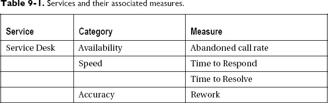
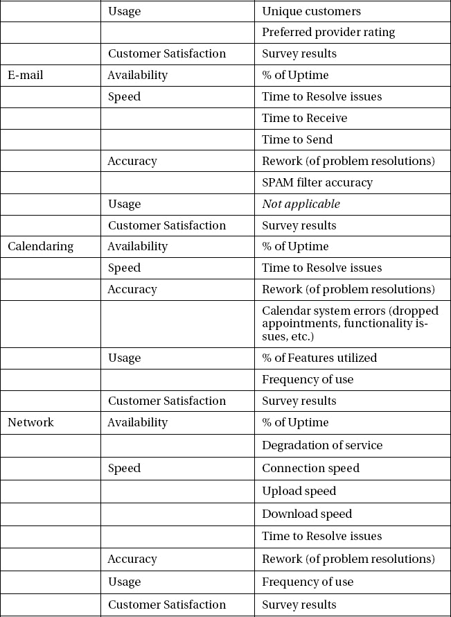
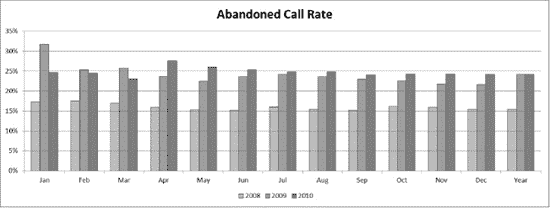
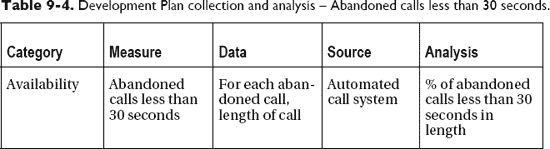
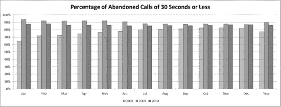
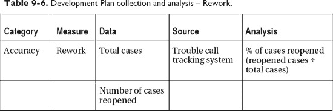
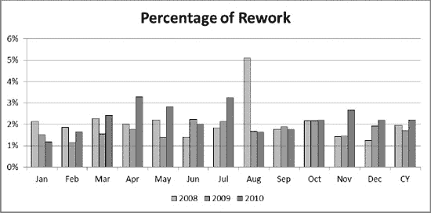
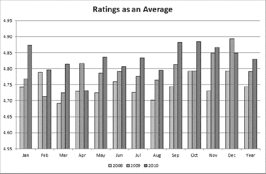
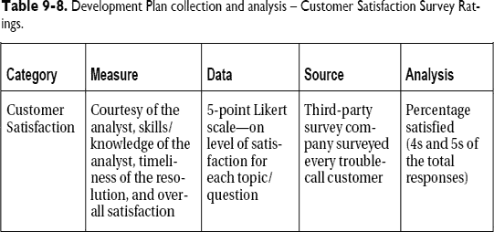
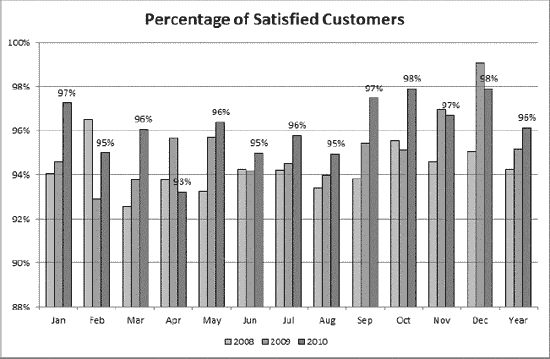

# 第九章 创建并解读度量成绩报告单

我挣扎了很长时间，试图决定如何向你介绍这份成绩报告单。我考虑过是把它作为另一个工具（像答案键那样）来呈现，还是作为一种方法论来提供。我最终决定，把它作为一个真实案例，展示度量指标如何在我提供的框架内演变和成形。

我将向你讲述一个为期三年的历程：为一个组织开发一个可行的度量计划，该计划必须清晰地阐述组织的整体健康状况以及其每项核心服务的健康状况。我在此过程中犯过错误，不断学习、改变、测试和尝试。我将与你分享这段探索之旅以及我最终到达的目的地。希望你能从我的错误中学习，并从中受益的最终产品作为你使用的模板或示例。

最高层执行官向我们首席信息官提出了一个直截了当的问题：“你的组织有多健康？你怎么知道的？” 这正好契合了我们首席信息官的好奇心，他想要获得关于组织健康的有意义信息，但不知道如何表达这种需求。

带着这个根源问题，我努力寻找一种方法来构建一个能够提供有意义答案的度量计划。我提到的“我们”是一个由安永咨询师和我本人组成的度量项目团队。

在一个尚未真正准备好的组织中灌输度量计划是一个艰难的命题。实际上，这是一个不可能成功的命题。我谦卑地这么说，因为即使我们如今在成绩报告单上取得了成功，它仍未发挥其全部潜力。但我们正在变得更好，而且这份成绩报告单比我们组织迄今为止使用过的任何其他报告工具都要持久。

要在坚持我在本书中阐述的原则和价值观的同时应对这一挑战，就更加困难了。为了使其成为可能，尤其是在有强制命令的情况下（这可能是实施任何具体改进措施的最糟糕方式之一，因为它剥夺了员工“获得认可”的机会），需要一个度量计划，使其对数据所有者、要求答案的执行官以及所有中间人员都有益处。

除了建立一个能为所有层级提供有意义信息的度量系统外，我还希望它易于理解，并且尽可能减少层级之间的翻译工作。

正如我之前所写，你无法独自完成这件事。我一个人是不可能成功的——不仅因为这项努力对单个人来说过于浩大，还因为我无法独自获得认可。如果我在整个过程中不让服务提供者参与其中，他们就不会接受并相信信息将如何（以及不会如何）被使用。管理层也不会接受我开发的任何解决方案都会奏效的想法，因为我已经是“村里人”了。没有一个先知（或度量指标设计者）在自己的家乡是被接受的。因此，我最终组建了一个外部顾问团队，加上我自己，以及每个服务提供者的深度参与。

## 概念

首先，您可能会想：“为什么是‘报告卡’而不是‘记分卡’？毕竟，许多组织都用`记分卡`来追踪指标。”我最初的想法是使用`记分卡`。`记分卡`方法论包含使用来自不同领域的度量指标（这符合三角验证的概念），但这些领域甚至不属于同一类度量指标（参见答案键）。另一个问题是，`记分卡`将风险更高的效率度量与有效性度量混在一起。毫无疑问，我想专注于服务/产品健康领域，因为我将努力突破足够多的障碍，而不必卷入伴随效率度量而来的战争。

我欣赏`记分卡`（以及仪表盘）的一点是，它能通过组合度量指标来呈现更全面的图景。这符合`度量指标`的定义，而不仅仅是一堆`度量数据`。

但请思考一下这个名称本身：`记分卡`代表了一种了解“谁在赢”的手段。2011 年秋天，我观看了圣母大学以 23 比 20 输给南佛罗里达大学的新赛季橄榄球揭幕战。令人惊讶的是，圣母大学在几乎所有能想到的类别中都“赢了”，而且优势不小。在进攻、防守等所有类别中都胜出，只有一个例外：失误。最终，唯一重要的统计数据是最终比分，而比分由得分决定。这些得分通常可以通过其他度量来预测。

因此，`记分卡`能快速告诉你谁正在赢，以及谁已经赢了。然而，它无法告诉你谁在特定领域表现更好。普通球迷可能只关心`记分卡`，但我当时是与相当于教练组的人员合作。进攻、防守和特勤组教练，以及跑卫、外接手和线卫教练都想知道他们各自的队伍表现如何。

我希望兼顾两者。我想要一个最终得分，同时也想要能够预示出该得分背后表现质量的指标。

我们想到的是`报告卡`这个概念。这个指标就像大学的成绩报告单，学生全年都会收到关于其学业进展情况的反馈。有测验、考试和论文需要评分。在定期的时间点（期中及期末）会给出成绩。根据反馈，学生知道自己的表现是良好、需要改进，还是超出预期。

在每一种情况下，组织都像学生一样，需要根据整个报告卡来做出决策。仅仅庆祝优异的成绩（A+）并贬低任何差等成绩是不够的。在做出决策之前，还需要更多信息。这个 A+是否是以牺牲另一门学科为代价获得的？相比 A 甚至 B，获得 A+有什么好处？差成绩是否出现在学生需要或真正想要的学科上？这门课可以退掉吗？它是否是主修课程所要求的？

出于我们的目的，我们将开发的度量指标视为`报告卡`。虽然我们可能乐于获得高于预期的成绩，但我们只期望以下结果：

1.  那些不需要超出可接受努力范围的结果（例如，学生是否忽略了其他科目，或者学生是否挑灯夜战到损害健康的地步）。

2.  学生没有通过“作弊”获得成绩。在组织环境中，作弊等同于超出可接受标准、政策或流程行事。

3.  学生是凭实力获得成绩的。我们不希望得到名不副实的成绩——无论是好成绩还是坏成绩。该度量指标应反映从客户视角看到的服务表现。

当我们审视低于预期的成绩时（例如，某次测验或考试不及格），我们还需要提出以下问题：

1.  失败是否由可避免的情况导致？这可能包括不良的学习习惯、未完成规定的作业，或缺乏先修课程？

2.  是否因缺乏努力或专注导致？

3.  这门课是否是主修课程所必需的？如果不是，它是一门可以退掉的课吗？如果该服务不是组织核心服务的一部分，它可以被放弃吗？“低于预期”的结果是否可接受？

接下来，让我们看看`报告卡`是如何构建的，从单个服务一直延伸到整个组织的健康状况。

## 基础工作

所有组织都有客户。在本案例中，为了回答高管层提出的问题，我们选择从向客户交付服务的质量角度来回答。我们本可以将问题理解为生产产品和交付服务的效率如何……但根据`答案指南`，我们决定从更关键的焦点出发：我们在多大程度上满足了客户（服务/产品健康度）。这一焦点使我们能够自下而上地设计整个项目。

通过关注客户的视角（有效性），我们发现可以在员工层面引入指标，从而减轻通常伴随指标而来的恐惧、不确定性和疑虑。我们能够向包括主管、中层经理和总监在内的全体员工保证，我们收集、分析并最终报告的信息，不会反映组织中任何个人或任何单位的绩效表现，而是传达客户如何看待我们的服务和产品。

这些信息对每个层级的每个人都是有价值的。由于不涉及“归咎责任”，我们能够心无旁骛地解决客户的关切。不仅不归咎责任（“谁”不重要，只有“为什么”才重要），而且我们掌握的信息也并非被视为事实——客户的感知比任何关于事实的争论都更重要。

这有助于应对通常反对收集某些数据的观点：“但我们对此无法控制” 和 “这不是我们的错。”

我们同意采用`答案指南`建议的以下主要信息类别：

1.  `交付`

2.  `使用情况`

3.  `客户满意度`

我们进一步同意，对于大多数服务，`交付`将细分为可用性、速度和准确性。这一点尤其有用，因为最具争议的衡量指标就属于`交付`类别。我们的大多数服务提供商已经通过故障呼叫跟踪系统调查来收集和审核`客户满意度`指标。`使用情况`是一个“安全”的指标，因为很少有人会将使用数据视为其绩效的反映。

由于我们预计来自`交付`指标的阻力最大，我们希望利用上述三个领域（三角验证法）来缓和这种阻力。

因此，根本问题以及我们更高层次的信息需求很容易被确定。当然，我们仍然需要确定具体的衡量指标及其组成数据。在这样做之前，我们需要知道哪些服务将包含在`报告卡`中。我们需要了解组织的关键/核心服务。服务目录本来会非常有帮助，但当时并没有。在许多组织成熟度不足的组织中，健全的指标项目所需的许多前提条件可能都缺失。这也是使用指标项目被视为一种成熟行为的原因之一。

虽然在不够成熟的组织中尝试实施成熟的行为（如指标项目）可能问题丛生，但如果谨慎操作，它实际上可以成为推动组织走向成熟的催化剂。在我们的案例中，指标项目明确帮助组织思考并着手开发服务目录。虽然早在指标项目启动之前，服务目录的需求就已经被识别出来，但指标工作有助于聚焦这个短板。

`报告卡`所鼓励的另一种行为是对故障呼叫跟踪系统更一致、更准确的使用。由于大量数据（几乎涵盖`报告卡`中所有服务）都依赖该系统，组织必须在使用该系统时变得更加严谨。

在组织记录服务目录之前，我们尽力识别出被组织大多数成员视为核心的服务。

作为一个信息技术组织，我们有许多服务和产品可供选择。我们选择的一些关键服务包括：

*   `服务台`

*   `电子邮件`

*   `日历`

*   `网络`

*   `电话`

这些服务很容易被接受为我们提供的核心服务的一部分。针对每项服务，我们构建了一个模板，用于在所确定的领域收集指标。该模板将包括服务、用于分析服务健康状况的信息类型（类别），以及用于回答根本问题的具体指标。结果见表 9-1。






你可能需要关注不同的服务。例如，你可能处于与我示例中完全不同的行业。即使你拥有相同的服务，你也可能有不同的信息类别，因此有不同的指标。

我将只聚焦于一个领域——`服务台`，来继续这个示例，但我想先解释一下`电子邮件`“使用情况”的指标为什么“不适用”。我们的组织为我们的客户提供`电子邮件`——基本上处于垄断地位。我们的客户在工作邮件上没有其他选择。他们可以使用其他电子邮件服务（例如 Gmail），但必须先经过我们的系统，然后才能自动转发。因此，我们一开始就认为“不适用”，并且没有衡量`电子邮件`的使用情况。基于同样的原因，我们也没有衡量`日历`、`网络`和`电话`的使用情况。虽然在这些案例中我们没有使用`使用情况`指标，但原本是可以使用某些指标的。

对于`电子邮件`，我们可以使用“使用率”和“将邮件自动转发到其他电子邮件提供商的客户数量”。

对于`日历`，我们可以查看“使用频率”和“功能使用率”。`日历`是一项足够新的服务，了解其功能的使用水平（客户接受度）是值得的。

衡量互联网和电话的使用频率似乎仍然没有意义，因为它们是高使用率的服务，而且我们处于垄断地位。

以下两点我想明确说明：

1.  某些指标可能“不适用”。虽然三角验证法要求你尝试从不同视角获得至少三个指标，但这并非强制要求。

2.  仅仅因为你能想到某些指标，并不意味着你必须使用它们。

那么，回到`服务台`。让我们看一下为该服务确定的具体指标。


如第 5 章所述，可用性、速度和准确性这三个“交付”指标将通过从服务提供商处收集的信息进行客观衡量。对我们来说，好消息是该部门经理过去是（并且现在仍然是）一位极具同理心的领导者。我之前写到的许多危险和警告都源于恐惧、不确定性和疑虑——而这些担忧往往在经理滥用指标时成为现实。就我们的服务台而言，我并不担心经理会滥用或误用我们提供的信息。如果我告诉她数据显示某位员工疏忽、懒惰或无能，她不会草率采取行动，而是会首先调查数据背后的“真相”。如果我所提供的解释是准确的，她会与员工一起以富有同理心的方式解决问题。

这位经理的态度使得服务台成为一个极佳的起步服务。我们对她在帮助我们将该项目推广给她员工，并成为其他服务提供者的坚实榜样方面的能力充满信心。

# 选择该服务提供商的另一个积极因素

选择该服务提供商的另一个积极因素是能够轻松获取大量数据。`服务台`是故障报修跟踪系统的最高频用户。大部分数据都将通过该系统获得。可用性数据（未接来电）通过全自动呼叫系统获取，使其成为一套客观的衡量指标。客户满意度则由第三方调查机构处理。因此，该服务提供商拥有我们想要的所有数据，并且大部分数据都通过客观收集方法获取。所有这些数据都能在不干扰各部门日常运营的情况下获取。这是一个理想的起点服务。

## 速度

速度的追踪客观性略低于可用性。由于它基于解决速度，因此将从故障报修案件的开启和关闭时间中得出。这要求接听电话的分析师在每个阶段——开启和关闭——都准确地记录案件。由于管理者信奉指标管理，她鼓励（并确保）员工准确记录案件。

## 准确度

准确度同样使用故障报修跟踪系统来衡量。返工被定义为过早（错误）关闭的案件。我们可以在整个解决方案过程中尝试识别错误（缺陷），但由于为客户寻找解决方案的过程往往包含试错，这并非一个容易的起点。即使管理者充满同情心，我也不想要求分析师追踪他们在找到正确答案之前尝试了多少种不同的猜测。这需要高度的信任（让员工相信这不会影响他们自身的评价），而这种信任我尚未建立起来。这种方法的另一个问题在于，信息可能无法反映客户的观点。大多数客户都期望并接受一定程度的试错和探索，以寻找正确的解决方案。

在每种情况下——`未接来电率`、`解决时长`和`返工率`——数据都将反映客户的观点。

## 交付到使用

从交付到使用，在这种情况下是一套更困难的衡量标准。由于`服务台`是一个内部服务提供商（客户不为此服务付费），使用量并不反映组织的收入。管理者对其部门的使命有着非常健康、宏观的视角。如果使用量“高”，可能反映了`IT`系统、服务和产品的不稳定性，也可能反映了`IT`相关培训的无效性。在大多数业务和服务中，高使用量是件好事。但对于`服务台`而言，高使用量可能和低使用量一样糟糕。此外，如果使用量“低”，则不清楚这是反映了培训效果出色、系统稳定，*还是*客户认为`服务台`不是一个有意义、有用的提供者。

与大多数衡量指标一样，从中得出的信息需要加以解读。应该进行进一步调查，而不是急于下结论。在这种情况下，任何极端情况都可能是一个负面信号——但信息仍然有用。由于我们拥有跨越相当长一段时间（超过三年）的数据、衡量指标和信息，我们可以判断客户的模式是否发生了变化。通过观察独立客户，我们可以判断是否存在异常——无论是上升还是下降。这些峰值可能不表明好事或坏事。相反，它们仅表明某些事物发生了变化。

为了有意义，我必须拥有纵向数据来进行比较；否则就无法识别异常。在某些情况下这并不那么重要——但在使用量方面，这很关键。关键在于能够识别异常——即超出正常预期范围的衡量指标。在我们确定了适当的衡量指标和数据点之后，我们必须确定预期。

任务是识别异常——即超出正常预期范围的衡量指标。

这突显了指标计划的一个重要方面。你的信息只是指示信号，在未进行进一步调查之前不应据此采取行动。不要期望这些指标成为行动的推动力，它们更常是表明某处有误、某物已变、或某事需要调查的指示器。

### 客户满意度

客户满意度是另一个易于获取数据的例子。该部门利用一家第三方调查公司，该公司对每一个已关闭的故障报修案件的客户发送调查邀请（通过电子邮件）。供应商收集回复，汇总结果，并每周向部门发送一份报告。我每月会收到一份结果副本，用于纳入报告卡。我们确定的所有衡量指标都可以在不引人注意、不干扰部门工作流程的情况下收集。这并非总是可行，但始终是一个目标。

由于大部分数据可以通过自动化系统获取，我们掌握的数据随时可得，并且与人为错误高度隔离。在少数几个有人类参与处理数据的环节，团队对生成准确信息的渴望使我们非常乐意将此服务作为我们的旗舰项目。

## 指标开发计划

回顾指标开发计划。我们认识到确定来源、数据（每个组成部分）、如何以及何时收集数据、以及如何分析数据是重要的。就`服务台`而言，其中大部分工作已经完成。表 9-3 将已为`服务台`确定的类别和衡量指标进一步细分为所需数据、这些数据的来源，以及对数据的一些基本分析。这些分析可以编程到软件工具中进行显示。

```

```

这是我们的起点。我们轻松确定了这些衡量指标。其中一些指标已经在收集和分析。与大多数事物一样，还有其他选项可供选择。在分析了之后，我们重新评估了我们的指标草案。

让我们回到指标开发计划，它包含以下内容：

*   目的声明

*   指标将如何使用

*   指标将不会如何使用

*   指标的客户

*   分析

*   时间表

*   为我们其余人准备的图景

*   散文式描述

### 目的声明

我们的目的声明是既定的——我们如何向领导层传达我们的服务和产品的健康状况？

### 将如何使用

你可能会认为这个答案简单明了；它将用于回答问题。在这个特定案例中，它将用于从客户的角度传达`服务台`的健康状况。

### 将不会如何使用

大多数人也希望这一点显而易见，期望无需回答这个问题。当然，我必须回答它。

*   它不会被用于区分分析师之间的优劣

*   它不会被用于绩效考核

*   它不会被用于推动分析团队达到不同的绩效水平——换句话说，这些衡量指标不会变成待实现的目标。

### 指标的客户

该指标（`服务台`健康状况）的客户，首先也是最重要的，是`服务台`本身。管理者和分析师是数据的所有者，也是由此衍生出的信息的“合法”所有者。另一位客户是我们支持服务部的总监（管理者向其汇报），然后是`CIO`，最后是高管。所有这些都是客户。每位客户需要不同级别的信息。

# 数据所有者从数据中获益

数据所有者（分析师和管理者）即使从最底层的数据中也能获益。主管需要看到异常情况。她想知道这些异常的原因是什么。CIO 想知道哪些异常需要他亲自参与处理。如果服务台确定需要升级电话系统、购置新的自动呼叫系统或专家系统，相关资金必须得到 CIO 的批准。这些数据将有助于支持这些请求。

CIO 还想了解任何可能反映客户不满的趋势（无论是积极的还是消极的）或异常情况。基本上，CIO 想知道他的上司（高管）可能会问到的异常情况。大多数情况下，高管之所以会问，是因为一个重要客户或一群客户投诉了某个问题领域。CIO 不应该从上司那里才听说异常情况。

高管也是如此。如果服务健康状况低于预期，并最终影响到上级组织，高管理所当然会想知道原因，以及正在采取什么措施来改善情况（要么重复积极体验，要么消除负面体验）。

## 分析

除了计划中的分析之外，还必须对信息结果进行分析，以了解其趋势和/或含义。既然我们已经打下了基础，是时候深入挖掘了。我们必须收集数据并进行分析，以确保我们最初关于用途的猜测是准确的。

### 可用性

我们从服务的`放弃呼叫率`开始。当我们查看图 9-1 中显示的数据时，我要求经理（和员工）进行一个简单的试金石测试。我问经理，她是否认为该部门对客户响应不及时。`放弃率`是否过高？如果高于预期，这个数据准确吗？如果准确，为什么这么高？



**图 9-1.** `放弃呼叫率`

经理之前多次听说过，`放弃率`是呼叫中心绩效的标准衡量指标。她查看数据时表示，“感觉不对”。这并不是因为数据让部门显得不利，而是因为她相信自己的单位对客户需求的响应程度比数据显示的要高（数据显示该部门每十个电话中就有超过两个被“挂断”）。

这促使我们对这些指标做出恰当反应：我们进行了调查。我们研究了两个方面——接听电话的流程和程序，以及系统生成的原始数据。流程显示，两声铃响内未接听的电话会被转到一个自动队列。这个队列从一段录音开始，告知来电者所有分析员都在忙，很快就会有人接听。值得一提的是，这段录音会提供有关 IT 服务任何已知问题的信息，例如“当前网络中断正在处理中，应该很快就会恢复”。大多数日子里，录音的前 30 秒传递的信息可能已经满足了来电者的需求。

经过进一步检查，我们发现原始数据包含了通话时长（开始时间与挂断时间之差）。这使我们能够提取出另一个指标，如表 9-4 所示。



该指标在图 9-2 中以图表形式呈现。我们将其与`总放弃率`进行比较，看是否能更清晰地说明问题。



**图 9-2.** 持续时间少于 30 秒的`放弃呼叫百分比`

与所有指标一样，一个主要问题是如何传达该指标（使用哪种图形表示形式）。就可用性而言，我们最初使用“`放弃呼叫率`”，即“`放弃呼叫百分比`”。当我们加入更具体的“30 秒内放弃的呼叫”时，我们再次使用了百分比。我们选择将其与总数*或*仅显示“`放弃呼叫百分比`”相关联，并限定“`放弃`”定义为 30 秒后`放弃`的呼叫。

在结合流程改进（包括缩短录音时间）观察这些指标一年后，该部门选择放弃“`总放弃率`”，仅使用“30 秒内`放弃`的呼叫”。这会更好地回答可用性问题，因为它允许以下情况：

1.  拨错号码
2.  通过自动录音回答的问题/解决的问题
3.  改变主意的客户（他们可能选择使用新的电子邮件或聊天功能寻求帮助。也许客户的电话刚打出，他们的问题就自行解决了。）

虽然假设等待时间不超过 30 秒的来电者不会对等待感到失望仅仅是一种假设，但人们相信这能提供更准确的描述。这需要与“速度”（参见速度衡量指标的补充）和客户满意度衡量指标“`及时性`”进行比较。当然，只有那些在电话上等待足够长以接通电话的人才会填写调查问卷。

在可用性方面有了坚实的开端之后，让我们来看看`速度`。`速度`最初是指“`解决时间`”，众所周知这是客户关心的问题。并非该组织在这方面存在缺陷，而是客户在乎解决问题需要多长时间。

### 速度

我们最初从故障呼叫跟踪系统中记录的`工单`开启与关闭时间入手。这些数据需要人工输入，要求分析师严格遵守围绕故障呼叫跟踪所建立的流程、规程与政策。如果管理者是其他类型的经理，我可能需要花费大量时间来确保员工明白：这些信息不会被滥用，而且尽可能准确地将数据录入系统符合部门、每位员工以及管理者自身的最大利益——无论数据反映的情况是好是坏。如果分析师为了“看起来不会太糟”或“显得格外好”而“篡改”数据，那么这些信息就会变得毫无价值，甚至可能导致错误决策。

在这个案例中，我信任这位管理者，因此只花少量时间在一次员工会议上说明了数据准确性的重要性，以及由此得出的`衡量指标`和`信息`如何能够用于改进流程——并且不会反映到个人绩效上。这一解释的关键点与我处理过的任何`衡量指标`或部门单元都是一致的。

`数据`、`衡量指标`、`信息`，乃至最终的`度量标准`，不应反映个人绩效。

此外，这些`度量标准`也不应反映部门整体的运营效率。

`数据`、`衡量指标`、`信息`和`度量标准`所清晰反映的，是客户对服务的感知。无论“真相”如何，了解客户的感知都使部门受益。这一点在`速度`方面尤其明显。

根据您用于捕获`速度`的工具，您可以报告解决一个问题的确切耗时。例如，您可以使用自动呼叫系统来识别呼叫发起的时间（而不是分析师在故障呼叫系统中打开工单的时间）。您还可以使用另一个呼叫系统记录分析师完成最后一次致电客户并关闭`工单`的日期和时间（假设处理过程不止一次通话）。您需要一种将`工单`信息与呼叫系统关联起来的方法。这种精确度在大多数情况下并非必需——记录`工单`的开启和关闭时间通常就足够了。但即便您拥有了上述精确度，客户仍可能“感知”到实际更快的解决耗时更为漫长。

我可以向您保证，向客户展示“证据”表明`工单`实际耗时比他们感知的要短，这既不会提高客户的满意度，也不会改变他们对部门工作效率的看法。对客户而言，感知即现实。虽然了解客观现实很有用——但您还必须应对客户的感知。

即使您达成了服务水平协议（`SLA`），假设您确实有这类协议，`工单`也可能被客户感知为耗时超出预期。

**注意：** 如果您能获取服务的`SLA`，这些是记录客户对服务或产品期望的绝佳起点。如果您有`SLA`，请保持警惕。您可能会发现，尽管客户同意了`SLA`，但它可能无法反映他们的真实期望——随着时间的推移尤其如此。甚至可能在`SLA`签署当天就无法反映他们的期望。

对于我们的`度量标准`，我收集了`工单`开启和关闭的时间。我们的故障呼叫系统具备切换“暂停计时”开关的功能。此功能记录了开关被拨至“暂停”位置，直至重新拨回“活动”位置之间的时长。

这非常有用，因为它允许工作人员捕获客户预计无需进行工作的时间段。但*并非*用于扣除非工作时间的晚间或周末时段。客户虽然不一定会期望在这些时段内完成工作，但仍会将“停机时间”视为解决其问题的总时长的一部分。“暂停计时”仅用于特定且明确界定的情况，例如：

1.  客户无法联系上（在休假、外出），导致`工单`虽已解决但无法关闭。
2.  客户要求延迟实施解决方案至特定时间，比如请求安装新软件，因为她不希望升级干扰当前工作。

对于计划内的修复，我使用了另一个数据点：`计划解决时间`，并将其作为公式中的起始时间。尽管暂停计时功能也可能适用，但我很少发现它在此类情形中被使用。如果您使用暂停计时或`计划解决时间`，您仍然必须捕获起始时间和关闭时间。您必须保留原始数据，因为您无法预知何时会面临客户争论，声称实际时间应从呼叫时刻算起；或者您可能希望展示您提前多久收到未来解决的请求。您是在需求产生前一天、一周，还是一个月前收到请求？您如何处理这些请求？如何确保工作按时完成？包含实际起始和关闭时间的原始数据，将有助于检查您的流程。

因此，我们首先将`解决时间`与客户期望进行对比，如图 9-3 所示。


**图 9-3.** `解决时间`：在期望时间内解决的`工单`百分比

对于`速度`指标，我们还必须就如何呈现数据做出决定。我们可以将数据显示为在期望时间内解决的呼叫数量，也可以使用百分比。您可能注意到一个趋势——百分比是一种简便的数据描述方式，尤其是在结合用于计算百分比的实例数量时。通常只需提供总数即可（如有必要，可据此推导出具体数据）。

与可用性指标类似，服务提供者认为故事缺失了一部分。除了完成工作所需的时间外，客户还关心他们需要等多久才能与一位活生生、能呼吸的分析师交谈，而不是听录音。因此，我们需要收集`响应时间`数据。表 9-5 展示了`响应时间`的细分情况。这是一个需要构建多个数据点的衡量指标的良好范例。


在定义这个衡量指标的过程中，我们意识到还存在其他衡量`响应时间`的方式。除了分析师接起电话前的时长，还有针对留下语音邮件的客户进行回电的情况。由于服务台在周末或非工作时间不开放，客户留下语音邮件是很常见的事情。因此，`响应时间`需要包含回电给客户（并取得联系）所需的时间。期望是基于工作小时数的（而非纯粹是消息留言的时刻）。如果客户在周五下午 5:15 留下消息，期望并非是在周一上午 8:00 就接到回电。与往常一样，期望会是一个范围——例如，服务台将尝试在三小时内回电。棘手之处在于，需要判断回电是否必须成功联系上客户，还是仅在客户语音邮箱中留言即算作“联系”并视为已响应。

`响应时间`是该`度量标准`在开发后期才加入的指标，第一年并未使用。灵活性是构建有意义`度量标准`计划的关键之一。

灵活性是构建有意义`度量标准`计划的关键之一。

## 准确性

# 服务台准确性衡量

系统内部及其运行过程中产生的缺陷通常会被审查。那些在发布前被捕获的缺陷属于“效率”的一部分。而到达客户手中（且客户意识到的）的缺陷，则属于我们正在制定的衡量指标范畴。我们需要方法来表征有缺陷的生产或服务交付。以服务台为例，我寻找了一种简单的准确性衡量标准。

## 返工

返工是一个容易的选择。利用故障呼叫跟踪系统，我们可以追踪在客户认为问题已解决后，又被重新打开的案例数量。只要客户将案例的重新打开视为返工，它就会被计入。我们发现，有时案例会被过早关闭——无论是服务台还是二级支持团队所为。之后客户会就同一个本以为已解决的问题再次致电服务台。分析师们以令人钦佩的方式重新打开案例（而非创建新案例，那样会使他们处理的总案例数看起来更好看，并避免准确性受到影响）。这种诚实的核算方式让服务台能够以客户看待他们的视角来看待自身。表 9-6 展示了返工情况的细分。您会注意到，所有这些案例的分析都非常简单。在关于工具的附录中，我会简要讨论统计学的应用场景。



图 9-4 展示了返工情况。您可能已经注意到，这些图表看起来都有点相似。如果仔细看，您会发现它们看起来完全一样。到目前为止，唯一的区别在于数据（数值）和标题。这种一致性应该对您有益，因为评审这些衡量指标的人会逐渐熟悉呈现方式以及如何解读它们。



图 9-4. 案例重新打开的百分比

## 三角验证

现在正是指出“三角验证”如何有助于防止“追逐数据”的好时机。组织经常发现自己追逐数据，试图为一切披上积极的外衣，只报告好消息。分析师本可以将每一个合理的返工回电都记录为新的案例。这样做几乎可以（如果不是完全的话）消除返工。但这会人为地增加其他数据。处理的呼叫数量会增加。处理的案件数量也会增加。而客户对分析师知识水平的满意度则可能会下降。如果客户知道这是返工，却看到另一份自动生成的针对新案例的调查问卷出现在他的邮箱里——仿佛工作人员没有意识到这是同一个问题——最终会导致对分析师技能/知识水平的评分降低。

当然，解决速度也可能看起来更好，因为没有案例会显示花费了返工所需的时间。如果没有三角验证，这种情况很容易发生。当然，我手中握有王牌。即使没有三角验证，该部门的管理者及其团队都是服务客户的坚定信徒。他们不仅提供服务，而且力求做到最好。他们是持续流程改进和卓越服务的信奉者。即使没有三角验证，我也完全相信这个部门不会追逐数据。

但是，通过使用三角验证，并且不以孤立的方式看待衡量指标，这有助于即使那些承诺度较低的部门也能坚持从客户的角度出发。

如果我们因为一个类别的虚假报告而看到其他类别出现峰值，我们就会发现有异常需要解释。除了这些异常之外，返工率会非常低（或不存在），这本身也是一个异常。这是我们调查超出预期和未达预期结果（除了希望复制成功之外）的另一个原因。

## 使用率

对于使用率，我们每月记录独立客户的数量，并将其作为累计总数运行。利用潜在客户群，我们能够得出使用服务台的独立客户百分比。我听说过关于某些数据根本无法获取的争论。在这种情况下，我喜欢参考道格拉斯·W·哈伯德的著作《如何衡量万物》（Wiley, 2007）。不是因为这本书包含了所有可能的衡量示例，而是因为它提供的方法让读者有信心能够衡量任何事物。

独立客户应该能够与客户群进行比较衡量，无论你的服务是什么。如果你是一个全国性的服务台——比如说，像微软、亚马逊或山姆会员店——客户群仍然可以确定。如你目前所知，精确的（事实性）数字可能无法获得，但获得一个非常好且有意义的估计是完全可行的。客户群可以通过确定相关软件的销售数量来估算。如果微软售出了 15 万份某款软件，那么关于该软件收到了多少个独立客户的来电？亚马逊拥有其客户总数的信息。对于山姆会员店也是如此，因为它是一个付费会员制零售商。而沃尔玛、麦当劳和社区超市则更难做到。

以沃尔玛和麦当劳为例，它们的全国呼叫中心可以使用关于“客户数量”的市场营销数据。每个公司都有可以利用的信息。不一定是独立客户，即便如此，它们对回头客数量和总客户数量也有很好的了解，因此可以推导出这些数字。

社区超市可以确定客户数量，或者将社区人口（以商店为中心，基于确定的半径）视为潜在客户群。

以服务台为例，我们拥有每个客户的识别信息（前提是客户提供了这些信息）。当然，这些数据的准确性完全取决于分析师的记录（姓名拼写错误可能是个问题）以及客户提供信息的诚实度（或意愿）。不过，百分百的准确性并非必需。好的数据就足够了。

有时候，“好的”数据就足够了。

查看三年期间的数据显示，客户群使用率相当稳定，我们更有信心异常情况会凸显出来。在图 9-5 中，您可以看到我们所看到的情况。最后一年显示出稳步增长。但这并非意外，因为最后一年有大量新技术、软件和硬件投入使用。


**图 9-5.** 独立客户百分比

与前两个衡量领域一样，使用率也以百分比表示。除了易于报告之外，这种方式也易于理解。另一个好处是为查看者提供了一致性。当你报告来自不同来源（三角验证）的多种衡量指标时，通过使这些指标的呈现方式尽可能保持一致，可以降低其复杂性。

通过纳入一项调查结果，我们立即对使用率衡量指标进行了改进。我们改版了年度客户满意度调查，并增加了一个关于客户如何就信息技术问题获得帮助的问题。我们询问谁是他们首选的求助来源：“当您遇到 IT 问题时，您首先会向哪里求助？”答案可以从以下选项中选择：

*   朋友

*   同事

*   互联网（搜索引擎、通用信息网站等）

*   供应商/制造商网站

*   硬件/软件制造商服务台

*   IT 服务台

*   其他

*   以上都不是——我不寻求帮助

### 使用指标与数据收集

虽然本次调查所得的数据并未直接反映实际使用情况，但我们仍将其归入此类别，因为它提供的答案契合了我们寻求使用数据的初衷。我们的客户对我们的服务满意吗？他们信任我们的服务台能提供所需支持吗？我们的服务台是他们解决故障的首选渠道吗？


正如您将在图 9-6 中看到的，本次调查收集结果中一个有趣的发现是第一年的百分比更高。


**图 9-6.** 将服务台作为首选求助渠道的客户中，独立用户所占的百分比

2007 年的调查与之后两年的唯一区别在于提供给受访者的选项数量。2007 年只有三个选项，而随后两年则有八个选项。

我们可以用来完善整体情况的另一个使用量指标是挂断电话的独立客户数。无论这些通话是否被计入可用性指标（等待时间大于或小于 30 秒），了解有多少独立客户曾致电我们的服务台仍是有用的信息。对于那些没有等待接通分析师、在 30 秒内挂断电话的客户，我们假定他们的需求已得到满足。如果他们等待超过 30 秒后挂断，我们则假定他们的问题未能解决。

因此，对于 30 秒内的通话，我们可以将其视为已服务客户。从流失通话的数量来看，这可能是我们数据池中缺失的相当数量的客户。这些数据对服务台经理在其他方面也很有用。如果同一个号码反复致电并在分析师接听前挂断，经理可以联系该号码，了解是否有特定的需求未得到满足。这需要自动呼叫系统能够在电话未被分析师接听的情况下捕获呼叫号码。在制定这些指标时，当前的电话系统尚无法实现这一点。因此，这一需求被记录下来，作为今后更换呼叫系统时的未来需求。

### 客户满意度

我们用于完善指标体系的最后一组衡量标准涉及经典的客户满意度调查。我们组织此前一直委托第三方机构进行“故障解决满意度调查”的管理、收集和制表工作，因此数据很容易获取。这些问题对所有服务用户都是标准化的，使我们能够与第三方机构所有客户（包括我们所在行业和整体）的平均水平进行比较。这一点让我们的管理层和高级领导层非常满意。他们非常喜欢能够将自己的服务与基准进行比较。当自己的服务表现优于基准时（正如我们那样），他们就更高兴了。

为了保持与之前相同的衡量风格——使用占总数的百分比，也是可行的。我们可以报告打 5 分、4 分、3 分、2 分和 1 分的百分比。但这会过于复杂，尤其是对于四个问题而言。因此，我们选择展示“满意”客户的百分比。我们将“满意”定义为在 5 分量表中给出 4 分或 5 分。

其他选项包括使用赖克海德的“推荐者与贬损者比率”。在我最终放弃之前，这个尝试实际上进行了一年多。（我无法让第三方机构使用 10 分量表，而且推荐者与贬损者的概念对某些经理来说过于复杂。）使用百分比提供的一致性很快就成为团队所期待的标准。我仍然相信推荐者与贬损者分析的价值，但就报告卡而言，我为我们的特定受众增加了“满意百分比”这一衡量指标。

**弗雷德里克·赖克海德的推荐者与贬损者量表**

根据赖克海德的《终极问题》（哈佛商业出版社，2006 年），你应该问的最重要的问题是：“你会向朋友或同事推荐这项服务（或产品）吗？”答案采用 10 分量表，1 分表示“绝对不会”，10 分表示“绝对会”。如果受访者给出 9 分或 10 分，她被认为是“推荐者”——即会鼓励他人使用你的服务（或购买你产品）的人。如果受访者给出 6 分或更低，她是“贬损者”。贬损者会积极劝阻他人使用你的服务（或购买你的产品）。7 分和 8 分被认为是“中立”答案——这意味着无法预测他们会提升还是损害你的声誉。你需要有每位贬损者对应两位推荐者的比例，才能实现增长（中立者不计入）。这个比例越高，你的口碑宣传效果越好，你的业务（客户数量）增长的可能性就越大。

图 9-7 展示了推荐者与贬损者的比率。如果贬损者多于推荐者，这个比率可能是负数。就服务台而言，我们的比率很高。例如，在 2009 年 12 月，每有一位贬损者（评分 1-3 分），服务台就有超过 50 位推荐者（将其评为 5 分的客户）。


**图 9-7.** 整体客户满意度中推荐者与贬损者的比率

这些比率令人印象深刻。我在一定程度上灵活运用了赖克海德的方法。5 分等同于 9 分或 10 分，1 分到 3 分等同于 1 分到 6 分。4 分则等同于 7 分和 8 分。由于我们没有使用正确的问题，我停止使用“推荐者”和“贬损者”这两个术语。更直接地说，这个指标反映了“非常满意”（5 分）与那些不能自称满意（3 分及以下）的客户之间的比率，这本身就比平均值更有意义，但仍然没有达到我期望的清晰度。

# 关于客户满意度调查评分的思考

“那么 4 分算什么？”是我以这种方式展示数据时经常收到的问题。解释 4 分是“真正的中立”并不能说服大多数人。服务提供商认为我们正在失去“满意者”，并且 3 分才是中立。我将这些分数与`Reichheld`的公式相关联的做法，他们很难接受。我认为这在很大程度上是因为对衡量标准的恐惧，以及担心他们的表现不会像他们期望的那样好。

使用高度满意与不满意的比例对你来说可能合乎逻辑（对我来说也是如此）。但我发现这并不是客户满意度调查的常态。服务台报告这些数据已经超过一年，他们总是将其报告为平均分，例如 4.7（满分 5 分）。似乎展示结果的最佳方式是使用李克特量表（`Likert Scale`）。

## 问题：评分含义不明确

我查看了过去三年的所有服务台报告。第一年的年平均得分为 4.7，第二年为 4.76，最近一年为 4.8。除了略微上升的趋势外，我无法理解这些数据的含义。这个平均值是好还是坏？好在有第三方为我们的行业及其所有服务用户提供了基准。所以我们现在可以看到，我们的分数高于平均水平。但是，我仍然觉得有些茫然。我不明白 4.8、4.9 或 4.58 意味着什么。当然，如果平均值是 5.0，我就知道所有分数都是 5 分。这意味着 100%的客户对我们的服务高度满意。但是，一旦平均分低于这个神话般的结果，我就难以理解它的含义了。即使我加入了总回复数，我仍然不知道平均评分意味着什么。图 9-8 展示了为什么难以理解其含义。



`图 9-8.` 客户满意度平均评分

因此，平均分缺乏意义，而比较高度满意与不满意又有点令人困惑。第三个选择是使用满意百分比。我可以快速理解，我们客户中有一定比例（那些使用我们服务的客户）要么满意（4 或 5 分），要么不满意（1、2 或 3 分）。即便如此，我也收到了关于“不满意”含义细微差别的争论。有不少经理希望不要计算 3 分，因为他们认为在 5 分量表中，3 分是中立的。

我不得不解释，“中立”意味着受访者虽然不“不满意”，但也不能说“满意”。该图表并非比较满意与“不满意”，而是比较满意与“不满意”。请注意，那些希望在第一比例（5 分对 1-3 分）中纳入中立分数的经理们，如果他们认为这会让他们部门的表现更差，他们就会想要放弃中立分数。图 9-9 展示了为什么“满意百分比”是解释数据的更简单方法。


`图 9-9.` 客户满意百分比

## 进一步思考：年度调查与问题解决调查的差异

我们在原始计划中不断增加衡量指标，进展相当顺利，因此在客户满意度方面我们没有保留意见。我们意识到我们只关注那些遇到问题客户的反馈。这可能会使我们对客户对我们服务的整体满意度产生片面的看法。我们永远不会听到那些因为不喜欢我们的服务而不会致电服务台的客户的意见。或者我们可能会错过那些喜欢我们服务，但要么没有选择填写调查问卷，要么当年没有使用我们服务的客户。基本上，我们希望听到那些没有致电服务台的客户的声音。我们希望听到我们其余客户群的意见，这些意见并未反映在我们的使用量指标中。

答案是进行年度客户满意度调查。我们发送的调查问卷不仅询问关于我们服务满意度的基本问题，还询问哪些服务被客户认为最重要。这有助于我们在成绩单中包含的其他服务。我们还询问了“谁是你解决问题的首选来源”这个问题，我们将其用于使用量指标。这项年度调查除了客户满意度之外，还提供了许多有用的衡量指标。表 9-8 显示了该类别的首次数据细分。



对于年度调查，我们能够显示相同的满意百分比，但数据来自不同的背景。这似乎不太重要，但对于允许不同视角来看待问题非常有用。一个有说服力的结果是，年度调查的分数明显“低于”问题解决调查的分数。这与各部门的预期相悖（所有服务部门都是如此）。员工错误地预测，问题解决调查的分数会比年度调查的分数更差。他们认为，填写问题解决调查的客户因为遇到了“问题”而倾向于不高兴，而年度调查则有很大机会捕捉到客户处于中立或良好情绪中。

但数据证明他们完全错了。问题解决调查的分数显著高于年度调查。这引发了进一步的调查，以确定为何存在如此巨大的差异（并且与预测相反）。这项调查并非旨在提高年度调查的数字，而是旨在提供理解，并基于此理解产生可能的想法。

一个结论是，问题解决做得非常好（快速、准确且成功率高），以至于客户非常满意，给出了很高的评分。相反，年度调查反映的只是当时的一种冷漠态度。这并不是说年度调查的数字很糟糕——它们仍然非常好。但与问题解决获得的极高分数相比，它们就显得低了。

另一个结论是，一些年度调查的受访者（尤其是相当数量的负面评分）是由那些并未使用 IT 服务的受访者提供的——尤其是在服务台的情况下。由于 IT 组织在几年前服务水平远低于标准时名声不佳，这些受访者是根据这个糟糕的名声来评价 IT 部门的。这类似于 20 世纪中期人们对日本制造业的看法。如果你说“`日本制造`”，那就意味着该商品是垃圾。如果它容易坏、不工作，或者故障次数多于正常工作次数——你会说，“那一定是`日本制造`的。”

如今，这种声誉基本被扭转了。现在“`日本制造`”代表的是高质量。日本制造的汽车在质量上比美国制造的汽车更受尊重。我们不会讲述一个美国人如何促成这一变化的故事（去查查`W. Edwards Deming`的故事），因为他无法让我们自己的制造业听从。关键在于，日本人不得不克服他们的负面声誉。这并不仅仅是提供更高质量的产品那么简单。他们还必须说服潜在的客户群给他们一个机会。那些只知道日本产品是笑话的答案的人必须被争取过来。对于我们的很大一部分客户群来说，情况也是如此。

# 重新排版后的 Markdown 文档

遗憾的是，赖克哈尔德所讨论的那些诋毁者可能会严重损害您组织的声誉。如果您的很大一部分客户群体正在对您的服务和产品进行负面评价，您就需要对此采取应对措施。寄希望于通过客户的自然流失来让他们回心转意，是一条危险的道路。您可能会发现，在客户意识到他们的看法已经过时、而实际情况是您一直在提供优质服务之前，您的业务就已经难以为继了。

这些衡量标准及后续调查表明，需要的是一项营销计划，而非服务、流程或产品的改变。

## 高等教育 TechQual+ 项目：一个范例

蒂莫西·切斯特（Timothy Chester）的高等教育 TechQual+ 项目是一个极佳的例子，它展示了一项年度调查不仅能提供满意度数据，还能深入了解客户认为重要的事项。蒂姆是佐治亚大学的 CIO，在过去的六年里，他倾注心血的项目就是开发 TechQual+ 项目。该项目的目的是评估教职员工、学生和工作人员希望从高等教育中的信息技术组织获得什么。它主要是一个帮助高等教育机构了解其客户对其服务认知的工具。

TechQual+ 项目的目标是找到 IT 从业者与 IT 用户之间的共同“语言”。这也是切斯特工作成果独特之处的一部分。但是，该项目基础的第一块基石是“最终用户的视角”是“为 IT 组织定义绩效指标”的关键。换句话说，客户的看法对于 IT 组织的成功以及任何衡量计划的意义都至关重要。

切斯特写道：“有了以最终用户为中心的数据，人们就能轻易地将服务交付中的失败理解为一次性错误，而不是关于 IT 中反复出现问题的都市传说。” ^(1)

在《TechQual+ 协议指南》中，蒂姆·切斯特解释说，该工具的关键目的是让“IT 领导者能够响应管理人员和认证机构的要求，这些机构越来越频繁地要求提供成功成果的证据。” 该项目旨在为 IT 组织提供一种工具，用于汇编证据来回应这些要求。

切斯特接着解释道：“对于 IT 组织而言，展示技术服务的有效交付对于建立赞赏、尊重和信任至关重要……”

该项目将对其目的最关键的输入列为对 IT 服务有效性的有效且可靠的衡量标准。切斯特也认为，虽然标准化绩效衡量标准非常必要，但高等教育 IT 行业距离满足这一需求还有很长的路要走。

TechQual+ 试图提供能够被组织客户理解和使用 的衡量标准，提供一个用于机构间结果比较的数据库，以及一个易于使用的调查工具来生成数据。该项目的关键点之一是 TechQual+ 是“从最终用户的角度”来定义结果。切斯特明白，需要的不仅仅是客户满意度调查，他利用自己的工具来捕捉客户对《答案卡》所确定的“产品/服务健康度”的任何和所有方面的看法。

__________________

¹ [`www.techqual.org`](http://www.techqual.org)

这个项目与我在本书中阐述的内容非常契合。这是一个“询问客户”以获得他们意见的好方法。它不仅可以提供一种收集客户对服务质量评价的手段，还可以收集客户的期望。在我依赖服务提供商来解释客户期望的地方，TechQual+ 提供的方法可以用来构建一个基于客户回应的范围。这绝对是一种值得研究的方法论。

TechQual+ 的方法基于评估以下三项指标：

1. 最低可接受的服务水平（最低期望）
2. 期望的服务水平（期望值）
3. 客户认为服务在多大程度上满足了这些期望（感知绩效）

这些指标的结果用于开发一个“容忍区间”、一个“充分性差距分数”和一个“优越性差距分数”，描述如下：

1. *容忍区间*：介于最低期望与期望值之间的范围（《成绩单》中简称为“符合期望”）。
2. *充分性差距分数*：“感知”绩效与最低期望之间的差异。
3. *优越性差距分数*：期望值绩效与感知绩效之间的差异。

您应该能看到这些“分数”与《成绩单》分数之间的关联。如果您查看《成绩单》中为每项指标提供的图表，您可以确定容忍区间（“符合期望”的范围）以及代表正向或负向充分性差距或优越性差距分数的那些数值。

TechQual+ 项目的美妙之处在于，其结果不仅反映了客户的期望值（通过调查工具收集），还反映了感知到的服务健康度（同样通过调查）。这是一个极好的反馈工具。我强烈建议您考虑使用这个工具（它是免费的），或者在您的调查工具中实施它所提供的概念。当与您的客观衡量标准（交付与使用情况）结合使用时，它能更全面地描绘您的服务健康状况。您可以将 TechQual+ 或其他调查工具用于《成绩单》的“客户满意度”部分。虽然它被标记为“客户满意度”，但您会发现调查中可以提出的问题并不局限于这个领域。您可以（也应该）就您所衡量服务的重要性征求反馈。这对于获取关于期望值范围的输入特别有用。

《成绩单》与 TechQual+ 之间有两个主要差异点应该显而易见。《成绩单》试图使用除调查方法之外的其他方式收集的客观衡量标准。三角验证要求您使用不同的收集方法和不同的来源。《成绩单》虽然也使用期望值，但将“卓越”（超出期望）的表现视为一种特殊情况。

结论是什么？TechQual+ 项目（以及其他基于调查的创新工具）值得研究——特别是作为《成绩单》中“客户满意度”部分的解决方案，以及用于收集所有衡量指标相关的期望信息。

### 应用期望值

你可能已经注意到，本章提供的图表都是"有意义的"。部分原因在于每个度量指标都包含了期望值。试想如果度量指标缺少了这一限定特征会怎样。回头再看一下客户满意度图表（图 9-9）。注意它没有期望值。我之所以省略它们，有两个原因。首先，在我们刚开始时并没有这些期望值，但仍然可以生成到目前为止你看到的基本图表。其次，如前所述，很多时候数据本身就能帮助你判断什么是"正常的"。当我们把"正常"水平与服务提供商对报告期内绩效"正常"程度的评估结合起来时，就能较好地估算出期望值。

现在，我们至少为最近一年添加百分比数值。这使图表（图 9-10）更易于阅读。



**图 9-10.** 客户满意度：过去一年满意客户的百分比

可读性稍强了一些。一眼就能看出我们与上一年的对比情况。我们还能看出是否存在上升或下降趋势（连续三个数据点上升或下降）。虽然你仍能看到趋势（上升或下降），但无法判断数据是"好"、"坏"还是"无所谓"。因此，在设定期望值之前，这个图表已经提示我们关注 2010 年 8 月至 10 月的数据。当时发生了什么？是什么导致了持续上升？这需要我们更仔细地审视吗？

我们必须采取的最重要步骤之一就是制定期望值。正如关于期望值的章节所述，你不可能就这个问题征求所有客户的反馈。根据客户群体的规模，期望值可能差异很大。服务水平协议（SLA）有所帮助，但它们并不总能反映客户的期望值。有时它们只代表合同约定的要求。

如果服务台不知道对此应抱有何种期望值，我们可以利用数据来告诉我们。如果有 SLA，你可以从 SLA 入手，收集客户反馈，然后与部门意见进行对比。我始终发现，部门的期望值总是高于 SLA 或我的建议。大多数人对自己的要求比客户对他们的要求更严格。

我们与服务台部门坐下来讨论。我们会见了经理、分析师和部门主管。我们的任务是从客户的角度为每个度量指标制定一套期望值。如果客户的期望值需要校准，可能需要单独的市场营销工作，但在成功调整之前，我们只能以当前客户的看法为准。图 9-11 展示了添加期望值后的客户满意度。如图所示，我们将期望值设定在满意度为 90% 到 95% 之间。


**图 9-11.** 包含期望值的客户满意度

正如图 9-11 所示，很容易看出哪些点需要进一步调查。除了 2010 年 8 月至 10 月的上升趋势外，我们还可以调查那些满意度超过 95% 的异常点。这基本上没有引起什么波澜。讨论是健康的，并且对每个人来说，了解彼此对客户期望值的看法都很有教育意义。

你可以想象关于客户期望电话（由分析师）接听速度的讨论有多热烈。有人认为 60 秒就足够了。另一些人则认为客户愿意等几分钟。还有一些人认为，在当今"即刻满足"的文化中，如果等待时间超过 10 秒，就会被认为是太长了。

最终，我们为每个度量得出了期望值范围。关键在于找到一种通用语言，以便一致地呈现这些期望值。对于每个度量，我们不仅确定了什么是"好"或"坏"，还确定了预期的百分比范围。

以放弃呼叫率为例。第一个问题是，什么是好，什么是坏？较低的放弃率是好的。较高的放弃率是坏的。确定"好"和"坏"的方向后，我们必须确定期望值是什么。客户能容忍放弃多少百分比的呼叫而不感到不满？一个健康（良好）的服务中，"预期"的放弃率是多少？什么百分比代表着不满意？什么时候客户会说"放弃率太高了，快解决！"？放弃率要低到什么程度才会让客户印象深刻？甚至感到惊讶？

当我们难以确定期望值时，就会玩估算游戏。我会从最明显的开始：什么超出了预期？

> *有人会回答："我没办法告诉你什么超出了期望……"*

>

> *"好吧。那我们一起想办法。"我回答。不愿给出估算的原因有很多。幸运的是，你不必消除这些原因，只需应对其影响即可。*

>

> *我会提问来帮助得出估算："零放弃呼叫率会超出客户的期望吗？"*

>

> *"你的意思是他们总能接通？"*

>

> *"当然。不用等待。"*

>

> *"他们会喜欢的！"*

>

> *我说："当然，但他们会期望这样吗？"*

>

> *一位分析师会说："不会。他们知道我们没有配备足够的人手做到这一点。"*

> “那么他们不会期望这种服务水平？”
> “不会。”
> “那么30秒内接通呢？”
> “嗯，他们应该期望这样。”
> 我会问：“但他们会吗？”
> “嗯，会的，”有人会说，“大部分时候。他们知道有时候电话很忙。”
> “所以有时候他们期望等待超过30秒？”
> “当然，比如周一，或者系统宕机时，或者我们在安装新软件时。”
> “好的，”我说，“那么这种情况发生的频率是多少？”
> “大概10%的时间吧。”
> 我会总结道：“好的，到目前为止，我们可以说，90%的情况下，他们期望在30秒内与分析师通话？”
> “我觉得他们会对此满意。”
> 由于我们总是需要范围（而非目标或阈值），我进一步追问：“那么，85%的时间他们会满意吗？或者80%？如果他们一个月打十次电话，他们应该期望十次中有八次能在30秒内与分析师通话，而另外两次需要更长的时间？”
> “当然……那也可以。”
> “那十次中有七次呢？他们还会满意吗，还是不会满意？”
> “嗯，他们可能不会喜欢。我的意思是，这很接近了。”
> 我再次总结道：“好吧。那我们就说，客户期望在75%到90%的情况下，能在30秒内接通分析师。这样听起来差不多吧？”
> “当然。”

最终我得到了符合期望值的数字。一旦绘制出这些期望值，我们就进行了关于期望值章节中解释的试金石测试。我们对每个度量都这样做了。我们查看了多年来的数据，并根据部门对那段时间服务提供情况的感知来检验期望值。他们知道自己哪个月份表现不佳。度量指标与期望值之间的关系，应能反映他们对该时间段服务质量独立评估的结果。

# 指标开发与报告卡方法论

回顾指标开发计划，你会发现需要明确数据收集和报告的时间表。这些事项并非孤立处理。在确定衡量标准的同时，我们同步制定了预期目标。在制定预期目标的过程中，我们还确定了报告频率和评估周期。我们最终选择了月度全面报告，并汇总至日历年度。当然，理论上也可以选择周报、季报，或仅按日历年度、学年、财政年度进行报告。

## 要点回顾

在现实案例中可以看到，即便是被强制要求实施指标计划，你仍可以回归根本问题，让工作由基础需求驱动。在我所举的案例中，幸运的是领导层的信息需求很容易被解读为“产品/服务健康度”问题。这直接引导我们为每项关键服务开发了有效性指标。

能够始终聚焦在“答案关键”的第一象限， 大大降低了在一个此前从未成功实施大规模指标计划的组织中推行此类计划所面临的风险。这也使得我们能够集中精力，从而开发出报告卡方法论。

三角验证与预期目标的应用对该计划的成功至关重要——部分原因是它能更全面地呈现根本问题的答案，另一部分原因则是有助于消除通常伴随指标而来的大量恐惧、不确定性和疑虑。

## 结论

在奠定了报告卡的基础之后，现在是时候完成这项工作了。我需要一种方法，让这个由基础支撑的“大”图景对总监级别、首席信息官乃至更高层管理者都具有意义。如果组织要为其高层领导发布指标，那么也必须准备好面对其他受众，包括股东或利益相关者。客户可能也想了解组织为其服务的成效如何。

这就要求指标能够轻松调整，以向不同受众展示不同的视图。当然，它也必须对服务提供者具有实际意义。


