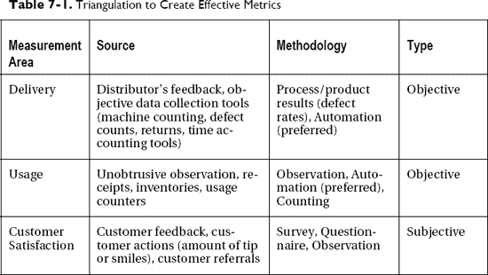

# 引言

当我尝试为自己的组织建立一个度量程序时，遇到了很大的阻力。我曾以为这源于“本地无先知”综合征。但在帮助他人建立并实施度量程序之后，我现在认为原因远不止于此。尽管这种综合征确实会造成困难，即使你是一名外部顾问，依然会听到这样的反对声——“去问客户啊！我们的客户满意度调查就够了！”这不仅是有人会大声疾呼，而且还会引来一片强烈的附和声。

即使在今天，我仍不得不为多维度度量而努力。这不仅是指使用两个以上的度量指标，更是指在同一象限内使用来自不同视角的指标。

## 收集方法与来源的三角互证

三角互证也需要不同的收集方法，如下所示：

-   **交付量** 是客观收集的，无需客户参与。换句话说，客户不会知道你在收集数据。你不会使用任何意见（全是定量数据）。大多数时候，我也尝试对这些指标使用自动化收集方法（例如问题呼叫跟踪系统、监控系统或时间核算系统）。需要注意的是，这些指标衡量的不是客户，而是组织交付产品和服务的好坏程度。稍后我会解释。

-   **使用量** 是基于客户行为的度量。他们买了什么？他们给谁打过电话？他们多久使用一次我们的服务？他们是如何知道我们的服务和产品的？我们有多少一次性客户，又有多少回头客？

-   **客户满意度** 是最以客户为中心的度量组。在这里，我们直接询问客户的意见。将此项目称为“客户直接反馈”可能更贴切。你询问客户对服务和产品的看法，也询问改进建议。这些问题可以通过调查、焦点小组或个人访谈来提出。每种方法各有利弊，从不同的成本到收集数据量的差异。你应该选择最适合你的方法。很多时候，客户群体会决定最佳的反馈工具。

还记得那三只盲鼠吗？当它们“观察”大象时，很难弄清楚它是什么，直到它们被允许交流各自的观察结果（三角互证）。既然它们能正确识别动物，似乎无需改变这种策略或方法——只需改变样本和来源即可。更精确的三角互证形式会使用多种方法和策略。如果这头大象是活的，而不是博物馆的展品，那么一只老鼠可以用触觉，另一只用嗅觉，第三只则可以向大象提出一系列深思熟虑的问题。

三角互证要求你使用不同的来源、方法和度量类型。表 7-1 反映了这些可能性。

你可以使用其他分组进行三角互证。我提出这些分组是因为我知道它们行之有效，并且易于实施。其核心思想是至少要涉及三种不同的视角、来源和收集方法。

三角互证的概念可以应用于度量的每一个层级。我不建议你深入太多，否则你可能会发现自己收集了成千上万种不同的度量指标。我希望你在顶层使用三角互证——在有效性度量中，即在交付量、使用量和客户满意度层面。但是，你也可以在下一层级使用同样的概念。

对于客户满意度，你可以使用以下三种不同的收集方法：调查、焦点小组和访谈。这可能非常昂贵，尤其是访谈。但你也可以使用两种不同的调查——面向大部分客户群的年度调查，以及问题呼叫调查。你还可以使用工单调查——即在交付服务/产品时提供给客户的问卷。这是对你的活跃客户群进行的另一项调查，但不需要他们有投诉。你还可以在交付后三到六个月进行满意度调查，以了解客户是否：

1.  在最初的兴奋感消退后，仍然对服务或产品感到满意

2.  对你的产品或服务的优势或劣势有了新的见解

3.  已将你的服务或产品推荐给了其他人

使用量也允许有多个度量指标。你可以衡量独特客户的数量、回头客的数量，以及客户“购买”你服务和产品的频率。我最近在百思买买了一台新笔记本电脑，体验非常愉快，以至于第二周我就带我已成年的女儿去了那里。她为自己买了一台笔记本电脑（和我的完全不同），而我也忍不住买了一个无线键盘和鼠标（我现在正在用它们打字）。我不但自己成了回头客，而且第二周还推荐了另一个人（实际上，我开车送她去商店，帮她挑选电脑，并主动提出帮她把电脑拿到车上）。所有这些都可以用于衡量使用量。

我把交付量放在最后，因为它是最容易进行三角互证的。在我为我的组织开发的程序中，我将交付量分解为以下三个主要因素：

-   **可用性**

-   **速度**

-   **准确性**

### 交付量：可用性

可用性很直接，但并不总是适用。当客户需要或想要服务或产品时，它是否可用？就电话服务而言，当你拿起听筒时，是否有拨号音？我刚刚因为屋外的电话线故障，在家忍受了五天没有电话服务（我家里仍然有固定电话）。服务（产品）五天内不可用。我和我的妻子都觉得这不可接受。可用性也可以进行三角互证（记住，我警告过不要深入太多）——在这种情况下，完全中断、部分中断和服务降级是三个可行的度量指标。

### 交付量：速度

速度是交付量度量中最有力的指标之一，尤其是在我们当今的社会，甚至是全球社会中——我们都希望事情更快完成。耐心基本上已经是一种遗失的美德。所以，在我的项目中，我们衡量了解决速度、恢复速度和完成工单的速度。我们还衡量了项目交付、软件合同和新产品上市的速度。许多公司另一个偏爱的指标是响应速度——你回复信息、接听电话或亲自响应的速度有多快？速度很容易与可用性相关联。例如，我们不仅想知道中断的次数和持续时间，还想知道我们响应、解决问题和恢复服务的速度有多快。

耐心基本上是一种遗失的美德，因此预计你的许多产品/服务健康指标将与速度相关。

以我的电话中断为例，我对响应时间感到不满（技术人员五天后才上门），但我对解决速度感到满意。技术人员在不到 30 分钟内就解决了问题。

### 交付量：准确性

我用于交付量的最后一个领域是准确性。这通常以返工的形式来衡量。在客户认为问题已解决后，有多少工单被重新开启？其他指标可能包括交付产品的缺陷数。服务中也存在错误。我们是否交付了正确的东西？我们是否交付给了正确的人？在正确的时间？在正确的地点？组织可能在很多方面犯错。准确性从客户的角度衡量你的产品或服务的质量。