## 最终成果：指标报告卡

第 9 章介绍了为回答组织内领导层问题而开发的指标。如果只有服务提供者和执行领导者查看结果，我本可以直接发布指标。但由于这些指标需要经过整个管理层的严格审查，并且还会被客户看到，我必须找到一种方法，让结果在每一层级都具有可用性（即便不一定是可读性）。

我与一个顾问团队及服务提供者合作，共同开发了后来的报告卡。这种指标解读方式允许以不同层级和不同聚合度进行查看，同时保留了预期目标的概念。

在基本衡量标准制定完成后，我们（包括顾问团队、服务提供者和我本人）需要找到一种方法将它们整合成报告卡。我们当时只有一组图表，但需要找到一种方式来报告整体服务健康度，同时保留交付、使用和客户满意度这几个独立的衡量类别。由于身处学术机构，采用报告卡的概念作为模板似乎是合乎逻辑的选择。

在报告卡机制中，学生可以选修截然不同的课程——从法医人类学到精美版画制作。评分可以基于完全不同的评估标准，但成绩仍然是可理解的。`A`表示学生超出预期，表现非常出色；`B`表示表现良好；`C`表示学生勉强及格；低于`C`则意味着学生未能达到预期。测验、考试、研究论文和课堂参与均可构成成绩的一部分。还可以采用其他非传统的评估方法，如评审创作的艺术作品、向委员会进行演示，以及审核课堂作业中产生的材料。

无论哪种情况，学生都会获得一个可以转换为绩点数字的字母等级。我们希望获得类似的效果，让高层利益相关者能够一眼看懂并快速掌握。

我们最终确定了`E`、`M`和`O`三个等级。我们需要弄清楚如何评估每项指标和每条信息，将其归类为超出预期、符合预期或改进机会。可用性以百分比形式呈现（例如，放弃呼叫的比率或小于 30 秒的放弃呼叫比率）。因此我们可以顺利地将此转换为通用的衡量视图。

### 交付

请记住，在这次讨论中，我将“交付”分解为“可用性”、“速度”和“准确性”。

#### 可用性

对于每项指标，都必须明确其预期目标。表 10-1 显示了可用性的预期目标。

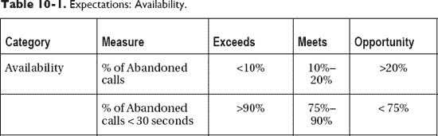

这使得分析结果变得简单。将各项指标放入网格中，我们会得到`O`、`M`或`E`的“等级”。然后可用此来生成平均绩点。我们可以在可用性层面汇总等级，也可以在交付层面汇总等级（将可用性、速度和准确性合并）。并且希望最终能将等级汇总为一项总体服务等级。

我们需要做的第一个决定是如何汇总这两个不同的等级。我们选择为每个等级（`E`、`M`或`O`）赋予一个分值。对我们来说，确保结果无可指摘至关重要。由于我们知道错误可能从多个方面渗入，我们必须确保我们的意图永远不会受到质疑。为了将可能复杂的问题变得易于处理（即便不是简化），我们采用了 10 分钟的分值体系。`E`值为 10 分；`M`值为 5 分；`O`值为 0 分。然后计算这些数值的平均分。因此，如果我们有两个值需要处理，例如在可用性层面，我们会得到以下结果：
*   `E` = 10，`M` = 5，`O` = 0
*   一个`E`和一个`M`的平均分是 7.5 分
*   一个`E`和一个`O`的平均分是 5 分
*   一个`M`和一个`O`的平均分是 2.5 分

现在，我们将计算出的平均分再转换回对预期目标的评估。8 分及以上为`E`级。5 分到 8 分之间为`M`级。5 分以下为`O`级。因此，另一种理解方式是：
*   一个`E`和一个`M`平均得 7.5 分，对应等级为`M`
*   一个`E`和一个`O`平均得 5 分，对应等级为`M`
*   一个`M`和一个`O`平均得 2.5 分，对应等级为`O`

我们很满意这种运作方式。你必须在一项指标上超出预期，才能抵消掉一项改进机会。正如我的朋友唐所说，我们认为这体现了“宁求卓越”的精神。

> 宁求卓越。

一个可能的缺点是，这使得“改进机会”成了“坏事”，而“超出预期”成了“好事”。正如我之前提到的，两者其实都是异常情况。我们真正想要的是“符合预期”。另一个缺点是，合并后的等级可能掩盖异常情况。如果你有相同数量的`E`和`O`，汇总后就会变成`M`等级，看起来好像一切正常，符合预期。

优点是我们能够展示一个总体等级，让人对该项指标的健康状况有一个“感觉”。另一个优点是可以处理被“隐藏”的等级，只需标记出那些数据中潜藏着`O`的`M`或`E`等级即可。这将引导指标的使用者知道应该深入挖掘哪里，以找到这些`O`，并了解那些情况究竟发生了什么。

对于“差”与“好”这两种情况，我们无法轻易规避。最终，我们决定逐案处理，并强调两者均属异常。我们接受这一做法，因为无论我们如何强调“超出预期”的负面因素，最终，预期被超越本身并非坏事。它之所以“不好”，只取决于你达成这一评级的方式——例如，你忽视了其他重要工作/服务，或投入了过多资源。但如果你通过流程改进或仅仅是在不同领域恰当聚焦而获得此评级，那么这不仅是一件好事，我们甚至能改变客户的预期，因为我们能够始终以这一更高水平交付。这甚至可能成为我们服务相对于竞争对手的营销亮点。至于另一类异常——“有待改进”，则无法相提并论。如果你未能满足预期，大多数情况下，未能达到客户期望本身就是一件坏事。即使你发现这是由于自然灾害或不可控因素所致，客户仍会视其为负面。因此，尽管我希望这两种异常都能引发相同的反应——即进一步调查，但调查的目的显然不同。

一种调查本质上是为了判断该情况未来能否避免，而另一种则是为了看它能否被复制。

这最终促使我们做出决定：使用转换表对数值进行汇总，如果在我们显示的层级之下存在“O”，我们就会在该评级上标注一个图标。（注意：随着我们不断改进工具和流程，当任何异常隐藏在评级为“E”或“O”的数据中时，我们都会调整图标的显示！）

图 10-1 是我们用来将数值评级转换为字母评级（以及反向转换）的转换表。我们最初将“超出”标为绿色，“符合”标为蓝色，“有待改进”标为红色。这使得我们很难说服任何人：“有待改进（红色）”和“超出预期（绿色）”一样，都是需要调查的异常。

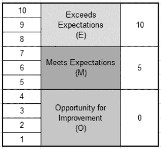

图 10-1. 转换表

因此，在查看可用性图表时，我们加入了预期值，这样我们就能从视觉上判断当前可用性的健康水平。这种可视化呈现发生在度量层面，即在我们将评级与其他可用性度量（以生成该类别最终评级）进行汇总之前，以及在我们着手将评级向上归集到交付层面之前。图 10-2 和 10-3 显示了带有预期值的放弃率及 30 秒内放弃的电话数量。

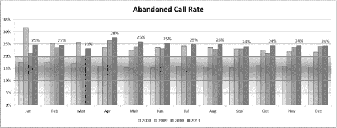

图 10-2. 带预期值的放弃呼叫率

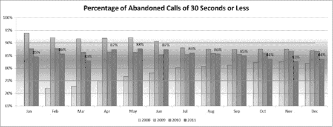

图 10-3. 30 秒或更短时间内放弃的电话占比

### 速度

速度不像可用性那么简单。我们可以衡量有多少工单的响应（或解决）速度快于预期、符合预期以及慢于预期。问题在于确定这到底意味着什么。什么是好的？我们可以说，任何超出“符合预期”范围（高于或低于）的工单都是异常，应该进行调查。这听起来合乎逻辑，但由于工单数量成千上万，实际操作并不可行。而且，在我与部门成员访谈时，很明显异常情况会时不时发生。有时分析师响应时间比预期的要长；有时他们又在第一声铃响后就接起。这是工作性质、影响绩效的环境因素以及工作负荷共同作用下的自然产物。

因此，针对这些情况，我们决定在第二个层面确定客户的预期。我们提出了以下问题：
*   客户认为应该有多少百分比的工单超出预期？
*   客户认为应该有多少百分比的工单符合预期？
*   客户认为可以接受多少百分比的工单未能达到预期？

于是，我们着手以响应时长和解决时长的形式来定义预期。

响应时间
*   `超出`：在 5 秒内响应
*   `符合`：在 6 到 30 秒内响应
*   `有待改进`：响应时间超过 30 秒

解决时间
*   `超出`：在一小时或更短时间内解决

*   *符合*：在 24 小时或更短时间内解决

*   *有待改进*：在五天或更短时间内解决

对于每一项，我们都需要确定客户的预期。客户期望每个类别分别占多少百分比的工单，如表 10-2 所示。

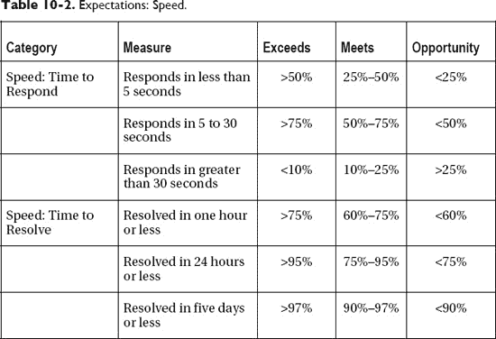

图 10-4 显示了一小时内解决的工单占比。虽然这是一个很好的度量指标，但需要所有三个指标才能了解全貌。如果只看这一个指标，会对服务的健康状况（就速度而言）产生片面的看法。

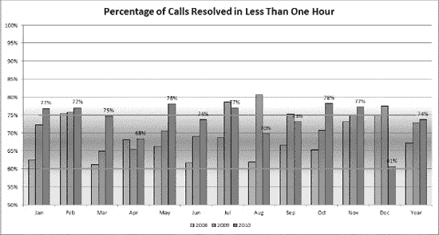

**图 10-4.** 一小时内解决的通话占比

这第二层面的预期使我们能够使用百分比，并且只在异常汇总到相当数量（按预期定义）的工单时才予以关注。值得注意的时，速度的第三个度量：响应时间，其变化方向与其他度量相反。返工情况也是如此，返工率越低越好。

## 准确性

返工最终成为服务台准确性最好的度量指标。图 10-5 以工单占比的形式显示了返工情况。

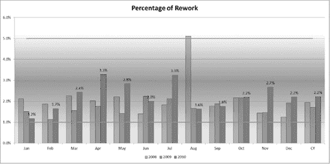

**图 10-5.** 返工占比

也许值得一提的是，指标的查看者所得到的印象或感受可能会受到呈现方式的影响。让我们快速看一下返工完全相同数据的两三种不同呈现方式。图 10-6 和 10-7 与图 10-5 的数据相同，但我改变了第一张图的颜色和第二张图的刻度。

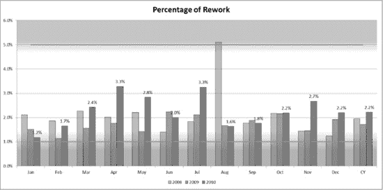

**图 10-6.** 返工占比背景颜色反转

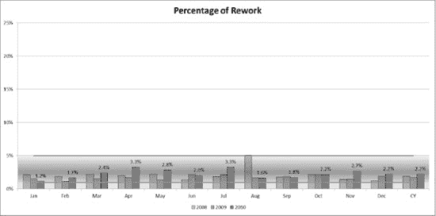

**图 10-7.** 返工占比，刻度从 0-6%增至 0-25%

你可以想象出无数种可能影响查看者对数据感知的排列方式。一种方式可能让你觉得数据“糟糕”，另一种让你觉得“还行”，还有一种则可能让你觉得“很好”。

基于数据呈现方式而对度量指标进行的解读必须受到限制。这需要通过持续且彻底的沟通来实现，明确我们要寻找的是——异常。你不能被事物的表象所迷惑；不要纠结于图表看起来如何，也不要纠结于它们如何让你或你的团队看起来如何。

至关重要的是，你必须理解预期，并知道如何评估所呈现的图表。你要寻找的是趋势和异常，而不是基于颜色或数值的“好”或“坏”的感觉。正因为如此，我尽量只给这些图表使用中性颜色，甚至还特意去掉了那些构成“有待改进”与“超出预期”的值的明显分界线。表 10-3 显示了返工占比的预期值。

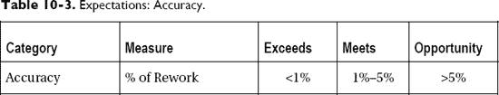

我们再次能够使用百分比——这为不同的度量指标提供了一致的视图。虽然我们使用了各种度量指标（三角互证法），但我们通过使用一致的形式、一致的视角（客户的）以及每组度量指标一致的一套“评级”，将所有内容简化了。我们在使用情况方面成功地坚持了这套既定的规范。

### 使用量

使用量是根据独立客户数量来定义的（表 10-4）。数字（数据）本身毫无意义。但通过将其置于以度量指标和客户基数百分比形式呈现的上下文中，它就变得更有用了。我们刚开始衡量时，是以一年为一个周期进行观察。我们展示了每个月的独立客户数量（一个滚动累计值），这样就能区分出淡季和旺季。当我们随时间展示这些度量指标时，每年都是从零开始。这让我们年初总是低于预期，但随后一年内会稳步增长，直到年底时，我们完全达到了预期（参见图 10-8）。

由于这种情况在第二季度之前总是给人留下（并被评为）“有待改进”的印象，我们重新审视了信息的呈现方式。不是因为“看起来糟糕”，而是因为它讲述了错误的故事。我们的使用量并不是在年初偏低——我们错误地每年都从零开始。

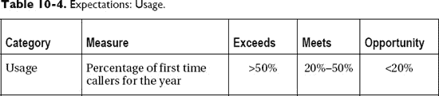

图 10-8 展示了当从一年时间跨度来看时，使用量是如何给人一种前三个月存在异常的印象的。

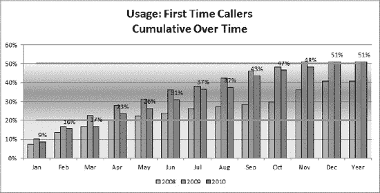

**图 10-8.** 使用量：首次来电者累计趋势

因此，更好的呈现方式是将度量指标按滚动时间段展示。我们可以展示一整年的数据（因为我们有足够的历史数据），也可以展示更短的时间段。可选方案包括展示滚动三个月、六个月以及十二个月的累计数据。无论选择哪种，我们都必须确定预期值——我们预计在一年、半年或一个季度内，有多少比例的独立客户会使用我们的服务？

另一个需要考虑的因素是服务的预期使用频率。对于那些可能每年只使用一次的服务（比如汽车保养），服务提供商会按年度周期来衡量首次来电者。

如果服务是半年一次，比如更像换机油，那么按这个间隔来衡量就合情合理了。关键在于，这取决于你预计客户回头使用你的服务或购买你的产品的频率。即使是餐厅也遵循这个规律。高档餐厅可能预计每月或每季度有回头客，而快餐店则可能期望更高的频率。

独立客户的度量指标可以很容易地与回头客指标结合使用。大多数企业的收入主要依赖回头客。回头客率直接反映了企业与客户之间的关系。为了发展，更不用说生存了，企业必须让客户满意，从而赢得他们的信任。如果客户喜欢你的服务或产品，他们最终会再次光顾。

如果你只销售一种产品或服务，且重复购买的几率很小，那么满意的客户仍然是你最好的销售员。与其衡量回头客，不如衡量客户推荐量。还记得我买笔记本电脑的故事（第 7 章）吗？一周后，因为选择众多、价格合适，但主要是出于客户服务，我带我女儿去同一家店买了她的笔记本电脑。通常情况下，我三四年都不会再买一台电脑。

当然，这家店销售的不只是电脑，他们应该衡量我是否还会回来购买他们的其他科技产品。一个更纯粹的例子是我的第一本书。我为《为何组织如此难以实现微小改进》感到自豪。这是一本好书。但我能预期同一个客户购买多少本呢？在这种情况下，你可能认为总销量是我唯一需要的度量指标。但是，我也可以从分析使用量指标中学习。想象一下，如果我能获知一个人或一个组织订购的书籍数量；或者推荐量——即受其他读者鼓励而购买我书的销量。另一个度量指标可以是评论数量和评论附带的评分。当然，如果我销售另一本书（比如这本），我会尽可能衡量回头客。有多少人两本书都买了？如果读者喜欢其中一本，希望他们足够喜欢而去读另一本，并期待一定的质量和信息水平。

弗雷德·赖克哈尔德提出的推荐者和批评者预测指标之所以有价值，是因为口碑宣传——那种你无法买到的宣传——对企业的增长至关重要。新客户固然好，但回头客才是你持续成功和未来增长的基础。

在我们的服务台案例中，我们预计客户会每季度遇到一次信息技术问题。如果他们每年只打电话一两次，这可能表明他们在使用其他渠道来解决 IT 问题。这可能包括尝试自己解决问题。如果他们每周都打电话，可能意味着该组织的产品线和服务目录有太多缺陷或错误——需要频繁的帮助。

预期值可以保持不变，但由于我们最初看的是全年的预期值，从逻辑上讲，我们不应该期望在三个月周期内有同样高的首次来电者（独立用户）数量。由于部门认为报告期内的使用量是健康的，我们选择先回顾数据。如果不确定，一个简单的工具就是让度量指标告诉你预期值应该是什么。

图 10-9 为我们展示了没有预期值的图表，这样我们就可以利用数据来确定什么是“正常”。

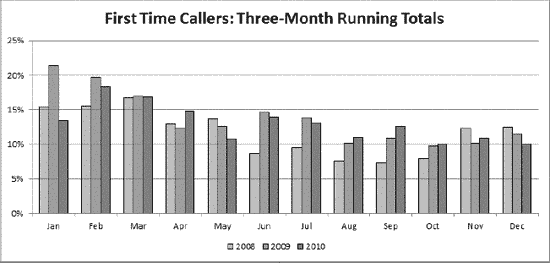

**图 10-9.** 首次来电者：三个月滚动累计值（无预期值）

基于以滚动三个月累计值呈现的度量指标图表，正常值看起来在 5%到 15%之间。当我和团队沟通时，他们觉得 5%太低了。尽管这会让他们更频繁地处于“有待改进”的状况，但他们觉得“这样才合理”。他们还觉得“超出预期”应设定为 20%，从而使预期范围变为 10%到 20%。由于这些度量指标，我敦促他们找出选择 20%的原因。答案是“15%有点太低了”。于是，我进一步追问：“那为什么是 20%呢？”你可能已经猜到了，答案是“它是下一个数值”。

所以，我将范围设定为 10%到 17.5%。不要让惯例阻止你设定正确的预期。

不要让惯例阻止你做正确的事。

图 10-10 展示了首次来电者在三个月滚动累计值下的预期值。

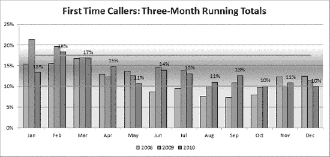

**图 10-10.** 首次来电者：三个月滚动累计值（有预期值）

表 10-5 以表格形式列出了这些预期值。

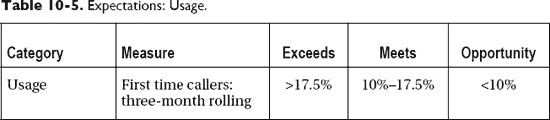

在确定衡量独立客户及其期望的适当指标后，我们审视了另一项衡量使用情况的指标。另一个选择是，在我们的年度调查中，选择服务台作为其主要服务提供商的受访者所占的百分比。表 10-6 展示了我们针对调查结果所确定的期望值。

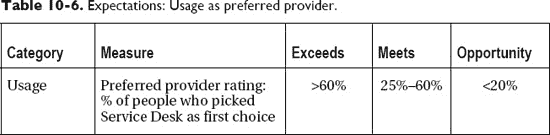

图 10-11 展示了在寻求信息技术问题帮助时，将服务台列为首选的调查受访者所占的百分比。

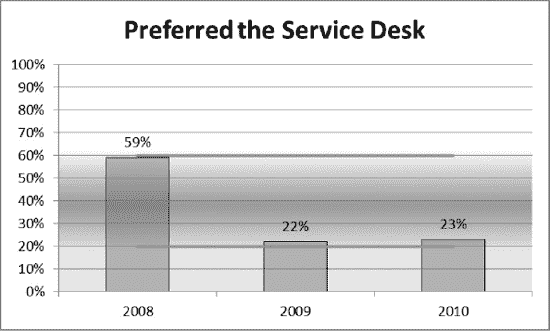

**图 10-11.** 倾向于选择服务台寻求帮助的客户百分比

尽管 2008 年的结果并非异常，但与随后一年的结果差异巨大，以至于我们不得不调查原因。我们唯一能确定的原因是，2008 年要求受访者选出他们最偏好的三个选项。服务台被 59%的受访者列为前三个首选之一。而接下来的两年，该问题只允许选择一个答案——即首要选择或偏好。你已经看到图表如何改变对指标的认知。这又是一个强有力的例子，说明基于不同的数据收集方式，指标可能截然不同。

如前所述，我们还可以增加一项关于回头客的指标。如果我们想继续使用百分比，可以计算给定时期内回头客占客户总数的比例。同样，这可以按三个月、六个月或十二个月的周期来衡量。真正的好消息是，这项指标可以从计算独立客户数量的同一数据集中衍生出来。独立客户是与总潜在客户（客户群）进行比较，而回头客则是与给定时期内的客户总数进行比较。

## 我们使用的最后一类指标，是大多数人首先想到要收集的——客户满意度调查。

### 客户满意度

我们再次感到幸运，因为数据已经由他人收集、整理并分析完成。如前所述，我们必须决定哪种数据视图最有效。基本上，我们需要确定基于数据构建哪项指标。

该部门报告这一指标已有很长时间，但仅以 5 点李克特量表的平均值形式呈现。我们的领导层对于如何理解这个平均分数以及如何解读感到困惑。作为问题解决者，他们并未将解决方案留给部门，而是要求提供基准，以便与平均值进行比较。他们的理由是，如果优于“全国平均水平”或竞争对手的平均水平，那就说明做得不错。但实际上，这只能说明他们优于平均水平，可以声称自己处于前 50%。如果我们足够幸运，可能会发现以下情况：

1.  我们的同行使用了与我们相同的问题。第三方服务提供商拥有令人印象深刻的客户名单，但他们并未囊括我们所有的同行，也未垄断该服务。

2.  我们的同行使用了与我们相同的 5 点量表。

3.  我们的同行愿意分享他们的平均分数。

4.  我们的同行以相同的方式计算平均值——他们可能剔除了短期内的重复客户，可能对客户进行了不同的分类，或者可能未包含某些客户（如服务台的内部用户）。另一个差异可能是他们只调查了部分样本，而我们调查了所有用户。

这种完美的同步可能性极低，更不用说长期保持同步了。因此，我们用作基准的，可能只是部分同行的样本数据。这是我反对使用基准来试图让指标具有意义的第一点理由。

我的第二点理由是，即使与有效的基准进行比较，也只能表明我们相对于所选标准的表现如何——而非我们在多大程度上满足了客户需求。我们完全有可能“处于班级前列”，却仍然远低于客户的期望。如果你带回家的成绩单平均分是 B-，你的父母很可能不会高兴。如果你告诉他们你是班级第一名，他们可能会稍微印象深刻一些，或者他们可能会决定给你转学。一份成绩单应该告诉你自己的表现如何，无论你在毕业班中的排名如何。一旦你知道了自己的表现（或已取得的成绩），了解自己在同龄人中的排名则是一个额外的收获。

我的第三个也是最后一个理由基于原则：在寻找基准之前，指标就应对组织有意义。基准应仅作为信息的补充，而非信息的定义者。指标本身必须具有意义。

图 10-12 展示了平均分数。尽管我认为这比其他视图的意义较小，但当你加入期望值后，即使是这项指标也变得有用。

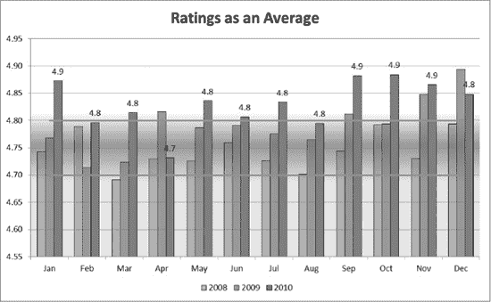

**图 10-12.** 平均客户满意度分数

我仍然希望有一个更好的指标来表示。我们尝试使用推荐者与贬损者的比例，但由于供应商不会改为 10 点量表，我们不得不将 5 点量表转换为 Reichheld 建议的方法，以确定客户在支持范围内的位置。我们最终将 5 分定为推荐者，1、2、3 分定为贬损者。这是为了匹配 Reichheld 的 1-6 分（贬损者）、7-8 分（中立者）以及 9-10 分（推荐者）的分类。虽然这并不完美（也非最优），但我相信它是有效的，并且可以说我们再次“在追求卓越方面犯了偏保守的错误”。但展示这个比率（高度满意 vs. 不满意）被证明是有问题的。虽然它比平均评分更有意义，但管理层仍然难以解读。

对话大致会像下面这样进行：

> “那么，每收到 1、2 或 3 分，我们就对应有十二个 5 分？”

> “是的，你的推荐者与贬损者比例是十二比一。”

> “那 4 分呢？为什么我们不计算 4 分？”

> “因为 4 分被视为中立。我们无法判断他们会如何‘谈论’我们的服务。他们可能会说服务不错，也可能不会。”

> “我以为 3 分才是中立？”

> “3 分处于中间位置，既不满意也不满意，我们相信，如果一个人不能说出他们满意（4 分或 5 分），那么他们肯定会负面地谈论我们的服务——他们会损害我们的声誉。”

> “好吧，如果我们忽略 4 分，我们就遗漏了数据……所以这并不完整。”

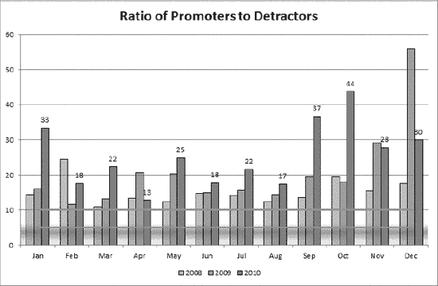

**图 10-13.** 推荐者与贬损者比例

与“看起来不错”的平均分相比，这种表示方式（见图 10-13）让服务台看起来非常出色！有趣的是，我相信这更准确地反映了他们有多优秀。

经过两年的争论，我最终让步并找到了另一种表示该数据的方式。我仍然认为推荐者与贬损者的故事是一个好故事（甚至可能是最好的）。有一个公认的“好”的标准可以作为起点。当 Reichheld 使用这个标准来判断增长潜力时，它作为高质量基准是有效的。话虽如此，少数能够理解推荐者与贬损者衡量标准的部门，总是将这个基准提高到这个标准之上。我合作过的一个客户希望达到 90 比 1 的比例。作为健身课程提供商，他们认为让客户高度满意是首要职责，他们期望每 100 名学生中，有 90 名推荐者，9 名中立者，只有 1 名贬损者（他们乐于将 5 分制改为 10 分制）。

我们最终采用了一种新的衡量标准——一种解释数据的新方式。我们展示了“满意”的百分比（图 10-14）。这是 4 分和 5 分的数量与总受访人数的比值。这绝对比平均分更好。调查的第三方供应商以这种方式（我们以及我们行业的数据）表示数据没有任何问题。他们实际上以多种形式生成了报告，包括这种形式。

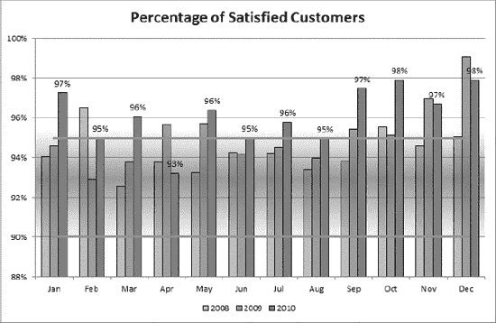

**图 10-14.** 满意客户百分比

在撰写本文时，我们的组织正在测试这种数据视图。这仍然需要一些接受度，而且我确信我会听到争议，认为所有数据都没有显示出来（4 分和 5 分被混在一起，而 1 分、2 分和 3 分实际上根本没有显示）。有趣的是，我认为这更多是抵制变革的问题，而不是这些数据表示方式的缺陷。大多数不喜欢推荐者与贬损者比率的人（以及我预期会反对满意百分比的人）并没有抱怨平均分缺乏粒度。在这些更新的视图中，提供的数据比平均分中给出的更多，如表 10-7 所示。

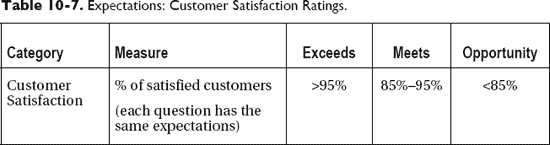

### 权重与度量

手头有了完整的度量指标，我们的下一步是将它们整合成一个“度量体系”。为了成为一份报告卡，我们需要汇总数据，同时深入分析异常情况。到目前为止，我们的方法论提供了一定的严谨性和灵活性。让我们从这个角度分别审视。

#### 严谨性

*   每个度量指标都使用了三角验证；每个指标至少由三类信息组成（交付、使用和客户满意度）

*   信息由服务提供商根据他们认为合适的多个度量构建而成

*   每个度量都按“超出预期”、“符合预期”或“未达预期”进行评定

*   每个度量都来自客户视角，并符合服务/产品健康状况的规则

#### 灵活性

*   每个度量由服务提供商（我们的服务台部门）选择

*   每个数据集根据服务提供商的选择构建成一个度量

*   预期，虽然代表了客户的需求和期望，但由服务提供商定义，并且可以调整，以反映服务提供商希望客户形成的认知。例如，如果客户对低于服务台认为可接受的放弃率感到满意，那么预期可以设定得更高。

对服务提供商来说，另一个重要的灵活性领域是使用权重来分配度量指标的重要性。这首次用于交付类别。由于交付（三个有效性衡量领域之一）由多个度量指标组成——可用性、速度和准确性——服务提供商可以对这些子类别进行不同的加权。

对于一个刚开始使用度量的组织来说，对这些因素进行加权并非易事。我们通过提供建议使其变得更容易。对于支持服务，我们建议速度对客户最重要；对于非支持服务，可用性则占主导地位。因此，对于服务台，我们提供了以下权重：

*   可用性：35%

*   速度：50%

*   准确性：15%

服务提供商可以任意更改这些权重。这一点（以及整份报告卡）的关键在于度量的所有权。由于服务提供商“拥有”数据、度量、信息和度量体系——如果他们追逐数据，那就是在“自欺欺人”。我在本章之前给出的许多告诫，都是为了帮助你理解准确性的必要性，但更重要的是诚实的必要性。正如 *Getting Things Done* (Viking, 2001) 的作者 David Allen 所说：“你可以对所有人撒谎，但你骗不了自己。”如果服务提供商出于正确的理由并以正确的方式使用度量，那么领导层就绝不能滥用或误用它们。

尽管我对这个部门有最大的信任，但我仍然强调了“实事求是”的重要性。该部门不仅要“愿意”听到坏消息；如果故事的发展如此，他们还必须想要听到它。

对因素进行加权可能成为一种轻易追逐数据的方式，使度量指标讲述你希望的故事，而不是真实的故事。为了降低这种诱惑，我们做的事情之一是在查看数据之前确定权重。然后，如果在看到结果后需要更改权重，自我约束改变权重以单纯追求更好表现的诱惑就会容易得多。

这是年度调查的另一个重要用途。我们可以询问客户，哪些衡量因素最重要。只需询问“解决时间”是否比“响应时间”更重要。你就能发现，等待 30 秒是否比不得不多次回电修复同一个问题（准确性）更麻烦。

当然，你也可以对所有这些因素进行等权加权。

除了对交付的各个组成部分进行加权，我们还可以对三个类别——交付、使用和客户满意度——进行加权。权重应该清晰地传达给查看报告卡的人。

让我们看看如何将绩效度量汇总成一份报告卡。

### 将数据汇总为等级

现在，我们将前面讨论过的各个组件——用于衡量有效性、三角验证、预期和转换网格的答案关键词类别——整合起来，生成最终的“等级”。这为员工、经理和领导层提供了一种快速、清晰地传达客户对您表现看法的方式。

你需要用到之前的转换网格（见图 10-15），但这次使用中性色调，以降低“超出预期”天然被视为好的倾向。

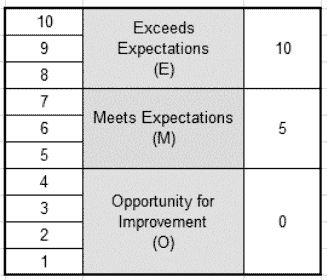

**图 10-15.** 转换网格

我在此使用的数值并不反映之前分享的信息。我只是想确保你能清楚地理解如何汇总等级并聚合各项衡量指标。表 10-8 展示了所有衡量指标、其预期值、实际值，以及将这些值转换为“字母等级”的结果。这些都可以编入电子表格，以便自动计算等级。

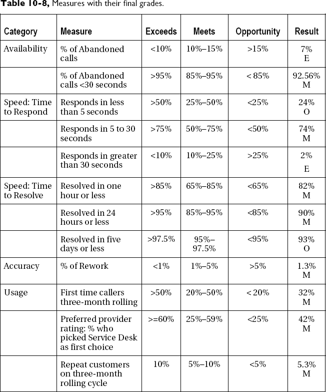

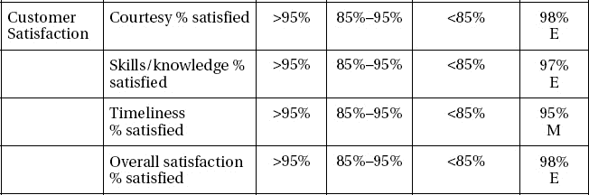

在表 10-8 中，“等级” (显示在`结果`列中) 已被转换为字母值——如果实际衡量指标超出预期，则记为`E`；符合预期则记为`M`；未达到预期则记为`O`。

在每个项目（信息层级）内，总等级是使用转换网格计算平均值得出的。如前所述，你甚至可以在类别内使用权重。例如，可以将“30 秒内放弃的通话”权重设为 85%，而“放弃通话总数”权重设为 15%。另一个例子是，可以将“整体客户满意度”与其余三个满意度问题之和（各占 16.6%）设为同等权重（各占 50%）。在本例中，我们将采用这两个加权选项，其余指标在其各自的信息类别内均采用同等权重。表 10-9 展示了将等级逐步汇总到最终“报告卡”的下一步流程。注意：等级旁边的双星号表示在更低层级存在`O`等级。

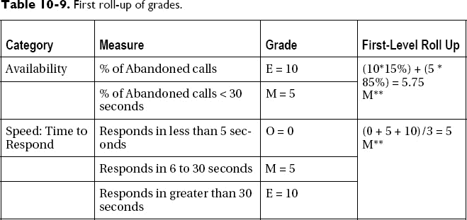

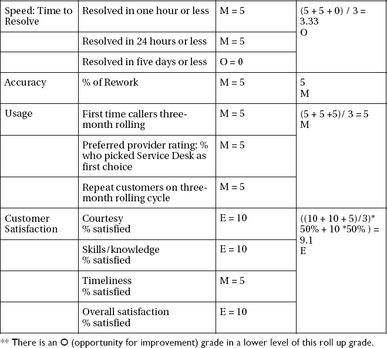

让我们看看这两个加权指标。如果“可用性”指标权重相同，总等级将简单地是这两个等级（10 和 5）的平均值，得出 7.5 分。如果四舍五入，这将会变成`E`。但是，由于我们总是倾向于追求卓越，因此我们不会向上取整。你必须完全达到该等级才能获得对应的字母等级。如果权重互换（“放弃通话总数”占 85%，“30 秒内放弃的通话”占 15%），那么总等级将变成`E`，因为仅“放弃通话总数”的 10 分就已经给了你 8.5 分，甚至还未考虑“30 秒内放弃的通话”。

在满意度评分中，我们发现尽管有一个`M`，但总等级仍然是`E`。如果不将整体满意度权重设为 50%，而是对所有三个问题赋予相同权重，那么总等级将简单地是四个等级的平均值，得出 8.75 分。仍然是`E`，但分数更低。

请注意，`速度：响应时间` 的结果是 `M`（符合预期），但我加了一个星号来表示下面隐藏着一个`O`。同样，由于下面隐藏着一个`E`，可用性总等级也做了相同处理。这有助于报告卡的查看者快速判断是否需要深入查看信息。被埋藏的`E`和`O`是需要识别出来的异常情况。

让我们继续分析这些结果。如果我们采用为“交付”设定的权重（`速度`占 50%，`可用性`占 35%，`准确性`占 15%），我们将得到交付的下一个层级等级，如表 10-10 所示。

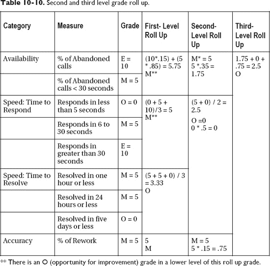

让我们以同样的方式继续到表 10-11。

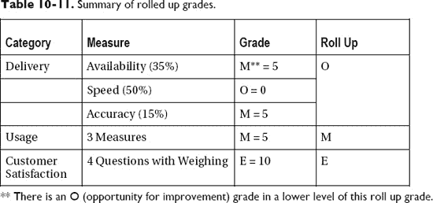

我们再次面临抉择。`交付`、`使用`和`客户满意度`价值相等吗？只有在试图将所有等级汇总为一个总等级时，才需要做这个决定。在我的组织中，我们止步于这个层级，选择将这三大关键信息类别分开处理，即使跨不同服务也是如此。因此，如果我们汇总三个支持服务（服务台、二线和三线支持），我们会分别展示`交付`总览、`使用`总览以及`客户满意度`总览。我们发现，使用这种基本的三角验证方法来审视服务，已经足够满足我们的需求了。如果你想将其汇总为一个最终等级（GPA），剩下的唯一问题就是权重。为了本例的目的，我们将其简化，赋予它们相等的权重。

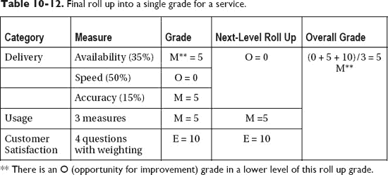

因此，服务台的最终报告卡，基于每个信息类别的权重，得出的总等级为`M*`。这很容易被解读为：整体服务符合预期，但存在一些需要调查的异常情况。

如果你像我的组织那样看待这些等级——不将主要类别汇总为一个总等级，而是分别查看每个主要“科目”领域——你将得到以下结果：

- 交付：`O` 表示存在改进的机会。此时应花时间调查异常原因。

- 使用：`M` 表示我们符合预期。此区域无需调查。

- 客户满意度：`E` 表示我们超出预期。此时应花时间调查异常原因。

最终的总结性报告卡将如图 10-16 所示。

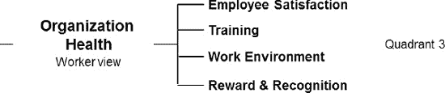

**图 10-16.** 报告卡

对于每一项，在调查结束后，都应附上叙述性文字。这些文字向领导层阐明服务提供者所确定的异常原因，以及为减轻、避免、纠正或复制这些原因而建议采取的任何行动。这些变更针对的是流程（而非人员），并且应旨在控制未来的结果。

如果我们从过去的错误中吸取教训，就不应继续重蹈覆辙。

同样，如果我们从过去的成功中学习，就应该找到方法将异常变为常态（如果这被认为是公平合理的选择的话）。

### 回顾

报告卡使我们能够汇总指标各个层级的评分。你可以自行决定在哪个层级停止整合成最终分数。你并*不*必须以单一分数作为最终结果。本章通过逐步示例，展示了前述概念如何（并已经）被应用于创建服务级指标。

我以这样的方式进行了回顾：从数据出发，再到衡量指标，进而形成信息，最终构建出指标。从衡量指标阶段起，我展示了如何为每一步应用期望值，从而赋予每个部分背景和意义。除应用期望值外，我还介绍了一种标准化方法，用于在不同衡量类型和领域间统一信息。使用百分比仅仅是实现一致性的方式之一。当你运用不同的衡量指标来评估各类服务和产品时，你会发现这种方式可能并非始终易于操作。根据我的经验，所用的衡量指标在类型上会有所不同。

另一种标准化工具是评分方法，其核心是每一步都力求向卓越倾斜。正因如此，“待改进项”被记为零分，且只有“超出预期”才能将其平衡至“符合预期”。由于我们不采用向上取整（再次确保向卓越倾斜），仅一项“待改进项”就会使总（平均）分永远无法达到`M`，除非其中包含一项`E`。

我们追求的是“符合预期”。其他任何结果都属于异常情况，需要进行调查。

请回顾以下几种可能造成印象偏差的方式：

- 艺术加工——颜色选择、对齐方式等。

- 用于表示衡量指标的刻度

- 用于呈现数据的格式（比率、平均值、百分比等）

总体评分能够提供对评估对象健康度的“整体感知”。将各分数汇总为“最终分数”是可行的，但并非总是可取。这取决于目标受众。

报告卡展示了如何展示、汇总和报告你的指标结果。它并未深入探讨你可能选择用于收集数据的工具。我用作示例的组织有多种自动化工具、一些人机交互工具，以及完全主观的调研问卷。请检查你所在组织的现有数据源。通常，你可以（在不引人注意的情况下）收集数据的地方比你预期的要多。

应当发现并利用其他数据收集工具。高等教育 TechQual+项目仅仅是一个（免费的）基于调研问卷的工具示例——即使你不在 IT 组织内，该工具的理念也可应用于你的服务和产品。

*“重要的不是你看什么，而是你看到了什么。”*

——亨利·戴维·梭罗

创新并非提出一个全新的概念或想法。最伟大的创新往往源于以新的视角审视已存在的事物。托马斯·爱迪生的一大优势，便是在他人尝试发明新事物时，看到了他们错过的要点。

## 结论

报告卡是创建记分卡的另一种方式，其额外好处是允许你在需要时将各项衡量指标汇总为单一分数。通过识别衡量指标和信息中的异常值，你可以明确标记哪些是异常情况，并仅将时间投入到那些需要深入调查的异常点上。这使你能够：

- 识别需要进一步调查的领域

- 仅在必要的地方投入资源

- 使用通用评估语言，对单一服务或一组服务的健康度建立“整体感知”

关键在于你使用什么工具来收集、分析、汇总或报告你所开发的信息和指标。关键在于找到一种方法来完成这项工作，使其能被你的受众轻松理解。你的指标必须以正确的方式，向正确的受众讲述恰当的故事。

