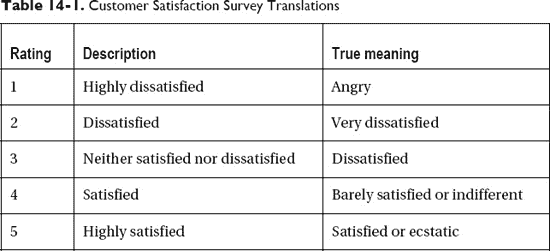

## 尊重度量指标的力量

本章篇幅简短，这是有意为之，旨在帮助你聚焦于度量指标的力量。你必须尊重度量指标的力量，并警惕不当使用它们可能给组织带来的损害。

当我还是美国空军一名年轻士兵时，有幸与一位名叫汤姆·伦南的文职电工共事。汤姆是个务实的人，也是我的好友。他比我年长（至今仍是），并多次用金玉良言帮助我。他给我的最佳建议之一，就是尊重电的力量——因为即使是训练有素的电工，也曾在进行电气作业时受重伤，甚至更糟。在建筑行业，触电伤害是导致死亡的第二大原因。

我之所以提到这个，是因为度量指标就如同电。度量指标可以用来做很多有益的事。作为一种工具，它们能帮助我们了解环境，评估我们努力的成效，让沟通更便捷、更清晰。但和电一样，度量指标必须被尊重。遵循规则，你就能利用电——以及度量指标——让生活更美好。但即便你遵循规则，仍存在造成损害的可能性。风险如此之高，以至于你必须在每个案例中权衡：收益是否值得承担这些风险。

本书大部分内容都在讨论如何开发、分析、报告以及（最重要的）*运用*度量指标来实现改进。但与大多数组织改进工具（如培训计划、战略规划和员工表彰计划）不同，度量指标如果用得不当，其危害可能与益处相当。在多数情况下，这是因为数据的使用者没有得到充分训练，或是警惕性不足，未能理解度量指标强大但又充满风险的本质。

度量指标有可能弊大于利。

正如我已经谈到的，你必须努力找到*正确的*根本问题：构建答案的抽象图景，确定描绘该图景所需的信息，然后费尽心血地建立收集、分析和报告该度量指标所需的流程。在整个过程中，你必须反复核查所有环节——从数据到收集方法，再到度量指标本身，最后再到根本问题。

请严谨而勤勉地对待你的努力，因为出错是极为容易的。即使所有数据都已核实，解读上仍可能出现错误。我曾与一位同事就"事实"这一概念进行过一场有趣的辩论。他认为度量指标（至少是好的度量指标）就是事实；如果它们不是事实，我们就不该用它们来展示绩效。我不得不解释（至少从我个人的观点来看）：度量指标并非事实。度量指标首先是指标。它们能让我们获得洞见，但未必是正在寻求的*真相*。它们不是事实。

度量指标不是事实，它们是指标。

### 指标：是事实还是指示？

指标究竟是事实还是指示，这一区分是正确使用指标的核心。若将指标视为事实，我们极易陷入仓促决策的风险。

那么，测量值或数据又该如何看待？你车上的速度表显示的是关于车速的事实吗？它的读数是否精确无误，还是存在`+/-`的误差？如果速度表显示时速 55 英里，而警用雷达显示为 58 英里，哪个才是真相？

你可能会辩称，尽管测量设备存在差异，但实际行驶速度显然是一个客观事实。这一点我同意。在特定时刻，你确实在以某个确切速度行驶。但我几乎不相信，任何用于捕捉特定瞬间数据的设备能精确到足以将测量值称为"事实"。

让我们试试主观测量。假设我请你用 1 到 5 分来评价对我服务的满意度，1 分代表非常不满意，2 分不满意，3 分中立，4 分满意，5 分非常满意。那么，我是否应该将你选择的分值视为一个事实呢？

错。

在调查中，我唯一能确定的事实是：我收到的答案就是你给出的答案。即便如此，仍可能存在错误。在客户满意度调查中，我们常发现受访者会颠倒数字，本想打 5 分却给了 1 分。排除这类错误，结果难道不能算事实吗？再次强调，我们唯一能明确证实的是：我们拥有的答案就是受访者选择的那个答案。我们无法确知这个给出的答案就是真实答案。

这种不确定性经反复分析与研究，我已能自信地说：大多数答案实际上*并非*真实。在《终极问题》（哈佛商业出版社，2006 年）一书中，弗雷德·赖克海尔德研究了最能预测业务增长潜力的客户满意度问题。他的研究基于推荐者（会推荐产品/服务的人）和贬损者（会劝阻他人使用产品/服务的人）的反馈。这项研究的副产品之一，是发现人们不会完全诚实地填写调查问卷。

基本而言，赖克海尔德发现，在 10 分量表的问题中，`6`分并非真正的中立值。大多数对受评产品或服务持中立态度的人，实际给出了 7 分或 8 分，尽管这档分值明确标注为比中立更具好感。

我相信这种情况在 5 分量表中同样存在。大多数客户若对产品或服务感受矛盾，并不想打`3`分。我们来看一个简单的转换表，如表 14-1 所示，我认为这个表更接近大多数客户满意度调查受访者的真实情况。

我发现，除非受访者确实对服务感到愤怒，否则他不会给`1`分。因此，2 分成了非常不满（接近愤怒但未及）者的选择。3 分由那些并不满意，但又不愿明确表达的客户给出。4 分来自勉强满意或无所谓的客户。而 5 分则来自相当满意的客户。

如果你将所有 3 分都视为中立回答，可能会忽略大批不满意的客户。

那么，究竟什么指标才算是事实？尤其是在我们对指标的定义中——它由多个数据、测量值、信息，有时甚至包含其他指标构成。在这个层面上，变量足够多，使得任何答案都远称不上"事实"。那么，在最底层呢？比如数据本身？难道数据也不可信赖为事实吗？

不。科学家们不断发现，昨天还被认为是科学事实的东西，今天就被彻底推翻了。自动化数据采集系统很容易校准失误，提供错误数据（我的浴室秤就是铁证）。当我们将人为因素纳入考量时，出错的可能性只会增加。

技术固然伟大；随着技术进步，数据的准确性也在提高。但即便运用当前技术，至关重要的是：切勿将指标视为事实。当你赋予指标超出其应得的权重或意义时，便冒了仅凭数据做决策的风险。

虽然底层信息绝不应被视为完全客观事实或无懈可击，但这不应阻碍你正确使用指标。不过，希望这些认知能引导你按照指标应有的用途来使用它们——即作为支持决策的*指示器*。

指标永远不应取代常识或个人参与。

### 被误用的指标："客户讨厌我们"

让我举一个现实中的例子，说明一位经理善意使用指标如何弊大于利。一群辛勤工作的员工被告知，他们被客户群体所厌恶。至少，这是他们对老板分享的信息的理解。

## 一个关于客户满意度指标的案例

每两周，CEO 会与各部门负责人开会。在会议的前 30 分钟，他们会审查整个组织内所有评分为 1 分或 2 分（满分 5 分）的客户满意度评价。这些评分被标记为“非常不满意”和“不满意”。

实际上，这个流程所展示的仅仅是选择 1 分或 2 分评价的受访者数量。除此之外，我们了解的信息非常有限。

每条评价附带的评论（如果有的话）也会被仔细审查。根据这些评论，大多数客户显然很不高兴，但偶尔也能明显看出是受访者选错了评分。

在逐一查看每个案例后，我很清楚，大多数客户只有在生气时才会给出 1 分，并且他们总是会借此机会写一篇长评论，解释他们为什么不满。

在各部门负责人审查完 1 分和 2 分的调查问卷后，如果时间允许，他们还会查看 3 分的评价，因为其附带的评论通常表明存在一定程度的不满，并指出了可以改进的领域。

这种审查是出于好意。毕竟，公司领导层是在倾听客户的声音。这就是他们实施调查并审查负面反馈的原因。

对于每份问卷反馈，都需要解释以下几点：

-   给出低分的原因。如果客户的评论不清楚（或者没有评论），应由员工联系客户进行澄清。
-   为“纠正问题”而对客户采取了什么措施。
-   本可以做些什么来避免低分。（更好的表述是：“我们本可以做些什么来防止客户不满？”措辞上的细微差别很重要。如果我们将改进与指标挂钩，而非与行为或流程挂钩，我们就有可能在不改变行为或流程的情况下改善数据。）

不幸的是，最后一点——如何改进才能让客户将来不再不满意——在这些会议上很少得到关注。然而，这并不罕见。我见过领导层要求解释客户不满的原因，但目标应该是改进流程以消除重复事件。

所以，部门负责人做了你可能预料到的事。他们在会议前就仔细审查了调查结果。他们确定了哪些团队是收到 1 分、2 分和 3 分评价的对象。他们责成这些团队（通过他们的经理）去：

1.  联系客户，确定问题的性质。
2.  解释差评的原因。
3.  解释他们将采取什么措施来避免再次得到这样的评分（是的——此时经理已经误用了这个指标）。

员工听到的是：

1.  联系客户，看看是否能安抚他们。
2.  找出谁该负责。
3.  如果你无法安抚他们，而且责任在你，你打算怎么做？

但让我们回到对团队的影响上。他们从领导层那里听到的只有：调查问卷对他们提出了严厉批评——客户显然讨厌他们。由于领导层只分享了低分调查，团队便认为他们从未获得过高的客户满意度评分。

有趣的是，所有调查结果都对团队开放，但团队中从未有人想过要自己去查看这些调查。

你说的，不一定就是别人听到的。

由于在处理客户满意度指标时犯了以下错误，团队认为自己成了组织的“害群之马”：

-   CEO 和部门负责人（无意中）要求对每一条差评给出解释。
-   经理将这个要求转达给了团队，却没有考虑这会对他们产生什么影响。
-   经理从未费心去查看自己团队的调查结果。
-   团队除了安抚老板之外，也从未想过将调查结果用于其他任何目的。

那么，底线是什么？这些数据只被高层管理用来确保面向客户的服务质量。而当进一步索取信息的请求下达到基层时（这本身是件好事），调查结果却被“断章取义”（团队认为客户讨厌他们），而且没有人分享或查看任何正面的对照数据。

这种无意的行为造成了压力、士气低落，以及对客户对团队满意度的错误认知。

在这种互动持续了一年多之后，我受命为我们组织的关键服务制定一份记分卡。该团队的服务是我们的核心服务之一，因此我去拜访他们以制定他们的记分卡。

当我提议将客户满意度纳入记分卡时，我遇到了意想不到的阻力。我并不知道他们每两个月都在经历着什么。

我知道客户满意度评分在整个组织中一直是一大优势，而且我确信这项服务也不会例外。但团队却同样确信评分会非常糟糕。他们还辩称，由于每份客户满意度调查问卷都是发给那些有问题的客户的（因此他们才需要提供二级支持），结果会对他们不利。

我再次试图向他们保证，这在组织内并不正常。同样，基于他们的观察和经验，他们也再次向我保证，结果肯定会很难看。

在我与指标打交道的工作中，最精彩的时刻之一，就是当我向这个团队展示客户满意度的完整数据时。结果发现，非常满意的客户与给出低分客户的比例远高于团队的想象。事实上，该团队的客户满意度评分始终保持着十比一的良好服务比率！

虽然团队、他们的经理和我都对这一结果感到非常高兴，但这对我们所有人来说都是一个启示：这样一个看似合乎逻辑的指标使用方式，竟然会造成如此大的伤害。

对团队士气的损害足以让我确信，对待指标必须极其谨慎。

### 指标的误用：好的、坏的和丑陋的

尊重指标的力量。这种尊重应包含一种健康的敬畏。在处理指标时，怀有一点点健康的敬畏之心，我希望各级用户都能在让指标影响自己的决策时多加小心。

请放心，如果使用不当，指标会严重危及组织的健康。不尊重指标的力量常常导致我们在使用它们时犯错。这些错误表现为各种形式的滥用。

# 好的方面

以下对指标的滥用被归类为“好”，并非因为它们可以接受，而仅仅是因为滥用者缺乏恶意，他们只是无意中误用了指标，而非蓄意造成破坏。有时，这是由于傲慢；另一些时候则是出于无知。无论哪种情况，增加一点健康的尊重都能解决这个问题。

- `只分享部分故事`。值得注意的是，在花费时间和精力构建了一个完整的故事之后，人们仍然会错误地只分享部分内容。这似乎有违常理。每当你选择性地分享指标的某些部分，而非完整的故事时，你就扭曲了信息。不要因为仅仅不分享完整的故事而造成错误信息。

- `根本不分享故事`。同样，为什么要费尽心思构建一个完整的故事，却把结果藏起来呢？你不仅需要与客户（那些可以且应该使用指标的人）分享指标，还应该与那些为你提供数据的人分享。并非所有使用指标的人都是数据的提供者，但所有数据的提供者都应该是使用者。
    我看到的另一种表现形式是，人们根本不愿意构建指标。这源于对指标将揭示什么的恐惧。大多数时候，我听到的是`数据无效`或`我们无法获取数据`。基本上，这些都是旨在扼杀指标（在其被创建之前）的借口。

- `只分享好的指标`。不展示所有指标的最常见原因是，在某些人看来，指标中的某些内容会让其他人看起来很难堪。当然，如果你正确使用指标，它们是用于改进的指示器。如果你只有好的结果，那你还需要改进什么？不愿意展示不利结果，恰恰忽略了指标的真正意义。为了改进，你需要知道哪些地方需要改进。为了展示进展，你需要能够展示改进。只展示“好结果”，就是剥夺了他人获取有助于改进所需的信息。

- `只分享坏的指标`。有时，人们会有意只分享负面结果。例如，当一位经理想要“激励”他的员工时，他可能会选择把情况描绘得比实际更糟一些。我们不会深入探讨更险恶的指标滥用行为——这部分留给你自己去想象。简而言之，另一种数据滥用方式是只揭示负面结果。

- `展示数据`。还记得数据、度量、信息和指标之间的区别吗？展示数据（或度量）意味着你将观看者的注意力从故事上转移开。这就像展示用过的调色板而不是画作本身。当你展示数据（而不是指标）时，你邀请观看者自行进行分析并形成他们自己的故事。

你可能已经注意到这些“好”的指标滥用案例有一个共同主题。大多数源于没有展示完整的故事。这也支持了为什么使用根本性问题并构建完整的故事如此重要。

# 坏的方面

与无意的指标滥用相反，“坏”的方面描述的是知情情况下的滥用。你可能会认为这是罕见的情况。你希望那些接收指标的人不会明知故犯地滥用它们。但有些人并不尊重指标所具有的破坏性力量；他们随意地挥舞它，最终造成严重的损害。这些类型的滥用如下：

- *利用指标谋取私利*。看到指标后，有些人会决定利用指标来推动自己的目标。也有些人可能纯粹是为了实现个人议程而指派创建指标的任务。这些人很容易被识别出来。他们拒绝与你合作以确定根本问题，要么是因为对渴望特定答案的意图毫不掩饰而感到尴尬，要么是因为在能证明自己的观点之前不愿分享。这些人会找各种借口来避免触及根本。如果你试图正确地使用指标，你会对这种滥用者感到极度沮丧。
- *利用指标控制他人*。有一群专业人士以开发、分析和报告“绩效指标”为生，这些指标专门设计用来衡量人们的表现水平。你也可以使用绩效指标来评估流程、系统，甚至硬件。根据在线社区网站的讨论，一个普遍持有的观点是，绩效指标是操纵人们行为的良好工具。这是不可接受的。“控制”或“操纵”这些词可能没有被明确使用，但通过说“你可以并且应该使用指标来推动绩效”，这就是其含义。
- *利用指标做决策*。我理解管理层想要指标（他们称之为数据）作为决策的基础，以便做出“知情”的决策。我并不是说这是坏事。只有当领导层认为指标就是事实时，它才变成坏事。当决策仅仅根据指标结果做出时，这就成了问题。指标可以用来为决策提供信息，但前提是它们经过了调查和验证。如果你要基于指标做决策，只知道“是什么”（指标）是不够的；你还必须弄明白“为什么”。
  
  当我的油表显示快没油时，我会决定是马上去加油，还是再等一会儿。这个决定对任何人来说都不是至关重要的。如果油表显示快没油了，我不立即加油也不会有什么影响。我知道油表是一个指示器，而不是事实（取决于我是在上坡还是下坡，读数会变化）。我也知道它可能有错误；如果我刚加满油，它却显示没油，那肯定是出了别的问题。归根结底呢？我使用数据、度量、信息和指标来*为*我的决策*提供信息*，而不是让它们*直接做出*决策。
- *利用指标赢得争论或影响观点*。这可能是最常见的指标滥用。我们在政治中看到它。我们在辩论中看到它。我们在会议室里争夺资金的战线上看到它。问题不在于你用指标来证明你的观点，而在于你只使用支持你论点的数据——而忽略了其余部分。这是一种严重的滥用。

你可能已经注意到，这些“坏”的滥用大多基于它们“如何”被使用——即报告背后的意图。如果你的意图是坏的（自私、操纵、控制或懒惰），你最终会滥用信息。负面的意图驱使你以最糟糕的方式滥用指标。

# 丑陋的方面

如果“好”的方面是非恶意意图的结果，那么“丑陋的方面”则是恶意意图的直接结果。我不会在这方面花费太多时间，因为那些有意滥用指标的人可能根本不会读这本书。

我之所以讨论这一点，只是为了提醒你，有些人会故意使用指标来造成伤害。

所以，你必须尊重指标的力量。你不仅要确保自己谨慎使用它们，还必须保护他人免受其危害。这是你需要与数据提供者建立信任的一部分。仅仅因为你永远不会故意使用指标来伤害他人，并不代表别人不会。当你承担起收集、分析和报告指标的责任时，你也有责任保护他人。

需要持续警惕以确保指标得到恰当使用。

## 意外后果的艺术

除了讲述错误故事及其所有意外后果（错误决策、改进错误事项、未改进需要改进的事项等）的危险之外，滥用还会导致其他危险后果。

我们已经讨论过仅展示不良指标对士气的损害。除了打击员工士气之外，你还面临创造、延续或加剧以下问题的风险：

-   对指标被滥用的恐惧

-   对误用和滥用的愤怒

-   对做什么或将要做什么的不确定性

-   对指标有效性的怀疑

-   对收集、分析和报告指标者的不信任

-   回避可能正面或负面影响指标的活动

-   不愿参与未来的改进工作

以上每一点都值得讨论，但首先重要的是要意识到我们谈论的对象是谁——那些提供数据的人，以及那些觉得数据与自己相关的人。请注意我说的是数据。无论指标是汇总数据还是讲述一个更大的故事，如果提供数据的人认为数据可能被误用或滥用，他们就不会关心你对该指标的计划。这些对指标的反应是合理的。恐惧、不确定性、怀疑、愤怒、不信任和回避，这些都是无法忽视或争辩的情绪。

对数据误用的情绪反应不可忽视。

让我们更深入地探讨。

-   **对指标及其滥用的恐惧。** 指标是危险的，可能弊大于利。在你收集第一个数据点之前，员工就可能害怕指标的误用和滥用。即使你做对了所有事情——展示了数据将如何被使用（用于讲述完整的故事，进而用于改进流程）以及将如何不被使用（用于惩罚或控制员工）——恐惧可能依然存在。恐惧你不会履行承诺，或改变你对指标使用方式的看法。恐惧其他人会接触到数据并加以误用或滥用。这种恐惧是真实且合理的。你的任务是找到建立足够信任来克服它的方法。简而言之，你将通过解释你将如何使用以及不会如何使用指标，并信守这些承诺来建立信任。

-   **对做什么或将要做什么的不确定性。** 当为你的指标提供信息的人不确定信息将如何被使用（或者是否会被使用）时，他们可能会犹豫是否提供数据。不确定性会导致许多其他潜在问题，例如最终对你信息的准确性产生怀疑。

-   **对指标有效性的怀疑。** 有些人并非真正怀疑指标的有效性，而是决定质疑数据的有效性，这样他们就不必处理这些指标了。如果指标无效，那么他们就可以忽略它们。如果指标被证明无效或不准确，那么指标本应产生的力量也就丧失了。

-   **对误用和滥用的愤怒。** 在我看来，这是比恐惧或不确定性更好的对误用的反应。愤怒表明了一定程度的关注和参与，这是迈向改进的良好基础。然而，愤怒也通常会引发防御性反应，并有可能激发出他人最坏的一面。领导层可能想惩罚那些表现出愤怒的人，或将他们标记为“不满分子”、非团队成员或“破坏分子”。与其简单地谴责那些以愤怒回应的人，他们的热情至少应该得到欣赏。热情、参与和自我激励是无法教授或灌输的。

-   **对收集、分析和报告指标者的不信任。** 当我们发现不信任时，这是一个比愤怒更深层次的问题。不信任需要付出巨大努力才能克服。整体上的不信任不容易解决，但关于指标使用的不信任是可以解决的。如果你能在这个过程中建立信任，那么也许你可以以此为基础来改善整体信任。建立信任需要坚定不移地坚守原则——仅以你承诺的方式使用指标，并且绝不使用你承诺不会使用的方式。

-   **回避可能正面或负面影响指标的活动。** 恐惧、不确定性、怀疑、愤怒和/或不信任可能导致对你的指标工作的消极抵抗。最简单的抵抗形式就是回避任何与指标相关的事情——避免参与指标的识别、收集、分析或报告。这种回避除非你需要其参与，否则甚至可能不会被注意到。同样，你必须主动处理这个问题。如果你希望项目成功，处理消极抵抗与处理更明显的行为同等重要。

-   **不愿参与未来的改进工作。** 在处理指标或任何组织改进工作时，这种后果常常被忽视。当你滥用赋予你的权力时，最简单的反驳方式就是抵制未来的改进工作。即使是无意的，如果之前的方法处理不当，也很难再支持另一种改进工作或技术。

这些意外后果并非必然发生——只要你小心谨慎并尊重指标的力量。

## 总结

指标是一个强大的工具——与大多数强大工具一样，它们可能造成严重损害。你必须采取预防措施，使用适当的安全设备，最终你*必须*尊重这种力量。

经验法则如下：

-   指标可能弊大于利。

-   指标绝不能取代常识或个人参与。

-   指标不是事实，是指示器。

-   你所说的可能并非他人所听到的。

-   滥用指标造成的损害会伤害组织中的每个人。

-   需要持续警惕以确保指标被正确使用。

我们涵盖了以下内容：

-   **指标的力量。** 即使是无关紧要的指标误用也可能造成损害，例如团队士气低落。如果关于指标误用或滥用的消息在你的组织内传播，将会造成无法弥补的损害。

-   **指标的误用：好的、坏的和丑陋的。** 这些包括：

    -   只分享部分故事

    -   完全不分享故事

    -   只分享好的指标

    -   只分享坏的指标

    -   展示原始数据

    -   将指标用于个人目的

    -   利用指标控制他人

    -   利用指标做决策

    -   利用指标赢得争论或影响观点

-   **意外后果的艺术。** 误用指标可能导致的几类主要后果如下：

    -   对指标及其滥用的恐惧

    -   对做什么或将要做什么的不确定性

    -   对指标有效性的怀疑

    -   对误用和滥用的愤怒

    -   对报告、分析和报告指标者的不信任

    -   回避可能正面或负面影响指标的活动

## 结论

尊重指标的力量，实质上意味着要谨慎，并对指标可能造成的伤害保持一定的警惕。这种恐惧不应使你瘫痪；相反，它应激励你小心谨慎地处理指标。戴上你的安全装备，采取预防措施，并确保他人远离伤害。

