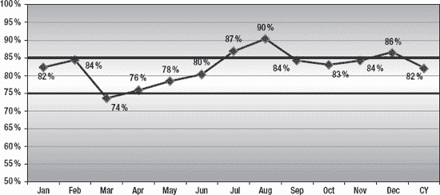
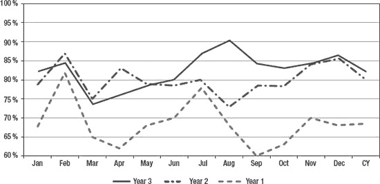
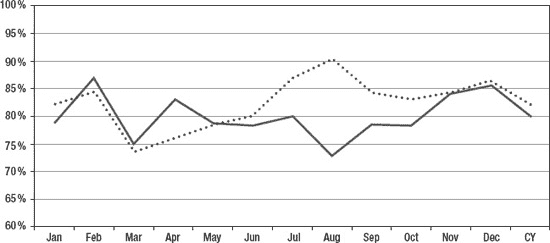
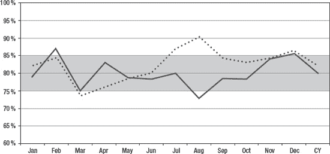
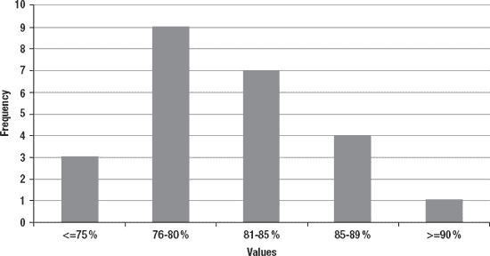
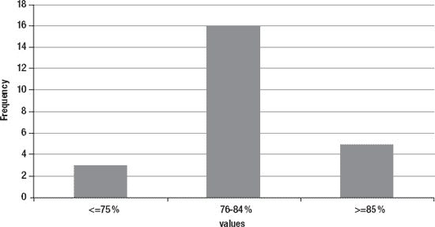
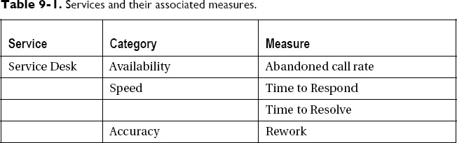
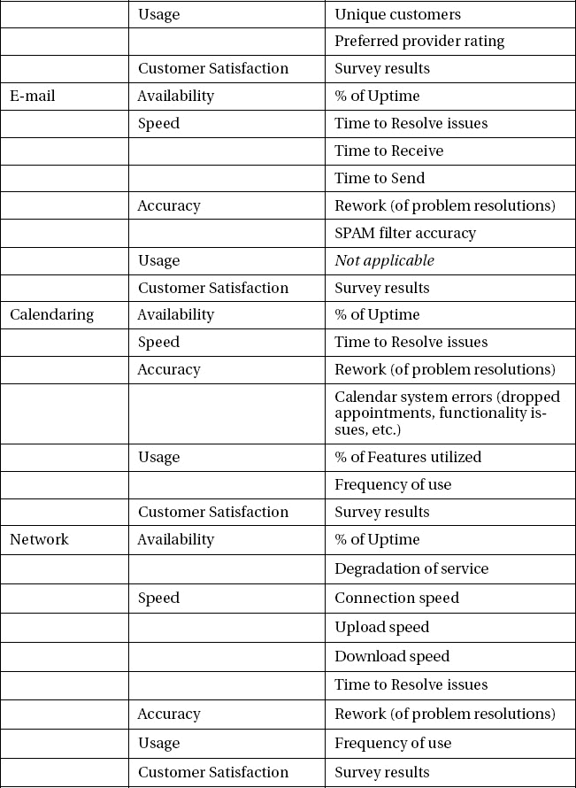
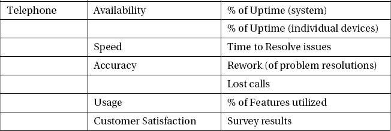
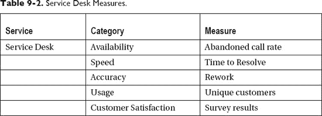

# 第八章 预期：满足、超越与不及

如果结果超出预期，需判断这种超常表现是否可以在可控成本内复现。由于超出预期并非正常现象，很可能为了达到这种服务水平或产品质量而牺牲了其他方面。可能是其他服务被忽视、需要额外时间或投入了额外成本。若非如此，这就不是异常情况，而是常态，并且会在客户预期范围之内。

在目标与预期上限之间存在细微差别。如果你持续超出预期，那么要么是你对客户预期的判断不够严谨，要么是你的服务/产品质量水平已达到客户会真正对你提出更高要求的程度。

前面我举的关于重置密码的预期例子是真实的。但如果我讨论的是对在线购买产品的第三方配送预期与对亚马逊 Prime 服务（两日免费配送）的预期，两者会截然不同。同样，我支付加急送达与标准运输的预期也完全不同。不过总体而言，每当我看到购买的商品由亚马逊（而非第三方）供货时，我对配送速度和包装质量抱有更高的预期。

如果你持续超出客户预期，同样的情况也会发生在你的客户身上。问题是：你能持续做到这一点吗？最佳情况是你因流程或程序改进而超出预期。如果你的持续过程改进工作（例如全面质量管理、改善或六西格玛）取得成功，你可能比以前提供更好更快的服务，同时不降低其他服务质量或增加成本。

如果这是一个“目标”，管理层会关注哪怕一次超出目标的情况，并要求你逐年提高超出频率。或者他们会在下一年调高目标。

当你超出预期时，它与未能达到预期一样都属于异常。诚然，客户不会不满意，但你仍需调查原因，因为你的组织可能无法承受这些异常情况。因此，不要自动将其视为好事。领导层必须像对未能达到预期一样，对超出预期背后的原因保持好奇。超出预期确实表明你没有让业务陷入困境（效率指标），也没有在其他服务或产品领域造成糟糕的客户体验。但正因如此，你无法承受推动或奖励超出预期的代价。

满足预期才是真正的理想状态。

更全面的指标展示方式应凸显预期区间。不要使用经典的绿色表示好、红色表示坏的风格。`Figure 8-3`更清晰地展示了在八个工作小时内解决问题的预期情况。

图 8-3. 中性颜色的预期区间

### 发现预期

很多时候，当我帮助部门定义指标时，管理者并不了解客户预期。我通常会通过提问来推动思考，例如：“什么会让你的客户不满意？”或者“什么会让他们注意到问题？”我会利用他们的客户满意度调查（记住，几乎每个人都有这些调查）来查看客户对速度、可及性或准确性的评价。

通常，只要稍加调查，我就能为客户预期设定一个初始范围。一旦我分析了足够的数据，并考虑了满意度调查中可用的信息，就很容易识别出常态。

这个常态有助于了解流程的稳定性以及通常提供的服务水平。我以此为指导，与部门合作制定预期。这样做是必要的，因为客户群体通常太大，无法调查完整的代表性样本。确定常态后，我会询问部门这是否合理。

`Figure 8-4`显示了一个示例数据——即八个工作小时或更短时间内解决故障电话的数量——收集自三个日历年度。

注意：如果没有历史数据，你可能无法进行此练习，直到收集到足够的数据进行对比。

图 8-4. 示例数据

当有多年的数据和多个数据点时，确定预期就变得更容易。在`Figure 8-4`的例子中，我会问客户第一年是否是“正常”年份。通常，回答是这对他们来说是一个低于平均水平的年份。与其他年份相比表现不佳，通常是由流程、领导层或系统变更造成的。无论原因如何，我只想知道该年度发生的情况是否可以被视为正常。

然后我检查第二年和第三年。很可能这些年更正常，部门对其在这些期间的整体表现感到满意。

仅使用第二年和第三年的数据，我与部门合作查看数据显示的“常态”。这在`Figure 8-5`中可见。我忽略第一年这个“异常”年份。即使那是卓越的一年——结果始终接近 90%，我也会将其剔除，因为这同样不是“常态”。

图 8-5. 两年数据样本

此时，我再次要求部门利用集体记忆告诉我低点和高点是否异常。我不是试图让他们设定一个范围，而是只询问极值。

*   “第二年八月，你的结果低于 75%。这正常吗？”如果回答是否定的，我会询问同年三月的情况。

*   “看起来三月历来是‘糟糕’的月份——对吗？过去两个三月是否有任何异常原因？”

我会就第三年八月（该单位达到最高值）提出相同问题，然后逐步向下排查。你也可以使用统计分析达到此目的，但我发现使用数据图表对部门来说不那么令人生畏。此外，统计会让人觉得设定范围并非部门自己的事。

让部门拥有指标及其团队绩效的所有权非常重要。通过让部门成员协作确定客户预期，你可以从一开始就获得以下好处：

1.  流程和团队绩效水平的所有权

2.  对客户期望的共同理解

3.  对过去高点和低点的公开讨论——不带负面或正面色彩。部门学会将指标视为输入信息，而非后果的驱动因素。

`Figure 8-6`显示了我对该单位绩效常态的估算示例。

图 8-6. 让数据决定常态

此时，我会询问部门，该图表（图 8-6）是否看起来正确。

“你是否同意，你的客户期望的绩效表现介于 75% 到 85% 之间？” 我通常能得到肯定的点头回应。但这还不够。我希望尽可能接近准确的数值，但我愿意接受一个起初看来不错的猜测作为起点。我这样说是因为，无论我们将期望设定在何处，我们都必须对定义保持灵活。我们可能会从客户那里获得更好的反馈。我们可能会改变流程，从而导致期望值不得不改变（客户很少会期望更少——大多数时候，他们只会期望更多）。

我问：“那么，如果你交付的成果超过 85%，客户会感到惊讶吗？” 如果答案是肯定的，我会合乎逻辑地追问：“客户在第二年的二月和第三年的八月有什么反应？” 以及“你是如何取得这些成果的？” 关于第三年三月和第二年的八月，我也会问同样的问题。根据答案，我可能会重新调整期望值。

我提到过，你可以使用统计分析。让我们看一个例子。图 8-7 显示了使用微软 Excel 数据分析加载项工具分析的相同数据。

图 8-7. 两年样本的直方图

基于直方图，我对 75% 到 85% 的猜测似乎是可接受的。更精确的范围可能是大于 75% 且小于等于 85%。如果我们从更简单的视角查看数据分布，会发现所提供的范围相当合理且很有可能实现。但再次强调，主要的检验标准是将我们的想法与客户反馈进行对照。

图 8-8 中所示的同一数据的简单频率图，检验了视觉解读并证实了该猜测。

图 8-8. 两年样本的频率图

## 小结

关于绩效度量的现有思想流派——特别是目标、阈值以及将度量作为目标的概念——应该被一种协作性的方法所取代，这种方法将服务和产品质量的所有权交给员工。这是通过确定客户期望来实现的。

-   期望几乎总是一个范围。

-   满足期望是你需要常规性做到的事情。

-   未能满足期望是一个异常现象，应调查其原因。

-   超越期望是一个异常现象，应调查其原因。

-   正面和负面的异常现象都应引起组织的关注。无论你是超越了期望还是未能满足期望，都需要进一步调查。

-   在设定期望时，要查看数据以帮助识别常态。那么问题就变成了：“常态是否等于客户的期望？”如果是，数据应能反映这一点。目的是能够识别出偏离常态或超出预期行为范围的异常情况。

-   珍视异常情况——因为异常情况是度量指标产生投资回报的地方。调整期望范围的主要原因是为了确保你能正确识别异常情况。

## 结论

旧的思想流派行不通。将度量指标作为一种激励形式更像是操纵而非协作。你需要与你的员工建立牢固融洽的关系，并与他们充分合作以正确使用度量指标。设定延伸目标、目标值、阈值，将度量值作为目标，以及奖励达到度量值作为激励，这些都是用错工具的例子。

满足客户期望才是真正的目标。与期望相关的异常情况可以提供有用的信息。

期望提供了清晰的背景，是打开改进之门的钥匙。

# 第九章 创建并解读度量成绩报告单

我挣扎了很长时间，试图决定如何向你介绍这份成绩报告单。我考虑过是把它作为另一个工具（像答案键那样）来呈现，还是作为一种方法论来提供。我最终决定，把它作为一个真实案例，展示度量指标如何在我提供的框架内演变和成形。

我将向你讲述一个为期三年的历程：为一个组织开发一个可行的度量计划，该计划必须清晰地阐述组织的整体健康状况以及其每项核心服务的健康状况。我在此过程中犯过错误，不断学习、改变、测试和尝试。我将与你分享这段探索之旅以及我最终到达的目的地。希望你能从我的错误中学习，并从中受益的最终产品作为你使用的模板或示例。

最高层执行官向我们首席信息官提出了一个直截了当的问题：“你的组织有多健康？你怎么知道的？” 这正好契合了我们首席信息官的好奇心，他想要获得关于组织健康的有意义信息，但不知道如何表达这种需求。

带着这个根源问题，我努力寻找一种方法来构建一个能够提供有意义答案的度量计划。我提到的“我们”是一个由安永咨询师和我本人组成的度量项目团队。

在一个尚未真正准备好的组织中灌输度量计划是一个艰难的命题。实际上，这是一个不可能成功的命题。我谦卑地这么说，因为即使我们如今在成绩报告单上取得了成功，它仍未发挥其全部潜力。但我们正在变得更好，而且这份成绩报告单比我们组织迄今为止使用过的任何其他报告工具都要持久。

要在坚持我在本书中阐述的原则和价值观的同时应对这一挑战，就更加困难了。为了使其成为可能，尤其是在有强制命令的情况下（这可能是实施任何具体改进措施的最糟糕方式之一，因为它剥夺了员工“获得认可”的机会），需要一个度量计划，使其对数据所有者、要求答案的执行官以及所有中间人员都有益处。

除了建立一个能为所有层级提供有意义信息的度量系统外，我还希望它易于理解，并且尽可能减少层级之间的翻译工作。

正如我之前所写，你无法独自完成这件事。我一个人是不可能成功的——不仅因为这项努力对单个人来说过于浩大，还因为我无法独自获得认可。如果我在整个过程中不让服务提供者参与其中，他们就不会接受并相信信息将如何（以及不会如何）被使用。管理层也不会接受我开发的任何解决方案都会奏效的想法，因为我已经是“村里人”了。没有一个先知（或度量指标设计者）在自己的家乡是被接受的。因此，我最终组建了一个外部顾问团队，加上我自己，以及每个服务提供者的深度参与。

## 概念

首先，您可能会想：“为什么是‘报告卡’而不是‘记分卡’？毕竟，许多组织都用`记分卡`来追踪指标。”我最初的想法是使用`记分卡`。`记分卡`方法论包含使用来自不同领域的度量指标（这符合三角验证的概念），但这些领域甚至不属于同一类度量指标（参见答案键）。另一个问题是，`记分卡`将风险更高的效率度量与有效性度量混在一起。毫无疑问，我想专注于服务/产品健康领域，因为我将努力突破足够多的障碍，而不必卷入伴随效率度量而来的战争。

我欣赏`记分卡`（以及仪表盘）的一点是，它能通过组合度量指标来呈现更全面的图景。这符合`度量指标`的定义，而不仅仅是一堆`度量数据`。

但请思考一下这个名称本身：`记分卡`代表了一种了解“谁在赢”的手段。2011 年秋天，我观看了圣母大学以 23 比 20 输给南佛罗里达大学的新赛季橄榄球揭幕战。令人惊讶的是，圣母大学在几乎所有能想到的类别中都“赢了”，而且优势不小。在进攻、防守等所有类别中都胜出，只有一个例外：失误。最终，唯一重要的统计数据是最终比分，而比分由得分决定。这些得分通常可以通过其他度量来预测。

因此，`记分卡`能快速告诉你谁正在赢，以及谁已经赢了。然而，它无法告诉你谁在特定领域表现更好。普通球迷可能只关心`记分卡`，但我当时是与相当于教练组的人员合作。进攻、防守和特勤组教练，以及跑卫、外接手和线卫教练都想知道他们各自的队伍表现如何。

我希望兼顾两者。我想要一个最终得分，同时也想要能够预示出该得分背后表现质量的指标。

我们想到的是`报告卡`这个概念。这个指标就像大学的成绩报告单，学生全年都会收到关于其学业进展情况的反馈。有测验、考试和论文需要评分。在定期的时间点（期中及期末）会给出成绩。根据反馈，学生知道自己的表现是良好、需要改进，还是超出预期。

在每一种情况下，组织都像学生一样，需要根据整个报告卡来做出决策。仅仅庆祝优异的成绩（A+）并贬低任何差等成绩是不够的。在做出决策之前，还需要更多信息。这个 A+是否是以牺牲另一门学科为代价获得的？相比 A 甚至 B，获得 A+有什么好处？差成绩是否出现在学生需要或真正想要的学科上？这门课可以退掉吗？它是否是主修课程所要求的？

出于我们的目的，我们将开发的度量指标视为`报告卡`。虽然我们可能乐于获得高于预期的成绩，但我们只期望以下结果：

1.  那些不需要超出可接受努力范围的结果（例如，学生是否忽略了其他科目，或者学生是否挑灯夜战到损害健康的地步）。

2.  学生没有通过“作弊”获得成绩。在组织环境中，作弊等同于超出可接受标准、政策或流程行事。

3.  学生是凭实力获得成绩的。我们不希望得到名不副实的成绩——无论是好成绩还是坏成绩。该度量指标应反映从客户视角看到的服务表现。

当我们审视低于预期的成绩时（例如，某次测验或考试不及格），我们还需要提出以下问题：

1.  失败是否由可避免的情况导致？这可能包括不良的学习习惯、未完成规定的作业，或缺乏先修课程？

2.  是否因缺乏努力或专注导致？

3.  这门课是否是主修课程所必需的？如果不是，它是一门可以退掉的课吗？如果该服务不是组织核心服务的一部分，它可以被放弃吗？“低于预期”的结果是否可接受？

接下来，让我们看看`报告卡`是如何构建的，从单个服务一直延伸到整个组织的健康状况。

## 基础工作

所有组织都有客户。在本案例中，为了回答高管层提出的问题，我们选择从向客户交付服务的质量角度来回答。我们本可以将问题理解为生产产品和交付服务的效率如何……但根据`答案指南`，我们决定从更关键的焦点出发：我们在多大程度上满足了客户（服务/产品健康度）。这一焦点使我们能够自下而上地设计整个项目。

通过关注客户的视角（有效性），我们发现可以在员工层面引入指标，从而减轻通常伴随指标而来的恐惧、不确定性和疑虑。我们能够向包括主管、中层经理和总监在内的全体员工保证，我们收集、分析并最终报告的信息，不会反映组织中任何个人或任何单位的绩效表现，而是传达客户如何看待我们的服务和产品。

这些信息对每个层级的每个人都是有价值的。由于不涉及“归咎责任”，我们能够心无旁骛地解决客户的关切。不仅不归咎责任（“谁”不重要，只有“为什么”才重要），而且我们掌握的信息也并非被视为事实——客户的感知比任何关于事实的争论都更重要。

这有助于应对通常反对收集某些数据的观点：“但我们对此无法控制” 和 “这不是我们的错。”

我们同意采用`答案指南`建议的以下主要信息类别：

1.  `交付`

2.  `使用情况`

3.  `客户满意度`

我们进一步同意，对于大多数服务，`交付`将细分为可用性、速度和准确性。这一点尤其有用，因为最具争议的衡量指标就属于`交付`类别。我们的大多数服务提供商已经通过故障呼叫跟踪系统调查来收集和审核`客户满意度`指标。`使用情况`是一个“安全”的指标，因为很少有人会将使用数据视为其绩效的反映。

由于我们预计来自`交付`指标的阻力最大，我们希望利用上述三个领域（三角验证法）来缓和这种阻力。

因此，根本问题以及我们更高层次的信息需求很容易被确定。当然，我们仍然需要确定具体的衡量指标及其组成数据。在这样做之前，我们需要知道哪些服务将包含在`报告卡`中。我们需要了解组织的关键/核心服务。服务目录本来会非常有帮助，但当时并没有。在许多组织成熟度不足的组织中，健全的指标项目所需的许多前提条件可能都缺失。这也是使用指标项目被视为一种成熟行为的原因之一。

虽然在不够成熟的组织中尝试实施成熟的行为（如指标项目）可能问题丛生，但如果谨慎操作，它实际上可以成为推动组织走向成熟的催化剂。在我们的案例中，指标项目明确帮助组织思考并着手开发服务目录。虽然早在指标项目启动之前，服务目录的需求就已经被识别出来，但指标工作有助于聚焦这个短板。

`报告卡`所鼓励的另一种行为是对故障呼叫跟踪系统更一致、更准确的使用。由于大量数据（几乎涵盖`报告卡`中所有服务）都依赖该系统，组织必须在使用该系统时变得更加严谨。

在组织记录服务目录之前，我们尽力识别出被组织大多数成员视为核心的服务。

作为一个信息技术组织，我们有许多服务和产品可供选择。我们选择的一些关键服务包括：

*   `服务台`

*   `电子邮件`

*   `日历`

*   `网络`

*   `电话`

这些服务很容易被接受为我们提供的核心服务的一部分。针对每项服务，我们构建了一个模板，用于在所确定的领域收集指标。该模板将包括服务、用于分析服务健康状况的信息类型（类别），以及用于回答根本问题的具体指标。结果见表 9-1。

你可能需要关注不同的服务。例如，你可能处于与我示例中完全不同的行业。即使你拥有相同的服务，你也可能有不同的信息类别，因此有不同的指标。

我将只聚焦于一个领域——`服务台`，来继续这个示例，但我想先解释一下`电子邮件`“使用情况”的指标为什么“不适用”。我们的组织为我们的客户提供`电子邮件`——基本上处于垄断地位。我们的客户在工作邮件上没有其他选择。他们可以使用其他电子邮件服务（例如 Gmail），但必须先经过我们的系统，然后才能自动转发。因此，我们一开始就认为“不适用”，并且没有衡量`电子邮件`的使用情况。基于同样的原因，我们也没有衡量`日历`、`网络`和`电话`的使用情况。虽然在这些案例中我们没有使用`使用情况`指标，但原本是可以使用某些指标的。

对于`电子邮件`，我们可以使用“使用率”和“将邮件自动转发到其他电子邮件提供商的客户数量”。

对于`日历`，我们可以查看“使用频率”和“功能使用率”。`日历`是一项足够新的服务，了解其功能的使用水平（客户接受度）是值得的。

衡量互联网和电话的使用频率似乎仍然没有意义，因为它们是高使用率的服务，而且我们处于垄断地位。

以下两点我想明确说明：

1.  某些指标可能“不适用”。虽然三角验证法要求你尝试从不同视角获得至少三个指标，但这并非强制要求。

2.  仅仅因为你能想到某些指标，并不意味着你必须使用它们。

那么，回到`服务台`。让我们看一下为该服务确定的具体指标。

如第 5 章所述，可用性、速度和准确性这三个“交付”指标将通过从服务提供商处收集的信息进行客观衡量。对我们来说，好消息是该部门经理过去是（并且现在仍然是）一位极具同理心的领导者。我之前写到的许多危险和警告都源于恐惧、不确定性和疑虑——而这些担忧往往在经理滥用指标时成为现实。就我们的服务台而言，我并不担心经理会滥用或误用我们提供的信息。如果我告诉她数据显示某位员工疏忽、懒惰或无能，她不会草率采取行动，而是会首先调查数据背后的“真相”。如果我所提供的解释是准确的，她会与员工一起以富有同理心的方式解决问题。

这位经理的态度使得服务台成为一个极佳的起步服务。我们对她在帮助我们将该项目推广给她员工，并成为其他服务提供者的坚实榜样方面的能力充满信心。