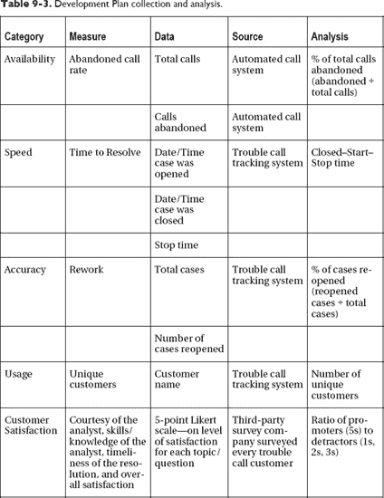

# 选择该服务提供商的另一个积极因素

选择该服务提供商的另一个积极因素是能够轻松获取大量数据。服务台是故障报修跟踪系统的最高频用户。大部分数据都将通过该系统获得。可用性数据（未接来电）通过全自动呼叫系统获取，使其成为一套客观的衡量指标。客户满意度则由第三方调查机构处理。因此，该服务提供商拥有我们想要的所有数据，并且大部分数据都通过客观收集方法获取。所有这些数据都能在不干扰各部门日常运营的情况下获取。这是一个理想的起点服务。

## 速度

速度的追踪客观性略低于可用性。由于它基于解决速度，因此将从故障报修案件的开启和关闭时间中得出。这要求接听电话的分析师在每个阶段——开启和关闭——都准确地记录案件。由于管理者信奉指标管理，她鼓励（并确保）员工准确记录案件。

## 准确度

准确度同样使用故障报修跟踪系统来衡量。返工被定义为过早（错误）关闭的案件。我们可以在整个解决方案过程中尝试识别错误（缺陷），但由于为客户寻找解决方案的过程往往包含试错，这并非一个容易的起点。即使管理者充满同情心，我也不想要求分析师追踪他们在找到正确答案之前尝试了多少种不同的猜测。这需要高度的信任（让员工相信这不会影响他们自身的评价），而这种信任我尚未建立起来。这种方法的另一个问题在于，信息可能无法反映客户的观点。大多数客户都期望并接受一定程度的试错和探索，以寻找正确的解决方案。

在每种情况下——未接来电率、解决时长和返工率——数据都将反映客户的观点。

## 交付到使用

从交付到使用，在这种情况下是一套更困难的衡量标准。由于服务台是一个内部服务提供商（客户不为此服务付费），使用量并不反映组织的收入。管理者对其部门的使命有着非常健康、宏观的视角。如果使用量“高”，可能反映了 IT 系统、服务和产品的不稳定性，也可能反映了 IT 相关培训的无效性。在大多数业务和服务中，高使用量是件好事。但对于服务台而言，高使用量可能和低使用量一样糟糕。此外，如果使用量“低”，则不清楚这是反映了培训效果出色、系统稳定，*还是*客户认为服务台不是一个有意义、有用的提供者。

与大多数衡量指标一样，从中得出的信息需要加以解读。应该进行进一步调查，而不是急于下结论。在这种情况下，任何极端情况都可能是一个负面信号——但信息仍然有用。由于我们拥有跨越相当长一段时间（超过三年）的数据、衡量指标和信息，我们可以判断客户的模式是否发生了变化。通过观察独立客户，我们可以判断是否存在异常——无论是上升还是下降。这些峰值可能不表明好事或坏事。相反，它们仅表明某些事物发生了变化。

为了有意义，我必须拥有纵向数据来进行比较；否则就无法识别异常。在某些情况下这并不那么重要——但在使用量方面，这很关键。关键在于能够识别异常——即超出正常预期范围的衡量指标。在我们确定了适当的衡量指标和数据点之后，我们必须确定预期。

任务是识别异常——即超出正常预期范围的衡量指标。

这突显了指标计划的一个重要方面。你的信息只是指示信号，在未进行进一步调查之前不应据此采取行动。不要期望这些指标成为行动的推动力，它们更常是表明某处有误、某物已变、或某事需要调查的指示器。

### 客户满意度

客户满意度是另一个易于获取数据的例子。该部门利用一家第三方调查公司，该公司对每一个已关闭的故障报修案件的客户发送调查邀请（通过电子邮件）。供应商收集回复，汇总结果，并每周向部门发送一份报告。我每月会收到一份结果副本，用于纳入报告卡。我们确定的所有衡量指标都可以在不引人注意、不干扰部门工作流程的情况下收集。这并非总是可行，但始终是一个目标。

由于大部分数据可以通过自动化系统获取，我们掌握的数据随时可得，并且与人为错误高度隔离。在少数几个有人类参与处理数据的环节，团队对生成准确信息的渴望使我们非常乐意将此服务作为我们的旗舰项目。

## 指标开发计划

回顾指标开发计划。我们认识到确定来源、数据（每个组成部分）、如何以及何时收集数据、以及如何分析数据是重要的。就服务台而言，其中大部分工作已经完成。表 9-3 将已为服务台确定的类别和衡量指标进一步细分为所需数据、这些数据的来源，以及对数据的一些基本分析。这些分析可以编程到软件工具中进行显示。

这是我们的起点。我们轻松确定了这些衡量指标。其中一些指标已经在收集和分析。与大多数事物一样，还有其他选项可供选择。在分析了之后，我们重新评估了我们的指标草案。

让我们回到指标开发计划，它包含以下内容：

*   目的声明
*   指标将如何使用
*   指标将不会如何使用
*   指标的客户
*   分析
*   时间表
*   为我们其余人准备的图景
*   散文式描述

### 目的声明

我们的目的声明是既定的——我们如何向领导层传达我们的服务和产品的健康状况？

### 将如何使用

你可能会认为这个答案简单明了；它将用于回答问题。在这个特定案例中，它将用于从客户的角度传达服务台的健康状况。

### 将不会如何使用

大多数人也希望这一点显而易见，期望无需回答这个问题。当然，我必须回答它。

*   它不会被用于区分分析师之间的优劣
*   它不会被用于绩效考核
*   它不会被用于推动分析团队达到不同的绩效水平——换句话说，这些衡量指标不会变成待实现的目标。

### 指标的客户

该指标（服务台健康状况）的客户，首先也是最重要的，是服务台本身。管理者和分析师是数据的所有者，也是由此衍生出的信息的“合法”所有者。另一位客户是我们支持服务部的总监（管理者向其汇报），然后是 CIO，最后是高管。所有这些都是客户。每位客户需要不同级别的信息。

