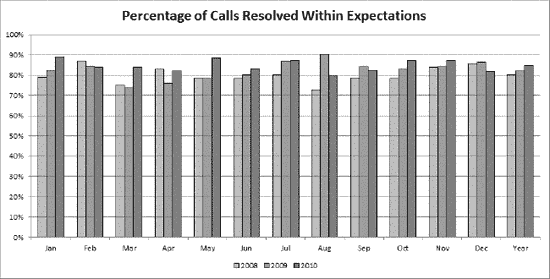
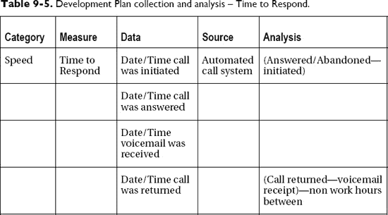

# 数据所有者（分析师和管理者）即使从最底层的数据中也能获益。主管需要看到异常情况。她想知道这些异常的原因是什么。CIO 想知道哪些异常需要他亲自参与处理。如果服务台确定需要升级电话系统、购置新的自动呼叫系统或专家系统，相关资金必须得到 CIO 的批准。这些数据将有助于支持这些请求。

CIO 还想了解任何可能反映客户不满的趋势（无论是积极的还是消极的）或异常情况。基本上，CIO 想知道他的上司（高管）可能会问到的异常情况。大多数情况下，高管之所以会问，是因为一个重要客户或一群客户投诉了某个问题领域。CIO 不应该从上司那里才听说异常情况。

高管也是如此。如果服务健康状况低于预期，并最终影响到上级组织，高管理所当然会想知道原因，以及正在采取什么措施来改善情况（要么重复积极体验，要么消除负面体验）。

## 分析

除了计划中的分析之外，还必须对信息结果进行分析，以了解其趋势和/或含义。既然我们已经打下了基础，是时候深入挖掘了。我们必须收集数据并进行分析，以确保我们最初关于用途的猜测是准确的。

#### 可用性

我们从服务的放弃呼叫率开始。当我们查看图 9-1 中显示的数据时，我要求经理（和员工）进行一个简单的试金石测试。我问经理，她是否认为该部门对客户响应不及时。放弃率是否过高？如果高于预期，这个数据准确吗？如果准确，为什么这么高？

**图 9-1.** 放弃呼叫率

经理之前多次听说过，放弃率是呼叫中心绩效的标准衡量指标。她查看数据时表示，“感觉不对”。这并不是因为数据让部门显得不利，而是因为她相信自己的单位对客户需求的响应程度比数据显示的要高（数据显示该部门每十个电话中就有超过两个被“挂断”）。

这促使我们对这些指标做出恰当反应：我们进行了调查。我们研究了两个方面——接听电话的流程和程序，以及系统生成的原始数据。流程显示，两声铃响内未接听的电话会被转到一个自动队列。这个队列从一段录音开始，告知来电者所有分析员都在忙，很快就会有人接听。值得一提的是，这段录音会提供有关 IT 服务任何已知问题的信息，例如“当前网络中断正在处理中，应该很快就会恢复”。大多数日子里，录音的前 30 秒传递的信息可能已经满足了来电者的需求。

经过进一步检查，我们发现原始数据包含了通话时长（开始时间与挂断时间之差）。这使我们能够提取出另一个指标，如表 9-4 所示。

该指标在图 9-2 中以图表形式呈现。我们将其与总放弃率进行比较，看是否能更清晰地说明问题。

**图 9-2.** 持续时间少于 30 秒的放弃呼叫百分比

与所有指标一样，一个主要问题是如何传达该指标（使用哪种图形表示形式）。就可用性而言，我们最初使用“放弃呼叫率”，即“放弃呼叫百分比”。当我们加入更具体的“30 秒内放弃的呼叫”时，我们再次使用了百分比。我们选择将其与总数*或*仅显示“放弃呼叫百分比”相关联，并限定“放弃”定义为 30 秒后放弃的呼叫。

在结合流程改进（包括缩短录音时间）观察这些指标一年后，该部门选择放弃“总放弃率”，仅使用“30 秒内放弃的呼叫”。这会更好地回答可用性问题，因为它允许以下情况：

1.  拨错号码
2.  通过自动录音回答的问题/解决的问题
3.  改变主意的客户（他们可能选择使用新的电子邮件或聊天功能寻求帮助。也许客户的电话刚打出，他们的问题就自行解决了。）

虽然假设等待时间不超过 30 秒的来电者不会对等待感到失望仅仅是一种假设，但人们相信这能提供更准确的描述。这需要与“速度”（参见速度衡量指标的补充）和客户满意度衡量指标“及时性”进行比较。当然，只有那些在电话上等待足够长以接通电话的人才会填写调查问卷。

在可用性方面有了坚实的开端之后，让我们来看看速度。速度最初是指“解决时间”，众所周知这是客户关心的问题。并非该组织在这方面存在缺陷，而是客户在乎解决问题需要多长时间。

## 速度

我们最初从故障呼叫跟踪系统中记录的工单开启与关闭时间入手。这些数据需要人工输入，要求分析师严格遵守围绕故障呼叫跟踪所建立的流程、规程与政策。如果管理者是其他类型的经理，我可能需要花费大量时间来确保员工明白：这些信息不会被滥用，而且尽可能准确地将数据录入系统符合部门、每位员工以及管理者自身的最大利益——无论数据反映的情况是好是坏。如果分析师为了“看起来不会太糟”或“显得格外好”而“篡改”数据，那么这些信息就会变得毫无价值，甚至可能导致错误决策。

在这个案例中，我信任这位管理者，因此只花少量时间在一次员工会议上说明了数据准确性的重要性，以及由此得出的衡量指标和信息如何能够用于改进流程——并且不会反映到个人绩效上。这一解释的关键点与我处理过的任何衡量指标或部门单元都是一致的。

数据、衡量指标、信息，乃至最终的度量标准，不应反映个人绩效。

此外，这些度量标准也不应反映部门整体的运营效率。

数据、衡量指标、信息和度量标准所清晰反映的，是客户对服务的感知。无论“真相”如何，了解客户的感知都使部门受益。这一点在速度方面尤其明显。

根据您用于捕获速度的工具，您可以报告解决一个问题的确切耗时。例如，您可以使用自动呼叫系统来识别呼叫发起的时间（而不是分析师在故障呼叫系统中打开工单的时间）。您还可以使用另一个呼叫系统记录分析师完成最后一次致电客户并关闭工单的日期和时间（假设处理过程不止一次通话）。您需要一种将工单信息与呼叫系统关联起来的方法。这种精确度在大多数情况下并非必需——记录工单的开启和关闭时间通常就足够了。但即便您拥有了上述精确度，客户仍可能“感知”到实际更快的解决耗时更为漫长。

我可以向您保证，向客户展示“证据”表明工单实际耗时比他们感知的要短，这既不会提高客户的满意度，也不会改变他们对部门工作效率的看法。对客户而言，感知即现实。虽然了解客观现实很有用——但您还必须应对客户的感知。

即使您达成了服务水平协议（SLA），假设您确实有这类协议，工单也可能被客户感知为耗时超出预期。

**注意：** 如果您能获取服务的 SLA，这些是记录客户对服务或产品期望的绝佳起点。如果您有 SLA，请保持警惕。您可能会发现，尽管客户同意了 SLA，但它可能无法反映他们的真实期望——随着时间的推移尤其如此。甚至可能在 SLA 签署当天就无法反映他们的期望。

对于我们的度量标准，我收集了工单开启和关闭的时间。我们的故障呼叫系统具备切换“暂停计时”开关的功能。此功能记录了开关被拨至“暂停”位置，直至重新拨回“活动”位置之间的时长。

这非常有用，因为它允许工作人员捕获客户预计无需进行工作的时间段。但*并非*用于扣除非工作时间的晚间或周末时段。客户虽然不一定会期望在这些时段内完成工作，但仍会将“停机时间”视为解决其问题的总时长的一部分。“暂停计时”仅用于特定且明确界定的情况，例如：

1.  客户无法联系上（在休假、外出），导致工单虽已解决但无法关闭。
2.  客户要求延迟实施解决方案至特定时间，比如请求安装新软件，因为她不希望升级干扰当前工作。

对于计划内的修复，我使用了另一个数据点：计划解决时间，并将其作为公式中的起始时间。尽管暂停计时功能也可能适用，但我很少发现它在此类情形中被使用。如果您使用暂停计时或计划解决时间，您仍然必须捕获起始时间和关闭时间。您必须保留原始数据，因为您无法预知何时会面临客户争论，声称实际时间应从呼叫时刻算起；或者您可能希望展示您提前多久收到未来解决的请求。您是在需求产生前一天、一周，还是一个月前收到请求？您如何处理这些请求？如何确保工作按时完成？包含实际起始和关闭时间的原始数据，将有助于检查您的流程。

因此，我们首先将解决时间与客户期望进行对比，如图 9-3 所示。

**图 9-3.** 解决时间：在期望时间内解决的工单百分比

对于速度指标，我们还必须就如何呈现数据做出决定。我们可以将数据显示为在期望时间内解决的呼叫数量，也可以使用百分比。您可能注意到一个趋势——百分比是一种简便的数据描述方式，尤其是在结合用于计算百分比的实例数量时。通常只需提供总数即可（如有必要，可据此推导出具体数据）。

与可用性指标类似，服务提供者认为故事缺失了一部分。除了完成工作所需的时间外，客户还关心他们需要等多久才能与一位活生生、能呼吸的分析师交谈，而不是听录音。因此，我们需要收集响应时间数据。表 9-5 展示了响应时间的细分情况。这是一个需要构建多个数据点的衡量指标的良好范例。

在定义这个衡量指标的过程中，我们意识到还存在其他衡量响应时间的方式。除了分析师接起电话前的时长，还有针对留下语音邮件的客户进行回电的情况。由于服务台在周末或非工作时间不开放，客户留下语音邮件是很常见的事情。因此，响应时间需要包含回电给客户（并取得联系）所需的时间。期望是基于工作小时数的（而非纯粹是消息留言的时刻）。如果客户在周五下午 5:15 留下消息，期望并非是在周一上午 8:00 就接到回电。与往常一样，期望会是一个范围——例如，服务台将尝试在三小时内回电。棘手之处在于，需要判断回电是否必须成功联系上客户，还是仅在客户语音邮箱中留言即算作“联系”并视为已响应。

响应时间是该度量标准在开发后期才加入的指标，第一年并未使用。灵活性是构建有意义度量标准计划的关键之一。

灵活性是构建有意义度量标准计划的关键之一。

## 准确性

系统内部及其运行过程中产生的缺陷通常会被审查。那些在发布前被捕获的缺陷属于“效率”的一部分。而到达客户手中（且客户意识到的）的缺陷，则属于我们正在制定的衡量指标范畴。我们需要方法来表征有缺陷的生产或服务交付。以服务台为例，我寻找了一种简单的准确性衡量标准。

返工是一个容易的选择。利用故障呼叫跟踪系统，我们可以追踪在客户认为问题已解决后，又被重新打开的案例数量。只要客户将案例的重新打开视为返工，它就会被计入。我们发现，有时案例会被过早关闭——无论是服务台还是二级支持团队所为。之后客户会就同一个本以为已解决的问题再次致电服务台。分析师们以令人钦佩的方式重新打开案例（而非创建新案例，那样会使他们处理的总案例数看起来更好看，并避免准确性受到影响）。这种诚实的核算方式让服务台能够以客户看待他们的视角来看待自身。表 9-6 展示了返工情况的细分。您会注意到，所有这些案例的分析都非常简单。在关于工具的附录中，我会简要讨论统计学的应用场景。

图 9-4 展示了返工情况。您可能已经注意到，这些图表看起来都有点相似。如果仔细看，您会发现它们看起来完全一样。到目前为止，唯一的区别在于数据（数值）和标题。这种一致性应该对您有益，因为评审这些衡量指标的人会逐渐熟悉呈现方式以及如何解读它们。

**图 9-4.** 案例重新打开的百分比

现在正是指出“三角验证”如何有助于防止“追逐数据”的好时机。组织经常发现自己追逐数据，试图为一切披上积极的外衣，只报告好消息。分析师本可以将每一个合理的返工回电都记录为新的案例。这样做几乎可以（如果不是完全的话）消除返工。但这会人为地增加其他数据。处理的呼叫数量会增加。处理的案件数量也会增加。而客户对分析师知识水平的满意度则可能会下降。如果客户知道这是返工，却看到另一份自动生成的针对新案例的调查问卷出现在他的邮箱里——仿佛工作人员没有意识到这是同一个问题——最终会导致对分析师技能/知识水平的评分降低。

当然，解决速度也可能看起来更好，因为没有案例会显示花费了返工所需的时间。如果没有三角验证，这种情况很容易发生。当然，我手中握有王牌。即使没有三角验证，该部门的管理者及其团队都是服务客户的坚定信徒。他们不仅提供服务，而且力求做到最好。他们是持续流程改进和卓越服务的信奉者。即使没有三角验证，我也完全相信这个部门不会追逐数据。

但是，通过使用三角验证，并且不以孤立的方式看待衡量指标，这有助于即使那些承诺度较低的部门也能坚持从客户的角度出发。

如果我们因为一个类别的虚假报告而看到其他类别出现峰值，我们就会发现有异常需要解释。除了这些异常之外，返工率会非常低（或不存在），这本身也是一个异常。这是我们调查超出预期和未达预期结果（除了希望复制成功之外）的另一个原因。

