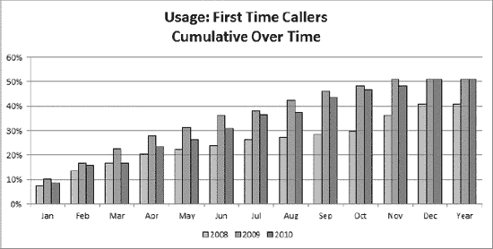
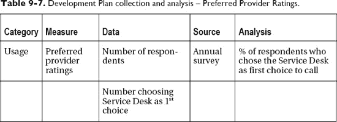
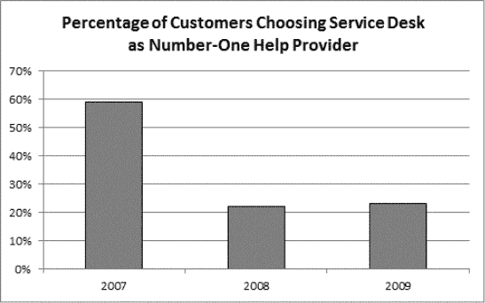
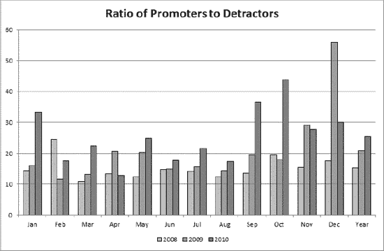

## 使用率

对于使用率，我们每月记录独立客户的数量，并将其作为累计总数运行。利用潜在客户群，我们能够得出使用服务台的独立客户百分比。我听说过关于某些数据根本无法获取的争论。在这种情况下，我喜欢参考道格拉斯·W·哈伯德的著作《如何衡量万物》（Wiley, 2007）。不是因为这本书包含了所有可能的衡量示例，而是因为它提供的方法让读者有信心能够衡量任何事物。

独立客户应该能够与客户群进行比较衡量，无论你的服务是什么。如果你是一个全国性的服务台——比如说，像微软、亚马逊或山姆会员店——客户群仍然可以确定。如你目前所知，精确的（事实性）数字可能无法获得，但获得一个非常好且有意义的估计是完全可行的。客户群可以通过确定相关软件的销售数量来估算。如果微软售出了 15 万份某款软件，那么关于该软件收到了多少个独立客户的来电？亚马逊拥有其客户总数的信息。对于山姆会员店也是如此，因为它是一个付费会员制零售商。而沃尔玛、麦当劳和社区超市则更难做到。

以沃尔玛和麦当劳为例，它们的全国呼叫中心可以使用关于“客户数量”的市场营销数据。每个公司都有可以利用的信息。不一定是独立客户，即便如此，它们对回头客数量和总客户数量也有很好的了解，因此可以推导出这些数字。

社区超市可以确定客户数量，或者将社区人口（以商店为中心，基于确定的半径）视为潜在客户群。

以服务台为例，我们拥有每个客户的识别信息（前提是客户提供了这些信息）。当然，这些数据的准确性完全取决于分析师的记录（姓名拼写错误可能是个问题）以及客户提供信息的诚实度（或意愿）。不过，百分百的准确性并非必需。好的数据就足够了。

有时候，“好的”数据就足够了。

查看三年期间的数据显示，客户群使用率相当稳定，我们更有信心异常情况会凸显出来。在图 9-5 中，您可以看到我们所看到的情况。最后一年显示出稳步增长。但这并非意外，因为最后一年有大量新技术、软件和硬件投入使用。

**图 9-5.** 独立客户百分比

与前两个衡量领域一样，使用率也以百分比表示。除了易于报告之外，这种方式也易于理解。另一个好处是为查看者提供了一致性。当你报告来自不同来源（三角验证）的多种衡量指标时，通过使这些指标的呈现方式尽可能保持一致，可以降低其复杂性。

通过纳入一项调查结果，我们立即对使用率衡量指标进行了改进。我们改版了年度客户满意度调查，并增加了一个关于客户如何就信息技术问题获得帮助的问题。我们询问谁是他们首选的求助来源：“当您遇到 IT 问题时，您首先会向哪里求助？”答案可以从以下选项中选择：

*   朋友

*   同事

*   互联网（搜索引擎、通用信息网站等）

*   供应商/制造商网站

*   硬件/软件制造商服务台

*   IT 服务台

*   其他

*   以上都不是——我不寻求帮助

### 使用指标与数据收集

虽然本次调查所得的数据并未直接反映实际使用情况，但我们仍将其归入此类别，因为它提供的答案契合了我们寻求使用数据的初衷。我们的客户对我们的服务满意吗？他们信任我们的服务台能提供所需支持吗？我们的服务台是他们解决故障的首选渠道吗？

正如您将在图 9-6 中看到的，本次调查收集结果中一个有趣的发现是第一年的百分比更高。

**图 9-6.** 将服务台作为首选求助渠道的客户中，独立用户所占的百分比

2007 年的调查与之后两年的唯一区别在于提供给受访者的选项数量。2007 年只有三个选项，而随后两年则有八个选项。

我们可以用来完善整体情况的另一个使用量指标是挂断电话的独立客户数。无论这些通话是否被计入可用性指标（等待时间大于或小于 30 秒），了解有多少独立客户曾致电我们的服务台仍是有用的信息。对于那些没有等待接通分析师、在 30 秒内挂断电话的客户，我们假定他们的需求已得到满足。如果他们等待超过 30 秒后挂断，我们则假定他们的问题未能解决。

因此，对于 30 秒内的通话，我们可以将其视为已服务客户。从流失通话的数量来看，这可能是我们数据池中缺失的相当数量的客户。这些数据对服务台经理在其他方面也很有用。如果同一个号码反复致电并在分析师接听前挂断，经理可以联系该号码，了解是否有特定的需求未得到满足。这需要自动呼叫系统能够在电话未被分析师接听的情况下捕获呼叫号码。在制定这些指标时，当前的电话系统尚无法实现这一点。因此，这一需求被记录下来，作为今后更换呼叫系统时的未来需求。

### 客户满意度

我们用于完善指标体系的最后一组衡量标准涉及经典的客户满意度调查。我们组织此前一直委托第三方机构进行“故障解决满意度调查”的管理、收集和制表工作，因此数据很容易获取。这些问题对所有服务用户都是标准化的，使我们能够与第三方机构所有客户（包括我们所在行业和整体）的平均水平进行比较。这一点让我们的管理层和高级领导层非常满意。他们非常喜欢能够将自己的服务与基准进行比较。当自己的服务表现优于基准时（正如我们那样），他们就更高兴了。

为了保持与之前相同的衡量风格——使用占总数的百分比，也是可行的。我们可以报告打 5 分、4 分、3 分、2 分和 1 分的百分比。但这会过于复杂，尤其是对于四个问题而言。因此，我们选择展示“满意”客户的百分比。我们将“满意”定义为在 5 分量表中给出 4 分或 5 分。

其他选项包括使用赖克海德的“推荐者与贬损者比率”。在我最终放弃之前，这个尝试实际上进行了一年多。（我无法让第三方机构使用 10 分量表，而且推荐者与贬损者的概念对某些经理来说过于复杂。）使用百分比提供的一致性很快就成为团队所期待的标准。我仍然相信推荐者与贬损者分析的价值，但就报告卡而言，我为我们的特定受众增加了“满意百分比”这一衡量指标。

**弗雷德里克·赖克海德的推荐者与贬损者量表**

根据赖克海德的《终极问题》（哈佛商业出版社，2006 年），你应该问的最重要的问题是：“你会向朋友或同事推荐这项服务（或产品）吗？”答案采用 10 分量表，1 分表示“绝对不会”，10 分表示“绝对会”。如果受访者给出 9 分或 10 分，她被认为是“推荐者”——即会鼓励他人使用你的服务（或购买你产品）的人。如果受访者给出 6 分或更低，她是“贬损者”。贬损者会积极劝阻他人使用你的服务（或购买你的产品）。7 分和 8 分被认为是“中立”答案——这意味着无法预测他们会提升还是损害你的声誉。你需要有每位贬损者对应两位推荐者的比例，才能实现增长（中立者不计入）。这个比例越高，你的口碑宣传效果越好，你的业务（客户数量）增长的可能性就越大。

图 9-7 展示了推荐者与贬损者的比率。如果贬损者多于推荐者，这个比率可能是负数。就服务台而言，我们的比率很高。例如，在 2009 年 12 月，每有一位贬损者（评分 1-3 分），服务台就有超过 50 位推荐者（将其评为 5 分的客户）。

**图 9-7.** 整体客户满意度中推荐者与贬损者的比率

这些比率令人印象深刻。我在一定程度上灵活运用了赖克海德的方法。5 分等同于 9 分或 10 分，1 分到 3 分等同于 1 分到 6 分。4 分则等同于 7 分和 8 分。由于我们没有使用正确的问题，我停止使用“推荐者”和“贬损者”这两个术语。更直接地说，这个指标反映了“非常满意”（5 分）与那些不能自称满意（3 分及以下）的客户之间的比率，这本身就比平均值更有意义，但仍然没有达到我期望的清晰度。