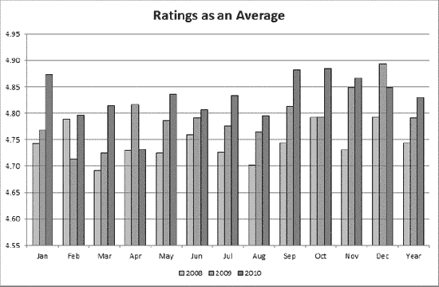
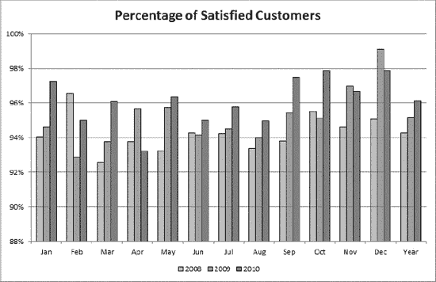
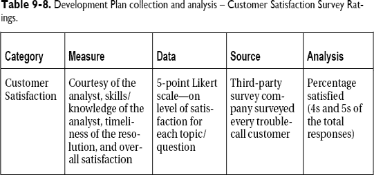

# 关于客户满意度调查评分的思考

“那么 4 分算什么？”是我以这种方式展示数据时经常收到的问题。解释 4 分是“真正的中立”并不能说服大多数人。服务提供商认为我们正在失去“满意者”，并且 3 分才是中立。我将这些分数与`Reichheld`的公式相关联的做法，他们很难接受。我认为这在很大程度上是因为对衡量标准的恐惧，以及担心他们的表现不会像他们期望的那样好。

使用高度满意与不满意的比例对你来说可能合乎逻辑（对我来说也是如此）。但我发现这并不是客户满意度调查的常态。服务台报告这些数据已经超过一年，他们总是将其报告为平均分，例如 4.7（满分 5 分）。似乎展示结果的最佳方式是使用李克特量表（`Likert Scale`）。

## 问题：评分含义不明确

我查看了过去三年的所有服务台报告。第一年的年平均得分为 4.7，第二年为 4.76，最近一年为 4.8。除了略微上升的趋势外，我无法理解这些数据的含义。这个平均值是好还是坏？好在有第三方为我们的行业及其所有服务用户提供了基准。所以我们现在可以看到，我们的分数高于平均水平。但是，我仍然觉得有些茫然。我不明白 4.8、4.9 或 4.58 意味着什么。当然，如果平均值是 5.0，我就知道所有分数都是 5 分。这意味着 100%的客户对我们的服务高度满意。但是，一旦平均分低于这个神话般的结果，我就难以理解它的含义了。即使我加入了总回复数，我仍然不知道平均评分意味着什么。图 9-8 展示了为什么难以理解其含义。

`图 9-8.` 客户满意度平均评分

因此，平均分缺乏意义，而比较高度满意与不满意又有点令人困惑。第三个选择是使用满意百分比。我可以快速理解，我们客户中有一定比例（那些使用我们服务的客户）要么满意（4 或 5 分），要么不满意（1、2 或 3 分）。即便如此，我也收到了关于“不满意”含义细微差别的争论。有不少经理希望不要计算 3 分，因为他们认为在 5 分量表中，3 分是中立的。

我不得不解释，“中立”意味着受访者虽然不“不满意”，但也不能说“满意”。该图表并非比较满意与“不满意”，而是比较满意与“不满意”。请注意，那些希望在第一比例（5 分对 1-3 分）中纳入中立分数的经理们，如果他们认为这会让他们部门的表现更差，他们就会想要放弃中立分数。图 9-9 展示了为什么“满意百分比”是解释数据的更简单方法。

`图 9-9.` 客户满意百分比

## 进一步思考：年度调查与问题解决调查的差异

我们在原始计划中不断增加衡量指标，进展相当顺利，因此在客户满意度方面我们没有保留意见。我们意识到我们只关注那些遇到问题客户的反馈。这可能会使我们对客户对我们服务的整体满意度产生片面的看法。我们永远不会听到那些因为不喜欢我们的服务而不会致电服务台的客户的意见。或者我们可能会错过那些喜欢我们服务，但要么没有选择填写调查问卷，要么当年没有使用我们服务的客户。基本上，我们希望听到那些没有致电服务台的客户的声音。我们希望听到我们其余客户群的意见，这些意见并未反映在我们的使用量指标中。

答案是进行年度客户满意度调查。我们发送的调查问卷不仅询问关于我们服务满意度的基本问题，还询问哪些服务被客户认为最重要。这有助于我们在成绩单中包含的其他服务。我们还询问了“谁是你解决问题的首选来源”这个问题，我们将其用于使用量指标。这项年度调查除了客户满意度之外，还提供了许多有用的衡量指标。表 9-8 显示了该类别的首次数据细分。

对于年度调查，我们能够显示相同的满意百分比，但数据来自不同的背景。这似乎不太重要，但对于允许不同视角来看待问题非常有用。一个有说服力的结果是，年度调查的分数明显“低于”问题解决调查的分数。这与各部门的预期相悖（所有服务部门都是如此）。员工错误地预测，问题解决调查的分数会比年度调查的分数更差。他们认为，填写问题解决调查的客户因为遇到了“问题”而倾向于不高兴，而年度调查则有很大机会捕捉到客户处于中立或良好情绪中。

但数据证明他们完全错了。问题解决调查的分数显著高于年度调查。这引发了进一步的调查，以确定为何存在如此巨大的差异（并且与预测相反）。这项调查并非旨在提高年度调查的数字，而是旨在提供理解，并基于此理解产生可能的想法。

一个结论是，问题解决做得非常好（快速、准确且成功率高），以至于客户非常满意，给出了很高的评分。相反，年度调查反映的只是当时的一种冷漠态度。这并不是说年度调查的数字很糟糕——它们仍然非常好。但与问题解决获得的极高分数相比，它们就显得低了。

另一个结论是，一些年度调查的受访者（尤其是相当数量的负面评分）是由那些并未使用 IT 服务的受访者提供的——尤其是在服务台的情况下。由于 IT 组织在几年前服务水平远低于标准时名声不佳，这些受访者是根据这个糟糕的名声来评价 IT 部门的。这类似于 20 世纪中期人们对日本制造业的看法。如果你说“`日本制造`”，那就意味着该商品是垃圾。如果它容易坏、不工作，或者故障次数多于正常工作次数——你会说，“那一定是`日本制造`的。”

如今，这种声誉基本被扭转了。现在“`日本制造`”代表的是高质量。日本制造的汽车在质量上比美国制造的汽车更受尊重。我们不会讲述一个美国人如何促成这一变化的故事（去查查`W. Edwards Deming`的故事），因为他无法让我们自己的制造业听从。关键在于，日本人不得不克服他们的负面声誉。这并不仅仅是提供更高质量的产品那么简单。他们还必须说服潜在的客户群给他们一个机会。那些只知道日本产品是笑话的答案的人必须被争取过来。对于我们的很大一部分客户群来说，情况也是如此。