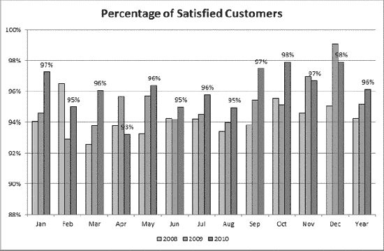
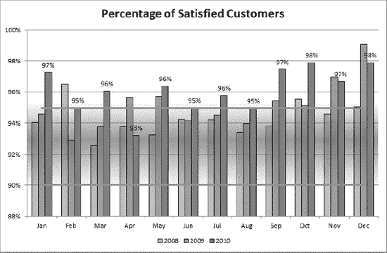

# 重新排版后的 Markdown 文档

遗憾的是，赖克哈尔德所讨论的那些诋毁者可能会严重损害您组织的声誉。如果您的很大一部分客户群体正在对您的服务和产品进行负面评价，您就需要对此采取应对措施。寄希望于通过客户的自然流失来让他们回心转意，是一条危险的道路。您可能会发现，在客户意识到他们的看法已经过时、而实际情况是您一直在提供优质服务之前，您的业务就已经难以为继了。

这些衡量标准及后续调查表明，需要的是一项营销计划，而非服务、流程或产品的改变。

## 高等教育 TechQual+ 项目：一个范例

蒂莫西·切斯特（Timothy Chester）的高等教育 TechQual+ 项目是一个极佳的例子，它展示了一项年度调查不仅能提供满意度数据，还能深入了解客户认为重要的事项。蒂姆是佐治亚大学的 CIO，在过去的六年里，他倾注心血的项目就是开发 TechQual+ 项目。该项目的目的是评估教职员工、学生和工作人员希望从高等教育中的信息技术组织获得什么。它主要是一个帮助高等教育机构了解其客户对其服务认知的工具。

TechQual+ 项目的目标是找到 IT 从业者与 IT 用户之间的共同“语言”。这也是切斯特工作成果独特之处的一部分。但是，该项目基础的第一块基石是“最终用户的视角”是“为 IT 组织定义绩效指标”的关键。换句话说，客户的看法对于 IT 组织的成功以及任何衡量计划的意义都至关重要。

切斯特写道：“有了以最终用户为中心的数据，人们就能轻易地将服务交付中的失败理解为一次性错误，而不是关于 IT 中反复出现问题的都市传说。” ^(1)

在《TechQual+ 协议指南》中，蒂姆·切斯特解释说，该工具的关键目的是让“IT 领导者能够响应管理人员和认证机构的要求，这些机构越来越频繁地要求提供成功成果的证据。” 该项目旨在为 IT 组织提供一种工具，用于汇编证据来回应这些要求。

切斯特接着解释道：“对于 IT 组织而言，展示技术服务的有效交付对于建立赞赏、尊重和信任至关重要……”

该项目将对其目的最关键的输入列为对 IT 服务有效性的有效且可靠的衡量标准。切斯特也认为，虽然标准化绩效衡量标准非常必要，但高等教育 IT 行业距离满足这一需求还有很长的路要走。

TechQual+ 试图提供能够被组织客户理解和使用 的衡量标准，提供一个用于机构间结果比较的数据库，以及一个易于使用的调查工具来生成数据。该项目的关键点之一是 TechQual+ 是“从最终用户的角度”来定义结果。切斯特明白，需要的不仅仅是客户满意度调查，他利用自己的工具来捕捉客户对《答案卡》所确定的“产品/服务健康度”的任何和所有方面的看法。

__________________

¹ [`www.techqual.org`](http://www.techqual.org)

这个项目与我在本书中阐述的内容非常契合。这是一个“询问客户”以获得他们意见的好方法。它不仅可以提供一种收集客户对服务质量评价的手段，还可以收集客户的期望。在我依赖服务提供商来解释客户期望的地方，TechQual+ 提供的方法可以用来构建一个基于客户回应的范围。这绝对是一种值得研究的方法论。

TechQual+ 的方法基于评估以下三项指标：

1. 最低可接受的服务水平（最低期望）
2. 期望的服务水平（期望值）
3. 客户认为服务在多大程度上满足了这些期望（感知绩效）

这些指标的结果用于开发一个“容忍区间”、一个“充分性差距分数”和一个“优越性差距分数”，描述如下：

1. *容忍区间*：介于最低期望与期望值之间的范围（《成绩单》中简称为“符合期望”）。
2. *充分性差距分数*：“感知”绩效与最低期望之间的差异。
3. *优越性差距分数*：期望值绩效与感知绩效之间的差异。

您应该能看到这些“分数”与《成绩单》分数之间的关联。如果您查看《成绩单》中为每项指标提供的图表，您可以确定容忍区间（“符合期望”的范围）以及代表正向或负向充分性差距或优越性差距分数的那些数值。

TechQual+ 项目的美妙之处在于，其结果不仅反映了客户的期望值（通过调查工具收集），还反映了感知到的服务健康度（同样通过调查）。这是一个极好的反馈工具。我强烈建议您考虑使用这个工具（它是免费的），或者在您的调查工具中实施它所提供的概念。当与您的客观衡量标准（交付与使用情况）结合使用时，它能更全面地描绘您的服务健康状况。您可以将 TechQual+ 或其他调查工具用于《成绩单》的“客户满意度”部分。虽然它被标记为“客户满意度”，但您会发现调查中可以提出的问题并不局限于这个领域。您可以（也应该）就您所衡量服务的重要性征求反馈。这对于获取关于期望值范围的输入特别有用。

《成绩单》与 TechQual+ 之间有两个主要差异点应该显而易见。《成绩单》试图使用除调查方法之外的其他方式收集的客观衡量标准。三角验证要求您使用不同的收集方法和不同的来源。《成绩单》虽然也使用期望值，但将“卓越”（超出期望）的表现视为一种特殊情况。

结论是什么？TechQual+ 项目（以及其他基于调查的创新工具）值得研究——特别是作为《成绩单》中“客户满意度”部分的解决方案，以及用于收集所有衡量指标相关的期望信息。

### 应用期望值

你可能已经注意到，本章提供的图表都是"有意义的"。部分原因在于每个度量指标都包含了期望值。试想如果度量指标缺少了这一限定特征会怎样。回头再看一下客户满意度图表（图 9-9）。注意它没有期望值。我之所以省略它们，有两个原因。首先，在我们刚开始时并没有这些期望值，但仍然可以生成到目前为止你看到的基本图表。其次，如前所述，很多时候数据本身就能帮助你判断什么是"正常的"。当我们把"正常"水平与服务提供商对报告期内绩效"正常"程度的评估结合起来时，就能较好地估算出期望值。

现在，我们至少为最近一年添加百分比数值。这使图表（图 9-10）更易于阅读。

**图 9-10.** 客户满意度：过去一年满意客户的百分比

可读性稍强了一些。一眼就能看出我们与上一年的对比情况。我们还能看出是否存在上升或下降趋势（连续三个数据点上升或下降）。虽然你仍能看到趋势（上升或下降），但无法判断数据是"好"、"坏"还是"无所谓"。因此，在设定期望值之前，这个图表已经提示我们关注 2010 年 8 月至 10 月的数据。当时发生了什么？是什么导致了持续上升？这需要我们更仔细地审视吗？

我们必须采取的最重要步骤之一就是制定期望值。正如关于期望值的章节所述，你不可能就这个问题征求所有客户的反馈。根据客户群体的规模，期望值可能差异很大。服务水平协议（SLA）有所帮助，但它们并不总能反映客户的期望值。有时它们只代表合同约定的要求。

如果服务台不知道对此应抱有何种期望值，我们可以利用数据来告诉我们。如果有 SLA，你可以从 SLA 入手，收集客户反馈，然后与部门意见进行对比。我始终发现，部门的期望值总是高于 SLA 或我的建议。大多数人对自己的要求比客户对他们的要求更严格。

我们与服务台部门坐下来讨论。我们会见了经理、分析师和部门主管。我们的任务是从客户的角度为每个度量指标制定一套期望值。如果客户的期望值需要校准，可能需要单独的市场营销工作，但在成功调整之前，我们只能以当前客户的看法为准。图 9-11 展示了添加期望值后的客户满意度。如图所示，我们将期望值设定在满意度为 90% 到 95% 之间。

**图 9-11.** 包含期望值的客户满意度

正如图 9-11 所示，很容易看出哪些点需要进一步调查。除了 2010 年 8 月至 10 月的上升趋势外，我们还可以调查那些满意度超过 95% 的异常点。这基本上没有引起什么波澜。讨论是健康的，并且对每个人来说，了解彼此对客户期望值的看法都很有教育意义。

你可以想象关于客户期望电话（由分析师）接听速度的讨论有多热烈。有人认为 60 秒就足够了。另一些人则认为客户愿意等几分钟。还有一些人认为，在当今"即刻满足"的文化中，如果等待时间超过 10 秒，就会被认为是太长了。

最终，我们为每个度量得出了期望值范围。关键在于找到一种通用语言，以便一致地呈现这些期望值。对于每个度量，我们不仅确定了什么是"好"或"坏"，还确定了预期的百分比范围。

以放弃呼叫率为例。第一个问题是，什么是好，什么是坏？较低的放弃率是好的。较高的放弃率是坏的。确定"好"和"坏"的方向后，我们必须确定期望值是什么。客户能容忍放弃多少百分比的呼叫而不感到不满？一个健康（良好）的服务中，"预期"的放弃率是多少？什么百分比代表着不满意？什么时候客户会说"放弃率太高了，快解决！"？放弃率要低到什么程度才会让客户印象深刻？甚至感到惊讶？

当我们难以确定期望值时，就会玩估算游戏。我会从最明显的开始：什么超出了预期？

> *有人会回答："我没办法告诉你什么超出了期望……"*

>

> *"好吧。那我们一起想办法。"我回答。不愿给出估算的原因有很多。幸运的是，你不必消除这些原因，只需应对其影响即可。*

>

> *我会提问来帮助得出估算："零放弃呼叫率会超出客户的期望吗？"*

>

> *"你的意思是他们总能接通？"*

>

> *"当然。不用等待。"*

>

> *"他们会喜欢的！"*

>

> *我说："当然，但他们会期望这样吗？"*

>

> *一位分析师会说："不会。他们知道我们没有配备足够的人手做到这一点。"*

> “那么他们不会期望这种服务水平？”
> “不会。”
> “那么30秒内接通呢？”
> “嗯，他们应该期望这样。”
> 我会问：“但他们会吗？”
> “嗯，会的，”有人会说，“大部分时候。他们知道有时候电话很忙。”
> “所以有时候他们期望等待超过30秒？”
> “当然，比如周一，或者系统宕机时，或者我们在安装新软件时。”
> “好的，”我说，“那么这种情况发生的频率是多少？”
> “大概10%的时间吧。”
> 我会总结道：“好的，到目前为止，我们可以说，90%的情况下，他们期望在30秒内与分析师通话？”
> “我觉得他们会对此满意。”
> 由于我们总是需要范围（而非目标或阈值），我进一步追问：“那么，85%的时间他们会满意吗？或者80%？如果他们一个月打十次电话，他们应该期望十次中有八次能在30秒内与分析师通话，而另外两次需要更长的时间？”
> “当然……那也可以。”
> “那十次中有七次呢？他们还会满意吗，还是不会满意？”
> “嗯，他们可能不会喜欢。我的意思是，这很接近了。”
> 我再次总结道：“好吧。那我们就说，客户期望在75%到90%的情况下，能在30秒内接通分析师。这样听起来差不多吧？”
> “当然。”

最终我得到了符合期望值的数字。一旦绘制出这些期望值，我们就进行了关于期望值章节中解释的试金石测试。我们对每个度量都这样做了。我们查看了多年来的数据，并根据部门对那段时间服务提供情况的感知来检验期望值。他们知道自己哪个月份表现不佳。度量指标与期望值之间的关系，应能反映他们对该时间段服务质量独立评估的结果。