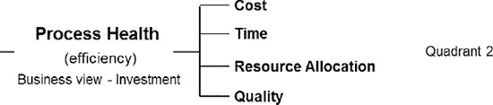
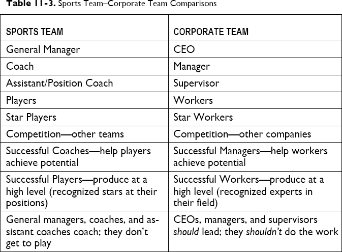
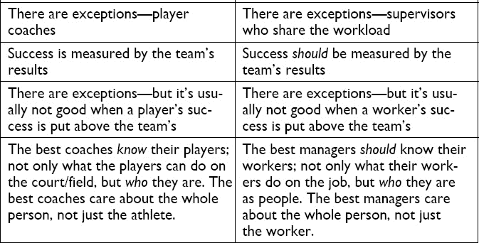

# 战略规划与目标达成衡量

如果你已经制定了 SMART（具体的、可衡量的、可实现的、现实的、有时限的）目标，那么衡量标准也就随之确定了。这些将成为衡量目标成功与否的指标。即便如此，我还是要提醒你，不要为了追逐数据而忘记初衷。

假设你的目标是“在未来六个月内将会员数量增加 50%”。这是一个相当清晰的目标（具体）。它无疑是可衡量的（当前会员数与六个月后会员数对比）、可实现的（假设有足够多的潜在会员使之可行）、现实的（同样，假设这并非不合情理）且有时限的（从现在起六个月后）。

因此，你可能会争辩，既然目标就是实现 50%的增长，为什么不追逐数据呢？目标本身就体现在数据中——即增加会员数量！从某种程度上说，你完全正确。问题在于，我们只关注了这个陈述的目标，而忽略了目标背后的深层原因。这就是为什么衡量领域要包含战略规划。如果你纯粹追逐数据，你可能会找到一些增加会员数量的方法，但这些方法未必符合目标的根本意图（即长期或永久性地扩大会员基础）。你可能会改变“会员”的定义规则，以便达成数字指标；你也可能提供一些激励措施，结果只带来了暂时性的增长（虽然达成了目标，但却偏离了方向）。

除了目标定义中已明确的衡量标准，你可能还需要衡量以下几点:

-   实现目标的成本
-   实现目标所花的时间（展示随时间推移的进展）
-   实现目标带来的实际收益（这是一个很少被捕捉到的难点）

特别是针对战略规划部分，你需要衡量规划的有效性。这可能包括：

-   总体目标达成情况（作为规划的组成部分）
-   对规划时间表的遵循程度
-   对规划资源计划（成本、时间、精力）的遵循程度
-   对规划的遵循程度
-   规划被修订的频率（调整得越频繁，越可能是一份活生生的、有用的规划，而非束之高阁的文件）

在衡量战略规划的价值、目标的实现情况以及项目和计划的效能时，你会意识到要做好这些工作需要一定的优先级排序。优先级设定可以是正式或非正式的，但无论哪种情况，你都需要一个确定优先级的流程。

## 优先级设定衡量

优先级设定的衡量标准，很像衡量准确性。这是一套简单的衡量指标。你是否坚持了自己设定的优先级？还是任由最新的需求打乱你的优先级？你是否会让“噪音最大的那个轮子”获得关注？你的所有计划是否在第一次危机出现时就全盘推翻？

当然，如果真的发生紧急情况，你可能不得不放下一切去解决危机。但是，你是否发现*总是*有危机存在？你是否发现，一旦紧急情况被克服，你的组织就不会再回到优先级清单上？

如果一个组织无法设定或坚持既定的优先级，那么它将很难成长。优先级设定不仅指明了方向，还意味着要识别出那些*不会*被执行的任务、目标和项目。要真正成熟起来，一个组织，如同个人一样，必须意识到它无法完成所有被要求的事情。你必须做出一些艰难的决定。如果做不到，你可能会发现自己做了很多事情——甚至超出了预期——但其中很少有自己真正想做的。

我们要讨论的最后一个象限，是大多数管理者最想开始的——流程健康，如图 11-4 所示。

## 流程健康

你应该处理的最后一个象限是流程健康，即第二象限。

**图 11-4.** 答案键的第二象限

### 概念

你已经坚持到了这里，终于有机会来运用效率衡量指标了。或者，你可能是跳到了这一部分，因为你*必须*使用它们。流程健康衡量指标风险最高，因为它们最容易滥用。这相当于一位教练掌握了每位球员的生产力统计数据。比如，知道你的球员在面对即将到来的系列赛中每位投手时的击球率。你知道他们在夜场比赛、日场比赛中的表现，甚至知道他们上次进食已过去多久。让我们让它更有意义一些，假设你还有关于所有情况下成本多少、耗时多久、资源如何分配以及工作质量如何的数据。

但是，如果你想根据数据来安排阵容，你可能还想要更多数据。比如，根据他们吃了什么、喝了什么、具体时间、前一晚睡了多久、星期几来表现如何。这样的清单可以无限列举下去。这就是问题所在。

要点很简单。虽然关于每个工人在特定情况下表现如何的数据、衡量指标和信息是可用的，但这并*不是*真理。我之前已经分享过这一点，所以不再赘述。但要明白，你无法通过查看数据来逃避主管、经理或领导者的职责。这无异于一位棒球队经理仅凭统计数据来安排他的阵容。你必须了解你的球员。你必须与他们交谈，与他们*一同*工作，并将每个人放在能够成功的岗位上。

我经常使用体育类比。不是因为我喜欢体育（尽管我确实喜欢），而是因为体育为如何经营一家企业、如何运作一个组织提供了绝佳的范例。表 11-3 展示了运动队与企业团队之间的对比。你可以选择将自己比作职业、大学或高中运动队——就像你可以选择把公司看作大型、中型或小型（夫妻店）组织一样。

这个类比实际上是无界限的。你可以把它延伸到任何你喜欢的程度。它可以应用于你业务的任何方面。运动队——无论是大学还是职业队——都是工作团队如何运作的绝佳范例。

如果你的工作团队是一支运动队，他们会有多成功？

当一位体育经理查看个人和团队的数据时，她会利用这些数据来改进每个人。她的意图是找到让团队尽可能成功的方法。她*可以*将数据作为与球员谈论其表现的起点。如果她发现该球员的表现无法满足其职位需求，她极有可能会尝试培养该球员的才能。团队已经在该球员身上投入了资金。但最终，如果她无法让该球员达到所需的水平，她可能会让他离开并招募新球员。（我甚至喜欢球员是“招募”和“选拔”而来的，而不是“雇用”的。）

一位优秀的经理会以同样的方式对待绩效衡量指标。他不会利用指标来操纵员工改变行为。他会利用这些信息与员工合作，提升她的能力，尽其所能地培养她。如果像体育经理一样，他失败了，他可能不得不让她离开并雇用新员工。

请记住，如果劳动力是组织最重要的资产，那么经理的工作就是将这些资产的潜力开发到极致。运动队知道什么是最重要的资产——并且相应地支付报酬。

经理的职责是最大限度地开发劳动力的潜力。

