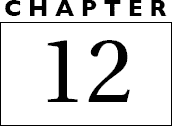

# 流程健康度量

你可能想衡量一切的成本。你可能想知道每个人每小时（即使是拿年薪的）的薪酬是多少，这样你就可以计算出走廊里的笑声要花公司多少钱。你可能想展示公司年度野餐要花多少钱，或者设备、设施和家具的成本。这些度量*不是*你需要的。

流程健康度量是关于流程，而不是关于人的。按照当前的方式执行给定流程需要花费多少钱？这全都是关于流程改进的。如果你能找到改进流程的方法，成功的度量之一可能是为客户、组织或社会降低成本。

那么，流程成本是多少？每个步骤的成本是多少？你可以将员工的时薪纳入考虑，但请记住你衡量的目的是什么——是为了改进。

大多数流程改进方法都非常擅长衡量正确的事情。除了成本，你会发现大多数方法还希望你衡量执行一个任务或流程步骤需要多长时间。你的客户需要等待服务多长时间？你执行服务需要多长时间？

一个例子是精益六西格玛（一种流程改进方法论），它基于流动和缺陷消除。流动是关于流程如何从起点A到终点Z。你是否有积压、库存堆积或时间损失？完成一个实际耗时仅需几小时的流程，你是否需要几天？步骤之间和步骤内部的等待时间有多长？六西格玛还希望将缺陷降至最低（达到六西格玛水平，即每百万次机会中3.4个缺陷）。所有方法都使用度量来确定它们改进组织流程的效果如何。

这些是质量度量。错误、返工、缺陷、议题和问题都是流程质量下的词汇。你的工作是使用质量度量来找到流程的改进点，以减少（并希望消除）它们。这可能包括对员工进行培训或再培训。这不包括“逼迫”你的员工更加勤奋。公平地说，你可能需要他们更关注细节，更专注，更勤奋。区别在于你如何做到这一点。你不应该“要求、哄骗、强迫或操纵”他们。你应该培养他们。

资源分配是你在流程健康中可用的另一个度量。除了流程步骤之外，你可能在错误的时间让错误类型的资源执行了错误的步骤。但要小心。向一个问题投入更多资源（资金、人力或设备）很少能长久地解决问题。你需要剖析问题，并找到能经得起时间考验的解决方案。

一套简化的度量包括以下内容：

* 流程步骤数
* 部门间的交接次数
* 等待时间
* 完成时间（按步骤/整体）
* 接触时间（活跃时间与等待时间的对比）
* 流程中的成本
  * 材料
  * 运输
  * 存储
  * 生产
* 分配的资源（按步骤/整体）
* 每次机会的缺陷数
* 缺陷类型
* 流程可重复性
  * 是否已文档化？
  * 是否每次都按相同方式执行？
* 是否可调整？
* 流程是否受控？

流程健康象限，如同其他象限一样，可以成为组织改进的有力且有意义的工具。风险在于管理层会利用这些指标来改进员工（而不是培养他）或影响行为（而不是改进流程）。如果你确信这些度量将被正确使用，它们就能带来巨大的好处。流程改进（因此也是流程健康）是大多数组织发展工作的核心。

### 总结

答案关键的第2、3、4象限提供了关于组织整体健康的重要洞察。每个象限都有其自身的视角——业务、员工和领导力——并且每个象限都有其益处和风险。还有其他你可以收集、分析和用于构建指标的度量。答案关键为全面的指标程序提供了基础和框架。

除了为组织健康提供有意义的见解之外，这些高级指标还帮助组织成熟为数据驱动的组织。转变为一个基于指标的组织所需的蜕变并非易事。它需要领导层、管理层和服务提供者的耐心和坚定不移的正直。

在产品/服务健康之后，我建议转向组织健康（第3象限），在此你使用诸如员工满意度、培训、工作环境和奖励与认可之类的度量。这是风险因素最低的指标，并且具有建立忠诚、敬业和快乐员工队伍的巨大潜力。

我建议接下来应对未来健康（第4象限）。唯一的问题可能是你的组织尚未准备好展望未来。它可能正在努力维持现状。我完全相信组织（和人们）不能“为生存而奋斗”。要成功，你必须追求比保持不沉没更高的目标。你必须游向岸边。但是，并非所有人都同意。如果你的组织不关心未来，你可能不得不跳过这个象限。但如果你有战略计划、长期目标或有正在进行中的项目——那么接下来就应对未来健康指标。

最后，我建议你深入钻研流程健康。重要的是要注意，如果你或你的组织正在实施流程改进工作，你很可能正在为这些工作做一些流程健康度量。我绝不是试图阻止你这样去做。这些指标及其度量中的任何一个都可以用来回答特定的根问题。我建议的是，在你已经在组织中建立足够的信誉，并使你的员工信任你使用这些度量的意图和方式之前，不要为这个象限建立一个独立的指标程序来提供组织健康监控。

## 结论

高级指标非常有用，可以帮助组织在许多方面成长。它们也会给组织带来风险。为了减轻这些风险并从指标中获得最大收益，我强烈建议你从你要创建的任何指标的根问题入手。这些指标只应在其能回答根问题且该问题仍需要答案期间“存在”。

如果你必须创建一个独立存在、没有特定根问题的指标程序，我强烈建议你从产品/服务健康（有效性）开始。一旦该程序完全实施，并且你已经建立了对使用（以及*不*使用）指标的方式的一定程度的信任和理解，就考虑纳入其他三个象限。按以下顺序纳入它们：

* 第3象限：组织健康
* 第4象限：未来健康
* 第2象限：流程健康（效率）

## 