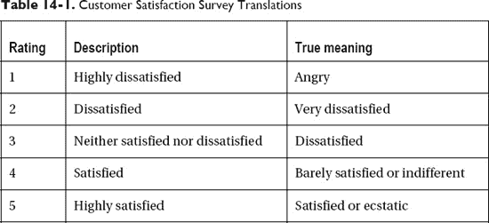

# 建立基线

在与客户合作处理指标时，我的乐趣之一就是帮助他们建立基线；这主要是因为它迫使他们将指标前置，融入到改进流程的思考中。我几乎总会遇到诸如提高效益、提高效率、提高生产力或提高客户满意度这样的目标。

“提高” 是一个用在目标陈述中的糟糕动词。你必须用更多信息来限定它——比如“提高”多少？提高一定百分比？还是达到某个具体数字？

关于“提高”型目标的糟糕用法，我最喜欢的一个回忆来自我的教区委员会。当时我希望将组织发展方面的专业知识引入委员会。与我搭档的有：一位退休警官、一位成功的企业主、一位护士、我们的神父，以及一位退休的祖母。目标是什么？提高教堂的会员人数。我并没有感到困扰，因为这类目标（增加、减少等）我已见过很多次。

> *我说：“提高会员人数——提高多少？”*
>
> *“你是什么意思？”前警官问道。*
>
> *“我的意思是，如果提高会员人数是我们的目标，我们怎么知道已经实现了它？”*
>
> *那位企业主说：“哦，你是想让我们设定一个具体目标。”*
>
> *我反驳道：“我以为那本就是意图——为今年制定目标？”*
>
> *“是的，”企业主说，“但你是想让我们一开始就注定失败。我们设一个数字，如果达不到，我们就失败了。”*
>
> *此刻我惊愕地坐着，沉默不语。我可能确实张开又闭上了嘴一两次。“呃。嗯。那么，如果只多一个家庭加入，你们会满意吗？”*
>
> *“当然，”护士说。*
>
> *“再多都是锦上添花！”前警官说。*
>
> *我转向神父，仍然震惊不已。“如果只增加一个家庭，您就认为我们实现了这个目标吗？”*
>
> 他摇了摇头，表示否定。作为团队和我教区的领袖，他的意见具有与 CEO 同等的分量。
>
> *“现在每年有多少家庭加入？” 我问道。*
>
> *“一年两到三个家庭，”神父回答。*
>
> *“那么，如果我们什么都不做，也能实现这个目标？”*
>
> *他肯定地点了点头。*

我们最终制定了一个合理且可衡量的增长目标，该目标是在不做任何改变的情况下，超出了预期的增长量。这个目标的目的是为了建设教区。指标的用途则是检验我们的努力是否成功。我们安排了计划、想法和活动，旨在吸引新成员并召回那些已然疏远的教友。我们需要：(1) 设定目标以聚焦我们的努力和想法；(2) 设定衡量标准，以告诉我们哪些方法有效，哪些无效。

我们还需要一个基准。如果我们不知道常态是什么，就无法判断任何一项努力是否产生了预期结果。在这种情况下，可以把基准视为一个“控制组”或基准值。你必须知道如果不做任何改变，你会得到什么结果。这样，当你以新的方式尝试新事物时，至少可以假设你所做的改变导致了结果的变化。即使你实施了太多改变，以至于无法确定到底什么有效、什么无效，你至少能知道整体努力是否奏效。

因此，基准基本上能让你知道自己身处何处，从而知道最终到达何方。

基准就是起跑线。

即使基准被用于与你同行进行比较，它本质上也是一条起跑线——一条用来衡量你进展的基线。基准最纯粹的形式是将其设定为内部基线（相对于外部比较而言）。这能够让你衡量进展。

## 负责任地设定基准

当领导者想要将比较性基准作为基线使用时，基准有时会失灵。大多数情况下，事情是这样开始的：“你能拿到我们竞争对手的平均可用性、响应时间或客户满意度评级吗？这样我们就可以和他们进行比较。”

这要求你竞争对手的表现是一个好的起点。

我对追查这类数据的第一个简单反对理由是：“如果你已经比竞争对手做得更好了呢？这是否意味着你已经做得足够好了？”

通常，那个让我去追查数据的领导者——他深信自己的组织远远落后于竞争对手——并没有准备好回答这个问题。我通常需要问两遍。

“不，我们还是需要改进……”

因此，虽然收集另一家组织绩效的信息可能具有启发性，但如果你的目标是改进，那它并没有太大的用处。如果你的目标是比同行更好，那么，这种基准当然至关重要。即使你的目标是比竞争对手更好，你也需要知道：(1) 你的努力是否在帮助你改进；(2) 你距离同行的表现还有多远（如果你已经比同行好了，那你就完成了吗？）。

所以，如果你选择只看自己内部的绩效表现，那么标准并非必需。但是，如果你决定（并且当——因为最终你会想了解自己与别人的比较情况）将自己的绩效与同行或竞争对手进行比较，那么标准就至关重要了。当衡量方法不同时，你无法将自己与他人进行比较。

假设你将网络的可用性定义为：在给定时间段内，无中断时间除以总时间。

- `可用性 = 1440 分钟（一天（或 24 小时）的分钟数） – 20 分钟（中断时间）除以 1440 分钟`
- `可用性 = (1440 – 20) ÷ 1440 = 98.6%`

到目前为止，一切顺利。但是，假设你最接近的竞争对手（或同行）在同一时期内的可用率是 100%。你会不会再加把劲？你会不会更努力地工作？你的竞争对手是否比你做得更好？

嗯，如果没有标准，你无法判断你的竞争对手是否比你做得更好。如果你将“中断”定义为客户无法使用网络的任何时间段，而你的竞争对手则认为“中断”仅指网络因非计划或意外停机而不可用的时间呢？换句话说，假设在相同的 24 小时内，你的竞争对手安排了四小时的计划维护。如果你将“中断”定义为服务不可用的任何时间（这很可能是客户理解的方式），那么竞争对手的可用性*应该*报告如下：

- `竞争对手可用性：(1440 – 240) ÷ 1440 = 83.3%`

如果你拥有竞争对手报告的所有原始数据，就可以使用你个人的“标准”来确定你与竞争对手相比表现如何。但这几乎不可能发生。即使运气极好，你能得到的也只是“分数”——即便从同行和竞争对手那里获得这个分数也相当困难。

因此，你如何定义“中断”，与你竞争对手定义“中断”的方式相比，对于你能否将其衡量指标用作基准至关重要。

## 标准促成与他人的比较

绩效衡量中的标准，归根结底是为了提供在不同组织之间比较衡量指标的能力。就像制造标准使得你的产品能与另一家组织的产品无缝衔接一样，绩效衡量中的标准也使得你能够将自己的衡量指标与另一家组织的衡量指标“无缝对接”。如果绩效衡量实现了标准化，你就可以为了自己的目的而“借用”另一个组织的衡量指标。如果你有相同的问题，就可以相信 A 公司使用的指标能够用来衡量你组织中的相同事物。

没有标准，很难想象你如何使用不同组织的衡量指标——即使你们有完全相同的根本问题。而将另一个组织产出的衡量指标作为基准来使用，则更加不切实际。

#### 获取可靠数据

性能衡量标准与基准的这一问题，也给那些致力于提供信息数据仓库的善意组织带来了麻烦。这些信息无一例外都是为了供你进行比对而设计的。要使数据仓库有效，就必须对来自不同组织的信息建立一套明确的标准。

第三方调查公司`HDI`通过控制数据定义，提供客户满意度数据的基准测试。`HDI`负责向你的客户发放调查问卷、收集回复，并为你提供报告、分析和原始数据。由于`HDI`标准化了其提问方式（使用相同的问句，并附带一套相同的五级李克特量表选项作为回复），它能够为你提供与其他组织的对比数据，包括：

*   你的得分（平均值、满意度百分比等）与所有使用过`HDI`服务的其他组织对比
*   你的得分与同行业其他组织（从列表中自行选择）的对比
*   你的得分与排名在同行客户群前百分之 N 位的组织对比

这让你对信息的可比性有了更高的信心。当然，也有一些缺点。只有使用`HDI`服务的组织才会被纳入对比范围，而你的主要竞争对手或同行可能并不在其中。即使你将自身结果与整个客户群对比，这仍然可能无法反映你想要的对比群体。另一个小缺点是，你被迫使用一套固定的问题，不容许任何偏差。如果你想使用赖克海德在《终极问题》一书中建议的十级量表，就无法使用`HDI`的服务。而且，即使你使用了十级量表，也无法将数据与那些使用五级量表的数据进行比较。

#### 目标：可靠的行业标准

性能衡量指标的行业标准将使真正的基准测试、排名和同行组织间的比较成为可能。在有机会采用*通用*标准之前，说服某个*行业*（例如高等教育 IT）标准化其性能衡量指标应该是可行的。你能够缩小的标准化群体范围越精确，达成一致意见就越容易。高等教育信息技术就是一个相当具体的群体。如果你从信息技术性能指标入手——你试图达成标准共识的群体就太大了。如果你将其缩小到*教育*信息技术，情况会好一些。而*高等教育*则使其更精确。

成功需要共识。仅仅发布一个标准并不能使其生效。你必须让（你所在行业的）大多数组织使用这个标准，它才能发挥效用。既然标准的采用需要高参与度，那么合乎逻辑的做法是，在制定标准时尽可能多地让目标受众参与进来。

我认为联盟结构是制定性能衡量标准的最佳途径。联盟为一个行业制定、评估、审查和管理标准。问题可能在于，此处的“行业”很难界定。当然，如果你按照我的建议，对目标受众找到一个更精确的定义，你就能实现目标。但是，将性能衡量本身视为一个行业显然过于宽泛了。因此，作为一名性能衡量专家，你必须定义你的“行业”来建立一个联盟。如果你有一些性能衡量标准可以参考，你就已经领先一步了。

### 要点总结

标准是实现互操作性的工具。在性能衡量方面，标准使得组织之间能够进行比较。

基准要么是你改进工作的起跑线（基线），要么是你需要实现的目标。作为基线，它帮助你确定与实现目标之间的差距、你取得进展的程度以及你已经走了多远。作为目标，它代表了你想要达到的优秀程度——“像 A 公司一样好”或“高于平均水平”。

要拥有真正的外部基准，你必须拥有与你选择进行比较的组织之间达成一致的标准。

如果你能为你自己的性能指标找到或制定标准，并且你的同行同意这些标准，那么你就可以进行衡量比较了。

**创建你自己的联盟**

根据你所在行业的不同，性能指标的标准化程度可能很低甚至完全没有。如果缺乏标准，你也就失去了与竞争对手或同行进行基准测试的能力。创建一个用于开发、发布和使用行业标准的联盟，是满足这一需求的可行方案。我于 2009 年创建了信息技术性能标准制定联盟（`CEITPS`），旨在解决高等教育 IT 领域缺乏性能衡量标准的问题。这项工作比我预想的要困难得多。

一直以来与我合作的人员——来自同行机构的指标分析师——都一致认为，比较性能指标的能力对于组织领导者接受指标至关重要。他们也一致认为，如果没有构成这些指标的衡量标准，这一目标几乎不可能实现。

我不确定让人们起草标准如此困难，是因为衡量指标比较的优先级低，还是人们担心一旦标准被创建和采纳后未来环境将发生改变。在某些情况下，标准可能被“强制执行”——特别是当存在有权力的监管机构时。但如果你和我们大多数人一样，你就必须建立共识、宣传标准、推广它们，然后期待被采纳。在这个努力中，害怕自己成功是有真实原因的。如果你成功了，并且所在行业采用了你的标准，那么你就会被要求将其贯彻到底，允许你所在组织的绩效与同行进行比较。届时将没有借口，也没有关于你实际表现如何的、主观的“感觉”。你将拥有真实的价值来进行比较。虽然大多数指标分析师不会“害怕”这种情况，但许多组织领导者可能会。

我在争取同行协助制定标准方面进展甚微（尽管`CEITPS`拥有健康的会员数量），以至于我转而寻求替代方法来起草标准。在下一次全国会议上（届时大多数代表都会出席），我计划主持一系列分组讨论，为关键衡量指标起草初稿。我将从答案密钥中定义的有效性衡量指标开始。我的希望是，这个联盟能够为我们的第一个标准起草一套完整的衡量指标：基于故障的服务可用性。

## 结论

标准与基准密不可分。如果没有标准来确保各组织间的定义和衡量方式保持一致，基准就毫无意义。对于外部基准而言，这尤其是个问题——因为你需要借此与同行和竞争对手进行自我排名。

如果只使用内部基准，则无需标准。

基准更适合用于展示相对于基线的进展，而非与外部组织进行比较。

何时需要标准与基准？

- 当你需要将自己的绩效与竞争对手或同行进行比较时。
    - 需要外部基准来确定
        - 比较对象的平均绩效水平
        - 比较对象的绩效范围
        - 比较对象中的顶尖表现者
    - 需要标准来确保你是在品牌、类型、颜色和尺寸上进行同类比较。换言之，标准是确保比较具体性的必要条件。
- 当你需要确定一个现实的目标、追踪目标进展，或判断是否已达成目标时。
    - 需要内部基准来确定
        - 一个常态值，以帮助设定切实可行的改进目标
        - 一个基线或起点，以便从当前状态追踪进展
        - 一种判断目标是否达成的方法（当该目标被定义为达到特定改进水平时）

基准还有助于判断你在组织发展或流程改进方面的努力是否对环境、服务或产品产生了积极影响。如果你预期自己的努力（尤其是流程变更）会对绩效产生影响，你就需要为任何可能涉及的领域设定基线。如果可以获取历史数据，则有助于判断这些变化是源于你的努力，还是属于正常波动。

## 尊重度量指标的力量

本章篇幅简短，这是有意为之，旨在帮助你聚焦于度量指标的力量。你必须尊重度量指标的力量，并警惕不当使用它们可能给组织带来的损害。

当我还是美国空军一名年轻士兵时，有幸与一位名叫汤姆·伦南的文职电工共事。汤姆是个务实的人，也是我的好友。他比我年长（至今仍是），并多次用金玉良言帮助我。他给我的最佳建议之一，就是尊重电的力量——因为即使是训练有素的电工，也曾在进行电气作业时受重伤，甚至更糟。在建筑行业，触电伤害是导致死亡的第二大原因。

我之所以提到这个，是因为度量指标就如同电。度量指标可以用来做很多有益的事。作为一种工具，它们能帮助我们了解环境，评估我们努力的成效，让沟通更便捷、更清晰。但和电一样，度量指标必须被尊重。遵循规则，你就能利用电——以及度量指标——让生活更美好。但即便你遵循规则，仍存在造成损害的可能性。风险如此之高，以至于你必须在每个案例中权衡：收益是否值得承担这些风险。

本书大部分内容都在讨论如何开发、分析、报告以及（最重要的）*运用*度量指标来实现改进。但与大多数组织改进工具（如培训计划、战略规划和员工表彰计划）不同，度量指标如果用得不当，其危害可能与益处相当。在多数情况下，这是因为数据的使用者没有得到充分训练，或是警惕性不足，未能理解度量指标强大但又充满风险的本质。

度量指标有可能弊大于利。

正如我已经谈到的，你必须努力找到*正确的*根本问题：构建答案的抽象图景，确定描绘该图景所需的信息，然后费尽心血地建立收集、分析和报告该度量指标所需的流程。在整个过程中，你必须反复核查所有环节——从数据到收集方法，再到度量指标本身，最后再到根本问题。

请严谨而勤勉地对待你的努力，因为出错是极为容易的。即使所有数据都已核实，解读上仍可能出现错误。我曾与一位同事就“事实”这一概念进行过一场有趣的辩论。他认为度量指标（至少是好的度量指标）就是事实；如果它们不是事实，我们就不该用它们来展示绩效。我不得不解释（至少从我个人的观点来看）：度量指标并非事实。度量指标首先是指标。它们能让我们获得洞见，但未必是正在寻求的*真相*。它们不是事实。

度量指标不是事实，它们是指标。

### 指标：是事实还是指示？

指标究竟是事实还是指示，这一区分是正确使用指标的核心。若将指标视为事实，我们极易陷入仓促决策的风险。

那么，测量值或数据又该如何看待？你车上的速度表显示的是关于车速的事实吗？它的读数是否精确无误，还是存在`+/-`的误差？如果速度表显示时速 55 英里，而警用雷达显示为 58 英里，哪个才是真相？

你可能会辩称，尽管测量设备存在差异，但实际行驶速度显然是一个客观事实。这一点我同意。在特定时刻，你确实在以某个确切速度行驶。但我几乎不相信，任何用于捕捉特定瞬间数据的设备能精确到足以将测量值称为"事实"。

让我们试试主观测量。假设我请你用 1 到 5 分来评价对我服务的满意度，1 分代表非常不满意，2 分不满意，3 分中立，4 分满意，5 分非常满意。那么，我是否应该将你选择的分值视为一个事实呢？

错。

在调查中，我唯一能确定的事实是：我收到的答案就是你给出的答案。即便如此，仍可能存在错误。在客户满意度调查中，我们常发现受访者会颠倒数字，本想打 5 分却给了 1 分。排除这类错误，结果难道不能算事实吗？再次强调，我们唯一能明确证实的是：我们拥有的答案就是受访者选择的那个答案。我们无法确知这个给出的答案就是真实答案。

这种不确定性经反复分析与研究，我已能自信地说：大多数答案实际上*并非*真实。在《终极问题》（哈佛商业出版社，2006 年）一书中，弗雷德·赖克海尔德研究了最能预测业务增长潜力的客户满意度问题。他的研究基于推荐者（会推荐产品/服务的人）和贬损者（会劝阻他人使用产品/服务的人）的反馈。这项研究的副产品之一，是发现人们不会完全诚实地填写调查问卷。

基本而言，赖克海尔德发现，在 10 分量表的问题中，`6`分并非真正的中立值。大多数对受评产品或服务持中立态度的人，实际给出了 7 分或 8 分，尽管这档分值明确标注为比中立更具好感。

我相信这种情况在 5 分量表中同样存在。大多数客户若对产品或服务感受矛盾，并不想打`3`分。我们来看一个简单的转换表，如表 14-1 所示，我认为这个表更接近大多数客户满意度调查受访者的真实情况。

我发现，除非受访者确实对服务感到愤怒，否则他不会给`1`分。因此，2 分成了非常不满（接近愤怒但未及）者的选择。3 分由那些并不满意，但又不愿明确表达的客户给出。4 分来自勉强满意或无所谓的客户。而 5 分则来自相当满意的客户。

如果你将所有 3 分都视为中立回答，可能会忽略大批不满意的客户。

那么，究竟什么指标才算是事实？尤其是在我们对指标的定义中——它由多个数据、测量值、信息，有时甚至包含其他指标构成。在这个层面上，变量足够多，使得任何答案都远称不上"事实"。那么，在最底层呢？比如数据本身？难道数据也不可信赖为事实吗？

不。科学家们不断发现，昨天还被认为是科学事实的东西，今天就被彻底推翻了。自动化数据采集系统很容易校准失误，提供错误数据（我的浴室秤就是铁证）。当我们将人为因素纳入考量时，出错的可能性只会增加。

技术固然伟大；随着技术进步，数据的准确性也在提高。但即便运用当前技术，至关重要的是：切勿将指标视为事实。当你赋予指标超出其应得的权重或意义时，便冒了仅凭数据做决策的风险。

虽然底层信息绝不应被视为完全客观事实或无懈可击，但这不应阻碍你正确使用指标。不过，希望这些认知能引导你按照指标应有的用途来使用它们——即作为支持决策的*指示器*。

指标永远不应取代常识或个人参与。

### 被误用的指标：“客户讨厌我们”

让我举一个现实中的例子，说明一位经理善意使用指标如何弊大于利。一群辛勤工作的员工被告知，他们被客户群体所厌恶。至少，这是他们对老板分享的信息的理解。

每两周，CEO 会与各部门负责人开会。在会议的前 30 分钟，他们会审查整个组织内所有评分为 1 分或 2 分（满分 5 分）的客户满意度评价。这些评分被标记为“非常不满意”和“不满意”。

实际上，这个流程所展示的仅仅是选择 1 分或 2 分评价的受访者数量。除此之外，我们了解的信息非常有限。

每条评价附带的评论（如果有的话）也会被仔细审查。根据这些评论，大多数客户显然很不高兴，但偶尔也能明显看出是受访者选错了评分。

在逐一查看每个案例后，我很清楚，大多数客户只有在生气时才会给出 1 分，并且他们总是会借此机会写一篇长评论，解释他们为什么不满。

在各部门负责人审查完 1 分和 2 分的调查问卷后，如果时间允许，他们还会查看 3 分的评价，因为其附带的评论通常表明存在一定程度的不满，并指出了可以改进的领域。

这种审查是出于好意。毕竟，公司领导层是在倾听客户的声音。这就是他们实施调查并审查负面反馈的原因。

对于每份问卷反馈，都需要解释以下几点：

-   给出低分的原因。如果客户的评论不清楚（或者没有评论），应由员工联系客户进行澄清。
-   为“纠正问题”而对客户采取了什么措施。
-   本可以做些什么来避免低分。（更好的表述是：“我们本可以做些什么来防止客户不满？”措辞上的细微差别很重要。如果我们将改进与指标挂钩，而非与行为或流程挂钩，我们就有可能在不改变行为或流程的情况下改善数据。）

不幸的是，最后一点——如何改进才能让客户将来不再不满意——在这些会议上很少得到关注。然而，这并不罕见。我见过领导层要求解释客户不满的原因，但目标应该是改进流程以消除重复事件。

所以，部门负责人做了你可能预料到的事。他们在会议前就仔细审查了调查结果。他们确定了哪些团队是收到 1 分、2 分和 3 分评价的对象。他们责成这些团队（通过他们的经理）去：

1.  联系客户，确定问题的性质。
2.  解释差评的原因。
3.  解释他们将采取什么措施来避免再次得到这样的评分（是的——此时经理已经误用了这个指标）。

员工听到的是：

1.  联系客户，看看是否能安抚他们。
2.  找出谁该负责。
3.  如果你无法安抚他们，而且责任在你，你打算怎么做？

但让我们回到对团队的影响上。他们从领导层那里听到的只有：调查问卷对他们提出了严厉批评——客户显然讨厌他们。由于领导层只分享了低分调查，团队便认为他们从未获得过高的客户满意度评分。

有趣的是，所有调查结果都对团队开放，但团队中从未有人想过要自己去查看这些调查。

你说的，不一定就是别人听到的。

由于在处理客户满意度指标时犯了以下错误，团队认为自己成了组织的“害群之马”：

-   CEO 和部门负责人（无意中）要求对每一条差评给出解释。
-   经理将这个要求转达给了团队，却没有考虑这会对他们产生什么影响。
-   经理从未费心去查看自己团队的调查结果。
-   团队除了安抚老板之外，也从未想过将调查结果用于其他任何目的。

那么，底线是什么？这些数据只被高层管理用来确保面向客户的服务质量。而当进一步索取信息的请求下达到基层时（这本身是件好事），调查结果却被“断章取义”（团队认为客户讨厌他们），而且没有人分享或查看任何正面的对照数据。

这种无意的行为造成了压力、士气低落，以及对客户对团队满意度的错误认知。

在这种互动持续了一年多之后，我受命为我们组织的关键服务制定一份记分卡。该团队的服务是我们的核心服务之一，因此我去拜访他们以制定他们的记分卡。

当我提议将客户满意度纳入记分卡时，我遇到了意想不到的阻力。我并不知道他们每两个月都在经历着什么。

我知道客户满意度评分在整个组织中一直是一大优势，而且我确信这项服务也不会例外。但团队却同样确信评分会非常糟糕。他们还辩称，由于每份客户满意度调查问卷都是发给那些有问题的客户的（因此他们才需要提供二级支持），结果会对他们不利。

我再次试图向他们保证，这在组织内并不正常。同样，基于他们的观察和经验，他们也再次向我保证，结果肯定会很难看。

在我与指标打交道的工作中，最精彩的时刻之一，就是当我向这个团队展示客户满意度的完整数据时。结果发现，非常满意的客户与给出低分客户的比例远高于团队的想象。事实上，该团队的客户满意度评分始终保持着十比一的良好服务比率！

虽然团队、他们的经理和我都对这一结果感到非常高兴，但这对我们所有人来说都是一个启示：这样一个看似合乎逻辑的指标使用方式，竟然会造成如此大的伤害。

对团队士气的损害足以让我确信，对待指标必须极其谨慎。

### 指标的误用：好的、坏的和丑陋的

尊重指标的力量。这种尊重应包含一种健康的敬畏。在处理指标时，怀有一点点健康的敬畏之心，我希望各级用户都能在让指标影响自己的决策时多加小心。

请放心，如果使用不当，指标会严重危及组织的健康。不尊重指标的力量常常导致我们在使用它们时犯错。这些错误表现为各种形式的滥用。

