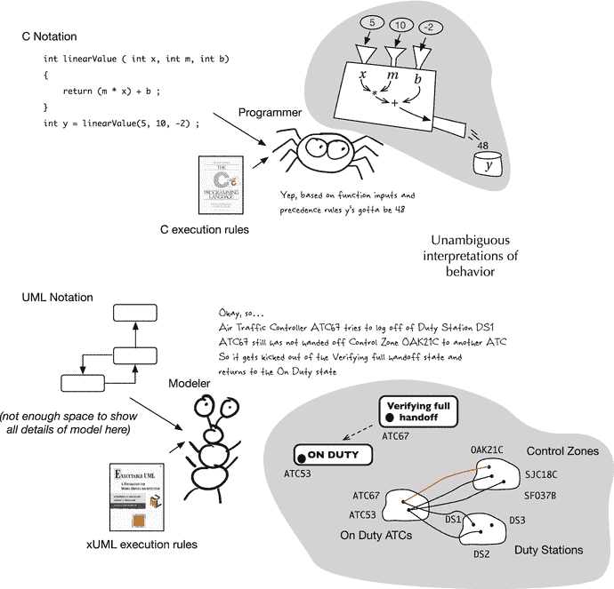

# 1. 建模全景

我们本可以在这本书的开篇列举软件开发的各种失败与弊端，但不必如此。如果你是一名实践中的软件开发者，你深知这些问题，并且亲身经历过。因此，我们直接切入正题。

我们相信，对需求进行建模，并将这些模型直接转化为代码，能够解决软件开发中的许多问题。然而，在创建需求模型与生成可运行程序之间，存在巨大鸿沟。如何弥合这一鸿沟并不显而易见。如果这一过程顺畅、简单且高效，我们理应看到建模无处不在。但现实并非如此。尽管数据各有不同，但只有大约 10% 的开发工作使用了模型。显然，模型并未提供足够的价值来席卷整个软件开发世界。我们认为，这主要是由于模型与实现之间的鸿沟难以跨越所致。

在本书中，我们将带你踏上一段从平台无关模型到特定平台 C 代码文件的详细旅程。我们专注于特定的建模语言、翻译过程、实现语言和硬件类别，试图通过实例来演示如何将模型转化为代码。研究具体实例对于掌握从模型获取代码的一般原理至关重要。这意味着，你有时可能会看到某些概念被引入，但直到后面章节才得到完整描述。多次反复阅读某些章节可能是必要的——实际上，我们鼓励这样做。

## 先决条件

我们假设你对建模和 UML 有一定兴趣和背景。虽然本书不教授建模方法，但我们会解释我们使用的可执行 UML（`xUML`）建模语言的关键方面，提供外部参考资料，并在行文中扩展我们的建模方法。

书中会出现代码。因此，我们假设你对 C 编程语言有所了解。在后续内容中，我们将大量分析代码。我们不会深入探讨 C 语言晦涩的角落，因此，对于这些目的而言，粗浅的了解应该足够。对于书中无法涵盖的内容，我们将提供在线参考资料。

### 没有魔法

软件建模工具和技术已经存在多年，然而业界似乎仍在等待某种未来的发展，期望它能将我们引向正途，让整个过程如同魔法般奏效。但本书并非关于未来、独角兽或仙女。它讲述的是你今天就能做到的事情——在一个真实组织中的真实项目上，交付可发布的代码。

## 细化：通往失败的捷径

要理解我们的方法，将其与一种完全不同且常见的方法（称为“细化”）进行对比是很有帮助的，后者反复未能交付成果。细化最初之所以流行，是因为其直观的吸引力，以及在了解分析和建模新知识方面门槛较低。了解表示法和具备面向对象编程技能是仅有的工程前提。事实证明，这种做法通常会导致灾难。事实上，细化已经导致许多项目完全放弃了模型驱动软件的理念，并在此过程中污名化了建模实践。

细化要求你从构建一个高层模型开始，进行“系统”或“架构”设计。“高层”的概念没有定义，因此它被认为是直观的。仅此一点就应是一个信号，表明你正走向麻烦。这一阶段，关注的往往不是确定系统的组件将如何协同工作，而是在项目的开发人员之间划分工作。

随着时间的推移，类不再那么“高层”，而变得越来越像 Java 或 C++。这一切看起来如此自然。实现边界导致模型元素按任务、线程或 CPU 边界进行分组。无论目标语言支持何种具体形式，私有方法和公有方法以及继承都被雕琢到建模的类及其周围。

在建模过程中，迟早会遇到一些棘手的问题。在氧气稀薄的建模高度上苦思冥想一番后，有人说：“哦，那个可以在实现中解决；别担心。”然后，你用一个聚合菱形或其他东西掩盖了所有难题，继续前行。这就是“高层”缺乏定义的后果——它让你很容易在建模时逃避解决问题。

建模继续进行，直到你意识到很难知道何时该停止建模。通常的指导原则是，当只剩下“实现细节”时停止。遗憾的是，“实现细节”也没有好的定义；关于什么算作细节，通常会有大量的讨论和分歧。这是前方麻烦的另一个警告信号。

你不断重复这一过程，直到逐渐或突然的失败降临。

### 细化——渐进式失败

在这里，模型被不断细化，直到产生代码。添加属性、添加状态，必要时重新组织模型。最终，每个建模的类都直接对应一个 Java 或其他实现语言中的类。每个属性对应实现类的一个属性。每个包对应一个线程、任务或其他软件执行单元。于是，你得到了代码。随着代码的产生，甚至还有一些工具可以对代码库和模型图进行“往返同步”，以保持它们的一致性。

这怎么会是失败呢？有两个原因。首先，“高层”模型被破坏了。逐步添加细节会模糊需求，模型也逐渐变成了代码的图示。这些图示可能有助于浏览代码库，但任何关于基本应用需求的陈述很快就被掩盖了。

那么，构建这些最终要被毁掉的模型有何意义呢？它们在项目之外将毫无生命力。在迁移到其他平台或软件架构时，它们几乎没有价值。它们并不比代码库本身更容易理解，对于软件开发人员之外的任何组织成员来说，它们完全是陌生的。

其次，建模过程本身价值不大，因为它没有专注于捕获问题领域的需求。困难的问题被扫到地毯下，然后在添加代码时解决，那时别无选择，只能做一些事情，无论正确与否。因此，事后看来，这些准备工作被正确视为一个额外、耗时且未必有帮助的阶段。

### 细化——突然失败

在突然失败的情况下，交付压力增加到每个人都惊慌失措，抛弃模型，开始编码。代码编写开始被认为是“真正工作”的开始，任何进一步理解被解决问题的尝试都被放弃了。模型之后可能还会被偶尔参考，但注意力不可避免地转向不断增长的代码库，因为那才是唯一重要的事情。

### 模型的毁灭

在这两种失败情景中，模型都变得毫无用处。在渐进式失败中，基本的应用逻辑被掩盖，模型沦为代码的图示。在突然失败中，模型可能作为咨询性文档短暂存在，但很快失去其相关性。在这两种情况下，项目结束后，当初构建模型的价值自然会受到质疑。有了这样的结果，难怪建模从未被广泛接受为一项重要的软件开发活动。

## 优秀模型的价值

市面上已有许多书籍详尽阐述了为应用程序需求建模的诸多益处。在此，我们需假设您认同模型具有潜在的可实现价值——即便在您的经验中，这种价值显得微不足道。不妨借用硬件工程中的类比，来剖析您是否能从建模工作中获得实实在在的好处。

想象一下我们的电子工程同行在设计印刷电路板（PCB）时的典型工作流程。他们首先在原理图中捕获电路的应用逻辑，定义所需元器件及其连接方式。原理图精确规定了电路板的工作方式。

完成原理图捕获后，才会考虑 PCB 布局。布局关乎电路板的物理特性：必须指定元器件尺寸、走线宽度、接地层、信号间距等诸多要素。在许多公司里，负责布局的人员与负责原理图捕获的人员并非同一人，因为这两项任务所需技能截然不同。当电路板制造完成后，电路的功能必须完全遵循原理图的规定——布局不会改变功能性。

对电子工程师而言，原理图就是应用逻辑的模型。原理图排除了元器件在 PCB 上的物理排列以及电气连接的所有实际考量。这些排除项随后由电路板布局来引入。

电路板制造完成后，若测试发现错误，不仅需要修补电路板，还必须严格更新原理图以反映修复结果。令人惊叹的是，从原理图、电路板布局到原理图更新这一整套工作流程，在电子工程师之间从未引发争议。原理图的价值及其准确描述电路板工作方式的绝对必要性，是电子工程师的共识。

若您向电子工程师询问电路板的工作原理，他们会立即掏出一厚叠包含电路板原理图的图纸，翻到相关页面，开始边指划边通过图解来解答问题。他们对此深信不疑：从原理图中得出的答案，与实验室工作台上电路板的实际运行方式完全吻合。

反观当下，如果有人问您某个软件功能的工作原理，而您的第一反应是翻阅代码文件，在脑海中阅读并执行一大堆代码——那么，无论该软件存在何种模型，其提供价值都不足以支撑产出这些模型的必要性。相反，当真正优秀的模型能够捕捉系统需求时，您会这样应对问题：“`gronkolator` `masticator` 是如何知道要自动关闭的？”——这时您会毫不犹豫地拿出一厚叠纸（或在巨型显示屏上加载模型文件），其中包含软件模型图，然后开始边指划边通过图解来解答。

## 更好的前进方向：翻译

我们推崇一种从模型生成代码的全新方法，即翻译。这种方法建立在两个基本原则之上：

*   模型是应用逻辑的详细表述。它们应当捕获并形式化问题的需求。

*   代码源于模型。在翻译过程中，模型不会被销毁。

模型在两个关键方面具有细节性：可执行性和平台无关性。所谓"高层""低层"的模糊概念在此既无意义也不相关。

### 可执行模型

这些模型无需代码即可完全执行。所谓"可执行"，是指必须存在一套清晰、完整、无歧义的规则来运行这些模型。

每套模型都经过充分细化，以至于可以在不借助任何编程语言代码的情况下执行和测试。这得益于一组定义明确、平台无关的执行规则，以及仅对模型元素进行操作的处理描述。这些执行规则的设计使其能在广泛的平台上实现——从单个微控制器到拥有众多并行处理单元的分布式系统。

如果您感兴趣，可以访问[`www.modelint.com/MBSE`](http://www.modelint.com/MBSE)或[`www.executableuml.org`](http://www.executableuml.org)，了解`xUML`中如何管理平台无关的同步机制，一窥执行规则的奥妙。

### 平台无关模型

模型不得包含实现技术。原因有二。


第一，应用程序的逻辑独立于其实现手段和方法。我们早已在不借助任何编程语言的情况下定义逻辑和处理流程。第二，正如众多开发者所发现的，在代码中定义实现特性比在模型形式化的受限语境中更为灵活。模型中假设的任何实现概念都会限制下游的决策选择。当模型强制限定实现选择时，优化和适配平台特定需求将变得更加困难。这是"用对工具做对事"的古老原则。编程语言擅长设计实现，却不擅长清晰表达应用逻辑；而我们构建的这种模型擅长表达逻辑、所需数据及同步机制，但绝非设计代码的理想场所。

### 从模型派生代码

假设模型是可执行且平台无关的，我们通过将它们映射到实现技术上来获得代码。所有实现决策和产物都折叠在建模流程的下游。因此，投入模型的所有工作成果和知识产权得以保留，与任何特定实现相分离。

我们绝不会将代码反向混合到模型本身中。我们需要一种支持这些特性的建模语言，并且为了弥合与代码之间的鸿沟，我们需要一种方法——将这些模型作为输入，添加必要的实现技术，将其转化为在硬件平台上运行的程序。让我们从语言开始讲起。

## xUML: 相同的标记法，不同的理念

我们使用可执行 UML（`xUML`）作为建模语言。与大多数建模语言一样，它拥有图形标记法和底层语义。语义简单来说就是“标记法实际代表的含义”。`xUML` 在平台无关的执行语义基础上，使用了 `UML` 标记法的一个子集。这不同于主流 `UML` 社区所采用的面向对象语义。Stephen Mellor 与 Marc Balcer 合著的 *《可执行 UML：模型驱动架构的基础》*（Addison-Wesley, 2002）以及 Chris Raistrick 等人合著的 *《基于可执行 UML 的模型驱动架构》*（Cambridge University Press, 2004）都对 `xUML` 建模做了完整的描述。

以类符号为例。大多数 `UML` 从业者看到它时，会将其想象成一个“高层”的 Java 风格或 C++ 风格的类。这随之带来了所有相关的面向对象编程概念，例如对象引用、公有/私有方法、继承等，无论你假设最终目标使用的是哪种面向对象编程语言。

在 `xUML` 中，语义则完全不同。首先，它没有隐含地预设我们以面向对象编程语言为目标。相反，`xUML` 建立在一套数学形式化方法之上。但请注意，我们在描述模型时，并不打算写出大量希腊字母或倒置的拉丁字符。基于形式化方法并不等同于模仿形式化方法。我们也不想暗示这种建模形式化方法与证明最终程序的正确性有某种关联。我们将程序的形式化证明留给计算机科学家，只致力于成为更好的软件工程师。使用 `xUML` 并不需要理解其底层的形式化方法，因为它们是以一套建模规则的形式表达的。不过，理解这些基础知识将帮助你成为更优秀的建模者。这些形式化方法消除了任何平台偏见，而其数学基础则确保我们能够将其转换到满足特定工程需求所需的任何目标平台，无论是面向对象的还是其他类型的平台。Lex de Hann 与 Toon Koppelaars 合著的 *《数据库专业人士应用数学》*（Apress, 2011）对逻辑数学及其在描述数据中的应用做了很好的介绍。

### xUML 中的 x

作为程序员，我们阅读大量代码。阅读代码可以理解程序的行为，因为你可以在脑海中运行这些代码。从这个意义上说，`C` 语言代码是可执行的，因为有完善的执行规则来准确预测代码将执行的操作。例如，考虑下面这个用 `C` 编写的函数，它根据 `x` 坐标、斜率和截距计算一条线的 `y` 坐标：

```
int
linearValue (
int x,
int m,
int b)
{
return (m * x) + b ; /* 是的，括号是多余的 */
}
int y = linearValue(5, 10, -2) ;
```

任何两位 `C` 语言程序员都能在脑海中逐行执行这段代码，并得出 `y` 变量中包含的值将是 `48` 的结论。这个结论不受观点、心情或看法的影响，因为每位程序员都设想了相同的执行模型来定义程序的运行方式。（如果答案有分歧，则意味着其中一位或两位程序员都误解了该模型！）然而，我们也知道实际计算机的行为并非严格遵循 `C` 语言的执行模型。`C` 编译器为变量分配内存，选择合适的整数指令，并生成必要的指令来强制执行传递参数的约定。但它必须产生与我们执行模型相同的结果。只要编译器正确工作，你无需去设想编译器复杂的布局方案也能得到正确的结果。

同样的原则也适用于可执行模型。你必须能够读取一个模型并准确预测结果，尽管该模型的实现方式可能与我们在脑海中执行它的方式完全不同。任何东西都不能有主观臆测的空间。`UML` 本身并不能提供这种确定性，但我们在本书中使用的 `xUML` 可以。图 1-1 说明了这一原则。



图 1-1. 在脑海中执行代码与模型

任何可执行语言的语法都将关键字和符号与相应的可执行含义或语义关联起来。例如，汇编语言是在特定处理器的寄存器和内存结构上运行的。而 `C` 语言则存在于变量、结构体、数组、循环和函数的世界中。我们的可执行建模语言将抽象层次提高了几个档次，运行在集合、关系、生命周期和数据流的世界中。这对于捕捉应用逻辑而不受干扰来说是理想的选择。

通过可执行模型，你可以无歧义地并以足够的细节对应用进行建模，使其能够像通常处理代码一样被执行和验证，而实际上它并不是代码。这迫使你去思考应用正在做什么。必须做出决策。不足的领域知识必须被补充。你不能用诸如“等到写代码时再解决这个问题”之类的说法来推迟处理难题。例如，当我们为空中交通管制系统建模需求时，我们必须确切决定当一名值班管制员下班时具体会发生什么。我们必须定义需要哪些数据，必须对这些数据执行哪些计算，以及这些计算如何排序或以其他方式进行同步。模型级的可执行语义让我们能够在无需假设任何特定目标编程语言、设计模式、处理器分布、框架、库或任何其他实现技术的情况下，详细规定所有这些内容。

### 转换

可执行模型不同于代码。可执行模型描述的是应用逻辑。要得到代码，必须将可执行应用模型转换到实现技术之上。

我们坚持将逻辑与技术分离，这导致了比在建模语言中掺杂实现概念更大的空白需要填补。如果你的建模语言看起来很像面向对象编程语言，那么生成面向对象代码的步骤就不会太大。在我们的情况下，我们必须融入所有所需的技术。这可能涵盖编程技术的整个范围，例如目标编程语言、设计模式、处理器分布、框架、运行时库，以及创建运行程序所需的任何其他实现机制。

需要强调的是，转换不会给系统的逻辑或行为增加任何东西。它仅仅增加了计算技术。此前，我们忽略实现技术是为了简洁地捕捉应用逻辑；而转换则将重点从应用逻辑转移到了技术。因为我们只关心计算技术如何实现应用逻辑，所以应用逻辑如何满足系统需求的细节可以被忽略。当我们进行转换时，我们不会试图去事后质疑应用逻辑，就像我们在建模时不会试图指定实现机制一样。

#### 我们的目标技术

现代计算技术的版图极为广阔，因此在确定将何种计算技术应用于特定问题时，需要做出诸多决策。翻译过程针对特定的目标技术和环境展开，我们必须明确该程序在何处以及如何运行的具体细节。

尽管我们描述的方法可应用于多种场景（例如网络应用、面向服务的架构、批处理程序以及分布式系统），但如果持续在不同实现环境之间来回切换，会分散注意力并降低效率。因此，我们选择一种环境，并深入探讨其带来的全部影响直至代码层面。本书通过一个实例，展示了如何将特定技术应用于翻译过程。它并非一部关于翻译理论的全面专著，但我们期望读者在阅读后，能对翻译的实现方式有更深入的理解。

我们假定目标计算环境具备以下特征，并在此基础上演示翻译过程：

-   该环境基于嵌入式微控制器。这类微控制器的内存通常小于 512 KB，且常常仅有 32 KB。我们不考虑此范围中内存极小的那一端。只读存储器小于 16 KB 或读写存储器小于 4 KB 的微控制器，不在我们目标环境的设计范围之内。

-   实现语言为 `C`。`C` 在该领域非常普遍，且存在优秀的 `C` 编译器。

-   应用类别本质上是响应式的。软件需要响应未经过滤的外部刺激，并通过一组硬件外设与其环境交互。这与那些主要进行转换处理的应用（例如渲染图形图像）形成对比。

#### 为何不用 `C++`？

有些读者可能会好奇，为什么选择 `C` 而不是 `C++`。尽管它们语法相似，但 `C` 和 `C++` 是两种截然不同的语言。`C++` 提供了强大的特性，但并非所有特性都能在微控制器环境中得到支持。一些嵌入式项目会使用 `C++` 的子集来规避这些难题。但编程语言的特性是为了帮助人类程序员更轻松地完成编程任务。在翻译环境中，同样的特性作用就没那么大了。实现语言在翻译中所扮演的角色，与其在直接编写程序时不同。翻译程序并不关心实现语言对某个特定概念的支持是否良好。最后，`C` 和 `C++` 之间还存在一些晦涩的不兼容之处，而我们的翻译程序需要一个在 `C` 中合法但在 `C++` 中非法的构造。

这种目标技术并不适合网络应用。但这并不意味着翻译方法对网络应用无效；它仅意味着网络应用的模型必须针对不同的技术。

#### 我们的翻译环境

将模型翻译成代码有广泛的方法。任何能够忠实地将应用逻辑映射为等价代码，同时又不破坏模型的机制，都是可行的候选方案。


在光谱的一端，模型翻译始于那些能够捕获模型图形化表示的软件工具。市面上有几十种 `UML` 绘图工具。模型的含义通过复杂的工具被捕获到数据库中。随后，可能通过复杂的方式遍历该数据库以生成代码。这种方法的主要优点是功能强大且通用性强。主要缺点是看起来像魔法。这种印象会因以下两点而加深：一是你需要先理解许多元素才能开始运作；二是在模型和代码之间存在大量不可见的处理过程。

我们的方法则从光谱的另一端开始。我们已经定义了目标平台的细节，并确定了模型执行规则在该平台技术上的实现方式。一系列特定于平台的规则决定了如何将模型元素映射到实现构件的选择。我们通过使用一种基于文本的领域特定语言（DSL）来编码模型元素到实现构件的映射。然后，一个名为 `pycca` 的相对简单的工具会生成输出的 C 代码。这样做的主要优点是我们确信能得到一个与目标平台技术相匹配的程序。主要缺点是与前端模型开发缺乏集成。

以下是我们的基本工作流程：

1.  创建一个关于主题领域的 `xUML` 模型。使用你最喜欢的模型绘制工具。具体用哪个工具无关紧要。

2.  分析模型以确定翻译特性。

3.  利用绘图工具的产物，使用 `pycca` DSL，将结构化的模型元素（例如类和状态模型）编码到一个文本文件中。

4.  将动作翻译成 C 代码，并直接放入 `pycca` 文件中。

5.  通过运行 `pycca` 生成一个代码文件。

6.  编译并链接生成的代码。

`Pycca` 在前端集成方面的不足之处，由以下几个重要特性来弥补：平台特异性、透明性和可获得性。

### 平台特异性

每个目标平台都有其工程挑战。如果你有幸能够使用常见的硬件和软件技术来满足应用需求，那你确实很幸运，可以将注意力集中在模型逻辑上。然而，经验表明，人们对实现的特性有着许多期望。对于我们这个示例目标而言，小内存和慢处理器意味着在传统台式电脑上可接受的技术，在微控制器环境中根本行不通。与许多代码生成方案不同，`pycca` 允许你亲手设计自己的算法来实现建模活动。在处理遗留代码的特殊之处或目标平台的其他特定方面时，这种能力至关重要。

### 透明性

模型、`pycca` 源代码以及生成的 C 代码之间的对应关系清晰而直接。你可以理解每个部分在你的程序中扮演的角色。绘图工具支持哪些构件的细节，或者绘图工具如何存储模型内容，都不会影响向代码的翻译过程。

### 可获得性

`Pycca` 是免费提供的，让这个方案运行起来所需要的，只是一点脑力和一个 C 编译器。

## 关于 `UML` 与标准的最终说明

我们在本书中使用 `UML` 符号作为通用语言来呈现模型图。然而，在涉及模型本身时，我们更关注的是符号之下的内容：模型执行语义和平台无关性。为此，我们采用 `xUML`，它恰好提供了我们所需的一切：坚实的数学基础，以及用于运行和测试模型的平台无关规则。

有时，`UML` 符号与 `xUML` 语义会存在不一致。这主要是因为 `UML` 倾向于面向对象编程范式，而 `xUML` 则是平台中立的。由于我们认为符号是次要因素，因此在两者冲突时，执行语义始终在我们工作中占据优先地位。毕竟，改变对图形符号的理解，要比克服全新符号带来的困惑容易得多。就像英语一样，`UML` 作为一种通用语言的后果是，每个人都可以为其赋予独特的地方风格（这有时会让母语使用者感到困扰！）。

你可能也注意到，我们并未声称遵循任何特定的 `UML` 标准。我们认为，软件领域的最佳标准是那些将现有实践规范化或致力于确保互操作性的标准。`UML` 的现有实践方向众多，而互操作性只能通过明确的测试来验证。凭借令人眼花缭乱的多种图表类型，`UML` 被用于从餐巾纸草图到我们这里展示的正式化软件需求声明等各种活动。我们发现很难确定现有的行业实践。通常，发布的标准反而导致了非标准实现。从 C 编译器到 SQL 查询语言，标准合规性似乎并未抑制功能的扩展和互操作性的限制，因为实现需求最终总会胜出。不遵守某个标准只是项目团队必须评估的另一种工程权衡。我们并不反对为项目团队贡献价值的标准，如果你所在的团队认为拥有符合特定 `UML` 标准版本的 `UML` 图表很重要，那么你完全应该追求这个目标。我们仍然坚持一个观点：重要的不是盒子和箭头的形状，而是赋予它们的含义。

### 接下来是什么？

本书的目标是通过详细的示例，教授模型如何被翻译成代码的关键原则。模型翻译并非魔法，也不必被神秘化。我们力求在生成可运行软件的工程现实基础上进行论述。尽管我们展示了完整的模型并解释了它们的含义，但我们的目的并非在此教授建模。虽然我们演示了如何使用 `pycca` 完成向代码的翻译，但这当然不是一本 `pycca` 手册（其文档可在网上获取）。我们会展示 C 代码，并假设你能阅读并理解它。所有未在此处详述的模型细节均可从[`www.modelstocode.com`](http://www.modelstocode.com)获得。那里有所有完整的示例。

为了让你尽快接触到代码，我们将从第 2 章介绍一个小型的空中交通管制员模型示例开始。这个模型也将作为 `xUML` 基础知识的良好介绍（或复习，取决于你的背景）。我们将展示模型如何捕获平台无关的应用需求，以及如何演练一个模型执行场景。

接着，在第 3 章，我们将审视执行中的示例模型，并预览那些必须做出的、会影响翻译过程的设计决策类型。我们将引入 `Pycca`，作为描述这些决策的语言。在这一章中，代码结构的初步轮廓将会出现。

第 4 章将进入正题，我们将编写 `pycca` 语句来定义到 C 语言的完整翻译。在整个过程中，我们将强调输入模型、`pycca` 语句以及生成的 C 代码三者之间的紧密对应关系。

在第 5 章中，我们将打开提供的模型执行运行时代码的“引擎盖”，这些代码将与你的生成代码链接。重点在于状态机如何执行、事件如何排队、分发，以及在必要时如何延迟。我们还将展示如何结合模型执行来服务基于中断的真实世界交互。

成功翻译完小模型后，我们将通过一个更具挑战性的新示例来扩展，说明真实系统是如何构建的。我们将介绍用于车辆和机械的自动润滑系统，其特色是使用多个称为域的建模组件。第 6 章介绍了一个涉及用户应用逻辑的域，第 7 章则呈现了一个名为信号输入/输出（`SIO`）的域，该域与物理传感器和执行器进行稳固连接。

我们将在第 8 章将这一切整合起来，利用“桥接”的概念集成各个域。这将使我们能够将各个域编织成一个完整的、可运行的系统。

在第 9 章，我们将探讨多态事件如何在泛化关系中被定义、发出和分发。

性能问题将在第 10 章中讨论，我们将展示刚刚翻译的系统的详细指标。此外，还将讨论 `pycca` 程序本身的设计以及如何针对一个完全不同的平台。

最后，在第 11 章，我们将退后一步，从全局视角审视整个模型和翻译工作流程。我们将展示一个此工作流程的参考模型，然后将我们描述的 `pycca` 工作流程置于该参考上下文中。

现在，让我们从一个简单模型开始……