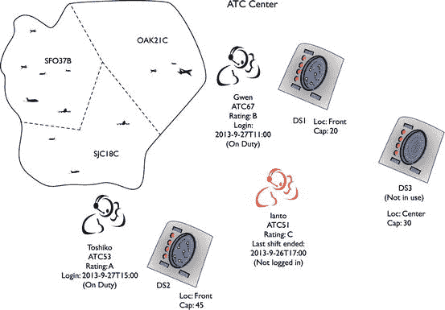
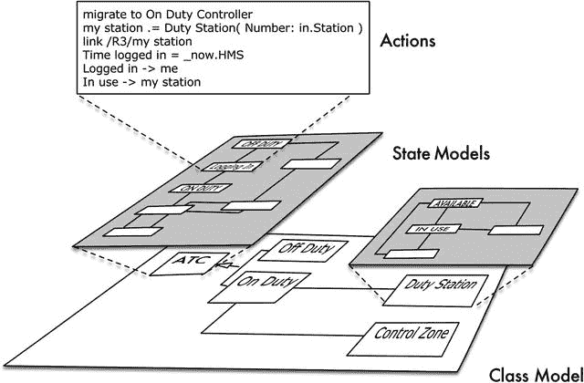

# 2. 一个简单的可执行模型

本章描述构成示例应用可执行模型的主要元素。该应用特意做得非常小，以便我们可以展示如何将整个模型翻译成可运行的代码，且不留任何神秘空白。之后我们将运用同样的原理来构建更大、更复杂的应用。

本章也旨在解释我们对 UML 图形符号的理解。我们使用 UML 图形符号来表示模型，但`xUML`在应用于该符号的语义上有很大差异。我们想确保你理解我们赋予这些图形符号的含义。

在阅读本章时，参考附录 A 可能会有所帮助，该附录总结了关键的`xUML`符号和语义。

## 空中交通管制员应用

空中交通管制应用负责管理管制中心内的空中交通管制员（ATC）。该系统确保所有本地空中交通得到指挥，同时管制员能够进行适当休息。图 2-1 展示了他们的工作环境。

图 2-1. 空中交通管制中心

该应用必须实现以下功能：

- 将空中交通管制员（ATC）登录到值班站
- 记录值班站所管辖的区域
- 验证某个管制区域始终处于值班站的管辖之下
- 记录管制区域交接给另一个值班站
- 将管制员（ATC）登出值班站
- 防止管制员连续工作超过 2 小时 15 分钟

显然，仅凭这些描述来构建应用是不完整且不充分的，但这只是一个开始。有些人会建议进一步调研，并在需求文档中确定所有细节；而另一些更偏向敏捷方法的人则推荐通过编写可执行代码来探索应用，即使当前并未完全理解需求。我们取两者之长，构建一个详细的可执行模型，用于更深入地对应用进行调研。我们可以利用该模型进行评估、运行和测试。当对结果满意后，再将其直接转换为代码。

我们将模型构建为三个相互关联的方面，如图 2-2 所示。

图 2-2. 建模语言的三个层面

第一个层面是`类模型`，它声明了系统中的概念实体。我们使用 UML 类图表示法的有限子集来表示该模型。`类模型`定义了类、类的属性以及类之间的关联。

第二个层面由`状态模型`组成，它描述了某个类随时间变化的行为。同样，我们使用 UML 状态机图表示法的子集来表示该模型。每个类都有一个`状态模型`。每个类实例都拥有该`状态模型`的一个副本，即一个状态机。每个状态机（因此每个实例）对其当前状态都有独立的定义。模型中的大部分动态行为都发生在状态机的上下文中。

第三个层面是`动作`。`动作`提供了计算和其他算法处理的细节。根据`动作`的表示方式不同，它们可能看起来像代码。但实际上，`动作`是对模型层面元素进行的模型层面计算的规格说明，这才是更好的理解方式。

这三个层面各自代表了系统的一个视角。它们组合成一个连贯的整体，代表了你的应用所提出的逻辑问题的解决方案。这些集成的层面定义了一个完整、可执行的领域，该领域可以转换为代码。领域是一个连贯的主题事务，拥有其自身的一套策略和规则。通常，应用由多个领域组成，这些领域相互交互以满足整套应用需求。关于领域，还有许多内容需要阐述，我们将在第 6 章中详细讨论。目前，只需了解建模后的领域是所有三个层面可独立执行和可测试的组合体即可。

模型构建的顺序至关重要：

- 首先构建`类模型`，用于捕获定义、数据、规则和约束
- 然后构建`状态模型`，用于捕获模式、控制间隔和同步
- 最后构建`动作`，用于捕获信号、数据处理和计算

每一步都为下一步奠定基础并设定约束框架。例如，轮班在某个特定时间结束这一事实（包含在`类模型`中），比确定该时间的具体方式（包含在`状态模型`和`动作`中）更为根本。因此，我们首先确定最不易发生变化的元素，稍后再定义和添加变化性更强的元素。这种方法建立了一个稳定的底层结构用于构建，并减少了每当发生变更时所需的整体重构工作。

重要的是要认识到，可执行性依赖于这三个层面。你必须知道如何进行计算（`动作`）、何时进行计算（`状态模型`），以及用于计算的确切数据（`类模型`）。

### 步骤 1：类模型

图 2-3 展示了航空交通管制系统的类模型。该模型已被注释，以便我们指明对图形符号的解释。