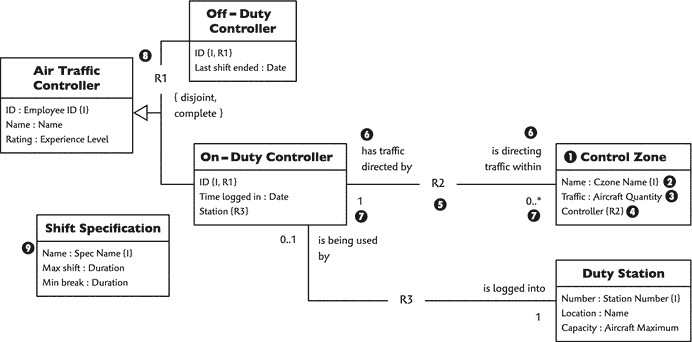
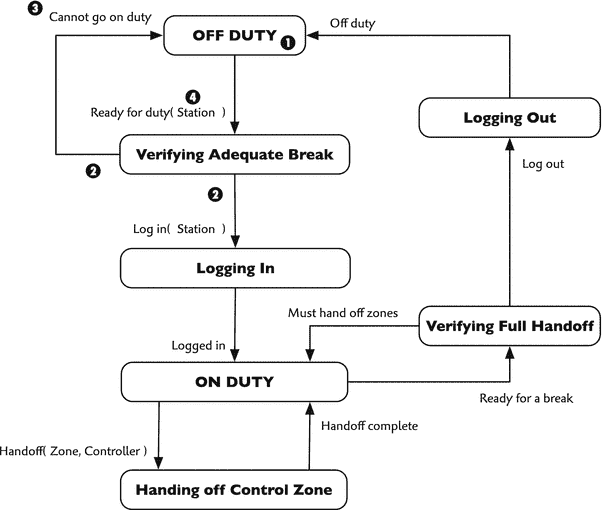
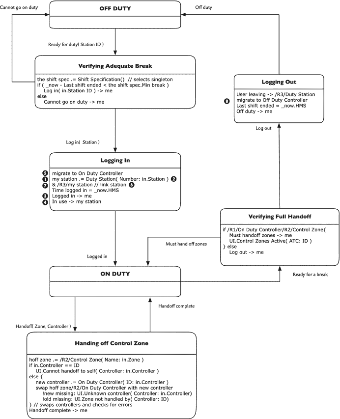
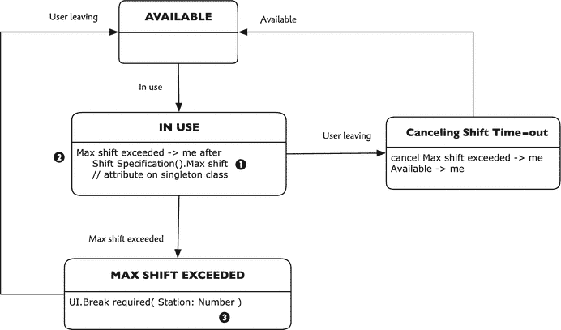
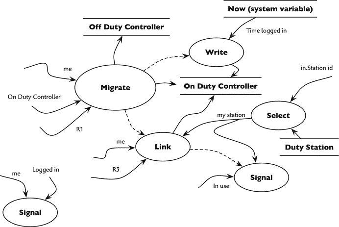

# 排版后的内容

- ❶ 每个方框代表一个类。类是对一组具有共同行为、共同特征且遵循相同规则和策略的物理或假设事物（例如本例中的控制区）的抽象。类的每个实例被称为对象或实例。我们将互换使用这两个术语。第二个分区包含一个属性列表，这些属性定义了每个实例所需的数据。每个控制区都由名称、流量大小和当前控制器来描述。
- ❷ 标识属性由标记 `{I}` 指示。类的标识属性集构成了它的标识符，它约束实例，使得没有两个实例的标识属性值相同。这也将类的实例约束为一个集合。在这种情况下，任何两个控制区都不能拥有相同的名称。标识符通常是很有用的应用程序数据（例如控制区的名称），但有时它完全是人为生成的。在模型被转换时，标识符可能会被转换或替换为更适合实现的内容。只要满足标识约束，转换就可以以任何方式自由地变换标识符。
- ❸ 描述属性具有数据类型，显示在名称和冒号之后。我们以应用术语捕获类型（例如，0 到 200 之间的整数架飞机数量）。在我们定义了作用于该属性的所有操作之后，我们可以决定如何在程序中表示该类型。
- ❹ 引用属性由标记 `{R}` 指示。这告诉我们该属性引用了另一个实例——在本例中，是指挥该控制区的控制器。所谓引用，是指实例中该属性的值等于另一个实例中某个属性的值。`控制区.控制器` 属性告诉我们哪个控制器正在监控控制区的特定实例。然而，领域规则坚持要求控制器必须处于值班状态。因此，`控制区.控制器` 引用属性的值被约束为必须与某个实例的 `值班控制器.ID` 的值相匹配。在实现时，这可以通过多种方式实现，例如数据库中的外键约束，或者仅仅是对指针值的检查。
- ❺ 两个方框之间的这条线，标记为 R2，是一种关联关系。它代表了现实世界中值班控制器与控制区实体之间存在的关联。每个关联都有一个唯一的编号——在本例中是 2。按照惯例，我们在图形上将其标记为 R，后跟其编号；例如，R2。需要唯一编号是因为同一对类之间可能存在多个关联（例如，一个人既可以驾驶一辆车，也可以拥有其他车辆）。
- ❻ 这些是关联短语。这些动词短语是文本注释，告诉我们关于该关系的重要语义信息，并为如何描述现实世界中的关联提供助记。我们可以说，值班控制器正在控制区内指挥交通。同样，该关系还有一个被动语态版本，说明控制区拥有由值班控制器指挥的交通。这些短语的构造使其可以双向解读，构成一个“主语—动词短语—宾语”的句子，而给定方向的动词短语被放置在图中更靠近充当宾语角色的类的一侧。
- 您可能更熟悉使用角色名称的 UML 风格。我们从大量实践中发现，动词短语风格几乎总是更精确且更具表现力。此外，直接说“正在...内指挥交通”比费心为控制区构思一个角色要容易得多。我们还发现，通过考虑动词短语来建立正确的多重性和条件性要容易得多。事实上，仔细地用精确的动词短语命名关联两侧的做法，经常能揭示出源需求中的矛盾、歧义和不完整之处。
- ❼ 我们总是通过为关联的每一方定义其多重性和条件性来进一步约束关联。多重性指定了是否可以有多个实例参与该关联。条件性指定了某个实例是否必须参与该关联。这两个概念被组合成一个图形符号，例如，在控制区一侧的 R2 的“0..*”表示，一个值班控制器正在指挥零个或多个控制区内的交通。关联的多重性和条件性的目的是约束一个类的实例集合的成员资格。
- ❽ 这表示一种泛化关系。箭头指向超类，超类是其所有子类的泛化。在本例中，空中交通管制员可以是下班管制员或值班管制员，但不能同时是两者。一个具体的管制员（例如 Ianto），他将同时是空中交通管制员和值班管制员。因此，他由以下属性描述：ID、姓名、评级、登录时间和当前控制的执勤岗位。我们对泛化的 xUML 解释比传统 UML 的限制严格得多。我们将泛化视为一个集合划分，并且超类实例是所有子类实例的无交并集。UML 将其标记为 `{disjoint, complete}`。由于我们只有这一种具体的解释，因此我们在此省略了注释。此外，我们并不在泛化上暗示任何继承的概念。我们将超类和子类实例分开处理。我们将泛化关系解释为：在子类实例与超类实例之间存在一条无条件的、单一的关联，并且在超类实例与来自泛化的所有子类中的一个子类实例之间也存在一条无条件的、单一的关联。
- ❾ 这种情况不常见，但一个类不通过任何关联与其他类连接是完全合法的。在这种情况下，班次规范只有一个实例，它定义了几个适用于所有空中交通管制员的时长。因为只有一个实例，无需进行任何关系遍历即可轻松选择它。（如果不同的空中交通管制员组受不同的休息时段约束，这种情况就会改变。）

**图 2-3. 带注释的类图**

关于类模型还有很多可以讨论的内容，并且已有整本专著论述它们，例如 Stephen Mellor 和 Marc Balcer 合著的 *Executable UML: A Foundation for Model-Driven Architecture*（Addison-Wesley Professional，2002 年）以及 Chris Raistrick 等人合著的 *Model Driven Architecture with Executable UML*（Cambridge University Press，2004 年）。此外，关于如何构建类模型也有很多可以讨论的内容，同样有整本书专门论述这一主题。例如，Leon Starr 所著的 *Executable UML: How to Build Class Models*（Prentice Hall，2001 年）。我们建议您阅读这些书籍，因为在转换之前必须构建一个完整的模型，而转换一个糟糕的模型只会产生同样糟糕的实现。

#### 解释

类模型通过少量、定义明确的元素就能揭示应用程序的诸多信息。它提供了一套精确且无歧义的词汇，用以解释和探讨问题。当我们谈及一个`控制区`时，指的就是模型上声明的那个确切的`控制区`，由其属性所定义，而非其他。正是这种“蛋头先生”式的严谨措辞，才保证了针对问题逻辑进行有意义讨论所需的精确性。

例如，一名`值班管制员`需要一个`ID`、一个登录时间以及一个要工作的`执勤岗位`；而一名`下班管制员`则必须有`ID`和上一班次结束的日期。对`值班`和`下班管制员`的声明使我们能够区分二者，防止`下班管制员`登录，并确保`下班管制员`获得休息。当然，这是显而易见的。但如果我们仅仅定义了一个不带子类的`空管员`，这一点就并不明显了。这样的模型可能会允许`下班管制员`在`控制区`内指挥交通，即便在现实世界中这是被禁止的。

属性的放置限制了我们对类含义的理解，因为每个属性都必须统一应用于该类的所有实例。例如，属性`执勤岗位.容量`对每个`执勤岗位`所能容纳的最大飞机数量进行了限制；而属性`控制区.容量`则会对`控制区`所能控制的飞机最大数量进行限制，从而限制了每个`控制区`内飞机数量的总和，而非所有飞机数量。当然，这是一个细节。但代码是细致的，并且针对这两种解释的代码是完全不同的。

我们还需要确保理解每个属性的精确含义。例如，`控制区.流量`究竟是什么意思？是指当前区域内的飞机数量？最大值？还是其他完全不同含义？我们必须在生成代码之前确定这些含义，否则生成的代码将会有误。为了捕获这些信息，我们还必须为每个类、每个属性和每个关联编写描述。

关联施加了在系统运行期间持续有效的约束。例如，`R2`关系中`控制区`侧的多重性“0..*”告诉我们，`值班管制员`是先登录，然后接管`控制区`，而不是在接管第一个`控制区`后被隐式登录。这也意味着管制员在退出登录前必须移交其`控制区`。多重性约束了关联事物的可能行为，从而更精确地限定了它们的含义。

这些陈述——类的定义、属性的放置以及多重性施加的约束——都必须与现实世界进行验证。如果一名管制员只有在控制至少一个`控制区`时才被视为在岗，那么模型就是错误的，应该予以修改。是这样吗？我们必须查明。我们必须系统地质疑并评估模型中每个元素所蕴含的意义。例如，属性`下班管制员.上一班次结束`强制执行了充分的休息时间。什么休息时间？这在前面的需求列表中并未提及！（它本应包含：要求至少 15 分钟的最短休息时间。）诸如此类。

这些规则适用于系统运行期间，而非初始化期间。系统刚建立时，可能没有`执勤岗位`、管制员或区域，但将某些类视为已有预先存在的实例是有用的。管制员来来去去，但`执勤岗位`可以被视为在系统运行之前就已存在。表 2-1 显示了系统启动时已存在的`执勤岗位`实例。

**表 2-1. 执勤岗位实例**

| 编号 | 位置   | 容量 |
|------|--------|------|
| DS1  | 前端   | 20   |
| DS3  | 中心   | 30   |
| DS2  | 前端   | 20   |

类似地，表 2-2 显示了`控制区`的预先存在实例。

**表 2-2. 控制区实例**

| 名称    | 流量 | 管制员 |
|---------|------|--------|
| SJC18C  | 30   | ATC53  |
| SFO37B  | 25   | ATC53  |
| OAK21C  | 15   | ATC67  |

这里，我们将`执勤岗位`的初始实例总体表示为一个表，尽管像往常一样，其实现可能完全不同。例如，`控制区`表中对`管制员`的引用可能是通过编程语言构造来实现的，而非表所暗示的值比较。

### 步骤 2：状态模型

类模型表达了行为约束，但并未定义随时间变化的具体行为。某个类的每个实例都遵循相同的规则和约束，并随时间以相同的方式运作。一个`空中交通管制员`对象最初将处于非值班状态，在某个时刻登录，值班一段时间，最终再次注销并回到非值班状态。所有空中交通管制员（ATC）共有的这个生命周期通过状态模型来捕获。

状态模型是定义在某个类上的，该类的所有实例都表现出相同的行为。在任何给定时刻，每个实例都将处于其自身的状态，而其他实例可能处于不同的状态。这就是我们区分了状态模型和状态机的原因。状态模型是与某个类相关联的状态和事件的模式，描述了该类所有实例的行为。状态机则描述了由该实例的当前状态值所支配的单个实例的行为。

虽然我们通常为每个类构建状态模型，但对于没有值得关注的行为的类，我们可以省略其状态模型。那些仅仅存在而不会随时间表现不同行为的类不需要状态模型。在泛化关系中，我们可以选择将状态模型关联到超类还是子类。关于其使用的完整规则和启发式方法集可参见《可执行 UML：模型驱动架构的基础》一书。

图 2-4 展示了空中交通管制员（ATC）的状态模型。该图也已被注释，以便我们定义对图形符号的解释。

-  ❶ 圆角矩形框代表状态。对于熟悉电气工程和数学教材中状态模型的读者来说，在这些语境中，单个状态通常用圆圈表示。圆角矩形记法更为方便，因为我们喜欢在框内书写文字。某些状态名称使用全大写字母的惯例表示：一个实例将保持在该状态，直到从其自身以外的类实例或已请求在将来某个时间到达的类实例那里传递来一个事件。相比之下，处于混合大小写名称状态的实例，一旦活动完成，就会在转换时退出。这仅仅是我们发现有用的一种记法惯例，并非状态模型执行规则的一部分。
-  ❷ 有向箭头代表转换。处于`验证休息是否充足`状态的空中交通管制员（ATC）可能转换到`非值班`或`正在登录`状态。
-  ❸ 每个转换都是由一个事件引起的。如果休息时间充足，空中交通管制员（ATC）将登录到一个工作站；但如果不充足，该事件会触发其转换回`非值班`状态。严格来说，可以对事件规约（它定义了事件名称和参数签名）与运行时定向到特定实例（并为任何参数填入值）的相应事件的发生进行区分。然而在实践中，除非上下文含义不清，否则为了方便，无论哪种情况都只说事件即可。在 UML 中，信号是你发送的东西，而事件是你检测到的东西，并且定义了多种 UML 类型的事件。但在 xUML 中，我们只需要由信号触发的事件类型。因此，在 xUML 中，信号和事件没有区别，我们可互换地使用这两个术语。
-  ❹ 每个事件可能携带事件参数。这是随事件一起传递的数据，可由与该状态关联的动作使用。当空中交通管制员（ATC）登录时，他们会登录到一个特定的值班工作站。这被表示为事件参数`Station`。

**图 2-4.** 空中交通管制员生命周期

#### 解释

状态机的行为如下：

-   每个状态机在任一时刻都恰好处于一个状态。
-   当一个事件发生时，会触发一个转换，状态机移动到新状态。新状态可能与先前状态相同，但即使它回到原处，也被认为发生了转换。
-   当进入一个状态时，状态机会执行一个活动，该活动包含一定数量的动作（在下一节中描述）。
-   这需要多长时间是不确定的，但状态机在完成活动并到达下一个状态之前，不会响应任何其他事件。
-   当状态机完成一个状态的活动后，它可以响应后续的事件。

最后两点概括了一个称为“运行至完成”的概念：在开始做其他任何事情之前，先完成手头的工作。从分析的角度来看，你无需担心某个活动可能会被中断。例如，状态活动可以操作类模型中的数据，而无需担心活动处理过程中的瞬时不一致。例如，一个活动可以更新经度和纬度，而无需担心数据在更新过程中被错误地读取。运行至完成确保了处理的一致性，并简化了构建模型的任务。

除了数据一致性，这个原则对于整体同步也至关重要。要理解运行至完成的重要性，可以设想一下如果事实并非如此可能会发生什么。假设一个假想场景：一个状态活动生成了一个信号，并且相应事件的分发作为信号发送操作的一部分发生。事件分发可能会导致另一个状态活动执行，而该活动又可能发回信号给原始发送者。同样，如果该事件分发与信号生成同步执行，那么在生成第一个信号的原始活动完成之前，我们就会在该实例中执行一个新的状态活动。这种情况可能导致底层属性值出现差异，具体取决于这些属性是在信号发送之前还是之后被访问。

事件既不会被保存也不会丢失；它们只是在状态机进入下一个状态并完成其活动之前不可用。我们也不指定事件被发出或传递的机制。只需要假设存在一种通用的、底层的手段来执行状态机事件分发规则即可。这些规则的实现可以通过多种方式完成，例如将事件排队直到状态机能够响应。稍后，我们将精确展示在我们的目标执行环境中这是如何发生的。关于状态、事件和活动同步规则的总结可在附录 A 中找到。

存在两种基本的状态模型表述形式：一种是将动作与进入状态相关联（摩尔型模型）；另一种是将动作与转换相关联（米利型模型）。关于哪种表述形式更好，已经耗费了大量的笔墨、口水和电子资源。实际上，米利型状态模型很容易转换为摩尔型表述，反之亦然，所以用一种风格能建模的任何内容，另一种风格也都能处理。

在 xUML 中，我们使用摩尔型表述，这意味着当状态机进入一个状态时，会执行一个活动。在 UML 中，这些被称为进入活动，并且这是我们需要的唯一类型的 UML 活动。同样，由于我们对活动只有一种解释，我们省略了 UML 的 `entry /` 保留字。xUML 使用摩尔型表述，因为它能产生更规则的状态表，这对于转换和验证事件-状态覆盖率都至关重要。摩尔型状态模型将活动与状态关联，这对于模型规约和转换都很方便。

一系列状态机的动态行为如下：

*   每个状态机都被视为与其他所有状态机**并发执行**。（`Toshiko` 可能正在交班，将她所有的`控制区域`移交给`Gwen`，而`Ianto`同时正在登录`值班站 S3`。）
*   一个状态机可以同步访问来自其他对象的数据。（`Gwen` 可以查看`Ianto`的上次休息时间，无论`Ianto`实际在做什么。）
*   一个状态机可以向另一个状态机发送信号，以促使其改变状态。
*   一个状态机可以响应来自其他状态机、外部世界或过去某个时间点请求的信号所发送的事件。

在这种公式化表述中，每个对象都并发执行，除非它被显式地与其他对象进行排序或同步。这要求建模者在承诺使用线程、任务、处理器等之前，尽早考虑同步问题。这也使得实现可以更加并发，因为模型没有强加不必要或任意的排序。

### 第三步：动作

在某个时刻，必须落到实处；我们必须实际计算一些东西。每个活动都包含一定数量的动作，这些动作必须在活动完成之前执行完毕。

动作使用动作语言来表达。存在许多可能的动作语言；它们具有（几乎）相同的基本构建模块。例如，它们都必须提供一种方法来遍历关联、选择和访问实例数据、在对象之间进行通信、调用外部服务和库，以及对选定的模型数据执行计算。

我们的动作语言旨在易于编写，语言元素最少，同时保持可读性，而这正是建模的首要关键目的。附录 B 中提供了摘要。我们将在本章后面讨论这种语言的优缺点。现在，让我们看看它如何在我们空中交通管制（ATC）示例中使用。图 2-5 再次显示了状态模型，这次填充了动作。同样，我们加入了注解来解释我们的解读。

*   ❶ `.=` 是一个赋值操作。在此示例中，`my station` 是一个实例引用变量，仅在它被初始化的活动内有效。`.=` 运算符中的单个点 `.` 将选择限制为最多一个实例。
*   ❷ `<class>(<attribute>:<value> ...)` 语法使用括号内的条件来查找匹配的对象。由于此示例中使用了标识属性，因此最多会找到一个对象。因此，`Duty Station( ID:in.Station )` 返回一个指向与传入的站点编号匹配的 `Duty Station` 对象的引用。
*   ❸ `->` 符号表示立即向一组实例（通常是一个实例）发送一个事件信号。在这种情况下，`Air Traffic Controller` 对象向自身发送 `Logged in` 信号，以便它不会永久停留在 `Logging In` 状态。`me` 关键字用作对局部对象的引用（`self`）。请注意，尽管信号是立即发送的，但在与 `Logging In` 状态关联的整个活动完成之前，该事件不会被处理。
*   ❹ 在这种情况下，信号的目标是相关的 `Duty Station` 对象。
*   ❺ 迁移动作会更改对象的子类。形式上，这涉及从子类实例中解散泛化关系，创建新的子类，并重建与超类的关系。在实践中，实现会找到存储子类的方法，以便有效地满足形式要求（例如，使用联合来存储子类意味着我们可以重用现有的内存空间，而不是创建新的子类对象）。
*   ❻ 要引用随事件到达的数据，请在其前面加上 `in` 关键字。在此示例中，`in.Station` 指代随事件传入的站点编号。
*   ❼ `&` 和 `!&` 链接/取消链接运算符用于创建和删除关联的实例。在此示例中，`& /R3/my station` 将自身与 `my station` 中引用的站点通过 R3 关联起来。`/` 是跳转运算符，指定跨关系跳转。当它前面没有任何显式实例时，导航假定从本地实例开始。请注意，链接/取消链接对于建模者来说是一个概念性操作。在 xUML 中没有这样的“链接”。实际情况是，链接运算符将本地实例的 `Station` 属性设置为 `my station.ID` 的值。我们也可以轻松地写成 `Station = Duty Station(Number:in.Station).Number`，但这样的表述有忽视关联被实例化这一概念的风险。
*   ❽ 无需显式取消链接 `Duty Station`，因为一个 `Off Duty Controller` 没有 `Station` 引用属性，并且 `On Duty Controller` 实例已被删除。

图 2-5.

空中交通管制员动作

#### 时间及其他细节

图 2-6 显示了`值班站`状态模型，并说明了如何管理时间。

图 2-6.

`值班站`生命周期

这里有几个需要说明的动作：

*   ❶ 在此示例中，`Shift Specification` 单例类持有一个带有延迟值的单个实例。将单例实例首先分配给实例变量的额外步骤被简化为单个语句。
*   ❷ 默认情况下，信号会立即发送，但也可以指定延迟。延迟信号充当超时，因此如果`值班站`在最大值班时长内注销，该信号将被取消。
*   ❸ `UI` 指的不是一个类，而是一个外部实体。外部实体是域边界之外某个事物的代理。在此示例中，ATC 域假设存在一个可以发布警告消息的用户界面（`UI`）。

## 讨论

有许多指定算法计算的好方法。图 2-7 展示了“登录”活动的数据流表示。

图 2-7. 数据流对一项活动进行建模

图中的每个椭圆代表一个动作。当一个动作的所有输入都可用时，该动作便可以执行。来自无源箭头和类数据存储（平行线）的数据在进入状态时可用。虚线箭头不提供数据，但会传递一个控制令牌，以表示源动作完成。`Migrate`、`Logged In Signal` 和 `Select` 动作可以在进入状态后立即执行。`Write` 和 `Link` 动作必须等待 `Migrate` 完成。最后，`In Use Signal` 动作可以执行。

数据流表示法仅在问题空间必需时才指定顺序。因此，它凸显了在实现中进行并发处理的机会。不足之处在于，数据流图可能难以绘制和编辑，并且当你试图理解其顺序时，可能会让你感到头疼。

基于文本的动作语言在阅读、编写和编辑方面要容易得多，也更为熟悉。你可以依靠你最喜欢的文本编辑器的熟悉度和强大功能来完成任务。一些文本动作语言并不试图消除任意的顺序。另一些则通过使用文本符号而非图形符号来模拟数据流的并发性。在本书中，我们使用 `Scrall` 作为一种伪动作语言，因为它像文本一样易于编辑，并且可以映射到数据流表示，以便进行下游翻译。其主要元素在附录 B 中进行了总结。

一个状态活动中固有的并发性有多少能够以并行执行的方式实现，取决于翻译机制和目标平台。我们针对的平台只有一个单处理器核心，因此无法实现真正的并行执行。能力更强的目标平台允许翻译机制安排模型中的并发性如何以并行执行的方式实现。

为什么不直接用 `C` 语言编写动作呢？这类建模的全部意义在于，以独立于实现的方式捕捉问题的逻辑。我们希望用非 `C` 概念来指定动作，例如对象状态机通信、通过复合关系进行数据访问以及实例集操作。通过将所有模型方面（类、状态和动作）保持在相同的抽象级别上，我们获得了一套一致且统一的规则，并在翻译过程中增加了选择更广泛高效实现的机会。这也使得建模更加容易，因为我们可以专注于处理逻辑，而无需考虑编程语言语法和语义的所有细节。

### 执行模型

现在，我们示例应用程序的所有三个方面都已建模，我们可以将它们作为一个整体来执行，以验证其行为是否正确。这可以在编写或生成任何代码之前（并且应该）完成。执行规则的完整描述可以在本章前面提到的可执行 UML 书籍中找到。这些规则也在附录 A 中进行了总结。在这里，我们只想通过一个简单的场景演练，让你对模型如何执行有所了解。

对于这个场景，我们将尝试通过登录到一个可用的`值班站`来激活一个`待机管制员`。假设 `ATC53` 处于`待机`状态，并且要选择的`值班站` `DS3` 正在`可用`状态中等待。一个 `Ready for Duty( DS3 )` 事件将被发送给 `ATC53` 以启动整个过程。`DS3` 值作为期望的`值班站`编号被传入。`值班站`的选择发生在我们的系统之外，我们的模型只是被告知 `ATC53` 正在尝试使用 `DS3`。然而，我们的模型必须确保在允许此事发生之前满足某些条件。

收到该事件后，`ATC53` 进行转换，进入`验证休息是否充足`状态，并在进入该状态时执行活动。`验证休息是否充足`活动会检查是否已休息了足够长的时间。假设已经休息充足，`ATC53` 会向自身发送一个 `Log in( DS3 )` 事件信号。完成该活动后，`ATC53` 接着接收同一个 `Log in` 事件，将其匹配到一个迁出转换，并进入`登录中`状态。

`ATC53` 执行`登录中`活动，该活动导致其从下班状态迁移到上班状态（删除下班子类实例，并创建一个引用同一超类实例的上班子类实例），将新的 `ATC53` 上班子类实例链接到 `DS3`，并记录当前时间以及发送信号——这次是两个事件：`ATC53` 向自身发送一个 `Logged in` 事件信号，并向 `DS3` 发送一个 `In use` 事件。信号的发送没有特定顺序，这一点只有从 DFD 中才能明显看出。

现在我们有待处理两个事件，每个事件都将被消费，同样没有要求的顺序。当 `Logged in` 事件被 `ATC53` 处理时，它会转换到`值班中`状态。当 `DS3` 消费 `In Use` 事件时，它会转换到`使用中`状态，并向自身发送一个延迟的 `Max shift exceeded` 事件，延迟时间由单例`班次规格`实例中指示的`最长班次`时长决定。本质上，设置了一个超时，以便如果值班的空中交通管制员没有休息，该延迟事件就会被触发，并在`超时班次`状态中触发警告。

至此，场景完成。`ATC53` 已成功登录到值班站 `DS3`。请注意，状态模型和动作为非特定实例指定了行为，这些行为在运行时由各个实例消费事件并从一种状态遍历到另一种状态来解释。

我们的场景巧妙地回避了这样一种可能性：一个实例在给定状态下消费一个事件，而该状态没有指定任何转换。这种情况通过构建状态表来解决，每个状态模型都需要一个状态表。状态表显示了如果出现意外事件，或者如果预期事件在实例准备好或未准备好时到达，实例将如何反应。第 3 章将详细讨论状态表。

### 标准动作语言

我们在第 1 章中区分了细化方法和翻译方法。在 UML 出现时，细化方法占主导地位——没有人认为需要动作语言。但少数人坚持了下来，几年后，UML 终于有了一种动作语言，即基础 UML 的动作语言，或称 `Alf`。其规范可以在对象管理组织网站（[`www.omg.org`](http://www.omg.org)）上找到。

该规范长达 439 页——比本书还要长。我们无意教你该语言的细节，或任何其他语言的细节。相反，我们希望利用动作语言的概念来展示翻译是如何工作的。因此，我们使用了一种自创的非正式语言，希望你能以最小的努力直观地理解它。我们在附录 B 中描述了这种语言。

使用非正式语言来执行充其量只能说是非常奇特。但另一种选择是教你另一种语言，而这并非本书的目的。此外，我们希望揭示从模型到代码所需的步骤。因此，我们在后续章节中正式化了这些动作。看起来我们好像写了两次代码。其实并非如此。我们只是在绕过形式化语言的细节。

## 摘要

我们以一个模糊且不完整的需求集为起点，引入了一个简单的应用程序，并将其转化为一组具体且可执行的模型。这些模型可通过一套精简的执行规则来运行，而这些规则使得我们能够像单步执行运行代码一样，逐步推演和测试应用程序场景。执行规则和语义被组织为三个层面：一个单一的类模型、每个类的状态模型，以及每个状态中分别对应已建模数据、已建模控制和已建模计算的、有意义的行为与动作。模型按此顺序构建，以最大限度地减少重构。

我们尚未在模型中包含任何实现概念。我们通过发送信号来协调状态机，但并未说明这些信号是如何发送的；我们提到了类实例之间存在关联，但同样未说明这些关联是如何实现的。正如我们在第 1 章所述，排除并非意味着删除该细节，也不是对其进行弃用。实现至关重要，这正是本书的主题。

从此以后，我们的焦点将转向转换。我们将把这些模型元素，以及由建模语言定义的执行行为，映射到一个特定平台的 C 代码包中，该代码包将在目标平台支持的计算设备上运行。当我们专注于代码生成时，我们不会质疑应用程序需求，也不会试图扩展或修改应用范围。相反，我们假设建模者清楚自己在做什么，将模型原样编码，使其在可测试的环境中运行，然后转向下一个应用程序。如果模型没有覆盖需求，那么代码同样不会覆盖需求！

脚注 1

“我用一个词的时候”，矮胖子用颇为轻蔑的口吻说，“这个词的意思就是我选择它表达的意思——不多不少。” “问题在于，”爱丽丝说，“你能不能使词表达这么多不同的意思。” “问题在于，”矮胖子说，“谁是主人——就是这样。” ——刘易斯·卡罗尔

